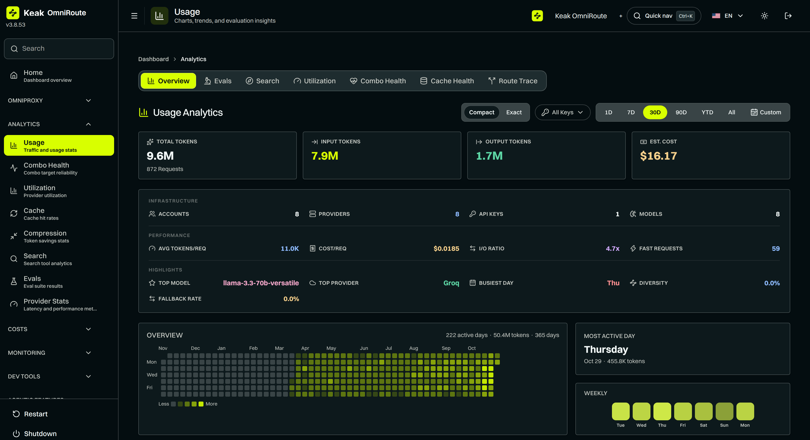
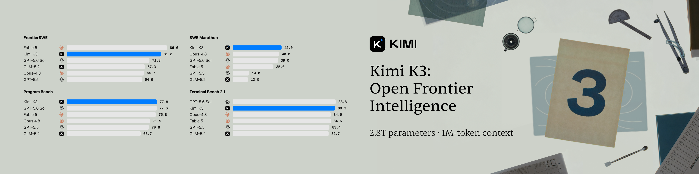
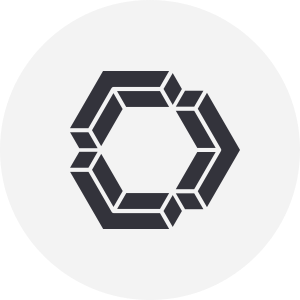

<a id="-omniroute"></a>
<a id="-omniroute--the-free-ai-gateway"></a>
<a id="top"></a>

<div align="center">



# OmniRoute — The Free AI Gateway

**Created by [Diego Souza](https://github.com/diegosouzapw)**


</div>

One endpoint for your AI tools. Connect your provider accounts, choose a model or routing policy, and manage requests from one local gateway.

**394 providers · 1,539 unique chat model IDs · 22 routing strategies · MIT**

Latest published release: [v3.8.53](https://github.com/cheaper-inference/OmniRoute/releases/tag/v3.8.53). Development snapshot: **v3.8.54**, checked 16 November 2026.

---

<a id="-available"></a>
<a id="available"></a>

## Available

[](https://github.com/cheaper-inference/OmniRoute)
[](https://www.npmjs.com/package/omniroute)
[](https://www.npmjs.com/package/omniroute)
[](https://hub.docker.com/r/diegosouzapw/omniroute)
[](https://hub.docker.com/r/diegosouzapw/omniroute)
[](https://github.com/cheaper-inference/OmniRoute/releases)
[](LICENSE)

| Browse the README | Sections                                                                                                                             |
| ----------------- | ------------------------------------------------------------------------------------------------------------------------------------ |
| **Start**         | [Quick start](#quick-start) · [Install methods](#install) · [Languages](#languages)                                                  |
| **Discover**      | [The promise](#promise) · [Why OmniRoute](#why) · [Comparison](#comparison) · [Growth & roadmap](#growth) · [What's new](#whats-new) |
| **Route**         | [Auto modes](#routing) · [22 strategies](#strategies) · [Recovery layers](#resilience)                                               |
| **Catalog**       | [Providers & free models](#providers) · [Radar](#radar) · [Compatible tools](#compatible-tools)                                      |
| **Run**           | [Platforms & downloads](#platforms) · [OmniCopilot](#omnicopilot) · [OmniRouteTray](#tray)                                           |
| **Operate**       | [CLI, MCP & A2A](#cli-protocols) · [Compression](#compression) · [Privacy](#privacy)                                                 |
| **Explore**       | [Videos & demos](#in-action) · [Tech stack](#tech-stack) · [Documentation](#documentation)                                           |
| **Support**       | [Donate](#support) · [Sponsors](#sponsors) · [Open Source Friends](#friends)                                                         |
| **Participate**   | [Contributors](#contributors) · [Community & help](#community) · [Acknowledgments](#acknowledgments)                                 |
| **Project**       | [Stars](#stars) · [StarMapper](#starmapper) · [License](#license)                                                                    |

---

<a id="languages"></a>

<details>
<summary>Choose from 67 languages</summary>

## Languages

English and 66 translated READMEs. Select your language.

<a href="README.md"></a> <a href="docs/i18n/pt-BR/README.md"></a> <a href="docs/i18n/pt/README.md"></a> <a href="docs/i18n/es/README.md"></a> <a href="docs/i18n/fr/README.md"></a> <a href="docs/i18n/it/README.md"></a> <a href="docs/i18n/de/README.md"></a> <a href="docs/i18n/nl/README.md"></a> <a href="docs/i18n/ru/README.md"></a> <a href="docs/i18n/uk-UA/README.md"></a> <a href="docs/i18n/pl/README.md"></a> <a href="docs/i18n/cs/README.md"></a> <a href="docs/i18n/sk/README.md"></a> <a href="docs/i18n/ro/README.md"></a> <a href="docs/i18n/hu/README.md"></a> <a href="docs/i18n/bg/README.md"></a> <a href="docs/i18n/da/README.md"></a> <a href="docs/i18n/fi/README.md"></a> <a href="docs/i18n/no/README.md"></a> <a href="docs/i18n/sv/README.md"></a> <a href="docs/i18n/zh-CN/README.md"></a> <a href="docs/i18n/zh-TW/README.md"></a> <a href="docs/i18n/ja/README.md"></a> <a href="docs/i18n/ko/README.md"></a> <a href="docs/i18n/th/README.md"></a> <a href="docs/i18n/vi/README.md"></a> <a href="docs/i18n/id/README.md"></a> <a href="docs/i18n/ms/README.md"></a> <a href="docs/i18n/phi/README.md"></a> <a href="docs/i18n/hi/README.md"></a> <a href="docs/i18n/gu/README.md"></a> <a href="docs/i18n/mr/README.md"></a> <a href="docs/i18n/ta/README.md"></a> <a href="docs/i18n/te/README.md"></a> <a href="docs/i18n/bn/README.md"></a> <a href="docs/i18n/ur/README.md"></a> <a href="docs/i18n/fa/README.md"></a> <a href="docs/i18n/ar/README.md"></a> <a href="docs/i18n/he/README.md"></a> <a href="docs/i18n/tr/README.md"></a> <a href="docs/i18n/az/README.md"></a> <a href="docs/i18n/sw/README.md"></a> <a href="docs/i18n/el/README.md"></a> <a href="docs/i18n/hr/README.md"></a> <a href="docs/i18n/sr/README.md"></a> <a href="docs/i18n/lt/README.md"></a> <a href="docs/i18n/et/README.md"></a> <a href="docs/i18n/lv/README.md"></a> <a href="docs/i18n/sl/README.md"></a> <a href="docs/i18n/mt/README.md"></a> <a href="docs/i18n/ga/README.md"></a> <a href="docs/i18n/kn/README.md"></a> <a href="docs/i18n/ml/README.md"></a> <a href="docs/i18n/or/README.md"></a> <a href="docs/i18n/pa/README.md"></a> <a href="docs/i18n/ne/README.md"></a> <a href="docs/i18n/si/README.md"></a> <a href="docs/i18n/my/README.md"></a> <a href="docs/i18n/km/README.md"></a> <a href="docs/i18n/ha/README.md"></a> <a href="docs/i18n/yo/README.md"></a> <a href="docs/i18n/ig/README.md"></a> <a href="docs/i18n/am/README.md"></a> <a href="docs/i18n/uz/README.md"></a> <a href="docs/i18n/ka/README.md"></a> <a href="docs/i18n/hy/README.md"></a> <a href="docs/i18n/bs/README.md"></a>

</details>

---

<a id="-quick-start"></a>
<a id="quick-start"></a>

## Quick start

<a id="first-run"></a>

**1. Install and start.** Use a supported Node.js version: 22.22.2–22.x or 24.x–26.x.

```bash
npm install -g omniroute
omniroute
```

**2. Connect a provider.** Open `http://localhost:20128`, add your provider account or API key under **Providers**, then copy an OmniRoute key from **Endpoints**.

**3. Connect your tool.**

```text
Base URL: http://localhost:20128/v1
API key:  your OmniRoute key
Model:    auto
```

**4. Send a request.**

```bash
curl http://localhost:20128/v1/chat/completions \
  -H "Authorization: Bearer YOUR_OMNIROUTE_KEY" \
  -H "Content-Type: application/json" \
  -d '{"model":"auto","messages":[{"role":"user","content":"Hello!"}]}'
```

`auto` needs at least one eligible connection. Provider access, quotas and model capabilities depend on your accounts.

[Install troubleshooting](docs/guides/TROUBLESHOOTING.md) · [Docker](docs/guides/DOCKER_GUIDE.md) · [Other install methods](#install)

<details>
<summary>From client to provider: illustrated setup</summary>


</details>

<details>
<summary>Install warnings and web-cookie providers</summary>

> See `npm warn ERESOLVE` or peer-dep warnings? [They're harmless](docs/guides/TROUBLESHOOTING.md#npm-install-warnings-eresolve--peer--deprecated).
> **Using npm 11 or later?** npm may block package lifecycle scripts unless they are allowed. OmniRoute's `postinstall` (`node scripts/build/postinstall.mjs`) is required to prepare its native runtime files. Allow the packages named in npm's warning when installing globally. For the package set reported by OmniRoute 3.8.54:
>
> ```bash
> npm install -g --allow-scripts=omniroute,keytar,onnxruntime-node,@parcel/watcher,@swc/core,protobufjs,esbuild omniroute
> ```
>
> To reuse this allowlist for future global installs, configure it once, then install normally:
>
> ```bash
> npm config set allow-scripts=omniroute,keytar,onnxruntime-node,@parcel/watcher,@swc/core,protobufjs,esbuild --location=user
> npm install -g omniroute
> ```
>
> The dependency list can change between releases; if npm reports a different list, use the package names from that warning. Allowing a package permits its install scripts to run.
> **Using Gemini Web or another web-cookie provider?** The npm package includes
> Playwright but not its Chromium binary. See the
> [Playwright Chromium setup](docs/guides/TROUBLESHOOTING.md#gemini-web-and-playwright-chromium)
> note before making the first web-provider request.

</details>

<details>
<summary>Clients without Authorization header support</summary>

If your client cannot send custom headers, OmniRoute also exposes tokenized compatibility aliases:

```txt
OpenAI catalog:   http://localhost:20128/vscode/YOUR_KEY/
OpenAI models:    http://localhost:20128/vscode/YOUR_KEY/models
OpenAI chat:      http://localhost:20128/vscode/YOUR_KEY/chat/completions
OpenAI responses: http://localhost:20128/vscode/YOUR_KEY/responses
Ollama chat:      http://localhost:20128/vscode/YOUR_KEY/api/chat
Ollama tags:      http://localhost:20128/vscode/YOUR_KEY/api/tags
```

Use these only for clients that cannot attach `Authorization: Bearer ...`. Header auth remains the preferred mode.

</details>

---

<a id="-the-gateway-keeps-growing"></a>
<a id="growth"></a>

## The Gateway Keeps Growing

The current development catalog contains **394 providers**, **1,539 unique chat model IDs** and free-offer metadata on **160 provider definitions**. These are source-catalog counts, not a promise that every model is available on every account.

| Version     | Status             | Focus on the road to v3.9.0 LTS                            |
| ----------- | ------------------ | ---------------------------------------------------------- |
| **v3.8.54** | **In development** | Release infrastructure and LTS preparation                 |
| v3.8.55     | Planned validation | Characterization tests, boundaries and end-to-end journeys |
| v3.8.56     | Planned validation | Extended canary, performance and memory baselines          |
| v3.8.57     | Planned validation | Security, compliance and publishing provenance             |
| v3.8.58     | Planned validation | LTS release rehearsal and rollback validation              |
| v3.8.59     | Planned validation | Final stabilization and an explicit LTS go/no-go decision  |

Some preparation is already implemented. A planned milestone is complete only when its release gates pass. Future provider and model totals will be measured when those versions are cut.

[Public roadmap](ROADMAP.md) · [Release strategy](docs/ops/RELEASE_STRATEGY.md) · [v3.8.50–v3.8.54 changes](#whats-new)

---

<a id="-whats-new"></a>
<a id="whats-new"></a>

## What's new — v3.8.50 to v3.8.54

**Latest published release: v3.8.53. Current development line: v3.8.54.**

| Version                      | Highlights                                                                                                                                                                                                                                                                                                                                             |
| ---------------------------- | ------------------------------------------------------------------------------------------------------------------------------------------------------------------------------------------------------------------------------------------------------------------------------------------------------------------------------------------------------ |
| **v3.8.54 — in development** | Preferred and reserve accounts for Auto combos, agentic context compaction, official Sign in with ChatGPT, optional two-factor login, reusable API-key policies and richer session/cost telemetry. New provider and media integrations, Jev System One, the Omni Queue workflow and Docker Hub organization mirroring are merged for the next release. |
| **v3.8.53 — released**       | A redesigned dashboard on the Keak UI Kit, team cost centers, per-key account preferences and model access controls. Microsoft Entra ID client authentication, WhyCodes integration, Bifrost/sing-box support and expanded quota and compression controls.                                                                                             |
| **v3.8.52 — released**       | Headless deployments, a routing-strategy registry, optional Nadir routing and per-model connection concurrency limits. An LLMLingua sidecar, optional claude-mem integration and further catalog, account and media improvements.                                                                                                                      |
| **v3.8.51 — released**       | Subscription-only and subscription-first routing, richer video-analysis workflows and unified orchestration history. Native ElevenLabs routes, Gemini batch speech, isolated compression workers and clearer live provider/quota information.                                                                                                          |
| **v3.8.50 — released**       | Vision/audio/video bridging, the optional signed Radar catalog and OmniConductor fleet integration with Faro voice interaction. Expanded routing, search, media, plugin and MCP capabilities, plus desktop attachment to an existing server.                                                                                                           |

The complete feature inventory is available by release in the changelog. Current development changes are listed separately until the v3.8.54 release is published.

[Full changelog](CHANGELOG.md)

[Published release notes: v3.8.50](https://github.com/cheaper-inference/OmniRoute/releases/tag/v3.8.50) · [v3.8.51](https://github.com/cheaper-inference/OmniRoute/releases/tag/v3.8.51) · [v3.8.52](https://github.com/cheaper-inference/OmniRoute/releases/tag/v3.8.52) · [v3.8.53](https://github.com/cheaper-inference/OmniRoute/releases/tag/v3.8.53) · [Development changes since v3.8.53](https://github.com/cheaper-inference/OmniRoute/compare/v3.8.53...release/v3.8.54)

---

<a id="-the-promise"></a>
<a id="promise"></a>

## The promise


<br/>
<br/>

---

<a id="-why-omniroute"></a>
<a id="why"></a>

## Why OmniRoute


The tier diagram illustrates a configurable combo. `auto/thrifty` follows its own subscription → keyless → free → cheap → premium ladder; see [subscription routing](docs/routing/SUBSCRIPTION_LADDER.md).

<br/>

---

<a id="-supported-by-our-open-source-friends"></a>
<a id="friends"></a>

## Open Source Friends

<p align="center">
  <a href="https://platform.kimi.ai?track_id=track-8197581fdd7d4139a0f562e4a03c3798&aff=omniroute">
    
  </a>
</p>

> **Want to join as an Open Source Friend?** These are the companies that back open source and help keep OmniRoute moving — and we say publicly where every token they give us goes. Reach out: [diegosouza.pw@outlook.com](mailto:diegosouza.pw@outlook.com)

<table>
  <tr>
    <td align="center" width="150">
      <a href="https://platform.kimi.ai?track_id=track-8197581fdd7d4139a0f562e4a03c3798&aff=omniroute">
        <picture>
          <source media="(prefers-color-scheme: dark)" srcset="public/providers/kimi-logomark-dark.svg">
          
        </picture>
      </a>
      <br/><b>Kimi</b><br/><sub>Moonshot AI</sub><br/><br/>
      
    </td>
    <td>
      Thanks to <b>Kimi (Moonshot AI)</b>, our founding Open Source Friend, for backing this project! Kimi is the AI lab behind the open-weight K2 and K3 model families — <b>Kimi K3</b> delivers a 1M-token context window, native vision and frontier-level coding at a fraction of closed-model prices, and works out of the box with Claude Code, Codex and every coding tool OmniRoute serves.
      <br/><br/>
      <b>What Kimi's support powers:</b> Kimi's API credits power OmniRoute's AI-validated release pipeline — the <i>merge validation powered by Kimi K3</i> stage that reviews every pull request before it ships — plus day-to-day feature development. First-class Kimi support ships on both rails: the direct <a href="https://platform.kimi.ai?track_id=track-8197581fdd7d4139a0f562e4a03c3798&aff=omniroute">Kimi API</a> (<code>kimi-k3</code>) and the <a href="https://www.kimi.ai/code?aff=omniroute">Kimi Code coding plan</a> (OAuth and API key). OmniRoute is also the first Brazilian open-source project in Kimi's support program. <a href="https://platform.kimi.ai?track_id=track-8197581fdd7d4139a0f562e4a03c3798&aff=omniroute"><b>Get a Kimi API key with 15% extra credits →</b></a>
    </td>
  </tr>
  <tr>
    <td align="center" width="150">
      <a href="https://cheaperinference.com/?utm_source=omniroute">
        
      </a>
      <br/><b>Cheaper Inference</b><br/><sub>cheaperinference.com</sub><br/><br/>
      
    </td>
    <td>
      Thanks to <b>Cheaper Inference</b>, an OmniRoute Open Source Friend, for backing this project! Cheaper Inference is a cost-ranked gateway that resells 42 frontier models — Claude, GPT-5.x, Gemini, Kimi K3, GLM, DeepSeek, Grok and MiniMax — behind one OpenAI-compatible endpoint, routing each request to the cheapest eligible provider without ever charging above the model maker's list price.
      <br/><br/>
      <b>First-class support in OmniRoute:</b> Chat Completions, the native <code>/v1/responses</code> endpoint, vision, tool calling and 3 image models (<code>grok-imagine</code>, <code>nano-banana-pro</code>, <code>nano-banana-2</code>, reachable as <code>cheaperinference/&lt;model&gt;</code>). <a href="https://cheaperinference.com/?utm_source=omniroute"><b>Get an API key →</b></a>
    </td>
  </tr>
</table>

<sub>Links tagged <code>aff=omniroute</code> are partner links. They fund the project at no extra cost to you.</sub>

<br/>

<details>
<summary><sub><b>🎟️ Affiliates Promo</b> — free signup coupons from providers we don't sponsor (click to expand)</sub></summary>

<sub><i>This section is for referral/coupon codes only. Sponsored partnerships live in <b>🤝 Supported by our Open Source Friends</b> above. OmniRoute has no sponsorship or partnership with the providers listed here — these are public coupons anyone can use.</i></sub>

<table>
  <tr>
    <td align="center" width="120">
      <a href="https://agentrouter.org/register?aff=70LM">
        
      </a>
      <br/><sub><b>AgentRouter</b></sub><br/><sub>agentrouter.org</sub>
    </td>
    <td>
      <sub><b><a href="https://agentrouter.org/register?aff=70LM">AgentRouter</a></b> — affiliate signup · <b>$100 free credits</b> on signup (free server, expect higher latency — best for testing, not production). First-class support in OmniRoute since <b>v3.8.50</b>: Chat Completions, the Anthropic-compatible wire format and the OpenAI-compatible path. Available models include <code>claude-opus-4-8</code>, <code>claude-opus-5</code>, <code>gpt-5.6-sol</code> and more. <b><a href="https://agentrouter.org/register?aff=70LM">Grab your $100 →</a></b></sub>
      <br/><br/>
      <sub>⚠️ <i>Affiliate link — OmniRoute has no sponsorship or partnership with this provider.</i></sub>
    </td>
  </tr>
</table>

<sub>Know another provider with a generous free signup coupon that benefits OmniRoute users? Open an issue and we'll add it here.</sub>

</details>

<br/>

---

<a id="-394-ai-providers--153-catalog-marked-free"></a>
<a id="providers"></a>

## Providers and models

| Catalog measure                                              |     Count | What it means                                                     |
| ------------------------------------------------------------ | --------: | ----------------------------------------------------------------- |
| Providers                                                    |   **394** | Registered provider definitions                                   |
| Unique chat model IDs                                        | **1,539** | Model IDs deduplicated across provider chat catalogs              |
| Provider/model pairs                                         |     3,186 | Distinct catalog routes; shared model IDs count per provider      |
| Providers marked with a free offer                           |   **160** | Provider metadata flag; may include limited or conditional offers |
| Providers in the detailed free-tier catalog                  |        74 | Documented free access, including trial credits                   |
| Active free-tier entries                                     |       458 | 465 entries minus 7 discontinued entries                          |
| Unique model IDs in active free-tier entries                 |       367 | Deduplicated IDs across the free-tier catalog                     |
| Recurring/keyless free providers without an eligibility gate |        51 | Narrower than the free-offer metadata count                       |

[Full provider catalog](docs/reference/PROVIDER_REFERENCE.md) · [Free tiers, limits and eligibility](docs/reference/FREE_TIERS.md)

### Free tiers and trial credits

The catalog estimates **1.62 billion recurring tokens per month** across separately eligible third-party pools. This is an aggregate across provider accounts, with shared quotas counted once. Signup credits, regional eligibility and discontinued offers are tracked separately. It is not an allowance supplied by OmniRoute.

### Every major lab — through one endpoint

<table>
  <tr>
    <td align="center" width="80"><picture><source media="(prefers-color-scheme:dark)" srcset="https://cdn.jsdelivr.net/npm/@lobehub/icons-static-png@1.91.0/dark/openai.png"/></picture><br/><sub>OpenAI</sub><br/><sub>                           </sub></td>
    <td align="center" width="80"><br/><sub>Anthropic</sub><br/><sub>                           </sub></td>
    <td align="center" width="80"><br/><sub>Gemini</sub><br/><sub>                           </sub></td>
    <td align="center" width="80"><picture><source media="(prefers-color-scheme:dark)" srcset="https://cdn.jsdelivr.net/npm/@lobehub/icons-static-png@1.91.0/dark/grok.png"/></picture><br/><sub>xAI Grok</sub><br/><sub>                           </sub></td>
    <td align="center" width="80"><br/><sub>DeepSeek</sub><br/><sub>                           </sub></td>
    <td align="center" width="80"><br/><sub>Mistral</sub><br/><sub>                           </sub></td>
  </tr>
  <tr>
    <td align="center" width="80"><br/><sub>Qwen</sub><br/><sub>                           </sub></td>
    <td align="center" width="80"><br/><sub>Meta Llama</sub><br/><sub>                           </sub></td>
    <td align="center" width="80"><picture><source media="(prefers-color-scheme:dark)" srcset="https://cdn.jsdelivr.net/npm/@lobehub/icons-static-png@1.91.0/dark/groq.png"/></picture><br/><sub>Groq</sub><br/><sub>                           </sub></td>
    <td align="center" width="80"><br/><sub>NVIDIA</sub><br/><sub>                           </sub></td>
    <td align="center" width="80"><br/><sub>MiniMax</sub><br/><sub>                           </sub></td>
    <td align="center" width="80"><br/><sub>Cohere</sub><br/><sub>                           </sub></td>
  </tr>
  <tr>
    <td align="center" width="80"><br/><sub>Perplexity</sub><br/><sub>                           </sub></td>
    <td align="center" width="80"><br/><sub>HuggingFace</sub><br/><sub>                           </sub></td>
    <td align="center" width="80"><br/><sub>Together</sub><br/><sub>                           </sub></td>
    <td align="center" width="80"><br/><sub>Fireworks</sub><br/><sub>                           </sub></td>
    <td align="center" width="80"><br/><sub>Cloudflare</sub><br/><sub>                           </sub></td>
    <td align="center" width="80"><br/><sub>Baidu</sub><br/><sub>                           </sub></td>
  </tr>
</table>

<sub>See all registered providers in the [Provider Reference](docs/reference/PROVIDER_REFERENCE.md)</sub>

<br/>


Providers set their own quotas and eligibility. The free catalog includes recurring access and trial credits; for example, Qoder is recorded as a signup-credit offer, and Cerebras requires a card for its trial. See the [free-tier catalog](docs/reference/FREE_TIERS.md) before connecting an account.

---

<a id="radar"></a>

## OmniRoute Radar

The main free-tier headline remains **~1.62B tokens/month** from the documented,
pool-deduplicated catalog above. Temporary provider signup credits can separately lift the first
month to **~2.22B**. Radar is an optional, signed catalog overlay for people who want fresher
free-model availability between OmniRoute releases; the community catalog and every existing free
feature remain free.

Supporters can receive the live catalog and additional provider opportunities. Its separate,
mutable ceiling is **approximately 3B tokens/month at most**, depending on provider availability.
That ceiling is not a guarantee: providers can change quotas, eligibility, models, or regions at
any time.

Radar is opt-in and GET-only. The OmniRoute client does not upload prompts, traffic, provider
configuration, usage telemetry, or local announcement-dismiss state. Learn about eligibility and
the current catalog at **[radar.omniroute.online/planos](https://radar.omniroute.online/planos)**.

<br/>

---

<a id="-combos--the-flagship"></a>
<a id="routing"></a>

## Automatic routing

Set your model to `auto`; OmniRoute builds a virtual combo from your eligible connections. No saved combo is required. Choose a variant to change its selection policy.

| Model ID            | Selection policy                                                                                      |
| ------------------- | ----------------------------------------------------------------------------------------------------- |
| `auto`              | Last-known-good provider stickiness; the default virtual combo.                                       |
| `auto/coding`       | Quality-oriented weights for coding tasks.                                                            |
| `auto/fast`         | Prefer lower latency.                                                                                 |
| `auto/cheap`        | Prefer lower catalog token prices.                                                                    |
| `auto/subscription` | Use eligible subscription quota only; fail closed when none is available.                             |
| `auto/thrifty`      | Use plan quota first, then advance through free and paid tiers; return when quota and cooldown allow. |
| `auto/offline`      | Prefer remaining quota and rate-limit headroom; requests still go to eligible providers.              |
| `auto/smart`        | Quality-oriented routing with 10% exploration.                                                        |
| `auto/lkgp`         | Explicit last-known-good-provider stickiness.                                                         |
| `auto/chaos`        | Run a model panel in parallel, one model per provider, up to five by default; produce one answer.     |

`auto/offline` describes quota headroom, not disconnected operation. `auto/chaos` makes multiple upstream calls. Category and tier filters return no eligible route when they cannot be satisfied, unless the legacy fallback is explicitly enabled.

[Auto-Combo reference](docs/routing/AUTO-COMBO.md) · [Subscription routing](docs/routing/SUBSCRIPTION_LADDER.md)

---

<a id="strategies"></a>

## Build your own combo

Choose from **22 public routing strategies**. `quota-share` is an internal routing mechanism and is not an additional selectable strategy. Auto-Combo defines **16 scoring factors**; their weights vary by mode, and some defaults are zero.

| Choose by goal           | Strategies                                                                                    |
| ------------------------ | --------------------------------------------------------------------------------------------- |
| Ordered fallback         | `priority`, `fill-first`, `lkgp`                                                              |
| Distribution             | `weighted`, `round-robin`, `p2c`, `least-used`, `random`, `strict-random`                     |
| Cost and quota           | `cost-optimized`, `headroom`, `quota-weighted`, `reset-window`, `reset-aware`, `expiry-first` |
| Context and cache        | `context-relay`, `context-optimized`, `cache-optimized`                                       |
| Automatic selection      | `auto`, `jev`                                                                                 |
| Multiple-model workflows | `fusion`, `pipeline`                                                                          |

<details>
<summary>Compare all 22 routing strategies</summary>

| Strategy            | Behavior                                                                                                             |
| ------------------- | -------------------------------------------------------------------------------------------------------------------- |
| `priority`          | Follow the configured target order.                                                                                  |
| `fill-first`        | Keep using the first eligible target until fallback is needed.                                                       |
| `weighted`          | Random selection weighted by target weight.                                                                          |
| `round-robin`       | Cycle through targets in order.                                                                                      |
| `p2c`               | Sample two targets and prefer the healthier, faster one.                                                             |
| `least-used`        | Prefer the target with the lowest recorded request count.                                                            |
| `random`            | Shuffle targets for each request; consecutive requests may repeat.                                                   |
| `strict-random`     | Use each target once per shuffle-deck cycle; avoid immediate repeats between cycles when there are multiple targets. |
| `cost-optimized`    | Order by catalog input-token price.                                                                                  |
| `headroom`          | Prefer the target with the most quota remaining.                                                                     |
| `quota-weighted`    | Distribute requests by quota availability and in-flight load; preserve session affinity.                             |
| `reset-window`      | Prefer earlier quota resets.                                                                                         |
| `reset-aware`       | Rank using quota-reset timing.                                                                                       |
| `context-relay`     | Hand off conversation context between targets.                                                                       |
| `context-optimized` | Order by larger context windows first.                                                                               |
| `cache-optimized`   | Prefer the account likely to hold the prompt prefix in cache.                                                        |
| `lkgp`              | Prefer the last successful provider, then fall back.                                                                 |
| `auto`              | Use the configurable scoring engine with 16 factors.                                                                 |
| `fusion`            | Ask a panel, then use a judge to synthesize the answer.                                                              |
| `pipeline`          | Feed each step's output into the next step.                                                                          |
| `expiry-first`      | Prefer unused quota likely to expire soon.                                                                           |
| `jev`               | Ask TypeSafe Jev to choose within your ranked list; fall back to your configured order. Paid opt-in.                 |

</details>

<details>
<summary>Routing strategies in motion</summary>


</details>

The Auto-Combo scorer defines **16 factors**, including health, quota, cost, latency, task fit and quality; individual weights depend on the profile. [Full routing reference](docs/routing/AUTO-COMBO.md).

---

<a id="resilience"></a>

### Three independent recovery layers

Provider circuit breakers, connection cooldowns and model lockouts operate at different scopes. A failure on one model does not automatically disable its account or provider.

[Routing and resilience guide](docs/architecture/RESILIENCE_GUIDE.md)


---

<a id="-what-sets-omniroute-apart"></a>
<a id="comparison"></a>

## What sets OmniRoute apart


<sub>📊 Full methodology &amp; per-feature detail vs 9router, OpenRouter, CLIProxyAPI &amp; LiteLLM → [`docs/comparison/OMNIROUTE_VS_ALTERNATIVES.md`](docs/comparison/OMNIROUTE_VS_ALTERNATIVES.md)</sub>

<br/>

---

<a id="-compatible-clis--coding-agents"></a>
<a id="compatible-tools"></a>

## Compatible CLIs and coding agents

<p> Claude Code &nbsp;  Codex &nbsp;  Cline &nbsp;  Continue &nbsp;  Qwen Code &nbsp;  Gemini CLI</p>

The dashboard tool catalog contains **39 entries**; the CLI manifest also defines tools outside that catalog, including Gemini CLI. The command surfaces are different: **8 launch targets** and **12 interactive configuration targets** and **16 dedicated setup commands**. Check the per-tool guide for supported protocols and limitations.

| Integration              | Tools                                                                        |
| ------------------------ | ---------------------------------------------------------------------------- |
| `omniroute run`          | Claude Code, Codex, Aider, Goose, OpenCode, Qwen Code, Gemini CLI, WhyCodes  |
| `omniroute configure`    | All eight above, plus Cline, Continue, Kilo and 5dive                        |
| Additional catalog tools | See the complete tool catalog for detection, setup and protocol requirements |

```bash
omniroute configure codex
omniroute configure whycodes
```

[Catalog reference](docs/reference/CLI-TOOLS.md) · [Launch and configure guide](docs/guides/CLI-INTEGRATIONS.md)

<details>
<summary>Tool catalog: 39 entries and their supported command surfaces</summary>

| Catalog tool            | Detect | Run | Configure | Generate config |
| ----------------------- | ------ | --- | --------- | --------------- |
| Agent Deck              | —      | —   | —         | —               |
| Aider                   | Yes    | Yes | Yes       | —               |
| Antigravity             | —      | —   | —         | —               |
| Claude Code             | Yes    | Yes | Yes       | Yes             |
| Cline                   | Yes    | —   | Yes       | Yes             |
| CodeWhale               | Yes    | —   | —         | —               |
| OpenAI Codex CLI        | Yes    | Yes | Yes       | Yes             |
| Continue                | Yes    | —   | Yes       | Yes             |
| GitHub Copilot          | —      | —   | —         | —               |
| Crush                   | Yes    | —   | —         | —               |
| Cursor                  | Yes    | —   | —         | —               |
| Cursor Agent CLI        | —      | —   | —         | —               |
| Custom CLI              | —      | —   | —         | —               |
| DeepSeek TUI            | Yes    | —   | —         | —               |
| Factory Droid           | Yes    | —   | —         | —               |
| ForgeCode               | Yes    | —   | —         | —               |
| Goose                   | Yes    | Yes | Yes       | —               |
| Grok Build              | Yes    | —   | —         | —               |
| Hermes                  | Yes    | —   | —         | Yes             |
| Hermes Agent            | Yes    | —   | —         | Yes             |
| Open Interpreter        | —      | —   | —         | —               |
| jcode                   | Yes    | —   | —         | —               |
| Kilo Code               | Yes    | —   | Yes       | Yes             |
| Kiro AI                 | —      | —   | —         | —               |
| Letta CLI               | Yes    | —   | —         | —               |
| Oh My Pi                | Yes    | —   | —         | —               |
| OpenClaude              | —      | —   | —         | —               |
| Open Claw               | Yes    | —   | —         | —               |
| OpenCode                | Yes    | Yes | Yes       | Yes             |
| Pi                      | Yes    | —   | —         | —               |
| Prime Agent             | Yes    | —   | —         | —               |
| Qwen Code               | Yes    | Yes | Yes       | —               |
| Roo Code                | —      | —   | —         | —               |
| Smelt                   | Yes    | —   | —         | —               |
| Warp AI                 | —      | —   | —         | —               |
| ZCode (GLM Coding Plan) | Yes    | —   | —         | —               |
| Zed                     | —      | —   | —         | —               |
| 5dive (agent fleet)     | Yes    | —   | Yes       | —               |
| WhyCodes                | Yes    | Yes | Yes       | Yes             |

</details>

---

<a id="-where-omniroute-runs--anywhere"></a>
<a id="platforms"></a>

## Where OmniRoute runs

| Form                   | Platform or purpose                                                | Install / guide                                                              |
| ---------------------- | ------------------------------------------------------------------ | ---------------------------------------------------------------------------- |
| Node.js server         | Windows, macOS and Linux                                           | `npm install -g omniroute`                                                   |
| Docker / Podman        | Server and container deployments                                   | [Docker](docs/guides/DOCKER_GUIDE.md) · [Podman](contrib/podman/README.md)   |
| Electron desktop       | Windows, macOS and Linux                                           | [Release downloads](https://github.com/cheaper-inference/OmniRoute/releases) |
| OmniRouteTray          | macOS menu bar; released DMG for Apple Silicon                     | [Community project](https://github.com/zoispag/omniroute-tray)               |
| Termux                 | Android, subject to device/runtime setup                           | [Termux guide](docs/guides/TERMUX_GUIDE.md)                                  |
| PWA                    | Installable dashboard; upstream inference still needs connectivity | [PWA guide](docs/guides/PWA_GUIDE.md)                                        |
| OmniCopilot / OpenCode | Clients connecting to a running gateway                            | [OmniCopilot](#omnicopilot) · [OpenCode](docs/frameworks/OPENCODE.md)        |

Node.js is the supported runtime. Bun has a best-effort compatibility path; it does not carry the same runtime support guarantee.

### Distribution snapshot — 16 November 2026

| Measure                            |     Count | Scope                                                       |
| ---------------------------------- | --------: | ----------------------------------------------------------- |
| npm downloads                      |   371,469 | 17 October–15 November 2026                                 |
| Docker pulls, historical image     | 1,901,960 | `diegosouzapw/omniroute`                                    |
| Docker pulls, organization mirror  |       135 | `cheaperinference/omniroute`; separate image history        |
| Desktop installer downloads        |   200,249 | Release assets ending `.exe`, `.dmg`, `.AppImage` or `.deb` |
| All GitHub release asset downloads |   571,609 | Includes assets other than desktop installers               |

Downloads and pulls are not unique users. Each metric keeps its own scope and period.

---

<a id="omnicopilot"></a>

## OmniCopilot for VS Code

Use OmniRoute models in VS Code's native Copilot Chat model picker. [VS Code 1.122+ supports BYOK chat without GitHub sign-in](https://code.visualstudio.com/updates/v1_122#_use-byok-without-a-github-sign-in); upstream provider usage still follows your account’s pricing and quota. Install OmniCopilot, connect it to your gateway, then choose **Manage Models → OmniRoute**. Streaming reasoning, model pricing and context information appear in the editor. Keys use VS Code SecretStorage, with optional workspace-specific keys. Tool use and vision depend on the selected model and editor support.

| Store               | Verified metric on 16 November 2026 | Link                                                                                                |
| ------------------- | ----------------------------------: | --------------------------------------------------------------------------------------------------- |
| VS Code Marketplace |                 **48,928 installs** | [Install OmniCopilot](https://marketplace.visualstudio.com/items?itemName=diegosouzapw.omnicopilot) |
| Open VSX            |                **18,790 downloads** | [Open VSX listing](https://open-vsx.org/extension/diegosouzapw/omnicopilot)                         |

Store availability does not guarantee that every editor fork implements the required chat-provider APIs. These store metrics use different definitions and are not added together.

[Source and issues](https://github.com/cheaper-inference/OmniCopilot) · [Setup, dashboard tab and troubleshooting](docs/guides/VSCODE-COPILOT.md)

---

<a id="tray"></a>

## OmniRouteTray for macOS

A community menu-bar app by [@zoispag](https://github.com/zoispag) that manages a local OmniRoute server. It bundles Node 24 and uses your existing `~/.omniroute/` data.

- Start, supervise or adopt an existing server; optionally start at login.
- Inspect provider quotas, reset countdowns and the 30-day cost breakdown.
- Install updates with staged replacement and rollback on failure.
- Open diagnostics, server logs and the dashboard from the menu bar.

```bash
brew install --cask zoispag/tap/omniroute-tray
```

OmniRouteTray release: `v0.1.22`. Published downloads are for Apple Silicon; **1,600 DMG downloads** across releases as of 16 November 2026.

[Source and releases](https://github.com/zoispag/omniroute-tray) · [Issue tracker](https://github.com/zoispag/omniroute-tray/issues)

---

<a id="-full-cli--a2a--mcp"></a>
<a id="cli-protocols"></a>

## CLI, MCP and A2A

Manage the gateway through **91 top-level CLI commands and groups**, **110 MCP tools with 33 scopes**, or **6 built-in A2A skills**. These are different interfaces to gateway operations.

```bash
omniroute          # Start the gateway and dashboard
omniroute setup    # Configure your first installation
omniroute chat     # Open interactive chat
omniroute doctor   # Run diagnostics
```

### Remote CLI

```bash
omniroute connect gateway.example.com
omniroute models
omniroute configure codex
omniroute contexts use default
```

The active context selects the server for supported remote operations. Configuring a client still writes that client's local configuration. Access tokens carry `read`, `write` or `admin` permissions; local-only operations retain their restrictions.

| Interface           | Entry point               | Purpose                                    |
| ------------------- | ------------------------- | ------------------------------------------ |
| MCP stdio           | `omniroute --mcp`         | Local MCP clients                          |
| MCP Streamable HTTP | `/api/mcp/stream`         | Authorized HTTP MCP clients                |
| MCP SSE             | `/api/mcp/sse`            | SSE transport                              |
| A2A execution       | `POST /a2a`               | JSON-RPC and streaming tasks               |
| A2A discovery       | `/.well-known/agent.json` | Agent card                                 |
| REST                | `/v1/*`                   | Chat, Responses, embeddings and media APIs |
| Webhooks            | `/api/webhooks`           | Configure event delivery                   |

External MCP HTTP access requires the configured `/api/mcp/` bypass and appropriate connection or management permission. Use `mcp:connect` plus the scopes for the required tools, or a management key (`manage`/`admin`). Tool-scope enforcement is mandatory for non-management HTTP keys; the global opt-in setting is not a blanket exemption.

```bash
omniroute mcp enable --transport streamable-http
claude mcp add --transport http omniroute http://localhost:20128/api/mcp/stream \
  --header "Authorization: Bearer YOUR_OMNIROUTE_KEY"
```

Use an OmniRoute key with the permissions required for the tools you intend to expose.

[MCP guide](docs/frameworks/MCP-SERVER.md) · [A2A guide](docs/frameworks/A2A-SERVER.md) · [Remote mode](docs/guides/REMOTE-MODE.md)

[Agent protocols](docs/frameworks/AGENT_PROTOCOLS_GUIDE.md) · [Webhooks](docs/frameworks/WEBHOOKS.md)

<details>
<summary>CLI demo: providers, combos and health</summary>


</details>

---

<a id="compression"></a>

## Token compression

### 📖 How it works — pipeline, architecture & savings math


Default stacked combo runs `RTK → Caveman`. When both act on the same tool/context payload, savings compound:

```txt
combined = 1 − (1 − RTK) × (1 − Caveman_input)
average  = 1 − (1 − 0.80) × (1 − 0.46) = 89.2%
range    = 78.4 – 94.6%
```

Code blocks, URLs, JSON and structured data are **always protected** by the preservation engine.

> **Why use many tokens when few tokens do the trick?** Every request passes through OmniRoute's compression pipeline **transparently** — no client changes. It's now a **stack of 12 composable engines** that run in order and mix & match per routing combo — building on ideas from [RTK](https://github.com/rtk-ai/rtk), [Caveman](https://github.com/JuliusBrussee/caveman) (⭐ 90K+), [LLMLingua-2](https://github.com/microsoft/LLMLingua), and [Troglodita](https://github.com/leninejunior/troglodita) (PT-BR).

### 🧱 The 12-engine stack

Engines run in pipeline order; each is independently toggleable and configurable per combo:

<table>
  <tr><th align="center">#</th><th align="left">Engine</th><th align="left">What it does</th></tr>
  <tr><td align="center" nowrap>1</td><td align="left" nowrap><b>Session-Dedup</b></td><td align="left">Drops content repeated across turns (content-addressed, cross-turn)</td></tr>
  <tr><td align="center" nowrap>2</td><td align="left" nowrap><b>CCR</b></td><td align="left">Archives large blocks behind retrieve markers, fetched on demand</td></tr>
  <tr><td align="center" nowrap>3</td><td align="left" nowrap><b>Lite</b></td><td align="left">Whitespace + image-URL trimming (latency-light baseline)</td></tr>
  <tr><td align="center" nowrap>4</td><td align="left" nowrap><b>RTK</b></td><td align="left">Smart tool-result filtering, dedup & truncation (command-aware)</td></tr>
  <tr><td align="center" nowrap>5</td><td align="left" nowrap><b>Responses Tool Output</b></td><td align="left">Lossless-first JSON + bounded diagnostic compression for shell/patch/search/build outputs (Responses API)</td></tr>
  <tr><td align="center" nowrap>6</td><td align="left" nowrap><b>Headroom</b></td><td align="left">Lossless tabular compaction of JSON arrays (~30%) via a vendored <b>GCF</b> codec</td></tr>
  <tr><td align="center" nowrap>7</td><td align="left" nowrap><b>Relevance</b></td><td align="left">Extractive sentence scoring against the last user query</td></tr>
  <tr><td align="center" nowrap>8</td><td align="left" nowrap><b>Caveman</b></td><td align="left">Rule-based prose compression (~65–75% on output)</td></tr>
  <tr><td align="center" nowrap>9</td><td align="left" nowrap><b>Aggressive</b></td><td align="left">Summarization + progressive aging of old turns</td></tr>
  <tr><td align="center" nowrap>10</td><td align="left" nowrap><b>LLMLingua-2</b></td><td align="left">ML semantic pruning via MobileBERT ONNX — code-safe, async</td></tr>
  <tr><td align="center" nowrap>11</td><td align="left" nowrap><b>Ultra</b></td><td align="left">Heuristic token pruning with an optional small-model (SLM) tier</td></tr>
  <tr><td align="center" nowrap>12</td><td align="left" nowrap><b>OmniGlyph</b></td><td align="left">Experimental context-as-image encoding for measured Claude Fable 5 on the direct Anthropic wire; GPT 5.6 transformers remain fail-closed pending provider receipts. Four compression profiles (aggressive default, balanced, coding-safe, passthrough) (most aggressive; opt-in)</td></tr>
</table>

Code blocks, URLs and structured data are **always preserved** byte-perfect. **One-click presets** combine the engines:

<table>
  <tr><th align="left">Mode</th><th align="left">Savings</th><th align="left">Best for</th></tr>
  <tr><td align="left" nowrap>🪶 <b>Lite</b></td><td align="left" nowrap>~15%</td><td align="left">Always-on safe default</td></tr>
  <tr><td align="left" nowrap>🪨 <b>Standard (Caveman)</b></td><td align="left" nowrap>~30%</td><td align="left">Daily coding</td></tr>
  <tr><td align="left" nowrap>⚡ <b>Aggressive</b></td><td align="left" nowrap>~50%</td><td align="left">Long tool-heavy sessions</td></tr>
  <tr><td align="left" nowrap>🔥 <b>Ultra</b></td><td align="left" nowrap>~75%</td><td align="left">Maximum savings</td></tr>
  <tr><td align="left" nowrap>🧰 <b>RTK</b></td><td align="left" nowrap>60–90%</td><td align="left">Shell/test/build/git output</td></tr>
  <tr><td align="left" nowrap>🔗 <b>Stacked (RTK → Caveman)</b></td><td align="left" nowrap><b>78–95%</b></td><td align="left">Mixed prompts + tool logs</td></tr>
</table>

**Real example — Standard mode:**

> **Before (69 tokens):** _"The reason your React component is re-rendering is likely because you're creating a new object reference on each render cycle. When you pass an inline object as a prop, React's shallow comparison sees it as a different object every time, which triggers a re-render. I would recommend using useMemo to memoize the object."_
>
> **After (19 tokens):** _"New object ref each render. Inline object prop = new ref = re-render. Wrap in useMemo."_
>
> **Same answer. 72% fewer tokens. Zero accuracy loss.** ✅

**PT-BR example — [Troglodita](https://github.com/leninejunior/troglodita) mode:**

> **Antes (42 tokens):** _"O problema é que o componente está re-renderizando porque uma nova referência de objeto está sendo criada em cada ciclo de renderização. Eu recomendaria usar useMemo."_
>
> **Depois (12 tokens):** _"Re-render: ref nova cada ciclo (objeto inline recriado). Usar `useMemo`."_
>
> **Mesma resposta. ~70% menos tokens. Precisão técnica intacta.** ✅

<br/>

### 🎚️ Beyond the engines — output styles, the adaptive dial & per-request control

The 12 engines above shrink what goes **in**. Three more layers shape **how**, **when**, and what comes **out**:

- **🪄 Output Styles** _(output-axis steering)_ — inject deterministic, cache-safe response-shaping instructions; combinable, each at `lite` / `full` / `ultra` intensity. Adding a style is a one-line registry entry:
  - **Terse prose** — drop filler / articles / hedging; keep technical substance exact.
  - **Less code** — "lazy senior dev" YAGNI: smallest working change, no unrequested scaffolding.
  - **Ponytail (lazy senior dev)** — climb the YAGNI ladder, fix the root cause, smallest working diff.
  - **I have ADHD (action-first)** — next action leads, steps numbered, one concrete next step, no preamble.
  - **Terse CJK (文言)** — classical-Chinese ultra-terse style (locale-gated to `zh`).
- **🎯 Adaptive context-budget** _(the dial)_ — instead of one on/off token threshold, escalate the cheapest, most-lossless engines only as far as needed to **fit the model's context window**. Policy: `reserve-output` (default, model-aware) · `percentage` · `absolute`. Mode: `floor` (guarantee fit) · `replace-autotrigger` (your explicit choice wins) · `off` (legacy threshold).
- **🎛️ Where compression is decided** _(precedence, high → low)_ — per-request `x-omniroute-compression` header › routing-combo override › active named profile › adaptive / auto-trigger › panel default › off. The applied plan echoes back in the `X-OmniRoute-Compression: <mode>; source=<source>` response header.

Auto-trigger by token threshold, flip on the adaptive dial, pin a named profile, set a one-off per request, or assign a pipeline per routing combo — whichever fits the workload. An opt-in offline **eval harness** (`npm run eval:compression`) scores fidelity vs. savings on a pinned corpus before you promote a change.

📖 [`COMPRESSION_GUIDE.md`](docs/compression/COMPRESSION_GUIDE.md) · [`RTK_COMPRESSION.md`](docs/compression/RTK_COMPRESSION.md) · [`COMPRESSION_ENGINES.md`](docs/compression/COMPRESSION_ENGINES.md)

<br/>

---

<a id="-private--local-first"></a>
<a id="privacy"></a>

## Private and local-first


<sub>📖 [Authorization](docs/architecture/AUTHZ_GUIDE.md) · [Guardrails](docs/security/GUARDRAILS.md) · [Compliance](docs/security/COMPLIANCE.md)</sub>

<br/>

---

<a id="-more-install-methods--docker-source-pnpm-arch"></a>
<a id="install"></a>

## More install methods

**🐳 Docker**

```bash
docker run -d --name omniroute --restart unless-stopped --stop-timeout 40 \
  -p 127.0.0.1:20128:20128 -v omniroute-data:/app/data diegosouzapw/omniroute:latest
```

`:latest` follows the highest **published** stable SemVer. It does not track git `main`. Pin `:X.Y.Z` for GitOps. See [Docker Release Channels](docs/guides/DOCKER_GUIDE.md#release-channels).The image pins **`OMNIROUTE_MEMORY_MB=1024`**. That is enough for the dashboard and a light chat. **Coding agents** (`POST /v1/responses` from Claude Code, Codex, Grok, …) need a much larger V8 heap or the process `FATAL ERROR`s at ~12 GiB under two overlapping long contexts. Size the container above the heap (native buffers sit outside V8):

| Workload                            | Heap (`-e OMNIROUTE_MEMORY_MB`) | Container (`--memory`) |
| ----------------------------------- | ------------------------------- | ---------------------- |
| Dashboard / light chat              | `1024` (image default)          | ≥2 g                   |
| One coding agent                    | `8192`                          | ≥10 g                  |
| Two concurrent long `/v1/responses` | `10240`–`12288`                 | ≥12–16 g               |

```bash
docker run -d --name omniroute --restart unless-stopped --stop-timeout 40 \
  -e OMNIROUTE_MEMORY_MB=8192 --memory=10g \
  -p 127.0.0.1:20128:20128 -v omniroute-data:/app/data diegosouzapw/omniroute:latest
```

Full table: [Docker Guide — runtime RAM](docs/guides/DOCKER_GUIDE.md#runtime-ram-for-coding-agents).

> **Pre-release Docker channel:** `diegosouzapw/omniroute:next` and
> `diegosouzapw/omniroute:next-web` follow the current default `release/v*`
> branch. These mutable tags are intended only for testing unreleased fixes and
> are **not supported for production**. See
> [Docker Release Channels](docs/guides/DOCKER_GUIDE.md#release-channels).

**Bun compatibility**

Node.js is the supported runtime. A best-effort Bun compatibility path exists for global installation; see [runtime and build notes](docs/ops/BUILD_WARNINGS.md).

**🛠️ From source**

```bash
cp .env.example .env && npm install
PORT=20128 npm run dev
```

**📦 pnpm**

```bash
pnpm add -g omniroute@latest --allow-build=better-sqlite3 --allow-build=@swc/core && omniroute
```

**🐧 Arch Linux (AUR)**

```bash
yay -S omniroute-bin && systemctl --user enable --now omniroute.service
```

**🔧 Nix (Flake)**

```bash
# Using Nix flakes
nix develop
npm run dev

# Or using devbox
devbox run npm run dev
```

📖 [Docker Guide](docs/guides/DOCKER_GUIDE.md) — Compose profiles, Caddy HTTPS, Cloudflare tunnels.

**🦭 Podman**

```bash
# 1. Prepare the bind-mounted data directory
mkdir -p data

# 2. Linux + local rootless Podman only (never a remote Podman Machine client):
podman unshare chown 1000:1000 ./data

# 3. Set the runtime hint, build the local Compose image, and start
echo "CONTAINER_HOST=podman" >> .env
podman compose --profile base up -d --build
```

On macOS or Windows, Podman uses a remote Podman Machine: skip `podman unshare` and
follow the [topology-specific data directory guidance](contrib/podman/README.md#data-directory-permissions-by-topology).

📖 [Podman Guide](contrib/podman/README.md) — Compose builds, Podman Machine, and
Linux/systemd Quadlet setup.

**⚡ Faster / leaner install (skip the native build)**

The native SQLite engine (`better-sqlite3`) is an **optional** dependency, so a global
install never blocks on compiling from source: it uses a prebuilt binary when one matches
your platform/Node, and otherwise falls back transparently to the built-in `node:sqlite` driver where available, then the bundled `sql.js` WASM engine — no build tools required.

To skip the post-install **native warm-up** entirely (CI, headless, or slow machines).
Note: this only skips the native SQLite warm-up step (`scripts/postinstall.mjs`); the
binary-copy/repair hook (`scripts/build/postinstall.mjs`) still runs normally:

```bash
OMNIROUTE_SKIP_POSTINSTALL=1 npm install -g omniroute   # CI=1 also skips it
```

For the fastest installs prefer **pnpm** (content-addressed store + hard links — see above).
For a dashboard-free, headless runtime use the Docker `base` profile (above) or the
[Termux guide](docs/guides/TERMUX_GUIDE.md). The CLI and the web dashboard are served by the
same process on one port, so there is no separate CLI-only package today.

<br/>

---

<a id="-omniroute-in-action"></a>
<a id="in-action"></a>

## OmniRoute in action

Watch a setup walkthrough or an integration demo. These community walkthroughs demonstrate setup and integrations; their steps may differ from the current release.

<table><tr>
<td align="center" width="280"><a href="https://www.youtube.com/watch?v=1GWGCjrgppI"></a><br/><b>Setup walkthrough</b><br/>Remigiusz</td>
<td align="center" width="280"><a href="https://www.youtube.com/watch?v=Ib-boTvKCIY"></a><br/><b>Installation and configuration</b><br/>Abi</td>
<td align="center" width="280"><a href="https://www.youtube.com/watch?v=z5VAMUixQBc"></a><br/><b>Hermes integration</b><br/>Mostafa</td>
</tr></table>

| Video                                                                         | Creator   | Published       |
| ----------------------------------------------------------------------------- | --------- | --------------- |
| [Setup walkthrough](https://www.youtube.com/watch?v=1GWGCjrgppI)              | Remigiusz | 4 November 2026 |
| [Installation and configuration](https://www.youtube.com/watch?v=Ib-boTvKCIY) | Abi       | 23 October 2026 |
| [Hermes integration](https://www.youtube.com/watch?v=z5VAMUixQBc)             | Mostafa   | 5 November 2026 |

Media tracker snapshot generated 16 November 2026: **2,326 unique video entries** — 1,702 YouTube, 334 TikTok and 290 Instagram. The catalog identifies **1,395 named channel/profile pairs by platform**. Known positive view counts sum to **24,704,833**; 79 entries have no positive view count. YouTube includes posts dated through 15 November; the TikTok and Instagram publication ranges are older. This is a catalog snapshot, not a live audience counter.

Made a video about OmniRoute? Share it in [Discussions](https://github.com/cheaper-inference/OmniRoute/discussions).

---

<a id="-tech-stack"></a>
<a id="tech-stack"></a>

## Tech stack

| Layer               | Technology                                                |
| ------------------- | --------------------------------------------------------- |
| Application         | Next.js 16.4.2, React 19.2.8, TypeScript 6                |
| UI                  | Tailwind CSS 4 and the shared UI kit                      |
| Streaming           | The `open-sse` workspace and provider executors           |
| Storage             | SQLite domain modules; 240 SQL migration files            |
| Validation and logs | Zod 4 and Pino 10                                         |
| Desktop             | Electron                                                  |
| Tests               | Node's native test runner, Vitest 5 and Playwright 1.62.1 |
| Delivery            | npm and container releases through GitHub Actions         |

[Architecture](docs/architecture/ARCHITECTURE.md) · [Repository map](docs/architecture/REPOSITORY_MAP.md) · [Supported runtime and build notes](docs/ops/BUILD_WARNINGS.md)

---

<a id="-documentation"></a>
<a id="documentation"></a>

## Documentation

Start with a task, then use the complete index for reference material.

| I want to…                                 | Read                                                                                                                                                                             |
| ------------------------------------------ | -------------------------------------------------------------------------------------------------------------------------------------------------------------------------------- |
| Install and connect my first provider      | [Quick start](docs/getting-started/QUICK-START.md) · [Providers](docs/getting-started/PROVIDERS-GUIDE.md)                                                                        |
| Choose free access or subscription routing | [Free tiers](docs/reference/FREE_TIERS.md) · [Subscription ladder](docs/routing/SUBSCRIPTION_LADDER.md)                                                                          |
| Configure routing                          | [Auto-Combo](docs/routing/AUTO-COMBO.md) · [Resilience](docs/architecture/RESILIENCE_GUIDE.md)                                                                                   |
| Connect editors and agents                 | [CLI integrations](docs/guides/CLI-INTEGRATIONS.md) · [OmniCopilot](docs/guides/VSCODE-COPILOT.md) · [MCP](docs/frameworks/MCP-SERVER.md) · [A2A](docs/frameworks/A2A-SERVER.md) |
| Deploy and operate                         | [Docker](docs/guides/DOCKER_GUIDE.md) · [Kubernetes](docs/ops/KUBERNETES_DEPLOYMENT_GUIDE.md) · [Remote mode](docs/guides/REMOTE-MODE.md)                                        |
| Use memory, skills or extensions           | [Memory](docs/frameworks/MEMORY.md) · [Skills](docs/frameworks/SKILLS.md) · [Plugins](docs/frameworks/PLUGINS.md)                                                                |
| Integrate the API                          | [API reference](docs/reference/API_REFERENCE.md) · [OpenAPI](docs/openapi.yaml)                                                                                                  |
| Contribute or report a vulnerability       | [Contributing](CONTRIBUTING.md) · [Security policy](SECURITY.md)                                                                                                                 |

**[Complete documentation index — 210 source files](docs/README.md#complete-source-documentation-index)**

---

<a id="-support-omniroute"></a>
<a id="support"></a>

## Support OmniRoute

OmniRoute is MIT-licensed and maintained in the open. Contributions help fund maintenance and releases. Financial support does not influence routing decisions.

| Method              | Link / details                                                            |
| ------------------- | ------------------------------------------------------------------------- |
| Star the repository | [Star OmniRoute](https://github.com/cheaper-inference/OmniRoute)          |
| GitHub Sponsors     | [One-time or recurring support](https://github.com/sponsors/diegosouzapw) |
| Ko-fi               | [Contribute](https://ko-fi.com/diegosouzapw)                              |
| Buy Me a Coffee     | [Contribute](https://buymeacoffee.com/diegosouzapw)                       |
| Liberapay           | [Recurring support](https://liberapay.com/diegosouzapw)                   |
| PIX                 | Random key: `5d865059-bc44-483a-962d-43ceb80126eb`                        |
| Cryptocurrency      | BTC, ETH, USDT-TRC20 and USDC-Solana; addresses below                     |

<details>
<summary>PIX key, QR code and copy-and-paste</summary>


```text
00020101021126580014br.gov.bcb.pix01365d865059-bc44-483a-962d-43ceb80126eb5204000053039865802BR5922OMNIROUTE CONTRIBUICAO6006BRASIL62070503***630475DD
```

</details>

<details>
<summary>Corporate support — Open Collective status</summary>

The [OmniRoute collective](https://opencollective.com/omniroute) exists, but fiscal-host approval and contribution activation are pending. It is not yet an active contribution channel. Companies can currently use [GitHub Sponsors](https://github.com/sponsors/diegosouzapw). Any future fiscal-host receipts and tax treatment will depend on the activated host and the donor’s jurisdiction. Status checked 16 November 2026.

</details>

<details>
<summary><b> Crypto</b> — BTC · ETH · USDT-TRC20 · USDC-Solana</summary>

<table>
  <tr><td nowrap><b> BTC</b></td><td nowrap>Bitcoin (SegWit)</td><td><code>bc1qh00smz004sy85wyl28v77tenkt3ckl6eaep7fd</code></td></tr>
  <tr><td nowrap><b>Ξ ETH</b></td><td nowrap>Ethereum (ERC20)</td><td><code>0x64Cf6B68A6Ff34288e89172950a2d00102337a84</code></td></tr>
  <tr><td nowrap><b>₮ USDT</b></td><td nowrap>Tron (TRC20)</td><td><code>TKAF41JpuQrHbKTnsQa9svJE2T192Hvsc2</code></td></tr>
  <tr><td nowrap><b>$ USDC</b></td><td nowrap>Solana</td><td><code>2emNNZzVVWQc3FQ2wk9M6qXUQmW8AKdjjL174fXR28Tu</code></td></tr>
</table>

<sub>Send each coin only on the network shown — sending on the wrong network can lose the funds.</sub>

</details>

---

<a id="-top-contributors"></a>
<a id="-1000-contributors"></a>
<a id="contributors"></a>

## Contributors

Credit is tracked in several ways. Authored and coauthored commit identities, merged pull-request authors and GitHub-attributed commits are different measurements.

At development snapshot [`8c60cc2`](https://github.com/cheaper-inference/OmniRoute/commit/8c60cc2d6e1c50cd0ebf72a8019e153ba16510a3) (16 November 2026), Git history contains **1,232 normalized credited identities** across authors and coauthors. This is not a verified count of unique people: a conservative bot/placeholder filter yields 1,187 identities. The public GitHub contributors API returns 430 user accounts, 2 bot accounts and 512 anonymous identities.

### GitHub-attributed commits

<details>
<summary>View the top 25 ranks, including ties</summary>

| Rank | Contributor                                          | Commits |
| ---- | ---------------------------------------------------- | ------: |
| 1    | [@maxmad64bis](https://github.com/maxmad64bis)       |     429 |
| 2    | [@HouMinXi](https://github.com/HouMinXi)             |     345 |
| 3    | [@oyi77](https://github.com/oyi77)                   |     230 |
| 4    | [@pacocartones](https://github.com/pacocartones)     |     222 |
| 5    | [@backryun](https://github.com/backryun)             |     202 |
| 6    | [@JxnLexn](https://github.com/JxnLexn)               |     137 |
| 7    | [@RaviTharuma](https://github.com/RaviTharuma)       |     128 |
| 8    | [@hartmark](https://github.com/hartmark)             |     117 |
| 9    | [@rdself](https://github.com/rdself)                 |     108 |
| 10   | [@xiaoyaner0201](https://github.com/xiaoyaner0201)   |      75 |
| 11   | [@christopher-s](https://github.com/christopher-s)   |      70 |
| 12   | [@serenity-X](https://github.com/serenity-X)         |      69 |
| 13   | [@KooshaPari](https://github.com/KooshaPari)         |      68 |
| 13   | [@jonlwheat2-gif](https://github.com/jonlwheat2-gif) |      68 |
| 15   | [@zen0bit](https://github.com/zen0bit)               |      62 |
| 16   | [@xz-dev](https://github.com/xz-dev)                 |      51 |
| 17   | [@woodsonl](https://github.com/woodsonl)             |      49 |
| 17   | [@Bl0ck154](https://github.com/Bl0ck154)             |      49 |
| 19   | [@chirag127](https://github.com/chirag127)           |      48 |
| 20   | [@rqzbeh](https://github.com/rqzbeh)                 |      47 |
| 21   | [@rafacpti23](https://github.com/rafacpti23)         |      44 |
| 22   | [@MumuTW](https://github.com/MumuTW)                 |      43 |
| 22   | [@QuangBlue](https://github.com/QuangBlue)           |      43 |
| 22   | [@benzntech](https://github.com/benzntech)           |      43 |
| 25   | [@aldoeliacim](https://github.com/aldoeliacim)       |      42 |
| 25   | [@yourspraveen](https://github.com/yourspraveen)     |      42 |

External contributors only; the maintainer is excluded from the ranking. GitHub API snapshot from 16 November 2026; API attribution may be cached.

</details>

### External contributors by merged pull requests

<details>
<summary>View the top 25 ranks, including ties</summary>

| Rank | Contributor                                          | Merged PRs |
| ---- | ---------------------------------------------------- | ---------: |
| 1    | [@maxmad64bis](https://github.com/maxmad64bis)       |        429 |
| 2    | [@HouMinXi](https://github.com/HouMinXi)             |        345 |
| 3    | [@pacocartones](https://github.com/pacocartones)     |        222 |
| 4    | [@backryun](https://github.com/backryun)             |        210 |
| 5    | [@JxnLexn](https://github.com/JxnLexn)               |        201 |
| 6    | [@oyi77](https://github.com/oyi77)                   |        191 |
| 7    | [@KooshaPari](https://github.com/KooshaPari)         |        151 |
| 8    | [@rdself](https://github.com/rdself)                 |        145 |
| 9    | [@RaviTharuma](https://github.com/RaviTharuma)       |        125 |
| 10   | [@herjarsa](https://github.com/herjarsa)             |         89 |
| 11   | [@hartmark](https://github.com/hartmark)             |         87 |
| 12   | [@xiaoyaner0201](https://github.com/xiaoyaner0201)   |         75 |
| 13   | [@serenity-X](https://github.com/serenity-X)         |         69 |
| 14   | [@jonlwheat2-gif](https://github.com/jonlwheat2-gif) |         68 |
| 15   | [@artickc](https://github.com/artickc)               |         62 |
| 16   | [@chirag127](https://github.com/chirag127)           |         52 |
| 17   | [@xz-dev](https://github.com/xz-dev)                 |         50 |
| 18   | [@Bl0ck154](https://github.com/Bl0ck154)             |         49 |
| 18   | [@woodsonl](https://github.com/woodsonl)             |         49 |
| 20   | [@rqzbeh](https://github.com/rqzbeh)                 |         47 |
| 21   | [@rafacpti23](https://github.com/rafacpti23)         |         45 |
| 22   | [@MumuTW](https://github.com/MumuTW)                 |         43 |
| 22   | [@QuangBlue](https://github.com/QuangBlue)           |         43 |
| 24   | [@aldoeliacim](https://github.com/aldoeliacim)       |         42 |
| 24   | [@insoln](https://github.com/insoln)                 |         42 |
| 24   | [@yourspraveen](https://github.com/yourspraveen)     |         42 |

6,031 external merged PRs from 922 accounts. The complete 10,684-PR census was checked on 16 November 2026; maintainer and bot PRs are excluded from this ranking. Equal counts share the same rank.

[All contributor accounts](https://github.com/cheaper-inference/OmniRoute/graphs/contributors) · [How to contribute](CONTRIBUTING.md)

</details>

[](https://github.com/cheaper-inference/OmniRoute/graphs/contributors)

### How to Contribute

1. Fork the repository
2. Branch from the **active** `release/vX.Y.Z` tip (not `main`) — see [Branching & Release Model](docs/ops/BRANCHING_MODEL.md)
3. Create your feature branch (`git checkout -b feat/amazing-feature`)
4. Commit your changes (`git commit -m 'feat: add amazing feature'`)
5. Push to the branch (`git push origin feat/amazing-feature`)
6. Open a Pull Request with **base = that `release/vX.Y.Z` branch**

See [CONTRIBUTING.md](CONTRIBUTING.md) for detailed guidelines.

Release maintainers: follow the [release checklist](docs/ops/RELEASE_CHECKLIST.md).

---

<a id="-sponsors"></a>
<a id="sponsors"></a>

## Sponsors

Thank you to everyone who has supported this project through GitHub Sponsors. The public record contains **13 sponsors** as of 16 November 2026.

**Current recurring support:** [@psylligent](https://github.com/psylligent), [@xiaoyaner0201](https://github.com/xiaoyaner0201).

**Latest one-time contributions:** [@rafacpti23](https://github.com/rafacpti23), [@lak-is-law](https://github.com/lak-is-law).

**Also thanked:** [@Guilsc](https://github.com/Guilsc), [@drewbitt](https://github.com/drewbitt), [@longtao77](https://github.com/longtao77), [@TheVingance](https://github.com/TheVingance), [@somesh-ghaturle](https://github.com/somesh-ghaturle), [@PixmaNts](https://github.com/PixmaNts), [@igormorais123](https://github.com/igormorais123), [@pacocartones](https://github.com/pacocartones), [@Kolonie-AI](https://github.com/Kolonie-AI).

Private sponsorships are omitted. One-time contributions remain acknowledged after their API status becomes inactive.

---

<a id="-community--help"></a>
<a id="community"></a>

## Community and help

> Everything in one place — follow the maintainer, chat with the community, or open an issue.

| Channel                                    | Where / how                                                                                                               |
| ------------------------------------------ | ------------------------------------------------------------------------------------------------------------------------- |
| 💼 **LinkedIn** — follow the maintainer    | [linkedin.com/in/diegosouzapw](https://www.linkedin.com/in/diegosouzapw/)                                                 |
| 🐙 **GitHub** — follow for releases & tips | [@diegosouzapw](https://github.com/diegosouzapw)                                                                          |
| 💬 **Discord**                             | [discord.gg/U47eFqAXCn](https://discord.gg/U47eFqAXCn)                                                                    |
| ✈️ **Telegram**                            | [t.me/omnirouteOficial](https://t.me/omnirouteOficial)                                                                    |
| 🟢 **WhatsApp — 🌍 Global**                | [join the group](https://chat.whatsapp.com/FvuCbrpZmQ6I85n2vW5QIC?s=cl&p=a&mlu=4)                                         |
| 🟢 **WhatsApp — 🇧🇷 Brasil**                | [entrar no grupo](https://chat.whatsapp.com/KWgatljAjmbELQory59Oti?s=cl&p=a&mlu=4)                                        |
| 🌍 **Website**                             | [omniroute.online](https://omniroute.online)                                                                              |
| 🌍 **🌍StHub OmniRoute Community (free)**  | [portal sthub](https://portal.sthub.com.br/communities/groups/st-hub/channels/Omniroute-World-8kRjmK)                     |
| 📦 **Source code**                         | [github.com/cheaper-inference/OmniRoute](https://github.com/cheaper-inference/OmniRoute)                                  |
| 🐛 **Report a bug**                        | [open an issue](https://github.com/cheaper-inference/OmniRoute/issues) — attach `npm run system-info` output              |
| 🤝 **Contribute**                          | [CONTRIBUTING.md](CONTRIBUTING.md) · [Branching & Release Model](docs/ops/BRANCHING_MODEL.md) · pick a `good first issue` |
| 💚 **Support the project**                 | [Ways to support ↑](#support) · [GitHub Sponsors](https://github.com/sponsors/diegosouzapw)                               |

---

<br/>

---

<a id="-stars"></a>
<a id="stars"></a>

## Stars

[](https://trendshift.io/repositories/23589)
[](https://www.star-history.com/cheaper-inference/omniroute)
[](https://olud.ai/project/diegosouzapw-omniroute.html)

[View star history](https://www.star-history.com/#cheaper-inference/OmniRoute&Date)


<a id="-starmapper"></a>
<a id="starmapper"></a>

### StarMapper

[Explore the community map](https://starmapper.bruniaux.com/cheaper-inference/omniroute)


---

<a id="-acknowledgments"></a>
<a id="acknowledgments"></a>

<details>
<summary>Acknowledgments — all 53 projects and their contributions</summary>

## Acknowledgments

OmniRoute stands on the shoulders of giants. It started as a fork of **[9router](https://github.com/decolua/9router)** and a TypeScript port of the Go project **[CLIProxyAPI](https://github.com/router-for-me/CLIProxyAPI)** — and from there, every subsystem below was inspired by an open-source project that got there first. Each one shaped a concrete piece of OmniRoute. This is our thank-you to all of them.

> Star counts verified from GitHub's REST API on November 16, 2026 — go give these projects a star. Counts are an exact dated snapshot and will naturally change.

### Lineage & gateway

<table>
  <tr><th align="left">Project</th><th align="center">Stars</th><th align="left">How it inspired OmniRoute</th></tr>
  <tr><td nowrap><b><a href="https://github.com/decolua/9router">9router</a></b></td><td align="center">32,509</td><td>The original project this fork is built on — extended here with multi-modal APIs and a full TypeScript rewrite.</td></tr>
  <tr><td nowrap><b><a href="https://github.com/router-for-me/CLIProxyAPI">CLIProxyAPI</a></b></td><td align="center">58,717</td><td>The Go implementation that inspired this JavaScript / TypeScript port.</td></tr>
  <tr><td nowrap><b><a href="https://github.com/BerriAI/litellm">LiteLLM</a></b></td><td align="center">63,346</td><td>The AI gateway whose public pricing dataset feeds our cost-tracking sync and whose provider-normalization model informed our routing.</td></tr>
  <tr><td nowrap><b><a href="https://github.com/miuuyy/codex-chatgpt-web">codex-chatgpt-web</a></b></td><td align="center">15,747</td><td>MIT source adapted into the vendored ChatGPT Web → Codex Responses bridge, including browser-session, response-framing, usage and web-search adapters.</td></tr>
  <tr><td nowrap><b><a href="https://github.com/Alishahryar1/free-claude-code">free-claude-code</a></b></td><td align="center">70,769</td><td>Patterns ported into stream recovery, no-thinking aliases, fallback web search, sliding-window limits, log redaction and hardened launcher flows.</td></tr>
  <tr><td nowrap><b><a href="https://github.com/standardagents/composer-api">composer-api</a></b></td><td align="center">350</td><td>Cursor Composer tool-choice, output-constraint and tool-commit patterns adapted into the native Cursor executor.</td></tr>
  <tr><td nowrap><b><a href="https://github.com/ndycode/codex-multi-auth">codex-multi-auth</a></b></td><td align="center">565</td><td>Fresh-login and refresh-token rotation patterns ported into Codex OAuth reauthentication.</td></tr>
  <tr><td nowrap><b><a href="https://github.com/ex-machina-co/opencode-anthropic-auth">opencode-anthropic-auth</a></b></td><td align="center">563</td><td>Claude Code-compatible transform defaults and billing-header behavior generalized into OmniRoute's config-driven bridge.</td></tr>
  <tr><td nowrap><b><a href="https://github.com/520mmxx/grok2api-merged">grok2api-merged</a></b></td><td align="center">2</td><td>Its Grok model mappings, fake-TypeError Statsig generator, request and device defaults, and NDJSON response processor were materially adapted into OmniRoute's Grok Web executor.</td></tr>
  <tr><td nowrap><b><a href="https://github.com/TQZHR/grok2api">TQZHR/grok2api</a></b></td><td align="center">703</td><td>The principal transitive code source behind grok2api-merged; its model, header, payload, Statsig and processor implementations are preserved in the Grok Web lineage.</td></tr>
  <tr><td nowrap><b><a href="https://github.com/chenyme/grok2api">chenyme/grok2api</a></b></td><td align="center">7,902</td><td>The underlying MIT source for Grok payload and device defaults, the Statsig generator, and the <code>result.response</code> processor carried through TQZHR and grok2api-merged.</td></tr>
  <tr><td nowrap><b><a href="https://github.com/miuzhaii/grok2api-pro">grok2api-pro</a></b></td><td align="center">27</td><td>A transitive source credited by grok2api-merged for its proxy-pool layer; OmniRoute preserves that lineage notice but does not claim a proxy-pool port in its bounded Grok Web executor.</td></tr>
  <tr><td nowrap><b><a href="https://github.com/CNFlyCat/GrokProxy">GrokProxy</a></b></td><td align="center">53</td><td>Its cookie-authenticated Grok proxy and <code>result.response.token</code> streaming pattern informed OmniRoute's Grok Web transport.</td></tr>
  <tr><td nowrap><b><a href="https://github.com/lianying1716/GrokBridge">GrokBridge</a></b></td><td align="center">Unavailable</td><td>The original Grok Web implementation consulted its HTTP/browser upstream design; its direct HTTP path derives from GrokProxy, so no independent code port is claimed.</td></tr>
</table>

### Context & token compression — engines

<table>
  <tr><th align="left">Project</th><th align="center">Stars</th><th align="left">How it inspired OmniRoute</th></tr>
  <tr><td nowrap><b><a href="https://github.com/JuliusBrussee/caveman">Caveman</a></b></td><td align="center">120,680</td><td>The viral "why use many token when few token do trick" project — its caveman-speak philosophy powers our standard compression mode and 30+ filler/condensation rules.</td></tr>
  <tr><td nowrap><b><a href="https://github.com/rtk-ai/rtk">RTK – Rust Token Killer</a></b></td><td align="center">86,744</td><td>High-performance command-output compression — inspired our RTK engine, JSON filter DSL, raw-output recovery and the stacked RTK → Caveman pipeline.</td></tr>
  <tr><td nowrap><b><a href="https://github.com/headroomlabs-ai/headroom">headroom</a></b></td><td align="center">79,813</td><td>Reversible context-compression (SmartCrusher) — inspired our <code>headroom</code> engine and the <code>ccr</code> retrieve-marker pattern.</td></tr>
  <tr><td nowrap><b><a href="https://github.com/microsoft/LLMLingua">LLMLingua</a></b></td><td align="center">6,823</td><td>Prompt-compression research (LLMLingua / LLMLingua-2) — inspired our async, code-safe, fail-open <code>llmlingua</code> engine.</td></tr>
  <tr><td nowrap><b><a href="https://github.com/atjsh/llmlingua-2-js">llmlingua-2-js</a></b></td><td align="center">33</td><td>The JS/ONNX port (MobileBERT / XLM-RoBERTa) used as the worker-thread backend for our LLMLingua engine.</td></tr>
  <tr><td nowrap><b><a href="https://github.com/leninejunior/troglodita">Troglodita</a></b></td><td align="center">51</td><td>PT-BR token compression — powers our pt-BR language pack: pleonasm reduction and filler removal tuned for Brazilian-Portuguese grammar.</td></tr>
  <tr><td nowrap><b><a href="https://github.com/DietrichGebert/ponytail">ponytail</a></b></td><td align="center">191,931</td><td>The viral "lazy senior dev" YAGNI-coder skill — inspired our <b>less-code</b> Output Style: smallest-working-change steering that cuts _generated_ code (the output-axis sibling to Caveman's terse prose).</td></tr>
  <tr><td nowrap><b><a href="https://github.com/ayghri/i-have-adhd">i-have-adhd</a></b></td><td align="center">61,370</td><td>Its action-first, ADHD-friendly response style was adapted into OmniRoute's concise output style across five languages.</td></tr>
</table>

### Compact formats, token research & code-aware tooling

<table>
  <tr><th align="left">Project</th><th align="center">Stars</th><th align="left">How it inspired OmniRoute</th></tr>
  <tr><td nowrap><b><a href="https://github.com/toon-format/toon">TOON</a></b></td><td align="center">25,634</td><td>Token-Oriented Object Notation — its columnar, header-plus-rows model shaped our tabular compaction stage.</td></tr>
  <tr><td nowrap><b><a href="https://github.com/blackwell-systems/gcf">GCF – Graph Compact Format</a></b></td><td align="center">62</td><td>Its compact graph format and generic-profile design informed OmniRoute's tabular compaction and Headroom codec format.</td></tr>
  <tr><td nowrap><b><a href="https://github.com/blackwell-systems/gcf-typescript">gcf-typescript</a></b></td><td align="center">5</td><td>The MIT TypeScript implementation directly vendored and extended as the Headroom generic-profile codec.</td></tr>
  <tr><td nowrap><b><a href="https://github.com/ooples/token-optimizer-mcp">token-optimizer-mcp</a></b></td><td align="center">585</td><td>Brotli/SQLite cache + per-session context-delta — inspired our <code>session-dedup</code> engine.</td></tr>
  <tr><td nowrap><b><a href="https://github.com/Mibayy/token-savior">token-savior</a></b></td><td align="center">1,222</td><td>Bash-output compaction + MCP profiles — inspired our compression bail-out discipline and MCP tool-manifest reduction.</td></tr>
  <tr><td nowrap><b><a href="https://github.com/ppgranger/token-saver">token-saver</a></b></td><td align="center">166</td><td>Content-aware, per-file-type output compression with failure-aware bail-out — validated our per-type dispatch and minimum-gain skip.</td></tr>
  <tr><td nowrap><b><a href="https://github.com/alexgreensh/token-optimizer">token-optimizer</a></b></td><td align="center">2,998</td><td>"Find the ghost tokens" — its offload + recoverable-handle pattern informed our CCR offload thinking.</td></tr>
  <tr><td nowrap><b><a href="https://github.com/Shweta-Mishra-ai/tokenmizer">TokenMizer</a></b></td><td align="center">35</td><td>A session-graph + cross-turn line-dedup blueprint that informed our session-dedup design.</td></tr>
  <tr><td nowrap><b><a href="https://github.com/jessefreitas/OmniCompress">OmniCompress</a></b></td><td align="center">3</td><td>Rust columnar-JSON + content-addressed retrieve + cross-message dedup — validated our <code>headroom</code>/<code>ccr</code>/<code>session-dedup</code> engine design and the cache-stable "compressed form is position-independent" invariant.</td></tr>
  <tr><td nowrap><b><a href="https://github.com/atlassian-labs/mcp-compressor">mcp-compressor</a></b></td><td align="center">143</td><td>MCP tool-schema/description compression — informed our MCP tool-manifest cardinality reduction.</td></tr>
  <tr><td nowrap><b><a href="https://github.com/pdavis68/RepoMapper">RepoMapper</a></b></td><td align="center">219</td><td>Aider-style repo-map ranking — informed our repo-map / retrieval-ranking exploration.</td></tr>
  <tr><td nowrap><b><a href="https://github.com/mrsimpson/quiet-shell-mcp">quiet-shell-mcp</a></b></td><td align="center">4</td><td>Declarative shell-output reduction over MCP — validated our declarative bash-output compaction.</td></tr>
  <tr><td nowrap><b><a href="https://github.com/dsherret/ts-morph">ts-morph</a></b></td><td align="center">6,229</td><td>TypeScript Compiler API toolkit — inspired our parser-based comment removal that preserves string, template and regex literals.</td></tr>
</table>

### Memory & RAG

<table>
  <tr><th align="left">Project</th><th align="center">Stars</th><th align="left">How it inspired OmniRoute</th></tr>
  <tr><td nowrap><b><a href="https://github.com/mem0ai/mem0">Mem0</a></b></td><td align="center">69,065</td><td>Universal memory layer — its proxy-as-write/read-boundary model shaped our memory architecture.</td></tr>
  <tr><td nowrap><b><a href="https://github.com/letta-ai/letta">Letta (MemGPT)</a></b></td><td align="center">25,463</td><td>Stateful agents with tiered memory — inspired our Context Control & Recovery (CCR) tiered model.</td></tr>
  <tr><td nowrap><b><a href="https://github.com/onestardao/WFGY">WFGY</a></b></td><td align="center">1,805</td><td>The ProblemMap taxonomy of 16 recurring RAG/LLM failure modes — the shared vocabulary in our troubleshooting guide.</td></tr>
</table>

### Traffic inspection, MITM & transparent proxy

<table>
  <tr><th align="left">Project</th><th align="center">Stars</th><th align="left">How it inspired OmniRoute</th></tr>
  <tr><td nowrap><b><a href="https://github.com/chouzz/llm-interceptor">llm-interceptor</a></b></td><td align="center">83</td><td>MITM interception/analysis of coding-assistant ↔ LLM traffic informed early Traffic Inspector requirements. Four previously derived modules — SSE merging, conversation normalization, secret masking and header sanitization — have been replaced by independent clean-room implementations based on public protocol standards. The two host-passthrough surfaces (<code>passthrough.ts</code> and <code>_internal/bypass.cjs</code>) remain OmniRoute-internal implementations classified independently; they were not rewritten as part of that replacement.</td></tr>
  <tr><td nowrap><b><a href="https://github.com/InterceptSuite/ProxyBridge">ProxyBridge</a></b></td><td align="center">7,138</td><td>Transparent per-process proxy routing — inspired our crash-safe MITM teardown, socket idle-timeouts, <code>/proc</code> process attribution and TPROXY capture.</td></tr>
</table>

### Model data, observability & UI

<table>
  <tr><th align="left">Project</th><th align="center">Stars</th><th align="left">How it inspired OmniRoute</th></tr>
  <tr><td nowrap><b><a href="https://github.com/anomalyco/models.dev">models.dev</a></b></td><td align="center">7,657</td><td>Open database of AI model specs, pricing and capabilities — synced natively into our model catalog.</td></tr>
  <tr><td nowrap><b><a href="https://github.com/xyflow/xyflow">React Flow / xyflow</a></b></td><td align="center">39,037</td><td>The node-based graph library powering our real-time Compression Studio and Combo/Routing Studio.</td></tr>
  <tr><td nowrap><b><a href="https://github.com/langchain-ai/langgraph">LangGraph</a></b></td><td align="center">45,027</td><td>LangGraph Studio's live workflow-graph visualization inspired our Studios' real-time cascade view.</td></tr>
  <tr><td nowrap><b><a href="https://github.com/langfuse/langfuse">Langfuse</a></b></td><td align="center">37,494</td><td>Its trace → span → generation observability model shaped our Compression Studio waterfall.</td></tr>
  <tr><td nowrap><b><a href="https://github.com/kiali/kiali">Kiali</a></b></td><td align="center">3,649</td><td>Istio service-mesh observability — inspired our circuit-breaker badges and error-edge visuals in the Routing/Combo Studio.</td></tr>
  <tr><td nowrap><b><a href="https://github.com/lobehub/lobe-icons">lobe-icons</a></b></td><td align="center">2,705</td><td>AI/LLM brand logos that render the provider icons across our dashboard.</td></tr>
  <tr><td nowrap><b><a href="https://github.com/lipis/flag-icons">flag-icons</a></b></td><td align="center">12,532</td><td>Provides the MIT-licensed SVG flags used by the README language selector.</td></tr>
</table>

### Security

<table>
  <tr><th align="left">Project</th><th align="center">Stars</th><th align="left">How it inspired OmniRoute</th></tr>
  <tr><td nowrap><b><a href="https://github.com/tldrsec/awesome-secure-defaults">awesome-secure-defaults</a></b></td><td align="center">724</td><td>A curated list of secure-by-default libraries that guides our security choices (Helmet.js, DOMPurify, ssrf-req-filter, safe-regex, Google Tink).</td></tr>
</table>

### Complementary tools

<table>
  <tr><th align="left">Project</th><th align="center">Stars</th><th align="left">How it inspired OmniRoute</th></tr>
  <tr><td nowrap><b><a href="https://github.com/BlockRunAI/ClawRouter">ClawRouter</a></b></td><td align="center">6,666</td><td>Inspired request deduplication, emergency zero-cost fallback, pluggable Auto-Combo strategies and multilingual intent classification.</td></tr>
  <tr><td nowrap><b><a href="https://github.com/lbjlaq/Antigravity-Manager">Antigravity-Manager</a></b></td><td align="center">33,173</td><td>Its account-aware model remapping, executable-path validation and plan-label behavior informed OmniRoute's Antigravity runtime.</td></tr>
  <tr><td nowrap><b><a href="https://github.com/jlcodes99/vscode-antigravity-cockpit">vscode-antigravity-cockpit</a></b></td><td align="center">4,852</td><td>Its compact quota-reset countdown format inspired the corresponding provider-limit display in OmniRoute.</td></tr>
  <tr><td nowrap><b><a href="https://github.com/iOfficeAI/AionUi">AionUi</a></b></td><td align="center">34,320</td><td>Its ACP integrations inspired OmniRoute's automatic detection of installed CLI agents.</td></tr>
  <tr><td nowrap><b><a href="https://github.com/steipete/CodexBar">CodexBar</a></b></td><td align="center">23,182</td><td>Identified the Grok Build quota surface; OmniRoute then verified and corrected the live wire format independently.</td></tr>
</table>

Star counts checked 16 November 2026. GrokBridge returned 404; its attribution is retained and its count is marked unavailable.

</details>

---

<a id="-license"></a>
<a id="license"></a>

## License

[MIT](LICENSE). Created by [Diego Souza](https://github.com/diegosouzapw), with contributions from the community.

[Back to top](#top)

[Back to top](#top)
