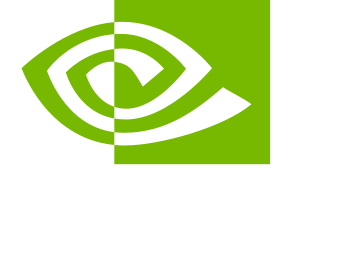

<div align="center">


<br/>
<br/>

# OmniRoute — The Free AI Gateway

**Created by [Diego Souza](https://github.com/diegosouzapw)**


</div>

<div align="center">

## ~1.62B Tokens / Month Across Third-Party Free Tiers

</div>

> **Bring your own provider accounts.** This is an estimated aggregate across separately eligible third-party free tiers, not a token grant from OmniRoute. Sign up, obtain credentials where required, and connect the providers you can use; each provider controls its limits, availability, and terms.
>
> Stacking free tiers by hand is painful — dozens of SDKs, dozens of rate limits, and no idea how much you actually have. OmniRoute catalogs **465 free-tier entries across 34 recurring pool keys** and computes the token headline from the **17 pools with a published positive monthly budget plus five per-model Groq caps**, deduplicated by shared pool. Quotas that only open after a regional identity check (today: ModelScope) are shown apart, +~6M behind regional identity verification, and never summed into the headline. The result stays visible on the dashboard (`/dashboard/free-tiers`).


> Animated summary of the live `/dashboard/free-tiers` page. Full methodology (pool dedupe, credit tiers, provider terms): **[docs/reference/FREE_TIERS.md](docs/reference/FREE_TIERS.md)**.
>
> <sub>These figures are re-audited every two weeks against the live catalog and **move both ways** — a provider ends a free tier and the number drops; a new one lands and it climbs. We publish what the catalog actually computes, never a rounded-up best case.</sub>

<br/>

<div align="center">

<h3>

⭐ Star the repo if OMNIROUTE helped you save money and make your work easier.

</h3>

[](https://github.com/cheaper-inference/OmniRoute)
<a href="https://trendshift.io/repositories/23589" target="_blank"></a>
[](https://www.star-history.com/cheaper-inference/omniroute)
[](https://olud.ai/project/diegosouzapw-omniroute.html)

### Join the community

**👋 Follow the maintainer — get new providers, releases & tips first:**

[](https://www.linkedin.com/in/diegosouzapw/)
[](https://github.com/diegosouzapw)

[](https://discord.gg/U47eFqAXCn)
[](https://t.me/omnirouteOficial)
[](https://chat.whatsapp.com/FvuCbrpZmQ6I85n2vW5QIC?s=cl&p=a&mlu=4)
[](https://chat.whatsapp.com/KWgatljAjmbELQory59Oti?s=cl&p=a&mlu=4)
[](https://omniroute.online)

**Questions, provider tips, roadmap & support → [Discord](https://discord.gg/U47eFqAXCn) · [Telegram](https://t.me/omnirouteOficial) · WhatsApp [🌍 Global](https://chat.whatsapp.com/FvuCbrpZmQ6I85n2vW5QIC?s=cl&p=a&mlu=4) / [🇧🇷 Brasil](https://chat.whatsapp.com/KWgatljAjmbELQory59Oti?s=cl&p=a&mlu=4) / [📢 Official Channel](https://whatsapp.com/channel/0029VbDwC7A3wtb5PN6a5t2R) / [Portal](https://portal.sthub.com.br/communities/groups/st-hub/channels/Omniroute-World-8kRjmK)**

<br/>

## The Gateway Keeps Growing


<table>
  <tr>
    <td align="center" width="25%"><b>394</b><br/><sub>providers</sub></td>
    <td align="center" width="25%"><b>1,539</b><br/><sub>unique chat model IDs</sub></td>
    <td align="center" width="25%"><b>160</b><br/><sub>providers marked free in the catalog</sub></td>
    <td align="center" width="25%"><b>22</b><br/><sub>public routing strategies</sub></td>
  </tr>
  <tr>
    <td colspan="4" align="center"><sub>Measured in v3.8.54, the current line. 1,539 IDs spread over 3,186 provider/model chat pairs. Latest published release: v3.8.53, 6 November 2026.</sub></td>
  </tr>
</table>

<table>
  <tr>
    <th align="left">Prepare</th>
    <th colspan="3" align="left">Validate: fixes, docs, translations and provider updates only</th>
  </tr>
  <tr>
    <td valign="top" width="25%">
      <b>v3.8.54</b> · release in preparation<br/>
      Release infrastructure for the LTS channels and the public feature-freeze announcement. The dormant channel infrastructure shipped early, in v3.8.52.
    </td>
    <td valign="top" width="25%">
      <b>v3.8.55</b> · groundwork merged<br/>
      Characterization tests for every extraction candidate, module-boundary re-measurement and wider end-to-end journeys. The boundary ratchet runs in CI.
    </td>
    <td valign="top" width="25%">
      <b>v3.8.56</b> · baseline pending<br/>
      Extended canary and performance baselines: heap, time to first byte, build time and load on critical routes. Script and preliminary report are in.
    </td>
    <td valign="top" width="25%">
      <b>v3.8.57</b> · sweep merged<br/>
      Security and compliance sweep and the LTS support policy. The publish-provenance (OIDC) rehearsal is pending.
    </td>
  </tr>
  <tr>
    <td valign="top">
      <b>v3.8.58</b> · rehearsed<br/>
      Full dry run of the 3.9.0 cut: branches, channels, forward-port and PR preview artifacts. Rehearsed on a private scratch remote in October 2026.
    </td>
    <td valign="top">
      <b>v3.8.59</b> · pending<br/>
      Final freeze, full-suite audit run twice and the owner's GO/NO-GO decision. The checklist is ready.
    </td>
    <td valign="top" colspan="2">
      <b>v3.9.0 LTS</b> · after GO<br/>
      <code>stable/v3</code> becomes the long-term support line and <code>npm install omniroute</code> stays on it during the whole v4 cycle. <code>develop</code> opens the v4 nightly channel. There is no v3.8.60.
    </td>
  </tr>
</table>

<table>
  <tr>
    <th colspan="4" align="left">Shipped on the rail so far</th>
  </tr>
  <tr>
    <td valign="top" width="25%"><b>Modality Bridge</b><br/>Vision, audio and video input for text-only models.<br/><sub>v3.8.50</sub></td>
    <td valign="top" width="25%"><b>Radar</b><br/>Signed free-model catalog, opt-in.<br/><sub>v3.8.50</sub></td>
    <td valign="top" width="25%"><b>Quota-aware scheduling</b><br/>Provider scheduling that reads remaining quota.<br/><sub>v3.8.50</sub></td>
    <td valign="top" width="25%"><b>Quota telemetry</b><br/>Live provider quota readings.<br/><sub>v3.8.50</sub></td>
  </tr>
  <tr>
    <td valign="top"><b>Headless mode</b><br/><code>omniroute serve --headless</code><br/><sub>v3.8.52</sub></td>
    <td valign="top"><b>Model discovery API</b><br/><code>POST /v1/models/query</code><br/><sub>v3.8.52</sub></td>
    <td valign="top" colspan="2"><b>LTS release infrastructure</b><br/>Channels, labels and forward-port workflows, dormant until 3.9.0.<br/><sub>v3.8.52</sub></td>
  </tr>
</table>

Provider and model totals for v3.8.55 to v3.8.59 are measured when each release is cut. There are no targets.

<p align="center"><b><a href="ROADMAP.md">Roadmap</a></b> · <a href="docs/ops/RELEASE_STRATEGY.md">Release strategy</a> · <a href="docs/ops/LTS_GO_NO_GO.md">LTS GO/NO-GO checklist</a> · <a href="SECURITY.md#lts-support-window-v39x">LTS support window</a></p>

<br/>

## Available

<div align="center">

[](https://www.npmjs.com/package/omniroute)
[](https://www.npmjs.com/package/omniroute)
[](https://github.com/cheaper-inference/OmniRoute/releases/latest)
[](https://hub.docker.com/r/diegosouzapw/omniroute)
[](https://hub.docker.com/r/diegosouzapw/omniroute)
[](https://github.com/cheaper-inference/OmniRoute/releases)
[](LICENSE)

</div>

Every section of this README, grouped by what you want to do.

| Goal                    | Sections                                                                                                                                                                                                                                                                                                                                                                                                                                                                                                                                                                                                                                                                                                                                                                                                                                                                                                                |
| ----------------------- | ----------------------------------------------------------------------------------------------------------------------------------------------------------------------------------------------------------------------------------------------------------------------------------------------------------------------------------------------------------------------------------------------------------------------------------------------------------------------------------------------------------------------------------------------------------------------------------------------------------------------------------------------------------------------------------------------------------------------------------------------------------------------------------------------------------------------------------------------------------------------------------------------------------------------- |
| **Start**               | [Install, connect, first request](#install-connect-a-provider-then-route-through-one-endpoint) · [Quick Start](#quick-start) · [More install methods](#more-install-methods--docker-source-pnpm-arch) · [Free-tier token budget](#162b-tokens--month-across-third-party-free-tiers) · [Languages](#languages)                                                                                                                                                                                                                                                                                                                                                                                                                                                                                                                                                                                                           |
| **Understand**          | [The Promise](#the-promise) · [Why OmniRoute?](#why-omniroute) · [What sets OmniRoute apart](#what-sets-omniroute-apart) · [The gateway keeps growing](#the-gateway-keeps-growing) · [What's new](#whats-new)                                                                                                                                                                                                                                                                                                                                                                                                                                                                                                                                                                                                                                                                                                           |
| **Route**               | [Combos](#combos-the-flagship) · [Zero-config `auto`](#zero-config-just-use-auto) · [22 routing strategies](#or-build-your-own-22-routing-strategies) · [Resilience layers](#resilience-is-built-in-3-independent-layers) · [OmniRoute Radar](#omniroute-radar)                                                                                                                                                                                                                                                                                                                                                                                                                                                                                                                                                                                                                                                         |
| **Providers and tools** | [AI providers](#394-ai-providers--51-with-recurring-free-access) · [Every major lab](#every-major-lab--through-one-endpoint) · [Free every day or month](#free-every-day-or-month) · [Trials and signup credits](#trial-and-signup-credits) · [Compatible CLIs and coding agents](#compatible-clis--coding-agents)                                                                                                                                                                                                                                                                                                                                                                                                                                                                                                                                                                                                      |
| **Run it**              | [Where OmniRoute runs](#where-omniroute-runs) · [OmniCopilot for VS Code](#omnicopilot-omniroute-inside-vs-codes-native-copilot-chat) · [OmniRouteTray for macOS](#omniroutetray-omniroute-in-the-macos-menu-bar) · [Private and local-first](#private--local-first)                                                                                                                                                                                                                                                                                                                                                                                                                                                                                                                                                                                                                                                    |
| **CLI and protocols**   | [Full CLI, MCP and A2A](#full-cli-mcp-and-a2a) · [The CLI](#a-real-cli-not-just-start) · [Remote mode](#remote-mode-the-cli-on-your-laptop-omniroute-on-a-server) · [Connect an agent](#connect-an-agent)                                                                                                                                                                                                                                                                                                                                                                                                                                                                                                                                                                                                                                                                                                               |
| **Save tokens**         | [Compression overview](#save-1595-tokens--automatically) · [How it works](#how-it-works--pipeline-architecture--savings-math) · [The 12-engine stack](#the-12-engine-stack) · [Output styles and per-request control](#beyond-the-engines--output-styles-the-adaptive-dial--per-request-control)                                                                                                                                                                                                                                                                                                                                                                                                                                                                                                                                                                                                                        |
| **See it**              | [OmniRoute in action](#omniroute-in-action) · [Video guides](#video-guides)                                                                                                                                                                                                                                                                                                                                                                                                                                                                                                                                                                                                                                                                                                                                                                                                                                             |
| **Reference**           | [Tech stack](#tech-stack) · [Documentation](#documentation) · [New users](#if-you-are-new-to-omniroute) · [Operators](#if-you-are-deploying-or-operating-a-server) · [Routing docs](#if-you-want-to-control-how-requests-are-routed) · [Spend and quota](#if-you-want-to-track-spend-and-quota) · [Provider guides](#if-you-are-connecting-a-specific-provider) · [Tokens and context](#if-you-want-to-save-tokens-or-add-context) · [Coding tools and CLI](#if-you-use-a-coding-tool-or-the-omniroute-cli) · [API](#if-you-are-building-against-the-api) · [Extensions and traffic](#if-you-want-to-extend-omniroute-or-watch-its-traffic) · [Upstream proxies](#if-you-route-upstream-traffic-through-proxies) · [Security review](#if-you-are-reviewing-security) · [Code](#if-you-want-to-understand-the-code) · [Contributing](#if-you-want-to-contribute) · [Past decisions](#if-you-are-tracing-a-past-decision) |
| **Community**           | [Community and help](#community--help) · [Join the community](#join-the-community) · [Top contributors](#top-contributors) · [By merged pull requests](#external-contributors-by-merged-pull-requests) · [By GitHub-attributed commits](#github-attributed-commits) · [All contributors](#1200-contributors) · [How to contribute](#how-to-contribute) · [Releasing a new version](#releasing-a-new-version) · [Stars](#stars) · [StarMapper](#starmapper)                                                                                                                                                                                                                                                                                                                                                                                                                                                              |
| **Support and credits** | [Support OmniRoute](#support-omniroute) · [Sponsors](#sponsors) · [Open Source Friends](#supported-by-our-open-source-friends) · [License](#license)                                                                                                                                                                                                                                                                                                                                                                                                                                                                                                                                                                                                                                                                                                                                                                    |
| **Acknowledgments**     | [Overview](#acknowledgments) · [Lineage and gateway](#lineage--gateway) · [Compression engines](#context--token-compression--engines) · [Compact formats and code-aware tooling](#compact-formats-token-research--code-aware-tooling) · [Memory and RAG](#memory--rag) · [Traffic inspection and MITM](#traffic-inspection-mitm--transparent-proxy) · [Model data, observability and UI](#model-data-observability--ui) · [Security](#security) · [Complementary tools](#complementary-tools)                                                                                                                                                                                                                                                                                                                                                                                                                           |

<a id="languages"></a>

<div align="center">
  <b>Read this README in 67 languages</b>
  <br/><br/>
  <a href="README.md"></a>
  <a href="docs/i18n/pt-BR/README.md"></a>
  <a href="docs/i18n/pt/README.md"></a>
  <a href="docs/i18n/es/README.md"></a>
  <a href="docs/i18n/fr/README.md"></a>
  <a href="docs/i18n/it/README.md"></a>
  <a href="docs/i18n/de/README.md"></a>
  <a href="docs/i18n/nl/README.md"></a>
  <a href="docs/i18n/ru/README.md"></a>
  <a href="docs/i18n/uk-UA/README.md"></a>
  <a href="docs/i18n/pl/README.md"></a>
  <a href="docs/i18n/cs/README.md"></a>
  <a href="docs/i18n/sk/README.md"></a>
  <a href="docs/i18n/ro/README.md"></a>
  <a href="docs/i18n/hu/README.md"></a>
  <a href="docs/i18n/bg/README.md"></a>
  <a href="docs/i18n/da/README.md"></a>
  <a href="docs/i18n/fi/README.md"></a>
  <a href="docs/i18n/no/README.md"></a>
  <a href="docs/i18n/sv/README.md"></a>
  <a href="docs/i18n/zh-CN/README.md"></a>
  <a href="docs/i18n/zh-TW/README.md"></a>
  <a href="docs/i18n/ja/README.md"></a>
  <a href="docs/i18n/ko/README.md"></a>
  <a href="docs/i18n/th/README.md"></a>
  <a href="docs/i18n/vi/README.md"></a>
  <a href="docs/i18n/id/README.md"></a>
  <a href="docs/i18n/ms/README.md"></a>
  <a href="docs/i18n/phi/README.md"></a>
  <a href="docs/i18n/hi/README.md"></a>
  <a href="docs/i18n/gu/README.md"></a>
  <a href="docs/i18n/mr/README.md"></a>
  <a href="docs/i18n/ta/README.md"></a>
  <a href="docs/i18n/te/README.md"></a>
  <a href="docs/i18n/bn/README.md"></a>
  <a href="docs/i18n/ur/README.md"></a>
  <a href="docs/i18n/fa/README.md"></a>
  <a href="docs/i18n/ar/README.md"></a>
  <a href="docs/i18n/he/README.md"></a>
  <a href="docs/i18n/tr/README.md"></a>
  <a href="docs/i18n/az/README.md"></a>
  <a href="docs/i18n/sw/README.md"></a>
  <a href="docs/i18n/el/README.md"></a>
  <a href="docs/i18n/hr/README.md"></a>
  <a href="docs/i18n/sr/README.md"></a>
  <a href="docs/i18n/lt/README.md"></a>
  <a href="docs/i18n/et/README.md"></a>
  <a href="docs/i18n/lv/README.md"></a>
  <a href="docs/i18n/sl/README.md"></a>
  <a href="docs/i18n/mt/README.md"></a>
  <a href="docs/i18n/ga/README.md"></a>
  <a href="docs/i18n/kn/README.md"></a>
  <a href="docs/i18n/ml/README.md"></a>
  <a href="docs/i18n/or/README.md"></a>
  <a href="docs/i18n/pa/README.md"></a>
  <a href="docs/i18n/ne/README.md"></a>
  <a href="docs/i18n/si/README.md"></a>
  <a href="docs/i18n/my/README.md"></a>
  <a href="docs/i18n/km/README.md"></a>
  <a href="docs/i18n/ha/README.md"></a>
  <a href="docs/i18n/yo/README.md"></a>
  <a href="docs/i18n/ig/README.md"></a>
  <a href="docs/i18n/am/README.md"></a>
  <a href="docs/i18n/uz/README.md"></a>
  <a href="docs/i18n/ka/README.md"></a>
  <a href="docs/i18n/hy/README.md"></a>
  <a href="docs/i18n/bs/README.md"></a>
</div>

<br/>
<br/>

<div align="center">

<a id="first-run"></a>

## Install, connect a provider, then route through one endpoint

</div>


<table>
  <tr>
    <td valign="top" width="25%"><sub>Step 1</sub><br/><b>Install</b><br/><code>npm install -g omniroute</code><br/><sub>Node.js 22.22.2+ (22.x) or 24.x–26.x</sub></td>
    <td valign="top" width="25%"><sub>Step 2</sub><br/><b>Start</b><br/><code>omniroute</code><br/><sub>Dashboard and API on port 20128</sub></td>
    <td valign="top" width="25%"><sub>Step 3</sub><br/><b>Connect and get a key</b><br/>Dashboard → <b>Providers</b>, then Dashboard → <b>API Keys</b></td>
    <td valign="top" width="25%"><sub>Step 4</sub><br/><b>Call <code>/v1</code></b><br/>Base URL <code>http://localhost:20128/v1</code>, model <code>auto</code></td>
  </tr>
</table>

```bash
curl http://localhost:20128/v1/chat/completions \
  -H "Authorization: Bearer YOUR_OMNIROUTE_KEY" \
  -H "Content-Type: application/json" \
  -d '{"model":"auto","messages":[{"role":"user","content":"Hello!"}]}'
```

<sub>`auto` needs an eligible route. A fresh installation can have no eligible keyless targets, and a keyless provider may reject third-party clients. Providers marked `tos: avoid`, including Kiro, are excluded from automatic routing by default; connecting an account does not override that setting. See the [Free Tiers Guide](docs/getting-started/FREE-TIERS-GUIDE.md) before choosing a provider.</sub>

<sub>Copy-paste quickstart scripts for **Python, Node.js, PHP and cURL**: [`examples/quickstart/`](examples/quickstart/). Step-by-step version: [Quick Start](#quick-start).</sub>

<br/>

<br/>

<div align="center">

# The Promise

</div>


<br/>
<br/>

<div align="center">

# Why OmniRoute?

</div>


<div align="center">


</div>

<br/>

<div align="center">

## Supported by our Open Source Friends

</div>

<p align="center">
  <a href="https://platform.kimi.ai?track_id=track-8197581fdd7d4139a0f562e4a03c3798&aff=omniroute">
    
  </a>
</p>

> **Want to join as an Open Source Friend?** These are the companies that back open source and help keep OmniRoute moving — and we say publicly where every token they give us goes. Reach out: [diegosouza.pw@outlook.com](mailto:diegosouza.pw@outlook.com)

<table>
  <tr>
    <td align="center" width="150">
      <a href="https://platform.kimi.ai?track_id=track-8197581fdd7d4139a0f562e4a03c3798&aff=omniroute">
        <picture>
          <source media="(prefers-color-scheme: dark)" srcset="public/providers/kimi-logomark-dark.svg">
          
        </picture>
      </a>
      <br/><b>Kimi</b><br/><sub>Moonshot AI</sub><br/><br/>
      
    </td>
    <td>
      Thanks to <b>Kimi (Moonshot AI)</b>, our founding Open Source Friend, for backing this project! Kimi is the AI lab behind the open-weight K2 and K3 model families — <b>Kimi K3</b> delivers a 1M-token context window, native vision and frontier-level coding at a fraction of closed-model prices, and works out of the box with Claude Code, Codex and every coding tool OmniRoute serves.
      <br/><br/>
      <b>What Kimi's support powers:</b> Kimi's API credits power OmniRoute's AI-validated release pipeline — the <i>merge validation powered by Kimi K3</i> stage that reviews every pull request before it ships — plus day-to-day feature development. First-class Kimi support ships on both rails: the direct <a href="https://platform.kimi.ai?track_id=track-8197581fdd7d4139a0f562e4a03c3798&aff=omniroute">Kimi API</a> (<code>kimi-k3</code>) and the <a href="https://www.kimi.ai/code?aff=omniroute">Kimi Code coding plan</a> (OAuth and API key). OmniRoute is also the first Brazilian open-source project in Kimi's support program. <a href="https://platform.kimi.ai?track_id=track-8197581fdd7d4139a0f562e4a03c3798&aff=omniroute"><b>Get a Kimi API key with 15% extra credits →</b></a>
    </td>
  </tr>
  <tr>
    <td align="center" width="150">
      <a href="https://cheaperinference.com/?utm_source=omniroute">
        
      </a>
      <br/><b>Cheaper Inference</b><br/><sub>cheaperinference.com</sub><br/><br/>
      
    </td>
    <td>
      Thanks to <b>Cheaper Inference</b>, an OmniRoute Open Source Friend, for backing this project! Cheaper Inference is a cost-ranked gateway that resells 42 frontier models — Claude, GPT-5.x, Gemini, Kimi K3, GLM, DeepSeek, Grok and MiniMax — behind one OpenAI-compatible endpoint, routing each request to the cheapest eligible provider without ever charging above the model maker's list price.
      <br/><br/>
      <b>First-class support in OmniRoute:</b> Chat Completions, the native <code>/v1/responses</code> endpoint, vision, tool calling and 3 image models (<code>grok-imagine</code>, <code>nano-banana-pro</code>, <code>nano-banana-2</code>, reachable as <code>cheaperinference/&lt;model&gt;</code>). <a href="https://cheaperinference.com/?utm_source=omniroute"><b>Get an API key →</b></a>
    </td>
  </tr>
</table>

<sub>Links tagged <code>aff=omniroute</code> are partner links. They fund the project at no extra cost to you.</sub>

<br/>

<details open>
<summary><sub><b>🎟️ Affiliates Promo</b> — free signup coupons from providers we don't sponsor (click to expand)</sub></summary>

<sub><i>This section is for referral/coupon codes only. Sponsored partnerships live in <b>🤝 Supported by our Open Source Friends</b> above. OmniRoute has no sponsorship or partnership with the providers listed here — these are public coupons anyone can use.</i></sub>

<table>
  <tr>
    <td align="center" width="120">
      <a href="https://agentrouter.org/register?aff=70LM">
        
      </a>
      <br/><sub><b>AgentRouter</b></sub><br/><sub>agentrouter.org</sub>
    </td>
    <td>
      <sub><b><a href="https://agentrouter.org/register?aff=70LM">AgentRouter</a></b> — affiliate signup · <b>$100 free credits</b> on signup (free server, expect higher latency — best for testing, not production). First-class support in OmniRoute since <b>v3.8.50</b>: Chat Completions, the Anthropic-compatible wire format and the OpenAI-compatible path. Available models include <code>claude-opus-4-8</code>, <code>claude-opus-5</code>, <code>gpt-5.6-sol</code> and more. <b><a href="https://agentrouter.org/register?aff=70LM">Grab your $100 →</a></b></sub>
      <br/><br/>
      <sub>⚠️ <i>Affiliate link — OmniRoute has no sponsorship or partnership with this provider.</i></sub>
    </td>
  </tr>
</table>

<sub>Know another provider with a generous free signup coupon that benefits OmniRoute users? Open an issue and we'll add it here.</sub>

</details>

<br/>

<div align="center">

## Combos: the flagship

</div>


> A **combo** is a list of models that OmniRoute routes across automatically. When quota runs out, a provider fails or a model is locked, the request moves to the next eligible, healthy target.

### Zero-config: just use `auto`

You don't need to create a combo. Point any OpenAI-compatible client at OmniRoute and set the model to `auto`. OmniRoute builds a virtual combo from the providers you have connected and scores the candidates live.

```bash
curl http://localhost:20128/v1/chat/completions \
  -H "Authorization: Bearer <your-omniroute-key>" \
  -H "Content-Type: application/json" \
  -d '{"model": "auto", "messages": [{"role": "user", "content": "Hello"}]}'
```

Swap `auto` for a variant when you want a different trade-off. Variants change the scoring weights. They are preferences, not guarantees: every variant keeps last-known-good stickiness, so it stays on the provider that last succeeded until that provider fails.

#### If you just want it to work

| Model ID    | What it does                                                                                    |
| ----------- | ----------------------------------------------------------------------------------------------- |
| `auto`      | Balanced default weights. Keeps the last provider that succeeded until it fails, then rescores. |
| `auto/lkgp` | Names the last-known-good behavior explicitly. Same weights as `auto`.                          |

#### If you care about speed, price or quality

| Model ID      | What it does                                                    |
| ------------- | --------------------------------------------------------------- |
| `auto/fast`   | Favors low latency and healthy providers.                       |
| `auto/cheap`  | Favors lower catalog prices.                                    |
| `auto/coding` | Quality-first weights, tuned for code generation.               |
| `auto/smart`  | Quality-first weights with 10% exploration (the default is 5%). |

`auto/fast` and `auto/cheap` lean toward speed or price. They do not promise the fastest or cheapest model on every request.

#### If you already pay for subscriptions

| Model ID            | What it does                                                                                                                                                           |
| ------------------- | ---------------------------------------------------------------------------------------------------------------------------------------------------------------------- |
| `auto/subscription` | Plan-included quota only, verified live. When none is left, the request fails with HTTP 503 instead of falling back to billed capacity.                                |
| `auto/thrifty`      | Plan quota first, then keyless, free, cheap and premium options, one rung at a time. It can reach billed models and returns to the plan when quota and cooldown allow. |
| `auto/offline`      | Favors quota and rate-limit headroom. Not an offline mode: requests still go to your providers.                                                                        |

How the rungs work: [Subscription-first routing](./docs/routing/SUBSCRIPTION_LADDER.md).

#### If you want several models to answer

| Model ID     | What it does                                                                                                                                                                                                                             |
| ------------ | ---------------------------------------------------------------------------------------------------------------------------------------------------------------------------------------------------------------------------------------- |
| `auto/chaos` | Sends the request in parallel to a panel, one model per provider, five by default (up to 10). Each panel model costs one upstream call. Your client gets one answer: the top-ranked model's, or the last one that succeeded if it fails. |

For a judge that merges the panel's answers into one, use a `fusion` combo (below).

#### If you need a specific kind of model

Combine a category with a tier: `auto/coding:fast`, `auto/coding:free`, `auto/reasoning:pro`, `auto/vision`. If nothing you have connected matches, the request fails with HTTP 503 instead of silently widening the pool. Full list: [Auto-Combo guide](./docs/routing/AUTO-COMBO.md).

##

### Or build your own: 22 routing strategies

A saved combo has a name, a list of targets and one strategy. The strategy decides which target goes first and the order of the fallbacks. Clients then call the combo by its name, like any model.

```bash
omniroute combo create my-pool --strategy fill-first \
  --models "provider-a/model-1,provider-b/model-2"
```

The CLI accepts 15 of the strategies. The dashboard and the combos API accept all 22. Pick by goal:

#### If you want a fixed order

| Strategy     | What it does                                                                    |
| ------------ | ------------------------------------------------------------------------------- |
| `priority`   | Try targets in the order you set. Session stickiness never reorders that list.  |
| `fill-first` | Keep using the first available target until it runs out or fails, then move on. |
| `lkgp`       | Put the last provider that succeeded first. Otherwise keep your order.          |

#### If you want to spread the load

| Strategy        | What it does                                                                                   |
| --------------- | ---------------------------------------------------------------------------------------------- |
| `weighted`      | Draw one target per request in proportion to its weight. The others become the fallback chain. |
| `round-robin`   | Rotate in order, staying on each target for a batch of successes (3 by default).               |
| `p2c`           | Sample two targets and use the one with the better success rate and latency.                   |
| `least-used`    | Use the target with the fewest recorded requests in this combo.                                |
| `random`        | Shuffle for every request. The same target can come first twice in a row.                      |
| `strict-random` | Deal from a shuffled deck: every target is used once before any repeats.                       |

`weighted` gives statistical balance, not an exact split. For strict rotation, use `round-robin`.

#### If you want to spend less

| Strategy         | What it does                                                            |
| ---------------- | ----------------------------------------------------------------------- |
| `cost-optimized` | Try the lowest catalog input-token price first. Unknown prices go last. |

It sorts by the input price in the catalog, not by the final cost of the request.

#### If you want to respect quota

| Strategy         | What it does                                                                                       |
| ---------------- | -------------------------------------------------------------------------------------------------- |
| `headroom`       | Use the account with the most free capacity across its 5-hour and weekly windows.                  |
| `quota-weighted` | Skip exhausted accounts, then draw in proportion to leftover quota and in-flight load.             |
| `reset-window`   | Use the account whose quota window resets soonest.                                                 |
| `reset-aware`    | Score each account on the quota it has left plus how soon its session and weekly windows reset.    |
| `expiry-first`   | Spend the quota that would otherwise expire unused: most leftover per hour until reset goes first. |

These read live quota for providers that report it, such as subscription accounts with 5-hour and weekly windows.

#### If you work with long context or prompt caching

| Strategy            | What it does                                                                               |
| ------------------- | ------------------------------------------------------------------------------------------ |
| `context-relay`     | Keep your order. When a conversation moves to another account, a summary of it goes along. |
| `context-optimized` | Try the model with the largest known context window first.                                 |
| `cache-optimized`   | Prefer the account most likely to already hold this prompt prefix in its cache.            |

#### If you want a scorer or a model to decide

| Strategy | What it does                                                                                                                                                                                                                  |
| -------- | ----------------------------------------------------------------------------------------------------------------------------------------------------------------------------------------------------------------------------- |
| `auto`   | Rank the candidates live with the 16-factor Auto-Combo scorer.                                                                                                                                                                |
| `jev`    | Keep your ranked list and let TypeSafe Jev pick which entries run. Off until `COMBO_JEV_STRATEGY_ENABLED` is on; then each request sends an excerpt to TypeSafe and uses paid TypeSafe calls. Without it, your order is used. |

The scorer uses 16 declared factors, including health, quota, cost, latency, task fit, quality and session availability. Weights depend on the profile; three factors are zero in the default profile. Details: [`docs/routing/AUTO-COMBO.md`](docs/routing/AUTO-COMBO.md).

#### If you want several models for one answer

| Strategy   | What it does                                                                                                |
| ---------- | ----------------------------------------------------------------------------------------------------------- |
| `fusion`   | Ask a panel of models in parallel. A judge model writes one answer from their replies.                      |
| `pipeline` | Run targets in sequence. Each step's output is the next step's input, and only the last answer is returned. |

Both make more than one upstream call per request.

##

### Resilience is built in: 3 independent layers

Failures are handled at three scopes, so one bad model does not take down its account, and one bad account does not take down its provider.


#### If a whole provider is down

The **provider circuit breaker** opens after 8 (OAuth) or 12 (API key) failures with status 408, 500, 502, 503 or 504. Combos skip that provider while it is open. After 60 s or 30 s, one probe request decides whether it closes.

#### If one key or account is rate-limited

The **connection cooldown** benches only that connection, with exponential backoff from 5 s (OAuth) or 3 s (API key). Other keys for the same provider keep serving.

#### If one model is refused

The **model lockout** blocks only that model on that connection after a per-model 429, 404 or access denial. Other models on the same connection keep serving.

Banned, expired and out-of-credit connections are terminal states, not cooldowns: they wait for you to fix them.

<sub>[Auto-Combo engine](docs/routing/AUTO-COMBO.md) · [Resilience guide](docs/architecture/RESILIENCE_GUIDE.md)</sub>

<br/>

<div align="center">

## What Sets OmniRoute Apart

</div>


<sub>📊 Full methodology &amp; per-feature detail vs 9router, OpenRouter, CLIProxyAPI &amp; LiteLLM → [`docs/comparison/OMNIROUTE_VS_ALTERNATIVES.md`](docs/comparison/OMNIROUTE_VS_ALTERNATIVES.md)</sub>

<br/>

<a id="-support-omniroute"></a>
<a id="support"></a>

## Support OmniRoute

OmniRoute is MIT-licensed and maintained in the open. If it saves you time or money, these are the ways to help keep it independent. Sponsorship never affects routing: it buys visibility, not ranking.

<table>
  <tr><th align="left">Method</th><th align="left">Best for</th><th align="left">Link</th></tr>
  <tr><td nowrap><b>Star the repo</b></td><td>Free, and it helps visibility</td><td><a href="https://github.com/cheaper-inference/OmniRoute">Star OmniRoute</a></td></tr>
  <tr><td nowrap><b>GitHub Sponsors</b></td><td>One-off or monthly. No platform fee on sponsorships from personal accounts</td><td><a href="https://github.com/sponsors/diegosouzapw">github.com/sponsors/diegosouzapw</a></td></tr>
  <tr><td nowrap><b>Ko-fi</b></td><td>Quick one-off tip, no signup for the donor</td><td><a href="https://ko-fi.com/diegosouzapw">ko-fi.com/diegosouzapw</a></td></tr>
  <tr><td nowrap><b>Buy Me a Coffee</b></td><td>Small, informal gesture</td><td><a href="https://www.buymeacoffee.com/diegosouzapw">buymeacoffee.com/diegosouzapw</a></td></tr>
  <tr><td nowrap><b>Liberapay</b></td><td>Recurring, run by a non-profit</td><td><a href="https://liberapay.com/diegosouzapw">liberapay.com/diegosouzapw</a></td></tr>
  <tr><td nowrap><b>Open Collective</b><br/><sub>companies, invoices</sub></td><td>Opening soon: the collective is waiting for fiscal-host approval and does not accept contributions yet</td><td><a href="https://opencollective.com/omniroute">opencollective.com/omniroute</a></td></tr>
  <tr><td nowrap><b>PIX</b> (Brazil)</td><td>Instant, no fees</td><td>Key and QR below</td></tr>
  <tr><td nowrap><b>Crypto</b></td><td>BTC, ETH, USDT-TRC20, USDC-Solana (Monero coming soon)</td><td>Addresses below</td></tr>
</table>

### Sponsoring as a company

Companies can sponsor today from a GitHub organization account through GitHub Sponsors, which offers invoiced billing for organizations. The [Open Collective page](https://opencollective.com/omniroute) is set up for companies that need invoices and public accounting, but it opens only after a fiscal host approves it. Tax treatment will depend on that host and on your country. OmniRoute does not promise that a contribution is tax-deductible.

### PIX (Brazil)


Key (random): `5d865059-bc44-483a-962d-43ceb80126eb`

Pix copia-e-cola:

```
00020101021126580014br.gov.bcb.pix01365d865059-bc44-483a-962d-43ceb80126eb5204000053039865802BR5922OMNIROUTE CONTRIBUICAO6006BRASIL62070503***630475DD
```

<br clear="right"/>

### Crypto

<table>
  <tr><th align="left">Coin</th><th align="left">Network</th><th align="left">Address</th></tr>
  <tr><td nowrap><b>BTC</b></td><td nowrap>Bitcoin (SegWit)</td><td><code>bc1qh00smz004sy85wyl28v77tenkt3ckl6eaep7fd</code></td></tr>
  <tr><td nowrap><b>ETH</b></td><td nowrap>Ethereum (ERC20)</td><td><code>0x64Cf6B68A6Ff34288e89172950a2d00102337a84</code></td></tr>
  <tr><td nowrap><b>USDT</b></td><td nowrap>Tron (TRC20)</td><td><code>TKAF41JpuQrHbKTnsQa9svJE2T192Hvsc2</code></td></tr>
  <tr><td nowrap><b>USDC</b></td><td nowrap>Solana</td><td><code>2emNNZzVVWQc3FQ2wk9M6qXUQmW8AKdjjL174fXR28Tu</code></td></tr>
  <tr><td nowrap><b>XMR</b></td><td nowrap>Monero</td><td>Address coming soon</td></tr>
</table>

> [!IMPORTANT]
> Send each coin only on the network shown. A transfer on the wrong network can lose the funds.

Found a bug or have feedback? Open a [Discussion](https://github.com/cheaper-inference/OmniRoute/discussions).

<br/>

<p><strong>Developer notes:</strong> The project may generate a local <code>.env</code> file during npm install/postinstall for developer convenience. This file is intentionally ignored via <code>.gitignore</code> and must never be committed. If it is committed by accident, rotate any exposed secrets and remove the file from history. See <a href="docs/DEVELOPER-ENVIRONMENT.md">docs/DEVELOPER-ENVIRONMENT.md</a> for guidance on managing local environment files and secrets.</p>

## OmniRoute Radar

The main free-tier headline remains **~1.62B tokens/month** from the documented,
pool-deduplicated catalog above. Temporary provider signup credits can separately lift the first
month to **~2.22B**. Radar is an optional, signed catalog overlay for people who want fresher
free-model availability between OmniRoute releases; the community catalog and every existing free
feature remain free.

Supporters can receive the live catalog and additional provider opportunities. Its separate,
mutable ceiling is **approximately 3B tokens/month at most**, depending on provider availability.
That ceiling is not a guarantee: providers can change quotas, eligibility, models, or regions at
any time.

Radar is opt-in and GET-only. The OmniRoute client does not upload prompts, traffic, provider
configuration, usage telemetry, or local announcement-dismiss state. Learn about eligibility and
the current catalog at **[radar.omniroute.online/planos](https://radar.omniroute.online/planos)**.

<br/>

## What's New

Everything user-facing that shipped from v3.8.50 through the current development line.

> [!NOTE]
> The latest published release is v3.8.53. v3.8.54 is in release preparation: its features are merged but not yet published, and can still change before the release. New work lands in v3.8.55. Dates are GitHub release dates (UTC).

Bug fixes, internal refactors and CI changes are left out. They are listed per version in [`CHANGELOG.md`](CHANGELOG.md); for v3.8.54 they wait in [`changelog.d/fixes/`](changelog.d/fixes/) until the release. Links named **PR #N** point to the merged pull request when no guide covers the feature yet.

| Version           | Status                     | Highlights                                                                                                                                                                  | Full notes                                                                           |
| ----------------- | -------------------------- | --------------------------------------------------------------------------------------------------------------------------------------------------------------------------- | ------------------------------------------------------------------------------------ |
| [v3.8.54](#v3854) | release in preparation     | Account-level routing control, agentic pipeline safeguards, reusable key policies and new providers. Not published yet: names and defaults can still change before release. | [changelog.d/features/](changelog.d/features/)                                       |
| [v3.8.53](#v3853) | latest release, 2026-11-06 | A redesigned dashboard, team cost centers, Entra ID and two-factor sign-in, Kubernetes manifests and many provider and media additions.                                     | [Release notes](https://github.com/cheaper-inference/OmniRoute/releases/tag/v3.8.53) |
| [v3.8.52](#v3852) | released, 2026-10-19       | Headless mode, model discovery filters, per-key model pinning, the Nadir router and the LLMLingua compression sidecar.                                                      | [Release notes](https://github.com/cheaper-inference/OmniRoute/releases/tag/v3.8.52) |
| [v3.8.51](#v3851) | released, 2026-09-30       | Subscription-first routing, the quota-weighted strategy, the orchestration view, 25 new interface languages and the OpenCode v2 plugin.                                     | [Release notes](https://github.com/cheaper-inference/OmniRoute/releases/tag/v3.8.51) |
| [v3.8.50](#v3850) | released, 2026-08-26       | The Modality Bridge, the opt-in Radar catalog, OmniConductor fleet delegation and desktop attachment to a running server.                                                   | [Release notes](https://github.com/cheaper-inference/OmniRoute/releases/tag/v3.8.50) |

<a id="v3854"></a>

### v3.8.54 — release in preparation

Account-level routing control, agentic pipeline safeguards, reusable key policies and new providers. Not published yet: names and defaults can still change before release. Full notes: [changelog.d/features/](changelog.d/features/).

| Feature                                           | What it does                                                                                                                                                                             | Read more                                                                                                                                                                                                                                                                                                                                  |
| ------------------------------------------------- | ---------------------------------------------------------------------------------------------------------------------------------------------------------------------------------------- | ------------------------------------------------------------------------------------------------------------------------------------------------------------------------------------------------------------------------------------------------------------------------------------------------------------------------------------------ |
| **Preferred and reserve accounts in Auto combos** | Mark each connection Preferred, Normal, Reserve or Excluded; Auto tries preferred accounts first and reserves last.                                                                      | [Auto-Combo](docs/routing/AUTO-COMBO.md) · [PR #18430](https://github.com/cheaper-inference/OmniRoute/pull/18430)                                                                                                                                                                                                                          |
| **Preferred-account start failover**              | Opt-in hop to one eligible sibling account when the preferred account is slow to start answering. Defaults and per-provider overrides live in Settings → Resilience.                     | [PR #19259](https://github.com/cheaper-inference/OmniRoute/pull/19259)                                                                                                                                                                                                                                                                     |
| **`expiry-first` combo strategy**                 | The 21st strategy orders targets by the quota that is closest to expiring, per model family.                                                                                             | [Auto-Combo](docs/routing/AUTO-COMBO.md) · [PR #17829](https://github.com/cheaper-inference/OmniRoute/pull/17829)                                                                                                                                                                                                                          |
| **`jev` combo strategy**                          | You order the providers; one TypeSafe System One call picks the winner plus up to four fallbacks per request.                                                                            | [Auto-Combo](docs/routing/AUTO-COMBO.md) · [PR #15279](https://github.com/cheaper-inference/OmniRoute/pull/15279)                                                                                                                                                                                                                          |
| **Endpoint-specific combos**                      | Separate targets, strategies and settings for chat, search and fetch, embeddings, rerank, images, video, music, OCR and audio.                                                           | [Auto-Combo](docs/routing/AUTO-COMBO.md) · [PR #18731](https://github.com/cheaper-inference/OmniRoute/pull/18731)                                                                                                                                                                                                                          |
| **Agentic loop detection**                        | Pipelines notice repeated tool rounds with unchanged results, or consecutive failed rounds, and hand control back to the planner.                                                        | [PR #19318](https://github.com/cheaper-inference/OmniRoute/pull/19318)                                                                                                                                                                                                                                                                     |
| **Deadline-failure budget for combos**            | `OMNIROUTE_COMBO_MAX_DEADLINE_FAILURES` ends a combo with a clean 504 instead of trying every target against a stalled upstream.                                                         | [Environment](docs/reference/ENVIRONMENT.md) · [PR #18721](https://github.com/cheaper-inference/OmniRoute/pull/18721)                                                                                                                                                                                                                      |
| **Sign in with ChatGPT**                          | Official `chatgpt` provider: PKCE sign-in, live account model discovery and inference through the public Responses API.                                                                  | [Provider Reference](docs/reference/PROVIDER_REFERENCE.md) · [PR #15201](https://github.com/cheaper-inference/OmniRoute/pull/15201)                                                                                                                                                                                                        |
| **Microsoft 365 Copilot sign-in**                 | Work or school PKCE sign-in, the documented model catalog, native turns and conversation continuation.                                                                                   | [Microsoft 365 Copilot](docs/providers/COPILOT-M365.md) · [PR #19122](https://github.com/cheaper-inference/OmniRoute/pull/19122)                                                                                                                                                                                                           |
| **Key policy templates**                          | Save an API key's settings as a reusable, secret-free template and create keys from it in one step.                                                                                      | [Key Templates](docs/guides/KEY-TEMPLATES.md) · [PR #19311](https://github.com/cheaper-inference/OmniRoute/pull/19311)                                                                                                                                                                                                                     |
| **Rolling 5-hour USD budget per key**             | Enforced next to the daily and weekly limits and reported on the API key endpoints.                                                                                                      | [API Reference](docs/reference/API_REFERENCE.md) · [PR #18362](https://github.com/cheaper-inference/OmniRoute/pull/18362)                                                                                                                                                                                                                  |
| **Self-service key endpoints**                    | `/v1/me/status` reports a key's own usage and limits; `/v1/me/sessions` lists its agent sessions with project and client filters.                                                        | [PR #14771](https://github.com/cheaper-inference/OmniRoute/pull/14771) · [PR #14840](https://github.com/cheaper-inference/OmniRoute/pull/14840)                                                                                                                                                                                            |
| **Import existing API keys**                      | `POST /api/keys/import` registers caller-supplied keys with atomic duplicate checks and masked responses.                                                                                | [PR #18010](https://github.com/cheaper-inference/OmniRoute/pull/18010)                                                                                                                                                                                                                                                                     |
| **Anthropic rate-limit header policy per key**    | Forward or strip upstream Anthropic account and quota headers on streaming and non-streaming responses.                                                                                  | [PR #14862](https://github.com/cheaper-inference/OmniRoute/pull/14862)                                                                                                                                                                                                                                                                     |
| **Agent session and project attribution**         | Requests are attributed to coding-agent sessions and projects (token counters, priced cost, working directory, repository) for team reports.                                             | [PR #14833](https://github.com/cheaper-inference/OmniRoute/pull/14833)                                                                                                                                                                                                                                                                     |
| **Cached and uncached input in analytics**        | Totals split into all input, input without cache reads, and cached input, with partial-coverage markers for older history.                                                               | [Cached Input Reporting](docs/ops/CACHED_INPUT_REPORTING.md) · [PR #16452](https://github.com/cheaper-inference/OmniRoute/pull/16452)                                                                                                                                                                                                      |
| **Cache-write tier diagnostics**                  | Provider-reported 5-minute and 1-hour cache writes are kept through call logs and Cache Health.                                                                                          | [PR #17307](https://github.com/cheaper-inference/OmniRoute/pull/17307)                                                                                                                                                                                                                                                                     |
| **Proxy payload traffic**                         | Per-proxy and total upload and download payload, including retries and incomplete transfers.                                                                                             | [Proxy Payload Traffic](docs/ops/PROXY_PAYLOAD_TRAFFIC.md) · [PR #16455](https://github.com/cheaper-inference/OmniRoute/pull/16455)                                                                                                                                                                                                        |
| **Account fallback response headers**             | Bounded headers report fallback count and reasons, same-account retries and routing wait.                                                                                                | [PR #19163](https://github.com/cheaper-inference/OmniRoute/pull/19163)                                                                                                                                                                                                                                                                     |
| **More quota cards**                              | Cursor per-model tokens and billed cost, Zed hosted credit balance, an explicit Codex quota query, and `/credits` balance checks for compatible nodes.                                   | [PR #18346](https://github.com/cheaper-inference/OmniRoute/pull/18346) · [PR #19065](https://github.com/cheaper-inference/OmniRoute/pull/19065) · [PR #16191](https://github.com/cheaper-inference/OmniRoute/pull/16191) · [PR #18350](https://github.com/cheaper-inference/OmniRoute/pull/18350)                                          |
| **Use banked resets automatically**               | Opt-in auto-apply of Codex credits, Claude grants and Claude session resets, and auto-spend of Codex reset credits that are about to expire.                                             | [PR #19267](https://github.com/cheaper-inference/OmniRoute/pull/19267) · [PR #18630](https://github.com/cheaper-inference/OmniRoute/pull/18630)                                                                                                                                                                                            |
| **Compare a model's price across providers**      | Costs → Pricing lists every provider offering a model, cheapest first, plus a "Configured only" filter.                                                                                  | [PR #18775](https://github.com/cheaper-inference/OmniRoute/pull/18775) · [PR #18651](https://github.com/cheaper-inference/OmniRoute/pull/18651)                                                                                                                                                                                            |
| **New providers**                                 | opencode-server, MiniMax Code, EmpirioLabs AI, ParalonCloud, deAPI, RenderHour, MegaBrain, Replicate chat, Cerebrium, Hetzner Inference and Grokified.                                   | [Provider Reference](docs/reference/PROVIDER_REFERENCE.md) · [MiniMax Code](docs/providers/MINIMAX_CODE.md) · [Replicate and Cerebrium](docs/providers/REPLICATE-CEREBRIUM.md)                                                                                                                                                             |
| **Custom JSON API provider nodes**                | Connect a JSON endpoint that does not speak the OpenAI format by filling a request template, from the dashboard or the API.                                                              | [Custom JSON API](docs/guides/CUSTOM_JSON_API.md) · [PR #18353](https://github.com/cheaper-inference/OmniRoute/pull/18353)                                                                                                                                                                                                                 |
| **Codex and Keenable search**                     | `codex-search` searches through connected Codex accounts; Keenable adds keyless web search and fetch.                                                                                    | [Search Tools Studio](docs/frameworks/SEARCH_TOOLS_STUDIO.md) · [PR #17933](https://github.com/cheaper-inference/OmniRoute/pull/17933) · [PR #17920](https://github.com/cheaper-inference/OmniRoute/pull/17920)                                                                                                                            |
| **System One on local and Cloudflare backends**   | `POST /v1/systemone` can run decisions on your local Ollama connection or on Cloudflare Workers AI.                                                                                      | [PR #14667](https://github.com/cheaper-inference/OmniRoute/pull/14667) · [PR #16676](https://github.com/cheaper-inference/OmniRoute/pull/16676)                                                                                                                                                                                            |
| **Media additions**                               | Gemini Lyria 3 music on `/v1/music/generations`, an opt-in fal gateway, Cloudflare Deepgram Nova-3 transcription, multi-reference Antigravity image edits and GitHub Copilot embeddings. | [fal](docs/integrations/FAL_NATIVE.md) · [PR #18797](https://github.com/cheaper-inference/OmniRoute/pull/18797) · [PR #18352](https://github.com/cheaper-inference/OmniRoute/pull/18352) · [PR #16731](https://github.com/cheaper-inference/OmniRoute/pull/16731) · [PR #18291](https://github.com/cheaper-inference/OmniRoute/pull/18291) |
| **Image input controls**                          | Per-image Gemini `media_resolution`, and opt-in image normalization for Qwen2-VL-style vision pipelines.                                                                                 | [PR #18844](https://github.com/cheaper-inference/OmniRoute/pull/18844) · [PR #18740](https://github.com/cheaper-inference/OmniRoute/pull/18740)                                                                                                                                                                                            |
| **Codex Ultrafast defaults**                      | Global and per-connection Ultrafast defaults for GPT-6 Astra and GPT-6.1 Sol.                                                                                                            | [PR #16678](https://github.com/cheaper-inference/OmniRoute/pull/16678)                                                                                                                                                                                                                                                                     |
| **Agentic context compaction**                    | Opt-in compaction for agentic pipelines, with a character budget per planner and executor model.                                                                                         | [Auto-Combo](docs/routing/AUTO-COMBO.md) · [PR #19317](https://github.com/cheaper-inference/OmniRoute/pull/19317)                                                                                                                                                                                                                          |
| **New models inbox**                              | Model sync records each provider's list and the Providers toolbar shows newly added models with an unread badge.                                                                         | [PR #16864](https://github.com/cheaper-inference/OmniRoute/pull/16864)                                                                                                                                                                                                                                                                     |
| **Model and combo editing**                       | Set a context window when adding a model, import only free models from compatible nodes, and configure Nadir inside the combo builder.                                                   | [PR #16178](https://github.com/cheaper-inference/OmniRoute/pull/16178) · [PR #18320](https://github.com/cheaper-inference/OmniRoute/pull/18320) · [PR #18846](https://github.com/cheaper-inference/OmniRoute/pull/18846)                                                                                                                   |
| **Antigravity account tools**                     | One-click import of the local Antigravity CLI login and a "Needs verification" filter for accounts that need Google verification.                                                        | [Antigravity onboarding](docs/guides/ANTIGRAVITY-ONBOARDING.md) · [PR #18181](https://github.com/cheaper-inference/OmniRoute/pull/18181) · [PR #18662](https://github.com/cheaper-inference/OmniRoute/pull/18662)                                                                                                                          |
| **Operator error cooldown rules**                 | Edit error cooldown rules in the dashboard, with an optional per-provider catch-all that never shortens an upstream reset hint.                                                          | [PR #16734](https://github.com/cheaper-inference/OmniRoute/pull/16734)                                                                                                                                                                                                                                                                     |
| **Reversible PII vault**                          | Opt-in and off by default: request PII becomes per-request tokens that are restored in the response. Requires PII redaction to be enabled.                                               | [Guardrails](docs/security/GUARDRAILS.md) · [PR #19326](https://github.com/cheaper-inference/OmniRoute/pull/19326)                                                                                                                                                                                                                         |
| **Remote skill sandbox**                          | Opt-in `agent-sandbox` runtime runs skill commands in a remote Kubernetes sandbox instead of a local container.                                                                          | [PR #19130](https://github.com/cheaper-inference/OmniRoute/pull/19130)                                                                                                                                                                                                                                                                     |
| **Docker Hub organization image**                 | Releases are also published to `cheaperinference/omniroute`; `diegosouzapw/omniroute` keeps its history and images.                                                                      | [Release Checklist](docs/ops/RELEASE_CHECKLIST.md) · [PR #20344](https://github.com/cheaper-inference/OmniRoute/pull/20344)                                                                                                                                                                                                                |
| **`provider.exhausted` webhook**                  | Alerts when every account of a provider is cooling down, at most once per provider every 10 minutes.                                                                                     | [Webhooks](docs/frameworks/WEBHOOKS.md) · [PR #19566](https://github.com/cheaper-inference/OmniRoute/pull/19566)                                                                                                                                                                                                                           |
| **Runtime tuning**                                | Configurable session TTL (`OMNIROUTE_SESSION_TTL_MIN`), opt-in V8 heap diagnostics, and gzip for large request bodies sent to api.anthropic.com.                                         | [Environment](docs/reference/ENVIRONMENT.md) · [PR #18394](https://github.com/cheaper-inference/OmniRoute/pull/18394) · [PR #19054](https://github.com/cheaper-inference/OmniRoute/pull/19054) · [PR #18889](https://github.com/cheaper-inference/OmniRoute/pull/18889)                                                                    |
| **Timestamped migrations and Omni Queue**         | New migrations use UTC timestamp names so parallel PRs stop colliding; pull requests merge through the project's own queue.                                                              | [Database Guide](docs/ops/DATABASE_GUIDE.md) · [Omni Queue](docs/ops/OMNI_QUEUE.md)                                                                                                                                                                                                                                                        |

<a id="v3853"></a>

### v3.8.53 — latest release, 2026-11-06

A redesigned dashboard, team cost centers, Entra ID and two-factor sign-in, Kubernetes manifests and many provider and media additions. Full notes: [Release notes](https://github.com/cheaper-inference/OmniRoute/releases/tag/v3.8.53).

| Feature                                    | What it does                                                                                                                                                                  | Read more                                                                                                                                                                                                                                                                                         |
| ------------------------------------------ | ----------------------------------------------------------------------------------------------------------------------------------------------------------------------------- | ------------------------------------------------------------------------------------------------------------------------------------------------------------------------------------------------------------------------------------------------------------------------------------------------- |
| **Resilience options**                     | Opt-in agentic-stall failover, anti-avalanche failover guard, latency signal for p2c account selection and a per-provider retry delay.                                        | [Resilience Guide](docs/architecture/RESILIENCE_GUIDE.md) · [Environment](docs/reference/ENVIRONMENT.md)                                                                                                                                                                                          |
| **Quota-aware strategy refinements**       | `quota-weighted` gains `pace` scoring, and `expiry-first` account rotation is scoped by quota family.                                                                         | [Auto-Combo](docs/routing/AUTO-COMBO.md)                                                                                                                                                                                                                                                          |
| **Quota session recovery**                 | Opt-in: a turn that hits a terminal quota error can be parked and polled later instead of failing.                                                                            | [API Reference](docs/reference/API_REFERENCE.md)                                                                                                                                                                                                                                                  |
| **Shared session affinity**                | Optional Redis store lets several instances share session-to-account affinity.                                                                                                | [Redis configuration](docs/ops/REDIS_PRODUCTION_CONFIG.md)                                                                                                                                                                                                                                        |
| **Team cost centers**                      | Group API keys under one billing owner with shared soft budgets and team usage reports.                                                                                       | [Team Cost Centers](docs/guides/TEAM_COST_CENTERS.md)                                                                                                                                                                                                                                             |
| **Preferred account per API key**          | Each project's key can pin an ordered list of provider accounts, with quota-aware fallback to the next one.                                                                   | [API-key connection preference](docs/routing/API_KEY_CONNECTION_PREFERENCE.md)                                                                                                                                                                                                                    |
| **Microsoft Entra ID for the client API**  | Clients such as Claude Code can call `/v1/*` with an Entra ID token; Entra groups map to OmniRoute key groups.                                                                | [Entra SSO](docs/security/ENTRA_SSO.md)                                                                                                                                                                                                                                                           |
| **Two-factor login**                       | Opt-in TOTP with recovery codes for the dashboard; `omniroute connect --totp` when it is on.                                                                                  | [Remote Mode](docs/guides/REMOTE-MODE.md) · [Authorization Guide](docs/architecture/AUTHZ_GUIDE.md)                                                                                                                                                                                               |
| **Model and combo access per key**         | Assign models and combos to keys from the catalog, expose only combos on `/v1/models`, and choose how unpriced usage counts against USD limits.                               | [Feature Flags](docs/reference/FEATURE_FLAGS.md) · [Model exposure list](docs/routing/MODEL_EXPOSURE_LIST.md)                                                                                                                                                                                     |
| **Trace export and request detail**        | Export call logs as OTLP traces with optional Langfuse mapping; logs record the client's session id, queue wait and separate generation and end-to-end rates.                 | [Log Export](docs/frameworks/LOG-EXPORT.md)                                                                                                                                                                                                                                                       |
| **Richer `/v1/models`**                    | OpenRouter-compatible `pricing` objects, readable model names and per-limit provenance with `withLimits=1`.                                                                   | [API Reference](docs/reference/API_REFERENCE.md)                                                                                                                                                                                                                                                  |
| **System One decisions**                   | Typed-decision models as a model kind, with a public `POST /v1/systemone` route.                                                                                              | [Feature Flags](docs/reference/FEATURE_FLAGS.md) · [PR #17994](https://github.com/cheaper-inference/OmniRoute/pull/17994)                                                                                                                                                                         |
| **Bifrost fast path and sing-box service** | A Bifrost sidecar fast path for chat and messages with native fallback, and a supervised sing-box TPROXY sidecar.                                                             | [Relay backend strategy](docs/reference/RELAY_BACKEND_STRATEGY.md) · [Embedded Services](docs/frameworks/EMBEDDED-SERVICES.md)                                                                                                                                                                    |
| **Account sign-in and imports**            | Freebuff and Devin Desktop browser sign-in, Antigravity Manager exports, GitHub Copilot plan and AI Credits tracking, and Claude reset credits.                               | [Provider Reference](docs/reference/PROVIDER_REFERENCE.md) · [GitHub Copilot](docs/providers/GITHUB-COPILOT.md)                                                                                                                                                                                   |
| **Grok Build media**                       | Video, speech and transcription through the existing Grok Build OAuth connection; images when the opt-in flag is on.                                                          | [Grok Build OAuth media](docs/providers/grok-cli-media.md)                                                                                                                                                                                                                                        |
| **Models and providers**                   | Kimi K3.1 Pro, Claude Haiku 5.5, the GPT-6 family on the ChatGPT Web adapter, MiniMax-M3.1-Flash; new providers ainetcafe, Token Harbor, Runcrate and Gisoo; Kimi web search. | [Provider Reference](docs/reference/PROVIDER_REFERENCE.md)                                                                                                                                                                                                                                        |
| **Audio and embeddings**                   | ElevenLabs sound effects and music, Gemini Live transcription, Gemini 3.8 TTS styles, transcription from a URL, and Amazon Bedrock embeddings.                                | [API Reference](docs/reference/API_REFERENCE.md) · [PR #16869](https://github.com/cheaper-inference/OmniRoute/pull/16869)                                                                                                                                                                         |
| **Compression and cache controls**         | Compression combos choose output styles, an RTK filter for PHPUnit, and an opt-in Gemini implicit prompt-cache mode.                                                          | [Compression Guide](docs/compression/COMPRESSION_GUIDE.md) · [RTK Compression](docs/compression/RTK_COMPRESSION.md) · [PR #12775](https://github.com/cheaper-inference/OmniRoute/pull/12775)                                                                                                      |
| **WhyCodes, Pi and OpenClaude**            | WhyCodes becomes a first-class CLI agent (`setup-whycodes`, `configure`, `run`); the Pi setup writes Pi's current format; an OpenClaude guide card.                           | [CLI Integrations](docs/guides/CLI-INTEGRATIONS.md)                                                                                                                                                                                                                                               |
| **OpenCode v2 plugin options**             | Optional free-model signals, one catalog branch with a prefix wildcard, and a switch to hide every combo.                                                                     | [OpenCode v2 plugin](docs/guides/OPENCODE-V2-PLUGIN.md)                                                                                                                                                                                                                                           |
| **CLIProxyAPI-compatible endpoints**       | Management endpoints for clients built for a CLIProxyAPI hub, plus an opt-in Perplexity research MCP tool.                                                                    | [MCP Server](docs/frameworks/MCP-SERVER.md)                                                                                                                                                                                                                                                       |
| **Redesigned dashboard**                   | The dashboard and standalone pages run on the Keak CI UI Kit. The theme follows the system; the Editions palette is the default and Classic stays available.                  | [Design System](docs/architecture/DESIGN_SYSTEM.md)                                                                                                                                                                                                                                               |
| **Home page metrics**                      | Host and process CPU and memory cards, live per-model nodes in the Provider Topology, and an account-availability quota overview.                                             | [PR #18393](https://github.com/cheaper-inference/OmniRoute/pull/18393) · [PR #16739](https://github.com/cheaper-inference/OmniRoute/pull/16739) · [PR #17026](https://github.com/cheaper-inference/OmniRoute/pull/17026)                                                                          |
| **Catalog and combo editing**              | Hide or show models across providers, see which combos use a model, flag combo steps no longer in the live catalog, and test one combo step at a time.                        | [PR #16749](https://github.com/cheaper-inference/OmniRoute/pull/16749) · [PR #16307](https://github.com/cheaper-inference/OmniRoute/pull/16307) · [PR #15923](https://github.com/cheaper-inference/OmniRoute/pull/15923) · [PR #16748](https://github.com/cheaper-inference/OmniRoute/pull/16748) |
| **More PII patterns**                      | Opt-in PII masking covers GDPR and POPIA identifiers, each checked by a validator.                                                                                            | [Guardrails](docs/security/GUARDRAILS.md)                                                                                                                                                                                                                                                         |
| **Kubernetes and Helm**                    | Kustomize base with k3s and generic k8s overlays, plus a Helm chart.                                                                                                          | [Kubernetes guide](docs/ops/KUBERNETES_DEPLOYMENT_GUIDE.md)                                                                                                                                                                                                                                       |
| **Lighter and self-maintaining runtime**   | Lower background resource use, SQLite planner statistics, bounded semantic-cache pruning, an Electron health watchdog and translated docs pages in npm and Docker installs.   | [Environment](docs/reference/ENVIRONMENT.md) · [PR #18396](https://github.com/cheaper-inference/OmniRoute/pull/18396) · [PR #17015](https://github.com/cheaper-inference/OmniRoute/pull/17015) · [PR #18869](https://github.com/cheaper-inference/OmniRoute/pull/18869)                           |

<a id="v3852"></a>

### v3.8.52 — released, 2026-10-19

Headless mode, model discovery filters, per-key model pinning, the Nadir router and the LLMLingua compression sidecar. Full notes: [Release notes](https://github.com/cheaper-inference/OmniRoute/releases/tag/v3.8.52).

| Feature                                         | What it does                                                                                                                                                                             | Read more                                                                                                                                                                                          |
| ----------------------------------------------- | ---------------------------------------------------------------------------------------------------------------------------------------------------------------------------------------- | -------------------------------------------------------------------------------------------------------------------------------------------------------------------------------------------------- |
| **Nadir router and concurrency caps**           | Opt-in `nadir` auto-router strategy and per-model concurrency limits on each connection.                                                                                                 | [Auto-Combo](docs/routing/AUTO-COMBO.md) · [Resilience Guide](docs/architecture/RESILIENCE_GUIDE.md)                                                                                               |
| **Combo maintenance**                           | Executor backups for agentic pipelines, rerank combos with fallback, and flagging or optional pruning of combo steps whose model disappeared.                                            | [Feature Flags](docs/reference/FEATURE_FLAGS.md) · [PR #15419](https://github.com/cheaper-inference/OmniRoute/pull/15419) · [PR #14286](https://github.com/cheaper-inference/OmniRoute/pull/14286) |
| **Per-key model pinning and access editing**    | `forcedModel` sends every request of a key to one model or combo; models and combos can be added or removed atomically in a full-page editor.                                            | [API Reference](docs/reference/API_REFERENCE.md) · [PR #16921](https://github.com/cheaper-inference/OmniRoute/pull/16921) · [PR #14885](https://github.com/cheaper-inference/OmniRoute/pull/14885) |
| **Key limits**                                  | Per-key service-tier overrides, an optional calendar week for weekly USD limits, and a flag to ignore unpriced models.                                                                   | [Feature Flags](docs/reference/FEATURE_FLAGS.md) · [PR #13554](https://github.com/cheaper-inference/OmniRoute/pull/13554)                                                                          |
| **Claude Code setup token**                     | Add a Claude Code connection from a `claude setup-token` token.                                                                                                                          | [Claude Code setup token](docs/providers/CLAUDE_CODE_SETUP_TOKEN.md)                                                                                                                               |
| **Model discovery filters**                     | `/v1/models` filters by capability, context, kind and text; `POST /v1/models/query` returns a short deterministic list.                                                                  | [API Reference](docs/reference/API_REFERENCE.md)                                                                                                                                                   |
| **Claude Opus 5.5, Sonnet 5.5 and GPT-6.1 Sol** | New models across the native catalogs, plus Gemini 4 Argon on the Gemini API and the GitHub Copilot `auto` model.                                                                        | [Provider Reference](docs/reference/PROVIDER_REFERENCE.md)                                                                                                                                         |
| **New providers**                               | BigModel.cn, NoTrack, Twinmind, WorkBuddy, onomeo, Apmix, BeatAPI, Y-API, CodeBuddy International, NaN.Builders, DaoXE, Demon Route, ChatPlayground, SYNTX, Token Market and Unifically. | [Provider Reference](docs/reference/PROVIDER_REFERENCE.md) · [Demon Route](docs/providers/DEMON_ROUTE.md) · [ChatPlayground](docs/providers/CHATPLAYGROUND.md)                                     |
| **Search and media**                            | Parallel search and fetch, Firecrawl Map, ZenMux images, MiniMax Hailuo video, Muse Image, Qwen TTS and Deepgram speaker diarization.                                                    | [Search Tools Studio](docs/frameworks/SEARCH_TOOLS_STUDIO.md)                                                                                                                                      |
| **LLMLingua sidecar and new output styles**     | A supervised LLMLingua prompt-compression service, plus `antislop-ui` and `antislop-copy` output styles.                                                                                 | [Compression Engines](docs/compression/COMPRESSION_ENGINES.md) · [Embedded Services](docs/frameworks/EMBEDDED-SERVICES.md)                                                                         |
| **claude-mem memory backend**                   | Opt-in backend so OmniRoute memory and the claude-mem Claude Code plugin share one store.                                                                                                | [Memory](docs/frameworks/MEMORY.md)                                                                                                                                                                |
| **Model validation and Zed setup**              | `omniroute models test-add` validates a model before adding it; `omniroute setup-zed` adds OmniRoute to Zed.                                                                             | [Model Validation](docs/guides/MODEL-VALIDATION.md) · [CLI Integrations](docs/guides/CLI-INTEGRATIONS.md)                                                                                          |
| **Operations pages**                            | A Cooldown Manager page, per-account test messages, decode speed on quota cards and a Docker-aware update flow.                                                                          | [Resilience Guide](docs/architecture/RESILIENCE_GUIDE.md) · [Docker Guide](docs/guides/DOCKER_GUIDE.md)                                                                                            |
| **Finer PII controls**                          | Per-type selection, custom masking patterns and detection counters for the opt-in PII masking.                                                                                           | [Guardrails](docs/security/GUARDRAILS.md)                                                                                                                                                          |
| **Headless mode**                               | `omniroute serve --headless` or `OMNIROUTE_HEADLESS=1` runs only the `/v1/*` proxy, without the dashboard.                                                                               | [Headless Mode](docs/guides/HEADLESS.md)                                                                                                                                                           |
| **Move accounts between installations**         | Selective, passphrase-sealed transfer of provider accounts and the custom nodes they use.                                                                                                | [PR #16877](https://github.com/cheaper-inference/OmniRoute/pull/16877)                                                                                                                             |

<a id="v3851"></a>

### v3.8.51 — released, 2026-09-30

Subscription-first routing, the quota-weighted strategy, the orchestration view, 25 new interface languages and the OpenCode v2 plugin. Full notes: [Release notes](https://github.com/cheaper-inference/OmniRoute/releases/tag/v3.8.51).

| Feature                                    | What it does                                                                                                                                                                                                                                                                                      | Read more                                                                                                                                                                                                                                                                                         |
| ------------------------------------------ | ------------------------------------------------------------------------------------------------------------------------------------------------------------------------------------------------------------------------------------------------------------------------------------------------- | ------------------------------------------------------------------------------------------------------------------------------------------------------------------------------------------------------------------------------------------------------------------------------------------------- |
| **Subscription-first routing**             | `auto/subscription` uses only plan-included connections; `auto/thrifty` prefers them before paid ones.                                                                                                                                                                                            | [Subscription-first routing](docs/routing/SUBSCRIPTION_LADDER.md)                                                                                                                                                                                                                                 |
| **`quota-weighted` combo strategy**        | Skips exhausted accounts, then draws among the rest by leftover quota and in-flight load.                                                                                                                                                                                                         | [Auto-Combo](docs/routing/AUTO-COMBO.md)                                                                                                                                                                                                                                                          |
| **`expiry-first` account fallback**        | A per-provider account strategy that spends the quota closest to being lost first.                                                                                                                                                                                                                | [Auto-Combo](docs/routing/AUTO-COMBO.md)                                                                                                                                                                                                                                                          |
| **Smarter Auto choices**                   | A `score` router strategy, adaptive reasoning effort (`auto`), success-rate weighting and two-model planner/executor pipelines.                                                                                                                                                                   | [Auto-Combo](docs/routing/AUTO-COMBO.md) · [Reasoning Routing](docs/routing/REASONING_ROUTING.md)                                                                                                                                                                                                 |
| **Self-hosted OpenAI entry**               | Route `/v1/chat/completions` to your own OpenAI-compatible servers with deterministic strategies.                                                                                                                                                                                                 | [Self-hosted entry](docs/routing/SELF_HOSTED_OPENAI_ENTRY.md) · [Deterministic routing](docs/routing/DETERMINISTIC_ROUTING.md)                                                                                                                                                                    |
| **Continuous log export**                  | Call logs exported to external analytics stores through pluggable destinations.                                                                                                                                                                                                                   | [Log Export](docs/frameworks/LOG-EXPORT.md)                                                                                                                                                                                                                                                       |
| **Free provider rankings by real traffic** | Rankings can sort by what each provider actually served, not only by ELO.                                                                                                                                                                                                                         | [Free Provider Rankings](docs/guides/FREE_PROVIDER_RANKINGS.md)                                                                                                                                                                                                                                   |
| **Video analysis**                         | Focused analysis, optional audio extraction and transcription, and a controlled frame drill-down for the Video Bridge.                                                                                                                                                                            | [Guardrails](docs/security/GUARDRAILS.md)                                                                                                                                                                                                                                                         |
| **Speech additions**                       | Gemini batch text-to-speech and Fish Audio S2.1 Pro voices.                                                                                                                                                                                                                                       | [API Reference](docs/reference/API_REFERENCE.md)                                                                                                                                                                                                                                                  |
| **New providers and models**               | MaxAI, Opper, Perplexity Agent API, UC, 1min.ai, Lyceum, EURouter, GreenPT, Agnes CN and SeekAi; GPT-6 Astra, GPT-6 Sol and Luna, Gemini 3.8 Flash and GLM-5.3-Flash.                                                                                                                             | [Provider Reference](docs/reference/PROVIDER_REFERENCE.md)                                                                                                                                                                                                                                        |
| **Search providers**                       | Xquik X search, AnySearch and Nimble join the search gateway.                                                                                                                                                                                                                                     | [Search Tools Studio](docs/frameworks/SEARCH_TOOLS_STUDIO.md)                                                                                                                                                                                                                                     |
| **Isolated compression workers**           | RTK and Caveman compression run in a bounded worker-thread pool; Hungarian Caveman pack and output styles in more languages.                                                                                                                                                                      | [Compression Engines](docs/compression/COMPRESSION_ENGINES.md) · [Language packs](docs/compression/COMPRESSION_LANGUAGE_PACKS.md)                                                                                                                                                                 |
| **Dual-layer semantic cache**              | Configurable semantic cache with Redis or in-memory vector stores.                                                                                                                                                                                                                                | [Redis configuration](docs/ops/REDIS_PRODUCTION_CONFIG.md)                                                                                                                                                                                                                                        |
| **OpenCode v2 plugin**                     | `@omniroute/opencode-plugin-v2` publishes the OmniRoute catalog to OpenCode v2 installs.                                                                                                                                                                                                          | [OpenCode v2 plugin](docs/guides/OPENCODE-V2-PLUGIN.md)                                                                                                                                                                                                                                           |
| **CLI companion and model commands**       | A copy-only dashboard companion, remote-aware manual model CRUD, 5dive and oh-my-pi targets, and real-binary smoke tests.                                                                                                                                                                         | [CLI Companion](docs/guides/CLI-COMPANION.md) · [CLI manual models](docs/guides/CLI-MANUAL-MODELS.md) · [CLI smoke tests](docs/guides/CLI-SMOKE-TESTS.md)                                                                                                                                         |
| **Orchestration view**                     | A live graph of Cloud Agent, A2A and Conductor work, with a History grid, run comparison and repeat.                                                                                                                                                                                              | [PR #12261](https://github.com/cheaper-inference/OmniRoute/pull/12261) · [PR #12479](https://github.com/cheaper-inference/OmniRoute/pull/12479) · [PR #12677](https://github.com/cheaper-inference/OmniRoute/pull/12677)                                                                          |
| **Catalog, keys and timeline**             | A searchable model catalog across providers, a full-width API-key routing editor, MCP calls on the request timeline and scheduled quota pools.                                                                                                                                                    | [PR #14684](https://github.com/cheaper-inference/OmniRoute/pull/14684) · [PR #13555](https://github.com/cheaper-inference/OmniRoute/pull/13555) · [PR #13941](https://github.com/cheaper-inference/OmniRoute/pull/13941) · [PR #14466](https://github.com/cheaper-inference/OmniRoute/pull/14466) |
| **25 new interface languages**             | Greek, Croatian, Serbian, Lithuanian, Estonian, Latvian, Slovenian, Maltese, Irish, Kannada, Malayalam, Odia, Punjabi, Nepali, Sinhala, Burmese, Khmer, Hausa, Yoruba, Igbo, Amharic, Uzbek, Georgian, Armenian and Bosnian. `npm run i18n:add-locale` adds a language everywhere in one command. | [i18n Guide](docs/guides/I18N.md)                                                                                                                                                                                                                                                                 |
| **Exposed-port warning**                   | OmniRoute warns at boot when `/v1` listens beyond loopback without `REQUIRE_API_KEY`.                                                                                                                                                                                                             | [Inference auth posture](docs/security/INFERENCE_AUTH_POSTURE.md)                                                                                                                                                                                                                                 |
| **Deployment helpers**                     | Self-host compose recipe, named cloudflared tunnels, an open-wa embedded service and npm Trusted Publishing.                                                                                                                                                                                      | [Self-Host Guide](docs/getting-started/SELF_HOST_GUIDE.md) · [Tunnels](docs/ops/TUNNELS_GUIDE.md)                                                                                                                                                                                                 |

<a id="v3850"></a>

### v3.8.50 — released, 2026-08-26

The Modality Bridge, the opt-in Radar catalog, OmniConductor fleet delegation and desktop attachment to a running server. Full notes: [Release notes](https://github.com/cheaper-inference/OmniRoute/releases/tag/v3.8.50).

| Feature                                  | What it does                                                                                                                                                                      | Read more                                                                                                                                       |
| ---------------------------------------- | --------------------------------------------------------------------------------------------------------------------------------------------------------------------------------- | ----------------------------------------------------------------------------------------------------------------------------------------------- |
| **Strict zero-cost policy**              | Opt-in `STRICT_ZERO_COST` refuses any target that is not verifiably free.                                                                                                         | [STRICT_ZERO_COST](docs/routing/STRICT_ZERO_COST.md)                                                                                            |
| **Adaptive admission**                   | Overload and pressure controls across the LLM routes, plus a decision trace for priority fallbacks.                                                                               | [Admission lanes](docs/architecture/admission-lanes.md) · [Resilience Guide](docs/architecture/RESILIENCE_GUIDE.md)                             |
| **Modality Bridge**                      | Vision, audio and video bridging lets text-only models receive images, speech and video through a compatible representation.                                                      | [Guardrails](docs/security/GUARDRAILS.md)                                                                                                       |
| **Radar catalog**                        | Opt-in, signed free-model catalog overlay with local catalog controls.                                                                                                            | [Radar](docs/frameworks/RADAR.md)                                                                                                               |
| **Model aliases and limits**             | Provider-scoped model aliases that survive rediscovery, exact per-model context and output overrides, and custom upstream headers per connection.                                 | [API Reference](docs/reference/API_REFERENCE.md)                                                                                                |
| **Search, OCR and media**                | X Search and context7 search, multi-provider `/v1/ocr`, native ElevenLabs routes, Soniox speech, Gemini Web images and combo fallback for image generation.                       | [API Reference](docs/reference/API_REFERENCE.md)                                                                                                |
| **New providers**                        | DeepAI, Naga.ac, ChatAnywhere, UnoRouter, Regolo, Raycast Pro, Conol, Cheaper Inference, Openference, Volcengine Ark plans and Token Kiosk; NanoGPT and Novita catalogs expanded. | [Provider Reference](docs/reference/PROVIDER_REFERENCE.md)                                                                                      |
| **Responses API continuity**             | `previous_response_id` works even when the upstream lacks it, and encrypted reasoning replay is available as an opt-in.                                                           | [API Reference](docs/reference/API_REFERENCE.md) · [Reasoning Replay](docs/routing/REASONING_REPLAY.md)                                         |
| **Compression updates**                  | omniglyph 1.4.0 semantic profiles, a Russian Caveman pack and the `i-have-adhd` output style.                                                                                     | [Compression Engines](docs/compression/COMPRESSION_ENGINES.md)                                                                                  |
| **Memory embeddings**                    | Memory can use custom OpenAI-compatible embedding endpoints, with guided Qdrant setup.                                                                                            | [Memory](docs/frameworks/MEMORY.md)                                                                                                             |
| **OmniConductor and Faro voice**         | Inbound A2A delegation to an OmniConductor fleet, Conductor skills on the Agent Card, and a dashboard panel with Faro voice chat.                                                 | [A2A Server](docs/frameworks/A2A-SERVER.md)                                                                                                     |
| **A2A v1.0 clients and MCP tools**       | A2A v1.0 client compatibility, an `omniroute_create_combo` MCP tool and tool lists that drop blocked providers.                                                                   | [A2A Server](docs/frameworks/A2A-SERVER.md) · [MCP Server](docs/frameworks/MCP-SERVER.md)                                                       |
| **Plugin marketplace installs**          | Install plugins with checksum verification; plugins see request headers and a stream-complete event.                                                                              | [Plugin Marketplace](docs/frameworks/PLUGIN_MARKETPLACE.md) · [Plugin SDK](docs/frameworks/PLUGIN_SDK.md)                                       |
| **Onboarding and conversations**         | One-click setup for eligible no-auth providers, a beginner-oriented UX pass and agentic conversation tracking.                                                                    | [PR #10014](https://github.com/cheaper-inference/OmniRoute/pull/10014) · [PR #10263](https://github.com/cheaper-inference/OmniRoute/pull/10263) |
| **Desktop attaches to a running server** | The Electron app can connect to an OmniRoute that already runs, for example in Docker.                                                                                            | [Electron Guide](docs/guides/ELECTRON_GUIDE.md)                                                                                                 |
| **Health probes and service managers**   | `/livez`, `/readyz` and `/api/health` probes, a Linux systemd unit with watchdog, Redis key prefixes and a Telegram Mini App bridge.                                              | [Monitoring Guide](docs/ops/MONITORING_GUIDE.md) · [Docker Guide](docs/guides/DOCKER_GUIDE.md)                                                  |

Older releases, from v3.8.49 back: [`CHANGELOG.md`](CHANGELOG.md). Planned milestones up to v3.9.0 LTS: [`ROADMAP.md`](ROADMAP.md).

<br/>

<div align="center">

## Compatible CLIs & Coding Agents

</div>

The dashboard catalog lists **39 integrations** (28 coding tools and 11 agents). The CLI manifest adds Gemini CLI, which launches with `omniroute run`, and four tools it can only detect. Of all of them, **8** launch with `omniroute run`, **12** can be set up with `omniroute configure`, and **16** have a dedicated `setup-*` command. Pick the path that matches what you want.

### If you want to launch a tool in one command

`omniroute run` starts the tool with OmniRoute's URL and key in its environment. Nothing is written to disk.

<table>
  <tr>
    <td align="center" width="96"><a href="https://github.com/anthropics/claude-code"><br/><sub><b>Claude Code</b></sub></a></td>
    <td align="center" width="96"><a href="https://github.com/openai/codex"><br/><sub><b>Codex CLI</b></sub></a></td>
    <td align="center" width="96"><br/><sub><b>Gemini CLI</b></sub></td>
    <td align="center" width="96"><a href="https://qwenlm.github.io/qwen-code-docs/en/users/configuration/model-providers/"><br/><sub><b>Qwen Code</b></sub></a></td>
    <td align="center" width="96"><a href="https://github.com/anomalyco/opencode"><br/><sub><b>OpenCode</b></sub></a></td>
    <td align="center" width="96"><a href="https://aider.chat/docs/config/options.html"><br/><sub><b>Aider</b></sub></a></td>
    <td align="center" width="96"><a href="https://block.github.io/goose/"><picture><source media="(prefers-color-scheme:dark)" srcset="https://cdn.jsdelivr.net/npm/@lobehub/icons-static-png@1.91.0/dark/goose.png"/></picture><br/><sub><b>Goose</b></sub></a></td>
    <td align="center" width="96"><a href="https://github.com/whycorporation/whycodes"><br/><sub><b>WhyCodes</b></sub></a></td>
  </tr>
</table>

```bash
omniroute run claude   --model openai/gpt-5.4          # Claude Code
omniroute run codex    --model glm/glm-5.2             # Codex CLI
omniroute run aider    --model glm/glm-5.2 -- --message "reply OK"
omniroute run goose    --model glm/glm-5.2
omniroute run opencode --model glm/glm-5.2 -- run "reply OK"
omniroute run qwen     --model glm/glm-5.2 -- -p "reply OK"
omniroute run gemini   --model glm/glm-5.2 -- --skip-trust -p "reply OK"
omniroute setup-whycodes && omniroute run whycodes --model glm/glm-5.2

# Or pick provider and model interactively and write the tool's own config:
omniroute configure codex   # also: claude opencode qwen aider goose gemini whycodes cline continue kilo 5dive
```

Every command honors the active remote context (`omniroute connect <host>`). `--dry-run` prints the exact env and args without running anything, and `--api-key-env NAME` keeps the key out of your shell history. Qwen Code and Gemini CLI run in a temporary home that is deleted on exit. WhyCodes reads its provider only from `config.toml`, so run `setup-whycodes` once before `run whycodes`. → [CLI Integrations](docs/guides/CLI-INTEGRATIONS.md)

### If you want OmniRoute to write the tool's config

`omniroute configure <tool>` lets you pick a provider and model, then writes the tool's own config file. All eight launch targets support it, plus the four tools below. Four more tools have a dedicated `setup-*` command instead.

<table>
  <tr>
    <td align="center" width="96"><a href="https://docs.cline.bot/"><picture><source media="(prefers-color-scheme:dark)" srcset="https://cdn.jsdelivr.net/npm/@lobehub/icons-static-png@1.91.0/dark/cline.png"/></picture><br/><sub><b>Cline</b></sub></a></td>
    <td align="center" width="96"><a href="https://docs.continue.dev/"><br/><sub><b>Continue</b></sub></a></td>
    <td align="center" width="96"><a href="https://github.com/Kilo-Org/kilocode"><br/><sub><b>Kilo Code</b></sub></a></td>
    <td align="center" width="96"><a href="https://5dive.ai"><br/><sub><b>5dive</b></sub></a></td>
    <td align="center" width="96"><a href="https://docs.cursor.com/settings/models"><br/><sub><b>Cursor</b></sub></a></td>
    <td align="center" width="96"><a href="https://docs.roocode.com/"><br/><sub><b>Roo Code</b></sub></a></td>
    <td align="center" width="96"><a href="https://github.com/charmbracelet/crush"><br/><sub><b>Crush</b></sub></a></td>
    <td align="center" width="96"><a href="https://zed.dev/docs/ai/llm-providers#openai-api-compatible"><br/><sub><b>Zed</b></sub></a></td>
  </tr>
</table>

| Tool                                                                                         | Command                        | What it writes                            |
| -------------------------------------------------------------------------------------------- | ------------------------------ | ----------------------------------------- |
| [Claude Code](https://github.com/anthropics/claude-code)                                     | `omniroute configure claude`   | ~/.claude/settings.json                   |
| [Codex CLI](https://github.com/openai/codex)                                                 | `omniroute configure codex`    | ~/.codex/config.toml                      |
| Gemini CLI                                                                                   | `omniroute configure gemini`   | ~/.gemini/settings.json                   |
| [Qwen Code](https://qwenlm.github.io/qwen-code-docs/en/users/configuration/model-providers/) | `omniroute configure qwen`     | ~/.qwen/settings.json                     |
| [OpenCode](https://github.com/anomalyco/opencode)                                            | `omniroute configure opencode` | ~/.config/opencode/opencode.json          |
| [Aider](https://aider.chat/docs/config/options.html)                                         | `omniroute configure aider`    | ~/.aider.conf.yml                         |
| [Goose](https://block.github.io/goose/)                                                      | `omniroute configure goose`    | ~/.config/goose/config.yaml               |
| [WhyCodes](https://github.com/whycorporation/whycodes)                                       | `omniroute configure whycodes` | ~/.whycodes/config.toml                   |
| [Cline](https://docs.cline.bot/)                                                             | `omniroute configure cline`    | ~/.cline/data/globalState.json            |
| [Continue](https://docs.continue.dev/)                                                       | `omniroute configure continue` | ~/.continue/config.yaml                   |
| [Kilo Code](https://github.com/Kilo-Org/kilocode)                                            | `omniroute configure kilo`     | ~/.local/share/kilo/auth.json             |
| [5dive](https://5dive.ai)                                                                    | `omniroute configure 5dive`    | 5dive auth profile                        |
| [Cursor](https://docs.cursor.com/settings/models)                                            | `omniroute setup-cursor`       | Nothing; prints the Cursor settings steps |
| [Roo Code](https://docs.roocode.com/)                                                        | `omniroute setup-roo`          | Roo import JSON and autoImport pointer    |
| [Crush](https://github.com/charmbracelet/crush)                                              | `omniroute setup-crush`        | ~/.config/crush/crush.json                |
| [Zed](https://zed.dev/docs/ai/llm-providers#openai-api-compatible)                           | `omniroute setup-zed`          | Zed settings.json                         |

### If your tool only takes a base URL

These catalog entries have a per-tool guide in the dashboard. Set the tool's OpenAI- or Anthropic-compatible base URL to `http://localhost:20128/v1` and use an OmniRoute API key. Three of them (Factory Droid, Cursor Agent CLI and Warp AI) support a custom base URL only partially.

<table>
  <tr>
    <td align="center" width="96"><a href="https://github.com/Hmbown/CodeWhale"><br/><sub><b>CodeWhale</b></sub></a></td>
    <td align="center" width="96"><a href="https://github.com/hunterbown/deepseek-tui"><br/><sub><b>DeepSeek TUI</b></sub></a></td>
    <td align="center" width="96"><br/><sub><b>Factory Droid</b></sub></td>
    <td align="center" width="96"><a href="https://github.com/antinomyhq/forge"><br/><sub><b>ForgeCode</b></sub></a></td>
    <td align="center" width="96"><a href="https://x.ai/cli"><br/><sub><b>Grok Build</b></sub></a></td>
  </tr>
  <tr>
    <td align="center" width="96"><picture><source media="(prefers-color-scheme:dark)" srcset="https://cdn.jsdelivr.net/npm/@lobehub/icons-static-png@1.91.0/dark/nousresearch.png"/></picture><br/><sub><b>Hermes Agent</b></sub></td>
    <td align="center" width="96"><a href="https://github.com/1jehuang/jcode"><br/><sub><b>jcode</b></sub></a></td>
    <td align="center" width="96"><a href="https://docs.letta.com"><br/><sub><b>Letta CLI</b></sub></a></td>
    <td align="center" width="96"><a href="https://github.com/can1357/oh-my-pi"><br/><sub><b>Oh My Pi</b></sub></a></td>
    <td align="center" width="96"><br/><sub><b>OpenClaw</b></sub></td>
  </tr>
  <tr>
    <td align="center" width="96"><a href="https://github.com/badlogic/pi"><br/><sub><b>Pi</b></sub></a></td>
    <td align="center" width="96"><a href="https://github.com/PrimeIntellect-ai/prime-agent"><br/><sub><b>Prime Agent</b></sub></a></td>
    <td align="center" width="96"><a href="https://github.com/leonardcser/smelt"><br/><sub><b>Smelt</b></sub></a></td>
    <td align="center" width="96"><a href="https://github.com/asheshgoplani/agent-deck"><br/><sub><b>Agent Deck</b></sub></a></td>
    <td align="center" width="96"><a href="https://code.visualstudio.com/docs/copilot/overview"><br/><sub><b>GitHub Copilot</b></sub></a></td>
  </tr>
  <tr>
    <td align="center" width="96"><a href="https://docs.cursor.com/advanced/api"><br/><sub><b>Cursor Agent CLI</b></sub></a></td>
    <td align="center" width="96"><a href="https://docs.openinterpreter.com/"><br/><sub><b>Open Interpreter</b></sub></a></td>
    <td align="center" width="96"><a href="https://github.com/Gitlawb/openclaude"><br/><sub><b>OpenClaude</b></sub></a></td>
    <td align="center" width="96"><a href="https://docs.warp.dev/"><br/><sub><b>Warp AI</b></sub></a></td>
    <td align="center" width="96"><br/><sub><b>Custom CLI</b></sub></td>
  </tr>
</table>

```bash
export OPENAI_BASE_URL=http://localhost:20128/v1
export OPENAI_API_KEY=<your OmniRoute API key>
```

### If your tool has no base URL setting, or is only detected

These tools do not accept a custom base URL. ZCode connects through its local app server, Antigravity and Kiro through OmniRoute's MITM targets, and Hermes has a guide-only entry (use Hermes Agent for base-URL setup). Amp, Devin CLI, Qoder CLI and Windsurf are detected on your machine but are not in the catalog.

<table>
  <tr>
    <td align="center" width="96"><a href="https://zcode.z.ai"><br/><sub><b>ZCode</b></sub></a></td>
    <td align="center" width="96"><picture><source media="(prefers-color-scheme:dark)" srcset="https://cdn.jsdelivr.net/npm/@lobehub/icons-static-png@1.91.0/dark/nousresearch.png"/></picture><br/><sub><b>Hermes</b></sub></td>
    <td align="center" width="96"><br/><sub><b>Antigravity</b></sub></td>
    <td align="center" width="96"><br/><sub><b>Kiro</b></sub></td>
    <td align="center" width="96"><br/><sub><b>Amp</b></sub></td>
    <td align="center" width="96"><br/><sub><b>Devin CLI</b></sub></td>
    <td align="center" width="96"><br/><sub><b>Qoder CLI</b></sub></td>
    <td align="center" width="96"><br/><sub><b>Windsurf</b></sub></td>
  </tr>
</table>

### Also reported working

deyin.ai and Zoo Code are not in the catalog or the CLI manifest. Configure them as generic OpenAI-compatible clients.

<table>
  <tr>
    <td align="center" width="96"><a href="https://deyin.ai"><br/><sub><b>deyin.ai</b></sub></a></td>
    <td align="center" width="96"><a href="https://github.com/Zoo-Code-Org/Zoo-Code"><br/><sub><b>Zoo Code</b></sub></a></td>
  </tr>
</table>

<sub>Gray text tiles mark tools whose icon is not stored in this repository; they are placeholders, not the projects' logos. Per-tool setup → [`docs/reference/CLI-TOOLS.md`](docs/reference/CLI-TOOLS.md) · OpenCode packages: [`@omniroute/opencode-plugin`](https://www.npmjs.com/package/@omniroute/opencode-plugin) (OpenCode v1, installed by `omniroute setup opencode`) and [`@omniroute/opencode-plugin-v2`](https://www.npmjs.com/package/@omniroute/opencode-plugin-v2) (OpenCode v2). The older `@omniroute/opencode-provider` is deprecated.</sub>

<div align="center">

## 394 AI Providers — 51 With Recurring Free Access

</div>

Each number counts something different. None of them is added to another.

<table>
  <tr>
    <td valign="top" width="25%"><b>394</b><br/><sub><b>Registered providers</b></sub><br/><sub>API key 262, web cookie 37, OAuth 31, search 21, local 15, audio-only 12, no-auth 10, cloud agents 3, upstream proxies 2, system 1.</sub></td>
    <td valign="top" width="25%"><b>160</b><br/><sub><b>Flagged with a free offer</b></sub><br/><sub>The <code>hasFree</code> flag. Trials, signup credits and limited plans count.</sub></td>
    <td valign="top" width="25%"><b>74</b><br/><sub><b>In the free-tier catalog</b></sub><br/><sub>Free access documented per model, signup credits included.</sub></td>
    <td valign="top" width="25%"><b>51</b><br/><sub><b>Recurring or keyless</b></sub><br/><sub>No trial, no eligibility gate. Free every day or month, or without a key.</sub></td>
  </tr>
</table>

<table>
  <tr>
    <td valign="top" width="25%"><b>458</b><br/><sub><b>Active free model entries</b></sub><br/><sub>Provider/model rows; 465 minus 7 discontinued.</sub></td>
    <td valign="top" width="25%"><b>367</b><br/><sub><b>Distinct free model IDs</b></sub><br/><sub>The 458 entries deduplicated by model ID.</sub></td>
    <td valign="top" width="25%"><b>34</b><br/><sub><b>Recurring free pools</b></sub><br/><sub>Shared quotas, each counted once.</sub></td>
    <td valign="top" width="25%"><b>~1.62B</b><br/><sub><b>Recurring free tokens / month</b></sub><br/><sub>Pool-deduplicated estimate across provider accounts; ~2.22B in the first month with signup credits. Not an OmniRoute allowance.</sub></td>
  </tr>
</table>

<sub>Chat catalog: static model lists from 250 of the providers, 3,186 provider/model pairs, 1,539 distinct raw model IDs.</sub>

### Every major lab — through one endpoint

<div align="center">

<table>
  <tr>
    <td align="center" width="80"><picture><source media="(prefers-color-scheme:dark)" srcset="https://cdn.jsdelivr.net/npm/@lobehub/icons-static-png@1.91.0/dark/openai.png"/></picture><br/><sub>OpenAI</sub><br/><sub>                           </sub></td>
    <td align="center" width="80"><br/><sub>Anthropic</sub><br/><sub>                           </sub></td>
    <td align="center" width="80"><br/><sub>Gemini</sub><br/><sub>                           </sub></td>
    <td align="center" width="80"><picture><source media="(prefers-color-scheme:dark)" srcset="https://cdn.jsdelivr.net/npm/@lobehub/icons-static-png@1.91.0/dark/grok.png"/></picture><br/><sub>xAI Grok</sub><br/><sub>                           </sub></td>
    <td align="center" width="80"><br/><sub>DeepSeek</sub><br/><sub>                           </sub></td>
    <td align="center" width="80"><br/><sub>Mistral</sub><br/><sub>                           </sub></td>
  </tr>
  <tr>
    <td align="center" width="80"><br/><sub>Qwen</sub><br/><sub>                           </sub></td>
    <td align="center" width="80"><br/><sub>Meta Llama</sub><br/><sub>                           </sub></td>
    <td align="center" width="80"><picture><source media="(prefers-color-scheme:dark)" srcset="https://cdn.jsdelivr.net/npm/@lobehub/icons-static-png@1.91.0/dark/groq.png"/></picture><br/><sub>Groq</sub><br/><sub>                           </sub></td>
    <td align="center" width="80"><br/><sub>NVIDIA</sub><br/><sub>                           </sub></td>
    <td align="center" width="80"><br/><sub>MiniMax</sub><br/><sub>                           </sub></td>
    <td align="center" width="80"><br/><sub>Cohere</sub><br/><sub>                           </sub></td>
  </tr>
  <tr>
    <td align="center" width="80"><br/><sub>Perplexity</sub><br/><sub>                           </sub></td>
    <td align="center" width="80"><br/><sub>HuggingFace</sub><br/><sub>                           </sub></td>
    <td align="center" width="80"><br/><sub>Together</sub><br/><sub>                           </sub></td>
    <td align="center" width="80"><br/><sub>Fireworks</sub><br/><sub>                           </sub></td>
    <td align="center" width="80"><br/><sub>Cloudflare</sub><br/><sub>                           </sub></td>
    <td align="center" width="80"><br/><sub>Baidu</sub><br/><sub>                           </sub></td>
  </tr>
</table>

<sub>18 of 394 registered providers shown. See all of them in the [Provider Reference](docs/reference/PROVIDER_REFERENCE.md).</sub>

</div>

### Free every day or month

<table>
  <tr>
    <td valign="top" width="25%"><br/><b>Kilo Gateway</b><br/><sub>Recurring</sub><br/><sub>Kilo Auto Free, Tencent Hy3</sub><br/><sub>12 free models, no published token cap</sub></td>
    <td valign="top" width="25%"><br/><b>Requesty</b><br/><sub>Recurring</sub><br/><sub>GPT-OSS 120B, Nemotron 3 Nano 30B</sub><br/><sub>About 200 requests/day</sub></td>
    <td valign="top" width="25%"><br/><b>Z.AI GLM</b><br/><sub>Recurring</sub><br/><sub>GLM-4.7-Flash, GLM-4.5-Flash</sub><br/><sub>No published token cap</sub></td>
    <td valign="top" width="25%"><br/><b>Baidu ERNIE</b><br/><sub>Recurring</sub><br/><sub>ERNIE 4.0 8K</sub><br/><sub>No published token cap</sub></td>
  </tr>
  <tr>
    <td valign="top" width="25%"><br/><b>Pollinations</b><br/><sub>Keyless</sub><br/><sub>24 models, no key</sub><br/><sub>Anonymous access is best-effort</sub></td>
    <td valign="top" width="25%"><br/><b>Cloudflare Workers AI</b><br/><sub>Daily</sub><br/><sub>9 models</sub><br/><sub>10K Neurons/day</sub></td>
    <td valign="top" width="25%"><br/><b>NVIDIA NIM</b><br/><sub>Recurring</sub><br/><sub>Gemma 4 31B, Nemotron 3.5 Super</sub><br/><sub>About 40 RPM</sub></td>
    <td valign="top" width="25%"><br/><b>OpenRouter</b><br/><sub>Daily</sub><br/><sub><code>:free</code> models</sub><br/><sub>A one-time $10 top-up raises the cap to 1,000 requests/day</sub></td>
  </tr>
  <tr>
    <td valign="top" width="25%"><br/><b>Gemini</b><br/><sub>Recurring</sub><br/><sub>Gemini 2.5 Flash, Gemini 3 Flash Preview</sub><br/><sub>Rate-limited, no published token cap</sub></td>
    <td valign="top" width="25%"><br/><b>Groq</b><br/><sub>Daily</sub><br/><sub>GPT-OSS 120B, GPT-OSS 20B</sub><br/><sub>Daily cap per model</sub></td>
    <td valign="top" width="25%"><br/><b>Mistral</b><br/><sub>Monthly</sub><br/><sub>Mistral Large 3, Mistral Medium 3.5</sub><br/><sub>About 1B tokens/month, shared pool</sub></td>
    <td valign="top" width="25%"><br/><b>Cohere</b><br/><sub>Monthly</sub><br/><sub>Command A family</sub><br/><sub>About 800K tokens/month</sub></td>
  </tr>
</table>

### Trial and signup credits

These are one-time offers. They are listed apart so they are not read as free forever.

<table>
  <tr>
    <td valign="top" width="33%"><br/><b>Cerebras</b><br/><sub>GLM 4.7, GPT-OSS 120B</sub><br/><sub>One-time $5 credit, valid 30 days. Card required.</sub></td>
    <td valign="top" width="33%"><br/><b>Qoder</b><br/><sub>Qwen3.8-Max-Preview, Kimi-K3</sub><br/><sub>Signup credits on 9 models</sub></td>
    <td valign="top" width="33%"><br/><b>SiliconFlow</b><br/><sub>$0 models listed by SiliconFlow</sub><br/><sub>$1 credit, plus $0 models after identity verification</sub></td>
  </tr>
  <tr>
    <td valign="top" width="33%"><br/><b>DeepSeek</b><br/><sub>DeepSeek V4 Pro, V4 Flash</sub><br/><sub>5M tokens on signup, no card</sub></td>
    <td valign="top" width="33%"><br/><b>Fireworks</b><br/><sub>DeepSeek V4, GLM 5.1</sub><br/><sub>$1 starter credit</sub></td>
    <td valign="top" width="33%"><br/><b>Hyperbolic</b><br/><sub>QwQ 32B, DeepSeek R1</sub><br/><sub>$1–5 trial credit</sub></td>
  </tr>
</table>

Provider limits and eligibility change; check the provider before you rely on a quota. Full catalog → [Provider Reference](docs/reference/PROVIDER_REFERENCE.md) · Limits, pools and the budget math → [Free Tiers](docs/reference/FREE_TIERS.md) · Live usage → <code>/dashboard/free-tiers</code>

<div align="center">

## Where OmniRoute Runs

</div>

> One server, many homes: a global npm install, a container, a desktop app, the macOS menu bar or an Android phone. Clients then connect to it from the browser, VS Code or OpenCode.

<p align="center">
  <a href="https://www.npmjs.com/package/omniroute"></a>
  <a href="https://hub.docker.com/r/diegosouzapw/omniroute"></a>
  <a href="https://github.com/cheaper-inference/OmniRoute/releases"></a>
  <a href="https://open-vsx.org/extension/diegosouzapw/omnicopilot"></a>
  <a href="https://github.com/zoispag/omniroute-tray/releases"></a>
</p>

### Run the server

<table>
  <tr><th align="left">Platform</th><th align="left">Install</th><th align="left">Notes</th></tr>
  <tr><td align="left" nowrap><b>npm (Node.js)</b></td><td align="left" nowrap><code>npm install -g omniroute</code> → <code>omniroute</code></td><td align="left">Windows, macOS and Linux. Node.js <code>&gt;=22.22.2 &lt;23</code> or <code>&gt;=24 &lt;27</code></td></tr>
  <tr><td align="left" nowrap><b>Docker</b></td><td align="left"><code>docker run -d -p 20128:20128 -v omniroute-data:/app/data diegosouzapw/omniroute:latest</code></td><td align="left"><code>linux/amd64</code> and <code>linux/arm64</code>. Releases are also mirrored to <code>cheaperinference/omniroute</code></td></tr>
  <tr><td align="left" nowrap><b>Podman</b></td><td align="left" nowrap><code>podman compose</code> or Quadlet</td><td align="left">Ready-made units in <a href="contrib/podman/README.md"><code>contrib/podman</code></a></td></tr>
  <tr><td align="left" nowrap><b>Headless server / VPS</b></td><td align="left" nowrap><code>omniroute serve --headless</code></td><td align="left">API only, dashboard off. Hardened Compose bundle in <a href="contrib/vps/README.md"><code>contrib/vps</code></a></td></tr>
  <tr><td align="left" nowrap><b>Desktop app (Electron)</b></td><td align="left" nowrap><a href="https://github.com/cheaper-inference/OmniRoute/releases/latest">Download from Releases</a></td><td align="left">Windows <code>.exe</code>, macOS <code>.dmg</code> (Intel and Apple Silicon), Linux <code>.AppImage</code> and <code>.deb</code> (x64 and arm64)</td></tr>
  <tr><td align="left" nowrap><b>System tray from the CLI</b></td><td align="left" nowrap><code>omniroute serve --tray</code></td><td align="left">macOS, Windows and graphical Linux. Tray menu opens the dashboard and logs, toggles auto-start, stops the server</td></tr>
  <tr><td align="left" nowrap><b>macOS menu bar (OmniRouteTray)</b></td><td align="left" nowrap><code>brew install --cask zoispag/tap/omniroute-tray</code></td><td align="left">Community app. Supervises and auto-updates the server. Apple Silicon, macOS 13+. <a href="#omniroutetray">Details below</a></td></tr>
  <tr><td align="left" nowrap><b>Android (Termux)</b></td><td align="left" nowrap><code>pkg install nodejs python build-essential git</code><br/><code>npx -y omniroute@latest</code></td><td align="left">No root. Needs Node 22.x or 24.x+ and build tools for native modules. Disable battery optimization to keep it running</td></tr>
  <tr><td align="left" nowrap><b>From source</b></td><td align="left" nowrap><code>npm install &amp;&amp; npm run dev</code></td><td align="left">Hack on it and contribute</td></tr>
</table>

> [!NOTE]
> **Node.js is the supported runtime.** A best-effort compatibility path lets `bun install -g omniroute` start on `bun:sqlite`, without the same support guarantee.

### Connect to a running server

<table>
  <tr><th align="left">Client</th><th align="left">How</th><th align="left">Notes</th></tr>
  <tr><td align="left" nowrap><b>Browser / PWA</b></td><td align="left" nowrap>Open the dashboard → "Add to Home Screen" / "Install app"</td><td align="left">Android, iOS and desktop Chrome/Edge. Runs fullscreen and caches static assets; the server must stay reachable for routing</td></tr>
  <tr><td align="left" nowrap><b>VS Code Copilot Chat</b></td><td align="left" nowrap>Install the <b>OmniCopilot</b> extension</td><td align="left">OmniRoute models in the native Copilot Chat picker. <a href="#omnicopilot">Details below</a></td></tr>
  <tr><td align="left" nowrap><b>OpenCode</b></td><td align="left" nowrap><code>omniroute config opencode</code> or <code>@omniroute/opencode-provider</code></td><td align="left">Writes the OpenCode provider config for your gateway</td></tr>
</table>

### Distribution snapshot — 16 November 2026

| Measure                            |      Count | Scope                                                                        |
| ---------------------------------- | ---------: | ---------------------------------------------------------------------------- |
| npm downloads, last 30 days        |   371,000+ | `omniroute`, 17 October – 15 November 2026                                   |
| npm downloads since first publish  | 1,450,000+ | `omniroute`, 14 February – 15 November 2026                                  |
| Docker pulls, historical image     | 1,900,000+ | `diegosouzapw/omniroute`, since February 2026                                |
| Docker pulls, organization mirror  |        143 | `cheaperinference/omniroute`, mirror opened 16 November 2026                 |
| Desktop installer downloads        |   201,000+ | Release assets ending in `.exe`, `.dmg`, `.AppImage` or `.deb`, 283 releases |
| All GitHub release asset downloads |   574,000+ | Installers plus update manifests, source archives, SBOMs and optional packs  |
| OmniCopilot, VS Code Marketplace   |    49,000+ | Marketplace `install` statistic                                              |
| OmniCopilot, Open VSX              |    18,900+ | Open VSX `downloadCount`                                                     |
| OmniRouteTray DMG downloads        |     1,600+ | All `zoispag/omniroute-tray` releases                                        |

<sub>Downloads, installs and pulls are not unique users, and each row keeps its own scope, so the rows are not added together. Sources: npm downloads API, Docker Hub API, GitHub Releases API, Visual Studio Marketplace gallery API, Open VSX API. The badges above update live.</sub>

<sub>Guides: [Docker](docs/guides/DOCKER_GUIDE.md) · [Headless mode](docs/guides/HEADLESS.md) · [Desktop](docs/guides/ELECTRON_GUIDE.md) · [Termux](docs/guides/TERMUX_GUIDE.md) · [PWA](docs/guides/PWA_GUIDE.md) · [OpenCode](docs/frameworks/OPENCODE.md) · [Menu-bar tray](https://github.com/zoispag/omniroute-tray)</sub>

<br/>

<a id="omnicopilot"></a>

<div align="center">

### OmniCopilot: OmniRoute inside VS Code's native Copilot Chat

</div>

> No new sidebar and no new chat UI. Every chat model your OmniRoute serves appears in the **Copilot Chat model picker you already use**, and Copilot's agent mode, tool calling, MCP servers and custom instructions keep working on the model you pick.

Install **OmniCopilot**, start your OmniRoute server (the extension defaults to `http://localhost:20128`), then open Copilot Chat → model picker → **Manage Models…** → **OmniRoute** and tick the models you want. In the editor you can also open the **Extensions** view, search **"OmniRoute"** and click **Install**.

<table>
  <tr><th align="left">Store</th><th align="left">Install</th><th align="left">Editors</th><th align="right">Snapshot, 16 Nov 2026</th></tr>
  <tr><td align="left" nowrap><b>VS Code Marketplace</b></td><td align="left"><a href="https://marketplace.visualstudio.com/items?itemName=diegosouzapw.omnicopilot">diegosouzapw.omnicopilot</a></td><td align="left">VS Code stable and Insiders</td><td align="right">49,000+ installs</td></tr>
  <tr><td align="left" nowrap><b>Open VSX Registry</b></td><td align="left"><a href="https://open-vsx.org/extension/diegosouzapw/omnicopilot">diegosouzapw/omnicopilot</a></td><td align="left">Cursor, Windsurf, VSCodium, Theia, code-server, Gitpod, Antigravity, Kiro</td><td align="right">18,900+ downloads</td></tr>
</table>

<sub>Current release on both stores: <b>1.5.0</b> (1.4.0 and 1.5.0 shipped on 15 November 2026). Marketplace installs and Open VSX downloads are different metrics and are not added together. A fork must implement VS Code's chat-provider API for the models to appear.</sub>

<table>
  <tr><th align="left">Capability</th><th align="left">What you get</th></tr>
  <tr><td align="left" nowrap><b>Agent mode and tool calling</b></td><td align="left">Runs on VS Code's native language-model provider API, so Copilot's agent mode, tools, MCP servers and instructions work unchanged. MCP tool names over 64 characters are shortened on the wire and restored</td></tr>
  <tr><td align="left" nowrap><b>Vision</b></td><td align="left">Models flagged as vision-capable in the OmniRoute catalog accept image attachments in chat</td></tr>
  <tr><td align="left" nowrap><b>Streaming reasoning</b></td><td align="left">Thinking models show their reasoning above the answer as it streams. On VS Code 1.120+, a <b>Thinking effort</b> menu sends <code>reasoning_effort</code></td></tr>
  <tr><td align="left" nowrap><b>Prices and combos in the picker</b></td><td align="left">Each model shows its price and context window. OmniRoute combos appear as models, with their strategy and steps</td></tr>
  <tr><td align="left" nowrap><b>Connection and usage</b></td><td align="left">Status-bar dot, daily-limit percentage and an Activity Bar panel with your key's spend and provider quotas (needs an OmniRoute server on v3.8.50 or later)</td></tr>
  <tr><td align="left" nowrap><b>Keys kept safe</b></td><td align="left">API key in VS Code SecretStorage (OS keychain), tied to the server it was saved for. Optional key per workspace</td></tr>
  <tr><td align="left" nowrap><b>Coding CLIs</b></td><td align="left"><code>OmniRoute: Configure Coding CLI</code> writes OmniRoute profiles for Codex CLI, Claude Code, Cline, Continue, Cursor, Aider, OpenCode and more</td></tr>
  <tr><td align="left" nowrap><b>Dashboard in a tab</b></td><td align="left">Opens the OmniRoute dashboard in an editor tab when the server was built with <code>DASHBOARD_ALLOW_EMBED=vscode</code>; otherwise it falls back to the browser</td></tr>
  <tr><td align="left" nowrap><b>42 languages</b></td><td align="left">The extension UI follows your VS Code display language</td></tr>
</table>

> [!NOTE]
> **Requirements.** OmniCopilot needs **VS Code 1.104+**. From **VS Code 1.122**, provider models work without a GitHub sign-in or a Copilot plan; older versions also need a signed-in Copilot plan. Inline completions and embeddings-based features stay outside the provider API and still need GitHub Copilot. On Copilot Business/Enterprise, admins can disable third-party model providers. Upstream usage follows each provider's own pricing and quotas.

<sub>Source, issues and releases: [cheaper-inference/OmniCopilot](https://github.com/cheaper-inference/OmniCopilot) (MIT). Setup, picker counts, dashboard tab and troubleshooting: [VS Code Copilot Chat guide](docs/guides/VSCODE-COPILOT.md).</sub>

<br/>

<a id="omniroutetray"></a>

<div align="center">

### OmniRouteTray: OmniRoute in the macOS menu bar

</div>

> **[OmniRouteTray](https://github.com/zoispag/omniroute-tray)** keeps `omniroute serve` running from the menu bar: it starts the server, keeps it alive across reboots and updates it in place, with no terminal left open. Built with [Tauri v2](https://v2.tauri.app/), it ships its own signed Node 24 runtime and an app-owned OmniRoute install, and shares your existing `~/.omniroute/` config and database.

<table>
  <tr><th align="left">Feature</th><th align="left">What it does</th></tr>
  <tr><td align="left" nowrap><b>Server supervision</b></td><td align="left">Spawns <code>omniroute serve</code> or adopts an instance already running; one-click restart</td></tr>
  <tr><td align="left" nowrap><b>Gateway health</b></td><td align="left">Active providers, p95 latency, prompt-cache rate and open circuit breakers in one status line</td></tr>
  <tr><td align="left" nowrap><b>Quotas</b></td><td align="left">Provider quota bars and Claude session/weekly limits with reset countdowns, shown as % left or % used; hide accounts you do not need</td></tr>
  <tr><td align="left" nowrap><b>Cost and trend</b></td><td align="left">Spend for Today, Yesterday, 1D, 7D or 30D, in dollars or tokens, plus a 30-day usage sparkline</td></tr>
  <tr><td align="left" nowrap><b>Auto-update</b></td><td align="left">Installs new OmniRoute releases in place: staged install, atomic swap, rollback on failure. Flags a newer tray release too</td></tr>
  <tr><td align="left" nowrap><b>Doctor, logs, dashboard</b></td><td align="left">One-click diagnostics, server logs, and the dashboard from the port link</td></tr>
  <tr><td align="left" nowrap><b>Tray-only, start at login</b></td><td align="left">No dock icon; follows the active space, full-screen apps included; optional launch at login</td></tr>
</table>

```sh
brew install --cask zoispag/tap/omniroute-tray
```

<sub>Apple Silicon, macOS 13 Ventura or newer. Latest release <b>v0.1.22</b>; <b>1,600+ DMG downloads</b> across releases as of 16 November 2026. Prefer a download? Get the <code>.dmg</code> from <a href="https://github.com/zoispag/omniroute-tray/releases">Releases</a>; the build is ad-hoc signed, so run <code>xattr -dr com.apple.quarantine /Applications/OmniRouteTray.app</code> once (Homebrew does this for you).<br/>A community project by <a href="https://github.com/zoispag">@zoispag</a> (MIT), not an official OmniRoute release.</sub>

<br/>

<div align="center">

## Private & Local-First

</div>


<sub>📖 [Authorization](docs/architecture/AUTHZ_GUIDE.md) · [Guardrails](docs/security/GUARDRAILS.md) · [Compliance](docs/security/COMPLIANCE.md)</sub>

<br/>

<a id="-full-cli--a2a--mcp"></a>
<a id="cli-protocols"></a>

<div align="center">

## Full CLI, MCP and A2A

</div>

> OmniRoute ships a command-line client with **91 top-level commands and command groups** (754 commands counting subcommands), an **MCP server with 110 tools and 33 scopes**, and an **A2A agent with 6 skills**. Scripts, terminals and AI agents can all operate the same gateway.

### A real CLI, not just `start`

```bash
omniroute                 # start the gateway and dashboard (port 20128)
omniroute setup           # guided first-run wizard
omniroute repl            # interactive chat in the terminal (/model /combo /skill /memory)
omniroute chat "hello"    # one-shot prompt; also reads --file or --stdin
omniroute doctor          # check config, database, ports, Node runtime and native deps
```

The global `--output table|json|jsonl|csv` flag makes the same commands usable from scripts and CI.

### Remote mode: the CLI on your laptop, OmniRoute on a server

Log in once to a remote server. The CLI saves it as a **context**, and later commands run against that server until you switch back.

```bash
omniroute connect omniroute.example.com          # asks for the password, saves a scoped token as a context
omniroute models                                 # runs against the remote server
omniroute configure codex                        # picks a remote model, writes a local Codex profile
omniroute tokens create --name ci --scope read   # mint a narrower token for another machine
omniroute contexts use default                   # switch back to the local server
```

| Token scope | What it allows                                              |
| ----------- | ----------------------------------------------------------- |
| `read`      | List and inspect: models, status, logs, usage               |
| `write`     | `read` plus configure and apply: client setup, keys, config |
| `admin`     | `write` plus manage: tokens, providers, services, policy    |

A bare host gets `http://` and port 20128; pass a full `https://` URL when the server sits behind TLS. Routes that can spawn processes stay loopback-only, whatever the token.
<sub>[Remote Mode guide](docs/guides/REMOTE-MODE.md)</sub>

<div align="left">


</div>

### Connect an agent

An agent, or your own code, can drive routing, providers, combos, cache, compression and memory through any of these interfaces. HTTP paths are served by the gateway, by default at `http://localhost:20128`.

| Interface                | Endpoint or command        | Use it for                                                                    |
| ------------------------ | -------------------------- | ----------------------------------------------------------------------------- |
| MCP over stdio           | `omniroute --mcp`          | Claude Desktop, Cursor and other local MCP clients                            |
| MCP over Streamable HTTP | `/api/mcp/stream`          | Remote MCP clients: 110 tools, 33 scopes, every call written to the audit log |
| MCP over SSE             | `/api/mcp/sse`             | Clients that still use the SSE transport                                      |
| A2A discovery            | `/.well-known/agent.json`  | Agent Card: tells other agents what OmniRoute can do                          |
| A2A execution            | `POST /a2a`                | JSON-RPC 2.0 tasks, synchronous or streamed over SSE, across 6 skills         |
| REST API                 | `/v1/*`                    | OpenAI-compatible chat, Responses, embeddings, images, audio and OCR          |
| Webhooks                 | `/api/webhooks`            | Events to Slack, Discord, Telegram, or any URL with HMAC signing              |
| Remote CLI               | `omniroute connect <host>` | Drive a remote instance with scoped access tokens                             |

The six A2A skills are `smart-routing`, `quota-management`, `provider-discovery`, `cost-analysis`, `health-report` and `list-capabilities`.

**Before you connect:**

- **MCP over HTTP starts disabled.** Turn it on with `omniroute mcp enable --transport streamable-http` or from the dashboard's Endpoints page. One HTTP transport is active at a time: `streamable-http` serves `/api/mcp/stream`, `sse` serves `/api/mcp/sse`.
- **A2A starts disabled.** Enable it on the dashboard's Endpoints page. `POST /a2a` then follows the same API-key rules as `/v1`.
- **Remote MCP needs a suitable key.** `/api/mcp/*` answers only loopback by default. From another host, send a key with `manage` or `admin` (all tools), or with `mcp:connect` plus the scopes of the tools you need. For keys without `manage`/`admin`, tool scopes are always enforced.

```bash
# Give Claude Code the OmniRoute toolset over MCP:
omniroute mcp enable --transport streamable-http
claude mcp add --transport http omniroute http://localhost:20128/api/mcp/stream \
  --header "Authorization: Bearer <api-key-with-manage-scope>"
```

<sub>[MCP Server](docs/frameworks/MCP-SERVER.md) · [A2A Server](docs/frameworks/A2A-SERVER.md) · [Agent Protocols](docs/frameworks/AGENT_PROTOCOLS_GUIDE.md) · [Webhooks](docs/frameworks/WEBHOOKS.md) · [Route guard tiers](docs/security/ROUTE_GUARD_TIERS.md)</sub>

<br/>

<div align="center">

## Save 15–95% Tokens — Automatically

</div>

### How it works — pipeline, architecture & savings math


Default stacked combo runs `RTK → Caveman`. When both act on the same tool/context payload, savings compound:

```txt
combined = 1 − (1 − RTK) × (1 − Caveman_input)
average  = 1 − (1 − 0.80) × (1 − 0.46) = 89.2%
range    = 78.4 – 94.6%
```

Code blocks, URLs, JSON and structured data are **always protected** by the preservation engine.

> **Why use many tokens when few tokens do the trick?** Every request passes through OmniRoute's compression pipeline **transparently** — no client changes. It's now a **stack of 12 composable engines** that run in order and mix & match per routing combo — building on ideas from [RTK](https://github.com/rtk-ai/rtk), [Caveman](https://github.com/JuliusBrussee/caveman) (⭐ 90K+), [LLMLingua-2](https://github.com/microsoft/LLMLingua), and [Troglodita](https://github.com/leninejunior/troglodita) (PT-BR).

### The 12-engine stack

Engines run in pipeline order; each is independently toggleable and configurable per combo:

<table>
  <tr><th align="center">#</th><th align="left">Engine</th><th align="left">What it does</th></tr>
  <tr><td align="center" nowrap>1</td><td align="left" nowrap><b>Session-Dedup</b></td><td align="left">Drops content repeated across turns (content-addressed, cross-turn)</td></tr>
  <tr><td align="center" nowrap>2</td><td align="left" nowrap><b>CCR</b></td><td align="left">Archives large blocks behind retrieve markers, fetched on demand</td></tr>
  <tr><td align="center" nowrap>3</td><td align="left" nowrap><b>Lite</b></td><td align="left">Whitespace + image-URL trimming (latency-light baseline)</td></tr>
  <tr><td align="center" nowrap>4</td><td align="left" nowrap><b>RTK</b></td><td align="left">Smart tool-result filtering, dedup & truncation (command-aware)</td></tr>
  <tr><td align="center" nowrap>5</td><td align="left" nowrap><b>Responses Tool Output</b></td><td align="left">Lossless-first JSON + bounded diagnostic compression for shell/patch/search/build outputs (Responses API)</td></tr>
  <tr><td align="center" nowrap>6</td><td align="left" nowrap><b>Headroom</b></td><td align="left">Lossless tabular compaction of JSON arrays (~30%) via a vendored <b>GCF</b> codec</td></tr>
  <tr><td align="center" nowrap>7</td><td align="left" nowrap><b>Relevance</b></td><td align="left">Extractive sentence scoring against the last user query</td></tr>
  <tr><td align="center" nowrap>8</td><td align="left" nowrap><b>Caveman</b></td><td align="left">Rule-based prose compression (~65–75% on output)</td></tr>
  <tr><td align="center" nowrap>9</td><td align="left" nowrap><b>Aggressive</b></td><td align="left">Summarization + progressive aging of old turns</td></tr>
  <tr><td align="center" nowrap>10</td><td align="left" nowrap><b>LLMLingua-2</b></td><td align="left">ML semantic pruning via MobileBERT ONNX — code-safe, async</td></tr>
  <tr><td align="center" nowrap>11</td><td align="left" nowrap><b>Ultra</b></td><td align="left">Heuristic token pruning with an optional small-model (SLM) tier</td></tr>
  <tr><td align="center" nowrap>12</td><td align="left" nowrap><b>OmniGlyph</b></td><td align="left">Experimental context-as-image encoding for measured Claude Fable 5 on the direct Anthropic wire; GPT 5.6 transformers remain fail-closed pending provider receipts. Four compression profiles (aggressive default, balanced, coding-safe, passthrough) (most aggressive; opt-in)</td></tr>
</table>

Code blocks, URLs and structured data are **always preserved** byte-perfect. **One-click presets** combine the engines:

<table>
  <tr><th align="left">Mode</th><th align="left">Savings</th><th align="left">Best for</th></tr>
  <tr><td align="left" nowrap>🪶 <b>Lite</b></td><td align="left" nowrap>~15%</td><td align="left">Always-on safe default</td></tr>
  <tr><td align="left" nowrap>🪨 <b>Standard (Caveman)</b></td><td align="left" nowrap>~30%</td><td align="left">Daily coding</td></tr>
  <tr><td align="left" nowrap>⚡ <b>Aggressive</b></td><td align="left" nowrap>~50%</td><td align="left">Long tool-heavy sessions</td></tr>
  <tr><td align="left" nowrap>🔥 <b>Ultra</b></td><td align="left" nowrap>~75%</td><td align="left">Maximum savings</td></tr>
  <tr><td align="left" nowrap>🧰 <b>RTK</b></td><td align="left" nowrap>60–90%</td><td align="left">Shell/test/build/git output</td></tr>
  <tr><td align="left" nowrap>🔗 <b>Stacked (RTK → Caveman)</b></td><td align="left" nowrap><b>78–95%</b></td><td align="left">Mixed prompts + tool logs</td></tr>
</table>

**Real example — Standard mode:**

> **Before (69 tokens):** _"The reason your React component is re-rendering is likely because you're creating a new object reference on each render cycle. When you pass an inline object as a prop, React's shallow comparison sees it as a different object every time, which triggers a re-render. I would recommend using useMemo to memoize the object."_
>
> **After (19 tokens):** _"New object ref each render. Inline object prop = new ref = re-render. Wrap in useMemo."_
>
> **Same answer. 72% fewer tokens. Zero accuracy loss.** ✅

**PT-BR example — [Troglodita](https://github.com/leninejunior/troglodita) mode:**

> **Antes (42 tokens):** _"O problema é que o componente está re-renderizando porque uma nova referência de objeto está sendo criada em cada ciclo de renderização. Eu recomendaria usar useMemo."_
>
> **Depois (12 tokens):** _"Re-render: ref nova cada ciclo (objeto inline recriado). Usar `useMemo`."_
>
> **Mesma resposta. ~70% menos tokens. Precisão técnica intacta.** ✅

<br/>

### Beyond the engines — output styles, the adaptive dial & per-request control

The 12 engines above shrink what goes **in**. Three more layers shape **how**, **when**, and what comes **out**:

- **🪄 Output Styles** _(output-axis steering)_ — inject deterministic, cache-safe response-shaping instructions; combinable, each at `lite` / `full` / `ultra` intensity. Adding a style is a one-line registry entry:
  - **Terse prose** — drop filler / articles / hedging; keep technical substance exact.
  - **Less code** — "lazy senior dev" YAGNI: smallest working change, no unrequested scaffolding.
  - **Ponytail (lazy senior dev)** — climb the YAGNI ladder, fix the root cause, smallest working diff.
  - **I have ADHD (action-first)** — next action leads, steps numbered, one concrete next step, no preamble.
  - **Terse CJK (文言)** — classical-Chinese ultra-terse style (locale-gated to `zh`).
- **🎯 Adaptive context-budget** _(the dial)_ — instead of one on/off token threshold, escalate the cheapest, most-lossless engines only as far as needed to **fit the model's context window**. Policy: `reserve-output` (default, model-aware) · `percentage` · `absolute`. Mode: `floor` (guarantee fit) · `replace-autotrigger` (your explicit choice wins) · `off` (legacy threshold).
- **🎛️ Where compression is decided** _(precedence, high → low)_ — per-request `x-omniroute-compression` header › routing-combo override › active named profile › adaptive / auto-trigger › panel default › off. The applied plan echoes back in the `X-OmniRoute-Compression: <mode>; source=<source>` response header.

Auto-trigger by token threshold, flip on the adaptive dial, pin a named profile, set a one-off per request, or assign a pipeline per routing combo — whichever fits the workload. An opt-in offline **eval harness** (`npm run eval:compression`) scores fidelity vs. savings on a pinned corpus before you promote a change.

📖 [`COMPRESSION_GUIDE.md`](docs/compression/COMPRESSION_GUIDE.md) · [`RTK_COMPRESSION.md`](docs/compression/RTK_COMPRESSION.md) · [`COMPRESSION_ENGINES.md`](docs/compression/COMPRESSION_ENGINES.md)

<br/>

<div align="center">

<a id="quick-start"></a>

# Quick Start

</div>

<table>
  <tr>
    <td valign="top" width="33%">
      <sub>1 · Before you install</sub><br/>
      <b>Supported Node.js</b><br/>
      22.22.2 and later 22.x, or 24.x, 25.x, 26.x.<br/>
      <sub>From <code>engines.node</code> in <a href="package.json">package.json</a>: <code>&gt;=22.22.2 &lt;23 || &gt;=24.0.0 &lt;27</code>. Check with <code>node --version</code>.</sub>
    </td>
    <td valign="top" width="33%">
      <sub>2 · Terminal</sub><br/>
      <b>Install and start</b><br/>
      <code>npm install -g omniroute</code><br/>
      <code>omniroute</code><br/>
      <sub>Runs <code>omniroute serve</code>. Dashboard <code>http://localhost:20128</code>, API <code>http://localhost:20128/v1</code>.</sub>
    </td>
    <td valign="top" width="33%">
      <sub>3 · Browser</sub><br/>
      <b>Password and provider</b><br/>
      Set a dashboard password in first-run setup, then Dashboard → <b>Providers</b> → add an API key or sign in.<br/>
      <sub>Without a password you cannot add providers during setup.</sub>
    </td>
  </tr>
  <tr>
    <td valign="top" width="33%">
      <sub>4 · Browser</sub><br/>
      <b>Create an OmniRoute key</b><br/>
      Dashboard → <b>API Keys</b> → <b>Create API Key</b>.<br/>
      <sub>The full key is shown once. It is for your tools, not a provider key.</sub>
    </td>
    <td valign="top" width="33%">
      <sub>5 · Terminal</sub><br/>
      <b>First request</b><br/>
      <code>POST /v1/chat/completions</code> with <code>"model": "auto"</code> (full command below).<br/>
      <sub><code>GET /v1/models</code> lists what your key can reach.</sub>
    </td>
    <td valign="top" width="33%">
      <sub>6 · Your coding tool</sub><br/>
      <b>Point it at OmniRoute</b><br/>
      <code>omniroute configure codex</code><br/>
      <code>omniroute run claude --model auto</code><br/>
      <sub>Or set base URL, key and model by hand. See <a href="docs/guides/CLI-INTEGRATIONS.md">CLI Integrations</a>.</sub>
    </td>
  </tr>
</table>

**First request**

```bash
curl http://localhost:20128/v1/chat/completions \
  -H "Authorization: Bearer YOUR_OMNIROUTE_KEY" \
  -H "Content-Type: application/json" \
  -d '{"model":"auto","messages":[{"role":"user","content":"Hello!"}]}'
```

**Check which models your key can reach**

```bash
curl http://localhost:20128/v1/models -H "Authorization: Bearer YOUR_OMNIROUTE_KEY"
```

**Manual tool settings**

```txt
Base URL: http://localhost:20128/v1
API Key:  [the key from Dashboard → API Keys]
Model:    auto            (routes among eligible connections — or choose provider/model)
```

> [!IMPORTANT]
> **Choosing a provider.** Pick one whose current terms and quota fit your use case. Free tiers may require signup, approval, or a payment method. Review the [Free Tiers Guide](docs/getting-started/FREE-TIERS-GUIDE.md); keyless availability is not guaranteed, and providers marked `tos: avoid` are excluded from `auto` by default.

> [!TIP]
> **Install warnings.** `npm warn ERESOLVE` and peer-dependency warnings [are harmless](docs/guides/TROUBLESHOOTING.md#npm-install-warnings-eresolve--peer--deprecated).
>
> **npm 11 or later** may block package lifecycle scripts unless they are allowed. OmniRoute's `postinstall` (`node scripts/build/postinstall.mjs`) is required to prepare its native runtime files. Allow the packages named in npm's warning when installing globally. For the package set reported by OmniRoute 3.8.55:
>
> ```bash
> npm install -g --allow-scripts=omniroute,keytar,onnxruntime-node,@parcel/watcher,@swc/core,protobufjs,esbuild omniroute
> ```
>
> To reuse this allowlist for future global installs, configure it once, then install normally:
>
> ```bash
> npm config set allow-scripts=omniroute,keytar,onnxruntime-node,@parcel/watcher,@swc/core,protobufjs,esbuild --location=user
> npm install -g omniroute
> ```
>
> The dependency list can change between releases; if npm reports a different list, use the package names from that warning. Allowing a package permits its install scripts to run.
>
> **Gemini Web and other web-cookie providers.** The npm package includes Playwright but not its Chromium binary. See the [Playwright Chromium setup](docs/guides/TROUBLESHOOTING.md#gemini-web-and-playwright-chromium) note before making the first web-provider request.

<table>
  <tr>
    <td valign="top" width="50%">
      <b>Other install methods</b><br/>
      Docker, source, pnpm, Arch Linux and the desktop app.<br/>
      <sub><a href="docs/guides/SETUP_GUIDE.md#install-methods">Setup Guide → Install Methods</a> · <a href="docs/guides/DOCKER_GUIDE.md">Docker Guide</a></sub>
    </td>
    <td valign="top" width="50%">
      <b>Something not working?</b><br/>
      <code>omniroute doctor</code> checks the database and the server health endpoint.<br/>
      <sub><a href="docs/guides/TROUBLESHOOTING.md">Troubleshooting</a></sub>
    </td>
  </tr>
</table>

**Clients that cannot send custom headers**

OmniRoute also exposes tokenized compatibility aliases:

```txt
OpenAI catalog:   http://localhost:20128/vscode/YOUR_KEY/
OpenAI models:    http://localhost:20128/vscode/YOUR_KEY/models
OpenAI chat:      http://localhost:20128/vscode/YOUR_KEY/chat/completions
OpenAI responses: http://localhost:20128/vscode/YOUR_KEY/responses
Ollama chat:      http://localhost:20128/vscode/YOUR_KEY/api/chat
Ollama tags:      http://localhost:20128/vscode/YOUR_KEY/api/tags
```

Use these only for clients that cannot attach `Authorization: Bearer ...`. Header auth remains the preferred mode.

<br/>

<br/>

## More install methods — Docker, source, pnpm, Arch

**🐳 Docker**

```bash
docker run -d --name omniroute --restart unless-stopped --stop-timeout 40 \
  -p 127.0.0.1:20128:20128 -v omniroute-data:/app/data diegosouzapw/omniroute:latest
```

`:latest` follows the highest **published** stable SemVer. It does not track git `main`. Pin `:X.Y.Z` for GitOps. See [Docker Release Channels](docs/guides/DOCKER_GUIDE.md#release-channels).The image pins **`OMNIROUTE_MEMORY_MB=1024`**. That is enough for the dashboard and a light chat. **Coding agents** (`POST /v1/responses` from Claude Code, Codex, Grok, …) need a much larger V8 heap or the process `FATAL ERROR`s at ~12 GiB under two overlapping long contexts. Size the container above the heap (native buffers sit outside V8):

| Workload                            | Heap (`-e OMNIROUTE_MEMORY_MB`) | Container (`--memory`) |
| ----------------------------------- | ------------------------------- | ---------------------- |
| Dashboard / light chat              | `1024` (image default)          | ≥2 g                   |
| One coding agent                    | `8192`                          | ≥10 g                  |
| Two concurrent long `/v1/responses` | `10240`–`12288`                 | ≥12–16 g               |

```bash
docker run -d --name omniroute --restart unless-stopped --stop-timeout 40 \
  -e OMNIROUTE_MEMORY_MB=8192 --memory=10g \
  -p 127.0.0.1:20128:20128 -v omniroute-data:/app/data diegosouzapw/omniroute:latest
```

Full table: [Docker Guide — runtime RAM](docs/guides/DOCKER_GUIDE.md#runtime-ram-for-coding-agents).

> **Pre-release Docker channel:** `diegosouzapw/omniroute:next` and
> `diegosouzapw/omniroute:next-web` follow the current default `release/v*`
> branch. These mutable tags are intended only for testing unreleased fixes and
> are **not supported for production**. See
> [Docker Release Channels](docs/guides/DOCKER_GUIDE.md#release-channels).

**🥟 Bun**

Standard `bun install` and global installation (`bun install -g omniroute`) are supported via Bun runtime detection:

- **Built-in `bun:sqlite`**: OmniRoute uses Bun's built-in `bun:sqlite` driver when running under Bun, falling back to `better-sqlite3` on Node.js or `sql.js`.
- **Automatic Webpack bundler selection in dev**: Development (`bun run dev`) automatically detects Bun and disables Turbopack in favor of Webpack to prevent native V8 binding incompatibilities. Production builds (`bun run build`) follow `OMNIROUTE_USE_TURBOPACK` exactly as on Node: Turbopack by default, `OMNIROUTE_USE_TURBOPACK=0` to build with Webpack (`Dockerfile.bun` exposes it as a `--build-arg`).
- **Dedicated Bun Dockerfile**: Multi-stage `Dockerfile.bun` for native Bun production deployments (`docker build -f Dockerfile.bun -t omniroute:bun .`).

```bash
# Install and run with Bun
bun install
bun run dev
```

**🛠️ From source**

```bash
cp .env.example .env && npm install
PORT=20128 npm run dev
```

**📦 pnpm**

```bash
pnpm add -g omniroute@latest --allow-build=better-sqlite3 --allow-build=@swc/core && omniroute
```

**🐧 Arch Linux (AUR)**

```bash
yay -S omniroute-bin && systemctl --user enable --now omniroute.service
```

**🔧 Nix (Flake)**

```bash
# Using Nix flakes
nix develop
npm run dev

# Or using devbox
devbox run npm run dev
```

📖 [Docker Guide](docs/guides/DOCKER_GUIDE.md) — Compose profiles, Caddy HTTPS, Cloudflare tunnels.

**🦭 Podman**

```bash
# 1. Prepare the bind-mounted data directory
mkdir -p data

# 2. Linux + local rootless Podman only (never a remote Podman Machine client):
podman unshare chown 1000:1000 ./data

# 3. Set the runtime hint, build the local Compose image, and start
echo "CONTAINER_HOST=podman" >> .env
podman compose --profile base up -d --build
```

On macOS or Windows, Podman uses a remote Podman Machine: skip `podman unshare` and
follow the [topology-specific data directory guidance](contrib/podman/README.md#data-directory-permissions-by-topology).

📖 [Podman Guide](contrib/podman/README.md) — Compose builds, Podman Machine, and
Linux/systemd Quadlet setup.

**⚡ Faster / leaner install (skip the native build)**

The native SQLite engine (`better-sqlite3`) is an **optional** dependency, so a global
install never blocks on compiling from source: it uses a prebuilt binary when one matches
your platform/Node, and otherwise falls back transparently to a pure-JS engine
(`node:sqlite` on Node 22+, else the bundled `sql.js` WASM) — no build tools required.

To skip the post-install **native warm-up** entirely (CI, headless, or slow machines).
Note: this only skips the native SQLite warm-up step (`scripts/postinstall.mjs`); the
binary-copy/repair hook (`scripts/build/postinstall.mjs`) still runs normally:

```bash
OMNIROUTE_SKIP_POSTINSTALL=1 npm install -g omniroute   # CI=1 also skips it
```

For the fastest installs prefer **pnpm** (content-addressed store + hard links — see above).
For a dashboard-free, headless runtime use the Docker `base` profile (above) or the
[Termux guide](docs/guides/TERMUX_GUIDE.md). The CLI and the web dashboard are served by the
same process on one port, so there is no separate CLI-only package today.

<br/>

<div align="center">

# OmniRoute in Action

</div>

## Video Guides

Community creators have published thousands of videos about OmniRoute. Use the list that matches what you need.

### If you want to watch someone set it up

Recent walkthroughs. Each link was checked against YouTube's oEmbed endpoint on 2026-11-16.

<table>
  <tr>
    <td valign="top" width="33%"><a href="https://www.youtube.com/watch?v=1GWGCjrgppI"></a><br/><sub>Remigiusz Zalewski · 2026-11-04</sub></td>
    <td valign="top" width="33%"><a href="https://www.youtube.com/watch?v=Ib-boTvKCIY"></a><br/><sub>Abi · 2026-10-23</sub></td>
    <td valign="top" width="33%"><a href="https://www.youtube.com/watch?v=z5VAMUixQBc"></a><br/><sub>Mostafa-JoOo · 2026-11-05</sub></td>
  </tr>
</table>

| Creator                                                           | What it covers                                                     | Published  | Views at snapshot |
| ----------------------------------------------------------------- | ------------------------------------------------------------------ | ---------- | ----------------: |
| [Remigiusz Zalewski](https://www.youtube.com/watch?v=1GWGCjrgppI) | Install and configure OmniRoute with free LLM APIs for Claude Code | 2026-11-04 |            55,951 |
| [Abi](https://www.youtube.com/watch?v=Ib-boTvKCIY)                | Connect Claude, GPT and Gemini to OmniRoute                        | 2026-10-23 |             1,873 |
| [Mostafa-JoOo](https://www.youtube.com/watch?v=z5VAMUixQBc)       | Run Hermes Agent through OmniRoute (in Arabic)                     | 2026-11-05 |            12,711 |

### If you want the most-watched videos

<table>
  <tr>
    <td align="center" width="20%"><a href="https://www.instagram.com/reel/Da8ZthUPK98/"></a><br/><sub>#1 · nick_saraev</sub></td>
    <td align="center" width="20%"><a href="https://www.instagram.com/reel/Dbp7wv_CIO0/"></a><br/><sub>#2 · nnapier7</sub></td>
    <td align="center" width="20%"><a href="https://www.youtube.com/watch?v=NJ0TQ-pyMDY"></a><br/><sub>#3 · Amidia AI & Tech</sub></td>
    <td align="center" width="20%"><a href="https://www.youtube.com/watch?v=l3WLKr56gQQ"></a><br/><sub>#4 · Umair Alam Chaudhry</sub></td>
    <td align="center" width="20%"><a href="https://www.instagram.com/reel/DaSs65mMrHk/"></a><br/><sub>#5 · theopenstack</sub></td>
  </tr>
  <tr>
    <td align="center" width="20%"><a href="https://www.tiktok.com/@migue.baena/video/7670919268216622358"></a><br/><sub>#6 · migue.baena</sub></td>
    <td align="center" width="20%"><a href="https://www.tiktok.com/@milesreevesai/video/7667980059189366019"></a><br/><sub>#7 · milesreevesai</sub></td>
    <td align="center" width="20%"><a href="https://www.tiktok.com/@nikothetech/video/7671890769665477918"></a><br/><sub>#8 · nikothetech</sub></td>
    <td align="center" width="20%"><a href="https://www.youtube.com/watch?v=QucgvbO5gsM"></a><br/><sub>#9 · Vaibhav Sisinty</sub></td>
    <td align="center" width="20%"><a href="https://www.youtube.com/shorts/fZIBK_4fKq8"></a><br/><sub>#10 · Nick Automates</sub></td>
  </tr>
</table>

|   # | Creator                                                                          | Platform       | Published  | Known views |
| --: | -------------------------------------------------------------------------------- | -------------- | ---------- | ----------: |
|   1 | [nick_saraev](https://www.instagram.com/reel/Da8ZthUPK98/)                       | Instagram      | 2026-07-18 |   3,042,474 |
|   2 | [nnapier7](https://www.instagram.com/reel/Dbp7wv_CIO0/)                          | Instagram      | 2026-08-05 |   1,454,535 |
|   3 | [Amidia AI & Tech](https://www.youtube.com/watch?v=NJ0TQ-pyMDY)                  | YouTube        | 2026-08-21 |   1,073,166 |
|   4 | [Umair Alam Chaudhry](https://www.youtube.com/watch?v=l3WLKr56gQQ)               | YouTube        | 2026-07-26 |     785,126 |
|   5 | [theopenstack](https://www.instagram.com/reel/DaSs65mMrHk/)                      | Instagram      | 2026-07-02 |     692,419 |
|   6 | [migue.baena](https://www.tiktok.com/@migue.baena/video/7670919268216622358)     | TikTok         | 2026-08-06 |     685,788 |
|   7 | [milesreevesai](https://www.tiktok.com/@milesreevesai/video/7667980059189366019) | TikTok         | 2026-07-29 |     620,400 |
|   8 | [nikothetech](https://www.tiktok.com/@nikothetech/video/7671890769665477918)     | TikTok         | 2026-08-09 |     610,803 |
|   9 | [Vaibhav Sisinty](https://www.youtube.com/watch?v=QucgvbO5gsM)                   | YouTube        | 2026-07-22 |     547,609 |
|  10 | [Nick Automates](https://www.youtube.com/shorts/fZIBK_4fKq8)                     | YouTube Shorts | 2026-07-18 |     426,596 |

Creator titles and captions are their own. Some promise more than OmniRoute guarantees; provider quotas and terms decide what you actually get.

### If you want the numbers

| Platform          |    Videos |    Known views |
| ----------------- | --------: | -------------: |
| YouTube long-form |       928 |     10,340,464 |
| YouTube Shorts    |       774 |      2,793,933 |
| Instagram         |       290 |      8,054,601 |
| TikTok            |       334 |      3,515,835 |
| **Total**         | **2,326** | **24,704,833** |

Snapshot of 2026-11-16: **2,326 unique videos** (YouTube 1,702 = 928 long-form + 774 Shorts · TikTok 334 · Instagram 290), **24,704,833 known views**, **1,395 channels and profiles**. Duplicates are merged by canonical URL, keeping the highest count; 79 videos have no view count yet and are not counted. YouTube is collected up to videos published on 2026-11-15; TikTok and Instagram collection has been frozen since 2026-09-02, so their counts are older.

### If you made a video

**Made a video about OmniRoute?** Open an [issue](https://github.com/cheaper-inference/OmniRoute/issues/new) or a [discussion](https://github.com/cheaper-inference/OmniRoute/discussions) with the link and we'll add it here.

<br/>

<br/>

<div align="center">

# Community & Help

> Everything in one place — follow the maintainer, chat with the community, or open an issue.

| Channel                                    | Where / how                                                                                                               |
| ------------------------------------------ | ------------------------------------------------------------------------------------------------------------------------- |
| 💼 **LinkedIn** — follow the maintainer    | [linkedin.com/in/diegosouzapw](https://www.linkedin.com/in/diegosouzapw/)                                                 |
| 🐙 **GitHub** — follow for releases & tips | [@diegosouzapw](https://github.com/diegosouzapw)                                                                          |
| 💬 **Discord**                             | [discord.gg/U47eFqAXCn](https://discord.gg/U47eFqAXCn)                                                                    |
| ✈️ **Telegram**                            | [t.me/omnirouteOficial](https://t.me/omnirouteOficial)                                                                    |
| 🟢 **WhatsApp — 🌍 Global**                | [join the group](https://chat.whatsapp.com/FvuCbrpZmQ6I85n2vW5QIC?s=cl&p=a&mlu=4)                                         |
| 🟢 **WhatsApp — 🇧🇷 Brasil**                | [entrar no grupo](https://chat.whatsapp.com/KWgatljAjmbELQory59Oti?s=cl&p=a&mlu=4)                                        |
| 🌍 **Website**                             | [omniroute.online](https://omniroute.online)                                                                              |
| 🌍 **🌍StHub OmniRoute Community (free)**  | [portal sthub](https://portal.sthub.com.br/communities/groups/st-hub/channels/Omniroute-World-8kRjmK)                     |
| 📦 **Source code**                         | [github.com/cheaper-inference/OmniRoute](https://github.com/cheaper-inference/OmniRoute)                                  |
| 🐛 **Report a bug**                        | [open an issue](https://github.com/cheaper-inference/OmniRoute/issues) — attach `npm run system-info` output              |
| 🤝 **Contribute**                          | [CONTRIBUTING.md](CONTRIBUTING.md) · [Branching & Release Model](docs/ops/BRANCHING_MODEL.md) · pick a `good first issue` |
| 💚 **Support the project**                 | [Ways to support ↑](#-support-omniroute) · [GitHub Sponsors](https://github.com/sponsors/diegosouzapw)                    |

</div>

---

<br/>
<br/>
<div align="center">

## Tech Stack

</div>

What OmniRoute is built with, as declared in [`package.json`](package.json) on `release/v3.8.55`.

<table>
  <tr><th align="left">Layer</th><th align="left">Technology</th></tr>
  <tr><td nowrap><b>Runtime</b></td><td>Node.js <code>&gt;=22.22.2 &lt;23 || &gt;=24.0.0 &lt;27</code> (22.x from 22.22.2, and 24.x to 26.x). Bun 1.4.2 is pinned only to run a few build scripts and a best-effort compatibility path; it is not a supported runtime</td></tr>
  <tr><td nowrap><b>Language</b></td><td>TypeScript 6 for the app and the streaming engine (<code>src/</code> and <code>open-sse/</code>); the <code>omniroute</code> CLI in <code>bin/</code> is ES-module JavaScript</td></tr>
  <tr><td nowrap><b>Framework</b></td><td>Next.js 16 + React 19 + Tailwind CSS 4, with the vendored Keak CI UI Kit (<code>packages/ui-kit</code>)</td></tr>
  <tr><td nowrap><b>Database</b></td><td>SQLite with WAL journaling through better-sqlite3, with a driver fallback chain — 178 modules in <code>src/lib/db/</code>, 240 migrations</td></tr>
  <tr><td nowrap><b>Memory</b></td><td>SQLite FTS5 full-text search + int8-quantized vector embeddings with typed decay; optional Qdrant</td></tr>
  <tr><td nowrap><b>Schemas</b></td><td>Zod 4 — API contracts and MCP tool input/output validation</td></tr>
  <tr><td nowrap><b>Protocols</b></td><td>MCP (stdio / SSE / Streamable HTTP, 110 tools) + A2A v0.3 (JSON-RPC 2.0 + SSE) with A2A v1.0 client compatibility</td></tr>
  <tr><td nowrap><b>Streaming</b></td><td>Server-Sent Events (SSE) + WebSocket bridge (<code>/v1/ws</code>)</td></tr>
  <tr><td nowrap><b>Compression</b></td><td>15 built-in engines, including RTK, Caveman, LLMLingua-2 (ONNX, TinyBERT by default), headroom and OmniGlyph</td></tr>
  <tr><td nowrap><b>Auth &amp; security</b></td><td>OAuth 2.0 (PKCE) + JWT + API keys + MCP scoped auth · optional Entra ID, OIDC and TOTP sign-in · AES-256-GCM at rest · DOMPurify</td></tr>
  <tr><td nowrap><b>Stealth</b></td><td>wreq-js — JA3 / JA4 TLS fingerprint impersonation, 3-level proxy</td></tr>
  <tr><td nowrap><b>Resilience</b></td><td>Provider circuit breaker, connection cooldown, model lockout, exponential backoff, adaptive admission</td></tr>
  <tr><td nowrap><b>Logging</b></td><td>pino — structured JSON logs with request context</td></tr>
  <tr><td nowrap><b>Testing</b></td><td>Node.js test runner + Vitest + Playwright — 9,500+ test files under <code>tests/</code> (unit, integration, E2E, security, ecosystem)</td></tr>
  <tr><td nowrap><b>Platforms</b></td><td>npm (Windows / macOS / Linux) · Docker (linux/amd64, linux/arm64) · Kubernetes (Kustomize + Helm) · Desktop (Electron) · Android (Termux) · PWA</td></tr>
  <tr><td nowrap><b>CI/CD</b></td><td>GitHub Actions — npm publish through Trusted Publishing (OIDC) and Docker Hub images on release</td></tr>
  <tr><td nowrap><b>Links</b></td><td><a href="https://omniroute.online">Website</a> · <a href="https://www.npmjs.com/package/omniroute">npm</a> · <a href="https://hub.docker.com/r/diegosouzapw/omniroute">Docker Hub</a></td></tr>
</table>

<div align="center">

<br/>

## Documentation

</div>

Every Markdown file in [`docs/`](docs/) outside the translations is linked below — 210 files — plus 19 documents that live elsewhere in the repository (contributing guide, changelog, package READMEs, the OpenAPI file). The searchable index is [`docs/README.md`](docs/README.md). Translations into 66 languages are in [`docs/i18n/`](docs/i18n/README.md).

| If you…                                       | Read first                                                                        | Then browse                       |
| --------------------------------------------- | --------------------------------------------------------------------------------- | --------------------------------- |
| are new to OmniRoute                          | [Documentation index](docs/README.md)                                             | [13 documents](#docs-start)       |
| are deploying or operating a server           | [Docker Guide](docs/guides/DOCKER_GUIDE.md)                                       | [24 documents](#docs-deploy)      |
| want to control how requests are routed       | [Auto-Combo Engine](docs/routing/AUTO-COMBO.md)                                   | [20 documents](#docs-routing)     |
| want to track spend and quota                 | [Cost & Spend Tracking](docs/guides/COST_TRACKING.md)                             | [10 documents](#docs-usage)       |
| are connecting a specific provider            | [Provider Reference](docs/reference/PROVIDER_REFERENCE.md)                        | [33 documents](#docs-providers)   |
| want to save tokens or add context            | [Compression Guide](docs/compression/COMPRESSION_GUIDE.md)                        | [11 documents](#docs-compression) |
| use a coding tool or the omniroute CLI        | [CLI Integrations](docs/guides/CLI-INTEGRATIONS.md)                               | [17 documents](#docs-cli)         |
| are building against the API                  | [API Reference](docs/reference/API_REFERENCE.md)                                  | [17 documents](#docs-api)         |
| want to extend OmniRoute or watch its traffic | [Plugin Marketplace](docs/frameworks/PLUGIN_MARKETPLACE.md)                       | [16 documents](#docs-extend)      |
| route upstream traffic through proxies        | [Proxy Guide](docs/ops/PROXY_GUIDE.md)                                            | [6 documents](#docs-network)      |
| are reviewing security                        | [Security Policy](SECURITY.md)                                                    | [17 documents](#docs-security)    |
| want to understand the code                   | [Architecture](docs/architecture/ARCHITECTURE.md)                                 | [10 documents](#docs-internals)   |
| want to contribute                            | [Contributing](CONTRIBUTING.md)                                                   | [25 documents](#docs-project)     |
| are tracing a past decision                   | [Plan: hierarchical admission (#7778)](docs/plans/7778-hierarchical-admission.md) | [10 documents](#docs-records)     |

<a id="docs-start"></a>

### If you are new to OmniRoute

Install, connect a first provider and learn the dashboard. Subject: **Getting started**.

| Document                                                         | What it answers                                                                | File                                       |
| ---------------------------------------------------------------- | ------------------------------------------------------------------------------ | ------------------------------------------ |
| [Documentation index](docs/README.md)                            | Navigable index of the whole documentation set, grouped by intent              | `docs/README.md`                           |
| [Quick Start guide](docs/getting-started/QUICK-START.md)         | Install, connect an eligible provider and point your IDE at OmniRoute          | `docs/getting-started/QUICK-START.md`      |
| [Providers Guide](docs/getting-started/PROVIDERS-GUIDE.md)       | What a provider is and how to connect AI models to OmniRoute                   | `docs/getting-started/PROVIDERS-GUIDE.md`  |
| [Free Tiers Guide](docs/getting-started/FREE-TIERS-GUIDE.md)     | How provider free access works and how to combine it responsibly               | `docs/getting-started/FREE-TIERS-GUIDE.md` |
| [Auto-Combo Guide](docs/getting-started/AUTO-COMBO-GUIDE.md)     | Beginner introduction to letting OmniRoute pick the model per request          | `docs/getting-started/AUTO-COMBO-GUIDE.md` |
| [Web Cookie Providers](docs/getting-started/WEB-COOKIE-GUIDE.md) | Use an AI service through your existing browser session instead of an API key  | `docs/getting-started/WEB-COOKIE-GUIDE.md` |
| [Self-Host Guide](docs/getting-started/SELF_HOST_GUIDE.md)       | Five-minute self-hosted deployment with Docker Compose                         | `docs/getting-started/SELF_HOST_GUIDE.md`  |
| [User Guide](docs/guides/USER_GUIDE.md)                          | Providers, combos, CLI integration and deployment                              | `docs/guides/USER_GUIDE.md`                |
| [Setup Guide](docs/guides/SETUP_GUIDE.md)                        | Every install method, CLI tool configuration, MCP/A2A setup and timeout tuning | `docs/guides/SETUP_GUIDE.md`               |
| [Features Gallery](docs/guides/FEATURES.md)                      | Visual tour of every dashboard section                                         | `docs/guides/FEATURES.md`                  |
| [Tiers](docs/guides/TIERS.md)                                    | How providers are grouped into three economic tiers for routing                | `docs/guides/TIERS.md`                     |
| [Troubleshooting](docs/guides/TROUBLESHOOTING.md)                | Common problems and their fixes, including install warnings                    | `docs/guides/TROUBLESHOOTING.md`           |
| [Uninstall Guide](docs/guides/UNINSTALL.md)                      | Clean removal for every install method                                         | `docs/guides/UNINSTALL.md`                 |

<a id="docs-deploy"></a>

### If you are deploying or operating a server

Run OmniRoute on a laptop, VPS, container platform or phone, and configure it. Subject: **Install, deploy and configure**.

| Document                                                              | What it answers                                                      | File                                      |
| --------------------------------------------------------------------- | -------------------------------------------------------------------- | ----------------------------------------- |
| [Docker Guide](docs/guides/DOCKER_GUIDE.md)                           | Docker run, Compose profiles, Caddy HTTPS, tunnels and image tags    | `docs/guides/DOCKER_GUIDE.md`             |
| [Podman Guide](contrib/podman/README.md)                              | Podman compose and Quadlet systemd integration, SELinux notes        | `contrib/podman/README.md`                |
| [Headless Linux VPS bundle](contrib/vps/README.md)                    | Run the published server image on a Linux VPS without the desktop    | `contrib/vps/README.md`                   |
| [Windows helpers](contrib/windows/README.md)                          | Double-click scripts to run OmniRoute from a Windows source checkout | `contrib/windows/README.md`               |
| [VM Deployment](docs/ops/VM_DEPLOYMENT_GUIDE.md)                      | VM + nginx + Cloudflare deployment, end to end                       | `docs/ops/VM_DEPLOYMENT_GUIDE.md`         |
| [Fly.io Deployment](docs/ops/FLY_IO_DEPLOYMENT_GUIDE.md)              | Deploy to Fly.io with persistent storage                             | `docs/ops/FLY_IO_DEPLOYMENT_GUIDE.md`     |
| [Kubernetes Deployment](docs/ops/KUBERNETES_DEPLOYMENT_GUIDE.md)      | Kustomize overlays for k3s and k8s, plus a Helm chart                | `docs/ops/KUBERNETES_DEPLOYMENT_GUIDE.md` |
| [Headless Mode](docs/guides/HEADLESS.md)                              | Run only the `/v1/*` proxy without the dashboard                     | `docs/guides/HEADLESS.md`                 |
| [Electron Desktop Guide](docs/guides/ELECTRON_GUIDE.md)               | Desktop app for Windows, macOS and Linux                             | `docs/guides/ELECTRON_GUIDE.md`           |
| [Electron app source](electron/README.md)                             | How the desktop wrapper is built and packaged                        | `electron/README.md`                      |
| [Termux Guide](docs/guides/TERMUX_GUIDE.md)                           | Run OmniRoute as a headless server on Android                        | `docs/guides/TERMUX_GUIDE.md`             |
| [PWA Guide](docs/guides/PWA_GUIDE.md)                                 | Install the dashboard as a Progressive Web App                       | `docs/guides/PWA_GUIDE.md`                |
| [Local Ollama + Docker](docs/guides/LOCAL_OLLAMA_DOCKER.md)           | OmniRoute in Docker with Ollama running on the host                  | `docs/guides/LOCAL_OLLAMA_DOCKER.md`      |
| [Docker Model Runner](docs/guides/DOCKER_MODEL_RUNNER.md)             | Use Docker Model Runner as a local provider                          | `docs/guides/DOCKER_MODEL_RUNNER.md`      |
| [Browser-login container](docker/vnc-browser/README.md)               | Isolated browser for providers that need an interactive web login    | `docker/vnc-browser/README.md`            |
| [Remote Mode](docs/guides/REMOTE-MODE.md)                             | Drive a remote OmniRoute from your laptop CLI with scoped tokens     | `docs/guides/REMOTE-MODE.md`              |
| [Tunnels Guide](docs/ops/TUNNELS_GUIDE.md)                            | Expose the local server publicly through tunnels                     | `docs/ops/TUNNELS_GUIDE.md`               |
| [Redis Production Configuration](docs/ops/REDIS_PRODUCTION_CONFIG.md) | Optional Redis for caches, affinity and multi-instance setups        | `docs/ops/REDIS_PRODUCTION_CONFIG.md`     |
| [Database Guide](docs/ops/DATABASE_GUIDE.md)                          | Schema, migrations and database operations                           | `docs/ops/DATABASE_GUIDE.md`              |
| [SQLite Runtime](docs/ops/SQLITE_RUNTIME.md)                          | How the SQLite driver is resolved at startup                         | `docs/ops/SQLITE_RUNTIME.md`              |
| [Environment Variables](docs/reference/ENVIRONMENT.md)                | Every `.env` variable and its default                                | `docs/reference/ENVIRONMENT.md`           |
| [Feature Flags](docs/reference/FEATURE_FLAGS.md)                      | Runtime toggles and how to change them                               | `docs/reference/FEATURE_FLAGS.md`         |
| [Management Authentication](docs/guides/MANAGEMENT-AUTH.md)           | The four credential families that can authorize management routes    | `docs/guides/MANAGEMENT-AUTH.md`          |
| [i18n Guide](docs/guides/I18N.md)                                     | 67-language support, translation workflow and RTL                    | `docs/guides/I18N.md`                     |

<a id="docs-routing"></a>

### If you want to control how requests are routed

Combos, strategies, fallbacks and the three resilience mechanisms. Subject: **Routing, combos and resilience**.

| Document                                                                       | What it answers                                                          | File                                            |
| ------------------------------------------------------------------------------ | ------------------------------------------------------------------------ | ----------------------------------------------- |
| [Auto-Combo Engine](docs/routing/AUTO-COMBO.md)                                | Scoring factors, strategies, mode packs and self-healing                 | `docs/routing/AUTO-COMBO.md`                    |
| [Subscription-first routing](docs/routing/SUBSCRIPTION_LADDER.md)              | Prefer plan-included connections before paid ones                        | `docs/routing/SUBSCRIPTION_LADDER.md`           |
| [STRICT_ZERO_COST](docs/routing/STRICT_ZERO_COST.md)                           | Refuse any target that is not verifiably free                            | `docs/routing/STRICT_ZERO_COST.md`              |
| [Quota Sharing Engine](docs/routing/QUOTA_SHARE.md)                            | Split a shared account's time-based quota across keys                    | `docs/routing/QUOTA_SHARE.md`                   |
| [API-key connection preference](docs/routing/API_KEY_CONNECTION_PREFERENCE.md) | Route each project to its own primary account with fallback              | `docs/routing/API_KEY_CONNECTION_PREFERENCE.md` |
| [Model exposure allow/deny list](docs/routing/MODEL_EXPOSURE_LIST.md)          | Curate which models `/v1/models` advertises                              | `docs/routing/MODEL_EXPOSURE_LIST.md`           |
| [Model Intelligence](docs/routing/MODEL_INTELLIGENCE.md)                       | Crowd-sourced ELO quality signal used by routing                         | `docs/routing/MODEL_INTELLIGENCE.md`            |
| [Reasoning Routing](docs/routing/REASONING_ROUTING.md)                         | Rules that route by reasoning needs                                      | `docs/routing/REASONING_ROUTING.md`             |
| [Reasoning Replay](docs/routing/REASONING_REPLAY.md)                           | Replay reasoning content to providers that require it on follow-up turns | `docs/routing/REASONING_REPLAY.md`              |
| [Deterministic routing](docs/routing/DETERMINISTIC_ROUTING.md)                 | Deterministic strategies for the self-hosted entry                       | `docs/routing/DETERMINISTIC_ROUTING.md`         |
| [Self-hosted OpenAI entry](docs/routing/SELF_HOSTED_OPENAI_ENTRY.md)           | Route `/v1/chat/completions` to your own OpenAI-compatible servers       | `docs/routing/SELF_HOSTED_OPENAI_ENTRY.md`      |
| [Valid empty turns](docs/routing/EMPTY_TURNS.md)                               | How assistant turns without visible text are preserved                   | `docs/routing/EMPTY_TURNS.md`                   |
| [Chaos Mode](docs/guides/CHAOS-MODE.md)                                        | Send one task to several providers at once                               | `docs/guides/CHAOS-MODE.md`                     |
| [Thinking Budget](docs/guides/THINKING_BUDGET.md)                              | Rewrite client thinking and reasoning parameters on the way to providers | `docs/guides/THINKING_BUDGET.md`                |
| [Resilience Guide](docs/architecture/RESILIENCE_GUIDE.md)                      | Circuit breaker, connection cooldown and model lockout                   | `docs/architecture/RESILIENCE_GUIDE.md`         |
| [Adaptive Routing](docs/architecture/ADAPTIVE_ROUTING.md)                      | Routing events, quality feedback and explainability                      | `docs/architecture/ADAPTIVE_ROUTING.md`         |
| [Admission lanes](docs/architecture/admission-lanes.md)                        | The two lane systems, what gates each and where they report              | `docs/architecture/admission-lanes.md`          |
| [Routing Policy](docs/OMNIROUTE_ROUTING_POLICY.md)                             | Order in which allocation, health, quota and latency rules apply         | `docs/OMNIROUTE_ROUTING_POLICY.md`              |
| [Provider Failover](docs/OMNIROUTE_PROVIDER_FAILOVER.md)                       | How failures are classified before retry decisions                       | `docs/OMNIROUTE_PROVIDER_FAILOVER.md`           |
| [Allocation Handoff](docs/OMNIROUTE_ALLOCATION_HANDOFF.md)                     | Allocation versus provider quota                                         | `docs/OMNIROUTE_ALLOCATION_HANDOFF.md`          |

<a id="docs-usage"></a>

### If you want to track spend and quota

Cost estimation, quota tracking, team budgets and free-tier data. Subject: **Usage, quota and cost**.

| Document                                                                  | What it answers                                                    | File                                       |
| ------------------------------------------------------------------------- | ------------------------------------------------------------------ | ------------------------------------------ |
| [Cost & Spend Tracking](docs/guides/COST_TRACKING.md)                     | How request cost is estimated, recorded and reported               | `docs/guides/COST_TRACKING.md`             |
| [Usage, Quota & Spend](docs/guides/USAGE_QUOTA_GUIDE.md)                  | Usage analytics, quota cards and per-key limits                    | `docs/guides/USAGE_QUOTA_GUIDE.md`         |
| [Team Cost Centers](docs/guides/TEAM_COST_CENTERS.md)                     | Group keys under one billing owner with shared budgets             | `docs/guides/TEAM_COST_CENTERS.md`         |
| [Key Templates](docs/guides/KEY-TEMPLATES.md)                             | Reusable, secret-free snapshots of API key settings                | `docs/guides/KEY-TEMPLATES.md`             |
| [Cached input reporting](docs/ops/CACHED_INPUT_REPORTING.md)              | How cache-read tokens are shown in analytics                       | `docs/ops/CACHED_INPUT_REPORTING.md`       |
| [Quota Telemetry](docs/OMNIROUTE_QUOTA_TELEMETRY.md)                      | Provider quota telemetry versus accounting                         | `docs/OMNIROUTE_QUOTA_TELEMETRY.md`        |
| [Free Tiers & Free-Token Budget](docs/reference/FREE_TIERS.md)            | Catalog of documented free pools and their conditions              | `docs/reference/FREE_TIERS.md`             |
| [Free Provider Rankings](docs/guides/FREE_PROVIDER_RANKINGS.md)           | Arena ELO rankings and real-traffic reliability for free providers | `docs/guides/FREE_PROVIDER_RANKINGS.md`    |
| [Monitoring & Observability](docs/ops/MONITORING_GUIDE.md)                | Health endpoints, metrics and logs                                 | `docs/ops/MONITORING_GUIDE.md`             |
| [Monitoring & Costs navigation](docs/architecture/MONITORING_SECTIONS.md) | Structure of the monitoring and cost pages                         | `docs/architecture/MONITORING_SECTIONS.md` |

<a id="docs-providers"></a>

### If you are connecting a specific provider

Provider catalog plus guides for providers with special setup. Subject: **Providers**.

| Document                                                                        | What it answers                                                         | File                                               |
| ------------------------------------------------------------------------------- | ----------------------------------------------------------------------- | -------------------------------------------------- |
| [Provider Reference](docs/reference/PROVIDER_REFERENCE.md)                      | Generated catalog of every registered provider                          | `docs/reference/PROVIDER_REFERENCE.md`             |
| [Removed providers](docs/reference/REMOVED_PROVIDERS.md)                        | Providers removed at their operator's request                           | `docs/reference/REMOVED_PROVIDERS.md`              |
| [Provider Plugin Manifest](docs/reference/PROVIDER_PLUGIN_MANIFEST.md)          | JSON-safe provider capability manifest                                  | `docs/reference/PROVIDER_PLUGIN_MANIFEST.md`       |
| [Claude Code (OAuth)](docs/providers/CLAUDE_CODE.md)                            | Serve Claude models through a Claude Code account                       | `docs/providers/CLAUDE_CODE.md`                    |
| [Claude Code setup token](docs/providers/CLAUDE_CODE_SETUP_TOKEN.md)            | Connect with a `claude setup-token` token                               | `docs/providers/CLAUDE_CODE_SETUP_TOKEN.md`        |
| [Claude Web](docs/providers/CLAUDE_WEB.md)                                      | OpenAI-format requests through an authenticated claude.ai session       | `docs/providers/CLAUDE_WEB.md`                     |
| [ChatGPT Web (Codex)](docs/providers/CHATGPT_WEB.md)                            | Bridge Codex Responses turns through ChatGPT Web                        | `docs/providers/CHATGPT_WEB.md`                    |
| [ChatGPT Web persistent CDP profile](docs/guides/CHATGPT-WEB-PERSISTENT-CDP.md) | Reuse a persistent Chrome DevTools profile                              | `docs/guides/CHATGPT-WEB-PERSISTENT-CDP.md`        |
| [Codex App-Server provider](docs/guides/CODEX-APP-SERVER-PROVIDER.md)           | The two ways to use OpenAI Codex through OmniRoute                      | `docs/guides/CODEX-APP-SERVER-PROVIDER.md`         |
| [GitHub Copilot](docs/providers/GITHUB-COPILOT.md)                              | Experimental Copilot provider and its policy caveats                    | `docs/providers/GITHUB-COPILOT.md`                 |
| [Microsoft 365 Copilot](docs/providers/COPILOT-M365.md)                         | OpenAI-format requests through Microsoft 365 Copilot                    | `docs/providers/COPILOT-M365.md`                   |
| [Cursor API key and CLI](docs/providers/CURSOR-API-KEY-AND-CLI.md)              | Put Cursor behind OmniRoute without an IDE session                      | `docs/providers/CURSOR-API-KEY-AND-CLI.md`         |
| [Cursor in Docker](docs/providers/CURSOR-DOCKER.md)                             | Cursor provider setup when OmniRoute runs in a container                | `docs/providers/CURSOR-DOCKER.md`                  |
| [Cursor image generation](docs/providers/CURSOR_IMAGE.md)                       | Cursor plan images on `/v1/images/generations`                          | `docs/providers/CURSOR_IMAGE.md`                   |
| [Zed in Docker](docs/providers/ZED-DOCKER.md)                                   | Zed account import when OmniRoute runs in a container                   | `docs/providers/ZED-DOCKER.md`                     |
| [Antigravity onboarding](docs/guides/ANTIGRAVITY-ONBOARDING.md)                 | Connect Google One AI (Antigravity) accounts                            | `docs/guides/ANTIGRAVITY-ONBOARDING.md`            |
| [Kiro setup](docs/guides/KIRO_SETUP.md)                                         | Add Kiro (AWS-hosted coding assistant) accounts                         | `docs/guides/KIRO_SETUP.md`                        |
| [AgentRouter](docs/providers/AGENTROUTER.md)                                    | Set up the AgentRouter Anthropic-compatible relay                       | `docs/providers/AGENTROUTER.md`                    |
| [Alibaba and Qwen families](docs/providers/ALIBABA-QWEN-PROVIDER-FAMILIES.md)   | How the Alibaba and Qwen provider families are split                    | `docs/providers/ALIBABA-QWEN-PROVIDER-FAMILIES.md` |
| [ChatPlayground](docs/providers/CHATPLAYGROUND.md)                              | Route through ChatPlayground's Azure, LMSYS and Perplexity endpoints    | `docs/providers/CHATPLAYGROUND.md`                 |
| [Demon Route](docs/providers/DEMON_ROUTE.md)                                    | Externally hosted OpenAI-compatible gateway                             | `docs/providers/DEMON_ROUTE.md`                    |
| [MiniMax Code](docs/providers/MINIMAX_CODE.md)                                  | Route chat through the managed MiniMax subscription gateway             | `docs/providers/MINIMAX_CODE.md`                   |
| [Replicate and Cerebrium](docs/providers/REPLICATE-CEREBRIUM.md)                | Chat providers added from the Free-LLM directory                        | `docs/providers/REPLICATE-CEREBRIUM.md`            |
| [Grok Build OAuth media](docs/providers/grok-cli-media.md)                      | Images, video and speech through a Grok Build connection                | `docs/providers/grok-cli-media.md`                 |
| [Grok image generation](docs/guides/GROK_IMAGES.md)                             | Grok images on `/v1/images/generations`                                 | `docs/guides/GROK_IMAGES.md`                       |
| [ZCode image input](docs/ops/ZCODE_IMAGES.md)                                   | Native image blocks for the ZCode executor                              | `docs/ops/ZCODE_IMAGES.md`                         |
| [Devin Claude Bridge](docs/DEVIN_CLAUDE_BRIDGE.md)                              | Run the real Claude Code runtime through OmniRoute's Anthropic endpoint | `docs/DEVIN_CLAUDE_BRIDGE.md`                      |
| [fal native APIs](docs/integrations/FAL_NATIVE.md)                              | Opt-in fal multimodal model APIs                                        | `docs/integrations/FAL_NATIVE.md`                  |
| [Custom JSON API nodes](docs/guides/CUSTOM_JSON_API.md)                         | Connect JSON endpoints that do not speak the OpenAI format              | `docs/guides/CUSTOM_JSON_API.md`                   |
| [Import providers from CSV or JSON](docs/providers/CSV-IMPORT.md)               | Create many API-key connections from one file                           | `docs/providers/CSV-IMPORT.md`                     |
| [Browser Session Sync extension](docs/guides/SESSION-SYNC-EXTENSION.md)         | Keep web-provider sessions in sync                                      | `docs/guides/SESSION-SYNC-EXTENSION.md`            |
| [Session Sync extension source](contrib/session-sync/README.md)                 | Chrome extension and loopback bridge that sync session cookies          | `contrib/session-sync/README.md`                   |
| [Validate a custom model](docs/guides/MODEL-VALIDATION.md)                      | `omniroute models test-add` before adding a model                       | `docs/guides/MODEL-VALIDATION.md`                  |

<a id="docs-compression"></a>

### If you want to save tokens or add context

Prompt compression engines, context sources and persistent memory. Subject: **Compression, context and memory**.

| Document                                                                     | What it answers                                                    | File                                             |
| ---------------------------------------------------------------------------- | ------------------------------------------------------------------ | ------------------------------------------------ |
| [Compression Guide](docs/compression/COMPRESSION_GUIDE.md)                   | Modes, triggers and the proactive compression pipeline             | `docs/compression/COMPRESSION_GUIDE.md`          |
| [Compression Engines](docs/compression/COMPRESSION_ENGINES.md)               | Engine contracts, stacked pipelines and dashboard/API/MCP surfaces | `docs/compression/COMPRESSION_ENGINES.md`        |
| [RTK Compression](docs/compression/RTK_COMPRESSION.md)                       | Command-output compression, filters and raw-output recovery        | `docs/compression/RTK_COMPRESSION.md`            |
| [Compression Rules Format](docs/compression/COMPRESSION_RULES_FORMAT.md)     | JSON rule-pack schemas for Caveman and RTK                         | `docs/compression/COMPRESSION_RULES_FORMAT.md`   |
| [Compression Language Packs](docs/compression/COMPRESSION_LANGUAGE_PACKS.md) | Language detection and Caveman rule-pack authoring                 | `docs/compression/COMPRESSION_LANGUAGE_PACKS.md` |
| [Extending Compression](docs/compression/EXTENDING_COMPRESSION.md)           | Add your own engine or step to the pipeline                        | `docs/compression/EXTENDING_COMPRESSION.md`      |
| [Delegated Context Editing](docs/compression/CONTEXT_EDITING.md)             | Claude-only context management delegated to Anthropic              | `docs/compression/CONTEXT_EDITING.md`            |
| [Memory](docs/frameworks/MEMORY.md)                                          | Persistent conversational memory with FTS5 and vectors             | `docs/frameworks/MEMORY.md`                      |
| [Local Corpus context](docs/frameworks/LOCAL_CORPUS_CONTEXT.md)              | Expose one approved directory of text files as context             | `docs/frameworks/LOCAL_CORPUS_CONTEXT.md`        |
| [Notion context](docs/frameworks/NOTION_CONTEXT.md)                          | Use a Notion workspace as a context source                         | `docs/frameworks/NOTION_CONTEXT.md`              |
| [Obsidian context](docs/frameworks/OBSIDIAN_CONTEXT.md)                      | Use an Obsidian vault as a context source                          | `docs/frameworks/OBSIDIAN_CONTEXT.md`            |

<a id="docs-cli"></a>

### If you use a coding tool or the omniroute CLI

Configure coding CLIs and editors, and use the `omniroute` command. Subject: **CLI tools and coding agents**.

| Document                                                                 | What it answers                                                | File                                          |
| ------------------------------------------------------------------------ | -------------------------------------------------------------- | --------------------------------------------- |
| [CLI Integrations](docs/guides/CLI-INTEGRATIONS.md)                      | `setup-*`, `configure` and `run` for each supported tool       | `docs/guides/CLI-INTEGRATIONS.md`             |
| [CLI Tools reference](docs/reference/CLI-TOOLS.md)                       | Per-tool setup notes for coding CLIs and editors               | `docs/reference/CLI-TOOLS.md`                 |
| [Claude Code configuration](docs/guides/CLAUDE-CODE-CONFIGURATION.md)    | Point Claude Code at a local or remote OmniRoute               | `docs/guides/CLAUDE-CODE-CONFIGURATION.md`    |
| [Codex CLI configuration](docs/guides/CODEX-CLI-CONFIGURATION.md)        | Use the Codex CLI with OmniRoute as its backend                | `docs/guides/CODEX-CLI-CONFIGURATION.md`      |
| [OpenCode integration](docs/frameworks/OPENCODE.md)                      | How OpenCode reads OmniRoute's catalog                         | `docs/frameworks/OPENCODE.md`                 |
| [OpenCode v2 plugin](docs/guides/OPENCODE-V2-PLUGIN.md)                  | Install and configure `@omniroute/opencode-plugin-v2`          | `docs/guides/OPENCODE-V2-PLUGIN.md`           |
| [opencode-plugin-v2 package](@omniroute/opencode-plugin-v2/README.md)    | Package README for the OpenCode v2 plugin                      | `@omniroute/opencode-plugin-v2/README.md`     |
| [opencode-plugin package](@omniroute/opencode-plugin/README.md)          | Package README for the OpenCode v1 plugin                      | `@omniroute/opencode-plugin/README.md`        |
| [opencode-provider package](@omniroute/opencode-provider/README.md)      | Legacy config generator for OpenCode                           | `@omniroute/opencode-provider/README.md`      |
| [OpenCode session identity](docs/reference/OPENCODE-SESSION-IDENTITY.md) | How OpenCode conversation ids are kept across turns            | `docs/reference/OPENCODE-SESSION-IDENTITY.md` |
| [VS Code Copilot Chat (OmniCopilot)](docs/guides/VSCODE-COPILOT.md)      | OmniRoute models in VS Code's native Copilot Chat picker       | `docs/guides/VSCODE-COPILOT.md`               |
| [CLI Companion](docs/guides/CLI-COMPANION.md)                            | Copy-only dashboard companion for the CLI                      | `docs/guides/CLI-COMPANION.md`                |
| [CLI model catalog](docs/guides/CLI-MANUAL-MODELS.md)                    | Read the catalog and manage manual model metadata from the CLI | `docs/guides/CLI-MANUAL-MODELS.md`            |
| [CLI launch contracts](docs/guides/CLI-LAUNCH-CONTRACTS.md)              | Shared manifest for CLI ids, launch and configuration          | `docs/guides/CLI-LAUNCH-CONTRACTS.md`         |
| [CLI smoke tests](docs/guides/CLI-SMOKE-TESTS.md)                        | Isolated harness for installed coding CLIs                     | `docs/guides/CLI-SMOKE-TESTS.md`              |
| [CLI configuration previews](docs/security/CLI-CONFIGURATION.md)         | How config previews and writes are authorized                  | `docs/security/CLI-CONFIGURATION.md`          |
| [CLI machine-ID token](docs/security/CLI_TOKEN.md)                       | How CLI commands authenticate to the local management API      | `docs/security/CLI_TOKEN.md`                  |

<a id="docs-api"></a>

### If you are building against the API

HTTP API, OpenAPI, MCP, A2A, ACP and cloud agents. Subject: **APIs and agent protocols**.

| Document                                                           | What it answers                                             | File                                       |
| ------------------------------------------------------------------ | ----------------------------------------------------------- | ------------------------------------------ |
| [API Reference](docs/reference/API_REFERENCE.md)                   | Public `/v1` surface and the most-used management endpoints | `docs/reference/API_REFERENCE.md`          |
| [OpenAPI spec](docs/openapi.yaml)                                  | Machine-readable OpenAPI 3.1 specification                  | `docs/openapi.yaml`                        |
| [OpenAI compatibility](docs/reference/OPENAI_COMPATIBILITY.md)     | The OpenAI-shaped client API at `/v1`                       | `docs/reference/OPENAI_COMPATIBILITY.md`   |
| [Embeddings runbook](docs/reference/EMBEDDINGS.md)                 | Operator notes for `POST /v1/embeddings`                    | `docs/reference/EMBEDDINGS.md`             |
| [Quickstart code examples](examples/quickstart/README.md)          | Copy-paste Python, Node.js, PHP and cURL scripts            | `examples/quickstart/README.md`            |
| [Relay backend strategy](docs/reference/RELAY_BACKEND_STRATEGY.md) | The three relay modes for `/api/v1/relay/chat/completions`  | `docs/reference/RELAY_BACKEND_STRATEGY.md` |
| [Relay troubleshooting](docs/reference/RELAY_TROUBLESHOOTING.md)   | Vercel, Deno and Cloudflare relay issues                    | `docs/reference/RELAY_TROUBLESHOOTING.md`  |
| [MCP Server Guide](docs/frameworks/MCP-SERVER.md)                  | Installation, transports and the 110-tool reference         | `docs/frameworks/MCP-SERVER.md`            |
| [MCP Server README](open-sse/mcp-server/README.md)                 | 110 MCP tools, IDE configs, Python/TS/Go clients            | `open-sse/mcp-server/README.md`            |
| [MarkItDown MCP](docs/integrations/MARKITDOWN_MCP.md)              | Document-to-Markdown MCP server integration                 | `docs/integrations/MARKITDOWN_MCP.md`      |
| [Integrations index](docs/integrations/README.md)                  | External services and tools that integrate with OmniRoute   | `docs/integrations/README.md`              |
| [A2A Server Guide](docs/frameworks/A2A-SERVER.md)                  | Agent card, tasks, skills and streaming                     | `docs/frameworks/A2A-SERVER.md`            |
| [A2A Server README](src/lib/a2a/README.md)                         | JSON-RPC 2.0 protocol, skills and task management           | `src/lib/a2a/README.md`                    |
| [Agent Protocols Guide](docs/frameworks/AGENT_PROTOCOLS_GUIDE.md)  | When to use A2A, ACP or cloud agents                        | `docs/frameworks/AGENT_PROTOCOLS_GUIDE.md` |
| [ACP](docs/frameworks/ACP.md)                                      | Agent Client Protocol registry and CLI launchers            | `docs/frameworks/ACP.md`                   |
| [Cloud Agents](docs/frameworks/CLOUD_AGENT.md)                     | Orchestrate Codex Cloud, Cursor, Devin and Jules            | `docs/frameworks/CLOUD_AGENT.md`           |
| [AgentBridge](docs/frameworks/AGENTBRIDGE.md)                      | Reroute IDE agent HTTPS traffic through OmniRoute           | `docs/frameworks/AGENTBRIDGE.md`           |

<a id="docs-extend"></a>

### If you want to extend OmniRoute or watch its traffic

Plugins, skills, embedded services, webhooks, exports and studios. Subject: **Extend and observe**.

| Document                                                       | What it answers                                           | File                                     |
| -------------------------------------------------------------- | --------------------------------------------------------- | ---------------------------------------- |
| [Plugin Marketplace](docs/frameworks/PLUGIN_MARKETPLACE.md)    | Self-contained server plugins and how to install them     | `docs/frameworks/PLUGIN_MARKETPLACE.md`  |
| [CLI Plugin System](docs/frameworks/PLUGINS.md)                | Extend the `omniroute` CLI with `omniroute-cmd-*` plugins | `docs/frameworks/PLUGINS.md`             |
| [Plugin SDK](docs/frameworks/PLUGIN_SDK.md)                    | Plugin API reference                                      | `docs/frameworks/PLUGIN_SDK.md`          |
| [Langfuse plugin example](examples/plugins/langfuse/README.md) | Emit Langfuse traces for every routed completion          | `examples/plugins/langfuse/README.md`    |
| [Skills Framework](docs/frameworks/SKILLS.md)                  | Reusable capabilities for models and operators            | `docs/frameworks/SKILLS.md`              |
| [Agent Skills Catalog](docs/frameworks/AGENT-SKILLS.md)        | SKILL.md files that teach agents to use OmniRoute         | `docs/frameworks/AGENT-SKILLS.md`        |
| [Embedded Services](docs/frameworks/EMBEDDED-SERVICES.md)      | Sidecar tools that OmniRoute installs and supervises      | `docs/frameworks/EMBEDDED-SERVICES.md`   |
| [Router backends](docs/architecture/ROUTER_BACKENDS.md)        | Contract for native, Bifrost, CLIProxy and other backends | `docs/architecture/ROUTER_BACKENDS.md`   |
| [Webhooks](docs/frameworks/WEBHOOKS.md)                        | HTTP webhooks on platform events                          | `docs/frameworks/WEBHOOKS.md`            |
| [Log Export](docs/frameworks/LOG-EXPORT.md)                    | Continuous export of call logs to analytics stores        | `docs/frameworks/LOG-EXPORT.md`          |
| [Evals](docs/frameworks/EVALS.md)                              | Benchmark routing and model quality                       | `docs/frameworks/EVALS.md`               |
| [Traffic Inspector](docs/frameworks/TRAFFIC_INSPECTOR.md)      | LLM-aware HTTPS traffic debugger                          | `docs/frameworks/TRAFFIC_INSPECTOR.md`   |
| [Playground Studio](docs/frameworks/PLAYGROUND_STUDIO.md)      | The dashboard playground                                  | `docs/frameworks/PLAYGROUND_STUDIO.md`   |
| [Search Tools Studio](docs/frameworks/SEARCH_TOOLS_STUDIO.md)  | Web search and fetch providers in one studio              | `docs/frameworks/SEARCH_TOOLS_STUDIO.md` |
| [Radar](docs/frameworks/RADAR.md)                              | Opt-in signed free-model catalog overlay                  | `docs/frameworks/RADAR.md`               |
| [Gamification](docs/frameworks/GAMIFICATION.md)                | Local XP, streaks and leaderboards                        | `docs/frameworks/GAMIFICATION.md`        |

<a id="docs-network"></a>

### If you route upstream traffic through proxies

Outbound proxies, proxy pools and egress controls. Subject: **Proxies and network**.

| Document                                                            | What it answers                                     | File                                 |
| ------------------------------------------------------------------- | --------------------------------------------------- | ------------------------------------ |
| [Proxy Guide](docs/ops/PROXY_GUIDE.md)                              | HTTP, HTTPS and SOCKS5 proxies for upstream traffic | `docs/ops/PROXY_GUIDE.md`            |
| [Named bulk proxy import](docs/ops/PROXY_BULK_IMPORT.md)            | Paste many named proxies at once                    | `docs/ops/PROXY_BULK_IMPORT.md`      |
| [Proxy payload traffic](docs/ops/PROXY_PAYLOAD_TRAFFIC.md)          | Per-proxy upload and download payload counters      | `docs/ops/PROXY_PAYLOAD_TRAFFIC.md`  |
| [Local proxy-core configuration](docs/routing/PROXY_CORE_CONFIG.md) | Generate a local core config from a subscription    | `docs/routing/PROXY_CORE_CONFIG.md`  |
| [Free Proxies API](docs/reference/FREE_PROXIES_API.md)              | The curated free proxy pool and its API             | `docs/reference/FREE_PROXIES_API.md` |
| [Egress IP family policy](docs/security/EGRESS_POLICY.md)           | Force IPv4 or IPv6 per proxy                        | `docs/security/EGRESS_POLICY.md`     |

<a id="docs-security"></a>

### If you are reviewing security

Authentication, guardrails, hardening and supply chain. Subject: **Security and compliance**.

| Document                                                          | What it answers                                              | File                                      |
| ----------------------------------------------------------------- | ------------------------------------------------------------ | ----------------------------------------- |
| [Security Policy](SECURITY.md)                                    | Vulnerability reporting and supported versions               | `SECURITY.md`                             |
| [Guardrails](docs/security/GUARDRAILS.md)                         | PII, prompt-injection and modality guardrails                | `docs/security/GUARDRAILS.md`             |
| [Inference auth posture](docs/security/INFERENCE_AUTH_POSTURE.md) | How `/v1/models` and inference endpoints are gated           | `docs/security/INFERENCE_AUTH_POSTURE.md` |
| [Authorization Guide](docs/architecture/AUTHZ_GUIDE.md)           | Route-aware, fail-closed authorization pipeline              | `docs/architecture/AUTHZ_GUIDE.md`        |
| [Route guard tiers](docs/security/ROUTE_GUARD_TIERS.md)           | The three protection tiers for management routes             | `docs/security/ROUTE_GUARD_TIERS.md`      |
| [Entra ID SSO](docs/security/ENTRA_SSO.md)                        | Microsoft Entra ID tokens for the client API                 | `docs/security/ENTRA_SSO.md`              |
| [CORS](docs/security/CORS.md)                                     | Which browser origins may read responses                     | `docs/security/CORS.md`                   |
| [Compliance & Audit](docs/security/COMPLIANCE.md)                 | Audit records for administrative and provider actions        | `docs/security/COMPLIANCE.md`             |
| [Stealth Guide](docs/security/STEALTH_GUIDE.md)                   | TLS and header fingerprint handling                          | `docs/security/STEALTH_GUIDE.md`          |
| [MITM TPROXY decrypt](docs/security/MITM-TPROXY-DECRYPT.md)       | Transparent capture for CLIs that ignore proxy settings      | `docs/security/MITM-TPROXY-DECRYPT.md`    |
| [Ban detection](docs/security/BAN_DETECTION.md)                   | Detect account bans from upstream errors                     | `docs/security/BAN_DETECTION.md`          |
| [AgentRouter WAF](docs/security/AGENTROUTER_WAF.md)               | The keyword-based content filter on the agentrouter upstream | `docs/security/AGENTROUTER_WAF.md`        |
| [Error sanitization](docs/security/ERROR_SANITIZATION.md)         | Keep stack traces out of responses                           | `docs/security/ERROR_SANITIZATION.md`     |
| [Public credentials](docs/security/PUBLIC_CREDS.md)               | How public upstream OAuth values are embedded                | `docs/security/PUBLIC_CREDS.md`           |
| [Supply chain](docs/security/SUPPLY_CHAIN.md)                     | Provenance and integrity gates for npm and Docker            | `docs/security/SUPPLY_CHAIN.md`           |
| [Socket.dev findings](docs/security/SOCKET_DEV_FINDINGS.md)       | Maintainer attestation for supply-chain findings             | `docs/security/SOCKET_DEV_FINDINGS.md`    |
| [LTS security baseline](docs/security/LTS_SECURITY_BASELINE.md)   | Security preparation for the v3.9.x LTS line                 | `docs/security/LTS_SECURITY_BASELINE.md`  |

<a id="docs-internals"></a>

### If you want to understand the code

How the system is put together and how to change it. Subject: **Architecture and internals**.

| Document                                                                      | What it answers                                   | File                                                |
| ----------------------------------------------------------------------------- | ------------------------------------------------- | --------------------------------------------------- |
| [Architecture](docs/architecture/ARCHITECTURE.md)                             | System architecture, data flow and internals      | `docs/architecture/ARCHITECTURE.md`                 |
| [Codebase Documentation](docs/architecture/CODEBASE_DOCUMENTATION.md)         | Walkthrough of what exists in the repository      | `docs/architecture/CODEBASE_DOCUMENTATION.md`       |
| [Repository Map](docs/architecture/REPOSITORY_MAP.md)                         | Where each part of the code lives                 | `docs/architecture/REPOSITORY_MAP.md`               |
| [open-sse architecture](docs/frameworks/OPEN_SSE_ARCHITECTURE.md)             | The streaming engine workspace                    | `docs/frameworks/OPEN_SSE_ARCHITECTURE.md`          |
| [Modification scenarios](docs/architecture/MODIFICATION_SCENARIOS.md)         | Step-by-step recipes for common changes           | `docs/architecture/MODIFICATION_SCENARIOS.md`       |
| [Design System](docs/architecture/DESIGN_SYSTEM.md)                           | Visual identity and the vendored UI kit           | `docs/architecture/DESIGN_SYSTEM.md`                |
| [Persistence boundary ADR](docs/architecture/persistence-backend-boundary.md) | Pluggable persistence behind `src/lib/db/`        | `docs/architecture/persistence-backend-boundary.md` |
| [Cluster decisions](docs/architecture/cluster-decisions.md)                   | Proposal for optional sidecar profiles            | `docs/architecture/cluster-decisions.md`            |
| [OmniRoute vs alternatives](docs/comparison/OMNIROUTE_VS_ALTERNATIVES.md)     | Feature comparison with other open-source routers | `docs/comparison/OMNIROUTE_VS_ALTERNATIVES.md`      |
| [Diagrams](docs/diagrams/README.md)                                           | Mermaid sources and exported SVGs                 | `docs/diagrams/README.md`                           |

<a id="docs-project"></a>

### If you want to contribute

How work gets into the project and how releases are cut. Subject: **Contributing, quality and releases**.

| Document                                                                    | What it answers                                           | File                                             |
| --------------------------------------------------------------------------- | --------------------------------------------------------- | ------------------------------------------------ |
| [Contributing](CONTRIBUTING.md)                                             | Development setup and guidelines                          | `CONTRIBUTING.md`                                |
| [Code of Conduct](CODE_OF_CONDUCT.md)                                       | Contributor Covenant                                      | `CODE_OF_CONDUCT.md`                             |
| [Changelog](CHANGELOG.md)                                                   | Per-version release history                               | `CHANGELOG.md`                                   |
| [Roadmap](ROADMAP.md)                                                       | Planned milestones up to v3.9.0 LTS and beyond            | `ROADMAP.md`                                     |
| [Developer environment](docs/DEVELOPER-ENVIRONMENT.md)                      | Local `.env` behavior and secrets during development      | `docs/DEVELOPER-ENVIRONMENT.md`                  |
| [Contribution golden path](docs/ops/CONTRIBUTION_GOLDEN_PATH.md)            | The smallest reliable development loop for a PR           | `docs/ops/CONTRIBUTION_GOLDEN_PATH.md`           |
| [Branching & Release Model](docs/ops/BRANCHING_MODEL.md)                    | Where PRs target and what `main` and tags mean            | `docs/ops/BRANCHING_MODEL.md`                    |
| [Worktree isolation](docs/ops/WORKTREE_ISOLATION.md)                        | One worktree and branch per task                          | `docs/ops/WORKTREE_ISOLATION.md`                 |
| [Hard Rules](docs/ops/HARD_RULES_DETAIL.md)                                 | Full text and rationale of the project's hard rules       | `docs/ops/HARD_RULES_DETAIL.md`                  |
| [Branch protection for main](docs/ops/BRANCH_PROTECTION_MAIN.md)            | Required protection settings                              | `docs/ops/BRANCH_PROTECTION_MAIN.md`             |
| [Omni Queue](docs/ops/OMNI_QUEUE.md)                                        | The project's own merge queue                             | `docs/ops/OMNI_QUEUE.md`                         |
| [Merge train runbook](docs/ops/MERGE_TRAIN.md)                              | Merge queue and manual merge-train procedure              | `docs/ops/MERGE_TRAIN.md`                        |
| [Relay integration queue](docs/ops/RELAY_INTEGRATION_QUEUE.md)              | Opt-in queue rule for precomposed integrations            | `docs/ops/RELAY_INTEGRATION_QUEUE.md`            |
| [Quality Gates](docs/architecture/QUALITY_GATES.md)                         | Every CI quality gate                                     | `docs/architecture/QUALITY_GATES.md`             |
| [Quality-gate playbook](docs/ops/QUALITY_GATE_PLAYBOOK.md)                  | Assessment and replication guide for the gate system      | `docs/ops/QUALITY_GATE_PLAYBOOK.md`              |
| [Quality evidence contract](docs/architecture/QUALITY_EVIDENCE_CONTRACT.md) | Versioned format of the release-acceptance report         | `docs/architecture/QUALITY_EVIDENCE_CONTRACT.md` |
| [Coverage Plan](docs/ops/COVERAGE_PLAN.md)                                  | Test coverage strategy                                    | `docs/ops/COVERAGE_PLAN.md`                      |
| [Build warnings](docs/ops/BUILD_WARNINGS.md)                                | Expected build warnings and Bun troubleshooting           | `docs/ops/BUILD_WARNINGS.md`                     |
| [Release Checklist](docs/ops/RELEASE_CHECKLIST.md)                          | Pre-release validation steps                              | `docs/ops/RELEASE_CHECKLIST.md`                  |
| [Release-Green](docs/ops/RELEASE_GREEN.md)                                  | Keep the queue and release branch green                   | `docs/ops/RELEASE_GREEN.md`                      |
| [Release strategy](docs/ops/RELEASE_STRATEGY.md)                            | LTS rail, channels and labels                             | `docs/ops/RELEASE_STRATEGY.md`                   |
| [3.9.0 LTS GO/NO-GO](docs/ops/LTS_GO_NO_GO.md)                              | The maintainer's decision checklist at the end of v3.8.59 | `docs/ops/LTS_GO_NO_GO.md`                       |
| [Performance baseline](docs/ops/PERF_BASELINE.md)                           | Reproducible performance baseline for the LTS rail        | `docs/ops/PERF_BASELINE.md`                      |
| [Homologation suite](docs/ops/HOMOLOGATION.md)                              | Real-environment E2E validation                           | `docs/ops/HOMOLOGATION.md`                       |
| [Runner box operations](docs/ops/RUNNER_BOX.md)                             | Self-hosted CI runner operations                          | `docs/ops/RUNNER_BOX.md`                         |

<a id="docs-records"></a>

### If you are tracing a past decision

Implementation plans, pending changelog fragments and asset notes kept in `docs/`. Subject: **Working records**.

| Document                                                                                | What it answers                                            | File                                                 |
| --------------------------------------------------------------------------------------- | ---------------------------------------------------------- | ---------------------------------------------------- |
| [Plan: hierarchical admission (#7778)](docs/plans/7778-hierarchical-admission.md)       | Cleanup plan for cumulative concurrency admission          | `docs/plans/7778-hierarchical-admission.md`          |
| [Plan: AnySearch provider (#11690)](docs/plans/11690-anysearch-provider-integration.md) | Integration plan for the AnySearch search provider         | `docs/plans/11690-anysearch-provider-integration.md` |
| [Fragment #7778](docs/changelog/fragments/7778.md)                                      | Atomic global, provider and account concurrency limits     | `docs/changelog/fragments/7778.md`                   |
| [Fragment #10962](docs/changelog/fragments/10962.md)                                    | Only provider-routable GLM reasoning-effort tiers          | `docs/changelog/fragments/10962.md`                  |
| [Fragment #14268](docs/changelog/fragments/14268.md)                                    | Prune compression engine breakdown on retention and resets | `docs/changelog/fragments/14268.md`                  |
| [Fragment #15006](docs/changelog/fragments/15006.md)                                    | New-connection default names no longer collide             | `docs/changelog/fragments/15006.md`                  |
| [Fragment #15540](docs/changelog/fragments/15540.md)                                    | Partial OpenCode sync keeps other keyless free models      | `docs/changelog/fragments/15540.md`                  |
| [Fragment #15659](docs/changelog/fragments/15659.md)                                    | Antigravity accepts Gemini 3.7/3.8 Flash tier ids          | `docs/changelog/fragments/15659.md`                  |
| [Fragment #18608](docs/changelog/fragments/18608.md)                                    | Saved resilience settings take precedence over env toggles | `docs/changelog/fragments/18608.md`                  |
| [Flag icons](docs/assets/flags/README.md)                                               | Country flags used by the language selector                | `docs/assets/flags/README.md`                        |

<br/>

<br/>

<div align="center">

# Top Contributors

> OmniRoute is shaped by a passionate open-source community. These individuals have made exceptional contributions that directly impact the quality, stability, and reach of the project. **Thank you.**

### External contributors by merged pull requests

<table>
  <tr><th align="center">Rank</th><th align="left">Contributor</th><th align="center">Merged PRs</th><th align="right">~Changed lines</th></tr>
  <tr><td align="center">1</td><td align="left"><a href="https://github.com/maxmad64bis"><b>maxmad64bis</b></a></td><td align="center">429</td><td align="right">25,379,104</td></tr>
  <tr><td align="center">2</td><td align="left"><a href="https://github.com/HouMinXi"><b>HouMinXi</b></a></td><td align="center">345</td><td align="right">13,590,900</td></tr>
  <tr><td align="center">3</td><td align="left"><a href="https://github.com/pacocartones"><b>pacocartones</b></a></td><td align="center">222</td><td align="right">81,551</td></tr>
  <tr><td align="center">4</td><td align="left"><a href="https://github.com/backryun"><b>backryun</b></a></td><td align="center">210</td><td align="right">270,562</td></tr>
  <tr><td align="center">5</td><td align="left"><a href="https://github.com/JxnLexn"><b>JxnLexn</b></a></td><td align="center">201</td><td align="right">3,583,349</td></tr>
  <tr><td align="center">6</td><td align="left"><a href="https://github.com/oyi77"><b>oyi77</b></a></td><td align="center">191</td><td align="right">412,053</td></tr>
  <tr><td align="center">7</td><td align="left"><a href="https://github.com/KooshaPari"><b>KooshaPari</b></a></td><td align="center">151</td><td align="right">5,972,314</td></tr>
  <tr><td align="center">8</td><td align="left"><a href="https://github.com/rdself"><b>rdself</b></a></td><td align="center">145</td><td align="right">80,663</td></tr>
  <tr><td align="center">9</td><td align="left"><a href="https://github.com/RaviTharuma"><b>RaviTharuma</b></a></td><td align="center">125</td><td align="right">500,381</td></tr>
  <tr><td align="center">10</td><td align="left"><a href="https://github.com/herjarsa"><b>herjarsa</b></a></td><td align="center">89</td><td align="right">231,099</td></tr>
  <tr><td align="center">11</td><td align="left"><a href="https://github.com/hartmark"><b>hartmark</b></a></td><td align="center">87</td><td align="right">2,850,688</td></tr>
  <tr><td align="center">12</td><td align="left"><a href="https://github.com/xiaoyaner0201"><b>xiaoyaner0201</b></a></td><td align="center">75</td><td align="right">153,717</td></tr>
  <tr><td align="center">13</td><td align="left"><a href="https://github.com/serenity-X"><b>serenity-X</b></a></td><td align="center">69</td><td align="right">27,510</td></tr>
  <tr><td align="center">14</td><td align="left"><a href="https://github.com/jonlwheat2-gif"><b>jonlwheat2-gif</b></a></td><td align="center">68</td><td align="right">69,097</td></tr>
  <tr><td align="center">15</td><td align="left"><a href="https://github.com/artickc"><b>artickc</b></a></td><td align="center">62</td><td align="right">43,502</td></tr>
  <tr><td align="center">16</td><td align="left"><a href="https://github.com/chirag127"><b>chirag127</b></a></td><td align="center">52</td><td align="right">6,661</td></tr>
  <tr><td align="center">17</td><td align="left"><a href="https://github.com/xz-dev"><b>xz-dev</b></a></td><td align="center">50</td><td align="right">245,976</td></tr>
  <tr><td align="center">18</td><td align="left"><a href="https://github.com/Bl0ck154"><b>Bl0ck154</b></a></td><td align="center">49</td><td align="right">11,872</td></tr>
  <tr><td align="center">18</td><td align="left"><a href="https://github.com/woodsonl"><b>woodsonl</b></a></td><td align="center">49</td><td align="right">812,132</td></tr>
  <tr><td align="center">20</td><td align="left"><a href="https://github.com/rqzbeh"><b>rqzbeh</b></a></td><td align="center">47</td><td align="right">152,462</td></tr>
</table>

<sub>Census taken 2026-11-16 15:55:12 UTC on <code>release/v3.8.54</code> and rechecked for later merges at 2026-11-17 00:12 UTC. The paginated GitHub GraphQL census contains 10,685 merged PRs: 4,399 by the repository owner, 249 by Dependabot, 6 by other bots/apps, and <b>6,031 external PRs from 922 distinct contributors</b>. “Changed lines” is GitHub additions + deletions, read on 2026-11-17 for every PR counted in this table, and includes generated files, lockfiles, catalogs, translations and documentation; it is churn, not authored LOC. 46 of the 2,716 PRs in this table report GitHub diffs above 500,000 lines (for example #13399, a single provider addition, lists 2,347 changed files), which inflates several totals above. Ties are ranked together.</sub>

### GitHub-attributed commits

<table>
  <tr>
    <td align="center" width="160">
      <a href="https://github.com/maxmad64bis">
        <br/>
        <b>Dizzle</b>
      </a><br/>
      <sub>🥇 429 GitHub-attributed commits</sub>
    </td>
    <td align="center" width="160">
      <a href="https://github.com/HouMinXi">
        <br/>
        <b>Minxi Hou</b>
      </a><br/>
      <sub>🥈 345 GitHub-attributed commits</sub>
    </td>
    <td align="center" width="160">
      <a href="https://github.com/oyi77">
        <br/>
        <b>Paijo</b>
      </a><br/>
      <sub>🥉 230 GitHub-attributed commits</sub>
    </td>
    <td align="center" width="160">
      <a href="https://github.com/pacocartones">
        <br/>
        <b>Paco Cartones</b>
      </a><br/>
      <sub>🏅 222 GitHub-attributed commits</sub>
    </td>
    <td align="center" width="160">
      <a href="https://github.com/backryun">
        <br/>
        <b>backryun</b>
      </a><br/>
      <sub>🏅 202 GitHub-attributed commits</sub>
    </td>
    <td align="center" width="160">
      <a href="https://github.com/JxnLexn">
        <br/>
        <b>Jan Leon</b>
      </a><br/>
      <sub>🏅 137 GitHub-attributed commits</sub>
    </td>
  </tr>
  <tr>
    <td align="center" width="160">
      <a href="https://github.com/RaviTharuma">
        <br/>
        <b>Ravi Tharuma</b>
      </a><br/>
      <sub>🏅 128 GitHub-attributed commits</sub>
    </td>
    <td align="center" width="160">
      <a href="https://github.com/hartmark">
        <br/>
        <b>Markus Hartung</b>
      </a><br/>
      <sub>🏅 117 GitHub-attributed commits</sub>
    </td>
    <td align="center" width="160">
      <a href="https://github.com/rdself">
        <br/>
        <b>Randi</b>
      </a><br/>
      <sub>🏅 108 GitHub-attributed commits</sub>
    </td>
    <td align="center" width="160">
      <a href="https://github.com/xiaoyaner0201">
        <br/>
        <b>小妍儿</b>
      </a><br/>
      <sub>🏅 75 GitHub-attributed commits</sub>
    </td>
    <td align="center" width="160">
      <a href="https://github.com/christopher-s">
        <br/>
        <b>Chris</b>
      </a><br/>
      <sub>🏅 70 GitHub-attributed commits</sub>
    </td>
    <td align="center" width="160">
      <a href="https://github.com/serenity-X">
        <br/>
        <b>serenity</b>
      </a><br/>
      <sub>🏅 69 GitHub-attributed commits</sub>
    </td>
  </tr>
  <tr>
    <td align="center" width="160">
      <a href="https://github.com/jonlwheat2-gif">
        <br/>
        <b>WebPerson</b>
      </a><br/>
      <sub>🏅 68 GitHub-attributed commits</sub>
    </td>
    <td align="center" width="160">
      <a href="https://github.com/KooshaPari">
        <br/>
        <b>Koosha Paridehpour</b>
      </a><br/>
      <sub>🏅 68 GitHub-attributed commits</sub>
    </td>
    <td align="center" width="160">
      <a href="https://github.com/zen0bit">
        <br/>
        <b>zenobit</b>
      </a><br/>
      <sub>🏅 62 GitHub-attributed commits</sub>
    </td>
    <td align="center" width="160">
      <a href="https://github.com/xz-dev">
        <br/>
        <b>Xiangzhe</b>
      </a><br/>
      <sub>🏅 51 GitHub-attributed commits</sub>
    </td>
    <td align="center" width="160">
      <a href="https://github.com/woodsonl">
        <br/>
        <b>Lance Woodson</b>
      </a><br/>
      <sub>🏅 49 GitHub-attributed commits</sub>
    </td>
    <td align="center" width="160">
      <a href="https://github.com/Bl0ck154">
        <br/>
        <b>Bl0ck</b>
      </a><br/>
      <sub>🏅 49 GitHub-attributed commits</sub>
    </td>
  </tr>
</table>

<sub>Rechecked at 2026-11-17 00:12:50 UTC: GitHub-attributed commits reported by the repository Contributors API for the <code>release/v3.8.54</code> default branch. The API returned 944 identities (430 users, 2 bots, 512 anonymous); this table excludes the maintainer, bots and anonymous identities and retains competition ties. It is distinct from both the merged-PR ranking above and the Git-metadata census below.</sub>

> 🙏 These contributors' features, bug fixes, and infrastructure improvements are a **core part** of what makes OmniRoute reliable and feature-rich. Every pull request, every test case, and every i18n translation file matters. Open source is built by people like them.

</div>

---

<br/>

## Sponsors

<div align="center">

A heartfelt thank-you to the people who fund OmniRoute out of their own pocket — every contribution keeps the project free, independent and moving.

<table>
  <tr>
    <td align="center" width="160">
      <a href="https://github.com/psylligent">
        <br/>
        <b>Vlad I</b>
      </a><br/>
      <sub>💛 Active monthly sponsor</sub>
    </td>
    <td align="center" width="160">
      <a href="https://github.com/xiaoyaner0201">
        <br/>
        <b>小妍儿</b>
      </a><br/>
      <sub>💛 Active monthly sponsor</sub>
    </td>
    <td align="center" width="160">
      <a href="https://github.com/lak-is-law">
        <br/>
        <b>Lakshya Agarwal</b>
      </a><br/>
      <sub>💛 Active one-time sponsor</sub>
    </td>
    <td align="center" width="160">
      <a href="https://github.com/rafacpti23">
        <br/>
        <b>Rafa Martins</b>
      </a><br/>
      <sub>💛 Active one-time sponsor</sub>
    </td>
  </tr>
  <tr>
    <td align="center" width="160">
      <a href="https://github.com/drewbitt">
        <br/>
        <b>Andrew</b>
      </a><br/>
      <sub>💛 Past monthly supporter</sub>
    </td>
    <td align="center" width="160">
      <a href="https://github.com/Guilsc">
        <br/>
        <b>Guilherme Costa</b>
      </a><br/>
      <sub>💛 Past one-time supporter</sub>
    </td>
    <td align="center" width="160">
      <a href="https://github.com/TheVingance">
        <br/>
        <b>Henrique Iurkiv</b>
      </a><br/>
      <sub>💛 Past one-time supporter</sub>
    </td>
    <td align="center" width="160">
      <a href="https://github.com/somesh-ghaturle">
        <br/>
        <b>Somesh Ghaturle</b>
      </a><br/>
      <sub>💛 Past one-time supporter</sub>
    </td>
    <td align="center" width="160">
      <a href="https://github.com/Kolonie-AI">
        <br/>
        <b>Kolonie AI</b>
      </a><br/>
      <sub>💛 Past one-time supporter</sub>
    </td>
  </tr>
  <tr>
    <td align="center" width="160">
      <a href="https://github.com/igormorais123">
        <br/>
        <b>Prof. Igor Morais</b>
      </a><br/>
      <sub>💛 Past one-time supporter</sub>
    </td>
    <td align="center" width="160">
      <a href="https://github.com/PixmaNts">
        <br/>
        <b>Pixma</b>
      </a><br/>
      <sub>💛 Past one-time supporter</sub>
    </td>
    <td align="center" width="160">
      <a href="https://github.com/pacocartones">
        <br/>
        <b>Paco Cartones</b>
      </a><br/>
      <sub>💛 Past one-time supporter</sub>
    </td>
    <td align="center" width="160">
      <a href="https://github.com/longtao77">
        <br/>
        <b>longtao</b>
      </a><br/>
      <sub>💛 Past one-time supporter</sub>
    </td>
  </tr>
</table>

<sub>… and others who prefer to stay private 💛</sub>

<sub>Public GitHub Sponsors revalidated on 2026-11-17 through the GitHub Sponsors GraphQL API: 13 public sponsorships (4 active, 9 past) out of 17 in total. GitHub's <code>isActive</code> status determines the active labels above; past public one-time supporters remain thanked, and private sponsors remain anonymous. Ko-fi, Buy Me a Coffee, Liberapay, PIX and crypto donations are not listed because they have no public sponsor record.</sub>

<b><a href="https://github.com/sponsors/diegosouzapw">💖 Become a sponsor →</a></b> — every dollar keeps OmniRoute free and independent.

</div>

<br/>

<div align="center">

## 1,200+ Contributors

</div>

[](https://github.com/cheaper-inference/OmniRoute/graphs/contributors)

<sub>Audited on 2026-11-17 at <code>release/v3.8.54</code> commit <code>a9539085bd</code> (13,520 commits, full history): <b>1,317 normalized human Git identities</b> — 943 appear as commit authors (including the maintainer) and 374 only in explicit <code>Co-authored-by</code> trailers. The census applies <code>.mailmap</code>, compares e-mail addresses case-insensitively, joins numeric and plain GitHub noreply addresses only when they encode the same handle, excludes 138 bot/agent/service/placeholder identities and trailer values that are not e-mail addresses, and does not merge ordinary e-mail addresses merely because their display names match. The previous figure (1,074 at <code>1c7135e0fb</code>) was measured on a history that held only 7,972 of that commit's 12,041 commits; this method re-run on the full history of <code>1c7135e0fb</code> gives 1,235, so the increase since then comes from new contributors, not from a looser method. The image above is drawn from the GitHub Contributors API (944 identities) and shows fewer faces than the Git census.</sub>

### How to Contribute

1. Fork the repository
2. Branch from the **active** `release/vX.Y.Z` tip (not `main`) — see [Branching & Release Model](docs/ops/BRANCHING_MODEL.md)
3. Create your feature branch (`git checkout -b feat/amazing-feature`)
4. Commit your changes (`git commit -m 'feat: add amazing feature'`)
5. Push to the branch (`git push origin feat/amazing-feature`)
6. Open a Pull Request with **base = that `release/vX.Y.Z` branch**

See [CONTRIBUTING.md](CONTRIBUTING.md) for detailed guidelines.

### Releasing a New Version

```bash
# Create a release — npm publish happens automatically
VERSION=x.y.z
gh release create "v${VERSION}" --title "v${VERSION}" --generate-notes
```

<br/>

<div align="center">

## Stars

<a href="https://www.star-history.com/?repos=cheaper-inference%2FOmniRoute&type=date&legend=top-left">
 <picture>
   <source media="(prefers-color-scheme: dark)" srcset="https://api.star-history.com/chart?repos=cheaper-inference/OmniRoute&type=date&theme=dark&legend=top-left" />
   <source media="(prefers-color-scheme: light)" srcset="https://api.star-history.com/chart?repos=cheaper-inference/OmniRoute&type=date&legend=top-left" />
   
 </picture>
</a>

<br/>

<div align="center">

## StarMapper

<a href="https://starmapper.bruniaux.com/cheaper-inference/omniroute">
  <picture>
    <source media="(prefers-color-scheme: dark)" srcset="https://starmapper.bruniaux.com/api/map-image/cheaper-inference/omniroute?theme=dark" />
    <source media="(prefers-color-scheme: light)" srcset="https://starmapper.bruniaux.com/api/map-image/cheaper-inference/omniroute?theme=light" />
    
  </picture>
</a>
</div>

<br/>

<div align="center">

## Acknowledgments

</div>

OmniRoute stands on the shoulders of giants. It started as a fork of **[9router](https://github.com/decolua/9router)** and a TypeScript port of the Go project **[CLIProxyAPI](https://github.com/router-for-me/CLIProxyAPI)** — and from there, every subsystem below was inspired by an open-source project that got there first. Each one shaped a concrete piece of OmniRoute. This is our thank-you to all of them. 🙏

> ⭐ star counts verified from GitHub's REST API on November 16, 2026 — go give these projects a star. Counts are an exact dated snapshot and will naturally change. GrokBridge returned HTTP 404 on that date; its attribution is kept.

### Lineage & gateway

<table>
  <tr><th align="left">Project</th><th align="center">⭐</th><th align="left">How it inspired OmniRoute</th></tr>
  <tr><td nowrap><b><a href="https://github.com/decolua/9router">9router</a></b></td><td align="center">32,509</td><td>The original project this fork is built on — extended here with multi-modal APIs and a full TypeScript rewrite.</td></tr>
  <tr><td nowrap><b><a href="https://github.com/router-for-me/CLIProxyAPI">CLIProxyAPI</a></b></td><td align="center">58,717</td><td>The Go implementation that inspired this JavaScript / TypeScript port.</td></tr>
  <tr><td nowrap><b><a href="https://github.com/BerriAI/litellm">LiteLLM</a></b></td><td align="center">63,346</td><td>The AI gateway whose public pricing dataset feeds our cost-tracking sync and whose provider-normalization model informed our routing.</td></tr>
  <tr><td nowrap><b><a href="https://github.com/miuuyy/codex-chatgpt-web">codex-chatgpt-web</a></b></td><td align="center">15,747</td><td>MIT source adapted into the vendored ChatGPT Web → Codex Responses bridge, including browser-session, response-framing, usage and web-search adapters.</td></tr>
  <tr><td nowrap><b><a href="https://github.com/Alishahryar1/free-claude-code">free-claude-code</a></b></td><td align="center">70,769</td><td>Patterns ported into stream recovery, no-thinking aliases, fallback web search, sliding-window limits, log redaction and hardened launcher flows.</td></tr>
  <tr><td nowrap><b><a href="https://github.com/standardagents/composer-api">composer-api</a></b></td><td align="center">350</td><td>Cursor Composer tool-choice, output-constraint and tool-commit patterns adapted into the native Cursor executor.</td></tr>
  <tr><td nowrap><b><a href="https://github.com/ndycode/codex-multi-auth">codex-multi-auth</a></b></td><td align="center">565</td><td>Fresh-login and refresh-token rotation patterns ported into Codex OAuth reauthentication.</td></tr>
  <tr><td nowrap><b><a href="https://github.com/ex-machina-co/opencode-anthropic-auth">opencode-anthropic-auth</a></b></td><td align="center">563</td><td>Claude Code-compatible transform defaults and billing-header behavior generalized into OmniRoute's config-driven bridge.</td></tr>
  <tr><td nowrap><b><a href="https://github.com/520mmxx/grok2api-merged">grok2api-merged</a></b></td><td align="center">2</td><td>Its Grok model mappings, fake-TypeError Statsig generator, request and device defaults, and NDJSON response processor were materially adapted into OmniRoute's Grok Web executor.</td></tr>
  <tr><td nowrap><b><a href="https://github.com/TQZHR/grok2api">TQZHR/grok2api</a></b></td><td align="center">703</td><td>The principal transitive code source behind grok2api-merged; its model, header, payload, Statsig and processor implementations are preserved in the Grok Web lineage.</td></tr>
  <tr><td nowrap><b><a href="https://github.com/chenyme/grok2api">chenyme/grok2api</a></b></td><td align="center">7,902</td><td>The underlying MIT source for Grok payload and device defaults, the Statsig generator, and the <code>result.response</code> processor carried through TQZHR and grok2api-merged.</td></tr>
  <tr><td nowrap><b><a href="https://github.com/miuzhaii/grok2api-pro">grok2api-pro</a></b></td><td align="center">27</td><td>A transitive source credited by grok2api-merged for its proxy-pool layer; OmniRoute preserves that lineage notice but does not claim a proxy-pool port in its bounded Grok Web executor.</td></tr>
  <tr><td nowrap><b><a href="https://github.com/CNFlyCat/GrokProxy">GrokProxy</a></b></td><td align="center">53</td><td>Its cookie-authenticated Grok proxy and <code>result.response.token</code> streaming pattern informed OmniRoute's Grok Web transport.</td></tr>
  <tr><td nowrap><b><a href="https://github.com/lianying1716/GrokBridge">GrokBridge</a></b></td><td align="center">—</td><td>The original Grok Web implementation consulted its HTTP/browser upstream design; its direct HTTP path derives from GrokProxy, so no independent code port is claimed.</td></tr>
</table>

### Context & token compression — engines

<table>
  <tr><th align="left">Project</th><th align="center">⭐</th><th align="left">How it inspired OmniRoute</th></tr>
  <tr><td nowrap><b><a href="https://github.com/JuliusBrussee/caveman">Caveman</a></b></td><td align="center">120,680</td><td>The viral "why use many token when few token do trick" project — its caveman-speak philosophy powers our standard compression mode and 30+ filler/condensation rules.</td></tr>
  <tr><td nowrap><b><a href="https://github.com/rtk-ai/rtk">RTK – Rust Token Killer</a></b></td><td align="center">86,744</td><td>High-performance command-output compression — inspired our RTK engine, JSON filter DSL, raw-output recovery and the stacked RTK → Caveman pipeline.</td></tr>
  <tr><td nowrap><b><a href="https://github.com/headroomlabs-ai/headroom">headroom</a></b></td><td align="center">79,813</td><td>Reversible context-compression (SmartCrusher) — inspired our <code>headroom</code> engine and the <code>ccr</code> retrieve-marker pattern.</td></tr>
  <tr><td nowrap><b><a href="https://github.com/microsoft/LLMLingua">LLMLingua</a></b></td><td align="center">6,823</td><td>Prompt-compression research (LLMLingua / LLMLingua-2) — inspired our async, code-safe, fail-open <code>llmlingua</code> engine.</td></tr>
  <tr><td nowrap><b><a href="https://github.com/atjsh/llmlingua-2-js">llmlingua-2-js</a></b></td><td align="center">33</td><td>The JS/ONNX port (MobileBERT / XLM-RoBERTa) used as the worker-thread backend for our LLMLingua engine.</td></tr>
  <tr><td nowrap><b><a href="https://github.com/leninejunior/troglodita">Troglodita</a></b></td><td align="center">51</td><td>PT-BR token compression — powers our pt-BR language pack: pleonasm reduction and filler removal tuned for Brazilian-Portuguese grammar.</td></tr>
  <tr><td nowrap><b><a href="https://github.com/DietrichGebert/ponytail">ponytail</a></b></td><td align="center">191,931</td><td>The viral "lazy senior dev" YAGNI-coder skill — inspired our <b>less-code</b> Output Style: smallest-working-change steering that cuts _generated_ code (the output-axis sibling to Caveman's terse prose).</td></tr>
  <tr><td nowrap><b><a href="https://github.com/ayghri/i-have-adhd">i-have-adhd</a></b></td><td align="center">61,370</td><td>Its action-first, ADHD-friendly response style was adapted into OmniRoute's concise output style across five languages.</td></tr>
</table>

### Compact formats, token research & code-aware tooling

<table>
  <tr><th align="left">Project</th><th align="center">⭐</th><th align="left">How it inspired OmniRoute</th></tr>
  <tr><td nowrap><b><a href="https://github.com/toon-format/toon">TOON</a></b></td><td align="center">25,634</td><td>Token-Oriented Object Notation — its columnar, header-plus-rows model shaped our tabular compaction stage.</td></tr>
  <tr><td nowrap><b><a href="https://github.com/blackwell-systems/gcf">GCF – Graph Compact Format</a></b></td><td align="center">62</td><td>Its compact graph format and generic-profile design informed OmniRoute's tabular compaction and Headroom codec format.</td></tr>
  <tr><td nowrap><b><a href="https://github.com/blackwell-systems/gcf-typescript">gcf-typescript</a></b></td><td align="center">5</td><td>The MIT TypeScript implementation directly vendored and extended as the Headroom generic-profile codec.</td></tr>
  <tr><td nowrap><b><a href="https://github.com/ooples/token-optimizer-mcp">token-optimizer-mcp</a></b></td><td align="center">585</td><td>Brotli/SQLite cache + per-session context-delta — inspired our <code>session-dedup</code> engine.</td></tr>
  <tr><td nowrap><b><a href="https://github.com/Mibayy/token-savior">token-savior</a></b></td><td align="center">1,222</td><td>Bash-output compaction + MCP profiles — inspired our compression bail-out discipline and MCP tool-manifest reduction.</td></tr>
  <tr><td nowrap><b><a href="https://github.com/ppgranger/token-saver">token-saver</a></b></td><td align="center">166</td><td>Content-aware, per-file-type output compression with failure-aware bail-out — validated our per-type dispatch and minimum-gain skip.</td></tr>
  <tr><td nowrap><b><a href="https://github.com/alexgreensh/token-optimizer">token-optimizer</a></b></td><td align="center">2,998</td><td>"Find the ghost tokens" — its offload + recoverable-handle pattern informed our CCR offload thinking.</td></tr>
  <tr><td nowrap><b><a href="https://github.com/Shweta-Mishra-ai/tokenmizer">TokenMizer</a></b></td><td align="center">35</td><td>A session-graph + cross-turn line-dedup blueprint that informed our session-dedup design.</td></tr>
  <tr><td nowrap><b><a href="https://github.com/jessefreitas/OmniCompress">OmniCompress</a></b></td><td align="center">3</td><td>Rust columnar-JSON + content-addressed retrieve + cross-message dedup — validated our <code>headroom</code>/<code>ccr</code>/<code>session-dedup</code> engine design and the cache-stable "compressed form is position-independent" invariant.</td></tr>
  <tr><td nowrap><b><a href="https://github.com/atlassian-labs/mcp-compressor">mcp-compressor</a></b></td><td align="center">143</td><td>MCP tool-schema/description compression — informed our MCP tool-manifest cardinality reduction.</td></tr>
  <tr><td nowrap><b><a href="https://github.com/pdavis68/RepoMapper">RepoMapper</a></b></td><td align="center">219</td><td>Aider-style repo-map ranking — informed our repo-map / retrieval-ranking exploration.</td></tr>
  <tr><td nowrap><b><a href="https://github.com/mrsimpson/quiet-shell-mcp">quiet-shell-mcp</a></b></td><td align="center">4</td><td>Declarative shell-output reduction over MCP — validated our declarative bash-output compaction.</td></tr>
  <tr><td nowrap><b><a href="https://github.com/dsherret/ts-morph">ts-morph</a></b></td><td align="center">6,229</td><td>TypeScript Compiler API toolkit — inspired our parser-based comment removal that preserves string, template and regex literals.</td></tr>
</table>

### Memory & RAG

<table>
  <tr><th align="left">Project</th><th align="center">⭐</th><th align="left">How it inspired OmniRoute</th></tr>
  <tr><td nowrap><b><a href="https://github.com/mem0ai/mem0">Mem0</a></b></td><td align="center">69,065</td><td>Universal memory layer — its proxy-as-write/read-boundary model shaped our memory architecture.</td></tr>
  <tr><td nowrap><b><a href="https://github.com/letta-ai/letta">Letta (MemGPT)</a></b></td><td align="center">25,463</td><td>Stateful agents with tiered memory — inspired our Context Control & Recovery (CCR) tiered model.</td></tr>
  <tr><td nowrap><b><a href="https://github.com/onestardao/WFGY">WFGY</a></b></td><td align="center">1,805</td><td>The ProblemMap taxonomy of 16 recurring RAG/LLM failure modes — the shared vocabulary in our troubleshooting guide.</td></tr>
</table>

### Traffic inspection, MITM & transparent proxy

<table>
  <tr><th align="left">Project</th><th align="center">⭐</th><th align="left">How it inspired OmniRoute</th></tr>
  <tr><td nowrap><b><a href="https://github.com/chouzz/llm-interceptor">llm-interceptor</a></b></td><td align="center">83</td><td>MITM interception/analysis of coding-assistant ↔ LLM traffic informed early Traffic Inspector requirements. Four previously derived modules — SSE merging, conversation normalization, secret masking and header sanitization — have been replaced by independent clean-room implementations based on public protocol standards. The two host-passthrough surfaces (<code>passthrough.ts</code> and <code>_internal/bypass.cjs</code>) remain OmniRoute-internal implementations classified independently; they were not rewritten as part of that replacement.</td></tr>
  <tr><td nowrap><b><a href="https://github.com/InterceptSuite/ProxyBridge">ProxyBridge</a></b></td><td align="center">7,138</td><td>Transparent per-process proxy routing — inspired our crash-safe MITM teardown, socket idle-timeouts, <code>/proc</code> process attribution and TPROXY capture.</td></tr>
</table>

### Model data, observability & UI

<table>
  <tr><th align="left">Project</th><th align="center">⭐</th><th align="left">How it inspired OmniRoute</th></tr>
  <tr><td nowrap><b><a href="https://github.com/anomalyco/models.dev">models.dev</a></b></td><td align="center">7,657</td><td>Open database of AI model specs, pricing and capabilities — synced natively into our model catalog.</td></tr>
  <tr><td nowrap><b><a href="https://github.com/xyflow/xyflow">React Flow / xyflow</a></b></td><td align="center">39,037</td><td>The node-based graph library powering our real-time Compression Studio and Combo/Routing Studio.</td></tr>
  <tr><td nowrap><b><a href="https://github.com/langchain-ai/langgraph">LangGraph</a></b></td><td align="center">45,027</td><td>LangGraph Studio's live workflow-graph visualization inspired our Studios' real-time cascade view.</td></tr>
  <tr><td nowrap><b><a href="https://github.com/langfuse/langfuse">Langfuse</a></b></td><td align="center">37,494</td><td>Its trace → span → generation observability model shaped our Compression Studio waterfall.</td></tr>
  <tr><td nowrap><b><a href="https://github.com/kiali/kiali">Kiali</a></b></td><td align="center">3,649</td><td>Istio service-mesh observability — inspired our circuit-breaker badges and error-edge visuals in the Routing/Combo Studio.</td></tr>
  <tr><td nowrap><b><a href="https://github.com/lobehub/lobe-icons">lobe-icons</a></b></td><td align="center">2,705</td><td>AI/LLM brand logos that render the provider icons across our dashboard.</td></tr>
  <tr><td nowrap><b><a href="https://github.com/lipis/flag-icons">flag-icons</a></b></td><td align="center">12,532</td><td>Provides the MIT-licensed SVG flags used by the README language selector.</td></tr>
</table>

### Security

<table>
  <tr><th align="left">Project</th><th align="center">⭐</th><th align="left">How it inspired OmniRoute</th></tr>
  <tr><td nowrap><b><a href="https://github.com/tldrsec/awesome-secure-defaults">awesome-secure-defaults</a></b></td><td align="center">724</td><td>A curated list of secure-by-default libraries that guides our security choices (Helmet.js, DOMPurify, ssrf-req-filter, safe-regex, Google Tink).</td></tr>
</table>

### Complementary tools

<table>
  <tr><th align="left">Project</th><th align="center">⭐</th><th align="left">How it inspired OmniRoute</th></tr>
  <tr><td nowrap><b><a href="https://github.com/BlockRunAI/ClawRouter">ClawRouter</a></b></td><td align="center">6,666</td><td>Inspired request deduplication, emergency zero-cost fallback, pluggable Auto-Combo strategies and multilingual intent classification.</td></tr>
  <tr><td nowrap><b><a href="https://github.com/lbjlaq/Antigravity-Manager">Antigravity-Manager</a></b></td><td align="center">33,173</td><td>Its account-aware model remapping, executable-path validation and plan-label behavior informed OmniRoute's Antigravity runtime.</td></tr>
  <tr><td nowrap><b><a href="https://github.com/jlcodes99/vscode-antigravity-cockpit">vscode-antigravity-cockpit</a></b></td><td align="center">4,852</td><td>Its compact quota-reset countdown format inspired the corresponding provider-limit display in OmniRoute.</td></tr>
  <tr><td nowrap><b><a href="https://github.com/iOfficeAI/AionUi">AionUi</a></b></td><td align="center">34,320</td><td>Its ACP integrations inspired OmniRoute's automatic detection of installed CLI agents.</td></tr>
  <tr><td nowrap><b><a href="https://github.com/steipete/CodexBar">CodexBar</a></b></td><td align="center">23,182</td><td>Identified the Grok Build quota surface; OmniRoute then verified and corrected the live wire format independently.</td></tr>
</table>

## License

MIT License - see [LICENSE](LICENSE) for details.

---

<div align="center">

**[⬆ Back to top](#omniroute--the-free-ai-gateway)** · Built with ❤️ for the open-source AI community.

<sub>Created by <a href="https://github.com/diegosouzapw">Diego Souza</a> · OmniRoute v3.8.55 · Node ≥22.22.2 · MIT License · <a href="https://omniroute.online">omniroute.online</a></sub>

</div>
<!-- GitHub Discussions enabled for community Q&A -->
