# Diagrams

Mermaid sources (`.mmd`) and exported SVGs for OmniRoute v3.8.0 architecture flows.

## Canonical diagrams

| Source                                             | Exported                                 | Used in                                                                        |
| -------------------------------------------------- | ---------------------------------------- | ------------------------------------------------------------------------------ |
| [request-pipeline.mmd](./request-pipeline.mmd)     | [SVG](./exported/request-pipeline.svg)   | docs/architecture/ARCHITECTURE.md, docs/architecture/CODEBASE_DOCUMENTATION.md |
| [auto-combo-scoring.mmd](./auto-combo-scoring.mmd) | [SVG](./exported/auto-combo-scoring.svg) | docs/routing/AUTO-COMBO.md                                                     |
| [resilience-3layers.mmd](./resilience-3layers.mmd) | [SVG](./exported/resilience-3layers.svg) | docs/architecture/RESILIENCE_GUIDE.md, CLAUDE.md                               |
| [i18n-flow.mmd](./i18n-flow.mmd)                   | [SVG](./exported/i18n-flow.svg)          | docs/guides/I18N.md                                                            |
| [mcp-tools.mmd](./mcp-tools.mmd)                   | [SVG](./exported/mcp-tools.svg)          | docs/frameworks/MCP-SERVER.md                                                  |
| [cloud-agent-flow.mmd](./cloud-agent-flow.mmd)     | [SVG](./exported/cloud-agent-flow.svg)   | docs/frameworks/CLOUD_AGENT.md                                                 |
| [authz-pipeline.mmd](./authz-pipeline.mmd)         | [SVG](./exported/authz-pipeline.svg)     | docs/architecture/AUTHZ_GUIDE.md                                               |
| [db-schema-overview.mmd](./db-schema-overview.mmd) | [SVG](./exported/db-schema-overview.svg) | docs/architecture/CODEBASE_DOCUMENTATION.md                                    |

## Hand-authored animated diagrams

Not every diagram comes from a `.mmd` source. The SVGs at this directory's root animate
with SMIL only (no JS, no external fetches), so they play inside GitHub's `` sandbox.
The twelve README diagrams are generated from `scripts/docs/gen-readme-<name>.mjs` (next
section); `pool-fair-share.svg` and `combo-always-on.svg` are the two still drawn by hand:

| File                                                   | Used in          | Notes                                                                                                                                                                                                                                                                                                                                                                                                                                                                                                                                                                                                                                                                         |
| ------------------------------------------------------ | ---------------- | ----------------------------------------------------------------------------------------------------------------------------------------------------------------------------------------------------------------------------------------------------------------------------------------------------------------------------------------------------------------------------------------------------------------------------------------------------------------------------------------------------------------------------------------------------------------------------------------------------------------------------------------------------------------------------- |
| [readme-hero.svg](./readme-hero.svg)                   | README.md (root) | Hero card (1200×548): serif headline, install command, six stat figures (providers, free tiers, free tokens per month, token savings, routing strategies, cost to start) on a kit card, pulsing accent dot. Generated by `scripts/docs/gen-readme-hero.mjs`; regenerate with `npm run docs:readme-diagrams`; the unit test `tests/unit/docs/readme-hero-svg.test.ts` fails when the committed file is stale.                                                                                                                                                                                                                                                                  |
| [free-tier-budget.svg](./free-tier-budget.svg)         | README.md (root) | Free-tier budget card (1200×842): pool-deduplicated budget bar of the quantified recurring pools (Groq's per-model caps as one segment), per-pool grid, signup credits and uncapped providers shown apart (10s loop). Every figure comes from the live catalog loader (`computeFreeModelTotals()` in `open-sse/config/freeModelCatalog.ts`); the CI consequence of a catalog change is in `docs/architecture/QUALITY_GATES.md` → `docs-sync-strict`. Generated by `scripts/docs/gen-readme-free-tier-budget.mjs`; regenerate with `npm run docs:readme-diagrams`; the unit test `tests/unit/docs/readme-free-tier-budget-svg.test.ts` fails when the committed file is stale. |
| [works-zero-config.svg](./works-zero-config.svg)       | README.md (root) | Zero-config flow (1200×430): three step tiles (install and start → connect provider → use your tool) fade in left to right, a dot travels the connectors, the final check pulses. Generated by `scripts/docs/gen-readme-works-zero-config.mjs`; regenerate with `npm run docs:readme-diagrams`; the unit test `tests/unit/docs/readme-works-zero-config-svg.test.ts` fails when the committed file is stale.                                                                                                                                                                                                                                                                  |
| [promise-pillars.svg](./promise-pillars.svg)           | README.md (root) | "The Promise" six-pillar card (1200×540) with a soft highlight sweeping tile to tile (12s loop). Generated by `scripts/docs/gen-readme-promise-pillars.mjs`; regenerate with `npm run docs:readme-diagrams`; the unit test `tests/unit/docs/readme-promise-pillars-svg.test.ts` fails when the committed file is stale.                                                                                                                                                                                                                                                                                                                                                       |
| [why-pain-fix.svg](./why-pain-fix.svg)                 | README.md (root) | "Why OmniRoute" ten-row pain-vs-fix ledger (1200×664), readable on the first frame, highlight sweeping down the rows (15s loop). Generated by `scripts/docs/gen-readme-why-pain-fix.mjs`; regenerate with `npm run docs:readme-diagrams`; the unit test `tests/unit/docs/readme-why-pain-fix-svg.test.ts` fails when the committed file is stale.                                                                                                                                                                                                                                                                                                                             |
| [tier-cascade.svg](./tier-cascade.svg)                 | README.md (root) | 4-tier auto-fallback cascade (1200×650): an animated request path tries the subscription, API-key, low-cost and free tiers in sequence. Generated by `scripts/docs/gen-readme-tier-cascade.mjs`; regenerate with `npm run docs:readme-diagrams`; the unit test `tests/unit/docs/readme-tier-cascade-svg.test.ts` fails when the committed file is stale.                                                                                                                                                                                                                                                                                                                      |
| [strategies-grid.svg](./strategies-grid.svg)           | README.md (root) | Grid (1200×644) illustrating 18 of the 20 routing strategies, a dot travelling each path; `cache-optimized` and `quota-weighted` remain documented in the adjacent table. Generated by `scripts/docs/gen-readme-strategies-grid.mjs`; regenerate with `npm run docs:readme-diagrams`; the unit test `tests/unit/docs/readme-strategies-grid-svg.test.ts` fails when the committed file is stale.                                                                                                                                                                                                                                                                              |
| [resilience-layers.svg](./resilience-layers.svg)       | README.md (root) | Three stacked resilience panels (1200×726): breaker states CLOSED → OPEN → HALF-OPEN, a cooling key with backoff while other keys serve, a locked model while sibling models keep serving. Generated by `scripts/docs/gen-readme-resilience-layers.mjs`; regenerate with `npm run docs:readme-diagrams`; the unit test `tests/unit/docs/readme-resilience-layers-svg.test.ts` fails when the committed file is stale.                                                                                                                                                                                                                                                         |
| [comparison-table.svg](./comparison-table.svg)         | README.md (root) | OmniRoute vs 9router, OpenRouter, CLIProxyAPI and LiteLLM (1200×780): capability rows fade in top to bottom, the OmniRoute column highlighted. Generated by `scripts/docs/gen-readme-comparison-table.mjs`; regenerate with `npm run docs:readme-diagrams`; the unit test `tests/unit/docs/readme-comparison-table-svg.test.ts` fails when the committed file is stale.                                                                                                                                                                                                                                                                                                       |
| [privacy-local.svg](./privacy-local.svg)               | README.md (root) | "Private & Local-First" eleven-row guarantee ledger (1200×650), green highlight sweeping down the rows (16s loop). Generated by `scripts/docs/gen-readme-privacy-local.mjs`; regenerate with `npm run docs:readme-diagrams`; the unit test `tests/unit/docs/readme-privacy-local-svg.test.ts` fails when the committed file is stale.                                                                                                                                                                                                                                                                                                                                         |
| [cli-terminal.svg](./cli-terminal.svg)                 | README.md (root) | Compact animated terminal (1200×350): three real CLI commands with a typewriter effect and a scrolling subcommand ticker; the first frame is the completed providers screen (18s loop). Generated by `scripts/docs/gen-readme-cli-terminal.mjs`; regenerate with `npm run docs:readme-diagrams`; the unit test `tests/unit/docs/readme-cli-terminal-svg.test.ts` fails when the committed file is stale.                                                                                                                                                                                                                                                                      |
| [compression-pipeline.svg](./compression-pipeline.svg) | README.md (root) | 12-engine token funnel (1200×460): token dots leave the client, evaporate at engines along the way, the survivors reach the provider while the engine cells light up (8s loop). Generated by `scripts/docs/gen-readme-compression-pipeline.mjs`; regenerate with `npm run docs:readme-diagrams`; the unit test `tests/unit/docs/readme-compression-pipeline-svg.test.ts` fails when the committed file is stale.                                                                                                                                                                                                                                                              |
| [pool-fair-share.svg](./pool-fair-share.svg)           | — (unused)       | Animated key-pool fair-share quota (generous → strict, 16s loop). Edit the SVG directly — there is no `.mmd` source.                                                                                                                                                                                                                                                                                                                                                                                                                                                                                                                                                          |
| [combo-always-on.svg](./combo-always-on.svg)           | style reference  | Animated priority-combo fallback (4 layers, 16s loop). Edit the SVG directly — there is no `.mmd` source.                                                                                                                                                                                                                                                                                                                                                                                                                                                                                                                                                                     |

## Generated README diagrams

The twelve README diagrams above are not edited by hand: each is the output of its
`scripts/docs/gen-readme-<name>.mjs`, and `npm run docs:readme-diagrams`
(`scripts/docs/gen-readme-diagrams.mjs`) regenerates all of them in README order, printing one
line per file with its size. Three shared modules do the common work:

- `scripts/docs/readme-fonts.mjs` — subsets the kit's `@fontsource` woff2 files (Instrument
  Serif, Inter, IBM Plex Mono) to the glyphs a diagram draws and returns `@font-face` rules as
  `data:` URIs. GitHub Markdown carries no CSS and no fonts, and the camo proxy blocks every
  external fetch, fonts included; inline data survives. The subsets are latin-only, so arrows
  and geometric symbols fall back to the system stack on purpose, each one allowed by name in
  `SYMBOL_FALLBACKS`; any other uncovered glyph throws before a font is subset.
- `scripts/docs/readme-diagram-theme.mjs` — the kit palette (copied from
  `packages/ui-kit/src/ci-tokens.css`) and the text roles. Every file is self-themed: light
  values on `:root`, dark values behind `prefers-color-scheme: dark`, evaluated by the viewer's
  browser even through camo.
- `scripts/docs/readme-svg-shots.mjs <file.svg> <outdir>` — the camo-proof harness: serves the
  SVG through an `` tag with camo's observed `Content-Security-Policy` and
  `image/svg+xml` content type, captures a light and a dark frame, and reports how many
  external font requests the page made (must be 0).

Rules: numbers stay in `<text>` nodes, never outlined to paths, because `check:docs-counts`
reads them from the raw file; every string a diagram draws is also its font-subset input, so a
glyph cannot be drawn without being embedded; each file stays under the 200 KB target (its
staleness test asserts it) — 500 KB is the hard cap for any README image (the SVG studio
validator's rule). Workflow: change the
generator (or the data it reads), run `npm run docs:readme-diagrams`, commit the generator and
the SVG together; a stale SVG fails the `test-unit` job.

## How to update

1. Edit `*.mmd`.
2. Re-render: `npm run docs:render-diagrams` (uses `@mermaid-js/mermaid-cli`).
3. Commit both `.mmd` and `.svg`.

If `@mermaid-js/mermaid-cli` is not available locally, install it once:

```bash
npm install -g @mermaid-js/mermaid-cli
```

The script renders every `.mmd` in `docs/diagrams/` into `docs/diagrams/exported/*.svg`
with a white background, suitable for both dark and light themes.

## Linking from a doc

From a doc in `docs/<subfolder>/`, the relative path becomes `../diagrams/...`:

```markdown


> Source: [../diagrams/request-pipeline.mmd](../diagrams/request-pipeline.mmd)
```

From the repo root (e.g. `CLAUDE.md`):

```markdown

```

## Conventions

- One concept per diagram. Don't try to fit the whole platform in one chart.
- Keep node labels short (3-6 words). Use `<br/>` for line breaks inside nodes.
- Prefer `flowchart LR` for pipelines and `flowchart TB` for layered models.
- Use `sequenceDiagram` for interactive (request/response) flows.
- Use `erDiagram` for database schema overviews.
- Update both `.mmd` and `.svg` in the same commit. Keep them in lock-step.
