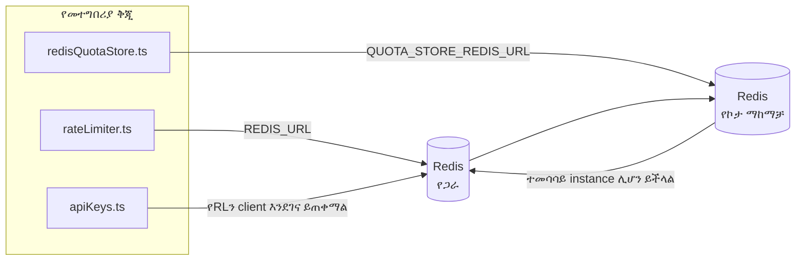

# Redis Production Configuration Guide (አማርኛ)

🌐 **Languages:** 🇺🇸 [English](../../../../ops/REDIS_PRODUCTION_CONFIG.md) · 🇸🇦 [ar](../../../ar/docs/ops/REDIS_PRODUCTION_CONFIG.md) · 🇦🇿 [az](../../../az/docs/ops/REDIS_PRODUCTION_CONFIG.md) · 🇧🇬 [bg](../../../bg/docs/ops/REDIS_PRODUCTION_CONFIG.md) · 🇧🇩 [bn](../../../bn/docs/ops/REDIS_PRODUCTION_CONFIG.md) · 🇧🇦 [bs](../../../bs/docs/ops/REDIS_PRODUCTION_CONFIG.md) · 🇨🇿 [cs](../../../cs/docs/ops/REDIS_PRODUCTION_CONFIG.md) · 🇩🇰 [da](../../../da/docs/ops/REDIS_PRODUCTION_CONFIG.md) · 🇩🇪 [de](../../../de/docs/ops/REDIS_PRODUCTION_CONFIG.md) · 🇬🇷 [el](../../../el/docs/ops/REDIS_PRODUCTION_CONFIG.md) · 🇪🇸 [es](../../../es/docs/ops/REDIS_PRODUCTION_CONFIG.md) · 🇪🇪 [et](../../../et/docs/ops/REDIS_PRODUCTION_CONFIG.md) · 🇮🇷 [fa](../../../fa/docs/ops/REDIS_PRODUCTION_CONFIG.md) · 🇫🇮 [fi](../../../fi/docs/ops/REDIS_PRODUCTION_CONFIG.md) · 🇫🇷 [fr](../../../fr/docs/ops/REDIS_PRODUCTION_CONFIG.md) · 🇮🇪 [ga](../../../ga/docs/ops/REDIS_PRODUCTION_CONFIG.md) · 🇮🇳 [gu](../../../gu/docs/ops/REDIS_PRODUCTION_CONFIG.md) · 🇳🇬 [ha](../../../ha/docs/ops/REDIS_PRODUCTION_CONFIG.md) · 🇮🇱 [he](../../../he/docs/ops/REDIS_PRODUCTION_CONFIG.md) · 🇮🇳 [hi](../../../hi/docs/ops/REDIS_PRODUCTION_CONFIG.md) · 🇭🇷 [hr](../../../hr/docs/ops/REDIS_PRODUCTION_CONFIG.md) · 🇭🇺 [hu](../../../hu/docs/ops/REDIS_PRODUCTION_CONFIG.md) · 🇦🇲 [hy](../../../hy/docs/ops/REDIS_PRODUCTION_CONFIG.md) · 🇮🇩 [id](../../../id/docs/ops/REDIS_PRODUCTION_CONFIG.md) · 🇳🇬 [ig](../../../ig/docs/ops/REDIS_PRODUCTION_CONFIG.md) · 🇮🇹 [it](../../../it/docs/ops/REDIS_PRODUCTION_CONFIG.md) · 🇯🇵 [ja](../../../ja/docs/ops/REDIS_PRODUCTION_CONFIG.md) · 🇬🇪 [ka](../../../ka/docs/ops/REDIS_PRODUCTION_CONFIG.md) · 🇰🇭 [km](../../../km/docs/ops/REDIS_PRODUCTION_CONFIG.md) · 🇮🇳 [kn](../../../kn/docs/ops/REDIS_PRODUCTION_CONFIG.md) · 🇰🇷 [ko](../../../ko/docs/ops/REDIS_PRODUCTION_CONFIG.md) · 🇱🇹 [lt](../../../lt/docs/ops/REDIS_PRODUCTION_CONFIG.md) · 🇱🇻 [lv](../../../lv/docs/ops/REDIS_PRODUCTION_CONFIG.md) · 🇮🇳 [ml](../../../ml/docs/ops/REDIS_PRODUCTION_CONFIG.md) · 🇮🇳 [mr](../../../mr/docs/ops/REDIS_PRODUCTION_CONFIG.md) · 🇲🇾 [ms](../../../ms/docs/ops/REDIS_PRODUCTION_CONFIG.md) · 🇲🇹 [mt](../../../mt/docs/ops/REDIS_PRODUCTION_CONFIG.md) · 🇲🇲 [my](../../../my/docs/ops/REDIS_PRODUCTION_CONFIG.md) · 🇳🇵 [ne](../../../ne/docs/ops/REDIS_PRODUCTION_CONFIG.md) · 🇳🇱 [nl](../../../nl/docs/ops/REDIS_PRODUCTION_CONFIG.md) · 🇳🇴 [no](../../../no/docs/ops/REDIS_PRODUCTION_CONFIG.md) · 🇮🇳 [or](../../../or/docs/ops/REDIS_PRODUCTION_CONFIG.md) · 🇮🇳 [pa](../../../pa/docs/ops/REDIS_PRODUCTION_CONFIG.md) · 🇵🇭 [phi](../../../phi/docs/ops/REDIS_PRODUCTION_CONFIG.md) · 🇵🇱 [pl](../../../pl/docs/ops/REDIS_PRODUCTION_CONFIG.md) · 🇵🇹 [pt](../../../pt/docs/ops/REDIS_PRODUCTION_CONFIG.md) · 🇧🇷 [pt-BR](../../../pt-BR/docs/ops/REDIS_PRODUCTION_CONFIG.md) · 🇷🇴 [ro](../../../ro/docs/ops/REDIS_PRODUCTION_CONFIG.md) · 🇷🇺 [ru](../../../ru/docs/ops/REDIS_PRODUCTION_CONFIG.md) · 🇱🇰 [si](../../../si/docs/ops/REDIS_PRODUCTION_CONFIG.md) · 🇸🇰 [sk](../../../sk/docs/ops/REDIS_PRODUCTION_CONFIG.md) · 🇸🇮 [sl](../../../sl/docs/ops/REDIS_PRODUCTION_CONFIG.md) · 🇷🇸 [sr](../../../sr/docs/ops/REDIS_PRODUCTION_CONFIG.md) · 🇸🇪 [sv](../../../sv/docs/ops/REDIS_PRODUCTION_CONFIG.md) · 🇰🇪 [sw](../../../sw/docs/ops/REDIS_PRODUCTION_CONFIG.md) · 🇮🇳 [ta](../../../ta/docs/ops/REDIS_PRODUCTION_CONFIG.md) · 🇮🇳 [te](../../../te/docs/ops/REDIS_PRODUCTION_CONFIG.md) · 🇹🇭 [th](../../../th/docs/ops/REDIS_PRODUCTION_CONFIG.md) · 🇹🇷 [tr](../../../tr/docs/ops/REDIS_PRODUCTION_CONFIG.md) · 🇺🇦 [uk-UA](../../../uk-UA/docs/ops/REDIS_PRODUCTION_CONFIG.md) · 🇵🇰 [ur](../../../ur/docs/ops/REDIS_PRODUCTION_CONFIG.md) · 🇺🇿 [uz](../../../uz/docs/ops/REDIS_PRODUCTION_CONFIG.md) · 🇻🇳 [vi](../../../vi/docs/ops/REDIS_PRODUCTION_CONFIG.md) · 🇳🇬 [yo](../../../yo/docs/ops/REDIS_PRODUCTION_CONFIG.md) · 🇨🇳 [zh-CN](../../../zh-CN/docs/ops/REDIS_PRODUCTION_CONFIG.md) · 🇹🇼 [zh-TW](../../../zh-TW/docs/ops/REDIS_PRODUCTION_CONFIG.md)

---

## አጠቃላይ እይታ

Redis በOmniRoute ውስጥ **አማራጭ፣ ወሳኝ ያልሆነ ጥገኝነት** ነው — Redis በማይገኝበት ጊዜ መተግበሪያው በተገቢ ሁኔታ ወደ አማራጭ አሠራር (በማህደረ ትውስታ ውስጥ
የሚሠሩ አማራጮች) ይሸጋገራል። በምርት አካባቢ Redisን ማስተካከል ለአራት የተለያዩ
የሥራ ጫናዎች መዘግየትን ይቀንሳል፦

| የሥራ ጫና                 | አንቀሳቃሽ                        | የደንበኛ ፋብሪካ                                            | የቁልፍ ንድፍ                                        |
| ---------------------- | ----------------------------- | ----------------------------------------------------- | ----------------------------------------------- |
| የፍጥነት ገደብ              | `rateLimiter.ts`              | `getRedisClient()` — ሲያስፈልግ የሚጀመር `ioredis` singleton | `<prefix>rl:*` በLua አቶሚክ የሆኑ የፍጥነት ገደብ ጊዜ መስኮቶች |
| የማረጋገጫ መሸጎጫ            | `apiKeys.ts`                  | የ`rateLimiter`ን ደንበኛ እንደገና ይጠቀማል                      | `<prefix>auth:api_key:<sha256>` ከTTL ጋር         |
| የኮታ ማከማቻ               | `redisQuotaStore.ts`          | የተለየ `getRedisClient(url)` singleton                  | `<prefix>quota:*` ለእያንዳንዱ instance ሊዋቀር የሚችል    |
| የማሟሟቂያ circuit breaker | `redisCircuitBreakerStore.ts` | በ`circuitBreakerFactory.ts` ውስጥ ያለ የተለየ ደንበኛ          | `<prefix>warmup:cb:<connectionId>`              |

አራቱም የሥራ ጫናዎች OmniRoute ከሌሎች መተግበሪያዎች ጋር በአንድ
Redis instance (ለምሳሌ `127.0.0.1:6379`) ላይ አብሮ እንዲሠራ አንድ የnamespace ቅድመ ቅጥያ ይጋራሉ። [የቁልፍ Namespace አደረጃጀት](#key-namespacing)ን ይመልከቱ።

---

## የአሁኑ ውቅር (የኮድ ነባሪዎች)

| ቅንብር                                | እሴት                                           | የሚገኝበት                                                                                |
| ----------------------------------- | --------------------------------------------- | ------------------------------------------------------------------------------------- |
| `REDIS_URL` የአካባቢ ተለዋዋጭ             | `redis://redis:6379` (compose)፣ አማራጭ          | `rateLimiter.ts:5`, `.env.example`                                                    |
| `REDIS_KEY_PREFIX` የአካባቢ ተለዋዋጭ      | `omniroute:` (ነባሪ)                            | `rateLimiter.ts`, `redisQuotaStore.ts`, `redisCircuitBreakerStore.ts`, `.env.example` |
| `QUOTA_STORE_REDIS_URL` የአካባቢ ተለዋዋጭ | የተለየ፣ ከ`REDIS_URL` ሊለይ ይችላል                   | `quota/storeFactory.ts`                                                               |
| `QUOTA_STORE_DRIVER`                | `"sqlite"` (ነባሪ)፣ `"redis"` አማራጭ              | `quota/storeFactory.ts`                                                               |
| ioredis `maxRetriesPerRequest`      | `3`                                           | የ`rateLimiter.ts` ደንበኛ መፍጠሪያ                                                          |
| `enableReadyCheck`                  | አልተቀናበረም (የioredis ነባሪ፦ `true`)               | —                                                                                     |
| `lazyConnect`                       | አልተቀናበረም (የioredis ነባሪ፦ `false`)              | —                                                                                     |
| `retryStrategy`                     | አልተቀናበረም (የioredis ነባሪ፦ 200ms መሠረት፣ ኤክስፖነንሻል) | —                                                                                     |
| TLS / የይለፍ ቃል / DB መረጃ ጠቋሚ          | **አልተዋቀረም**                                   | —                                                                                     |
| Sentinel / Cluster                  | **አልተዋቀረም** — standalone ባለአንድ-node ብቻ        | —                                                                                     |

---

## የቁልፍ Namespace አደረጃጀት

OmniRoute የRedis instanceን በhost ላይ ከሚሠሩ ሌሎች ማናቸውም ነገሮች ጋር ይጋራል። Namespace ከሌለ፣
እንደ `auth:api_key:<sha256>` ወይም `rl:*` ያሉ ቁልፎች ተመሳሳዩን Redis ከሚጠቀሙ ሌሎች መተግበሪያዎች
ቁልፎች ጋር ሊጋጩ ይችላሉ (ይህ instance Redisን ከሌሎች አገልግሎቶች ጎን ለጎን በ`127.0.0.1:6379` ላይ ያስኬዳል)።

ለ**እያንዳንዱ** የOmniRoute ቁልፍ ቅድመ ቅጥያ ለማከል `REDIS_KEY_PREFIX`ን ባዶ ያልሆነ ሕብረቁምፊ ያድርጉ፦

```bash
# .env — ሁሉም የOmniRoute ቁልፎች omniroute:rl:*, omniroute:auth:*, omniroute:quota:*, omniroute:warmup:cb:* ይሆናሉ
REDIS_KEY_PREFIX=omniroute:
```

- **ነባሪ፦** `omniroute:` (`REDIS_KEY_PREFIX` ካልተቀናበረ ወይም ባዶ ከሆነ ይተገበራል)።
- **የሚተገበርባቸው፦** የፍጥነት ገዳቢ + የማረጋገጫ መሸጎጫ (በ`keyPrefix` በኩል የሚጋራ `ioredis` ደንበኛ)፣
  የኮታ ማከማቻ (`KEY_PREFIX = "${REDIS_KEY_PREFIX}quota"`) እና የማሟሟቂያ circuit breaker
  (`KEY_PREFIX = "${REDIS_KEY_PREFIX}warmup:cb:"`)።
- ቁልፎች በRedis ውስጥ አስቀድመው በሚኖሩበት ጊዜ **ቅድመ ቅጥያውን መቀየር** የድሮ ቁልፎቹን ያለ ተጠቃሚ ያስቀራቸዋል (እነሱም
  በTTL / LRU በኩል ጊዜያቸው ያበቃል)። መቀየሩ ደህንነቱ የተጠበቀ ነው፤ ምንም migration አያስፈልግም። አንዱ ልዩ ሁኔታ የተከለከለ ተብሎ ምልክት ለተደረገበት connection የማሟሟቂያ
  circuit-breaker ቁልፍ ነው፦ ያለ TTL በቋሚነት ይቀመጣል፤ ስለዚህ ቀሪዎቹን በ`redis-cli --scan --pattern '<old-prefix>warmup:cb:*'` ይዘርዝሩና ይሰርዟቸው።
- **ioredis `keyPrefix`** በጽሑፍ ጊዜ ቅድመ ቅጥያውን በራስ-ሰር ይጨምራል፣ በንባብ ጊዜም በራስ-ሰር ያስወግደዋል፤
  ስለዚህ የመተግበሪያው ኮድ ቅድመ ቅጥያውን በፍጹም አያየውም።

---

## የሚመከር የምርት ማስተካከያ

### 1. የግንኙነት ገንዳ / የደንበኛ አማራጮች (ioredis `Redis` ግንበኛ)

የአሁኑ ኮድ ምንም ብጁ አማራጮች የሌሉበት ነጠላ `new Redis(url)` ይፈጥራል። ለምርት ባለብዙ-ብዜት ማሰማራቶች የደንበኛ ፋብሪካን በኮዱ ውስጥ ማለፍ ወይም `getRedisClient()` መጠቅለል፡-

```typescript
const redis = new Redis(REDIS_URL, {
  maxRetriesPerRequest: null, // no retry limit; let retryStrategy decide
  enableReadyCheck: true, // verify server is ready before accepting calls
  lazyConnect: true, // don't connect on construction; wait for first call
  retryStrategy: (times) => {
    if (times > 10) return null; // give up after 10 retries → reconnect later
    return Math.min(times * 200, 5000); // 200ms, 400ms, …, 5s cap
  },
  enableAutoPipelining: true, // coalesce concurrent commands into one TCP write
  keepAlive: 10000, // TCP keep‑alive every 10s
});
```

**ቁልፍ ግብይቶች፡-**

- `maxRetriesPerRequest: null` + `retryStrategy` — ለማምረት ተመራጭ ነው ስለዚህ ጊዜያዊ Redis ዳግም መጀመር እያንዳንዱን ጥያቄ ወዲያውኑ አያመልጥም። በ `checkRateLimit()` ውስጥ ያለው የማህደረ ትውስታ ውድቀት የውድቀቱን መንገድ ይይዛል።
- `lazyConnect: true` — አገልጋዩ ግንኙነቶችን መቀበል ከመጀመሩ በፊት በ Redis ላይ ከመነሳት የመነሻ ጥገኝነትን ያስወግዳል።
- `enableAutoPipelining: true` — ለተመሳሳይ መጠን ገደብ ፍተሻዎች የዙር ጉዞዎችን ይቀንሳል። በአንድ ግንኙነት ላይ በ > 50 RPS ጠቃሚ።

### 2. Redis የአገልጋይ ውቅር (`redis.conf`)

```
# Memory
maxmemory 80%                        # leave room for OS page cache
maxmemory-policy allkeys-lru         # evict stale auth cache entries under pressure

# Persistence (optional — OmniRoute is crash‑safe without it)
save 300 1                           # snapshot at least every 5 min if ≥1 key changed
appendonly no                        # AOF not needed; data is regeneratable
appendfsync no                       # no fsync overhead (RDB is sufficient)

# Networking
timeout 0                            # no idle disconnect
tcp-keepalive 300                    # 5 min keep‑alive
tcp-backlog 511                      # connection backlog for bursty load

# Performance
hz 10                                # default; 100 for latency‑sensitive
activedefrag yes                     # auto‑defragment when fragmentation >10%
```

**`maxmemory-policy allkeys-lru` ግብይት፡-** የማረጋገጫ መሸጎጫ ግቤቶች በማህደረ ትውስታ ግፊት ሊባረሩ ይችላሉ። ይህ ደህንነቱ የተጠበቀ — `setCachedApiKey` ሁልጊዜ በ miss ላይ እንደገና ይሞላል፣ እና የ SQLite ውድቀት ስልጣን ነው። ተመን-ገደብ Lua ስክሪፕት በንድፍ ለአጭር ጊዜ የሚቆዩ ትናንሽ ቁልፎችን ይፈጥራል።

### 3. Docker ቅንብሮችን ጻፍ

ፕሮድ አዘጋጅ (`docker-compose.prod.yml`) `redis:8.6.2-alpine` ይጠቀማል። አክል፡

```yaml
redis:
  image: redis:8.6.2-alpine
  command:
    [
      "redis-server",
      "--maxmemory",
      "512mb",
      "--maxmemory-policy",
      "allkeys-lru",
      "--activedefrag",
      "yes",
      "--save",
      "300 1",
    ]
  healthcheck:
    test: ["CMD", "redis-cli", "ping"]
    interval: 10s
    timeout: 3s
    retries: 3
    start_period: 5s
```

### 4. ባለብዙ-አብነት / ልኬት ግምት

**ነጠላ Redis ለሁሉም ቅጂዎች** — የዋጋ-ገደብ Lua ስክሪፕት በአንድ ባለ ስልጣን ቁልፍ ቦታ ላይ ይወሰናል። ከቅጂዎች በስተጀርባ ያሉ ብዙ Redis ምሳሌዎች ንፁህነትን ያጣሉ እና በጀቱን በእጥፍ ይጨምራሉ። ለሁሉም የመተግበሪያ ቅጂዎች ነጠላ Redis (ወይም Redis Sentinel cluster with failover) ይጠቀሙ።

**የግንኙነት ብዛት፡-** እያንዳንዱ መተግበሪያ ቅጂ ይከፈታል።** 2 TCP ግንኙነቶች** ወደ Redis (ተመን ገዥ ደንበኛ + የኮታ መደብር ደንበኛ)። በ10 ድግግሞሽ → 20 ግንኙነቶች፣ በነባሪ Redis ምሳሌ 10k የግንኙነት ጣሪያ ውስጥ።

### 5. ክትትል

በጤና ፍተሻ የመጨረሻ ነጥብ በኩል አጋልጥ፡

```typescript
// src/app/api/monitoring/health/route.ts already calls rateLimiter functions
// Add Redis-specific checks:
//   1. PING latency via ioredis .ping()
//   2. Memory usage via INFO memory
//   3. Connection count via INFO clients
//   4. Hit rate for maxmemory-policy (evicted_keys / keyspace_hits)
```

የሚመለከቱት ቁልፍ መለኪያዎች፡-

- **የተባረሩ ቁልፎች / ሰከንድ** — በቋሚነት ዜሮ ካልሆነ፣ `maxmemory` ይጨምሩ
- **የታገዱ ደንበኞች** — ዜሮ ያልሆኑ ቀርፋፋ የሉአ ጽሑፎችን ወይም ከፍተኛ ሙግትን ይጠቁማል
- **ውድቅ የተደረጉ ግንኙነቶች** — ግንኙነት ገደብ መታ; አልፎ አልፎ በ 20 ግንኙነቶች

### 6. Redis-ተኳሃኝ አገልጋዮች

እዚህ ጥቅም ላይ የሚውለው ማንኛውም አገልጋይ የ Lua ስክሪፕቶችን ማሄድ አለበት፡ የዋጋ ገደብ አንድ `EVAL` ነው። ሉአ በሌለበት አገልጋይ ላይ `checkRateLimit()` `[RATE_LIMITER] Redis eval failed, falling back to in-memory rate limiting` ይመዘግባል እና በየሂደቱ ይቆጥራል፣ ስለዚህ እያንዳንዱ ቅጂ በራሱ ገደቡን ያስፈጽማል። የመርጦ መግባቱ የጋራ ክፍለ-ጊዜ-ግንኙነት ማከማቻ (`OMNIROUTE_SESSION_AFFINITY_STORE=redis`) እንዲሁም ፒኖችን በ `EVAL` ያነብባል እና ያዘምናል፤ ያለ Lua `[SESSION_AFFINITY] Redis error; falling back to SQLite.` ይመዘግባል እና እያንዳንዱ ቅጂ የራሱን ፒን ይይዛል። ሌሎቹ የሥራ ጫናዎች ግልጽ ትዕዛዞችን (`SET ... EX`፣ `GET`፣ `DEL`፣ `MGET`፣ `EXPIRE`፣ `INCRBYFLOAT`፣ hashes and sets) ይጠቀማሉ፣ እና የትርጉም መሸጎጫ Redis ጀርባ ምንም `FT.*` ትዕዛዞችን አይልክም።

የተፈተነ በ OmniRoute 3.8.52 KiviDB 1.2.0 ከሉአ ምስሉ (`kividb/kividb:v1.2.0-lua`) ጋር። የፍጥነት ቆጣቢው (የሁለተኛ ሂደት ቆጣሪዎችን ማጋራትን ጨምሮ)፣ የዋስትና መሸጎጫ፣ የኮታ ማከማቻ፣ የማሞቅ ሰርክ ሰሪ፣ የትርጉም መሸጎጫ መደብር እና በቻት ተቆጣጣሪው በኩል `/v1/chat/completions` ጥያቄ በ Redis 8.10.3 ላይ ከሚያልፉት 19 ቼኮች 18ቱን አልፏል። የሚለየው: `INCRBYFLOAT` `0.1 + 0.2` እንደ `0.30000000000000004` ያከማቻል Redis የሚያከማችበት `0.3` ( [kividbio/kividb#387](https://github.com/kividbio/kividb/issues/387) )። የኮታ ማከማቻው ሁለቱንም በ `parseFloat` ይተነትናል፣ ነገር ግን ሁለቱ ቁጥሮች በመጨረሻዎቹ አሃዞች ይለያያሉ፣ ስለዚህ በኮታ ወሰን ላይ በትክክል የሚወድቅ ንፅፅር በተለየ መንገድ ሊወጣ ይችላል። የክፍለ-ጊዜው ተዛማጅነት ያለው መደብር የዚያ ሩጫ አካል አልነበረም። ( [ማዋቀር](https://github.com/kividbio/kividb/blob/master/docs/integrations/omniroute.md) ፣ [ውጤቶች](https://github.com/kividbio/kividb/tree/master/benchmarks/omniroute-compat) )

---

## የአርክቴክቸር ሥዕላዊ መግለጫ



---

## ማጣቀሻዎች

| ፋይል                                | ዓላማ                                                                 |
| ---------------------------------- | ------------------------------------------------------------------- |
| `src/shared/utils/rateLimiter.ts`  | ዋናው Redis client፣ የLua የፍጥነት ገደብ script፣ እና በማህደረ ትውስታ ውስጥ fallback |
| `src/lib/db/apiKeys.ts`            | የማረጋገጫ cache — Redis→SQLite fallback                                |
| `src/lib/quota/redisQuotaStore.ts` | ለአማራጭ የኮታ ማከማቻ የተለየ Redis client                                    |
| `src/lib/quota/storeFactory.ts`    | በ`sqlite` እና `redis` የኮታ drivers መካከል ይቀያየራል                        |
| `docker-compose.prod.yml`          | የምርት Redis container (image `redis:8.6.2-alpine`)                   |
| `.env.example`                     | የRedis env vars ሰነድ                                                 |
| `src/app/api/local/redis/`         | ለልማት container orchestration የAPI routes                            |
| `bin/cli/commands/redis.mjs`       | ለልማት container orchestration የCLI commands                          |
