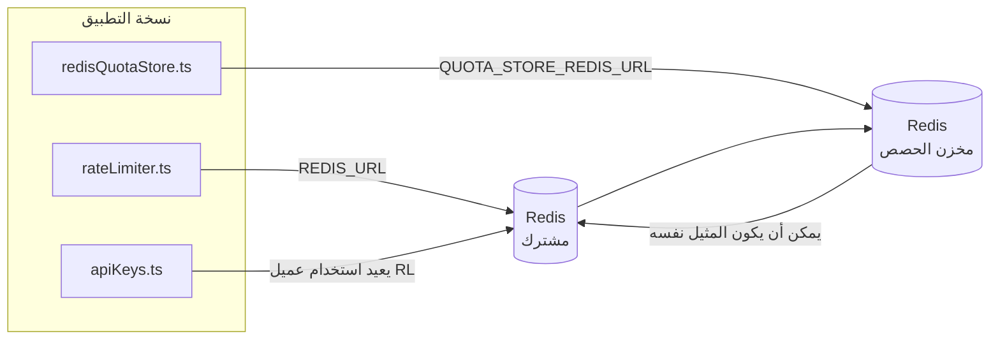

# Redis Production Configuration Guide (العربية)

🌐 **Languages:** 🇺🇸 [English](../../../../ops/REDIS_PRODUCTION_CONFIG.md) · 🇪🇹 [am](../../../am/docs/ops/REDIS_PRODUCTION_CONFIG.md) · 🇦🇿 [az](../../../az/docs/ops/REDIS_PRODUCTION_CONFIG.md) · 🇧🇬 [bg](../../../bg/docs/ops/REDIS_PRODUCTION_CONFIG.md) · 🇧🇩 [bn](../../../bn/docs/ops/REDIS_PRODUCTION_CONFIG.md) · 🇧🇦 [bs](../../../bs/docs/ops/REDIS_PRODUCTION_CONFIG.md) · 🇨🇿 [cs](../../../cs/docs/ops/REDIS_PRODUCTION_CONFIG.md) · 🇩🇰 [da](../../../da/docs/ops/REDIS_PRODUCTION_CONFIG.md) · 🇩🇪 [de](../../../de/docs/ops/REDIS_PRODUCTION_CONFIG.md) · 🇬🇷 [el](../../../el/docs/ops/REDIS_PRODUCTION_CONFIG.md) · 🇪🇸 [es](../../../es/docs/ops/REDIS_PRODUCTION_CONFIG.md) · 🇪🇪 [et](../../../et/docs/ops/REDIS_PRODUCTION_CONFIG.md) · 🇮🇷 [fa](../../../fa/docs/ops/REDIS_PRODUCTION_CONFIG.md) · 🇫🇮 [fi](../../../fi/docs/ops/REDIS_PRODUCTION_CONFIG.md) · 🇫🇷 [fr](../../../fr/docs/ops/REDIS_PRODUCTION_CONFIG.md) · 🇮🇪 [ga](../../../ga/docs/ops/REDIS_PRODUCTION_CONFIG.md) · 🇮🇳 [gu](../../../gu/docs/ops/REDIS_PRODUCTION_CONFIG.md) · 🇳🇬 [ha](../../../ha/docs/ops/REDIS_PRODUCTION_CONFIG.md) · 🇮🇱 [he](../../../he/docs/ops/REDIS_PRODUCTION_CONFIG.md) · 🇮🇳 [hi](../../../hi/docs/ops/REDIS_PRODUCTION_CONFIG.md) · 🇭🇷 [hr](../../../hr/docs/ops/REDIS_PRODUCTION_CONFIG.md) · 🇭🇺 [hu](../../../hu/docs/ops/REDIS_PRODUCTION_CONFIG.md) · 🇦🇲 [hy](../../../hy/docs/ops/REDIS_PRODUCTION_CONFIG.md) · 🇮🇩 [id](../../../id/docs/ops/REDIS_PRODUCTION_CONFIG.md) · 🇳🇬 [ig](../../../ig/docs/ops/REDIS_PRODUCTION_CONFIG.md) · 🇮🇹 [it](../../../it/docs/ops/REDIS_PRODUCTION_CONFIG.md) · 🇯🇵 [ja](../../../ja/docs/ops/REDIS_PRODUCTION_CONFIG.md) · 🇬🇪 [ka](../../../ka/docs/ops/REDIS_PRODUCTION_CONFIG.md) · 🇰🇭 [km](../../../km/docs/ops/REDIS_PRODUCTION_CONFIG.md) · 🇮🇳 [kn](../../../kn/docs/ops/REDIS_PRODUCTION_CONFIG.md) · 🇰🇷 [ko](../../../ko/docs/ops/REDIS_PRODUCTION_CONFIG.md) · 🇱🇹 [lt](../../../lt/docs/ops/REDIS_PRODUCTION_CONFIG.md) · 🇱🇻 [lv](../../../lv/docs/ops/REDIS_PRODUCTION_CONFIG.md) · 🇮🇳 [ml](../../../ml/docs/ops/REDIS_PRODUCTION_CONFIG.md) · 🇮🇳 [mr](../../../mr/docs/ops/REDIS_PRODUCTION_CONFIG.md) · 🇲🇾 [ms](../../../ms/docs/ops/REDIS_PRODUCTION_CONFIG.md) · 🇲🇹 [mt](../../../mt/docs/ops/REDIS_PRODUCTION_CONFIG.md) · 🇲🇲 [my](../../../my/docs/ops/REDIS_PRODUCTION_CONFIG.md) · 🇳🇵 [ne](../../../ne/docs/ops/REDIS_PRODUCTION_CONFIG.md) · 🇳🇱 [nl](../../../nl/docs/ops/REDIS_PRODUCTION_CONFIG.md) · 🇳🇴 [no](../../../no/docs/ops/REDIS_PRODUCTION_CONFIG.md) · 🇮🇳 [or](../../../or/docs/ops/REDIS_PRODUCTION_CONFIG.md) · 🇮🇳 [pa](../../../pa/docs/ops/REDIS_PRODUCTION_CONFIG.md) · 🇵🇭 [phi](../../../phi/docs/ops/REDIS_PRODUCTION_CONFIG.md) · 🇵🇱 [pl](../../../pl/docs/ops/REDIS_PRODUCTION_CONFIG.md) · 🇵🇹 [pt](../../../pt/docs/ops/REDIS_PRODUCTION_CONFIG.md) · 🇧🇷 [pt-BR](../../../pt-BR/docs/ops/REDIS_PRODUCTION_CONFIG.md) · 🇷🇴 [ro](../../../ro/docs/ops/REDIS_PRODUCTION_CONFIG.md) · 🇷🇺 [ru](../../../ru/docs/ops/REDIS_PRODUCTION_CONFIG.md) · 🇱🇰 [si](../../../si/docs/ops/REDIS_PRODUCTION_CONFIG.md) · 🇸🇰 [sk](../../../sk/docs/ops/REDIS_PRODUCTION_CONFIG.md) · 🇸🇮 [sl](../../../sl/docs/ops/REDIS_PRODUCTION_CONFIG.md) · 🇷🇸 [sr](../../../sr/docs/ops/REDIS_PRODUCTION_CONFIG.md) · 🇸🇪 [sv](../../../sv/docs/ops/REDIS_PRODUCTION_CONFIG.md) · 🇰🇪 [sw](../../../sw/docs/ops/REDIS_PRODUCTION_CONFIG.md) · 🇮🇳 [ta](../../../ta/docs/ops/REDIS_PRODUCTION_CONFIG.md) · 🇮🇳 [te](../../../te/docs/ops/REDIS_PRODUCTION_CONFIG.md) · 🇹🇭 [th](../../../th/docs/ops/REDIS_PRODUCTION_CONFIG.md) · 🇹🇷 [tr](../../../tr/docs/ops/REDIS_PRODUCTION_CONFIG.md) · 🇺🇦 [uk-UA](../../../uk-UA/docs/ops/REDIS_PRODUCTION_CONFIG.md) · 🇵🇰 [ur](../../../ur/docs/ops/REDIS_PRODUCTION_CONFIG.md) · 🇺🇿 [uz](../../../uz/docs/ops/REDIS_PRODUCTION_CONFIG.md) · 🇻🇳 [vi](../../../vi/docs/ops/REDIS_PRODUCTION_CONFIG.md) · 🇳🇬 [yo](../../../yo/docs/ops/REDIS_PRODUCTION_CONFIG.md) · 🇨🇳 [zh-CN](../../../zh-CN/docs/ops/REDIS_PRODUCTION_CONFIG.md) · 🇹🇼 [zh-TW](../../../zh-TW/docs/ops/REDIS_PRODUCTION_CONFIG.md)

---

## نظرة عامة

يُعد Redis **تبعية اختيارية ومرنة** في OmniRoute — إذ يتراجع التطبيق بسلاسة إلى بدائل داخل الذاكرة
عندما لا يتوفر Redis. في بيئة الإنتاج، يقلل ضبط Redis زمن الاستجابة لأربعة أعباء عمل منفصلة:

| عبء العمل                     | المشغّل                       | مصنع العميل                                        | نمط المفتاح                                              |
| ----------------------------- | ----------------------------- | -------------------------------------------------- | -------------------------------------------------------- |
| تحديد المعدل                  | `rateLimiter.ts`              | نسخة `ioredis` مفردة وكسولة عبر `getRedisClient()` | نوافذ تحديد معدل ذرية باستخدام Lua بالنمط `<prefix>rl:*` |
| ذاكرة التخزين المؤقت للمصادقة | `apiKeys.ts`                  | يعيد استخدام عميل `rateLimiter`                    | `<prefix>auth:api_key:<sha256>` مع TTL                   |
| مخزن الحصص                    | `redisQuotaStore.ts`          | نسخة مفردة منفصلة عبر `getRedisClient(url)`        | `<prefix>quota:*` قابل للتهيئة لكل نسخة                  |
| قاطع دائرة الإحماء            | `redisCircuitBreakerStore.ts` | عميل منفصل في `circuitBreakerFactory.ts`           | `<prefix>warmup:cb:<connectionId>`                       |

تتشارك أعباء العمل الأربعة بادئة مساحة أسماء واحدة، بحيث يمكن لـ OmniRoute التعايش مع تطبيقات أخرى على
نسخة Redis واحدة (مثل `127.0.0.1:6379`). راجع [مساحة أسماء المفاتيح](#key-namespacing).

---

## التهيئة الحالية (القيم الافتراضية في الشيفرة)

| الإعداد                                 | القيمة                                                                  | الموقع                                                                                |
| --------------------------------------- | ----------------------------------------------------------------------- | ------------------------------------------------------------------------------------- |
| متغير البيئة `REDIS_URL`                | `redis://redis:6379` (في compose)، اختياري                              | `rateLimiter.ts:5`، `.env.example`                                                    |
| متغير البيئة `REDIS_KEY_PREFIX`         | `omniroute:` (افتراضي)                                                  | `rateLimiter.ts`، `redisQuotaStore.ts`، `redisCircuitBreakerStore.ts`، `.env.example` |
| متغير البيئة `QUOTA_STORE_REDIS_URL`    | منفصل، ويمكن أن يختلف عن `REDIS_URL`                                    | `quota/storeFactory.ts`                                                               |
| `QUOTA_STORE_DRIVER`                    | `"sqlite"` (افتراضي)، و`"redis"` اختياري                                | `quota/storeFactory.ts`                                                               |
| ‏`maxRetriesPerRequest` في ioredis      | `3`                                                                     | إنشاء العميل في `rateLimiter.ts`                                                      |
| `enableReadyCheck`                      | غير مضبوط (القيمة الافتراضية في ioredis: `true`)                        | —                                                                                     |
| `lazyConnect`                           | غير مضبوط (القيمة الافتراضية في ioredis: `false`)                       | —                                                                                     |
| `retryStrategy`                         | غير مضبوط (القيمة الافتراضية في ioredis: أساس قدره 200ms، وتزايد أُسّي) | —                                                                                     |
| TLS / كلمة المرور / فهرس قاعدة البيانات | **غير مهيأة**                                                           | —                                                                                     |
| Sentinel / Cluster                      | **غير مهيأين** — عقدة مستقلة واحدة فقط                                  | —                                                                                     |

---

## مساحة أسماء المفاتيح

تتشارك OmniRoute نسخة Redis مع أي خدمات أخرى تعمل على المضيف. من دون مساحة أسماء،
قد تتعارض مفاتيح مثل `auth:api_key:<sha256>` أو `rl:*` مع مفاتيح تطبيقات أخرى
تستخدم Redis نفسه (تشغّل هذه النسخة Redis على `127.0.0.1:6379` إلى جانب خدمات أخرى).

اضبط `REDIS_KEY_PREFIX` على سلسلة غير فارغة لإضافة بادئة إلى **كل** مفتاح من مفاتيح OmniRoute:

```bash
# .env — تصبح جميع مفاتيح OmniRoute بالشكل omniroute:rl:* وomniroute:auth:* وomniroute:quota:* وomniroute:warmup:cb:*
REDIS_KEY_PREFIX=omniroute:
```

- **القيمة الافتراضية:** `omniroute:` (تُطبّق عندما يكون `REDIS_KEY_PREFIX` غير مضبوط أو فارغًا).
- **تُطبّق على:** محدد المعدل + ذاكرة التخزين المؤقت للمصادقة (عميل `ioredis` مشترك عبر `keyPrefix`) و
  مخزن الحصص (`KEY_PREFIX = "${REDIS_KEY_PREFIX}quota"`) وقاطع دائرة الإحماء
  (`KEY_PREFIX = "${REDIS_KEY_PREFIX}warmup:cb:"`).
- يؤدي **تغيير البادئة** عندما تكون المفاتيح موجودة بالفعل في Redis إلى جعل المفاتيح القديمة يتيمة (وتنتهي صلاحيتها
  عبر TTL / LRU). ويمكن تغييرها بأمان؛ فلا حاجة إلى ترحيل. الاستثناء الوحيد هو مفتاح قاطع
  دائرة الإحماء لاتصال معلَّم بأنه محظور: إذ يُحفظ من دون TTL، لذا اعرض المفاتيح المتبقية باستخدام
  `redis-cli --scan --pattern '<old-prefix>warmup:cb:*'` واحذفها.
- تقوم خاصية `keyPrefix` في **ioredis** تلقائيًا بإضافة البادئة عند الكتابة **و**إزالتها عند القراءة،
  لذلك لا ترى شيفرة التطبيق البادئة مطلقًا.

---

## ضبط الإنتاج الموصى به

### 1. تجمع الاتصال/خيارات العميل (منشئ ioredis `Redis` )

يقوم الكود الحالي بإنشاء `new Redis(url)` واحد بدون خيارات مخصصة. بالنسبة لعمليات نشر النسخ المتعددة للإنتاج، قم بتمرير مصنع العميل في التعليمات البرمجية أو قم بلف `getRedisClient()`:

```typescript
const redis = new Redis(REDIS_URL, {
  maxRetriesPerRequest: null, // no retry limit; let retryStrategy decide
  enableReadyCheck: true, // verify server is ready before accepting calls
  lazyConnect: true, // don't connect on construction; wait for first call
  retryStrategy: (times) => {
    if (times > 10) return null; // give up after 10 retries → reconnect later
    return Math.min(times * 200, 5000); // 200ms, 400ms, …, 5s cap
  },
  enableAutoPipelining: true, // coalesce concurrent commands into one TCP write
  keepAlive: 10000, // TCP keep‑alive every 10s
});
```

**المقايضات الرئيسية:**

- `maxRetriesPerRequest: null` + `retryStrategy` — مفضل للإنتاج، لذلك لا تفشل عمليات إعادة تشغيل Redis العابرة على الفور في كل طلب. يمتص الاحتياطي في الذاكرة في `checkRateLimit()` مسار الفشل.
- يتجنب `lazyConnect: true` — اعتماد بدء التشغيل على تشغيل Redis قبل أن يبدأ الخادم في قبول الاتصالات.
- يعمل `enableAutoPipelining: true` — على تقليل الرحلات ذهابًا وإيابًا لإجراء فحوصات الحد الأقصى للسعر المتزامنة؛ مفيد في > 50 RPS على اتصال واحد.

### 2. تكوين خادم Redis (`redis.conf`)

```
# Memory
maxmemory 80%                        # leave room for OS page cache
maxmemory-policy allkeys-lru         # evict stale auth cache entries under pressure

# Persistence (optional — OmniRoute is crash‑safe without it)
save 300 1                           # snapshot at least every 5 min if ≥1 key changed
appendonly no                        # AOF not needed; data is regeneratable
appendfsync no                       # no fsync overhead (RDB is sufficient)

# Networking
timeout 0                            # no idle disconnect
tcp-keepalive 300                    # 5 min keep‑alive
tcp-backlog 511                      # connection backlog for bursty load

# Performance
hz 10                                # default; 100 for latency‑sensitive
activedefrag yes                     # auto‑defragment when fragmentation >10%
```

**المقايضة ل `maxmemory-policy allkeys-lru`:** قد يتم طرد إدخالات ذاكرة التخزين المؤقت للمصادقة تحت ضغط الذاكرة. هذا أمر آمن، ويتم إعادة تعبئة — `setCachedApiKey` دائمًا في حالة عدم وجوده، ويكون الإجراء الاحتياطي SQLite موثوقًا. يقوم برنامج Lua النصي المحدد للمعدل بإنشاء مفاتيح صغيرة قصيرة العمر حسب التصميم.

### 3. إعدادات الإنشاء Docker

المنتج يؤلف (`docker-compose.prod.yml`) يستخدم `redis:8.6.2-alpine`. يضيف:

```yaml
redis:
  image: redis:8.6.2-alpine
  command:
    [
      "redis-server",
      "--maxmemory",
      "512mb",
      "--maxmemory-policy",
      "allkeys-lru",
      "--activedefrag",
      "yes",
      "--save",
      "300 1",
    ]
  healthcheck:
    test: ["CMD", "redis-cli", "ping"]
    interval: 10s
    timeout: 3s
    retries: 3
    start_period: 5s
```

### 4. اعتبارات المثيلات المتعددة/القياس

**Redis واحدة لجميع النسخ المتماثلة** — يعتمد البرنامج النصي Lua المحدد للمعدل على مساحة مفتاح موثوقة واحدة. ستفقد مثيلات Redis المتعددة الموجودة خلف النسخ المتماثلة ذريتها وتضاعف الميزانية. استخدم مجموعة Redis واحدة (أو مجموعة Redis Sentinel مع تجاوز الفشل) لجميع النسخ المتماثلة للتطبيق.

**عدد الاتصال:** يتم فتح كل نسخة طبق الأصل من التطبيق** 2 وصلات TCP** إلى Redis (عميل محدد السعر عميل مخزن الحصص + ). عند 10 نسخ متماثلة → 20 اتصالاً، ضمن سقف الاتصال الافتراضي لمثيل Redis وهو 10 كيلو بايت.

### 5. المراقبة

كشف عبر نقطة نهاية التحقق من الصحة:

```typescript
// src/app/api/monitoring/health/route.ts already calls rateLimiter functions
// Add Redis-specific checks:
//   1. PING latency via ioredis .ping()
//   2. Memory usage via INFO memory
//   3. Connection count via INFO clients
//   4. Hit rate for maxmemory-policy (evicted_keys / keyspace_hits)
```

المقاييس الرئيسية التي يجب مراقبتها:

- **مفاتيح طرد / ثانية** — إذا كان غير الصفر باستمرار، قم بزيادة `maxmemory`
- **العملاء المحظورون** — غير الصفر يشير إلى نصوص Lua البطيئة أو التنافس العالي
- **الاتصالات المرفوضة** ضرب حد اتصال — ؛ نادر عند 20 اتصالاً

### 6. الخوادم المتوافقة مع Redis

يجب على أي خادم مستخدم هنا تشغيل برامج Lua النصية: محدد المعدل هو `EVAL` واحد. على خادم لا يحتوي على Lua، يقوم `checkRateLimit()` بتسجيل `[RATE_LIMITER] Redis eval failed, falling back to in-memory rate limiting` والاحتساب لكل عملية، لذلك تفرض كل نسخة متماثلة الحد من تلقاء نفسها. يقوم متجر تقارب الجلسة المشتركة (`OMNIROUTE_SESSION_AFFINITY_STORE=redis`) أيضًا بقراءة الدبابيس وتحديثها باستخدام `EVAL`؛ بدون Lua يقوم بتسجيل `[SESSION_AFFINITY] Redis error; falling back to SQLite.` وتحتفظ كل نسخة متماثلة بالدبابيس الخاصة بها. تستخدم أحمال العمل الأخرى أوامر عادية (`SET ... EX`, `GET`, `DEL`, `MGET`, `EXPIRE`, `INCRBYFLOAT`, hashes وsets)، ولا ترسل الواجهة الخلفية Redis لذاكرة التخزين المؤقت الدلالية أي أوامر `FT.*`.

تم اختباره مع OmniRoute 3.8.52: KiviDB 1.2.0 مع صورة Lua الخاصة به (`kividb/kividb:v1.2.0-lua`). محدد المعدل (بما في ذلك عملية ثانية لمشاركة العدادات)، وذاكرة التخزين المؤقت للمصادقة، ومخزن الحصص، وقاطع دائرة التسخين، ومخزن ذاكرة التخزين المؤقت الدلالي، وطلب `/v1/chat/completions` من خلال معالج الدردشة اجتاز 18 من 19 عملية فحص تم تمريرها على Redis 8.10.3. الذي يختلف: `INCRBYFLOAT` يخزن `0.1 + 0.2` كـ `0.30000000000000004` حيث يخزن Redis `0.3` ( [kividbio/kividb#387](https://github.com/kividbio/kividb/issues/387) ). يقوم متجر الحصص بتوزيع كليهما باستخدام `parseFloat`، لكن الرقمين يختلفان في الأرقام الأخيرة، لذلك يمكن أن تظهر المقارنة التي تقع تمامًا على حدود الحصة بشكل مختلف. لم يكن متجر تقارب الجلسة جزءًا من هذا التشغيل. ( [الإعداد](https://github.com/kividbio/kividb/blob/master/docs/integrations/omniroute.md) ، [النتائج](https://github.com/kividbio/kividb/tree/master/benchmarks/omniroute-compat) )

---

## مخطط البنية



---

## المراجع

| الملف                              | الغرض                                                                     |
| ---------------------------------- | ------------------------------------------------------------------------- |
| `src/shared/utils/rateLimiter.ts`  | عميل Redis الأساسي، وبرنامج Lua النصي لتحديد المعدل، والبديل داخل الذاكرة |
| `src/lib/db/apiKeys.ts`            | ذاكرة التخزين المؤقت للمصادقة — Redis←SQLite كبديل                        |
| `src/lib/quota/redisQuotaStore.ts` | عميل Redis منفصل لمخزن الحصص الاختياري                                    |
| `src/lib/quota/storeFactory.ts`    | يبدّل بين مشغّلي الحصص `sqlite` و`redis`                                  |
| `docker-compose.prod.yml`          | حاوية Redis للإنتاج (الصورة `redis:8.6.2-alpine`)                         |
| `.env.example`                     | توثيق متغيرات بيئة Redis                                                  |
| `src/app/api/local/redis/`         | مسارات API لتنسيق حاوية التطوير                                           |
| `bin/cli/commands/redis.mjs`       | أوامر CLI لتنسيق حاوية التطوير                                            |
