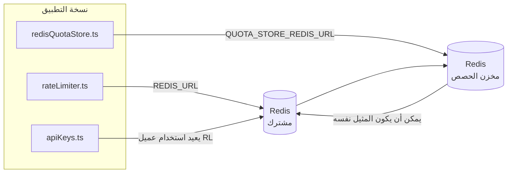

# Redis Production Configuration Guide (العربية)

🌐 **Languages:** 🇺🇸 [English](../../../../ops/REDIS_PRODUCTION_CONFIG.md) · 🇪🇹 [am](../../../am/docs/ops/REDIS_PRODUCTION_CONFIG.md) · 🇦🇿 [az](../../../az/docs/ops/REDIS_PRODUCTION_CONFIG.md) · 🇧🇬 [bg](../../../bg/docs/ops/REDIS_PRODUCTION_CONFIG.md) · 🇧🇩 [bn](../../../bn/docs/ops/REDIS_PRODUCTION_CONFIG.md) · 🇧🇦 [bs](../../../bs/docs/ops/REDIS_PRODUCTION_CONFIG.md) · 🇨🇿 [cs](../../../cs/docs/ops/REDIS_PRODUCTION_CONFIG.md) · 🇩🇰 [da](../../../da/docs/ops/REDIS_PRODUCTION_CONFIG.md) · 🇩🇪 [de](../../../de/docs/ops/REDIS_PRODUCTION_CONFIG.md) · 🇬🇷 [el](../../../el/docs/ops/REDIS_PRODUCTION_CONFIG.md) · 🇪🇸 [es](../../../es/docs/ops/REDIS_PRODUCTION_CONFIG.md) · 🇪🇪 [et](../../../et/docs/ops/REDIS_PRODUCTION_CONFIG.md) · 🇮🇷 [fa](../../../fa/docs/ops/REDIS_PRODUCTION_CONFIG.md) · 🇫🇮 [fi](../../../fi/docs/ops/REDIS_PRODUCTION_CONFIG.md) · 🇫🇷 [fr](../../../fr/docs/ops/REDIS_PRODUCTION_CONFIG.md) · 🇮🇪 [ga](../../../ga/docs/ops/REDIS_PRODUCTION_CONFIG.md) · 🇮🇳 [gu](../../../gu/docs/ops/REDIS_PRODUCTION_CONFIG.md) · 🇳🇬 [ha](../../../ha/docs/ops/REDIS_PRODUCTION_CONFIG.md) · 🇮🇱 [he](../../../he/docs/ops/REDIS_PRODUCTION_CONFIG.md) · 🇮🇳 [hi](../../../hi/docs/ops/REDIS_PRODUCTION_CONFIG.md) · 🇭🇷 [hr](../../../hr/docs/ops/REDIS_PRODUCTION_CONFIG.md) · 🇭🇺 [hu](../../../hu/docs/ops/REDIS_PRODUCTION_CONFIG.md) · 🇦🇲 [hy](../../../hy/docs/ops/REDIS_PRODUCTION_CONFIG.md) · 🇮🇩 [id](../../../id/docs/ops/REDIS_PRODUCTION_CONFIG.md) · 🇳🇬 [ig](../../../ig/docs/ops/REDIS_PRODUCTION_CONFIG.md) · 🇮🇹 [it](../../../it/docs/ops/REDIS_PRODUCTION_CONFIG.md) · 🇯🇵 [ja](../../../ja/docs/ops/REDIS_PRODUCTION_CONFIG.md) · 🇬🇪 [ka](../../../ka/docs/ops/REDIS_PRODUCTION_CONFIG.md) · 🇰🇭 [km](../../../km/docs/ops/REDIS_PRODUCTION_CONFIG.md) · 🇮🇳 [kn](../../../kn/docs/ops/REDIS_PRODUCTION_CONFIG.md) · 🇰🇷 [ko](../../../ko/docs/ops/REDIS_PRODUCTION_CONFIG.md) · 🇱🇹 [lt](../../../lt/docs/ops/REDIS_PRODUCTION_CONFIG.md) · 🇱🇻 [lv](../../../lv/docs/ops/REDIS_PRODUCTION_CONFIG.md) · 🇮🇳 [ml](../../../ml/docs/ops/REDIS_PRODUCTION_CONFIG.md) · 🇮🇳 [mr](../../../mr/docs/ops/REDIS_PRODUCTION_CONFIG.md) · 🇲🇾 [ms](../../../ms/docs/ops/REDIS_PRODUCTION_CONFIG.md) · 🇲🇹 [mt](../../../mt/docs/ops/REDIS_PRODUCTION_CONFIG.md) · 🇲🇲 [my](../../../my/docs/ops/REDIS_PRODUCTION_CONFIG.md) · 🇳🇵 [ne](../../../ne/docs/ops/REDIS_PRODUCTION_CONFIG.md) · 🇳🇱 [nl](../../../nl/docs/ops/REDIS_PRODUCTION_CONFIG.md) · 🇳🇴 [no](../../../no/docs/ops/REDIS_PRODUCTION_CONFIG.md) · 🇮🇳 [or](../../../or/docs/ops/REDIS_PRODUCTION_CONFIG.md) · 🇮🇳 [pa](../../../pa/docs/ops/REDIS_PRODUCTION_CONFIG.md) · 🇵🇭 [phi](../../../phi/docs/ops/REDIS_PRODUCTION_CONFIG.md) · 🇵🇱 [pl](../../../pl/docs/ops/REDIS_PRODUCTION_CONFIG.md) · 🇵🇹 [pt](../../../pt/docs/ops/REDIS_PRODUCTION_CONFIG.md) · 🇧🇷 [pt-BR](../../../pt-BR/docs/ops/REDIS_PRODUCTION_CONFIG.md) · 🇷🇴 [ro](../../../ro/docs/ops/REDIS_PRODUCTION_CONFIG.md) · 🇷🇺 [ru](../../../ru/docs/ops/REDIS_PRODUCTION_CONFIG.md) · 🇱🇰 [si](../../../si/docs/ops/REDIS_PRODUCTION_CONFIG.md) · 🇸🇰 [sk](../../../sk/docs/ops/REDIS_PRODUCTION_CONFIG.md) · 🇸🇮 [sl](../../../sl/docs/ops/REDIS_PRODUCTION_CONFIG.md) · 🇷🇸 [sr](../../../sr/docs/ops/REDIS_PRODUCTION_CONFIG.md) · 🇸🇪 [sv](../../../sv/docs/ops/REDIS_PRODUCTION_CONFIG.md) · 🇰🇪 [sw](../../../sw/docs/ops/REDIS_PRODUCTION_CONFIG.md) · 🇮🇳 [ta](../../../ta/docs/ops/REDIS_PRODUCTION_CONFIG.md) · 🇮🇳 [te](../../../te/docs/ops/REDIS_PRODUCTION_CONFIG.md) · 🇹🇭 [th](../../../th/docs/ops/REDIS_PRODUCTION_CONFIG.md) · 🇹🇷 [tr](../../../tr/docs/ops/REDIS_PRODUCTION_CONFIG.md) · 🇺🇦 [uk-UA](../../../uk-UA/docs/ops/REDIS_PRODUCTION_CONFIG.md) · 🇵🇰 [ur](../../../ur/docs/ops/REDIS_PRODUCTION_CONFIG.md) · 🇺🇿 [uz](../../../uz/docs/ops/REDIS_PRODUCTION_CONFIG.md) · 🇻🇳 [vi](../../../vi/docs/ops/REDIS_PRODUCTION_CONFIG.md) · 🇳🇬 [yo](../../../yo/docs/ops/REDIS_PRODUCTION_CONFIG.md) · 🇨🇳 [zh-CN](../../../zh-CN/docs/ops/REDIS_PRODUCTION_CONFIG.md) · 🇹🇼 [zh-TW](../../../zh-TW/docs/ops/REDIS_PRODUCTION_CONFIG.md)

---

## ملخص

Redis هو **اختياري، التبعية الناعمة** في OmniRoute — يتدهور التطبيق بشكل جيد (النسخ الاحتياطية في الذاكرة) عندما لا يكون Redis متاحًا. في الإنتاج، يؤدي ضبط Redis إلى تقليل زمن الوصول لأربعة أحمال عمل متميزة:

| عبء العمل                   | سائق                          | مصنع العميل                               | نمط المفتاح                              |
| --------------------------- | ----------------------------- | ----------------------------------------- | ---------------------------------------- |
| الحد من المعدل              | `rateLimiter.ts`              | `getRedisClient()` — كسول `ioredis` منفرد | نوافذ حد المعدل الذري `<prefix>rl:*` Lua |
| مصادقة ذاكرة التخزين المؤقت | `apiKeys.ts`                  | يعيد استخدام عميل `rateLimiter`           | `<prefix>auth:api_key:<sha256>` مع TTL   |
| متجر الحصص                  | `redisQuotaStore.ts`          | مفردة `getRedisClient(url)` منفصلة        | `<prefix>quota:*` قابل للتكوين لكل مثيل  |
| قاطع دائرة الإحماء          | `redisCircuitBreakerStore.ts` | عميل منفصل في `circuitBreakerFactory.ts`  | `<prefix>warmup:cb:<connectionId>`       |

تشترك جميع أحمال العمل الأربعة في بادئة مساحة اسم واحدة حتى يتمكن OmniRoute من التواجد مع التطبيقات الأخرى على مثيل Redis واحد (مثل `127.0.0.1:6379`). راجع [مسافة الاسم الرئيسية](#key-namespacing).

---

## التكوين الحالي (افتراضيات التعليمات البرمجية)

| جلسة                            | قيمة                                                       | أين                                                                                   |
| ------------------------------- | ---------------------------------------------------------- | ------------------------------------------------------------------------------------- |
| `REDIS_URL` env فار             | `redis://redis:6379` (تأليف)، اختياري                      | `rateLimiter.ts:5`, `.env.example`                                                    |
| `REDIS_KEY_PREFIX` env فار      | `omniroute:` (افتراضي)                                     | `rateLimiter.ts`, `redisQuotaStore.ts`, `redisCircuitBreakerStore.ts`, `.env.example` |
| `QUOTA_STORE_REDIS_URL` env فار | منفصلة، يمكن أن تختلف عن `REDIS_URL`                       | `quota/storeFactory.ts`                                                               |
| `QUOTA_STORE_DRIVER`            | `"sqlite"` (افتراضي)، `"redis"` اختياري                    | `quota/storeFactory.ts`                                                               |
| يوريديس `maxRetriesPerRequest`  | `3`                                                        | إنشاء عميل `rateLimiter.ts`                                                           |
| `enableReadyCheck`              | لم يتم ضبطه (ioredis الافتراضي: `true`)                    | —                                                                                     |
| `lazyConnect`                   | لم يتم ضبطه (ioredis الافتراضي: `false`)                   | —                                                                                     |
| `retryStrategy`                 | لم يتم ضبطه (ioredis الافتراضي: قاعدة 200 مللي ثانية، أسي) | —                                                                                     |
| TLS / كلمة المرور / مؤشر DB     | **لم يتم تكوينه**                                          | —                                                                                     |
| الحارس / الكتلة                 | **لم يتم تكوينه** — عقدة واحدة مستقلة فقط                  | —                                                                                     |

---

## مساحة أسماء المفاتيح

تتشارك OmniRoute نسخة Redis مع أي خدمات أخرى تعمل على المضيف. من دون مساحة أسماء،
قد تتعارض مفاتيح مثل `auth:api_key:<sha256>` أو `rl:*` مع مفاتيح تطبيقات أخرى
تستخدم Redis نفسه (تشغّل هذه النسخة Redis على `127.0.0.1:6379` إلى جانب خدمات أخرى).

اضبط `REDIS_KEY_PREFIX` على سلسلة غير فارغة لإضافة بادئة إلى **كل** مفتاح من مفاتيح OmniRoute:

```bash
# .env — تصبح جميع مفاتيح OmniRoute بالشكل omniroute:rl:* وomniroute:auth:* وomniroute:quota:* وomniroute:warmup:cb:*
REDIS_KEY_PREFIX=omniroute:
```

- **القيمة الافتراضية:** `omniroute:` (تُطبّق عندما يكون `REDIS_KEY_PREFIX` غير مضبوط أو فارغًا).
- **تُطبّق على:** محدد المعدل + ذاكرة التخزين المؤقت للمصادقة (عميل `ioredis` مشترك عبر `keyPrefix`) و
  مخزن الحصص (`KEY_PREFIX = "${REDIS_KEY_PREFIX}quota"`) وقاطع دائرة الإحماء
  (`KEY_PREFIX = "${REDIS_KEY_PREFIX}warmup:cb:"`).
- يؤدي **تغيير البادئة** عندما تكون المفاتيح موجودة بالفعل في Redis إلى جعل المفاتيح القديمة يتيمة (وتنتهي صلاحيتها
  عبر TTL / LRU). ويمكن تغييرها بأمان؛ فلا حاجة إلى ترحيل. الاستثناء الوحيد هو مفتاح قاطع
  دائرة الإحماء لاتصال معلَّم بأنه محظور: إذ يُحفظ من دون TTL، لذا اعرض المفاتيح المتبقية باستخدام
  `redis-cli --scan --pattern '<old-prefix>warmup:cb:*'` واحذفها.
- تقوم خاصية `keyPrefix` في **ioredis** تلقائيًا بإضافة البادئة عند الكتابة **و**إزالتها عند القراءة،
  لذلك لا ترى شيفرة التطبيق البادئة مطلقًا.

---

## ضبط الإنتاج الموصى به

### 1. تجمع الاتصال/خيارات العميل (منشئ ioredis `Redis` )

يقوم الكود الحالي بإنشاء `new Redis(url)` واحد بدون خيارات مخصصة. بالنسبة لعمليات نشر النسخ المتعددة للإنتاج، قم بتمرير مصنع العميل في التعليمات البرمجية أو قم بلف `getRedisClient()`:

```typescript
const redis = new Redis(REDIS_URL, {
  maxRetriesPerRequest: null, // no retry limit; let retryStrategy decide
  enableReadyCheck: true, // verify server is ready before accepting calls
  lazyConnect: true, // don't connect on construction; wait for first call
  retryStrategy: (times) => {
    if (times > 10) return null; // give up after 10 retries → reconnect later
    return Math.min(times * 200, 5000); // 200ms, 400ms, …, 5s cap
  },
  enableAutoPipelining: true, // coalesce concurrent commands into one TCP write
  keepAlive: 10000, // TCP keep‑alive every 10s
});
```

**المقايضات الرئيسية:**

- `maxRetriesPerRequest: null` + `retryStrategy` — مفضل للإنتاج حتى لا تفشل عمليات إعادة تشغيل Redis العابرة على الفور في كل طلب. يمتص الاحتياطي في الذاكرة في `checkRateLimit()` مسار الفشل.
- يتجنب `lazyConnect: true` — اعتماد بدء التشغيل على تشغيل Redis قبل أن يبدأ الخادم في قبول الاتصالات.
- تعمل `enableAutoPipelining: true` — على تقليل الرحلات ذهابًا وإيابًا لإجراء فحوصات الحد الأقصى للسعر المتزامنة؛ مفيد في > 50 RPS على اتصال واحد.

### 2. تكوين خادم Redis (`redis.conf`)

```
# Memory
maxmemory 80%                        # leave room for OS page cache
maxmemory-policy allkeys-lru         # evict stale auth cache entries under pressure

# Persistence (optional — OmniRoute is crash‑safe without it)
save 300 1                           # snapshot at least every 5 min if ≥1 key changed
appendonly no                        # AOF not needed; data is regeneratable
appendfsync no                       # no fsync overhead (RDB is sufficient)

# Networking
timeout 0                            # no idle disconnect
tcp-keepalive 300                    # 5 min keep‑alive
tcp-backlog 511                      # connection backlog for bursty load

# Performance
hz 10                                # default; 100 for latency‑sensitive
activedefrag yes                     # auto‑defragment when fragmentation >10%
```

**المقايضة لـ `maxmemory-policy allkeys-lru`:** قد يتم طرد إدخالات ذاكرة التخزين المؤقت للمصادقة تحت ضغط الذاكرة. يعد هذا أمرًا آمنًا، حيث تتم إعادة تعبئة — `setCachedApiKey` دائمًا عند حدوث خطأ، ويكون احتياطي SQLite موثوقًا. يقوم برنامج Lua النصي المحدد للمعدل بإنشاء مفاتيح صغيرة قصيرة العمر حسب التصميم.

### 3. إعدادات إنشاء Docker

يستخدم المنتج المؤلف (`docker-compose.prod.yml`) `redis:8.6.2-alpine`. يضيف:

```yaml
redis:
  image: redis:8.6.2-alpine
  command:
    [
      "redis-server",
      "--maxmemory",
      "512mb",
      "--maxmemory-policy",
      "allkeys-lru",
      "--activedefrag",
      "yes",
      "--save",
      "300 1",
    ]
  healthcheck:
    test: ["CMD", "redis-cli", "ping"]
    interval: 10s
    timeout: 3s
    retries: 3
    start_period: 5s
```

### 4. اعتبارات المثيلات المتعددة/القياس

**Redis واحد لجميع النسخ المتماثلة** — يعتمد البرنامج النصي Lua المحدد للمعدل على مساحة مفتاح موثوقة واحدة. ستفقد مثيلات Redis المتعددة الموجودة خلف النسخ المتماثلة ذريتها وتضاعف الميزانية. استخدم مجموعة Redis واحدة (أو مجموعة Redis Sentinel مع تجاوز الفشل) لجميع النسخ المتماثلة للتطبيق.

**عدد الاتصال:** يتم فتح كل نسخة طبق الأصل من التطبيق **2 اتصالات TCP** إلى Redis (عميل محدد السعر عميل مخزن الحصص + ). عند 10 نسخ متماثلة، يكون هناك 20 اتصالات → ، ضمن سقف اتصال 10 كيلو بايت لمثيل Redis الافتراضي.

### 5. المراقبة

كشف عبر نقطة نهاية التحقق من الصحة:

```typescript
// src/app/api/monitoring/health/route.ts already calls rateLimiter functions
// Add Redis-specific checks:
//   1. PING latency via ioredis .ping()
//   2. Memory usage via INFO memory
//   3. Connection count via INFO clients
//   4. Hit rate for maxmemory-policy (evicted_keys / keyspace_hits)
```

المقاييس الرئيسية التي يجب مراقبتها:

- **مفاتيح طرد / ثانية** — إذا كانت القيمة غير صفرية باستمرار، قم بزيادة `maxmemory`
- **العملاء المحظورون** يشير — غير الصفر إلى نصوص Lua البطيئة أو التنافس العالي
- **الاتصالات المرفوضة** تم الوصول إلى حد اتصال — ؛ نادر عند 20 اتصالاً

### 6. الخوادم المتوافقة مع Redis

يجب على أي خادم مستخدم هنا تشغيل برامج Lua النصية: محدد المعدل هو `EVAL` واحد. على خادم لا يحتوي على Lua، يقوم `checkRateLimit()` بتسجيل `[RATE_LIMITER] Redis eval failed, falling back to in-memory rate limiting` والاحتساب لكل عملية، بحيث تفرض كل نسخة متماثلة الحد من تلقاء نفسها. يقوم أيضًا متجر تقارب الجلسة المشتركة (`OMNIROUTE_SESSION_AFFINITY_STORE=redis`) بقراءة وتحديث الدبابيس باستخدام `EVAL`؛ بدون Lua فإنه يقوم بتسجيل `[SESSION_AFFINITY] Redis error; falling back to SQLite.` وتحتفظ كل نسخة متماثلة بدبابيسها الخاصة. تستخدم أحمال العمل الأخرى أوامر عادية (`SET ... EX`, `GET`, `DEL`, `MGET`, `EXPIRE`, `INCRBYFLOAT`, التجزئة والمجموعات)، ولا ترسل الواجهة الخلفية Redis لذاكرة التخزين المؤقت الدلالية أي أوامر `FT.*`.

تم اختباره مع OmniRoute 3.8.52: KiviDB 1.2.0 مع صورة Lua الخاصة به (`kividb/kividb:v1.2.0-lua`). محدد المعدل (بما في ذلك عملية ثانية لمشاركة العدادات)، وذاكرة التخزين المؤقت للمصادقة، ومخزن الحصص، وقاطع دائرة التسخين، ومخزن ذاكرة التخزين المؤقت الدلالي، وطلب `/v1/chat/completions` من خلال معالج الدردشة اجتاز 18 من 19 عملية فحص تم تمريرها على Redis 8.10.3. الشيء المختلف: يقوم `INCRBYFLOAT` بتخزين `0.1 + 0.2` كـ `0.30000000000000004` حيث يقوم Redis بتخزين `0.3` ( [kividbio/kividb#387](https://github.com/kividbio/kividb/issues/387) ). يقوم متجر الحصص بتوزيع كليهما باستخدام `parseFloat`، لكن الرقمين يختلفان في الأرقام الأخيرة، لذا فإن المقارنة التي تقع تمامًا على حدود الحصة النسبية يمكن أن تظهر بشكل مختلف. لم يكن متجر تقارب الجلسة جزءًا من هذا التشغيل. ( [الإعداد](https://github.com/kividbio/kividb/blob/master/docs/integrations/omniroute.md) ، [النتائج](https://github.com/kividbio/kividb/tree/master/benchmarks/omniroute-compat) )

---

## مخطط البنية



---

## مراجع

| ملف                                | غاية                                                                |
| ---------------------------------- | ------------------------------------------------------------------- |
| `src/shared/utils/rateLimiter.ts`  | عميل Redis الأساسي، البرنامج النصي لحد معدل Lua، احتياطي في الذاكرة |
| `src/lib/db/apiKeys.ts`            | مصادقة ذاكرة التخزين المؤقت — Redis→SQLite الاحتياطية               |
| `src/lib/quota/redisQuotaStore.ts` | عميل Redis منفصل لمخزن الحصص الاختياري                              |
| `src/lib/quota/storeFactory.ts`    | التبديل بين برامج تشغيل الحصص `sqlite` و `redis`                    |
| `docker-compose.prod.yml`          | حاوية Prod Redis (صورة `redis:8.6.2-alpine`)                        |
| `.env.example`                     | وثائق Redis env vars                                                |
| `src/app/api/local/redis/`         | مسارات API لتنسيق حاوية التطوير                                     |
| `bin/cli/commands/redis.mjs`       | أوامر CLI لتنسيق حاوية التطوير                                      |
