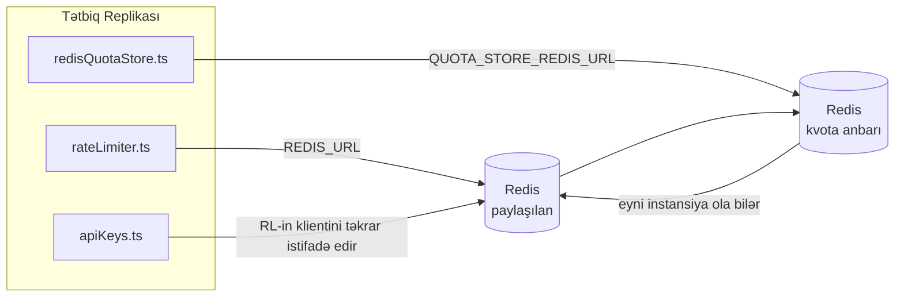

# Redis Production Configuration Guide (Azərbaycan dili)

🌐 **Languages:** 🇺🇸 [English](../../../../ops/REDIS_PRODUCTION_CONFIG.md) · 🇪🇹 [am](../../../am/docs/ops/REDIS_PRODUCTION_CONFIG.md) · 🇸🇦 [ar](../../../ar/docs/ops/REDIS_PRODUCTION_CONFIG.md) · 🇧🇬 [bg](../../../bg/docs/ops/REDIS_PRODUCTION_CONFIG.md) · 🇧🇩 [bn](../../../bn/docs/ops/REDIS_PRODUCTION_CONFIG.md) · 🇧🇦 [bs](../../../bs/docs/ops/REDIS_PRODUCTION_CONFIG.md) · 🇨🇿 [cs](../../../cs/docs/ops/REDIS_PRODUCTION_CONFIG.md) · 🇩🇰 [da](../../../da/docs/ops/REDIS_PRODUCTION_CONFIG.md) · 🇩🇪 [de](../../../de/docs/ops/REDIS_PRODUCTION_CONFIG.md) · 🇬🇷 [el](../../../el/docs/ops/REDIS_PRODUCTION_CONFIG.md) · 🇪🇸 [es](../../../es/docs/ops/REDIS_PRODUCTION_CONFIG.md) · 🇪🇪 [et](../../../et/docs/ops/REDIS_PRODUCTION_CONFIG.md) · 🇮🇷 [fa](../../../fa/docs/ops/REDIS_PRODUCTION_CONFIG.md) · 🇫🇮 [fi](../../../fi/docs/ops/REDIS_PRODUCTION_CONFIG.md) · 🇫🇷 [fr](../../../fr/docs/ops/REDIS_PRODUCTION_CONFIG.md) · 🇮🇪 [ga](../../../ga/docs/ops/REDIS_PRODUCTION_CONFIG.md) · 🇮🇳 [gu](../../../gu/docs/ops/REDIS_PRODUCTION_CONFIG.md) · 🇳🇬 [ha](../../../ha/docs/ops/REDIS_PRODUCTION_CONFIG.md) · 🇮🇱 [he](../../../he/docs/ops/REDIS_PRODUCTION_CONFIG.md) · 🇮🇳 [hi](../../../hi/docs/ops/REDIS_PRODUCTION_CONFIG.md) · 🇭🇷 [hr](../../../hr/docs/ops/REDIS_PRODUCTION_CONFIG.md) · 🇭🇺 [hu](../../../hu/docs/ops/REDIS_PRODUCTION_CONFIG.md) · 🇦🇲 [hy](../../../hy/docs/ops/REDIS_PRODUCTION_CONFIG.md) · 🇮🇩 [id](../../../id/docs/ops/REDIS_PRODUCTION_CONFIG.md) · 🇳🇬 [ig](../../../ig/docs/ops/REDIS_PRODUCTION_CONFIG.md) · 🇮🇹 [it](../../../it/docs/ops/REDIS_PRODUCTION_CONFIG.md) · 🇯🇵 [ja](../../../ja/docs/ops/REDIS_PRODUCTION_CONFIG.md) · 🇬🇪 [ka](../../../ka/docs/ops/REDIS_PRODUCTION_CONFIG.md) · 🇰🇭 [km](../../../km/docs/ops/REDIS_PRODUCTION_CONFIG.md) · 🇮🇳 [kn](../../../kn/docs/ops/REDIS_PRODUCTION_CONFIG.md) · 🇰🇷 [ko](../../../ko/docs/ops/REDIS_PRODUCTION_CONFIG.md) · 🇱🇹 [lt](../../../lt/docs/ops/REDIS_PRODUCTION_CONFIG.md) · 🇱🇻 [lv](../../../lv/docs/ops/REDIS_PRODUCTION_CONFIG.md) · 🇮🇳 [ml](../../../ml/docs/ops/REDIS_PRODUCTION_CONFIG.md) · 🇮🇳 [mr](../../../mr/docs/ops/REDIS_PRODUCTION_CONFIG.md) · 🇲🇾 [ms](../../../ms/docs/ops/REDIS_PRODUCTION_CONFIG.md) · 🇲🇹 [mt](../../../mt/docs/ops/REDIS_PRODUCTION_CONFIG.md) · 🇲🇲 [my](../../../my/docs/ops/REDIS_PRODUCTION_CONFIG.md) · 🇳🇵 [ne](../../../ne/docs/ops/REDIS_PRODUCTION_CONFIG.md) · 🇳🇱 [nl](../../../nl/docs/ops/REDIS_PRODUCTION_CONFIG.md) · 🇳🇴 [no](../../../no/docs/ops/REDIS_PRODUCTION_CONFIG.md) · 🇮🇳 [or](../../../or/docs/ops/REDIS_PRODUCTION_CONFIG.md) · 🇮🇳 [pa](../../../pa/docs/ops/REDIS_PRODUCTION_CONFIG.md) · 🇵🇭 [phi](../../../phi/docs/ops/REDIS_PRODUCTION_CONFIG.md) · 🇵🇱 [pl](../../../pl/docs/ops/REDIS_PRODUCTION_CONFIG.md) · 🇵🇹 [pt](../../../pt/docs/ops/REDIS_PRODUCTION_CONFIG.md) · 🇧🇷 [pt-BR](../../../pt-BR/docs/ops/REDIS_PRODUCTION_CONFIG.md) · 🇷🇴 [ro](../../../ro/docs/ops/REDIS_PRODUCTION_CONFIG.md) · 🇷🇺 [ru](../../../ru/docs/ops/REDIS_PRODUCTION_CONFIG.md) · 🇱🇰 [si](../../../si/docs/ops/REDIS_PRODUCTION_CONFIG.md) · 🇸🇰 [sk](../../../sk/docs/ops/REDIS_PRODUCTION_CONFIG.md) · 🇸🇮 [sl](../../../sl/docs/ops/REDIS_PRODUCTION_CONFIG.md) · 🇷🇸 [sr](../../../sr/docs/ops/REDIS_PRODUCTION_CONFIG.md) · 🇸🇪 [sv](../../../sv/docs/ops/REDIS_PRODUCTION_CONFIG.md) · 🇰🇪 [sw](../../../sw/docs/ops/REDIS_PRODUCTION_CONFIG.md) · 🇮🇳 [ta](../../../ta/docs/ops/REDIS_PRODUCTION_CONFIG.md) · 🇮🇳 [te](../../../te/docs/ops/REDIS_PRODUCTION_CONFIG.md) · 🇹🇭 [th](../../../th/docs/ops/REDIS_PRODUCTION_CONFIG.md) · 🇹🇷 [tr](../../../tr/docs/ops/REDIS_PRODUCTION_CONFIG.md) · 🇺🇦 [uk-UA](../../../uk-UA/docs/ops/REDIS_PRODUCTION_CONFIG.md) · 🇵🇰 [ur](../../../ur/docs/ops/REDIS_PRODUCTION_CONFIG.md) · 🇺🇿 [uz](../../../uz/docs/ops/REDIS_PRODUCTION_CONFIG.md) · 🇻🇳 [vi](../../../vi/docs/ops/REDIS_PRODUCTION_CONFIG.md) · 🇳🇬 [yo](../../../yo/docs/ops/REDIS_PRODUCTION_CONFIG.md) · 🇨🇳 [zh-CN](../../../zh-CN/docs/ops/REDIS_PRODUCTION_CONFIG.md) · 🇹🇼 [zh-TW](../../../zh-TW/docs/ops/REDIS_PRODUCTION_CONFIG.md)

---

## İcmal

Redis OmniRoute-da **ixtiyari, yumşaq asılılıqdır** — Redis əlçatan olmadıqda tətbiq işləməyə davam edir və funksionallığı uyğun şəkildə azaldır (yaddaşdaxili
ehtiyat mexanizmlərindən istifadə edir). İstehsal mühitində Redis-in tənzimlənməsi dörd fərqli
iş yükü üçün gecikməni azaldır:

| İş yükü                             | İdarəedici                    | Klient fabriki                                               | Açar nümunəsi                                                    |
| ----------------------------------- | ----------------------------- | ------------------------------------------------------------ | ---------------------------------------------------------------- |
| Sorğu tezliyinin məhdudlaşdırılması | `rateLimiter.ts`              | `getRedisClient()` — tənbəl başladılan `ioredis` singleton-u | `<prefix>rl:*` Lua ilə atomik sorğu tezliyi limiti pəncərələri   |
| Autentifikasiya keşi                | `apiKeys.ts`                  | `rateLimiter` klientindən təkrar istifadə edir               | TTL ilə `<prefix>auth:api_key:<sha256>`                          |
| Kvota anbarı                        | `redisQuotaStore.ts`          | Ayrı `getRedisClient(url)` singleton-u                       | `<prefix>quota:*`, hər instansiya üçün konfiqurasiya edilə bilər |
| İlkin qızdırma dövrə kəsicisi       | `redisCircuitBreakerStore.ts` | `circuitBreakerFactory.ts` daxilində ayrıca klient           | `<prefix>warmup:cb:<connectionId>`                               |

OmniRoute-un digər tətbiqlərlə tək bir Redis instansiyasında (məsələn, `127.0.0.1:6379`) yanaşı işləyə bilməsi üçün bütün dörd iş yükü eyni ad məkanı prefiksindən istifadə edir.
Baxın: [Açarların ad məkanı üzrə ayrılması](#key-namespacing).

---

## Cari konfiqurasiya (koddakı standart dəyərlər)

| Parametr                               | Dəyər                                                         | Yeri                                                                                  |
| -------------------------------------- | ------------------------------------------------------------- | ------------------------------------------------------------------------------------- |
| `REDIS_URL` mühit dəyişəni             | `redis://redis:6379` (compose), ixtiyari                      | `rateLimiter.ts:5`, `.env.example`                                                    |
| `REDIS_KEY_PREFIX` mühit dəyişəni      | `omniroute:` (standart)                                       | `rateLimiter.ts`, `redisQuotaStore.ts`, `redisCircuitBreakerStore.ts`, `.env.example` |
| `QUOTA_STORE_REDIS_URL` mühit dəyişəni | ayrıdır, `REDIS_URL` dəyərindən fərqli ola bilər              | `quota/storeFactory.ts`                                                               |
| `QUOTA_STORE_DRIVER`                   | `"sqlite"` (standart), `"redis"` ixtiyaridir                  | `quota/storeFactory.ts`                                                               |
| ioredis `maxRetriesPerRequest`         | `3`                                                           | `rateLimiter.ts` klientinin yaradılması                                               |
| `enableReadyCheck`                     | təyin edilməyib (ioredis standartı: `true`)                   | —                                                                                     |
| `lazyConnect`                          | təyin edilməyib (ioredis standartı: `false`)                  | —                                                                                     |
| `retryStrategy`                        | təyin edilməyib (ioredis standartı: 200ms baza, eksponensial) | —                                                                                     |
| TLS / parol / DB indeksi               | **konfiqurasiya edilməyib**                                   | —                                                                                     |
| Sentinel / Cluster                     | **konfiqurasiya edilməyib** — yalnız müstəqil tək qovşaq      | —                                                                                     |

---

## Açarların ad məkanı üzrə ayrılması

OmniRoute Redis instansiyasını hostda işləyən digər xidmətlərlə paylaşır. Ad məkanı olmadan
`auth:api_key:<sha256>` və ya `rl:*` kimi açarlar eyni Redis-dən istifadə edən digər tətbiqlərin
açarları ilə toqquşa bilər (bu instansiya Redis-i digər xidmətlərlə yanaşı `127.0.0.1:6379` ünvanında işlədir).

**Bütün** OmniRoute açarlarına prefiks əlavə etmək üçün `REDIS_KEY_PREFIX` dəyişənini boş olmayan sətirə təyin edin:

```bash
# .env — bütün OmniRoute açarları omniroute:rl:*, omniroute:auth:*, omniroute:quota:*, omniroute:warmup:cb:* formasını alır
REDIS_KEY_PREFIX=omniroute:
```

- **Standart:** `omniroute:` (`REDIS_KEY_PREFIX` təyin edilmədikdə və ya boş olduqda tətbiq edilir).
- **Tətbiq edildiyi yerlər:** sorğu tezliyi məhdudlaşdırıcısı + autentifikasiya keşi (`keyPrefix` vasitəsilə paylaşılan `ioredis` klienti), həmçinin
  kvota anbarı (`KEY_PREFIX = "${REDIS_KEY_PREFIX}quota"`) və ilkin qızdırma dövrə kəsicisi
  (`KEY_PREFIX = "${REDIS_KEY_PREFIX}warmup:cb:"`).
- Redis-də açarlar artıq mövcud olduqda **prefiksin dəyişdirilməsi** köhnə açarları sahibsiz qoyur (onlar
  TTL / LRU vasitəsilə silinir). Dəyişdirmək təhlükəsizdir; miqrasiya tələb olunmur. Yeganə istisna,
  qadağan edilmiş kimi işarələnmiş bağlantı üçün ilkin qızdırma dövrə kəsicisi açarıdır: o, TTL olmadan saxlanılır, buna görə
  qalıqları `redis-cli --scan --pattern '<old-prefix>warmup:cb:*'` ilə siyahıya alın və silin.
- **ioredis `keyPrefix`** yazma zamanı prefiksi avtomatik olaraq əlavə edir **və** oxuma zamanı onu silir,
  buna görə tətbiq kodu prefiksi heç vaxt görmür.

---

## Tövsiyə olunan İstehsal Tuning

### 1. Qoşulma Hovuzu / Müştəri Seçimləri (ioredis `Redis` konstruktoru)

Cari kod heç bir xüsusi seçimləri olmayan tək `new Redis(url)` yaradır. İstehsal çoxlu replika yerləşdirmələri üçün kodda müştəri fabrikini keçin və ya `getRedisClient()` sarın:

```typescript
const redis = new Redis(REDIS_URL, {
  maxRetriesPerRequest: null, // no retry limit; let retryStrategy decide
  enableReadyCheck: true, // verify server is ready before accepting calls
  lazyConnect: true, // don't connect on construction; wait for first call
  retryStrategy: (times) => {
    if (times > 10) return null; // give up after 10 retries → reconnect later
    return Math.min(times * 200, 5000); // 200ms, 400ms, …, 5s cap
  },
  enableAutoPipelining: true, // coalesce concurrent commands into one TCP write
  keepAlive: 10000, // TCP keep‑alive every 10s
});
```

**Əsas mübadilələr:**

- `maxRetriesPerRequest: null` + `retryStrategy` — istehsal üçün seçilir, ona görə də keçici Redis yenidən başlamaları hər sorğunu dərhal yerinə yetirmir. `checkRateLimit()` -də yaddaşdaxili geriləmə uğursuzluq yolunu udur.
- `lazyConnect: true` — server bağlantıları qəbul etməyə başlamazdan əvvəl Redis nin işə başlamasından asılılığın qarşısını alır.
- `enableAutoPipelining: true` — eyni vaxtda tarif limiti yoxlamaları üçün gediş-gəlişləri azaldır; bir əlaqədə > 50 RPS -də faydalıdır.

### 2. Redis Server Konfiqurasiyası (`redis.conf`)

```
# Memory
maxmemory 80%                        # leave room for OS page cache
maxmemory-policy allkeys-lru         # evict stale auth cache entries under pressure

# Persistence (optional — OmniRoute is crash‑safe without it)
save 300 1                           # snapshot at least every 5 min if ≥1 key changed
appendonly no                        # AOF not needed; data is regeneratable
appendfsync no                       # no fsync overhead (RDB is sufficient)

# Networking
timeout 0                            # no idle disconnect
tcp-keepalive 300                    # 5 min keep‑alive
tcp-backlog 511                      # connection backlog for bursty load

# Performance
hz 10                                # default; 100 for latency‑sensitive
activedefrag yes                     # auto‑defragment when fragmentation >10%
```

**`maxmemory-policy allkeys-lru` üçün mübadilə:** Auth cache daxiletmələri yaddaş təzyiqi altında çıxarıla bilər. Bu təhlükəsizdir — `setCachedApiKey` həmişə qaçırılanda yenidən doldurulur və SQLite geri dönüşü etibarlıdır. Razı məhdudlaşdırıcı Lua skripti dizaynla qısa ömürlü olan kiçik açarlar yaradır.

### 3. Docker Parametrləri Yarat

Prod compose (`docker-compose.prod.yml`) `redis:8.6.2-alpine` istifadə edir . Əlavə edin:

```yaml
redis:
  image: redis:8.6.2-alpine
  command:
    [
      "redis-server",
      "--maxmemory",
      "512mb",
      "--maxmemory-policy",
      "allkeys-lru",
      "--activedefrag",
      "yes",
      "--save",
      "300 1",
    ]
  healthcheck:
    test: ["CMD", "redis-cli", "ping"]
    interval: 10s
    timeout: 3s
    retries: 3
    start_period: 5s
```

### 4. Çox Nümunə / Ölçmə Mülahizələri

**Bütün replikalar üçün tək Redis** — dərəcəsi məhdudlaşdırıcı Lua skripti tək səlahiyyətli açar boşluğundan asılıdır. Replikaların arxasında çoxlu Redis nümunələri atomikliyini itirəcək və büdcəni ikiqat artıracaq. Bütün proqram replikaları üçün tək Redis (yaxud əvəzetmə ilə Redis Sentinel klaster) istifadə edin.

**Bağlantı sayı:** Hər bir proqram replikası açılır** 2 TCP əlaqə** Redis (dərəcə məhdudlaşdırıcı müştəri + kvota mağazası müştərisi). 10 replikada → 20 əlaqə, defolt Redis instansiyasının 10k əlaqə tavanı daxilində.

### 5. Monitorinq

Sağlamlıq yoxlamasının son nöqtəsi ilə ifşa olun:

```typescript
// src/app/api/monitoring/health/route.ts already calls rateLimiter functions
// Add Redis-specific checks:
//   1. PING latency via ioredis .ping()
//   2. Memory usage via INFO memory
//   3. Connection count via INFO clients
//   4. Hit rate for maxmemory-policy (evicted_keys / keyspace_hits)
```

Baxılacaq əsas göstəricilər:

- **Çıxarılan açarlar / san** — davamlı olaraq sıfır deyilsə, `maxmemory` artırın
- **Bloklanmış müştərilər** — qeyri-sıfır yavaş Lua skriptlərini və ya yüksək mübahisəni təklif edir
- **Rədd edilmiş əlaqələr** — əlaqə limitinə çatmaq; 20 əlaqədə nadirdir

### 6. Redis-ə uyğun gələn serverlər

Burada istifadə olunan istənilən server Lua skriptlərini işlətməlidir: sürət məhdudlaşdırıcısı bir `EVAL`. Lua olmayan bir serverdə `checkRateLimit()` `[RATE_LIMITER] Redis eval failed, falling back to in-memory rate limiting` qeyd edir və hər bir prosesi hesablayır, buna görə də hər bir replika limiti özbaşına tətbiq edir. Daxil olan paylaşılan sessiya yaxınlıq mağazası (`OMNIROUTE_SESSION_AFFINITY_STORE=redis`) həmçinin `EVAL` ilə pinləri oxuyur və yeniləyir; Lua olmadan `[SESSION_AFFINITY] Redis error; falling back to SQLite.` qeyd edir və hər replika öz pinlərini saxlayır. Digər iş yükləri sadə əmrlərdən istifadə edir (`SET ... EX`, `GET`, `DEL`, `MGET`, `EXPIRE`, `INCRBYFLOAT`, hashes and sets) və semantik keşin Redis backend heç bir `FT.*` əmri göndərmir.

OmniRoute 3.8.52 ilə sınaqdan keçirilib: KiviDB 1.2.0 Lua təsviri ilə (`kividb/kividb:v1.2.0-lua`). Dərəcə məhdudlaşdırıcı (sayğacları paylaşan ikinci proses daxil olmaqla), auth keşi, kvota anbarı, istiləşmə dövrə açarı, semantik keş anbarı və söhbət idarəedicisi vasitəsilə `/v1/chat/completions` sorğusu Redis 8.10.3-də keçən 19 yoxlamadan 18-ni keçdi. Fərqli olan: `INCRBYFLOAT` `0.1 + 0.2` `0.30000000000000004` kimi saxlayır, burada Redis `0.3` saxlayır ( [kividbio/kividb#387](https://github.com/kividbio/kividb/issues/387) ). Kvota anbarı hər ikisini `parseFloat` ilə təhlil edir, lakin iki rəqəm son rəqəmlərdə fərqlənir, buna görə də tam olaraq kvota sərhədinə düşən müqayisə fərqli şəkildə çıxa bilər. Sessiya yaxınlıq mağazası bu qaçışın bir hissəsi deyildi. ( [quraşdırma](https://github.com/kividbio/kividb/blob/master/docs/integrations/omniroute.md), [nəticələr](https://github.com/kividbio/kividb/tree/master/benchmarks/omniroute-compat) )

---

## Arxitektura Diaqramı



---

## İstinadlar

| Fayl                               | Təyinat                                                                                      |
| ---------------------------------- | -------------------------------------------------------------------------------------------- |
| `src/shared/utils/rateLimiter.ts`  | Əsas Redis klienti, Lua sorğu tezliyi məhdudlaşdırma skripti, yaddaşdaxili ehtiyat mexanizmi |
| `src/lib/db/apiKeys.ts`            | Autentifikasiya keşi — Redis→SQLite ehtiyat mexanizmi                                        |
| `src/lib/quota/redisQuotaStore.ts` | Opsional kvota anbarı üçün ayrıca Redis klienti                                              |
| `src/lib/quota/storeFactory.ts`    | `sqlite` və `redis` kvota drayverləri arasında keçid edir                                    |
| `docker-compose.prod.yml`          | Prod Redis konteyneri (`redis:8.6.2-alpine` obrazı)                                          |
| `.env.example`                     | Redis mühit dəyişənlərinin sənədləri                                                         |
| `src/app/api/local/redis/`         | Dev konteynerinin orkestrasiya API marşrutları                                               |
| `bin/cli/commands/redis.mjs`       | Dev konteynerinin orkestrasiya CLI komandaları                                               |
