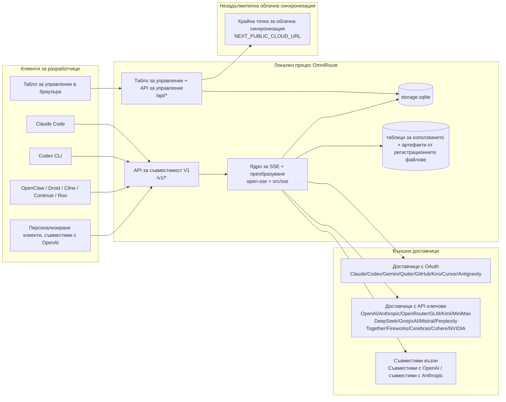
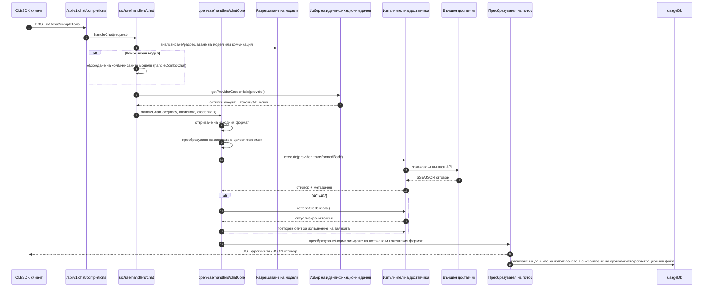
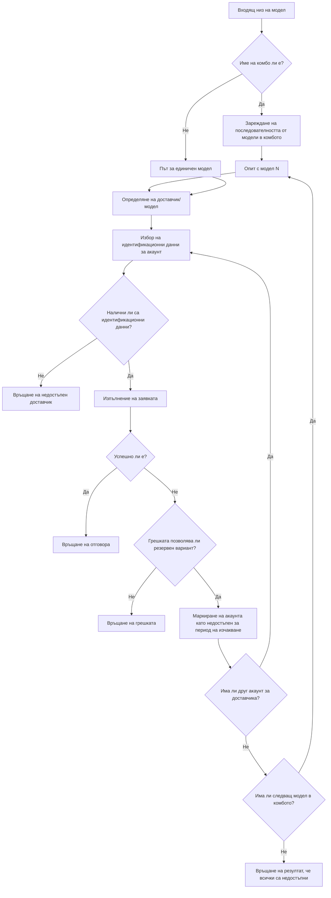
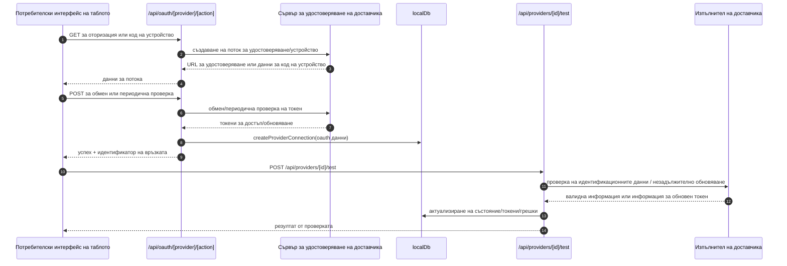
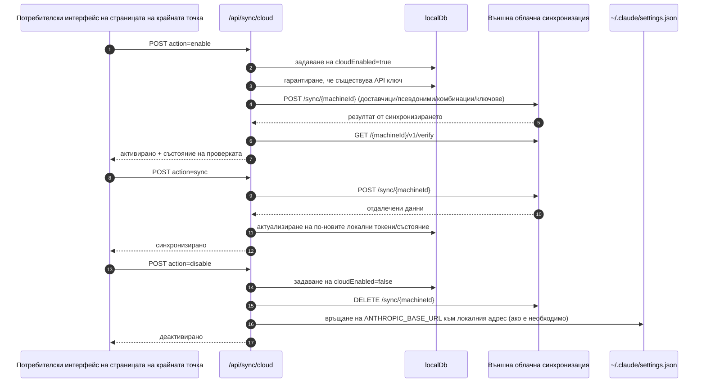
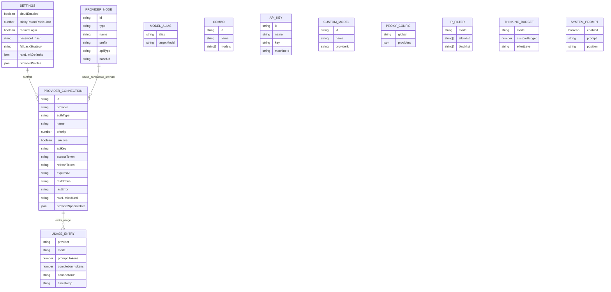
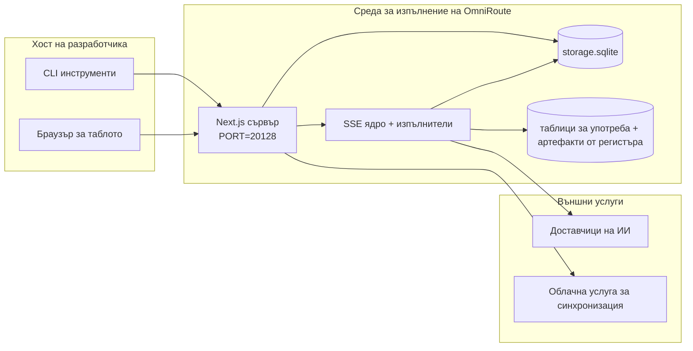

# OmniRoute Architecture (Български)

🌐 **Languages:** 🇺🇸 [English](../../../../architecture/ARCHITECTURE.md) · 🇪🇹 [am](../../../am/docs/architecture/ARCHITECTURE.md) · 🇸🇦 [ar](../../../ar/docs/architecture/ARCHITECTURE.md) · 🇦🇿 [az](../../../az/docs/architecture/ARCHITECTURE.md) · 🇧🇩 [bn](../../../bn/docs/architecture/ARCHITECTURE.md) · 🇧🇦 [bs](../../../bs/docs/architecture/ARCHITECTURE.md) · 🇨🇿 [cs](../../../cs/docs/architecture/ARCHITECTURE.md) · 🇩🇰 [da](../../../da/docs/architecture/ARCHITECTURE.md) · 🇩🇪 [de](../../../de/docs/architecture/ARCHITECTURE.md) · 🇬🇷 [el](../../../el/docs/architecture/ARCHITECTURE.md) · 🇪🇸 [es](../../../es/docs/architecture/ARCHITECTURE.md) · 🇪🇪 [et](../../../et/docs/architecture/ARCHITECTURE.md) · 🇮🇷 [fa](../../../fa/docs/architecture/ARCHITECTURE.md) · 🇫🇮 [fi](../../../fi/docs/architecture/ARCHITECTURE.md) · 🇫🇷 [fr](../../../fr/docs/architecture/ARCHITECTURE.md) · 🇮🇪 [ga](../../../ga/docs/architecture/ARCHITECTURE.md) · 🇮🇳 [gu](../../../gu/docs/architecture/ARCHITECTURE.md) · 🇳🇬 [ha](../../../ha/docs/architecture/ARCHITECTURE.md) · 🇮🇱 [he](../../../he/docs/architecture/ARCHITECTURE.md) · 🇮🇳 [hi](../../../hi/docs/architecture/ARCHITECTURE.md) · 🇭🇷 [hr](../../../hr/docs/architecture/ARCHITECTURE.md) · 🇭🇺 [hu](../../../hu/docs/architecture/ARCHITECTURE.md) · 🇦🇲 [hy](../../../hy/docs/architecture/ARCHITECTURE.md) · 🇮🇩 [id](../../../id/docs/architecture/ARCHITECTURE.md) · 🇳🇬 [ig](../../../ig/docs/architecture/ARCHITECTURE.md) · 🇮🇹 [it](../../../it/docs/architecture/ARCHITECTURE.md) · 🇯🇵 [ja](../../../ja/docs/architecture/ARCHITECTURE.md) · 🇬🇪 [ka](../../../ka/docs/architecture/ARCHITECTURE.md) · 🇰🇭 [km](../../../km/docs/architecture/ARCHITECTURE.md) · 🇮🇳 [kn](../../../kn/docs/architecture/ARCHITECTURE.md) · 🇰🇷 [ko](../../../ko/docs/architecture/ARCHITECTURE.md) · 🇱🇹 [lt](../../../lt/docs/architecture/ARCHITECTURE.md) · 🇱🇻 [lv](../../../lv/docs/architecture/ARCHITECTURE.md) · 🇮🇳 [ml](../../../ml/docs/architecture/ARCHITECTURE.md) · 🇮🇳 [mr](../../../mr/docs/architecture/ARCHITECTURE.md) · 🇲🇾 [ms](../../../ms/docs/architecture/ARCHITECTURE.md) · 🇲🇹 [mt](../../../mt/docs/architecture/ARCHITECTURE.md) · 🇲🇲 [my](../../../my/docs/architecture/ARCHITECTURE.md) · 🇳🇵 [ne](../../../ne/docs/architecture/ARCHITECTURE.md) · 🇳🇱 [nl](../../../nl/docs/architecture/ARCHITECTURE.md) · 🇳🇴 [no](../../../no/docs/architecture/ARCHITECTURE.md) · 🇮🇳 [or](../../../or/docs/architecture/ARCHITECTURE.md) · 🇮🇳 [pa](../../../pa/docs/architecture/ARCHITECTURE.md) · 🇵🇭 [phi](../../../phi/docs/architecture/ARCHITECTURE.md) · 🇵🇱 [pl](../../../pl/docs/architecture/ARCHITECTURE.md) · 🇵🇹 [pt](../../../pt/docs/architecture/ARCHITECTURE.md) · 🇧🇷 [pt-BR](../../../pt-BR/docs/architecture/ARCHITECTURE.md) · 🇷🇴 [ro](../../../ro/docs/architecture/ARCHITECTURE.md) · 🇷🇺 [ru](../../../ru/docs/architecture/ARCHITECTURE.md) · 🇱🇰 [si](../../../si/docs/architecture/ARCHITECTURE.md) · 🇸🇰 [sk](../../../sk/docs/architecture/ARCHITECTURE.md) · 🇸🇮 [sl](../../../sl/docs/architecture/ARCHITECTURE.md) · 🇷🇸 [sr](../../../sr/docs/architecture/ARCHITECTURE.md) · 🇸🇪 [sv](../../../sv/docs/architecture/ARCHITECTURE.md) · 🇰🇪 [sw](../../../sw/docs/architecture/ARCHITECTURE.md) · 🇮🇳 [ta](../../../ta/docs/architecture/ARCHITECTURE.md) · 🇮🇳 [te](../../../te/docs/architecture/ARCHITECTURE.md) · 🇹🇭 [th](../../../th/docs/architecture/ARCHITECTURE.md) · 🇹🇷 [tr](../../../tr/docs/architecture/ARCHITECTURE.md) · 🇺🇦 [uk-UA](../../../uk-UA/docs/architecture/ARCHITECTURE.md) · 🇵🇰 [ur](../../../ur/docs/architecture/ARCHITECTURE.md) · 🇺🇿 [uz](../../../uz/docs/architecture/ARCHITECTURE.md) · 🇻🇳 [vi](../../../vi/docs/architecture/ARCHITECTURE.md) · 🇳🇬 [yo](../../../yo/docs/architecture/ARCHITECTURE.md) · 🇨🇳 [zh-CN](../../../zh-CN/docs/architecture/ARCHITECTURE.md) · 🇹🇼 [zh-TW](../../../zh-TW/docs/architecture/ARCHITECTURE.md)

---

🌐 **Languages:** 🇺🇸 [English](../../../../architecture/ARCHITECTURE.md) · 🇪🇹 [am](../../../am/docs/architecture/ARCHITECTURE.md) · 🇸🇦 [ar](../../../ar/docs/architecture/ARCHITECTURE.md) · 🇦🇿 [az](../../../az/docs/architecture/ARCHITECTURE.md) · 🇧🇩 [bn](../../../bn/docs/architecture/ARCHITECTURE.md) · 🇧🇦 [bs](../../../bs/docs/architecture/ARCHITECTURE.md) · 🇨🇿 [cs](../../../cs/docs/architecture/ARCHITECTURE.md) · 🇩🇰 [da](../../../da/docs/architecture/ARCHITECTURE.md) · 🇩🇪 [de](../../../de/docs/architecture/ARCHITECTURE.md) · 🇬🇷 [el](../../../el/docs/architecture/ARCHITECTURE.md) · 🇪🇸 [es](../../../es/docs/architecture/ARCHITECTURE.md) · 🇪🇪 [et](../../../et/docs/architecture/ARCHITECTURE.md) · 🇮🇷 [fa](../../../fa/docs/architecture/ARCHITECTURE.md) · 🇫🇮 [fi](../../../fi/docs/architecture/ARCHITECTURE.md) · 🇫🇷 [fr](../../../fr/docs/architecture/ARCHITECTURE.md) · 🇮🇪 [ga](../../../ga/docs/architecture/ARCHITECTURE.md) · 🇮🇳 [gu](../../../gu/docs/architecture/ARCHITECTURE.md) · 🇳🇬 [ha](../../../ha/docs/architecture/ARCHITECTURE.md) · 🇮🇱 [he](../../../he/docs/architecture/ARCHITECTURE.md) · 🇮🇳 [hi](../../../hi/docs/architecture/ARCHITECTURE.md) · 🇭🇷 [hr](../../../hr/docs/architecture/ARCHITECTURE.md) · 🇭🇺 [hu](../../../hu/docs/architecture/ARCHITECTURE.md) · 🇦🇲 [hy](../../../hy/docs/architecture/ARCHITECTURE.md) · 🇮🇩 [id](../../../id/docs/architecture/ARCHITECTURE.md) · 🇳🇬 [ig](../../../ig/docs/architecture/ARCHITECTURE.md) · 🇮🇹 [it](../../../it/docs/architecture/ARCHITECTURE.md) · 🇯🇵 [ja](../../../ja/docs/architecture/ARCHITECTURE.md) · 🇬🇪 [ka](../../../ka/docs/architecture/ARCHITECTURE.md) · 🇰🇭 [km](../../../km/docs/architecture/ARCHITECTURE.md) · 🇮🇳 [kn](../../../kn/docs/architecture/ARCHITECTURE.md) · 🇰🇷 [ko](../../../ko/docs/architecture/ARCHITECTURE.md) · 🇱🇹 [lt](../../../lt/docs/architecture/ARCHITECTURE.md) · 🇱🇻 [lv](../../../lv/docs/architecture/ARCHITECTURE.md) · 🇮🇳 [ml](../../../ml/docs/architecture/ARCHITECTURE.md) · 🇮🇳 [mr](../../../mr/docs/architecture/ARCHITECTURE.md) · 🇲🇾 [ms](../../../ms/docs/architecture/ARCHITECTURE.md) · 🇲🇹 [mt](../../../mt/docs/architecture/ARCHITECTURE.md) · 🇲🇲 [my](../../../my/docs/architecture/ARCHITECTURE.md) · 🇳🇵 [ne](../../../ne/docs/architecture/ARCHITECTURE.md) · 🇳🇱 [nl](../../../nl/docs/architecture/ARCHITECTURE.md) · 🇳🇴 [no](../../../no/docs/architecture/ARCHITECTURE.md) · 🇮🇳 [or](../../../or/docs/architecture/ARCHITECTURE.md) · 🇮🇳 [pa](../../../pa/docs/architecture/ARCHITECTURE.md) · 🇵🇭 [phi](../../../phi/docs/architecture/ARCHITECTURE.md) · 🇵🇱 [pl](../../../pl/docs/architecture/ARCHITECTURE.md) · 🇵🇹 [pt](../../../pt/docs/architecture/ARCHITECTURE.md) · 🇧🇷 [pt-BR](../../../pt-BR/docs/architecture/ARCHITECTURE.md) · 🇷🇴 [ro](../../../ro/docs/architecture/ARCHITECTURE.md) · 🇷🇺 [ru](../../../ru/docs/architecture/ARCHITECTURE.md) · 🇱🇰 [si](../../../si/docs/architecture/ARCHITECTURE.md) · 🇸🇰 [sk](../../../sk/docs/architecture/ARCHITECTURE.md) · 🇸🇮 [sl](../../../sl/docs/architecture/ARCHITECTURE.md) · 🇷🇸 [sr](../../../sr/docs/architecture/ARCHITECTURE.md) · 🇸🇪 [sv](../../../sv/docs/architecture/ARCHITECTURE.md) · 🇰🇪 [sw](../../../sw/docs/architecture/ARCHITECTURE.md) · 🇮🇳 [ta](../../../ta/docs/architecture/ARCHITECTURE.md) · 🇮🇳 [te](../../../te/docs/architecture/ARCHITECTURE.md) · 🇹🇭 [th](../../../th/docs/architecture/ARCHITECTURE.md) · 🇹🇷 [tr](../../../tr/docs/architecture/ARCHITECTURE.md) · 🇺🇦 [uk-UA](../../../uk-UA/docs/architecture/ARCHITECTURE.md) · 🇵🇰 [ur](../../../ur/docs/architecture/ARCHITECTURE.md) · 🇺🇿 [uz](../../../uz/docs/architecture/ARCHITECTURE.md) · 🇻🇳 [vi](../../../vi/docs/architecture/ARCHITECTURE.md) · 🇳🇬 [yo](../../../yo/docs/architecture/ARCHITECTURE.md) · 🇨🇳 [zh-CN](../../../zh-CN/docs/architecture/ARCHITECTURE.md) · 🇹🇼 [zh-TW](../../../zh-TW/docs/architecture/ARCHITECTURE.md)

_Последна актуализация: 2026-06-28_

## Изпълнително резюме

OmniRoute е локален AI шлюз за маршрутизиране и табло за управление, изградено на Next.js. Той осигурява единична OpenAI-съвместима крайна точка (`/v1/*`) и маршрутизира трафик през множество доставчици нагоре по веригата с превод, резервен вариант, опресняване на токени и проследяване на използването.

Основни възможности:

- OpenAI-съвместима API повърхност за CLI/tools (377 доставчици, 156 изпълнителни модула)
- Request/response превод във формати на доставчика
- Резервна комбинация от модели (последователност от множество модели)
- Структурирани комбинирани стъпки (`provider + model + connection`) с подреждане по време на изпълнение от `compositeTiers`
- Резервен вариант на ниво акаунт (няколко акаунта на доставчик)
- Предполетна квота и избор на P2C акаунт, съобразен с квотите, в главния път за чат
- OAuth + API-ключ за управление на връзката на доставчика (27 OAuth модула за доставчик)
- Генериране на вграждане чрез `/v1/embeddings` (18 доставчика)
- Генериране на изображения чрез `/v1/images/generations` (10 + доставчици, 20 + модела)
- Аудио транскрипция чрез `/v1/audio/transcriptions` (18 доставчика)
- Текст към говор чрез `/v1/audio/speech` (24 вградени доставчика)
- Видео генериране чрез `/v1/videos/generations` (ComfyUI + SD WebUI)
- Генериране на музика чрез `/v1/music/generations` (ComfyUI)
- Търсене в мрежата чрез `/v1/search` (20 доставчика)
- Модериране чрез `/v1/moderations`
- Прекласиране чрез `/v1/rerank`
- Разбор на мислен етикет (`<think>...</think>`) за разсъждаващи модели
- Дезинфекция на реакцията за стриктна съвместимост OpenAI SDK
- Нормализиране на ролята (разработчик → система, системен → потребител) за съвместимост между различни доставчици
- Преобразуване на структуриран изход (json_schema → Gemini responseSchema)
- Локална устойчивост за доставчици, ключове, псевдоними, комбинации, настройки, ценообразуване (122 DB модула)
- Usage/cost проследяване и регистриране на заявки
- Незадължително облачно синхронизиране за multi-device/state синхронизиране
- IP allowlist/blocklist за API контрол на достъпа
- Мислещо управление на бюджета (passthrough/auto/custom/adaptive)
- Бързо инжектиране на глобалната система
- Проследяване на сесии и пръстови отпечатъци
- Подобрено ограничаване на скоростта за всеки акаунт със специфични за доставчика профили
- Схема на прекъсвача за устойчивост на доставчика
- Анти-гръмотевична стадна защита с mutex заключване
- Кеш за дедупликация на заявки, базиран на подпис
- Домейн слой: правила за разходите, резервна политика, политика за блокиране
- Контекстно предаване: обобщения за предаване на сесии за непрекъснатост на ротацията на акаунта
- Устойчивост на състоянието на домейна (SQLite кеш за записване за резервни варианти, бюджети, блокировки, прекъсвачи на верига)
- Двигател за правила за централизирана оценка на заявка (блокиране → бюджет → резервен)
- Заявка за телеметрия с агрегиране на латентност p50/p95/p99
- Комбинирана целева телеметрия и историческо комбо целево здраве чрез `combo_execution_key` / `combo_step_id`
- Корелация ID (X-Request-Id) за проследяване от край до край
- Регистриране на одит за съответствие с отказ за всеки API ключ
- Eval рамка за осигуряване на качеството LLM
- Здравно табло със статус на прекъсвача на доставчика в реално време
- MCP сървър (110 инструмента) с 3 транспорта (stdio/SSE/Streamable HTTP)
- A2A сървър (JSON-RPC 2.0 + SSE) с жизнен цикъл на умения и задачи
- Система за памет (извличане, инжектиране, извличане, обобщаване)
- Система за умения (регистър, изпълнител, пясъчник, вградени умения)
- MITM прокси с управление на сертификати и обработка DNS
- Мидълуер за бързо инжектиране
- Конвейер за бързо компресиране с Caveman, RTK, подредени конвейери, комбинации за компресиране, езикови пакети и анализи
- ACP (Agent Communication Protocol) регистър
- Модулни OAuth доставчици (22 отделни модула под `src/lib/oauth/providers/`)
- Uninstall/full-uninstall скриптове
- OAuth действие за възстановяване на околната среда
- WebSocket мост за OpenAI-съвместими WS клиенти (`/v1/ws`)
- Управление на токени за синхронизиране (issue/revoke, изтегляне на конфигурационен пакет с версия на ETag)
- GLM мислене (`glmt`) предварително зададени първокласни доставчици
- Хибридно броене на токени ( `/messages/count_tokens` от страна на доставчика с резервна оценка)
- Автоматично зареждане на псевдоним на модел (30 + кръстосани прокси диалектни нормализации при стартиране)
- Безопасно изходящо извличане с SSRF guard, частно URL блокиране и конфигурируем повторен опит
- Повторни опити за чат с разхлаждане с конфигурируеми `requestRetry` и `maxRetryIntervalSec`
- Валидиране на среда за изпълнение с Zod при стартиране
- Одит на съответствие v2 със страниране, CRUD събития на доставчика и регистриране на валидиране, блокирано от SSRF

Основен модел на изпълнение:

- маршрутите на приложението Next.js под `src/app/api/*` прилагат както APIs на таблото за управление, така и APIs за съвместимост
- Споделено SSE/routing ядро в `src/sse/*` + `open-sse/*` управлява изпълнението на доставчика, превода, стрийминг, резервен вариант и използване

## Референтни диаграми

Каноничните Mermaid изходни файлове с контрол на версиите за платформата v3.8.0 се намират в
[`docs/diagrams/`](../diagrams/README.md). Две от тях са възпроизведени по-долу за ориентация;
останалите са свързани от съответните ръководства за конкретните области.


> Източник: [diagrams/request-pipeline.mmd](../diagrams/request-pipeline.mmd)


> Източник: [diagrams/resilience-3layers.mmd](../diagrams/resilience-3layers.mmd) — също е свързан от
> [RESILIENCE_GUIDE.md](./RESILIENCE_GUIDE.md) и справочника за устойчивост в `CLAUDE.md`.

## Обхват и граници

### В обхвата

- Локална среда за изпълнение на шлюза
- API за управление на таблото
- Удостоверяване при доставчици и обновяване на токени
- Преобразуване на заявки и SSE поточно предаване
- Локално състояние + съхранение на данни за използването
- Незадължителна оркестрация на облачната синхронизация

### Извън обхвата

- Реализацията на облачната услуга зад `NEXT_PUBLIC_CLOUD_URL`
- SLA/контролната равнина на доставчика извън локалния процес
- Самите външни CLI двоични файлове (Claude CLI, Codex CLI и др.)

## Обхват на таблото (текущ)

Основни страници в `src/app/(dashboard)/dashboard/`:

- `/dashboard` — бърз старт + преглед на доставчиците
- `/dashboard/endpoint` — прокси за крайни точки + раздели за MCP + A2A + API крайни точки
- `/dashboard/providers` — връзки с доставчици и идентификационни данни
- `/dashboard/combos` — комбо стратегии, шаблони, конструктор на стъпки, правила за маршрутизиране на модели, ръчно запазвано подреждане
- `/dashboard/auto-combo` — механизъм Auto Combo: тегла за оценяване, пакети от режими, предварително зададени настройки за виртуална фабрика, телеметрия
- `/dashboard/costs` — обобщаване на разходите и видимост на ценообразуването
- `/dashboard/analytics` — анализ на използването, оценки, състояние на комбо целите
- `/dashboard/limits` — контроли за квоти/ограничения на честотата
- `/dashboard/cli-tools` — първоначална настройка на CLI, откриване на средата за изпълнение, генериране на конфигурация
- `/dashboard/agents` — открити ACP агенти + регистриране на персонализирани агенти
- `/dashboard/cloud-agents` — задачи на агенти, хоствани в облака (Codex Cloud, Devin, Jules), и жизнен цикъл на задачите
- `/dashboard/skills` — регистър на A2A умения, изпълнение в изолирана среда, каталог с вградени умения
- `/dashboard/memory` — преглед и извличане на постоянна разговорна памет
- `/dashboard/webhooks` — абонаменти за изходящи webhook известия, ротация на тайни, статистика за повторните опити
- `/dashboard/batch` — подаване на пакетни задания и проследяване на напредъка
- `/dashboard/cache` — статистика за кеша с прозрачно четене и кеша за разсъждения, контроли за изчистване
- `/dashboard/playground` — интерактивна чат среда за експериментиране с всяко конфигурирано комбо/модел
- `/dashboard/changelog` — визуализатор на регистъра на промените в приложението (рендира `CHANGELOG.md`)
- `/dashboard/system` — диагностика на средата за изпълнение, информация за версията, интерфейс за валидиране на средата
- `/dashboard/onboarding` — съветник за първоначална настройка при нови инсталации
- `/dashboard/media` — среда за експериментиране с изображения/видео/музика
- `/dashboard/search-tools` — тестване на доставчици за търсене и история
- `/dashboard/health` — време на работа, прекъсвачи на вериги, ограничения на честотата, сесии с наблюдавани квоти
- `/dashboard/logs` — дневници на заявки/прокси/одит/конзола
- `/dashboard/settings` — раздели със системни настройки (общи, маршрутизиране, комбо настройки по подразбиране и др.)
- `/dashboard/context/caveman` — правила за компресиране на Caveman, езикови пакети, визуализация и режим на изхода
- `/dashboard/context/rtk` — RTK филтри за изхода на команди, визуализация и настройки за безопасност на средата за изпълнение
- `/dashboard/context/combos` — именувани конвейери за компресиране, присвоени към маршрутни комбота
- `/dashboard/translator` — преглед на преводача и визуализация на преобразуването на формата на заявките
- `/dashboard/audit` — браузър на дневника за одит на съответствието със странициране и структурирани метаданни
- `/dashboard/usage` — браузър за използването по заявки, свързан с `usage_history`
- `/dashboard/compression` — анализи и статистика за компресирането и присвояване на конвейери
- `/dashboard/api-manager` — жизнен цикъл на API ключовете и разрешения за моделите

Слой на потребителския интерфейс: всяка страница се рендира в една обвивка — `src/app/(dashboard)/layout.tsx` →
`src/shared/components/layouts/DashboardLayout.tsx` → `DashboardShell.tsx` (`SidebarProvider`/`SidebarInset` на комплекта, както и
`Sidebar.tsx` и `Header.tsx` на OmniRoute). Страниците импортират своите
градивни елементи от `@/shared/components` (адаптери върху включения в хранилището Keak CI UI Kit в
`packages/ui-kit`) или от подпътищата към компонентите на комплекта (`@omniroute/ui-kit/table`, `…/page-header`), а
иконите — чрез `<Icon>` (`ICON_MAP` → Lucide). Темата (`system` по подразбиране, светла/тъмна) и токените идват
от комплекта чрез свързващия слой в `src/app/globals.css`. Подробности: `docs/architecture/DESIGN_SYSTEM.md`.

## Системен контекст на високо ниво



## Основни компоненти на средата за изпълнение

## 1) Слой за API и маршрутизиране (маршрути на приложението Next.js)

Основни директории:

- `src/app/api/v1/*` и `src/app/api/v1beta/*` за API за съвместимост
- `src/app/api/*` за API за управление/конфигуриране
- Правилата за пренаписване на Next в `next.config.mjs` съпоставят `/v1/*` към `/api/v1/*`

Важни маршрути за съвместимост:

- `src/app/api/v1/chat/completions/route.ts`
- `src/app/api/v1/messages/route.ts`
- `src/app/api/v1/responses/route.ts`
- `src/app/api/v1/models/route.ts` — включва персонализирани модели с `custom: true`
- `src/app/api/v1/embeddings/route.ts` — генериране на векторни представяния (6 доставчика)
- `src/app/api/v1/images/generations/route.ts` — генериране на изображения (4+ доставчика, включително Antigravity/Nebius)
- `src/app/api/v1/messages/count_tokens/route.ts`
- `src/app/api/v1/providers/[provider]/chat/completions/route.ts` — специализиран чат за всеки доставчик
- `src/app/api/v1/providers/[provider]/embeddings/route.ts` — специализирани векторни представяния за всеки доставчик
- `src/app/api/v1/providers/[provider]/images/generations/route.ts` — специализирани изображения за всеки доставчик
- `src/app/api/v1beta/models/route.ts`
- `src/app/api/v1beta/models/[...path]/route.ts`

Области на управление:

- Удостоверяване/настройки: `src/app/api/auth/*`, `src/app/api/settings/*`
- Доставчици/връзки: `src/app/api/providers*`
- Възли на доставчици: `src/app/api/provider-nodes*`
- Персонализирани модели: `src/app/api/provider-models` (GET/POST/DELETE)
- Каталог с модели: `src/app/api/models/route.ts` (GET)
- Конфигурация на прокси: `src/app/api/settings/proxy` (GET/PUT/DELETE) + `src/app/api/settings/proxy/test` (POST)
- OAuth: `src/app/api/oauth/*`
- Ключове/псевдоними/комбинации/ценообразуване: `src/app/api/keys*`, `src/app/api/models/alias`, `src/app/api/combos*`, `src/app/api/pricing`
- Използване: `src/app/api/usage/*`
- Синхронизация/облак: `src/app/api/sync/*`, `src/app/api/cloud/*`
- Помощни инструменти за CLI: `src/app/api/cli-tools/*`
- IP филтър: `src/app/api/settings/ip-filter` (GET/PUT)
- Бюджет за разсъждение: `src/app/api/settings/thinking-budget` (GET/PUT)
- Системна подкана: `src/app/api/settings/system-prompt` (GET/PUT)
- Компресиране: `src/app/api/settings/compression`, `src/app/api/compression/*` и
  `src/app/api/context/*`
- Сесии: `src/app/api/sessions` (GET)
- Ограничения на честотата: `src/app/api/rate-limits` (GET)
- Устойчивост: `src/app/api/resilience` (GET/PATCH) — опашка със заявки, период на изчакване за връзката, предпазител на доставчика, конфигурация за изчакване до края на периода
- Нулиране на устойчивостта: `src/app/api/resilience/reset` (POST) — нулиране на предпазителите на доставчиците
- Статистика за кеша: `src/app/api/cache/stats` (GET/DELETE)
- Телеметрия: `src/app/api/telemetry/summary` (GET)
- Бюджет: `src/app/api/usage/budget` (GET/POST)
- Вериги за резервен избор: `src/app/api/fallback/chains` (GET/POST/DELETE)
- Одит на съответствието: `src/app/api/compliance/audit-log` (GET, с пагинация + структурирани метаданни)
- Оценявания: `src/app/api/evals` (GET/POST), `src/app/api/evals/[suiteId]` (GET)
- Политики: `src/app/api/policies` (GET/POST)
- Токени за синхронизация: `src/app/api/sync/tokens` (GET/POST), `src/app/api/sync/tokens/[id]` (GET/DELETE)
- Конфигурационен пакет: `src/app/api/sync/bundle` (GET, моментна снимка на настройките/доставчиците/комбинациите/ключовете, версионирана чрез ETag)
- WebSocket: `src/app/api/v1/ws/route.ts` — обработчик на Upgrade за WS клиенти, съвместими с OpenAI

## 2) SSE + ядро за преобразуване

Основни модули на потока:

- Входна точка: `src/sse/handlers/chat.ts`
- Основна оркестрация: `open-sse/handlers/chatCore.ts`
- Адаптери за изпълнение на доставчици: `open-sse/executors/*`
- Откриване на формат/конфигурация на доставчик: `open-sse/services/provider.ts`
- Анализиране/разрешаване на модел: `src/sse/services/model.ts`, `open-sse/services/model.ts`
- Логика за резервен акаунт: `open-sse/services/accountFallback.ts`
- Регистър за преобразуване: `open-sse/translator/index.ts`
- Трансформации на потоци: `open-sse/utils/stream.ts`, `open-sse/utils/streamHandler.ts`
- Извличане/нормализиране на използването: `open-sse/utils/usageTracking.ts`
- Анализатор на тагове за разсъждение: `open-sse/utils/thinkTagParser.ts`
- Обработчик за вграждания: `open-sse/handlers/embeddings.ts`
- Регистър на доставчиците на вграждания: `open-sse/config/embeddingRegistry.ts`
- Обработчик за генериране на изображения: `open-sse/handlers/imageGeneration.ts`
- Регистър на доставчиците на изображения: `open-sse/config/imageRegistry.ts`
- Саниране на отговорите: `open-sse/handlers/responseSanitizer.ts`
- Нормализиране на ролите: `open-sse/services/roleNormalizer.ts`

Услуги (бизнес логика):

- Избор/оценяване на акаунти: `open-sse/services/accountSelector.ts`
- Управление на жизнения цикъл на контекста: `open-sse/services/contextManager.ts`
- Прилагане на IP филтър: `open-sse/services/ipFilter.ts`
- Проследяване на сесии: `open-sse/services/sessionManager.ts`
- Премахване на дублиращи се заявки: `open-sse/services/signatureCache.ts`
- Инжектиране на системна подкана: `open-sse/services/systemPrompt.ts`
- Управление на бюджета за разсъждение: `open-sse/services/thinkingBudget.ts`
- Маршрутизиране на модели със заместващи символи: `open-sse/services/wildcardRouter.ts`
- Управление на ограниченията на честотата: `open-sse/services/rateLimitManager.ts`
- Прекъсвач на веригата: `src/shared/utils/circuitBreaker.ts`
- Предаване на контекст: `open-sse/services/contextHandoff.ts` — генериране и инжектиране на обобщение при предаване за стратегията за препредаване на контекст
- Компресиране: `open-sse/services/compression/*` — проактивно компресиране преди преобразуването за доставчика;
  включва правила Caveman, RTK филтри, подредени конвейери, комбинации за компресиране, статистика и валидиране
- Извличане на квота за Codex: `open-sse/services/codexQuotaFetcher.ts` — извлича квотата за Codex за решенията за предаване при препредаване на контекст
- Повторни опити, съобразени с периода за изчакване: `src/sse/services/cooldownAwareRetry.ts` — повторни опити за отделните модели след период за изчакване с конфигурируеми `requestRetry` / `maxRetryIntervalSec`
- Безопасно изходящо извличане: `src/shared/network/safeOutboundFetch.ts` — защитено извличане от доставчик/модел със защита срещу SSRF, блокиране на частни URL адреси, повторни опити и изчакване
- Защита на изходящите URL адреси: `src/shared/network/outboundUrlGuard.ts` — проверки на хостовете в URL адресите на доставчиците; `src/shared/network/outboundUrlGuardPolicy.ts` избира режима от `OMNIROUTE_ALLOW_LOCAL_PROVIDER_URLS`, `OMNIROUTE_ALLOW_PRIVATE_PROVIDER_URLS` и съответните им превключватели в таблото (вижте `docs/reference/ENVIRONMENT.md`)
- Стойности по подразбиране за заявките към доставчици: `open-sse/services/providerRequestDefaults.ts` — стойности по подразбиране на ниво доставчик за `maxTokens`, `temperature`, `thinkingBudgetTokens`
- Константи за доставчика GLM: `open-sse/config/glmProvider.ts` — споделени GLM модели, URL адреси за квоти, изчакване/стойности по подразбиране за GLMT
- Горен поток на Antigravity: `open-sse/config/antigravityUpstream.ts` — константи за базовия URL адрес и пътя за откриване
- Константи за клиента Codex: `open-sse/config/codexClient.ts` — версионирани стойности за потребителския агент и версията на клиента
- Начални псевдоними на модели: `src/lib/modelAliasSeed.ts` — добавя при стартиране над 30 псевдонима между диалекти на различни прокси сървъри

Модули на домейн слоя:

- Правила за разходи/бюджети: `src/domain/costRules.ts`
- Политика за резервен вариант: `src/domain/fallbackPolicy.ts`
- Разрешаване на комбинации: `src/domain/comboResolver.ts`
- Политика за блокиране: `src/domain/lockoutPolicy.ts`
- Механизъм за политики: `src/domain/policyEngine.ts` — централизирана оценка в последователност блокиране → бюджет → резервен вариант
- Каталог с кодове за грешки: `src/shared/constants/errorCodes.ts`
- Идентификатор на заявка: `src/shared/utils/requestId.ts`
- Изчакване при извличане: `src/shared/utils/fetchTimeout.ts`
- Телеметрия на заявките: `src/shared/utils/requestTelemetry.ts`
- Съответствие/одит: `src/lib/compliance/index.ts`
- Изпълнител на оценки: `src/lib/evals/evalRunner.ts`
- Устойчиво съхранение на състоянието на домейна: `src/lib/db/domainState.ts` — SQLite CRUD за вериги от резервни варианти, бюджети, история на разходите, състояние на блокиране и прекъсвачи на вериги

Модули за OAuth доставчици (27 отделни файла в `src/lib/oauth/providers/`):

- Индекс на регистъра: `src/lib/oauth/providers/index.ts`
- Отделни доставчици: `agy.ts`, `antigravity.ts`, `claude.ts`, `cline.ts`, `codebuddy-cn.ts`, `codebuddy-intl.ts`, `codex.ts`, `cursor.ts`, `devin-desktop.ts`, `ghe-copilot.ts`, `github.ts`, `gitlab-duo.ts`, `grok-cli-oauth.ts`, `grok-cli.ts`, `kilocode.ts`, `kimi-coding.ts`, `kiro.ts`, `muse-code.ts`, `openference.ts`, `qoder.ts`, `trae.ts`, `workbuddy.ts`, `xai-oauth.ts`, `zed-hosted.ts`, `zed.ts`
- Споделени помощни модули: `codebuddyDeviceAuth.ts` (поток за удостоверяване на устройства за CodeBuddy CN/intl), `museCodeDeviceResponse.ts`
- Тънка обвивка: `src/lib/oauth/providers.ts` — реекспортира от отделните модули

## 5) Вградени услуги (v3.8.4)

OmniRoute може да инсталира, наблюдава и маршрутизира към локално работещи процеси с инструменти за ИИ,
наречени **вградени услуги**. Предоставят се пет: 9Router, CLIProxyAPI, Bifrost, Mux и Dario.

Архитектурни слоеве:

- **Потребителски интерфейс** (`/dashboard/providers/services`) — страница с два раздела и контроли за жизнения цикъл,
  поточно предаване на журналите в реално време, управление на API ключове и (за 9Router) вграден нативен потребителски интерфейс чрез
  вътрешно обратно прокси.
- **API** (`/api/services/{name}/*`) — 11 крайни точки за 9Router, 10 за CLIProxyAPI и по 8 за Bifrost / Mux / Dario,
  всички класифицирани като **LOCAL_ONLY** (строго правило #17). Споделена SSE крайна точка `GET /api/services/[name]/logs`
  обслужва и двете услуги.
- **Супервайзор** (`src/lib/services/`) — общият клас `ServiceSupervisor` обгръща
  `child_process.spawn`, поддържа 5 MB цикличен буфер за поточно предаване на SSE журнали, цикъл за
  проверки на изправността, заключване за атомарни операции и плавно изключване чрез SIGTERM→SIGKILL.
  `bootstrap.ts` свързва всички конфигурирани услуги при стартирането на процеса.
- **Доставчик/изпълнител** (`open-sse/executors/ninerouter.ts`) — 9Router е представен като
  реален доставчик. Моделите имат префикс `9router/{sub}/{model}` и се синхронизират на всеки 5 минути
  от крайната точка `/v1/models` на 9Router.

Подробен преглед: `docs/frameworks/EMBEDDED-SERVICES.md`

## Основни подсистеми (v3.8.0)

### A. Автоматичен комбиниран двигател

Auto Combo динамично отбелязва и избира цели за маршрутизиране по време на заявка, вместо да разчита на статична дефиниция на комбинация. Той захранва фамилията префикси на моделите `auto/*`.

- Вход на двигателя: `open-sse/services/autoCombo/` (`autoComboEngine.ts`, `scoringEngine.ts`, `virtualFactory.ts`, `modePacks.ts`)
- Резолвер: `src/domain/comboResolver.ts` (автоматично откриване на префикс `auto/` )
- Табло: `/dashboard/auto-combo`
- Телеметрия: `auto_combo_decisions` SQLite таблица

Ключови възможности:

- **20 стратегии за маршрутизиране** (приоритетно, претеглено, първо попълване, кръгово, P2C, произволно, най-малко използвано, оптимизирано по отношение на разходите, с нулиране, прозорец за нулиране, пространство, претеглено по квота, строго произволно,** авто** , lkgp, оптимизиран за контекст, оптимизиран за кеш, контекстно препредаване,** синтез** , тръбопровод) — auto е добавката към заглавието във v3.8.0; `fusion` (панел fan-out + съдебен синтез, `open-sse/services/fusion.ts`) е нов във v3.8.36.
- **16-факторно точкуване** : квота, здраве, обратна цена, обратна латентност, прилягане на задача и още десет. Каноничната таблица на факторите и техните тегла по подразбиране съществуват в [`docs/routing/AUTO-COMBO.md`](../routing/AUTO-COMBO.md) —, ако я повторим тук, ще й даде второ място, за да остане остаряла.
- **Виртуална фабрика** материализира краткотрайни комбинации, когато не съществува съответстваща наименувана комбинация, извличайки кандидати от здрави активни връзки на доставчик.
- **Автоматични префикси** : `auto/coding`, `auto/cheap`, `auto/fast`, `auto/offline`, `auto/smart`, `auto/lkgp` — всеки от които е подкрепен от настроен профил на теглото.
- **Пакети с 6 режима** : `ship-fast`, `cost-saver`, `quality-first`, `offline-friendly`, `reliability-first` и `chaos-mode` — предварително зададени конфигурации на тегло, които могат да се извикват от таблото за управление. (Да не се бърка с префиксите `auto/*` по-горе, които са варианти по време на заявка.)

За пълни алгоритмични подробности (факторни формули, настройка на теглото), вижте [`docs/routing/AUTO-COMBO.md`](../routing/AUTO-COMBO.md).

### Б. Облачни агенти

Cloud Agents обгръща хоствани от трети страни платформи за кодови агенти (Codex Cloud, Devin, Jules) зад единен жизнен цикъл на задача, поддържан от DB. Всички creation/inspection крайни точки на задача изискват удостоверяване на управлението.

- Корен на модула: `src/lib/cloudAgent/` (`baseAgent.ts`, `registry.ts`, `api.ts`, `types.ts`, `db.ts`, плюс поддиректории за всеки агент под `agents/`)
- Реализации на агент: `agents/codex/`, `agents/devin/`, `agents/jules/`
- Публични крайни точки: `/api/v1/agents/tasks/*` (list/create/get/cancel)
- Крайни точки на управление: `/api/cloud/*` (обезпечаване, състояние, партида)
- Табло: `/dashboard/cloud-agents`
- Съхранение: `cloud_agent_tasks` маса

За предоставяне на отделни агенти и специфики OAuth вижте [`docs/frameworks/CLOUD_AGENT.md`](../frameworks/CLOUD_AGENT.md).

### В. Мантинели

Модулът guardrails е междинен слой с възможност за горещо презареждане, който инспектира заявки и отговори за PII, незабавно инжектиране и опасно визуално съдържание. Нарушенията водят до късо съединение на заявката с HTTP** 503** плюс структуриран код за грешка, позволяващ на повикващите надолу по веригата да опитат отново или да се разклонят.

- Корен на модула: `src/lib/guardrails/` (`base.ts`, `registry.ts`, `piiMasker.ts`, `promptInjection.ts`, `visionBridge.ts`, `visionBridgeHelpers.ts`)
- Горещо презареждане: регистърът следи за промени в конфигурацията и възстановява веригата на място
- Точки за свързване: въвеждане на манипулатор за чат, манипулатор за генериране на изображения, дезинфекциращо средство за отговор
- HTTP договор: нарушенията се появяват като `503` със `error.code = "GUARDRAIL_VIOLATION"`

За създаване на набор от правила и настройка на прага вижте [`docs/security/GUARDRAILS.md`](../security/GUARDRAILS.md).

### D. Домейн слой

Пространството от имена `src/domain/` централизира политически решения, така че манипулаторите на маршрути не трябва сами да сглобяват lockout/budget/fallback логика.

- Механизъм за правила: `src/domain/policyEngine.ts` — единична входна точка за оценка преди изпълнение (заключване → бюджет → резервно подреждане)
- Правила за разходите: `src/domain/costRules.ts`
- Резервна политика: `src/domain/fallbackPolicy.ts`
- Политика за блокиране: `src/domain/lockoutPolicy.ts`
- Маршрутизиране, базирано на тагове: `src/domain/tagRouter.ts`
- Комбо резолвер: `src/domain/comboResolver.ts` — разрешава комбо имена, префикси auto/\* и целеви модели със заместващи символи в конкретни планове за изпълнение
- Connection/model правило съединител: `src/domain/connectionModelRules.ts`
- Моментни снимки за наличност на модела: `src/domain/modelAvailability.ts`
- Проследяване на срока на валидност на доставчика: `src/domain/providerExpiration.ts`
- Квота кеш: `src/domain/quotaCache.ts`
- Състояние на разграждане: `src/domain/degradation.ts`
- Одит на конфигурацията: `src/domain/configAudit.ts`
- създател на метаданни за отговор OmniRoute : `src/domain/omnirouteResponseMeta.ts`
- Подсистема за оценка: `src/domain/assessment/` — периодични задания за оценка

### Д. Тръбопровод за оторизация

Конвейерът за оторизация класифицира всяка входяща заявка и прилага подходящата верига от правила преди изпращането.

- Вход в тръбопровода: `src/server/authz/pipeline.ts`
- Класификатор на заявки: `src/server/authz/classify.ts` — разграничава публичните маршрути за съвместимост от маршрутите за управление
- Обществен опис на маршрута: `src/shared/constants/publicApiRoutes.ts`
- Политики: съставяеми предикати `src/server/authz/policies/` — (`requireApiKey`, `requireManagement`, `requireFreshAuth` и др.)
- Помощни програми за заглавки: `src/server/authz/headers.ts`
- Помощник за твърдения: `src/server/authz/assertAuth.ts`
- Контекст на заявката: `src/server/authz/context.ts`

Публичните срещу управляващите маршрути са твърда граница: agent/cooldown APIs и мутациите на доставчик изискват удостоверяване на управление (HTTP 401, ако липсва).

За пълните правила за класификация на маршрута вижте [`docs/architecture/AUTHZ_GUIDE.md`](./AUTHZ_GUIDE.md).

### F. Работен поток FSM и рутер, съобразен със задачите

Рутер, управляван от крайна машина, наслоен над комбинирания избор за насочване на трафик въз основа на открития етап на работния поток (планиране, изпълнение, преглед) и афинитета на фоновата задача.

- Работен процес FSM: `open-sse/services/workflowFSM.ts`
- Рутер, съобразен със задачите: `open-sse/services/taskAwareRouter.ts`
- Детектор на фонови задачи: `open-sse/services/backgroundTaskDetector.ts`
- Класификатор на намерения: `open-sse/services/intentClassifier.ts`

Преходите FSM се включват в точкуването на Auto Combo, като се ориентират към по-евтини модели за background/automation задачи и към по-силни модели за интерактивни planning/review завои.

### Ж. Устойчивост, специфична за доставчика

Няколко доставчици доставят специални модули за устойчивост и стелт, които се закрепват към слоевете за глобален прекъсвач / охлаждане на връзката / блокиране на модела:

- Antigravity 429 двигател: `open-sse/services/antigravity429Engine.ts` (завърта самоличността, почиства заглавките на отговорите, управлява credits/version проследяване чрез `antigravityCredits.ts`, `antigravityHeaderScrub.ts`, `antigravityHeaders.ts`, `antigravityIdentity.ts`, `antigravityVersion.ts`)
- Antigravity 429 guard: `open-sse/services/antigravity429Guard.ts` (бюджет на заявка от upstream 429s във всички хостове, `ANTIGRAVITY_MAX_429_ATTEMPTS`; на идентично повторно изпращане на отказано тяло се отговаря локално; `src/sse/handlers/chat.ts` не рестартира такава заявка чрез повторен опит с разхлаждане)
- ModelScope квотна политика: `open-sse/services/modelscopePolicy.ts`
- Claude код CCH (ръкостискане на канала за съвместимост): `open-sse/services/claudeCodeCCH.ts`, плюс `claudeCodeCompatible.ts`, `claudeCodeConstraints.ts`, `claudeCodeExtraRemap.ts`, `claudeCodeToolRemapper.ts`
- Claude Код за оформяне на пръстови отпечатъци: `open-sse/services/claudeCodeFingerprint.ts`
- Claude Объркване на кода: `open-sse/services/claudeCodeObfuscation.ts`

За пълната книга за стелт и оперативни насоки вижте `docs/security/STEALTH_GUIDE.md` (git; не е компилиран в `/docs`).

### H. Webhooks, Reasoning Cache, Read Cache

- **Уеб кукички** — изходящо изпращане за provider/account/task събития.
  - Диспечер: `src/lib/webhookDispatcher.ts`
  - Съхранение: `webhooks` SQLite таблица (чрез `src/lib/db/webhooks.ts`)
  - Табло за управление: `/dashboard/webhooks` (абонаменти, тайни, хронология на повторните опити)
  - За таксономия на събития и семантика на повторен опит вижте [`docs/frameworks/WEBHOOKS.md`](../frameworks/WEBHOOKS.md).
- **Кеш за разсъждения** — повторно възпроизвеждани логически блокове за доставчици, които излъчват мислещи токени (Claude, GLMT и т.н.), така че последователните ходове могат да пропуснат повторното мислене.
  - DB слой: `src/lib/db/reasoningCache.ts`
  - Обслужващ слой: `open-sse/services/reasoningCache.ts`
  - За семантика на повторение вижте [`docs/routing/REASONING_REPLAY.md`](../routing/REASONING_REPLAY.md).
- **Прочетете кеша** — краткотраен кеш за отговор, ключиран от подпис и използван за свиване на идентични повторни опити от повреден SDKs нагоре.
  - DB слой: `src/lib/db/readCache.ts`
  - Крайна точка на статистиката: `GET /api/cache/stats`, табло за управление в `/dashboard/cache`

## 3) Слой за съхранение на данни

Основна база данни за състоянието (SQLite):

- Основна инфраструктура: `src/lib/db/core.ts` (better-sqlite3, миграции, WAL)
- Достъп до базата данни: импортирайте директно конкретните модули от `src/lib/db/*` (старият обобщаващ модул `localDb.ts` беше премахнат)
- файл: `${DATA_DIR}/storage.sqlite` (или `$XDG_CONFIG_HOME/omniroute/storage.sqlite`, когато е зададено, в противен случай `~/.omniroute/storage.sqlite`)
- обекти (таблици + KV пространства от имена): providerConnections, providerNodes, modelAliases, combos, apiKeys, settings, pricing, **customModels**, **proxyConfig**, **ipFilter**, **thinkingBudget**, **systemPrompt**

Съхранение на данни за използването:

- фасада: `src/lib/usageDb.ts` (разделени модули в `src/lib/usage/*`)
- SQLite таблици в `storage.sqlite`: `usage_history`, `call_logs`, `proxy_logs`
- незадължителните файлови артефакти се запазват за съвместимост/отстраняване на грешки (`${DATA_DIR}/log.txt`, `${DATA_DIR}/call_logs/`, `<repo>/logs/...`)
- наличните наследени JSON файлове се мигрират към SQLite чрез стартовите миграции

База данни за състоянието на домейните (SQLite):

- `src/lib/db/domainState.ts` — CRUD операции за състоянието на домейните
- Таблици (създадени в `src/lib/db/core.ts`): `domain_fallback_chains`, `domain_budgets`, `domain_cost_history`, `domain_lockout_state`, `domain_circuit_breakers`
- Шаблон за кеш с директен запис: работещите в паметта Maps са авторитетният източник по време на изпълнение; промените се записват синхронно в SQLite; състоянието се възстановява от базата данни при студено стартиране

## 4) Удостоверяване + повърхности за сигурност

- Удостоверяване на таблото чрез бисквитка: `src/proxy.ts`, `src/app/api/auth/login/route.ts`
- Генериране/проверка на API ключове: `src/shared/utils/apiKey.ts`
- Тайните на доставчиците се съхраняват в записи в `providerConnections`
- Поддръжка на изходящо прокси чрез `open-sse/utils/proxyFetch.ts` (променливи на средата) и `open-sse/utils/networkProxy.ts` (конфигурируемо за отделен доставчик или глобално)
- Защита срещу SSRF / изходящи URL адреси: `src/shared/network/outboundUrlGuard.ts` — проверки на хостовете при извиквания към доставчици и цели на webhook-ове; режимът идва от `src/shared/network/outboundUrlGuardPolicy.ts` (флагове в `docs/reference/ENVIRONMENT.md`)
- Валидиране на средата по време на изпълнение: `src/lib/env/runtimeEnv.ts` — Zod схема за всички променливи на средата, като проблемите се показват като грешки/предупреждения при стартиране
- Токени за синхронизация: `src/lib/db/syncTokens.ts` — токени с ограничен обхват за крайни точки за изтегляне на конфигурационни пакети; съхраняват се в SQLite таблицата `sync_tokens` (миграция `024_create_sync_tokens.sql`)
- Удостоверяване при WebSocket handshake: `src/lib/ws/handshake.ts` — валидира заявките за надграждане до WS чрез API ключ или сесийна бисквитка
- Удостоверяване за WebSocket връзката на таблото в реално време: `src/server/ws/liveServer.ts` — страничната услуга (порт `LIVE_WS_PORT`) приема сесийна бисквитка на таблото или Bearer API ключ с обхват за управление (`manage`/`admin`); ключове само за inference се отказват. Нейната вътрешна крайна точка за публикуване `POST /__omniroute_event` приема локални loopback клиенти само когато не присъства заглавка за преминаване през прокси (`x-forwarded-*`, `x-real-ip`, `forwarded`, `via`)

## 5) Синхронизация с облака

- Инициализация на планировчика: `src/lib/initCloudSync.ts`, `src/shared/services/initializeCloudSync.ts`, `src/shared/services/modelSyncScheduler.ts`
- Периодична задача: `src/shared/services/cloudSyncScheduler.ts`
- Периодична задача: `src/shared/services/modelSyncScheduler.ts`
- Маршрут за управление: `src/app/api/sync/cloud/route.ts`

## Жизнен цикъл на заявка (`/v1/chat/completions`)



## Поток за комбо + резервен акаунт



Решенията за използване на резервен вариант се управляват от `open-sse/services/accountFallback.ts` чрез кодове на състоянието и евристики за съобщенията за грешки. Маршрутизирането на комбо добавя още една предпазна проверка: грешки 400, ограничени до конкретен доставчик, като блокиране на съдържание от услуга нагоре по веригата и неуспешна проверка на роля, се третират като грешки, локални за модела, така че следващите цели в комбото все пак да могат да бъдат изпълнени.

## Жизнен цикъл на първоначалното настройване на OAuth и обновяването на токени



Обновяването при текущ трафик се изпълнява в `open-sse/handlers/chatCore.ts` чрез `refreshCredentials()` на изпълнителя.

## Жизнен цикъл на облачната синхронизация (активиране / синхронизиране / деактивиране)



Периодичната синхронизация се задейства от `CloudSyncScheduler`, когато облачната синхронизация е активирана.

## Модел на данните и карта на хранилището



Файлове за физическо съхранение:

- основна база данни за изпълнение: `${DATA_DIR}/storage.sqlite`
- редове от регистъра на заявките: `${DATA_DIR}/log.txt` (артефакт за съвместимост/отстраняване на грешки)
- архиви със структурирани полезни товари на извикванията: `${DATA_DIR}/call_logs/`
- незадължителни сесии за отстраняване на грешки в транслатора/заявките: `<repo>/logs/...`

## Топология на внедряването



## Съпоставяне на модулите (критично за вземането на решения)

### Модули за маршрути и API

- `src/app/api/v1/*`, `src/app/api/v1beta/*`: API за съвместимост
- `src/app/api/v1/providers/[provider]/*`: специализирани маршрути за всеки доставчик (чат, вграждания, изображения)
- `src/app/api/providers*`: CRUD операции, валидиране и тестване на доставчици
- `src/app/api/provider-nodes*`: управление на персонализирани съвместими възли
- `src/app/api/provider-models`: управление на персонализирани модели (CRUD)
- `src/app/api/models/route.ts`: API за каталог с модели (псевдоними + персонализирани модели)
- `src/app/api/oauth/*`: потоци за OAuth/код на устройство
- `src/app/api/keys*`: жизнен цикъл на локалните API ключове
- `src/app/api/models/alias`: управление на псевдоними
- `src/app/api/combos*`: управление на резервни комбинации
- `src/app/api/pricing`: замествания на цените за изчисляване на разходите
- `src/app/api/settings/proxy`: конфигурация на прокси (GET/PUT/DELETE)
- `src/app/api/settings/proxy/test`: тест за изходяща свързаност през прокси (POST)
- `src/app/api/usage/*`: API за употреба и регистри
- `src/app/api/sync/*` + `src/app/api/cloud/*`: облачна синхронизация и помощни компоненти за работа с облака
- `src/app/api/cli-tools/*`: локални инструменти за записване/проверка на CLI конфигурацията
- `src/app/api/settings/ip-filter`: списък с разрешени/блокирани IP адреси (GET/PUT)
- `src/app/api/settings/thinking-budget`: конфигурация на бюджета от токени за разсъждение (GET/PUT)
- `src/app/api/settings/system-prompt`: глобална системна подкана (GET/PUT)
- `src/app/api/settings/compression`: глобални настройки за компресиране (GET/PUT)
- `src/app/api/compression/*`: предварителен преглед на компресирането, метаданни за правилата и езикови пакети
- `src/app/api/context/caveman/config`: псевдоним за настройките на Caveman (GET/PUT)
- `src/app/api/context/rtk/*`: конфигурация на RTK, каталог с филтри, крайна точка за тестване и възстановяване на необработения изход
- `src/app/api/context/combos*`: CRUD операции за комбинации за компресиране и присвояване на комбинации за маршрутизиране
- `src/app/api/context/analytics`: псевдоним за анализите на компресирането
- `src/app/api/sessions`: извеждане на активните сесии (GET)
- `src/app/api/rate-limits`: състояние на ограничението на честотата за всеки акаунт (GET)
- `src/app/api/sync/tokens`: CRUD операции за токени за синхронизация (GET/POST)
- `src/app/api/sync/tokens/[id]`: извличане/изтриване на токен за синхронизация (GET/DELETE)
- `src/app/api/sync/bundle`: изтегляне на пакет с конфигурация (GET, версиониране чрез ETag)
- `src/app/api/v1/ws`: обработчик за надграждане до WebSocket за съвместими с OpenAI WS клиенти

### Ядро за маршрутизиране и изпълнение

- `src/sse/handlers/chat.ts`: анализиране на заявката, обработка на комбинациите, цикъл за избор на акаунт
- `open-sse/handlers/chatCore.ts`: преобразуване, пренасочване към изпълнител, обработка на повторни опити/опресняване, настройване на потока
- `open-sse/executors/*`: специфично за доставчика поведение на мрежата и формата

### Регистър за преобразуване и конвертори на формати

- `open-sse/translator/index.ts`: регистър и оркестрация на преобразувателите
- Преобразуватели на заявки: `open-sse/translator/request/*` (9 модула — `antigravity-to-openai`, `claude-to-gemini`, `claude-to-openai`, `gemini-to-openai`, `openai-responses`, `openai-to-claude`, `openai-to-cursor`, `openai-to-gemini`, `openai-to-kiro`)
- Преобразуватели на отговори: `open-sse/translator/response/*` (11 модула — `claude-to-openai`, `cursor-to-openai`, `gemini-to-claude`, `gemini-to-openai`, `kiro-to-openai`, `openai-responses`, `openai-to-antigravity`, `openai-to-claude`, `openai-to-gemini`, `openai-to-gemini-sse`, `responsesToolItem`)
- Помощни модули: `open-sse/translator/helpers/*` (12 модула — `claudeHelper`, `geminiHelper`, `geminiToolsSanitizer`, `jsonUtil`, `markdownBoundary`, `maxTokensHelper`, `openaiHelper`, `responsesApiHelper`, `schemaCoercion`, `strictSystemHoist`, `toolCallHelper`, `toolCallShim`)
- Константи за форматите: `open-sse/translator/formats.ts`
- Инициализация и регистър: `open-sse/translator/bootstrap.ts`, `open-sse/translator/registry.ts`
- Помощни модули за формати на изображения: `open-sse/translator/image/`

### Персистентност

- `src/lib/db/*`: персистентна конфигурация/състояние и съхранение на данни от предметната област в SQLite
- `src/lib/db/*`: импортирайте конкретните модули директно — без обобщаващ модул (старият слой за реекспортиране `localDb.ts` беше премахнат)
- `src/lib/usageDb.ts`: фасада за историята на използването/регистрационните файлове на извикванията върху таблиците на SQLite

## Покритие на изпълнителите за доставчици (шаблон „Стратегия“)

Всеки доставчик има специализиран изпълнител, който разширява `BaseExecutor` (в `open-sse/executors/base.ts`) и предоставя изграждане на URL адреси, конструиране на заглавки, повторни опити с експоненциално изчакване, механизми за обновяване на идентификационните данни и метода за оркестрация `execute()`.

| Изпълнител                | Доставчик(ци)                                                                                                                                               | Специална обработка                                                                      |
| ------------------------- | ----------------------------------------------------------------------------------------------------------------------------------------------------------- | ---------------------------------------------------------------------------------------- |
| `DefaultExecutor`         | OpenAI, Claude, Gemini, Qwen, OpenRouter, GLM, Kimi, MiniMax, DeepSeek, Groq, xAI, Mistral, Perplexity, Together, Fireworks, Cerebras, Cohere, NVIDIA и др. | Динамична конфигурация на URL/заглавки според доставчика                                 |
| `AntigravityExecutor`     | Google Antigravity                                                                                                                                          | Персонализирани идентификатори на проект/сесия, анализ на Retry-After, обфускация на 429 |
| `AzureOpenAIExecutor`     | Azure OpenAI                                                                                                                                                | Маршрутизиране според внедряването, задължително използване на заявката api-version      |
| `BlackboxWebExecutor`     | Blackbox AI (уеб режим)                                                                                                                                     | Обратно инженерство на уеб сесия с емулация на TLS отпечатък                             |
| `ClaudeIdentityExecutor`  | Claude.ai (CCH път)                                                                                                                                         | Конвейери за ограничения и пренасочване на инструменти, оформяне на отпечатъка           |
| `CliProxyApiExecutor`     | Доставчици, съвместими с CLIProxyAPI                                                                                                                        | Персонализирано удостоверяване и обработка на протокола                                  |
| `CloudflareAiExecutor`    | Cloudflare Workers AI                                                                                                                                       | Вмъкване на идентификатор на акаунт, проследяване на потреблението чрез Neurons          |
| `CodexExecutor`           | OpenAI Codex                                                                                                                                                | Вмъква системни инструкции, налага ниво на усилие за разсъждение                         |
| `ChatGptWebCodexExecutor` | ChatGPT Web (Codex)                                                                                                                                         | Мост към Responses API чрез сесия на браузъра със закрепване на нишка/ход                |
| `CommandCodeExecutor`     | Command Code                                                                                                                                                | OAuth + ротация на заглавките за всяка сесия                                             |
| `CursorExecutor`          | Cursor IDE                                                                                                                                                  | Протокол ConnectRPC, Protobuf кодиране, подписване на заявките чрез контролна сума       |
| `DevinCliExecutor`        | Devin CLI                                                                                                                                                   | Свързване на жизнения цикъл на задачите на Devin чрез модул за облачен агент             |
| `GithubExecutor`          | GitHub Copilot                                                                                                                                              | Опресняване на токена на Copilot, заглавки, имитиращи VSCode                             |
| `GitlabExecutor`          | GitLab Duo                                                                                                                                                  | GitLab OAuth + маршрутизиране в обхвата на проекта                                       |
| `GlmExecutor`             | Z.AI GLM (вкл. предварителната настройка `glmt`)                                                                                                            | Съобразяване с бюджета за разсъждение, константи на предварителната настройка GLMT       |
| `GrokWebExecutor`         | xAI Grok web                                                                                                                                                | Обратно инженерство на уеб сесия, избор на режим (разсъждение/стандартен)                |
| `KieExecutor`             | KIE                                                                                                                                                         | Персонализирано издаване на токени с ротиращи опорни точки на сесията                    |
| `KiroExecutor`            | AWS CodeWhisperer/Kiro                                                                                                                                      | Двоичен формат AWS EventStream → преобразуване в SSE                                     |
| `MuseSparkWebExecutor`    | Muse Spark (уеб)                                                                                                                                            | Обратно инженерство на уеб сесия с мост за съобщения с изображения                       |
| `NlpCloudExecutor`        | NLP Cloud                                                                                                                                                   | Специфична за доставчика структура на тялото на заявката                                 |
| `OpenCodeExecutor`        | OpenCode                                                                                                                                                    | Настройка на доставчик, съвместима с AI SDK                                              |
| `PerplexityWebExecutor`   | Perplexity web                                                                                                                                              | Обратно инженерство на уеб сесия за продължаване на чата                                 |
| `PetalsExecutor`          | Разпределен извод с Petals                                                                                                                                  | Децентрализирано маршрутизиране в роя                                                    |
| `PollinationsExecutor`    | Pollinations AI                                                                                                                                             | Не се изисква API ключ, заявки с ограничена честота                                      |
| `QoderExecutor`           | Qoder AI                                                                                                                                                    | Поддръжка на PAT и OAuth, безплатно ниво с множество модели                              |
| `VertexExecutor`          | Google Vertex AI                                                                                                                                            | Удостоверяване чрез сервизен акаунт, крайни точки според региона                         |
| `DevinDesktopExecutor`    | Devin Desktop                                                                                                                                               | Импортиран API ключ + поточно предаване на чат чрез Connect-protobuf                     |

Всички останали доставчици (включително персонализирани съвместими възли) използват `DefaultExecutor`.

## Матрица за съвместимост на доставчиците

> **Забележка:** Матрицата по-долу е представителна извадка от 351 регистрирани доставчици в
> OmniRoute v3.8.0. За каноничния и непрекъснато актуализиран списък вижте
> [`docs/reference/PROVIDER_REFERENCE.md`](../reference/PROVIDER_REFERENCE.md) (автоматично генериран) или източника на
> достоверна информация в `src/shared/constants/providers.ts` (валидиран чрез Zod при зареждане).

| Доставчик                      | Формат           | Удостоверяване                 | Поточно предаване | Без поточно предаване | Обновяване на токена | API за използване            |
| ------------------------------ | ---------------- | ------------------------------ | ----------------- | --------------------- | -------------------- | ---------------------------- |
| Claude                         | claude           | API ключ / OAuth               | ✅                | ✅                    | ✅                   | ⚠️ Само за администратори    |
| Gemini                         | gemini           | API ключ / OAuth               | ✅                | ✅                    | ✅                   | ⚠️ Cloud Console             |
| Antigravity                    | antigravity      | OAuth                          | ✅                | ✅                    | ✅                   | ✅ API за пълната квота      |
| OpenAI                         | openai           | API ключ                       | ✅                | ✅                    | ❌                   | ❌                           |
| Codex                          | openai-responses | OAuth                          | ✅ задължително   | ❌                    | ✅                   | ✅ Ограничения на заявките   |
| ChatGPT Web (Codex)            | openai-responses | Сесия на браузъра              | ✅ задължително   | ❌                    | ❌                   | ❌                           |
| GitHub Copilot                 | openai           | OAuth + Copilot токен          | ✅                | ✅                    | ✅                   | ✅ Моментни данни за квотата |
| Cursor                         | cursor           | Персонализирана контролна сума | ✅                | ✅                    | ❌                   | ❌                           |
| Kiro                           | kiro             | AWS SSO OIDC                   | ✅ (EventStream)  | ❌                    | ✅                   | ✅ Ограничения за използване |
| Qoder                          | openai           | OAuth / PAT                    | ✅                | ✅                    | ✅                   | ⚠️ За всяка заявка           |
| Kilo Code                      | openai           | OAuth                          | ✅                | ✅                    | ✅                   | ❌                           |
| Cline                          | openai           | OAuth                          | ✅                | ✅                    | ✅                   | ❌                           |
| Kimi Coding                    | openai           | OAuth                          | ✅                | ✅                    | ✅                   | ❌                           |
| OpenRouter                     | openai           | API ключ                       | ✅                | ✅                    | ❌                   | ❌                           |
| GLM/Kimi/MiniMax               | claude           | API ключ                       | ✅                | ✅                    | ❌                   | ❌                           |
| DeepSeek                       | openai           | API ключ                       | ✅                | ✅                    | ❌                   | ❌                           |
| Groq                           | openai           | API ключ                       | ✅                | ✅                    | ❌                   | ❌                           |
| xAI (Grok)                     | openai           | API ключ                       | ✅                | ✅                    | ❌                   | ❌                           |
| Mistral                        | openai           | API ключ                       | ✅                | ✅                    | ❌                   | ❌                           |
| Perplexity                     | openai           | API ключ                       | ✅                | ✅                    | ❌                   | ❌                           |
| Together AI                    | openai           | API ключ                       | ✅                | ✅                    | ❌                   | ❌                           |
| Fireworks AI                   | openai           | API ключ                       | ✅                | ✅                    | ❌                   | ❌                           |
| Cerebras                       | openai           | API ключ                       | ✅                | ✅                    | ❌                   | ❌                           |
| Cohere                         | openai           | API ключ                       | ✅                | ✅                    | ❌                   | ❌                           |
| NVIDIA NIM                     | openai           | API ключ                       | ✅                | ✅                    | ❌                   | ❌                           |
| Cloudflare AI                  | openai           | API токен + ИД на акаунта      | ✅                | ✅                    | ❌                   | ❌                           |
| Pollinations                   | openai           | Няма (без ключ)                | ✅                | ✅                    | ❌                   | ❌                           |
| Scaleway AI                    | openai           | API ключ                       | ✅                | ✅                    | ❌                   | ❌                           |
| LongCat                        | openai           | API ключ                       | ✅                | ✅                    | ❌                   | ❌                           |
| Ollama Cloud                   | openai           | API ключ (по избор)            | ✅                | ✅                    | ❌                   | ❌                           |
| HuggingFace                    | openai           | API ключ                       | ✅                | ✅                    | ❌                   | ❌                           |
| Nebius                         | openai           | API ключ                       | ✅                | ✅                    | ❌                   | ❌                           |
| SiliconFlow                    | openai           | API ключ                       | ✅                | ✅                    | ❌                   | ❌                           |
| Hyperbolic                     | openai           | API ключ                       | ✅                | ✅                    | ❌                   | ❌                           |
| Vertex AI                      | gemini           | Служебен акаунт                | ✅                | ✅                    | ✅                   | ⚠️ Cloud Console             |
| Command Code                   | openai           | OAuth                          | ✅                | ✅                    | ✅                   | ⚠️ За всяка заявка           |
| Z.AI / GLM                     | openai           | API ключ / OAuth               | ✅                | ✅                    | ❌                   | ❌                           |
| GLMT (предварителна настройка) | claude           | API ключ                       | ✅                | ✅                    | ❌                   | ⚠️ За всяка заявка           |
| Kimi Coding                    | openai           | OAuth / API ключ               | ✅                | ✅                    | ✅                   | ❌                           |
| KIE                            | openai           | API ключ                       | ✅                | ✅                    | ❌                   | ❌                           |
| Devin Desktop                  | openai           | Импортиран API ключ            | ✅ (Connect→SSE)  | ✅                    | ❌                   | ⚠️ За всяка заявка           |
| GitLab Duo                     | openai           | OAuth (GitLab)                 | ✅                | ✅                    | ✅                   | ❌                           |
| Devin CLI                      | openai           | Локално влизане чрез CLI       | ✅                | ✅                    | ❌                   | ✅ API за задачи             |
| Codex Cloud                    | openai-responses | OAuth                          | ✅                | ❌                    | ✅                   | ✅ Ограничения на заявките   |
| Jules                          | openai           | OAuth                          | ✅                | ✅                    | ✅                   | ✅ API за задачи             |
| AgentRouter                    | openai           | API ключ                       | ✅                | ✅                    | ❌                   | ❌                           |
| Grok-Web                       | openai           | Бисквитка за сесия             | ✅                | ✅                    | ❌                   | ❌                           |
| Perplexity-Web                 | openai           | Бисквитка за сесия             | ✅                | ✅                    | ❌                   | ❌                           |
| BlackBox-Web                   | openai           | Бисквитка за сесия + TLS       | ✅                | ✅                    | ❌                   | ❌                           |
| Muse-Spark-Web                 | openai           | Бисквитка за сесия             | ✅                | ✅                    | ❌                   | ❌                           |
| ModelScope                     | openai           | API ключ                       | ✅                | ✅                    | ❌                   | ⚠️ Политика за квотите       |
| BazaarLink                     | openai           | API ключ                       | ✅                | ✅                    | ❌                   | ❌                           |
| Petals                         | openai           | Няма                           | ✅                | ✅                    | ❌                   | ❌                           |
| Qoder                          | openai           | OAuth / PAT                    | ✅                | ✅                    | ✅                   | ⚠️ За всяка заявка           |
| OpenCode (Go/Zen)              | openai           | OAuth                          | ✅                | ✅                    | ✅                   | ❌                           |
| CLIProxyAPI                    | openai           | Персонализирано                | ✅                | ✅                    | ❌                   | ❌                           |

## Покритие на преобразуването на формати

Разпознаваните изходни формати включват:

- `openai`
- `openai-responses`
- `claude`
- `gemini`

Целевите формати включват:

- OpenAI chat/Responses
- Claude
- Gemini/Antigravity envelope
- Kiro
- Cursor

Преобразуванията използват **OpenAI като централен формат** — всички преобразувания преминават през OpenAI като междинен формат:

```
Изходен формат → OpenAI (централен формат) → Целеви формат
```

Преобразуванията се избират динамично въз основа на структурата на изходните данни и целевия формат на доставчика.

Допълнителни слоеве за обработка в конвейера за преобразуване:

- **Санитизиране на отговорите** — Премахва нестандартните полета от отговорите във формат OpenAI (както поточни, така и непоточни), за да осигури стриктно съответствие със SDK
- **Нормализиране на ролите** — Преобразува `developer` → `system` за цели, различни от OpenAI; обединява `system` → `user` за модели, които не приемат системната роля (GLM, ERNIE)
- **Извличане на тагове за разсъждение** — Анализира блоковете `<think>...</think>` от съдържанието и ги записва в полето `reasoning_content`
- **Структуриран изход** — Преобразува OpenAI `response_format.json_schema` в `responseMimeType` + `responseSchema` на Gemini

## Поддържани API крайни точки

| Крайна точка                                       | Формат                    | Обработчик                                                                                            |
| -------------------------------------------------- | ------------------------- | ----------------------------------------------------------------------------------------------------- |
| `POST /v1/chat/completions`                        | OpenAI Chat               | `src/sse/handlers/chat.ts`                                                                            |
| `POST /v1/messages`                                | Claude Messages           | Същият обработчик (автоматично разпознаване)                                                          |
| `POST /v1/responses`                               | OpenAI Responses          | `open-sse/handlers/responsesHandler.ts`                                                               |
| `POST /v1/embeddings`                              | OpenAI Embeddings         | `open-sse/handlers/embeddings.ts`                                                                     |
| `GET /v1/embeddings`                               | Списък с модели           | API маршрут                                                                                           |
| `POST /v1/images/generations`                      | OpenAI Images             | `open-sse/handlers/imageGeneration.ts`                                                                |
| `GET /v1/images/generations`                       | Списък с модели           | API маршрут                                                                                           |
| `POST /v1/providers/{provider}/chat/completions`   | OpenAI Chat               | Специализиран за всеки доставчик, с валидиране на модела                                              |
| `POST /v1/providers/{provider}/embeddings`         | OpenAI Embeddings         | Специализиран за всеки доставчик, с валидиране на модела                                              |
| `POST /v1/providers/{provider}/images/generations` | OpenAI Images             | Специализиран за всеки доставчик, с валидиране на модела                                              |
| `POST /v1/messages/count_tokens`                   | Брой токени Claude        | API маршрут                                                                                           |
| `GET /v1/models`                                   | Списък с модели на OpenAI | API маршрут (чат + вграждания + изображения + персонализирани модели)                                 |
| `GET /api/models/catalog`                          | Каталог                   | Всички модели, групирани по доставчик + тип                                                           |
| `POST /v1beta/models/*:streamGenerateContent`      | Нативен Gemini            | API маршрут                                                                                           |
| `GET/PUT/DELETE /api/settings/proxy`               | Конфигурация на прокси    | Конфигурация на мрежово прокси                                                                        |
| `POST /api/settings/proxy/test`                    | Свързаност на прокси      | Крайна точка за проверка на състоянието/свързаността на проксито                                      |
| `GET/POST/DELETE /api/provider-models`             | Модели на доставчици      | Метаданни за моделите на доставчиците, използвани от персонализираните и управляваните налични модели |

## Обработчик за заобикаляне

Обработчикът за заобикаляне (`open-sse/utils/bypassHandler.ts`) прихваща известни „еднократни“ заявки от Claude CLI — сигнали за загряване, извличане на заглавия и преброяване на токени — и връща **фиктивен отговор**, без да изразходва токени от доставчика нагоре по веригата. Това се задейства само когато `User-Agent` съдържа `claude-cli`.

## Регистриране на заявки и артефакти

По-старият файлов механизъм за регистриране на заявки (`open-sse/utils/requestLogger.ts`) се запазва само за
съвместимост с наследени версии. Текущият договор за изпълнение използва:

- `APP_LOG_TO_FILE=true` за журналите на приложението и одита, записвани в `<repo>/logs/`
- записи в журнала на извикванията в `call_logs`, съхранявани в SQLite
- артефакти в `${DATA_DIR}/call_logs/YYYY-MM-DD/...`, когато конвейерът за регистриране на извиквания е активиран

## Режими на отказ и устойчивост

## 1) Достъпност на акаунта/доставчика

- период на изчакване за връзката при повторими грешки нагоре по веригата
- преминаване към резервен акаунт, преди заявката да бъде отчетена като неуспешна
- преминаване към резервен комбиниран модел, когато текущият път през модела/доставчика е изчерпан

## 2) Изтичане на токени

- предварителна проверка и опресняване с повторен опит за доставчици, поддържащи опресняване
- повторен опит при 401/403 след опит за опресняване в основния път

## 3) Безопасност на потока

- контролер на потока, отчитащ прекъсванията на връзката
- поток за транслация с окончателно изчистване при края на потока и обработка на `[DONE]`
- резервно оценяване на използването, когато липсват метаданни за използването от доставчика

## 4) Влошаване на облачната синхронизация

- грешките при синхронизацията се показват, но локалната среда за изпълнение продължава да работи
- планировчикът има логика с възможност за повторни опити, но по подразбиране периодичното изпълнение в момента извиква синхронизация само с един опит

## 5) Цялост на данните

- миграции на схемата на SQLite и механизми за автоматично надграждане при стартиране
- път за съвместима миграция от наследен JSON към SQLite

## 6) Защита срещу SSRF / изходящи URL адреси

- `src/shared/network/outboundUrlGuard.ts` блокира всички частни, loopback и link-local целеви URL адреси, преди те да достигнат до изпълнителите на доставчиците
- маршрутите за откриване и валидиране на модели на доставчици използват `src/shared/network/safeOutboundFetch.ts`, който прилага защитата преди всяка изходяща заявка
- грешките от защитата се показват като `URL_GUARD_BLOCKED` с HTTP 422 и се регистрират в следата за одит на съответствието чрез `providerAudit.ts`

## Наблюдаемост и оперативни сигнали

Източници за видимост на средата за изпълнение:

- конзолни журнали от `src/sse/utils/logger.ts`
- обобщени данни за използването за всяка заявка в SQLite (`usage_history`, `call_logs`, `proxy_logs`)
- подробни заснемания на полезния товар в четири етапа в SQLite (`request_detail_logs`), когато `settings.detailed_logs_enabled=true`
- текстов журнал за състоянието на заявките в `log.txt` (незадължителен/за съвместимост)
- незадължителни файлове с журнали на приложението в `logs/`, когато `APP_LOG_TO_FILE=true`
- незадължителни артефакти на заявките в `${DATA_DIR}/call_logs/`, когато конвейерът за регистриране на извиквания е активиран
- крайни точки за използването от таблото за управление (`/api/usage/*`) за използване от потребителския интерфейс

Подробното заснемане на полезния товар на заявките съхранява до четири етапа на JSON полезния товар за всяко маршрутизирано извикване:

- необработената заявка, получена от клиента
- преобразуваната заявка, действително изпратена нагоре по веригата
- отговорът на доставчика, реконструиран като JSON; поточните отговори се свеждат до окончателното обобщение и метаданните на потока
- окончателният клиентски отговор, върнат от OmniRoute; поточните отговори се съхраняват в същия компактен обобщен формат

## Граници, чувствителни към сигурността

- Тайната за JWT (`JWT_SECRET`) защитава проверката/подписването на сесийната бисквитка на таблото
- Първоначалното задаване на парола (`INITIAL_PASSWORD`) трябва да бъде изрично конфигурирано за първоначалното осигуряване
- Тайната за HMAC на API ключа (`API_KEY_SECRET`) защитава формата на генерираните локални API ключове
- Тайните на доставчиците (API ключове/токени) се съхраняват в локалната база данни и трябва да бъдат защитени на ниво файлова система
- Крайните точки за облачна синхронизация разчитат на удостоверяване чрез API ключ + семантика на идентификатора на машината

## Матрица на средите и изпълнението

Променливи на средата, използвани активно от кода:

- Приложение/удостоверяване: `JWT_SECRET`, `INITIAL_PASSWORD`
- Съхранение: `DATA_DIR`
- Незадължително заместване на базовото местоположение за съхранение (Linux/macOS, когато `DATA_DIR` не е зададена): `XDG_CONFIG_HOME`
- Хеширане за сигурност: `API_KEY_SECRET`, `MACHINE_ID_SALT`
- Регистриране: `APP_LOG_TO_FILE`, `APP_LOG_RETENTION_DAYS`, `CALL_LOG_RETENTION_DAYS`
- URL адреси за синхронизация/облак: `NEXT_PUBLIC_BASE_URL`, `NEXT_PUBLIC_CLOUD_URL`
- Изходящ прокси сървър: `HTTP_PROXY`, `HTTPS_PROXY`, `ALL_PROXY`, `NO_PROXY` и вариантите с малки букви
- Флагове за функционалност на SOCKS5: `ENABLE_SOCKS5_PROXY`, `NEXT_PUBLIC_ENABLE_SOCKS5_PROXY`
- Помощни променливи за платформата/средата за изпълнение (не са специфична конфигурация на приложението): `APPDATA`, `NODE_ENV`, `PORT`, `HOSTNAME`

## Известни архитектурни бележки

1. `usageDb` и `localDb` споделят една и съща политика за базовата директория (`DATA_DIR` -> `XDG_CONFIG_HOME/omniroute` -> `~/.omniroute`) с миграция на стари файлове.
2. `/api/v1/route.ts` делегира към същия унифициран конструктор на каталог, използван от `/api/v1/models` (`src/app/api/v1/models/catalog.ts`), за да се избегне семантично разминаване.
3. При активиране регистраторът на заявки записва пълните заглавки/тяло; третирайте директорията с регистрационни файлове като чувствителна.
4. Облачното поведение зависи от правилната стойност на `NEXT_PUBLIC_BASE_URL` и достъпността на крайната точка в облака.
5. Директорията `open-sse/` се публикува като **npm пакет в работното пространство** `@omniroute/open-sse`. Изходният код я импортира чрез `@omniroute/open-sse/...` (разрешавано от `transpilePackages` на Next.js). Файловите пътища в този документ продължават да използват името на директорията `open-sse/` за последователност.
6. Диаграмите в таблото използват **Recharts** (базирана на SVG) за достъпни, интерактивни аналитични визуализации (стълбовидни диаграми за използването на модели, таблици с разбивка по доставчици и проценти на успеваемост).
7. E2E тестовете използват **Playwright** (`tests/e2e/`) и се изпълняват чрез `npm run test:e2e`. Модулните тестове използват **средството за изпълнение на тестове на Node.js** (`tests/unit/`) и се изпълняват чрез `npm run test:unit`. Изходният код в `src/` е на **TypeScript** (`.ts`/`.tsx`); работното пространство `open-sse/` остава на JavaScript (`.js`).
8. Страницата с настройки е организирана в 7 раздела: Общи, Външен вид, ИИ, Сигурност, Маршрутизиране, Устойчивост, Разширени. Страницата „Устойчивост“ конфигурира само опашката от заявки, периода за изчакване на връзката, прекъсвача на доставчика и поведението за изчакване на периода за възстановяване; текущото състояние на прекъсвача в средата за изпълнение се показва на страницата „Състояние“.
9. Стратегията **Context Relay** (`context-relay`) е разделена между два слоя: `combo.ts` решава дали да бъде генерирано предаване, а `chat.ts` го вмъква след определянето на акаунта. Данните за предаването се съхраняват в SQLite таблицата `context_handoffs`. Това разделение е умишлено, тъй като само `chat.ts` знае дали действителният акаунт се е променил.
10. **Налагането на използване на прокси сървър** вече е всеобхватно: `tokenHealthCheck.ts` определя прокси сървъра за всяка връзка, `/api/providers/validate` използва `runWithProxyContext`, а `proxyFetch.ts` използва `undici.fetch()`, за да поддържа съвместимост с диспечера в Node 22.
11. **Откриване на политиката за средата за изпълнение на Node.js**: `/api/settings/require-login` връща полетата `nodeVersion` и `nodeCompatible`. Страницата за вход показва предупредителен банер, когато средата за изпълнение е извън поддържаните сигурни линии на Node.js.

## Контролен списък за оперативна проверка

- Компилиране от изходния код: `npm run build`
- Създаване на Docker образ: `docker build -t omniroute .`
- Стартирайте услугата и проверете:
- `GET /api/settings`
- `GET /api/v1/models`
- Базовият URL адрес на целта за CLI трябва да бъде `http://<host>:20128/v1`, когато `PORT=20128`
