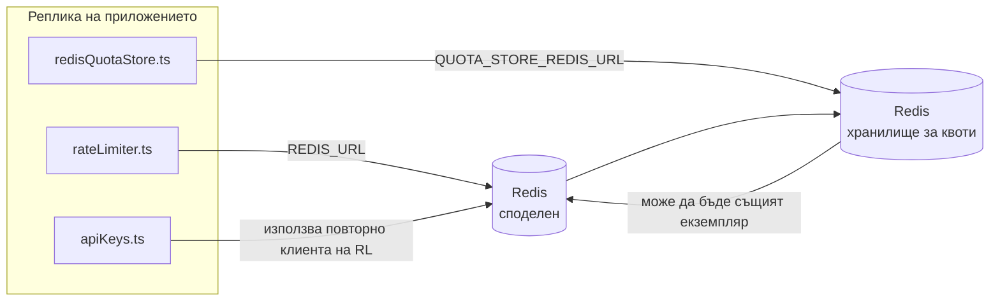

# Redis Production Configuration Guide (Български)

🌐 **Languages:** 🇺🇸 [English](../../../../ops/REDIS_PRODUCTION_CONFIG.md) · 🇪🇹 [am](../../../am/docs/ops/REDIS_PRODUCTION_CONFIG.md) · 🇸🇦 [ar](../../../ar/docs/ops/REDIS_PRODUCTION_CONFIG.md) · 🇦🇿 [az](../../../az/docs/ops/REDIS_PRODUCTION_CONFIG.md) · 🇧🇩 [bn](../../../bn/docs/ops/REDIS_PRODUCTION_CONFIG.md) · 🇧🇦 [bs](../../../bs/docs/ops/REDIS_PRODUCTION_CONFIG.md) · 🇨🇿 [cs](../../../cs/docs/ops/REDIS_PRODUCTION_CONFIG.md) · 🇩🇰 [da](../../../da/docs/ops/REDIS_PRODUCTION_CONFIG.md) · 🇩🇪 [de](../../../de/docs/ops/REDIS_PRODUCTION_CONFIG.md) · 🇬🇷 [el](../../../el/docs/ops/REDIS_PRODUCTION_CONFIG.md) · 🇪🇸 [es](../../../es/docs/ops/REDIS_PRODUCTION_CONFIG.md) · 🇪🇪 [et](../../../et/docs/ops/REDIS_PRODUCTION_CONFIG.md) · 🇮🇷 [fa](../../../fa/docs/ops/REDIS_PRODUCTION_CONFIG.md) · 🇫🇮 [fi](../../../fi/docs/ops/REDIS_PRODUCTION_CONFIG.md) · 🇫🇷 [fr](../../../fr/docs/ops/REDIS_PRODUCTION_CONFIG.md) · 🇮🇪 [ga](../../../ga/docs/ops/REDIS_PRODUCTION_CONFIG.md) · 🇮🇳 [gu](../../../gu/docs/ops/REDIS_PRODUCTION_CONFIG.md) · 🇳🇬 [ha](../../../ha/docs/ops/REDIS_PRODUCTION_CONFIG.md) · 🇮🇱 [he](../../../he/docs/ops/REDIS_PRODUCTION_CONFIG.md) · 🇮🇳 [hi](../../../hi/docs/ops/REDIS_PRODUCTION_CONFIG.md) · 🇭🇷 [hr](../../../hr/docs/ops/REDIS_PRODUCTION_CONFIG.md) · 🇭🇺 [hu](../../../hu/docs/ops/REDIS_PRODUCTION_CONFIG.md) · 🇦🇲 [hy](../../../hy/docs/ops/REDIS_PRODUCTION_CONFIG.md) · 🇮🇩 [id](../../../id/docs/ops/REDIS_PRODUCTION_CONFIG.md) · 🇳🇬 [ig](../../../ig/docs/ops/REDIS_PRODUCTION_CONFIG.md) · 🇮🇹 [it](../../../it/docs/ops/REDIS_PRODUCTION_CONFIG.md) · 🇯🇵 [ja](../../../ja/docs/ops/REDIS_PRODUCTION_CONFIG.md) · 🇬🇪 [ka](../../../ka/docs/ops/REDIS_PRODUCTION_CONFIG.md) · 🇰🇭 [km](../../../km/docs/ops/REDIS_PRODUCTION_CONFIG.md) · 🇮🇳 [kn](../../../kn/docs/ops/REDIS_PRODUCTION_CONFIG.md) · 🇰🇷 [ko](../../../ko/docs/ops/REDIS_PRODUCTION_CONFIG.md) · 🇱🇹 [lt](../../../lt/docs/ops/REDIS_PRODUCTION_CONFIG.md) · 🇱🇻 [lv](../../../lv/docs/ops/REDIS_PRODUCTION_CONFIG.md) · 🇮🇳 [ml](../../../ml/docs/ops/REDIS_PRODUCTION_CONFIG.md) · 🇮🇳 [mr](../../../mr/docs/ops/REDIS_PRODUCTION_CONFIG.md) · 🇲🇾 [ms](../../../ms/docs/ops/REDIS_PRODUCTION_CONFIG.md) · 🇲🇹 [mt](../../../mt/docs/ops/REDIS_PRODUCTION_CONFIG.md) · 🇲🇲 [my](../../../my/docs/ops/REDIS_PRODUCTION_CONFIG.md) · 🇳🇵 [ne](../../../ne/docs/ops/REDIS_PRODUCTION_CONFIG.md) · 🇳🇱 [nl](../../../nl/docs/ops/REDIS_PRODUCTION_CONFIG.md) · 🇳🇴 [no](../../../no/docs/ops/REDIS_PRODUCTION_CONFIG.md) · 🇮🇳 [or](../../../or/docs/ops/REDIS_PRODUCTION_CONFIG.md) · 🇮🇳 [pa](../../../pa/docs/ops/REDIS_PRODUCTION_CONFIG.md) · 🇵🇭 [phi](../../../phi/docs/ops/REDIS_PRODUCTION_CONFIG.md) · 🇵🇱 [pl](../../../pl/docs/ops/REDIS_PRODUCTION_CONFIG.md) · 🇵🇹 [pt](../../../pt/docs/ops/REDIS_PRODUCTION_CONFIG.md) · 🇧🇷 [pt-BR](../../../pt-BR/docs/ops/REDIS_PRODUCTION_CONFIG.md) · 🇷🇴 [ro](../../../ro/docs/ops/REDIS_PRODUCTION_CONFIG.md) · 🇷🇺 [ru](../../../ru/docs/ops/REDIS_PRODUCTION_CONFIG.md) · 🇱🇰 [si](../../../si/docs/ops/REDIS_PRODUCTION_CONFIG.md) · 🇸🇰 [sk](../../../sk/docs/ops/REDIS_PRODUCTION_CONFIG.md) · 🇸🇮 [sl](../../../sl/docs/ops/REDIS_PRODUCTION_CONFIG.md) · 🇷🇸 [sr](../../../sr/docs/ops/REDIS_PRODUCTION_CONFIG.md) · 🇸🇪 [sv](../../../sv/docs/ops/REDIS_PRODUCTION_CONFIG.md) · 🇰🇪 [sw](../../../sw/docs/ops/REDIS_PRODUCTION_CONFIG.md) · 🇮🇳 [ta](../../../ta/docs/ops/REDIS_PRODUCTION_CONFIG.md) · 🇮🇳 [te](../../../te/docs/ops/REDIS_PRODUCTION_CONFIG.md) · 🇹🇭 [th](../../../th/docs/ops/REDIS_PRODUCTION_CONFIG.md) · 🇹🇷 [tr](../../../tr/docs/ops/REDIS_PRODUCTION_CONFIG.md) · 🇺🇦 [uk-UA](../../../uk-UA/docs/ops/REDIS_PRODUCTION_CONFIG.md) · 🇵🇰 [ur](../../../ur/docs/ops/REDIS_PRODUCTION_CONFIG.md) · 🇺🇿 [uz](../../../uz/docs/ops/REDIS_PRODUCTION_CONFIG.md) · 🇻🇳 [vi](../../../vi/docs/ops/REDIS_PRODUCTION_CONFIG.md) · 🇳🇬 [yo](../../../yo/docs/ops/REDIS_PRODUCTION_CONFIG.md) · 🇨🇳 [zh-CN](../../../zh-CN/docs/ops/REDIS_PRODUCTION_CONFIG.md) · 🇹🇼 [zh-TW](../../../zh-TW/docs/ops/REDIS_PRODUCTION_CONFIG.md)

---

## Общ преглед

Redis е **незадължима, некритична зависимост** в OmniRoute — приложението продължава да работи с ограничена функционалност (резервни реализации в паметта), когато Redis не е наличен. В производствена среда настройването на Redis намалява латентността за четири различни типа натоварване:

| Натоварване                                      | Компонент                     | Фабрика за клиенти                                                          | Шаблон на ключовете                                                       |
| ------------------------------------------------ | ----------------------------- | --------------------------------------------------------------------------- | ------------------------------------------------------------------------- |
| Ограничаване на честотата                        | `rateLimiter.ts`              | `getRedisClient()` — отложено инициализиран единичен екземпляр на `ioredis` | `<prefix>rl:*` Lua-атомарни времеви прозорци за ограничаване на честотата |
| Кеш за удостоверяване                            | `apiKeys.ts`                  | Използва повторно клиента на `rateLimiter`                                  | `<prefix>auth:api_key:<sha256>` с TTL                                     |
| Хранилище за квоти                               | `redisQuotaStore.ts`          | Отделен единичен екземпляр `getRedisClient(url)`                            | `<prefix>quota:*`, конфигурируемо за всеки екземпляр                      |
| Прекъсвач на веригата за предварително загряване | `redisCircuitBreakerStore.ts` | Отделен клиент в `circuitBreakerFactory.ts`                                 | `<prefix>warmup:cb:<connectionId>`                                        |

Всички четири типа натоварване споделят един префикс на пространството от имена, така че OmniRoute да може да съществува съвместно с други приложения в един екземпляр на Redis (напр. `127.0.0.1:6379`). Вижте [Пространство от имена за ключовете](#key-namespacing).

---

## Текуща конфигурация (стойности по подразбиране в кода)

| Настройка                                     | Стойност                                                                                     | Местоположение                                                                        |
| --------------------------------------------- | -------------------------------------------------------------------------------------------- | ------------------------------------------------------------------------------------- |
| Променлива на средата `REDIS_URL`             | `redis://redis:6379` (compose), незадължителна                                               | `rateLimiter.ts:5`, `.env.example`                                                    |
| Променлива на средата `REDIS_KEY_PREFIX`      | `omniroute:` (по подразбиране)                                                               | `rateLimiter.ts`, `redisQuotaStore.ts`, `redisCircuitBreakerStore.ts`, `.env.example` |
| Променлива на средата `QUOTA_STORE_REDIS_URL` | отделна, може да се различава от `REDIS_URL`                                                 | `quota/storeFactory.ts`                                                               |
| `QUOTA_STORE_DRIVER`                          | `"sqlite"` (по подразбиране), `"redis"` по избор                                             | `quota/storeFactory.ts`                                                               |
| `maxRetriesPerRequest` на ioredis             | `3`                                                                                          | създаване на клиент в `rateLimiter.ts`                                                |
| `enableReadyCheck`                            | не е зададено (по подразбиране за ioredis: `true`)                                           | —                                                                                     |
| `lazyConnect`                                 | не е зададено (по подразбиране за ioredis: `false`)                                          | —                                                                                     |
| `retryStrategy`                               | не е зададено (по подразбиране за ioredis: базова стойност 200ms, експоненциално нарастване) | —                                                                                     |
| TLS / парола / индекс на БД                   | **не са конфигурирани**                                                                      | —                                                                                     |
| Sentinel / Cluster                            | **не са конфигурирани** — поддържа се само самостоятелен единичен възел                      | —                                                                                     |

---

## Пространство от имена за ключовете

OmniRoute споделя един екземпляр на Redis с всичко останало, което работи на хоста. Без пространство от имена ключове като `auth:api_key:<sha256>` или `rl:*` може да влязат в конфликт с ключове от други приложения, използващи същия Redis (този екземпляр изпълнява Redis на `127.0.0.1:6379` заедно с други услуги).

Задайте `REDIS_KEY_PREFIX` като непразен низ, за да добавите префикс към **всеки** ключ на OmniRoute:

```bash
# .env — всички ключове на OmniRoute стават omniroute:rl:*, omniroute:auth:*, omniroute:quota:*, omniroute:warmup:cb:*
REDIS_KEY_PREFIX=omniroute:
```

- **По подразбиране:** `omniroute:` (прилага се, когато `REDIS_KEY_PREFIX` не е зададен или е празен).
- **Прилага се към:** ограничителя на честотата + кеша за удостоверяване (споделен клиент `ioredis` чрез `keyPrefix`), хранилището за квоти (`KEY_PREFIX = "${REDIS_KEY_PREFIX}quota"`) и прекъсвача на веригата за предварително загряване (`KEY_PREFIX = "${REDIS_KEY_PREFIX}warmup:cb:"`).
- **Промяната на префикса**, когато в Redis вече съществуват ключове, оставя старите ключове неизползвани (те изтичат чрез TTL / LRU). Промяната е безопасна и не е необходима миграция. Единственото изключение е ключ на прекъсвача на веригата за предварително загряване за връзка, маркирана като забранена: той се съхранява без TTL, затова изведете остатъчните ключове с `redis-cli --scan --pattern '<old-prefix>warmup:cb:*'` и ги изтрийте.
- **`keyPrefix` на ioredis** автоматично добавя префикса при запис **и** го премахва при четене, така че кодът на приложението никога не вижда префикса.

---

## Препоръчителна производствена настройка

### 1. Пул за връзки/Опции на клиента (конструктор ioredis `Redis` )

Текущият код създава единична `new Redis(url)` без персонализирани опции. За производствени внедрявания с множество реплики, предайте клиентска фабрика в кода или обвийте `getRedisClient()`:

```typescript
const redis = new Redis(REDIS_URL, {
  maxRetriesPerRequest: null, // no retry limit; let retryStrategy decide
  enableReadyCheck: true, // verify server is ready before accepting calls
  lazyConnect: true, // don't connect on construction; wait for first call
  retryStrategy: (times) => {
    if (times > 10) return null; // give up after 10 retries → reconnect later
    return Math.min(times * 200, 5000); // 200ms, 400ms, …, 5s cap
  },
  enableAutoPipelining: true, // coalesce concurrent commands into one TCP write
  keepAlive: 10000, // TCP keep‑alive every 10s
});
```

**Ключови компромиси:**

- `maxRetriesPerRequest: null` + `retryStrategy` — предпочитан за производство, така че преходните рестартирания Redis да не провалят веднага всяка заявка. Резервният в паметта в `checkRateLimit()` абсорбира пътя на повредата.
- `lazyConnect: true` — избягва зависимостта при стартиране на Redis, преди сървърът да започне да приема връзки.
- `enableAutoPipelining: true` — намалява двупосочните пътувания за едновременни проверки на ограничение на скоростта; изгодно при > 50 RPS на една връзка.

### 2. Конфигурация на Redis сървър (`redis.conf`)

```
# Memory
maxmemory 80%                        # leave room for OS page cache
maxmemory-policy allkeys-lru         # evict stale auth cache entries under pressure

# Persistence (optional — OmniRoute is crash‑safe without it)
save 300 1                           # snapshot at least every 5 min if ≥1 key changed
appendonly no                        # AOF not needed; data is regeneratable
appendfsync no                       # no fsync overhead (RDB is sufficient)

# Networking
timeout 0                            # no idle disconnect
tcp-keepalive 300                    # 5 min keep‑alive
tcp-backlog 511                      # connection backlog for bursty load

# Performance
hz 10                                # default; 100 for latency‑sensitive
activedefrag yes                     # auto‑defragment when fragmentation >10%
```

**Компромис за `maxmemory-policy allkeys-lru`:** Записите в кеша за удостоверяване може да бъдат извадени при натиск на паметта. Това е безопасно — `setCachedApiKey` винаги се попълва отново при пропускане и резервният SQLite е авторитетен. Скриптът Lua за ограничаване на скоростта създава малки ключове, които са краткотрайни по дизайн.

### 3. Docker Compose Settings

Продуктът compose (`docker-compose.prod.yml`) използва `redis:8.6.2-alpine`. добавете:

```yaml
redis:
  image: redis:8.6.2-alpine
  command:
    [
      "redis-server",
      "--maxmemory",
      "512mb",
      "--maxmemory-policy",
      "allkeys-lru",
      "--activedefrag",
      "yes",
      "--save",
      "300 1",
    ]
  healthcheck:
    test: ["CMD", "redis-cli", "ping"]
    interval: 10s
    timeout: 3s
    retries: 3
    start_period: 5s
```

### 4. Съображения за множество инстанции/мащабиране

**Единична Redis за всички реплики** — Lua скриптът за ограничаване на скоростта зависи от едно единствено авторитетно ключово пространство. Няколко Redis инстанции зад реплики биха загубили атомарност и биха удвоили бюджета. Използвайте един Redis (или Redis Sentinel клъстер с отказ) за всички реплики на приложения.

**Брой връзки:** Всяка реплика на приложение се отваря** 2 TCP връзки** към Redis (клиент за ограничаване на скоростта + клиент за съхранение на квоти). При 10 реплики → 20 връзки, доста в рамките на тавана от 10k връзки на Redis екземпляр по подразбиране.

### 5. Мониторинг

Разкриване чрез крайна точка за проверка на здравето:

```typescript
// src/app/api/monitoring/health/route.ts already calls rateLimiter functions
// Add Redis-specific checks:
//   1. PING latency via ioredis .ping()
//   2. Memory usage via INFO memory
//   3. Connection count via INFO clients
//   4. Hit rate for maxmemory-policy (evicted_keys / keyspace_hits)
```

Ключови показатели за наблюдение:

- **Изгонени ключове/сек** — ако постоянно не е нула, увеличете `maxmemory`
- **Блокирани клиенти** — не-нула предполага бавни Lua скриптове или голямо съревнование
- **Отхвърлени връзки** — ограничение за връзка; рядко при 20 връзки

### 6. Съвместими с Redis сървъри

Всеки сървър, използван тук, трябва да изпълнява Lua скриптове: ограничителят на скоростта е един `EVAL`. На сървър без Lua, `checkRateLimit()` регистрира `[RATE_LIMITER] Redis eval failed, falling back to in-memory rate limiting` и брои за процес, така че всяка реплика налага ограничението сама. Споделеното хранилище за афинитет на сесия за включване (`OMNIROUTE_SESSION_AFFINITY_STORE=redis`) също чете и актуализира пинове с `EVAL`; без Lua регистрира `[SESSION_AFFINITY] Redis error; falling back to SQLite.` и всяка реплика запазва свои собствени пинове. Другите работни натоварвания използват обикновени команди (`SET ... EX`, `GET`, `DEL`, `MGET`, `EXPIRE`, `INCRBYFLOAT`, хешове и набори), а Redis бекендът на семантичния кеш не изпраща `FT.*` команди.

Тествано с OmniRoute 3.8.52: KiviDB 1.2.0 с неговия Lua образ (`kividb/kividb:v1.2.0-lua`). Ограничителят на скоростта (включително втори процес, споделящ броячите), кешът за удостоверяване, съхранението на квотите, прекъсвачът на веригата за загряване, съхраняването на семантичния кеш и `/v1/chat/completions` заявката през манипулатора на чат преминаха 18 от 19-те проверки, които преминават през Redis 8.10.3. Този, който се различава: `INCRBYFLOAT` съхранява `0.1 + 0.2` като `0.30000000000000004` където Redis съхранява `0.3` ( [kividbio/kividb#387](https://github.com/kividbio/kividb/issues/387) ). Хранилището за квота анализира и двете с `parseFloat`, но двете числа се различават в последните цифри, така че сравнение, което попада точно на границата на квотата, може да излезе различно. Хранилището за афинитет на сесия не беше част от това изпълнение. ( [настройка](https://github.com/kividbio/kividb/blob/master/docs/integrations/omniroute.md), [резултати](https://github.com/kividbio/kividb/tree/master/benchmarks/omniroute-compat) )

---

## Архитектурна диаграма



---

## Препратки

| Файл                               | Предназначение                                                                                           |
| ---------------------------------- | -------------------------------------------------------------------------------------------------------- |
| `src/shared/utils/rateLimiter.ts`  | Основен Redis клиент, Lua скрипт за ограничаване на честотата на заявките и резервен механизъм в паметта |
| `src/lib/db/apiKeys.ts`            | Кеш за удостоверяване — резервно превключване от Redis към SQLite                                        |
| `src/lib/quota/redisQuotaStore.ts` | Отделен Redis клиент за незадължителното хранилище за квоти                                              |
| `src/lib/quota/storeFactory.ts`    | Превключва между драйверите за квоти `sqlite` и `redis`                                                  |
| `docker-compose.prod.yml`          | Redis контейнер за продукционна среда (образ `redis:8.6.2-alpine`)                                       |
| `.env.example`                     | Документация за променливите на средата за Redis                                                         |
| `src/app/api/local/redis/`         | API маршрути за оркестрация на контейнера за разработка                                                  |
| `bin/cli/commands/redis.mjs`       | CLI команди за оркестрация на контейнера за разработка                                                   |
