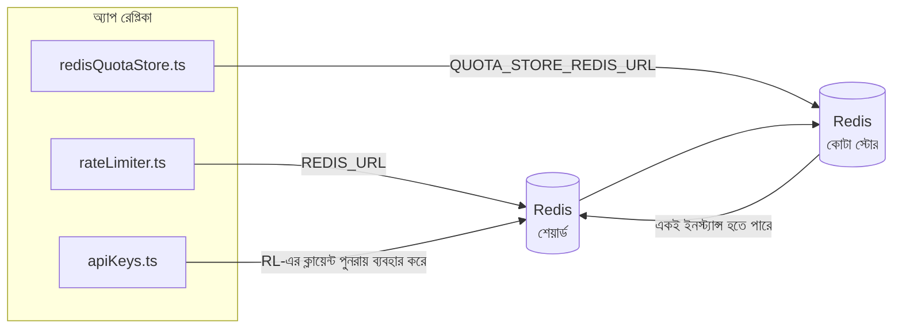

# Redis Production Configuration Guide (বাংলা)

🌐 **Languages:** 🇺🇸 [English](../../../../ops/REDIS_PRODUCTION_CONFIG.md) · 🇪🇹 [am](../../../am/docs/ops/REDIS_PRODUCTION_CONFIG.md) · 🇸🇦 [ar](../../../ar/docs/ops/REDIS_PRODUCTION_CONFIG.md) · 🇦🇿 [az](../../../az/docs/ops/REDIS_PRODUCTION_CONFIG.md) · 🇧🇬 [bg](../../../bg/docs/ops/REDIS_PRODUCTION_CONFIG.md) · 🇧🇦 [bs](../../../bs/docs/ops/REDIS_PRODUCTION_CONFIG.md) · 🇨🇿 [cs](../../../cs/docs/ops/REDIS_PRODUCTION_CONFIG.md) · 🇩🇰 [da](../../../da/docs/ops/REDIS_PRODUCTION_CONFIG.md) · 🇩🇪 [de](../../../de/docs/ops/REDIS_PRODUCTION_CONFIG.md) · 🇬🇷 [el](../../../el/docs/ops/REDIS_PRODUCTION_CONFIG.md) · 🇪🇸 [es](../../../es/docs/ops/REDIS_PRODUCTION_CONFIG.md) · 🇪🇪 [et](../../../et/docs/ops/REDIS_PRODUCTION_CONFIG.md) · 🇮🇷 [fa](../../../fa/docs/ops/REDIS_PRODUCTION_CONFIG.md) · 🇫🇮 [fi](../../../fi/docs/ops/REDIS_PRODUCTION_CONFIG.md) · 🇫🇷 [fr](../../../fr/docs/ops/REDIS_PRODUCTION_CONFIG.md) · 🇮🇪 [ga](../../../ga/docs/ops/REDIS_PRODUCTION_CONFIG.md) · 🇮🇳 [gu](../../../gu/docs/ops/REDIS_PRODUCTION_CONFIG.md) · 🇳🇬 [ha](../../../ha/docs/ops/REDIS_PRODUCTION_CONFIG.md) · 🇮🇱 [he](../../../he/docs/ops/REDIS_PRODUCTION_CONFIG.md) · 🇮🇳 [hi](../../../hi/docs/ops/REDIS_PRODUCTION_CONFIG.md) · 🇭🇷 [hr](../../../hr/docs/ops/REDIS_PRODUCTION_CONFIG.md) · 🇭🇺 [hu](../../../hu/docs/ops/REDIS_PRODUCTION_CONFIG.md) · 🇦🇲 [hy](../../../hy/docs/ops/REDIS_PRODUCTION_CONFIG.md) · 🇮🇩 [id](../../../id/docs/ops/REDIS_PRODUCTION_CONFIG.md) · 🇳🇬 [ig](../../../ig/docs/ops/REDIS_PRODUCTION_CONFIG.md) · 🇮🇹 [it](../../../it/docs/ops/REDIS_PRODUCTION_CONFIG.md) · 🇯🇵 [ja](../../../ja/docs/ops/REDIS_PRODUCTION_CONFIG.md) · 🇬🇪 [ka](../../../ka/docs/ops/REDIS_PRODUCTION_CONFIG.md) · 🇰🇭 [km](../../../km/docs/ops/REDIS_PRODUCTION_CONFIG.md) · 🇮🇳 [kn](../../../kn/docs/ops/REDIS_PRODUCTION_CONFIG.md) · 🇰🇷 [ko](../../../ko/docs/ops/REDIS_PRODUCTION_CONFIG.md) · 🇱🇹 [lt](../../../lt/docs/ops/REDIS_PRODUCTION_CONFIG.md) · 🇱🇻 [lv](../../../lv/docs/ops/REDIS_PRODUCTION_CONFIG.md) · 🇮🇳 [ml](../../../ml/docs/ops/REDIS_PRODUCTION_CONFIG.md) · 🇮🇳 [mr](../../../mr/docs/ops/REDIS_PRODUCTION_CONFIG.md) · 🇲🇾 [ms](../../../ms/docs/ops/REDIS_PRODUCTION_CONFIG.md) · 🇲🇹 [mt](../../../mt/docs/ops/REDIS_PRODUCTION_CONFIG.md) · 🇲🇲 [my](../../../my/docs/ops/REDIS_PRODUCTION_CONFIG.md) · 🇳🇵 [ne](../../../ne/docs/ops/REDIS_PRODUCTION_CONFIG.md) · 🇳🇱 [nl](../../../nl/docs/ops/REDIS_PRODUCTION_CONFIG.md) · 🇳🇴 [no](../../../no/docs/ops/REDIS_PRODUCTION_CONFIG.md) · 🇮🇳 [or](../../../or/docs/ops/REDIS_PRODUCTION_CONFIG.md) · 🇮🇳 [pa](../../../pa/docs/ops/REDIS_PRODUCTION_CONFIG.md) · 🇵🇭 [phi](../../../phi/docs/ops/REDIS_PRODUCTION_CONFIG.md) · 🇵🇱 [pl](../../../pl/docs/ops/REDIS_PRODUCTION_CONFIG.md) · 🇵🇹 [pt](../../../pt/docs/ops/REDIS_PRODUCTION_CONFIG.md) · 🇧🇷 [pt-BR](../../../pt-BR/docs/ops/REDIS_PRODUCTION_CONFIG.md) · 🇷🇴 [ro](../../../ro/docs/ops/REDIS_PRODUCTION_CONFIG.md) · 🇷🇺 [ru](../../../ru/docs/ops/REDIS_PRODUCTION_CONFIG.md) · 🇱🇰 [si](../../../si/docs/ops/REDIS_PRODUCTION_CONFIG.md) · 🇸🇰 [sk](../../../sk/docs/ops/REDIS_PRODUCTION_CONFIG.md) · 🇸🇮 [sl](../../../sl/docs/ops/REDIS_PRODUCTION_CONFIG.md) · 🇷🇸 [sr](../../../sr/docs/ops/REDIS_PRODUCTION_CONFIG.md) · 🇸🇪 [sv](../../../sv/docs/ops/REDIS_PRODUCTION_CONFIG.md) · 🇰🇪 [sw](../../../sw/docs/ops/REDIS_PRODUCTION_CONFIG.md) · 🇮🇳 [ta](../../../ta/docs/ops/REDIS_PRODUCTION_CONFIG.md) · 🇮🇳 [te](../../../te/docs/ops/REDIS_PRODUCTION_CONFIG.md) · 🇹🇭 [th](../../../th/docs/ops/REDIS_PRODUCTION_CONFIG.md) · 🇹🇷 [tr](../../../tr/docs/ops/REDIS_PRODUCTION_CONFIG.md) · 🇺🇦 [uk-UA](../../../uk-UA/docs/ops/REDIS_PRODUCTION_CONFIG.md) · 🇵🇰 [ur](../../../ur/docs/ops/REDIS_PRODUCTION_CONFIG.md) · 🇺🇿 [uz](../../../uz/docs/ops/REDIS_PRODUCTION_CONFIG.md) · 🇻🇳 [vi](../../../vi/docs/ops/REDIS_PRODUCTION_CONFIG.md) · 🇳🇬 [yo](../../../yo/docs/ops/REDIS_PRODUCTION_CONFIG.md) · 🇨🇳 [zh-CN](../../../zh-CN/docs/ops/REDIS_PRODUCTION_CONFIG.md) · 🇹🇼 [zh-TW](../../../zh-TW/docs/ops/REDIS_PRODUCTION_CONFIG.md)

---

## সারসংক্ষেপ

OmniRoute-এ Redis একটি **ঐচ্ছিক, সফট ডিপেন্ডেন্সি** — Redis অনুপলভ্য হলে অ্যাপ্লিকেশনটি স্বাভাবিকভাবে কার্যক্ষমতা কমিয়ে ইন-মেমরি
ফলব্যাক ব্যবহার করে। প্রোডাকশনে Redis টিউন করলে চারটি স্বতন্ত্র
ওয়ার্কলোডের লেটেন্সি কমে:

| ওয়ার্কলোড                | ড্রাইভার                      | ক্লায়েন্ট ফ্যাক্টরি                            | কী প্যাটার্ন                                               |
| ------------------------- | ----------------------------- | ----------------------------------------------- | ---------------------------------------------------------- |
| রেট লিমিটিং               | `rateLimiter.ts`              | `getRedisClient()` — লেজি `ioredis` সিঙ্গেলটন   | `<prefix>rl:*` Lua‑অ্যাটমিক রেট লিমিট উইন্ডো               |
| অথ ক্যাশ                  | `apiKeys.ts`                  | `rateLimiter`-এর ক্লায়েন্ট পুনরায় ব্যবহার করে | TTL-সহ `<prefix>auth:api_key:<sha256>`                     |
| কোটা স্টোর                | `redisQuotaStore.ts`          | পৃথক `getRedisClient(url)` সিঙ্গেলটন            | `<prefix>quota:*`, প্রতিটি ইনস্ট্যান্সের জন্য কনফিগারযোগ্য |
| ওয়ার্মআপ সার্কিট ব্রেকার | `redisCircuitBreakerStore.ts` | `circuitBreakerFactory.ts`-এ পৃথক ক্লায়েন্ট    | `<prefix>warmup:cb:<connectionId>`                         |

চারটি ওয়ার্কলোডই একই নেমস্পেস প্রিফিক্স ব্যবহার করে, যাতে OmniRoute একটি
একক Redis ইনস্ট্যান্সে (যেমন `127.0.0.1:6379`) অন্যান্য অ্যাপের সঙ্গে সহাবস্থান করতে পারে। [কী নেমস্পেসিং](#key-namespacing) দেখুন।

---

## বর্তমান কনফিগারেশন (কোডের ডিফল্ট)

| সেটিং                           | মান                                                      | অবস্থান                                                                               |
| ------------------------------- | -------------------------------------------------------- | ------------------------------------------------------------------------------------- |
| `REDIS_URL` env var             | `redis://redis:6379` (compose), ঐচ্ছিক                   | `rateLimiter.ts:5`, `.env.example`                                                    |
| `REDIS_KEY_PREFIX` env var      | `omniroute:` (ডিফল্ট)                                    | `rateLimiter.ts`, `redisQuotaStore.ts`, `redisCircuitBreakerStore.ts`, `.env.example` |
| `QUOTA_STORE_REDIS_URL` env var | পৃথক; `REDIS_URL` থেকে ভিন্ন হতে পারে                    | `quota/storeFactory.ts`                                                               |
| `QUOTA_STORE_DRIVER`            | `"sqlite"` (ডিফল্ট), `"redis"` ঐচ্ছিক                    | `quota/storeFactory.ts`                                                               |
| ioredis `maxRetriesPerRequest`  | `3`                                                      | `rateLimiter.ts` ক্লায়েন্ট তৈরি                                                      |
| `enableReadyCheck`              | সেট করা নেই (ioredis ডিফল্ট: `true`)                     | —                                                                                     |
| `lazyConnect`                   | সেট করা নেই (ioredis ডিফল্ট: `false`)                    | —                                                                                     |
| `retryStrategy`                 | সেট করা নেই (ioredis ডিফল্ট: 200ms বেস, এক্সপোনেনশিয়াল) | —                                                                                     |
| TLS / পাসওয়ার্ড / DB ইনডেক্স   | **কনফিগার করা নেই**                                      | —                                                                                     |
| Sentinel / Cluster              | **কনফিগার করা নেই** — শুধু স্বতন্ত্র সিঙ্গেল-নোড         | —                                                                                     |

---

## কী নেমস্পেসিং

হোস্টে চলমান অন্যান্য সবকিছুর সঙ্গে OmniRoute একটি Redis ইনস্ট্যান্স শেয়ার করে। নেমস্পেস ছাড়া,
`auth:api_key:<sha256>` বা `rl:*`-এর মতো কীগুলো একই Redis ব্যবহারকারী অন্যান্য অ্যাপ্লিকেশনের
কীর সঙ্গে সংঘর্ষে জড়াতে পারে (এই ইনস্ট্যান্সটি অন্যান্য সার্ভিসের পাশাপাশি `127.0.0.1:6379`-এ Redis চালায়)।

OmniRoute-এর **প্রতিটি** কীর শুরুতে প্রিফিক্স যোগ করতে `REDIS_KEY_PREFIX`-কে একটি খালি নয় এমন স্ট্রিংয়ে সেট করুন:

```bash
# .env — OmniRoute-এর সব কী হয়ে যাবে omniroute:rl:*, omniroute:auth:*, omniroute:quota:*, omniroute:warmup:cb:*
REDIS_KEY_PREFIX=omniroute:
```

- **ডিফল্ট:** `omniroute:` (`REDIS_KEY_PREFIX` সেট করা না থাকলে বা ফাঁকা থাকলে প্রয়োগ করা হয়)।
- **যেগুলোতে প্রয়োগ করা হয়:** রেট লিমিটার + অথ ক্যাশ (`keyPrefix`-এর মাধ্যমে শেয়ার করা `ioredis` ক্লায়েন্ট) এবং
  কোটা স্টোর (`KEY_PREFIX = "${REDIS_KEY_PREFIX}quota"`) ও ওয়ার্মআপ সার্কিট ব্রেকার
  (`KEY_PREFIX = "${REDIS_KEY_PREFIX}warmup:cb:"`)।
- Redis-এ কী আগে থেকেই থাকা অবস্থায় **প্রিফিক্স পরিবর্তন করলে** পুরোনো কীগুলো অনাথ হয়ে যায় (সেগুলোর মেয়াদ
  TTL / LRU-এর মাধ্যমে শেষ হয়)। পরিবর্তন করা নিরাপদ; কোনো মাইগ্রেশন প্রয়োজন নেই। একমাত্র ব্যতিক্রম হলো নিষিদ্ধ হিসেবে চিহ্নিত কোনো সংযোগের
  ওয়ার্মআপ সার্কিট-ব্রেকার কী: এটি TTL ছাড়াই সংরক্ষিত থাকে, তাই অবশিষ্ট কীগুলো
  `redis-cli --scan --pattern '<old-prefix>warmup:cb:*'` দিয়ে তালিকাভুক্ত করে মুছে ফেলুন।
- **ioredis `keyPrefix`** লেখার সময় স্বয়ংক্রিয়ভাবে প্রিফিক্স যোগ করে **এবং** পড়ার সময় সেটি বাদ দেয়,
  তাই অ্যাপ্লিকেশন কোড কখনোই প্রিফিক্সটি দেখতে পায় না।

---

## প্রস্তাবিত উত্পাদন টিউনিং

### 1. সংযোগ পুল / ক্লায়েন্ট বিকল্প (ioredis `Redis` কনস্ট্রাক্টর)

বর্তমান কোড কোনো কাস্টম বিকল্প ছাড়াই একটি একক `new Redis(url)` তৈরি করে। প্রোডাকশন মাল্টি-রেপ্লিকা ডিপ্লোয়মেন্টের জন্য, কোডে একটি ক্লায়েন্ট ফ্যাক্টরি পাস করুন বা `getRedisClient()` মোড়ানো:

```typescript
const redis = new Redis(REDIS_URL, {
  maxRetriesPerRequest: null, // no retry limit; let retryStrategy decide
  enableReadyCheck: true, // verify server is ready before accepting calls
  lazyConnect: true, // don't connect on construction; wait for first call
  retryStrategy: (times) => {
    if (times > 10) return null; // give up after 10 retries → reconnect later
    return Math.min(times * 200, 5000); // 200ms, 400ms, …, 5s cap
  },
  enableAutoPipelining: true, // coalesce concurrent commands into one TCP write
  keepAlive: 10000, // TCP keep‑alive every 10s
});
```

**মূল ট্রেড-অফ:**

- `maxRetriesPerRequest: null` + `retryStrategy` — প্রোডাকশনের জন্য পছন্দের তাই ক্ষণস্থায়ী Redis রিস্টার্ট প্রতিটি অনুরোধ অবিলম্বে ব্যর্থ হয় না। `checkRateLimit()` এ ইন-মেমরি ফলব্যাক ব্যর্থতার পথকে শোষণ করে।
- সার্ভার সংযোগ গ্রহণ শুরু করার আগে`lazyConnect: true` — Redis এর উপর একটি স্টার্টআপ নির্ভরতা এড়ায়।
- `enableAutoPipelining: true` — সমবর্তী হার-সীমা চেকের জন্য রাউন্ড-ট্রিপ হ্রাস করে; একক সংযোগে > 50 RPS এ উপকারী।

### 2. Redis সার্ভার কনফিগারেশন (`redis.conf`)

```
# Memory
maxmemory 80%                        # leave room for OS page cache
maxmemory-policy allkeys-lru         # evict stale auth cache entries under pressure

# Persistence (optional — OmniRoute is crash‑safe without it)
save 300 1                           # snapshot at least every 5 min if ≥1 key changed
appendonly no                        # AOF not needed; data is regeneratable
appendfsync no                       # no fsync overhead (RDB is sufficient)

# Networking
timeout 0                            # no idle disconnect
tcp-keepalive 300                    # 5 min keep‑alive
tcp-backlog 511                      # connection backlog for bursty load

# Performance
hz 10                                # default; 100 for latency‑sensitive
activedefrag yes                     # auto‑defragment when fragmentation >10%
```

**`maxmemory-policy allkeys-lru` জন্য ট্রেড-অফ:** মেমরির চাপে Auth ক্যাশে এন্ট্রিগুলি উচ্ছেদ করা হতে পারে৷ এটি নিরাপদ — `setCachedApiKey` সর্বদা মিস-এ পুনঃপ্রকাশ করে এবং SQLite ফলব্যাক প্রামাণিক। রেট-লিমিটার লুয়া স্ক্রিপ্ট ছোট কী তৈরি করে যা ডিজাইনের দ্বারা স্বল্পস্থায়ী হয়।

### 3. Docker রচনা সেটিংস

প্রোড কম্পোজ (`docker-compose.prod.yml`) `redis:8.6.2-alpine` ব্যবহার করে। যোগ করুন:

```yaml
redis:
  image: redis:8.6.2-alpine
  command:
    [
      "redis-server",
      "--maxmemory",
      "512mb",
      "--maxmemory-policy",
      "allkeys-lru",
      "--activedefrag",
      "yes",
      "--save",
      "300 1",
    ]
  healthcheck:
    test: ["CMD", "redis-cli", "ping"]
    interval: 10s
    timeout: 3s
    retries: 3
    start_period: 5s
```

### 4. মাল্টি-ইনস্ট্যান্স / স্কেলিং বিবেচনা

**সমস্ত প্রতিলিপির জন্য একক Redis** — হার-সীমিত লুয়া স্ক্রিপ্ট একটি একক প্রামাণিক কী স্থানের উপর নির্ভর করে। প্রতিলিপিগুলির পিছনে একাধিক Redis দৃষ্টান্ত পারমাণবিকতা হারাবে এবং বাজেট দ্বিগুণ করবে। সমস্ত অ্যাপ্লিকেশন প্রতিলিপির জন্য একটি একক Redis (বা ফেইলওভার সহ Redis সেন্টিনেল ক্লাস্টার) ব্যবহার করুন।

**সংযোগ সংখ্যা:** প্রতিটি অ্যাপ্লিকেশন প্রতিলিপি খোলে** 2 TCP সংযোগ** to Redis (রেট লিমিটার ক্লায়েন্ট + কোটা স্টোর ক্লায়েন্ট)। 10 রেপ্লিকা → 20 কানেকশনে, ডিফল্ট Redis ইন্সট্যান্সের 10k কানেকশন সিলিং এর মধ্যে।

### 5. মনিটরিং

স্বাস্থ্য-পরীক্ষার শেষ পয়েন্টের মাধ্যমে প্রকাশ করুন:

```typescript
// src/app/api/monitoring/health/route.ts already calls rateLimiter functions
// Add Redis-specific checks:
//   1. PING latency via ioredis .ping()
//   2. Memory usage via INFO memory
//   3. Connection count via INFO clients
//   4. Hit rate for maxmemory-policy (evicted_keys / keyspace_hits)
```

দেখার জন্য মূল মেট্রিক্স:

- **উচ্ছেদ করা কী / সেকেন্ড** — যদি ক্রমাগতভাবে অ-শূন্য হয়, `maxmemory` বাড়ান
- **ব্লকড ক্লায়েন্ট** — নন-জিরো ধীর লুয়া স্ক্রিপ্ট বা উচ্চ বিতর্কের পরামর্শ দেয়
- **প্রত্যাখ্যান সংযোগ** — সংযোগ সীমা আঘাত; 20টি সংযোগে বিরল

### 6. রিডিস-সামঞ্জস্যপূর্ণ সার্ভার

এখানে ব্যবহৃত যেকোনো সার্ভার অবশ্যই লুয়া স্ক্রিপ্ট চালাতে হবে: রেট লিমিটার এক `EVAL`। Lua ব্যতীত সার্ভারে, `checkRateLimit()` `[RATE_LIMITER] Redis eval failed, falling back to in-memory rate limiting` লগ করে এবং প্রতি প্রক্রিয়ায় গণনা করে, তাই প্রতিটি প্রতিলিপি তার নিজস্ব সীমা প্রয়োগ করে। অপ্ট-ইন শেয়ার্ড সেশন-অ্যাফিনিটি স্টোর (`OMNIROUTE_SESSION_AFFINITY_STORE=redis`) এছাড়াও `EVAL` সাথে পিনগুলি পড়ে এবং আপডেট করে; লুয়া ছাড়া এটি `[SESSION_AFFINITY] Redis error; falling back to SQLite.` লগ করে এবং প্রতিটি রেপ্লিকা নিজস্ব পিন রাখে। অন্যান্য কাজের চাপগুলি প্লেইন কমান্ড ব্যবহার করে (`SET ... EX`, `GET`, `DEL`, `MGET`, `EXPIRE`, `INCRBYFLOAT`, হ্যাশ এবং সেট), এবং শব্দার্থিক ক্যাশের Redis ব্যাকএন্ড কোন `FT.*` কমান্ড পাঠায় না।

OmniRoute 3.8.52: KiviDB 1.2.0 এর Lua ইমেজ (`kividb/kividb:v1.2.0-lua`) দিয়ে পরীক্ষা করা হয়েছে। রেট লিমিটার (কাউন্টারগুলি ভাগ করার দ্বিতীয় প্রক্রিয়া সহ), প্রমাণীকরণ ক্যাশে, কোটা স্টোর, ওয়ার্মআপ সার্কিট ব্রেকার, শব্দার্থিক ক্যাশে স্টোর এবং চ্যাট হ্যান্ডলারের মাধ্যমে একটি `/v1/chat/completions` অনুরোধ 19টি চেকের মধ্যে 18টি পাস করেছে যা Redis 8.10.3-এ পাস হয়েছে৷ যেটি আলাদা: `INCRBYFLOAT` `0.1 + 0.2` `0.30000000000000004` হিসাবে সঞ্চয় করে যেখানে Redis `0.3` সঞ্চয় করে ( [kividbio/kividb#387](https://github.com/kividbio/kividb/issues/387) )। কোটা স্টোর উভয়কেই `parseFloat` দিয়ে পার্স করে, কিন্তু দুটি সংখ্যাই শেষ সংখ্যায় আলাদা, তাই কোটার সীমারেখার মধ্যে ঠিক যে তুলনা হয় তা ভিন্নভাবে বেরিয়ে আসতে পারে। সেশন-অ্যাফিনিটি স্টোরটি সেই রানের অংশ ছিল না। ( [সেটআপ](https://github.com/kividbio/kividb/blob/master/docs/integrations/omniroute.md), [ফলাফল](https://github.com/kividbio/kividb/tree/master/benchmarks/omniroute-compat) )

---

## আর্কিটেকচার ডায়াগ্রাম



---

## রেফারেন্স

| ফাইল                               | উদ্দেশ্য                                                             |
| ---------------------------------- | -------------------------------------------------------------------- |
| `src/shared/utils/rateLimiter.ts`  | প্রাথমিক Redis ক্লায়েন্ট, Lua রেট-লিমিট স্ক্রিপ্ট, ইন-মেমরি ফলব্যাক |
| `src/lib/db/apiKeys.ts`            | অথ ক্যাশ — Redis→SQLite ফলব্যাক                                      |
| `src/lib/quota/redisQuotaStore.ts` | ঐচ্ছিক কোটা স্টোরের জন্য পৃথক Redis ক্লায়েন্ট                       |
| `src/lib/quota/storeFactory.ts`    | `sqlite` এবং `redis` কোটা ড্রাইভারের মধ্যে পরিবর্তন করে              |
| `docker-compose.prod.yml`          | প্রোড Redis কনটেইনার (ইমেজ `redis:8.6.2-alpine`)                     |
| `.env.example`                     | Redis এনভায়রনমেন্ট ভেরিয়েবলের ডকুমেন্টেশন                          |
| `src/app/api/local/redis/`         | ডেভ কনটেইনার অর্কেস্ট্রেশনের জন্য API রুট                            |
| `bin/cli/commands/redis.mjs`       | ডেভ কনটেইনার অর্কেস্ট্রেশনের জন্য CLI কমান্ড                         |
