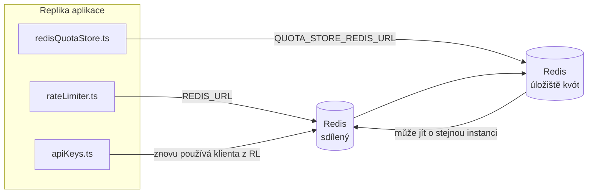

# Redis Production Configuration Guide (Čeština)

🌐 **Languages:** 🇺🇸 [English](../../../../ops/REDIS_PRODUCTION_CONFIG.md) · 🇪🇹 [am](../../../am/docs/ops/REDIS_PRODUCTION_CONFIG.md) · 🇸🇦 [ar](../../../ar/docs/ops/REDIS_PRODUCTION_CONFIG.md) · 🇦🇿 [az](../../../az/docs/ops/REDIS_PRODUCTION_CONFIG.md) · 🇧🇬 [bg](../../../bg/docs/ops/REDIS_PRODUCTION_CONFIG.md) · 🇧🇩 [bn](../../../bn/docs/ops/REDIS_PRODUCTION_CONFIG.md) · 🇧🇦 [bs](../../../bs/docs/ops/REDIS_PRODUCTION_CONFIG.md) · 🇩🇰 [da](../../../da/docs/ops/REDIS_PRODUCTION_CONFIG.md) · 🇩🇪 [de](../../../de/docs/ops/REDIS_PRODUCTION_CONFIG.md) · 🇬🇷 [el](../../../el/docs/ops/REDIS_PRODUCTION_CONFIG.md) · 🇪🇸 [es](../../../es/docs/ops/REDIS_PRODUCTION_CONFIG.md) · 🇪🇪 [et](../../../et/docs/ops/REDIS_PRODUCTION_CONFIG.md) · 🇮🇷 [fa](../../../fa/docs/ops/REDIS_PRODUCTION_CONFIG.md) · 🇫🇮 [fi](../../../fi/docs/ops/REDIS_PRODUCTION_CONFIG.md) · 🇫🇷 [fr](../../../fr/docs/ops/REDIS_PRODUCTION_CONFIG.md) · 🇮🇪 [ga](../../../ga/docs/ops/REDIS_PRODUCTION_CONFIG.md) · 🇮🇳 [gu](../../../gu/docs/ops/REDIS_PRODUCTION_CONFIG.md) · 🇳🇬 [ha](../../../ha/docs/ops/REDIS_PRODUCTION_CONFIG.md) · 🇮🇱 [he](../../../he/docs/ops/REDIS_PRODUCTION_CONFIG.md) · 🇮🇳 [hi](../../../hi/docs/ops/REDIS_PRODUCTION_CONFIG.md) · 🇭🇷 [hr](../../../hr/docs/ops/REDIS_PRODUCTION_CONFIG.md) · 🇭🇺 [hu](../../../hu/docs/ops/REDIS_PRODUCTION_CONFIG.md) · 🇦🇲 [hy](../../../hy/docs/ops/REDIS_PRODUCTION_CONFIG.md) · 🇮🇩 [id](../../../id/docs/ops/REDIS_PRODUCTION_CONFIG.md) · 🇳🇬 [ig](../../../ig/docs/ops/REDIS_PRODUCTION_CONFIG.md) · 🇮🇹 [it](../../../it/docs/ops/REDIS_PRODUCTION_CONFIG.md) · 🇯🇵 [ja](../../../ja/docs/ops/REDIS_PRODUCTION_CONFIG.md) · 🇬🇪 [ka](../../../ka/docs/ops/REDIS_PRODUCTION_CONFIG.md) · 🇰🇭 [km](../../../km/docs/ops/REDIS_PRODUCTION_CONFIG.md) · 🇮🇳 [kn](../../../kn/docs/ops/REDIS_PRODUCTION_CONFIG.md) · 🇰🇷 [ko](../../../ko/docs/ops/REDIS_PRODUCTION_CONFIG.md) · 🇱🇹 [lt](../../../lt/docs/ops/REDIS_PRODUCTION_CONFIG.md) · 🇱🇻 [lv](../../../lv/docs/ops/REDIS_PRODUCTION_CONFIG.md) · 🇮🇳 [ml](../../../ml/docs/ops/REDIS_PRODUCTION_CONFIG.md) · 🇮🇳 [mr](../../../mr/docs/ops/REDIS_PRODUCTION_CONFIG.md) · 🇲🇾 [ms](../../../ms/docs/ops/REDIS_PRODUCTION_CONFIG.md) · 🇲🇹 [mt](../../../mt/docs/ops/REDIS_PRODUCTION_CONFIG.md) · 🇲🇲 [my](../../../my/docs/ops/REDIS_PRODUCTION_CONFIG.md) · 🇳🇵 [ne](../../../ne/docs/ops/REDIS_PRODUCTION_CONFIG.md) · 🇳🇱 [nl](../../../nl/docs/ops/REDIS_PRODUCTION_CONFIG.md) · 🇳🇴 [no](../../../no/docs/ops/REDIS_PRODUCTION_CONFIG.md) · 🇮🇳 [or](../../../or/docs/ops/REDIS_PRODUCTION_CONFIG.md) · 🇮🇳 [pa](../../../pa/docs/ops/REDIS_PRODUCTION_CONFIG.md) · 🇵🇭 [phi](../../../phi/docs/ops/REDIS_PRODUCTION_CONFIG.md) · 🇵🇱 [pl](../../../pl/docs/ops/REDIS_PRODUCTION_CONFIG.md) · 🇵🇹 [pt](../../../pt/docs/ops/REDIS_PRODUCTION_CONFIG.md) · 🇧🇷 [pt-BR](../../../pt-BR/docs/ops/REDIS_PRODUCTION_CONFIG.md) · 🇷🇴 [ro](../../../ro/docs/ops/REDIS_PRODUCTION_CONFIG.md) · 🇷🇺 [ru](../../../ru/docs/ops/REDIS_PRODUCTION_CONFIG.md) · 🇱🇰 [si](../../../si/docs/ops/REDIS_PRODUCTION_CONFIG.md) · 🇸🇰 [sk](../../../sk/docs/ops/REDIS_PRODUCTION_CONFIG.md) · 🇸🇮 [sl](../../../sl/docs/ops/REDIS_PRODUCTION_CONFIG.md) · 🇷🇸 [sr](../../../sr/docs/ops/REDIS_PRODUCTION_CONFIG.md) · 🇸🇪 [sv](../../../sv/docs/ops/REDIS_PRODUCTION_CONFIG.md) · 🇰🇪 [sw](../../../sw/docs/ops/REDIS_PRODUCTION_CONFIG.md) · 🇮🇳 [ta](../../../ta/docs/ops/REDIS_PRODUCTION_CONFIG.md) · 🇮🇳 [te](../../../te/docs/ops/REDIS_PRODUCTION_CONFIG.md) · 🇹🇭 [th](../../../th/docs/ops/REDIS_PRODUCTION_CONFIG.md) · 🇹🇷 [tr](../../../tr/docs/ops/REDIS_PRODUCTION_CONFIG.md) · 🇺🇦 [uk-UA](../../../uk-UA/docs/ops/REDIS_PRODUCTION_CONFIG.md) · 🇵🇰 [ur](../../../ur/docs/ops/REDIS_PRODUCTION_CONFIG.md) · 🇺🇿 [uz](../../../uz/docs/ops/REDIS_PRODUCTION_CONFIG.md) · 🇻🇳 [vi](../../../vi/docs/ops/REDIS_PRODUCTION_CONFIG.md) · 🇳🇬 [yo](../../../yo/docs/ops/REDIS_PRODUCTION_CONFIG.md) · 🇨🇳 [zh-CN](../../../zh-CN/docs/ops/REDIS_PRODUCTION_CONFIG.md) · 🇹🇼 [zh-TW](../../../zh-TW/docs/ops/REDIS_PRODUCTION_CONFIG.md)

---

## Přehled

Redis je v OmniRoute **volitelná, měkká závislost** — pokud Redis není dostupný, aplikace se elegantně přepne na náhradní řešení v paměti. V produkčním prostředí snižuje vyladění Redis latenci u čtyř různých typů zátěže:

| Typ zátěže          | Ovladač                       | Továrna klienta                                              | Vzor klíče                                                          |
| ------------------- | ----------------------------- | ------------------------------------------------------------ | ------------------------------------------------------------------- |
| Omezení rychlosti   | `rateLimiter.ts`              | `getRedisClient()` — líně inicializovaný singleton `ioredis` | `<prefix>rl:*` atomická okna omezení rychlosti implementovaná v Lua |
| Mezipaměť ověřování | `apiKeys.ts`                  | Znovu používá klienta z `rateLimiter`                        | `<prefix>auth:api_key:<sha256>` s TTL                               |
| Úložiště kvót       | `redisQuotaStore.ts`          | Samostatný singleton `getRedisClient(url)`                   | `<prefix>quota:*` konfigurovatelné pro každou instanci              |
| Jistič zahřívání    | `redisCircuitBreakerStore.ts` | Samostatný klient v `circuitBreakerFactory.ts`               | `<prefix>warmup:cb:<connectionId>`                                  |

Všechny čtyři typy zátěže sdílejí jednu předponu jmenného prostoru, takže OmniRoute může na jedné instanci Redis (např. `127.0.0.1:6379`) koexistovat s dalšími aplikacemi. Viz [Jmenné prostory klíčů](#jmenné-prostory-klíčů).

---

## Aktuální konfigurace (výchozí hodnoty v kódu)

| Nastavení                                  | Hodnota                                                               | Kde                                                                                   |
| ------------------------------------------ | --------------------------------------------------------------------- | ------------------------------------------------------------------------------------- |
| Proměnná prostředí `REDIS_URL`             | `redis://redis:6379` (compose), volitelné                             | `rateLimiter.ts:5`, `.env.example`                                                    |
| Proměnná prostředí `REDIS_KEY_PREFIX`      | `omniroute:` (výchozí)                                                | `rateLimiter.ts`, `redisQuotaStore.ts`, `redisCircuitBreakerStore.ts`, `.env.example` |
| Proměnná prostředí `QUOTA_STORE_REDIS_URL` | samostatná, může se lišit od `REDIS_URL`                              | `quota/storeFactory.ts`                                                               |
| `QUOTA_STORE_DRIVER`                       | `"sqlite"` (výchozí), volitelně `"redis"`                             | `quota/storeFactory.ts`                                                               |
| `maxRetriesPerRequest` v ioredis           | `3`                                                                   | vytvoření klienta v `rateLimiter.ts`                                                  |
| `enableReadyCheck`                         | nenastaveno (výchozí hodnota ioredis: `true`)                         | —                                                                                     |
| `lazyConnect`                              | nenastaveno (výchozí hodnota ioredis: `false`)                        | —                                                                                     |
| `retryStrategy`                            | nenastaveno (výchozí nastavení ioredis: základ 200 ms, exponenciální) | —                                                                                     |
| TLS / heslo / index DB                     | **nenakonfigurováno**                                                 | —                                                                                     |
| Sentinel / Cluster                         | **nenakonfigurováno** — podporován je pouze samostatný uzel           | —                                                                                     |

---

## Jmenné prostory klíčů

OmniRoute sdílí instanci Redis se vším ostatním, co běží na daném hostiteli. Bez jmenného prostoru by mohlo dojít ke kolizi klíčů, jako jsou `auth:api_key:<sha256>` nebo `rl:*`, s klíči jiných aplikací používajících stejný Redis (tato instance provozuje Redis na `127.0.0.1:6379` společně s dalšími službami).

Nastavte `REDIS_KEY_PREFIX` na neprázdný řetězec, který bude přidán před **každý** klíč OmniRoute:

```bash
# .env — všechny klíče OmniRoute budou mít podobu omniroute:rl:*, omniroute:auth:*, omniroute:quota:*, omniroute:warmup:cb:*
REDIS_KEY_PREFIX=omniroute:
```

- **Výchozí hodnota:** `omniroute:` (použije se, pokud `REDIS_KEY_PREFIX` není nastaven nebo je prázdný).
- **Používá se pro:** omezovač rychlosti + mezipaměť ověřování (sdílený klient `ioredis` prostřednictvím `keyPrefix`), úložiště kvót (`KEY_PREFIX = "${REDIS_KEY_PREFIX}quota"`) a jistič zahřívání (`KEY_PREFIX = "${REDIS_KEY_PREFIX}warmup:cb:"`).
- **Změna předpony** v případě, že již v Redis existují klíče, způsobí osiření starých klíčů (jejich platnost vyprší prostřednictvím TTL / LRU). Změna je bezpečná; není nutná žádná migrace. Jedinou výjimkou je klíč jističe zahřívání pro připojení označené jako zakázané: ten se ukládá bez TTL, proto zbývající klíče vypište pomocí `redis-cli --scan --pattern '<old-prefix>warmup:cb:*'` a odstraňte je.
- **`keyPrefix` v ioredis** automaticky přidává předponu při zápisu **a** odstraňuje ji při čtení, takže kód aplikace tuto předponu nikdy nevidí.

---

## Doporučené ladění výroby

### 1. Fond připojení / Možnosti klienta (ioredis `Redis` konstruktor)

Aktuální kód vytvoří jeden `new Redis(url)` bez vlastních možností. Pro produkční nasazení s více replikami předejte továrnu klienta v kódu nebo zabalte `getRedisClient()`:

```typescript
const redis = new Redis(REDIS_URL, {
  maxRetriesPerRequest: null, // no retry limit; let retryStrategy decide
  enableReadyCheck: true, // verify server is ready before accepting calls
  lazyConnect: true, // don't connect on construction; wait for first call
  retryStrategy: (times) => {
    if (times > 10) return null; // give up after 10 retries → reconnect later
    return Math.min(times * 200, 5000); // 200ms, 400ms, …, 5s cap
  },
  enableAutoPipelining: true, // coalesce concurrent commands into one TCP write
  keepAlive: 10000, // TCP keep‑alive every 10s
});
```

**Klíčové kompromisy:**

- `maxRetriesPerRequest: null` + `retryStrategy` — je upřednostňován pro produkci, takže přechodné restarty Redis okamžitě nezdaří každý požadavek. Záložní funkce v paměti v `checkRateLimit()` absorbuje cestu selhání.
- `lazyConnect: true` — se vyhýbá spouštěcí závislosti na tom, že Redis je spuštěno předtím, než server začne přijímat připojení.
- `enableAutoPipelining: true` — omezuje zpáteční lety při souběžných kontrolách rychlostních limitů; výhodné při > 50 RPS na jedno připojení.

### 2. Konfigurace serveru Redis (`redis.conf`)

```
# Memory
maxmemory 80%                        # leave room for OS page cache
maxmemory-policy allkeys-lru         # evict stale auth cache entries under pressure

# Persistence (optional — OmniRoute is crash‑safe without it)
save 300 1                           # snapshot at least every 5 min if ≥1 key changed
appendonly no                        # AOF not needed; data is regeneratable
appendfsync no                       # no fsync overhead (RDB is sufficient)

# Networking
timeout 0                            # no idle disconnect
tcp-keepalive 300                    # 5 min keep‑alive
tcp-backlog 511                      # connection backlog for bursty load

# Performance
hz 10                                # default; 100 for latency‑sensitive
activedefrag yes                     # auto‑defragment when fragmentation >10%
```

**Kompromis za `maxmemory-policy allkeys-lru`:** Položky auth cache mohou být vyřazeny pod tlakem paměti. Toto je bezpečné — `setCachedApiKey` se vždy znovu naplní při chybění a záložní SQLite je směrodatný. Skript Lua s omezovačem rychlosti vytváří malé klávesy, které mají krátkou životnost.

### 3. Docker Nastavení skládání

Prod compose (`docker-compose.prod.yml`) používá `redis:8.6.2-alpine`. Přidat:

```yaml
redis:
  image: redis:8.6.2-alpine
  command:
    [
      "redis-server",
      "--maxmemory",
      "512mb",
      "--maxmemory-policy",
      "allkeys-lru",
      "--activedefrag",
      "yes",
      "--save",
      "300 1",
    ]
  healthcheck:
    test: ["CMD", "redis-cli", "ping"]
    interval: 10s
    timeout: 3s
    retries: 3
    start_period: 5s
```

### 4. Úvahy o více instancích / škálování

**Jediný Redis pro všechny repliky** — skript Lua s omezovačem rychlosti závisí na jediném autoritativním klíčovém prostoru. Více instancí Redis za replikami by ztratilo atomicitu a zdvojnásobilo rozpočet. Použijte jeden Redis (nebo Redis Sentinel cluster s převzetím služeb při selhání) pro všechny repliky aplikací.

**Počet připojení:** Otevře se každá replika aplikace** 2 TCP připojení** na Redis (klient s omezovačem rychlosti + klient úložiště kvót). Při 10 replikách → 20 připojení, v rámci výchozího stropu 10k připojení instance Redis.

### 5. Monitorování

Vystavit prostřednictvím koncového bodu kontroly stavu:

```typescript
// src/app/api/monitoring/health/route.ts already calls rateLimiter functions
// Add Redis-specific checks:
//   1. PING latency via ioredis .ping()
//   2. Memory usage via INFO memory
//   3. Connection count via INFO clients
//   4. Hit rate for maxmemory-policy (evicted_keys / keyspace_hits)
```

Klíčové metriky ke sledování:

- **Vysunuté klíče / sec** — je-li trvale nenulový, zvyšte `maxmemory`
- **Blokovaní klienti** — non-zero naznačuje pomalé skripty Lua nebo vysokou hádku
- **Odmítnutá spojení** — připojení limit hit; vzácné na 20 spojení

### 6. Servery kompatibilní s Redis

Každý zde použitý server musí spouštět skripty Lua: omezovač rychlosti je jeden `EVAL`. Na serveru bez Lua `checkRateLimit()` zaznamenává `[RATE_LIMITER] Redis eval failed, falling back to in-memory rate limiting` a počítá za proces, takže každá replika vynucuje limit sama. Volitelné úložiště sdílené relace-afinity (`OMNIROUTE_SESSION_AFFINITY_STORE=redis`) také čte a aktualizuje piny pomocí `EVAL`; bez Lua zaznamená `[SESSION_AFFINITY] Redis error; falling back to SQLite.` a každá replika si uchová své vlastní piny. Ostatní úlohy používají jednoduché příkazy (`SET ... EX`, `GET`, `DEL`, `MGET`, `EXPIRE`, `INCRBYFLOAT`, hashe a sady) a backend Redis sémantické mezipaměti neposílá žádné příkazy `FT.*`.

Testováno s OmniRoute 3.8.52: KiviDB 1.2.0 s jeho obrazem Lua (`kividb/kividb:v1.2.0-lua`). Omezovač rychlosti (včetně druhého procesu sdílejícího počítadla), mezipaměť ověřování, úložiště kvót, jistič zahřívacího obvodu, úložiště sémantické mezipaměti a požadavek `/v1/chat/completions` prostřednictvím obsluhy chatu prošly 18 z 19 kontrol, které předávají Redis 8.10.3. Ten, který se liší: `INCRBYFLOAT` ukládá `0.1 + 0.2` jako `0.30000000000000004` kde Redis ukládá `0.3` ( [kividbio/kividb#387](https://github.com/kividbio/kividb/issues/387) ). Úložiště kvót analyzuje obě pomocí `parseFloat`, ale tato dvě čísla se liší v posledních číslicích, takže srovnání, které spadá přesně na hranici kvóty, může vyjít jinak. Úložiště afinity relace nebylo součástí tohoto běhu. ( [nastavení](https://github.com/kividbio/kividb/blob/master/docs/integrations/omniroute.md), [výsledky](https://github.com/kividbio/kividb/tree/master/benchmarks/omniroute-compat) )

---

## Diagram architektury



---

## Reference

| Soubor                             | Účel                                                                             |
| ---------------------------------- | -------------------------------------------------------------------------------- |
| `src/shared/utils/rateLimiter.ts`  | Primární klient Redis, skript Lua pro omezení rychlosti, záložní řešení v paměti |
| `src/lib/db/apiKeys.ts`            | Mezipaměť ověřování — přechod z Redis na SQLite                                  |
| `src/lib/quota/redisQuotaStore.ts` | Samostatný klient Redis pro volitelné úložiště kvót                              |
| `src/lib/quota/storeFactory.ts`    | Přepíná mezi ovladači kvót `sqlite` a `redis`                                    |
| `docker-compose.prod.yml`          | Produkční kontejner Redis (image `redis:8.6.2-alpine`)                           |
| `.env.example`                     | Dokumentace proměnných prostředí pro Redis                                       |
| `src/app/api/local/redis/`         | Trasy API pro orchestraci vývojového kontejneru                                  |
| `bin/cli/commands/redis.mjs`       | Příkazy CLI pro orchestraci vývojového kontejneru                                |
