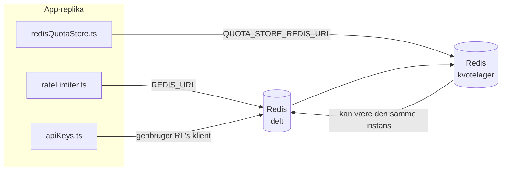

# Redis Production Configuration Guide (Dansk)

🌐 **Languages:** 🇺🇸 [English](../../../../ops/REDIS_PRODUCTION_CONFIG.md) · 🇪🇹 [am](../../../am/docs/ops/REDIS_PRODUCTION_CONFIG.md) · 🇸🇦 [ar](../../../ar/docs/ops/REDIS_PRODUCTION_CONFIG.md) · 🇦🇿 [az](../../../az/docs/ops/REDIS_PRODUCTION_CONFIG.md) · 🇧🇬 [bg](../../../bg/docs/ops/REDIS_PRODUCTION_CONFIG.md) · 🇧🇩 [bn](../../../bn/docs/ops/REDIS_PRODUCTION_CONFIG.md) · 🇧🇦 [bs](../../../bs/docs/ops/REDIS_PRODUCTION_CONFIG.md) · 🇨🇿 [cs](../../../cs/docs/ops/REDIS_PRODUCTION_CONFIG.md) · 🇩🇪 [de](../../../de/docs/ops/REDIS_PRODUCTION_CONFIG.md) · 🇬🇷 [el](../../../el/docs/ops/REDIS_PRODUCTION_CONFIG.md) · 🇪🇸 [es](../../../es/docs/ops/REDIS_PRODUCTION_CONFIG.md) · 🇪🇪 [et](../../../et/docs/ops/REDIS_PRODUCTION_CONFIG.md) · 🇮🇷 [fa](../../../fa/docs/ops/REDIS_PRODUCTION_CONFIG.md) · 🇫🇮 [fi](../../../fi/docs/ops/REDIS_PRODUCTION_CONFIG.md) · 🇫🇷 [fr](../../../fr/docs/ops/REDIS_PRODUCTION_CONFIG.md) · 🇮🇪 [ga](../../../ga/docs/ops/REDIS_PRODUCTION_CONFIG.md) · 🇮🇳 [gu](../../../gu/docs/ops/REDIS_PRODUCTION_CONFIG.md) · 🇳🇬 [ha](../../../ha/docs/ops/REDIS_PRODUCTION_CONFIG.md) · 🇮🇱 [he](../../../he/docs/ops/REDIS_PRODUCTION_CONFIG.md) · 🇮🇳 [hi](../../../hi/docs/ops/REDIS_PRODUCTION_CONFIG.md) · 🇭🇷 [hr](../../../hr/docs/ops/REDIS_PRODUCTION_CONFIG.md) · 🇭🇺 [hu](../../../hu/docs/ops/REDIS_PRODUCTION_CONFIG.md) · 🇦🇲 [hy](../../../hy/docs/ops/REDIS_PRODUCTION_CONFIG.md) · 🇮🇩 [id](../../../id/docs/ops/REDIS_PRODUCTION_CONFIG.md) · 🇳🇬 [ig](../../../ig/docs/ops/REDIS_PRODUCTION_CONFIG.md) · 🇮🇹 [it](../../../it/docs/ops/REDIS_PRODUCTION_CONFIG.md) · 🇯🇵 [ja](../../../ja/docs/ops/REDIS_PRODUCTION_CONFIG.md) · 🇬🇪 [ka](../../../ka/docs/ops/REDIS_PRODUCTION_CONFIG.md) · 🇰🇭 [km](../../../km/docs/ops/REDIS_PRODUCTION_CONFIG.md) · 🇮🇳 [kn](../../../kn/docs/ops/REDIS_PRODUCTION_CONFIG.md) · 🇰🇷 [ko](../../../ko/docs/ops/REDIS_PRODUCTION_CONFIG.md) · 🇱🇹 [lt](../../../lt/docs/ops/REDIS_PRODUCTION_CONFIG.md) · 🇱🇻 [lv](../../../lv/docs/ops/REDIS_PRODUCTION_CONFIG.md) · 🇮🇳 [ml](../../../ml/docs/ops/REDIS_PRODUCTION_CONFIG.md) · 🇮🇳 [mr](../../../mr/docs/ops/REDIS_PRODUCTION_CONFIG.md) · 🇲🇾 [ms](../../../ms/docs/ops/REDIS_PRODUCTION_CONFIG.md) · 🇲🇹 [mt](../../../mt/docs/ops/REDIS_PRODUCTION_CONFIG.md) · 🇲🇲 [my](../../../my/docs/ops/REDIS_PRODUCTION_CONFIG.md) · 🇳🇵 [ne](../../../ne/docs/ops/REDIS_PRODUCTION_CONFIG.md) · 🇳🇱 [nl](../../../nl/docs/ops/REDIS_PRODUCTION_CONFIG.md) · 🇳🇴 [no](../../../no/docs/ops/REDIS_PRODUCTION_CONFIG.md) · 🇮🇳 [or](../../../or/docs/ops/REDIS_PRODUCTION_CONFIG.md) · 🇮🇳 [pa](../../../pa/docs/ops/REDIS_PRODUCTION_CONFIG.md) · 🇵🇭 [phi](../../../phi/docs/ops/REDIS_PRODUCTION_CONFIG.md) · 🇵🇱 [pl](../../../pl/docs/ops/REDIS_PRODUCTION_CONFIG.md) · 🇵🇹 [pt](../../../pt/docs/ops/REDIS_PRODUCTION_CONFIG.md) · 🇧🇷 [pt-BR](../../../pt-BR/docs/ops/REDIS_PRODUCTION_CONFIG.md) · 🇷🇴 [ro](../../../ro/docs/ops/REDIS_PRODUCTION_CONFIG.md) · 🇷🇺 [ru](../../../ru/docs/ops/REDIS_PRODUCTION_CONFIG.md) · 🇱🇰 [si](../../../si/docs/ops/REDIS_PRODUCTION_CONFIG.md) · 🇸🇰 [sk](../../../sk/docs/ops/REDIS_PRODUCTION_CONFIG.md) · 🇸🇮 [sl](../../../sl/docs/ops/REDIS_PRODUCTION_CONFIG.md) · 🇷🇸 [sr](../../../sr/docs/ops/REDIS_PRODUCTION_CONFIG.md) · 🇸🇪 [sv](../../../sv/docs/ops/REDIS_PRODUCTION_CONFIG.md) · 🇰🇪 [sw](../../../sw/docs/ops/REDIS_PRODUCTION_CONFIG.md) · 🇮🇳 [ta](../../../ta/docs/ops/REDIS_PRODUCTION_CONFIG.md) · 🇮🇳 [te](../../../te/docs/ops/REDIS_PRODUCTION_CONFIG.md) · 🇹🇭 [th](../../../th/docs/ops/REDIS_PRODUCTION_CONFIG.md) · 🇹🇷 [tr](../../../tr/docs/ops/REDIS_PRODUCTION_CONFIG.md) · 🇺🇦 [uk-UA](../../../uk-UA/docs/ops/REDIS_PRODUCTION_CONFIG.md) · 🇵🇰 [ur](../../../ur/docs/ops/REDIS_PRODUCTION_CONFIG.md) · 🇺🇿 [uz](../../../uz/docs/ops/REDIS_PRODUCTION_CONFIG.md) · 🇻🇳 [vi](../../../vi/docs/ops/REDIS_PRODUCTION_CONFIG.md) · 🇳🇬 [yo](../../../yo/docs/ops/REDIS_PRODUCTION_CONFIG.md) · 🇨🇳 [zh-CN](../../../zh-CN/docs/ops/REDIS_PRODUCTION_CONFIG.md) · 🇹🇼 [zh-TW](../../../zh-TW/docs/ops/REDIS_PRODUCTION_CONFIG.md)

---

## Oversigt

Redis er en **valgfri, blød afhængighed** i OmniRoute — applikationen nedgraderer problemfrit til alternativer i hukommelsen, når Redis ikke er tilgængelig. I produktion reducerer finjustering af Redis latenstiden for fire forskellige arbejdsbelastninger:

| Arbejdsbelastning                | Driver                        | Klientfabrik                                   | Nøglemønster                                                  |
| -------------------------------- | ----------------------------- | ---------------------------------------------- | ------------------------------------------------------------- |
| Hastighedsbegrænsning            | `rateLimiter.ts`              | `getRedisClient()` — doven `ioredis`-singleton | `<prefix>rl:*` Lua-atomiske vinduer til hastighedsbegrænsning |
| Godkendelsescache                | `apiKeys.ts`                  | Genbruger klienten fra `rateLimiter`           | `<prefix>auth:api_key:<sha256>` med TTL                       |
| Kvote-lager                      | `redisQuotaStore.ts`          | Separat `getRedisClient(url)`-singleton        | `<prefix>quota:*`, konfigurerbar pr. instans                  |
| Kredsløbsafbryder til opvarmning | `redisCircuitBreakerStore.ts` | Separat klient i `circuitBreakerFactory.ts`    | `<prefix>warmup:cb:<connectionId>`                            |

Alle fire arbejdsbelastninger deler ét namespace-præfiks, så OmniRoute kan eksistere side om side med andre apps på en enkelt Redis-instans (f.eks. `127.0.0.1:6379`). Se [Namespace-opdeling af nøgler](#key-namespacing).

---

## Aktuel konfiguration (standardværdier i koden)

| Indstilling                            | Værdi                                                          | Placering                                                                             |
| -------------------------------------- | -------------------------------------------------------------- | ------------------------------------------------------------------------------------- |
| Miljøvariablen `REDIS_URL`             | `redis://redis:6379` (compose), valgfri                        | `rateLimiter.ts:5`, `.env.example`                                                    |
| Miljøvariablen `REDIS_KEY_PREFIX`      | `omniroute:` (standard)                                        | `rateLimiter.ts`, `redisQuotaStore.ts`, `redisCircuitBreakerStore.ts`, `.env.example` |
| Miljøvariablen `QUOTA_STORE_REDIS_URL` | separat, kan afvige fra `REDIS_URL`                            | `quota/storeFactory.ts`                                                               |
| `QUOTA_STORE_DRIVER`                   | `"sqlite"` (standard), `"redis"` valgfri                       | `quota/storeFactory.ts`                                                               |
| ioredis `maxRetriesPerRequest`         | `3`                                                            | klientoprettelse i `rateLimiter.ts`                                                   |
| `enableReadyCheck`                     | ikke angivet (ioredis-standard: `true`)                        | —                                                                                     |
| `lazyConnect`                          | ikke angivet (ioredis-standard: `false`)                       | —                                                                                     |
| `retryStrategy`                        | ikke angivet (ioredis-standard: basis på 200 ms, eksponentiel) | —                                                                                     |
| TLS / adgangskode / DB-indeks          | **ikke konfigureret**                                          | —                                                                                     |
| Sentinel / Cluster                     | **ikke konfigureret** — kun enkeltstående node                 | —                                                                                     |

---

## Namespace-opdeling af nøgler

OmniRoute deler en Redis-instans med alt andet, der kører på værten. Uden et namespace kan nøgler som `auth:api_key:<sha256>` eller `rl:*` kollidere med nøgler fra andre applikationer, der bruger den samme Redis (denne instans kører Redis på `127.0.0.1:6379` sammen med andre tjenester).

Indstil `REDIS_KEY_PREFIX` til en ikke-tom streng for at føje et præfiks til **alle** OmniRoute-nøgler:

```bash
# .env — alle OmniRoute-nøgler bliver omniroute:rl:*, omniroute:auth:*, omniroute:quota:*, omniroute:warmup:cb:*
REDIS_KEY_PREFIX=omniroute:
```

- **Standard:** `omniroute:` (anvendes, når `REDIS_KEY_PREFIX` ikke er angivet eller er tom).
- **Anvendes på:** hastighedsbegrænseren + godkendelsescachen (delt `ioredis`-klient via `keyPrefix`), kvote-lageret (`KEY_PREFIX = "${REDIS_KEY_PREFIX}quota"`) og kredsløbsafbryderen til opvarmning (`KEY_PREFIX = "${REDIS_KEY_PREFIX}warmup:cb:"`).
- **Ændring af præfikset**, når der allerede findes nøgler i Redis, efterlader de gamle nøgler uden tilknytning (de udløber via TTL / LRU). Det er sikkert at ændre præfikset; ingen migrering er nødvendig. Den eneste undtagelse er en nøgle til kredsløbsafbryderen for opvarmning for en forbindelse, der er markeret som forbudt: Den gemmes uden en TTL, så find efterladte nøgler med `redis-cli --scan --pattern '<old-prefix>warmup:cb:*'`, og slet dem.
- **ioredis `keyPrefix`** tilføjer automatisk præfikset ved skrivninger **og** fjerner det ved læsninger, så applikationskoden aldrig ser præfikset.

---

## Anbefalet produktionstuning

### 1. Forbindelsespulje / klientindstillinger (ioredis `Redis` constructor)

Den aktuelle kode opretter en enkelt `new Redis(url)` uden brugerdefinerede muligheder. For produktions-multi-replika-implementeringer skal du sende en klientfabrik i koden eller omslutte `getRedisClient()`:

```typescript
const redis = new Redis(REDIS_URL, {
  maxRetriesPerRequest: null, // no retry limit; let retryStrategy decide
  enableReadyCheck: true, // verify server is ready before accepting calls
  lazyConnect: true, // don't connect on construction; wait for first call
  retryStrategy: (times) => {
    if (times > 10) return null; // give up after 10 retries → reconnect later
    return Math.min(times * 200, 5000); // 200ms, 400ms, …, 5s cap
  },
  enableAutoPipelining: true, // coalesce concurrent commands into one TCP write
  keepAlive: 10000, // TCP keep‑alive every 10s
});
```

**Vigtige afvejninger:**

- `maxRetriesPerRequest: null` + `retryStrategy` — foretrækkes til produktion, så forbigående Redis -genstarter ikke umiddelbart fejler hver anmodning. In-memory fallback i `checkRateLimit()` absorberer fejlstien.
- `lazyConnect: true` — undgår en opstartsafhængighed af, at Redis er oppe, før serveren begynder at acceptere forbindelser.
- `enableAutoPipelining: true` — reducerer rundrejser for samtidige rate-grænsekontrol; fordelagtig ved > 50 RPS på en enkelt forbindelse.

### 2. Redis serverkonfiguration (`redis.conf`)

```
# Memory
maxmemory 80%                        # leave room for OS page cache
maxmemory-policy allkeys-lru         # evict stale auth cache entries under pressure

# Persistence (optional — OmniRoute is crash‑safe without it)
save 300 1                           # snapshot at least every 5 min if ≥1 key changed
appendonly no                        # AOF not needed; data is regeneratable
appendfsync no                       # no fsync overhead (RDB is sufficient)

# Networking
timeout 0                            # no idle disconnect
tcp-keepalive 300                    # 5 min keep‑alive
tcp-backlog 511                      # connection backlog for bursty load

# Performance
hz 10                                # default; 100 for latency‑sensitive
activedefrag yes                     # auto‑defragment when fragmentation >10%
```

**Afvejning for `maxmemory-policy allkeys-lru`:** Auth-cache-indgange kan blive smidt ud under pres på hukommelsen. Dette er sikkert — `setCachedApiKey` genudfyldes altid ved miss, og SQLite tilbagefaldet er autoritativt. Hastighedsbegrænsende Lua-scriptet skaber små nøgler, der er kortvarige ved design.

### 3. Docker Compose Settings

Prod compose (`docker-compose.prod.yml`) bruger `redis:8.6.2-alpine`. Tilføje:

```yaml
redis:
  image: redis:8.6.2-alpine
  command:
    [
      "redis-server",
      "--maxmemory",
      "512mb",
      "--maxmemory-policy",
      "allkeys-lru",
      "--activedefrag",
      "yes",
      "--save",
      "300 1",
    ]
  healthcheck:
    test: ["CMD", "redis-cli", "ping"]
    interval: 10s
    timeout: 3s
    retries: 3
    start_period: 5s
```

### 4. Overvejelser om flere instanser/skalering

**Single Redis til alle replikaer** — rate-limiter Lua scriptet afhænger af et enkelt autoritativt nøglerum. Flere Redis forekomster bag replikaer ville miste atomicitet og fordoble budgettet. Brug en enkelt Redis (eller Redis Sentinel-klynge med failover) til alle applikationsreplikaer.

**Antal forbindelser:** Hver applikationsreplik åbnes** 2 TCP forbindelser** til Redis (rate limiter client + quota store client). Ved 10 replikaer → 20-forbindelser, godt inden for en standard Redis instanss 10k forbindelsesloft.

### 5. Overvågning

Eksponering via sundhedstjek slutpunkt:

```typescript
// src/app/api/monitoring/health/route.ts already calls rateLimiter functions
// Add Redis-specific checks:
//   1. PING latency via ioredis .ping()
//   2. Memory usage via INFO memory
//   3. Connection count via INFO clients
//   4. Hit rate for maxmemory-policy (evicted_keys / keyspace_hits)
```

Nøglemålinger at se:

- **Fraflyttede nøgler/sek** — hvis den vedvarende ikke er nul, øg `maxmemory`
- **Blokerede klienter** — ikke-nul antyder langsomme Lua-scripts eller høj strid
- **Afviste forbindelser** — forbindelsesgrænse hit; sjælden ved 20 forbindelser

### 6. Redis-kompatible servere

Enhver server, der bruges her, skal køre Lua-scripts: hastighedsbegrænseren er en `EVAL`. På en server uden Lua logger `checkRateLimit()` `[RATE_LIMITER] Redis eval failed, falling back to in-memory rate limiting` og tæller pr. proces, så hver replika håndhæver grænsen for sig selv. Opt-in shared session-affinity store (`OMNIROUTE_SESSION_AFFINITY_STORE=redis`) læser og opdaterer også pins med `EVAL`; uden Lua logger den `[SESSION_AFFINITY] Redis error; falling back to SQLite.`, og hver replika beholder sine egne pins. De andre arbejdsbelastninger bruger almindelige kommandoer (`SET ... EX`, `GET`, `DEL`, `MGET`, `EXPIRE`, `INCRBYFLOAT`, hashes og sæt), og den semantiske caches Redis backend sender ingen `FT.*` kommandoer.

Testet med OmniRoute 3.8.52: KiviDB 1.2.0 med dets Lua-billede (`kividb/kividb:v1.2.0-lua`). Hastighedsbegrænseren (inklusive en anden proces, der deler tællerne), godkendelsescache, kvotelager, opvarmningsafbryder, semantisk cachelager og en `/v1/chat/completions` anmodning gennem chatbehandleren bestod 18 af de 19 kontroller, der videregives Redis 8.10.3. Den der adskiller sig: `INCRBYFLOAT` gemmer `0.1 + 0.2` som `0.30000000000000004` hvor Redis gemmer `0.3` ( [kividbio/kividb#387](https://github.com/kividbio/kividb/issues/387) ). Kvotelageret parser begge med `parseFloat`, men de to tal adskiller sig i de sidste cifre, så en sammenligning, der falder præcist på en kvotegrænse, kan komme forskelligt ud. Session-affinity-butikken var ikke en del af denne kørsel. ( [opsætning](https://github.com/kividbio/kividb/blob/master/docs/integrations/omniroute.md), [resultater](https://github.com/kividbio/kividb/tree/master/benchmarks/omniroute-compat) )

---

## Arkitekturdiagram



---

## Referencer

| Fil                                | Formål                                                                                   |
| ---------------------------------- | ---------------------------------------------------------------------------------------- |
| `src/shared/utils/rateLimiter.ts`  | Primær Redis-klient, Lua-script til hastighedsbegrænsning, reservefunktion i hukommelsen |
| `src/lib/db/apiKeys.ts`            | Godkendelsescache — Redis→SQLite-reservefunktion                                         |
| `src/lib/quota/redisQuotaStore.ts` | Separat Redis-klient til valgfrit kvotelager                                             |
| `src/lib/quota/storeFactory.ts`    | Skifter mellem kvotedriverne `sqlite` og `redis`                                         |
| `docker-compose.prod.yml`          | Redis-container til produktion (image `redis:8.6.2-alpine`)                              |
| `.env.example`                     | Dokumentation til Redis-miljøvariabler                                                   |
| `src/app/api/local/redis/`         | API-ruter til orkestrering af udviklingscontainere                                       |
| `bin/cli/commands/redis.mjs`       | CLI-kommandoer til orkestrering af udviklingscontainere                                  |
