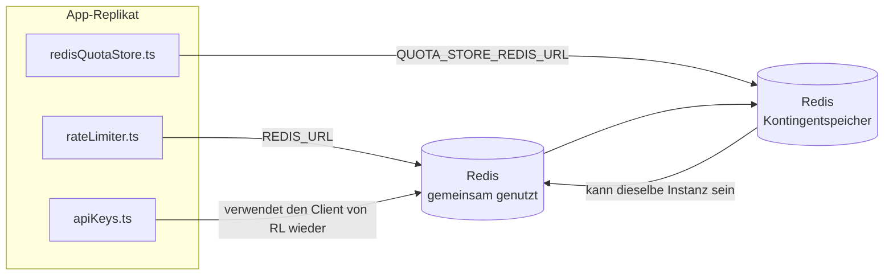

# Redis Production Configuration Guide (Deutsch)

🌐 **Languages:** 🇺🇸 [English](../../../../ops/REDIS_PRODUCTION_CONFIG.md) · 🇪🇹 [am](../../../am/docs/ops/REDIS_PRODUCTION_CONFIG.md) · 🇸🇦 [ar](../../../ar/docs/ops/REDIS_PRODUCTION_CONFIG.md) · 🇦🇿 [az](../../../az/docs/ops/REDIS_PRODUCTION_CONFIG.md) · 🇧🇬 [bg](../../../bg/docs/ops/REDIS_PRODUCTION_CONFIG.md) · 🇧🇩 [bn](../../../bn/docs/ops/REDIS_PRODUCTION_CONFIG.md) · 🇧🇦 [bs](../../../bs/docs/ops/REDIS_PRODUCTION_CONFIG.md) · 🇨🇿 [cs](../../../cs/docs/ops/REDIS_PRODUCTION_CONFIG.md) · 🇩🇰 [da](../../../da/docs/ops/REDIS_PRODUCTION_CONFIG.md) · 🇬🇷 [el](../../../el/docs/ops/REDIS_PRODUCTION_CONFIG.md) · 🇪🇸 [es](../../../es/docs/ops/REDIS_PRODUCTION_CONFIG.md) · 🇪🇪 [et](../../../et/docs/ops/REDIS_PRODUCTION_CONFIG.md) · 🇮🇷 [fa](../../../fa/docs/ops/REDIS_PRODUCTION_CONFIG.md) · 🇫🇮 [fi](../../../fi/docs/ops/REDIS_PRODUCTION_CONFIG.md) · 🇫🇷 [fr](../../../fr/docs/ops/REDIS_PRODUCTION_CONFIG.md) · 🇮🇪 [ga](../../../ga/docs/ops/REDIS_PRODUCTION_CONFIG.md) · 🇮🇳 [gu](../../../gu/docs/ops/REDIS_PRODUCTION_CONFIG.md) · 🇳🇬 [ha](../../../ha/docs/ops/REDIS_PRODUCTION_CONFIG.md) · 🇮🇱 [he](../../../he/docs/ops/REDIS_PRODUCTION_CONFIG.md) · 🇮🇳 [hi](../../../hi/docs/ops/REDIS_PRODUCTION_CONFIG.md) · 🇭🇷 [hr](../../../hr/docs/ops/REDIS_PRODUCTION_CONFIG.md) · 🇭🇺 [hu](../../../hu/docs/ops/REDIS_PRODUCTION_CONFIG.md) · 🇦🇲 [hy](../../../hy/docs/ops/REDIS_PRODUCTION_CONFIG.md) · 🇮🇩 [id](../../../id/docs/ops/REDIS_PRODUCTION_CONFIG.md) · 🇳🇬 [ig](../../../ig/docs/ops/REDIS_PRODUCTION_CONFIG.md) · 🇮🇹 [it](../../../it/docs/ops/REDIS_PRODUCTION_CONFIG.md) · 🇯🇵 [ja](../../../ja/docs/ops/REDIS_PRODUCTION_CONFIG.md) · 🇬🇪 [ka](../../../ka/docs/ops/REDIS_PRODUCTION_CONFIG.md) · 🇰🇭 [km](../../../km/docs/ops/REDIS_PRODUCTION_CONFIG.md) · 🇮🇳 [kn](../../../kn/docs/ops/REDIS_PRODUCTION_CONFIG.md) · 🇰🇷 [ko](../../../ko/docs/ops/REDIS_PRODUCTION_CONFIG.md) · 🇱🇹 [lt](../../../lt/docs/ops/REDIS_PRODUCTION_CONFIG.md) · 🇱🇻 [lv](../../../lv/docs/ops/REDIS_PRODUCTION_CONFIG.md) · 🇮🇳 [ml](../../../ml/docs/ops/REDIS_PRODUCTION_CONFIG.md) · 🇮🇳 [mr](../../../mr/docs/ops/REDIS_PRODUCTION_CONFIG.md) · 🇲🇾 [ms](../../../ms/docs/ops/REDIS_PRODUCTION_CONFIG.md) · 🇲🇹 [mt](../../../mt/docs/ops/REDIS_PRODUCTION_CONFIG.md) · 🇲🇲 [my](../../../my/docs/ops/REDIS_PRODUCTION_CONFIG.md) · 🇳🇵 [ne](../../../ne/docs/ops/REDIS_PRODUCTION_CONFIG.md) · 🇳🇱 [nl](../../../nl/docs/ops/REDIS_PRODUCTION_CONFIG.md) · 🇳🇴 [no](../../../no/docs/ops/REDIS_PRODUCTION_CONFIG.md) · 🇮🇳 [or](../../../or/docs/ops/REDIS_PRODUCTION_CONFIG.md) · 🇮🇳 [pa](../../../pa/docs/ops/REDIS_PRODUCTION_CONFIG.md) · 🇵🇭 [phi](../../../phi/docs/ops/REDIS_PRODUCTION_CONFIG.md) · 🇵🇱 [pl](../../../pl/docs/ops/REDIS_PRODUCTION_CONFIG.md) · 🇵🇹 [pt](../../../pt/docs/ops/REDIS_PRODUCTION_CONFIG.md) · 🇧🇷 [pt-BR](../../../pt-BR/docs/ops/REDIS_PRODUCTION_CONFIG.md) · 🇷🇴 [ro](../../../ro/docs/ops/REDIS_PRODUCTION_CONFIG.md) · 🇷🇺 [ru](../../../ru/docs/ops/REDIS_PRODUCTION_CONFIG.md) · 🇱🇰 [si](../../../si/docs/ops/REDIS_PRODUCTION_CONFIG.md) · 🇸🇰 [sk](../../../sk/docs/ops/REDIS_PRODUCTION_CONFIG.md) · 🇸🇮 [sl](../../../sl/docs/ops/REDIS_PRODUCTION_CONFIG.md) · 🇷🇸 [sr](../../../sr/docs/ops/REDIS_PRODUCTION_CONFIG.md) · 🇸🇪 [sv](../../../sv/docs/ops/REDIS_PRODUCTION_CONFIG.md) · 🇰🇪 [sw](../../../sw/docs/ops/REDIS_PRODUCTION_CONFIG.md) · 🇮🇳 [ta](../../../ta/docs/ops/REDIS_PRODUCTION_CONFIG.md) · 🇮🇳 [te](../../../te/docs/ops/REDIS_PRODUCTION_CONFIG.md) · 🇹🇭 [th](../../../th/docs/ops/REDIS_PRODUCTION_CONFIG.md) · 🇹🇷 [tr](../../../tr/docs/ops/REDIS_PRODUCTION_CONFIG.md) · 🇺🇦 [uk-UA](../../../uk-UA/docs/ops/REDIS_PRODUCTION_CONFIG.md) · 🇵🇰 [ur](../../../ur/docs/ops/REDIS_PRODUCTION_CONFIG.md) · 🇺🇿 [uz](../../../uz/docs/ops/REDIS_PRODUCTION_CONFIG.md) · 🇻🇳 [vi](../../../vi/docs/ops/REDIS_PRODUCTION_CONFIG.md) · 🇳🇬 [yo](../../../yo/docs/ops/REDIS_PRODUCTION_CONFIG.md) · 🇨🇳 [zh-CN](../../../zh-CN/docs/ops/REDIS_PRODUCTION_CONFIG.md) · 🇹🇼 [zh-TW](../../../zh-TW/docs/ops/REDIS_PRODUCTION_CONFIG.md)

---

## Überblick

Redis ist ein **optionale, weiche Abhängigkeit** In OmniRoute — wird die Anwendung ordnungsgemäß heruntergefahren (In-Memory-Fallbacks), wenn Redis nicht verfügbar ist. In der Produktion reduziert die Optimierung Redis die Latenz für vier verschiedene Arbeitslasten:

| Arbeitsbelastung      | Treiber                       | Kundenfabrik                                    | Schlüsselmuster                                    |
| --------------------- | ----------------------------- | ----------------------------------------------- | -------------------------------------------------- |
| Ratenbegrenzung       | `rateLimiter.ts`              | `getRedisClient()` — fauler `ioredis` Singleton | `<prefix>rl:*` Lua-atomare Ratenbegrenzungsfenster |
| Auth-Cache            | `apiKeys.ts`                  | Verwendet den Client von `rateLimiter` wieder   | `<prefix>auth:api_key:<sha256>` mit TTL            |
| Quotenspeicher        | `redisQuotaStore.ts`          | Separater `getRedisClient(url)` -Singleton      | `<prefix>quota:*` pro Instanz konfigurierbar       |
| Aufwärmschutzschalter | `redisCircuitBreakerStore.ts` | Separater Mandant in `circuitBreakerFactory.ts` | `<prefix>warmup:cb:<connectionId>`                 |

Alle vier Workloads teilen sich ein Namespace-Präfix, sodass OmniRoute mit anderen Apps auf einer einzelnen Redis Instanz (z. B. `127.0.0.1:6379`) koexistieren kann. Siehe [Schlüsselnamensraum](#key-namespacing).

---

## Aktuelle Konfiguration (Code-Standardeinstellungen)

| Einstellung                          | Wert                                                         | Wo                                                                                    |
| ------------------------------------ | ------------------------------------------------------------ | ------------------------------------------------------------------------------------- |
| `REDIS_URL` Umgebungsvar             | `redis://redis:6379` (verfassen), optional                   | `rateLimiter.ts:5`, `.env.example`                                                    |
| `REDIS_KEY_PREFIX` Umgebungsvar      | `omniroute:` (Standard)                                      | `rateLimiter.ts`, `redisQuotaStore.ts`, `redisCircuitBreakerStore.ts`, `.env.example` |
| `QUOTA_STORE_REDIS_URL` Umgebungsvar | getrennt, kann von `REDIS_URL` abweichen                     | `quota/storeFactory.ts`                                                               |
| `QUOTA_STORE_DRIVER`                 | `"sqlite"` (Standard), `"redis"` optional                    | `quota/storeFactory.ts`                                                               |
| ioredis `maxRetriesPerRequest`       | `3`                                                          | Erstellung `rateLimiter.ts` Clients                                                   |
| `enableReadyCheck`                   | nicht gesetzt (ioredis-Standard: `true`)                     | —                                                                                     |
| `lazyConnect`                        | nicht gesetzt (ioredis-Standard: `false`)                    | —                                                                                     |
| `retryStrategy`                      | nicht gesetzt (ioredis-Standard: 200 ms Basis, exponentiell) | —                                                                                     |
| TLS / Passwort / DB Index            | **nicht konfiguriert**                                       | —                                                                                     |
| Sentinel / Cluster                   | **nicht konfiguriert** Nur eigenständiger — -Einzelknoten    | —                                                                                     |

---

## Schlüssel-Namespaces

OmniRoute verwendet eine Redis-Instanz gemeinsam mit allen anderen Anwendungen, die auf dem Host ausgeführt werden. Ohne einen Namespace
könnten Schlüssel wie `auth:api_key:<sha256>` oder `rl:*` mit Schlüsseln anderer Anwendungen kollidieren,
die dasselbe Redis verwenden (diese Instanz führt Redis auf `127.0.0.1:6379` zusammen mit anderen Diensten aus).

Setzen Sie `REDIS_KEY_PREFIX` auf eine nicht leere Zeichenfolge, um **jedem** OmniRoute-Schlüssel ein Präfix voranzustellen:

```bash
# .env — alle OmniRoute-Schlüssel werden zu omniroute:rl:*, omniroute:auth:*, omniroute:quota:*, omniroute:warmup:cb:*
REDIS_KEY_PREFIX=omniroute:
```

- **Standardwert:** `omniroute:` (wird angewendet, wenn `REDIS_KEY_PREFIX` nicht gesetzt oder leer ist).
- **Angewendet auf:** Ratenbegrenzer + Authentifizierungs-Cache (gemeinsam genutzter `ioredis`-Client über `keyPrefix`), den
  Kontingentspeicher (`KEY_PREFIX = "${REDIS_KEY_PREFIX}quota"`) und den Circuit Breaker für das Aufwärmen
  (`KEY_PREFIX = "${REDIS_KEY_PREFIX}warmup:cb:"`).
- **Eine Änderung des Präfixes**, während bereits Schlüssel in Redis vorhanden sind, lässt die alten Schlüssel verwaist zurück (sie laufen
  über TTL / LRU ab). Eine Änderung ist sicher; es ist keine Migration erforderlich. Die einzige Ausnahme ist ein Warmup-
  Circuit-Breaker-Schlüssel für eine als unzulässig markierte Verbindung: Er wird ohne TTL dauerhaft gespeichert. Listen Sie daher
  verbliebene Schlüssel mit `redis-cli --scan --pattern '<old-prefix>warmup:cb:*'` auf und löschen Sie sie.
- **ioredis `keyPrefix`** stellt das Präfix bei Schreibvorgängen automatisch voran **und** entfernt es bei Lesevorgängen,
  sodass der Anwendungscode das Präfix nie sieht.

---

## Empfohlene Produktionsoptimierung

### 1. Verbindungspool/Client-Optionen (ioredis `Redis` Konstruktor)

Der aktuelle Code erstellt eine einzelne `new Redis(url)` ohne benutzerdefinierte Optionen. Übergeben Sie für Produktionsbereitstellungen mit mehreren Replikaten eine Client-Factory im Code oder umschließen Sie `getRedisClient()`:

```typescript
const redis = new Redis(REDIS_URL, {
  maxRetriesPerRequest: null, // no retry limit; let retryStrategy decide
  enableReadyCheck: true, // verify server is ready before accepting calls
  lazyConnect: true, // don't connect on construction; wait for first call
  retryStrategy: (times) => {
    if (times > 10) return null; // give up after 10 retries → reconnect later
    return Math.min(times * 200, 5000); // 200ms, 400ms, …, 5s cap
  },
  enableAutoPipelining: true, // coalesce concurrent commands into one TCP write
  keepAlive: 10000, // TCP keep‑alive every 10s
});
```

**Wichtige Kompromisse:**

- `maxRetriesPerRequest: null` + `retryStrategy` — wird für die Produktion bevorzugt, damit vorübergehende Redis Neustarts nicht sofort bei jeder Anfrage fehlschlagen. Der In-Memory-Fallback in `checkRateLimit()` absorbiert den Fehlerpfad.
- `lazyConnect: true` — vermeidet eine Startabhängigkeit davon, dass Redis aktiv ist, bevor der Server mit der Annahme von Verbindungen beginnt.
- `enableAutoPipelining: true` — reduziert Roundtrips für gleichzeitige Ratenlimitprüfungen; vorteilhaft bei > 50 RPS auf einer einzelnen Verbindung.

### 2. Redis -Serverkonfiguration (`redis.conf`)

```
# Memory
maxmemory 80%                        # leave room for OS page cache
maxmemory-policy allkeys-lru         # evict stale auth cache entries under pressure

# Persistence (optional — OmniRoute is crash‑safe without it)
save 300 1                           # snapshot at least every 5 min if ≥1 key changed
appendonly no                        # AOF not needed; data is regeneratable
appendfsync no                       # no fsync overhead (RDB is sufficient)

# Networking
timeout 0                            # no idle disconnect
tcp-keepalive 300                    # 5 min keep‑alive
tcp-backlog 511                      # connection backlog for bursty load

# Performance
hz 10                                # default; 100 for latency‑sensitive
activedefrag yes                     # auto‑defragment when fragmentation >10%
```

**Kompromiss für `maxmemory-policy allkeys-lru`:** Authentifizierungs-Cache-Einträge können aufgrund von Speicherauslastung entfernt werden. Dies ist sicher, dass — `setCachedApiKey` bei Fehlschlägen immer neu aufgefüllt wird und der SQLite Fallback maßgeblich ist. Das Ratenbegrenzer-Lua-Skript erstellt kleine Schlüssel, die konstruktionsbedingt nur von kurzer Dauer sind.

### 3. Docker Compose-Einstellungen

Das Prod Compose (`docker-compose.prod.yml`) verwendet `redis:8.6.2-alpine`. Hinzufügen:

```yaml
redis:
  image: redis:8.6.2-alpine
  command:
    [
      "redis-server",
      "--maxmemory",
      "512mb",
      "--maxmemory-policy",
      "allkeys-lru",
      "--activedefrag",
      "yes",
      "--save",
      "300 1",
    ]
  healthcheck:
    test: ["CMD", "redis-cli", "ping"]
    interval: 10s
    timeout: 3s
    retries: 3
    start_period: 5s
```

### 4. Überlegungen zu mehreren Instanzen/Skalierung

**Einzelne Redis für alle Replikate** — das Ratenbegrenzer-Lua-Skript, hängt von einem einzigen autorisierenden Schlüsselraum ab. Mehrere Redis Instanzen hinter Replikaten würden die Atomizität verlieren und das Budget verdoppeln. Verwenden Sie einen einzelnen Redis (oder Redis Sentinel-Cluster mit Failover) für alle Anwendungsreplikate.

**Anzahl der Verbindungen:** Jedes Anwendungsreplikat wird geöffnet **2 TCP -Anschlüsse** an Redis (Rate Limiter Client + Quote Store Client). Bei 10 Replikaten → 20 Verbindungen, deutlich innerhalb der 10.000-Verbindungsobergrenze einer Standard- Redis Instanz.

### 5. Überwachung

Über den Health-Check-Endpunkt verfügbar machen:

```typescript
// src/app/api/monitoring/health/route.ts already calls rateLimiter functions
// Add Redis-specific checks:
//   1. PING latency via ioredis .ping()
//   2. Memory usage via INFO memory
//   3. Connection count via INFO clients
//   4. Hit rate for maxmemory-policy (evicted_keys / keyspace_hits)
```

Wichtige Kennzahlen, die Sie im Auge behalten sollten:

- **Entfernte Schlüssel/Sek** Wenn — dauerhaft ungleich Null ist, erhöhen Sie `maxmemory`
- **Blockierte Clients** — ungleich Null deutet auf langsame Lua-Skripte oder starke Konflikte hin
- **Abgelehnte Verbindungen** — -Verbindungslimit erreicht; selten bei 20 Verbindungen

### 6. Redis-kompatible Server

Jeder hier verwendete Server muss Lua-Skripte ausführen: Der Ratenbegrenzer ist ein `EVAL`. Auf einem Server ohne Lua protokolliert `checkRateLimit()` `[RATE_LIMITER] Redis eval failed, falling back to in-memory rate limiting` und zählt pro Prozess, sodass jedes Replikat das Limit selbst durchsetzt. Der Opt-in Shared Session-Affinity Store (`OMNIROUTE_SESSION_AFFINITY_STORE=redis`) liest und aktualisiert auch Pins mit `EVAL`; Ohne Lua protokolliert es `[SESSION_AFFINITY] Redis error; falling back to SQLite.` und jedes Replikat behält seine eigenen Pins. Die anderen Workloads verwenden einfache Befehle (`SET ... EX`, `GET`, `DEL`, `MGET`, `EXPIRE`, `INCRBYFLOAT`, Hashes und Sets), und das Redis Backend des semantischen Caches sendet keine `FT.*` -Befehle.

Getestet mit OmniRoute 3.8.52: KiviDB 1.2.0 mit seinem Lua-Image (`kividb/kividb:v1.2.0-lua`). Der Ratenbegrenzer (einschließlich eines zweiten Prozesses, der die Zähler gemeinsam nutzt), der Authentifizierungscache, der Quotenspeicher, der Aufwärmschutzschalter, der semantische Cachespeicher und eine `/v1/chat/completions` Anfrage über den Chat-Handler haben 18 der 19 Prüfungen bestanden, die Redis 8.10.3 bestehen. Der Unterschied besteht darin, dass `INCRBYFLOAT` `0.1 + 0.2` als `0.30000000000000004` speichert, während Redis `0.3` speichert ( [kividbio/kividb#387](https://github.com/kividbio/kividb/issues/387) ). Der Quotenspeicher analysiert beide mit `parseFloat`, aber die beiden Zahlen unterscheiden sich in den letzten Ziffern, sodass ein Vergleich, der genau auf eine Quotengrenze fällt, unterschiedlich ausfallen kann. Der Sitzungsaffinitätsspeicher war nicht Teil dieses Laufs. ( [Setup](https://github.com/kividbio/kividb/blob/master/docs/integrations/omniroute.md), [Ergebnisse](https://github.com/kividbio/kividb/tree/master/benchmarks/omniroute-compat) )

---

## Architekturdiagramm



---

## Referenzen

| Datei                              | Zweck                                                            |
| ---------------------------------- | ---------------------------------------------------------------- |
| `src/shared/utils/rateLimiter.ts`  | Primärer Redis Client, Lua-Rate-Limit-Skript, In-Memory-Fallback |
| `src/lib/db/apiKeys.ts`            | Auth-Cache — Redis→SQLite Fallback                               |
| `src/lib/quota/redisQuotaStore.ts` | Separater Redis Client für optionalen Quotenspeicher             |
| `src/lib/quota/storeFactory.ts`    | Wechselt zwischen `sqlite` und `redis` -Kontingenttreibern       |
| `docker-compose.prod.yml`          | Prod Redis Container (Bild `redis:8.6.2-alpine`)                 |
| `.env.example`                     | Redis Env-Vars-Dokumentation                                     |
| `src/app/api/local/redis/`         | API Routen für die Orchestrierung von Entwicklungscontainern     |
| `bin/cli/commands/redis.mjs`       | CLI -Befehle für die Orchestrierung von Entwicklungscontainern   |
