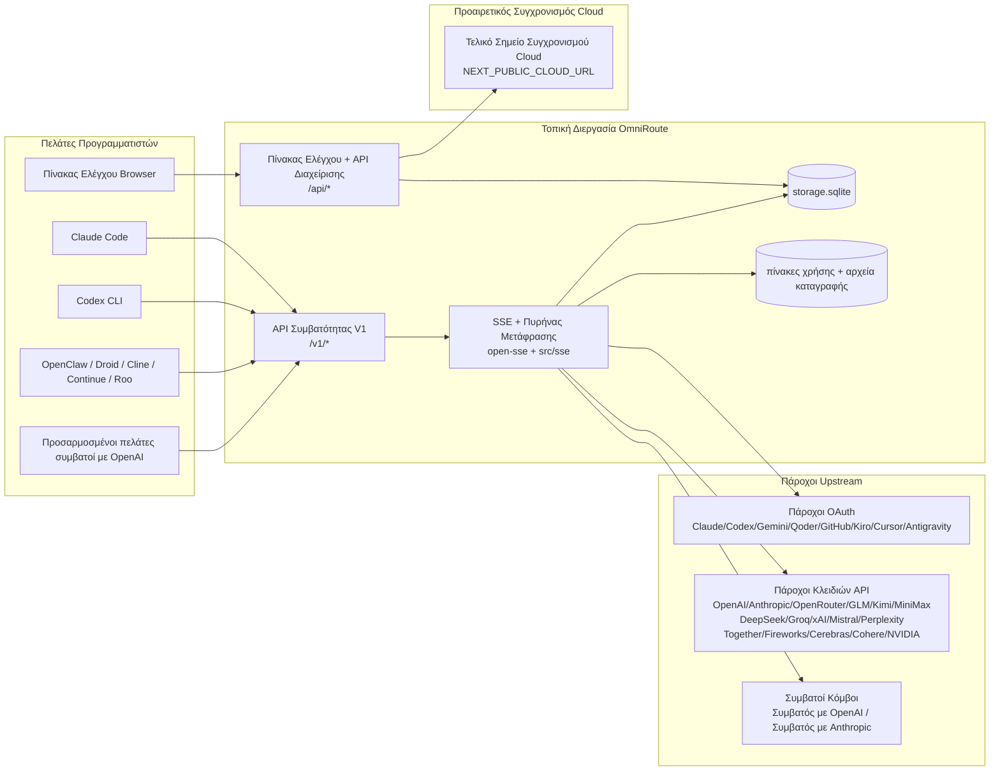
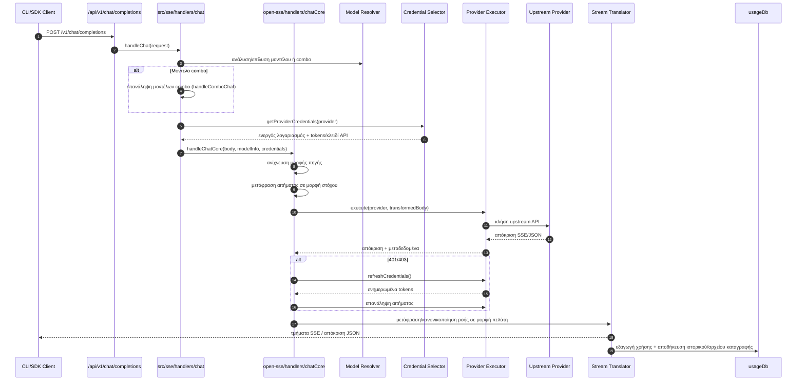
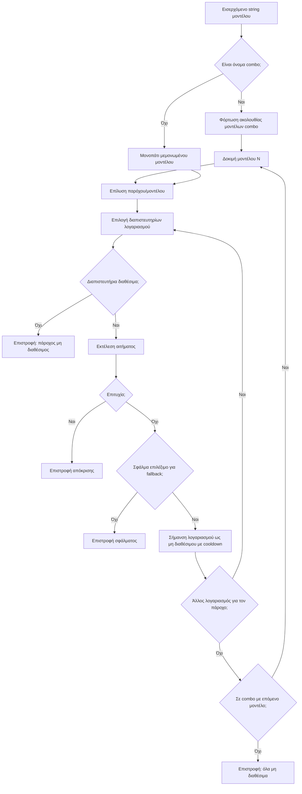
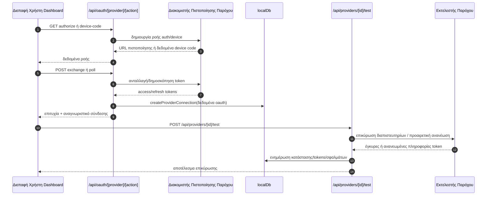
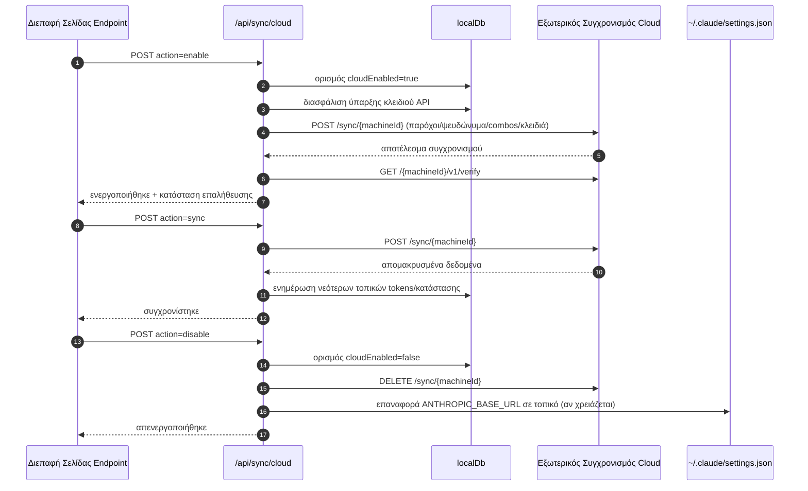
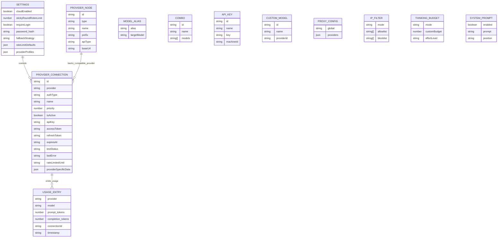
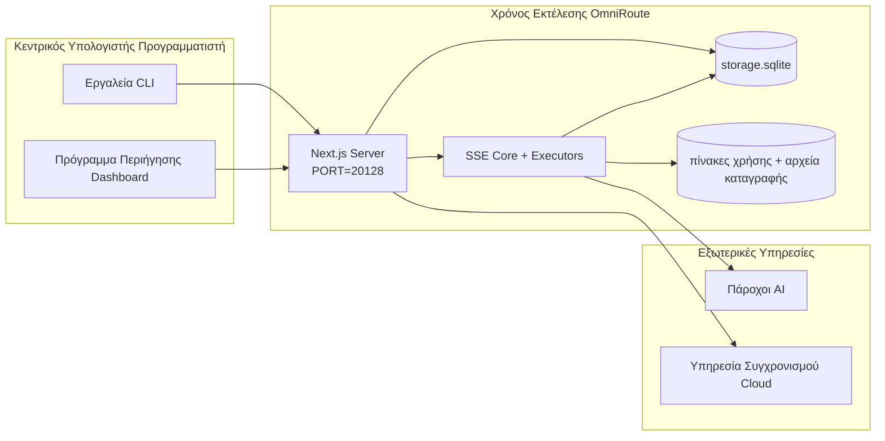

# OmniRoute Architecture (Ελληνικά)

🌐 **Languages:** 🇺🇸 [English](../../../../architecture/ARCHITECTURE.md) · 🇪🇹 [am](../../../am/docs/architecture/ARCHITECTURE.md) · 🇸🇦 [ar](../../../ar/docs/architecture/ARCHITECTURE.md) · 🇦🇿 [az](../../../az/docs/architecture/ARCHITECTURE.md) · 🇧🇬 [bg](../../../bg/docs/architecture/ARCHITECTURE.md) · 🇧🇩 [bn](../../../bn/docs/architecture/ARCHITECTURE.md) · 🇧🇦 [bs](../../../bs/docs/architecture/ARCHITECTURE.md) · 🇨🇿 [cs](../../../cs/docs/architecture/ARCHITECTURE.md) · 🇩🇰 [da](../../../da/docs/architecture/ARCHITECTURE.md) · 🇩🇪 [de](../../../de/docs/architecture/ARCHITECTURE.md) · 🇪🇸 [es](../../../es/docs/architecture/ARCHITECTURE.md) · 🇪🇪 [et](../../../et/docs/architecture/ARCHITECTURE.md) · 🇮🇷 [fa](../../../fa/docs/architecture/ARCHITECTURE.md) · 🇫🇮 [fi](../../../fi/docs/architecture/ARCHITECTURE.md) · 🇫🇷 [fr](../../../fr/docs/architecture/ARCHITECTURE.md) · 🇮🇪 [ga](../../../ga/docs/architecture/ARCHITECTURE.md) · 🇮🇳 [gu](../../../gu/docs/architecture/ARCHITECTURE.md) · 🇳🇬 [ha](../../../ha/docs/architecture/ARCHITECTURE.md) · 🇮🇱 [he](../../../he/docs/architecture/ARCHITECTURE.md) · 🇮🇳 [hi](../../../hi/docs/architecture/ARCHITECTURE.md) · 🇭🇷 [hr](../../../hr/docs/architecture/ARCHITECTURE.md) · 🇭🇺 [hu](../../../hu/docs/architecture/ARCHITECTURE.md) · 🇦🇲 [hy](../../../hy/docs/architecture/ARCHITECTURE.md) · 🇮🇩 [id](../../../id/docs/architecture/ARCHITECTURE.md) · 🇳🇬 [ig](../../../ig/docs/architecture/ARCHITECTURE.md) · 🇮🇹 [it](../../../it/docs/architecture/ARCHITECTURE.md) · 🇯🇵 [ja](../../../ja/docs/architecture/ARCHITECTURE.md) · 🇬🇪 [ka](../../../ka/docs/architecture/ARCHITECTURE.md) · 🇰🇭 [km](../../../km/docs/architecture/ARCHITECTURE.md) · 🇮🇳 [kn](../../../kn/docs/architecture/ARCHITECTURE.md) · 🇰🇷 [ko](../../../ko/docs/architecture/ARCHITECTURE.md) · 🇱🇹 [lt](../../../lt/docs/architecture/ARCHITECTURE.md) · 🇱🇻 [lv](../../../lv/docs/architecture/ARCHITECTURE.md) · 🇮🇳 [ml](../../../ml/docs/architecture/ARCHITECTURE.md) · 🇮🇳 [mr](../../../mr/docs/architecture/ARCHITECTURE.md) · 🇲🇾 [ms](../../../ms/docs/architecture/ARCHITECTURE.md) · 🇲🇹 [mt](../../../mt/docs/architecture/ARCHITECTURE.md) · 🇲🇲 [my](../../../my/docs/architecture/ARCHITECTURE.md) · 🇳🇵 [ne](../../../ne/docs/architecture/ARCHITECTURE.md) · 🇳🇱 [nl](../../../nl/docs/architecture/ARCHITECTURE.md) · 🇳🇴 [no](../../../no/docs/architecture/ARCHITECTURE.md) · 🇮🇳 [or](../../../or/docs/architecture/ARCHITECTURE.md) · 🇮🇳 [pa](../../../pa/docs/architecture/ARCHITECTURE.md) · 🇵🇭 [phi](../../../phi/docs/architecture/ARCHITECTURE.md) · 🇵🇱 [pl](../../../pl/docs/architecture/ARCHITECTURE.md) · 🇵🇹 [pt](../../../pt/docs/architecture/ARCHITECTURE.md) · 🇧🇷 [pt-BR](../../../pt-BR/docs/architecture/ARCHITECTURE.md) · 🇷🇴 [ro](../../../ro/docs/architecture/ARCHITECTURE.md) · 🇷🇺 [ru](../../../ru/docs/architecture/ARCHITECTURE.md) · 🇱🇰 [si](../../../si/docs/architecture/ARCHITECTURE.md) · 🇸🇰 [sk](../../../sk/docs/architecture/ARCHITECTURE.md) · 🇸🇮 [sl](../../../sl/docs/architecture/ARCHITECTURE.md) · 🇷🇸 [sr](../../../sr/docs/architecture/ARCHITECTURE.md) · 🇸🇪 [sv](../../../sv/docs/architecture/ARCHITECTURE.md) · 🇰🇪 [sw](../../../sw/docs/architecture/ARCHITECTURE.md) · 🇮🇳 [ta](../../../ta/docs/architecture/ARCHITECTURE.md) · 🇮🇳 [te](../../../te/docs/architecture/ARCHITECTURE.md) · 🇹🇭 [th](../../../th/docs/architecture/ARCHITECTURE.md) · 🇹🇷 [tr](../../../tr/docs/architecture/ARCHITECTURE.md) · 🇺🇦 [uk-UA](../../../uk-UA/docs/architecture/ARCHITECTURE.md) · 🇵🇰 [ur](../../../ur/docs/architecture/ARCHITECTURE.md) · 🇺🇿 [uz](../../../uz/docs/architecture/ARCHITECTURE.md) · 🇻🇳 [vi](../../../vi/docs/architecture/ARCHITECTURE.md) · 🇳🇬 [yo](../../../yo/docs/architecture/ARCHITECTURE.md) · 🇨🇳 [zh-CN](../../../zh-CN/docs/architecture/ARCHITECTURE.md) · 🇹🇼 [zh-TW](../../../zh-TW/docs/architecture/ARCHITECTURE.md)

---

🌐 **Languages:** 🇺🇸 [English](../../../../architecture/ARCHITECTURE.md) · 🇪🇹 [am](../../../am/docs/architecture/ARCHITECTURE.md) · 🇸🇦 [ar](../../../ar/docs/architecture/ARCHITECTURE.md) · 🇦🇿 [az](../../../az/docs/architecture/ARCHITECTURE.md) · 🇧🇬 [bg](../../../bg/docs/architecture/ARCHITECTURE.md) · 🇧🇩 [bn](../../../bn/docs/architecture/ARCHITECTURE.md) · 🇧🇦 [bs](../../../bs/docs/architecture/ARCHITECTURE.md) · 🇨🇿 [cs](../../../cs/docs/architecture/ARCHITECTURE.md) · 🇩🇰 [da](../../../da/docs/architecture/ARCHITECTURE.md) · 🇩🇪 [de](../../../de/docs/architecture/ARCHITECTURE.md) · 🇪🇸 [es](../../../es/docs/architecture/ARCHITECTURE.md) · 🇪🇪 [et](../../../et/docs/architecture/ARCHITECTURE.md) · 🇮🇷 [fa](../../../fa/docs/architecture/ARCHITECTURE.md) · 🇫🇮 [fi](../../../fi/docs/architecture/ARCHITECTURE.md) · 🇫🇷 [fr](../../../fr/docs/architecture/ARCHITECTURE.md) · 🇮🇪 [ga](../../../ga/docs/architecture/ARCHITECTURE.md) · 🇮🇳 [gu](../../../gu/docs/architecture/ARCHITECTURE.md) · 🇳🇬 [ha](../../../ha/docs/architecture/ARCHITECTURE.md) · 🇮🇱 [he](../../../he/docs/architecture/ARCHITECTURE.md) · 🇮🇳 [hi](../../../hi/docs/architecture/ARCHITECTURE.md) · 🇭🇷 [hr](../../../hr/docs/architecture/ARCHITECTURE.md) · 🇭🇺 [hu](../../../hu/docs/architecture/ARCHITECTURE.md) · 🇦🇲 [hy](../../../hy/docs/architecture/ARCHITECTURE.md) · 🇮🇩 [id](../../../id/docs/architecture/ARCHITECTURE.md) · 🇳🇬 [ig](../../../ig/docs/architecture/ARCHITECTURE.md) · 🇮🇹 [it](../../../it/docs/architecture/ARCHITECTURE.md) · 🇯🇵 [ja](../../../ja/docs/architecture/ARCHITECTURE.md) · 🇬🇪 [ka](../../../ka/docs/architecture/ARCHITECTURE.md) · 🇰🇭 [km](../../../km/docs/architecture/ARCHITECTURE.md) · 🇮🇳 [kn](../../../kn/docs/architecture/ARCHITECTURE.md) · 🇰🇷 [ko](../../../ko/docs/architecture/ARCHITECTURE.md) · 🇱🇹 [lt](../../../lt/docs/architecture/ARCHITECTURE.md) · 🇱🇻 [lv](../../../lv/docs/architecture/ARCHITECTURE.md) · 🇮🇳 [ml](../../../ml/docs/architecture/ARCHITECTURE.md) · 🇮🇳 [mr](../../../mr/docs/architecture/ARCHITECTURE.md) · 🇲🇾 [ms](../../../ms/docs/architecture/ARCHITECTURE.md) · 🇲🇹 [mt](../../../mt/docs/architecture/ARCHITECTURE.md) · 🇲🇲 [my](../../../my/docs/architecture/ARCHITECTURE.md) · 🇳🇵 [ne](../../../ne/docs/architecture/ARCHITECTURE.md) · 🇳🇱 [nl](../../../nl/docs/architecture/ARCHITECTURE.md) · 🇳🇴 [no](../../../no/docs/architecture/ARCHITECTURE.md) · 🇮🇳 [or](../../../or/docs/architecture/ARCHITECTURE.md) · 🇮🇳 [pa](../../../pa/docs/architecture/ARCHITECTURE.md) · 🇵🇭 [phi](../../../phi/docs/architecture/ARCHITECTURE.md) · 🇵🇱 [pl](../../../pl/docs/architecture/ARCHITECTURE.md) · 🇵🇹 [pt](../../../pt/docs/architecture/ARCHITECTURE.md) · 🇧🇷 [pt-BR](../../../pt-BR/docs/architecture/ARCHITECTURE.md) · 🇷🇴 [ro](../../../ro/docs/architecture/ARCHITECTURE.md) · 🇷🇺 [ru](../../../ru/docs/architecture/ARCHITECTURE.md) · 🇱🇰 [si](../../../si/docs/architecture/ARCHITECTURE.md) · 🇸🇰 [sk](../../../sk/docs/architecture/ARCHITECTURE.md) · 🇸🇮 [sl](../../../sl/docs/architecture/ARCHITECTURE.md) · 🇷🇸 [sr](../../../sr/docs/architecture/ARCHITECTURE.md) · 🇸🇪 [sv](../../../sv/docs/architecture/ARCHITECTURE.md) · 🇰🇪 [sw](../../../sw/docs/architecture/ARCHITECTURE.md) · 🇮🇳 [ta](../../../ta/docs/architecture/ARCHITECTURE.md) · 🇮🇳 [te](../../../te/docs/architecture/ARCHITECTURE.md) · 🇹🇭 [th](../../../th/docs/architecture/ARCHITECTURE.md) · 🇹🇷 [tr](../../../tr/docs/architecture/ARCHITECTURE.md) · 🇺🇦 [uk-UA](../../../uk-UA/docs/architecture/ARCHITECTURE.md) · 🇵🇰 [ur](../../../ur/docs/architecture/ARCHITECTURE.md) · 🇺🇿 [uz](../../../uz/docs/architecture/ARCHITECTURE.md) · 🇻🇳 [vi](../../../vi/docs/architecture/ARCHITECTURE.md) · 🇳🇬 [yo](../../../yo/docs/architecture/ARCHITECTURE.md) · 🇨🇳 [zh-CN](../../../zh-CN/docs/architecture/ARCHITECTURE.md) · 🇹🇼 [zh-TW](../../../zh-TW/docs/architecture/ARCHITECTURE.md)

_Τελευταία ενημέρωση: 2026-06-28_

## Εκτελεστική σύνοψη

Το OmniRoute είναι μια τοπική πύλη δρομολόγησης AI και ένας πίνακας ελέγχου, βασισμένα στο Next.js.
Παρέχει ένα ενιαίο τελικό σημείο συμβατό με το OpenAI (`/v1/*`) και δρομολογεί την κίνηση μεταξύ πολλών ανάντη παρόχων, με μετάφραση, εφεδρική μετάπτωση, ανανέωση διακριτικών και παρακολούθηση χρήσης.

Βασικές δυνατότητες:

- Επιφάνεια API συμβατή με το OpenAI για CLI/εργαλεία (375 πάροχοι, 156 αρθρώματα εκτέλεσης)
- Μετάφραση αιτημάτων/αποκρίσεων μεταξύ μορφών παρόχων
- Εφεδρική μετάπτωση συνδυασμών μοντέλων (ακολουθία πολλαπλών μοντέλων)
- Δομημένα βήματα συνδυασμών (`provider + model + connection`) με σειρά εκτέλεσης βάσει του `compositeTiers`
- Εφεδρική μετάπτωση σε επίπεδο λογαριασμού (πολλαπλοί λογαριασμοί ανά πάροχο)
- Προκαταρκτικός έλεγχος ορίου χρήσης και επιλογή λογαριασμού P2C με επίγνωση του ορίου χρήσης στην κύρια διαδρομή συνομιλίας
- Διαχείριση συνδέσεων παρόχων μέσω OAuth + κλειδιών API (27 αρθρώματα παρόχων OAuth)
- Δημιουργία ενσωματώσεων μέσω του `/v1/embeddings` (18 πάροχοι)
- Δημιουργία εικόνων μέσω του `/v1/images/generations` (10+ πάροχοι, 20+ μοντέλα)
- Μεταγραφή ήχου μέσω του `/v1/audio/transcriptions` (18 πάροχοι)
- Μετατροπή κειμένου σε ομιλία μέσω του `/v1/audio/speech` (24 ενσωματωμένοι πάροχοι)
- Δημιουργία βίντεο μέσω του `/v1/videos/generations` (ComfyUI + SD WebUI)
- Δημιουργία μουσικής μέσω του `/v1/music/generations` (ComfyUI)
- Αναζήτηση στον ιστό μέσω του `/v1/search` (20 πάροχοι)
- Έλεγχοι εποπτείας μέσω του `/v1/moderations`
- Ανακατάταξη μέσω του `/v1/rerank`
- Ανάλυση ετικετών σκέψης (`<think>...</think>`) για μοντέλα συλλογισμού
- Εξυγίανση αποκρίσεων για αυστηρή συμβατότητα με το OpenAI SDK
- Κανονικοποίηση ρόλων (developer→system, system→user) για συμβατότητα μεταξύ παρόχων
- Μετατροπή δομημένης εξόδου (json_schema → Gemini responseSchema)
- Τοπική διατήρηση παρόχων, κλειδιών, ψευδωνύμων, συνδυασμών, ρυθμίσεων και τιμολόγησης (122 αρθρώματα βάσης δεδομένων)
- Παρακολούθηση χρήσης/κόστους και καταγραφή αιτημάτων
- Προαιρετικός συγχρονισμός μέσω cloud για συγχρονισμό μεταξύ πολλών συσκευών/κατάστασης
- Λίστα επιτρεπόμενων/αποκλεισμένων διευθύνσεων IP για έλεγχο πρόσβασης στο API
- Διαχείριση προϋπολογισμού σκέψης (άμεση διέλευση/αυτόματο/προσαρμοσμένο/προσαρμοστικό)
- Καθολική εισαγωγή προτροπής συστήματος
- Παρακολούθηση και αποτύπωση δακτυλικού αποτυπώματος συνεδριών
- Βελτιωμένος περιορισμός ρυθμού ανά λογαριασμό, με προφίλ ειδικά για κάθε πάροχο
- Μοτίβο διακόπτη κυκλώματος για ανθεκτικότητα των παρόχων
- Προστασία από το φαινόμενο «αγέλης που ορμά» μέσω κλειδώματος mutex
- Cache αποδιπλοποίησης αιτημάτων βάσει υπογραφής
- Επίπεδο τομέα: κανόνες κόστους, πολιτική εφεδρικής μετάπτωσης, πολιτική αποκλεισμού
- Αναμετάδοση περιβάλλοντος: περιλήψεις παράδοσης συνεδρίας για διατήρηση της συνέχειας κατά την εναλλαγή λογαριασμών
- Διατήρηση κατάστασης τομέα (cache άμεσης εγγραφής SQLite για εφεδρικές μεταπτώσεις, προϋπολογισμούς, αποκλεισμούς και διακόπτες κυκλώματος)
- Μηχανή πολιτικών για κεντρική αξιολόγηση αιτημάτων (αποκλεισμός → προϋπολογισμός → εφεδρική μετάπτωση)
- Τηλεμετρία αιτημάτων με συγκεντρωτικά στοιχεία καθυστέρησης p50/p95/p99
- Τηλεμετρία στόχων συνδυασμών και ιστορικό εύρυθμης λειτουργίας στόχων συνδυασμών μέσω `combo_execution_key` / `combo_step_id`
- Αναγνωριστικό συσχέτισης (X-Request-Id) για ανίχνευση από άκρο σε άκρο
- Καταγραφή ελέγχου συμμόρφωσης με δυνατότητα εξαίρεσης ανά κλειδί API
- Πλαίσιο αξιολόγησης για διασφάλιση ποιότητας LLM
- Πίνακας ελέγχου εύρυθμης λειτουργίας με κατάσταση διακοπτών κυκλώματος παρόχων σε πραγματικό χρόνο
- Διακομιστής MCP (110 εργαλεία) με 3 τρόπους μεταφοράς (stdio/SSE/Streamable HTTP)
- Διακομιστής A2A (JSON-RPC 2.0 + SSE) με δεξιότητες και κύκλο ζωής εργασιών
- Σύστημα μνήμης (εξαγωγή, εισαγωγή, ανάκτηση, σύνοψη)
- Σύστημα δεξιοτήτων (μητρώο, εκτελεστής, sandbox, ενσωματωμένες δεξιότητες)
- Διακομιστής μεσολάβησης MITM με διαχείριση πιστοποιητικών και χειρισμό DNS
- Ενδιάμεσο λογισμικό προστασίας από έγχυση προτροπών
- Διοχέτευση συμπίεσης προτροπών με Caveman, RTK, στοιβαγμένες διοχετεύσεις, συνδυασμούς συμπίεσης, πακέτα γλωσσών και αναλυτικά στοιχεία
- Μητρώο ACP (Πρωτόκολλο Επικοινωνίας Πρακτόρων)
- Αρθρωτοί πάροχοι OAuth (22 μεμονωμένα αρθρώματα στο `src/lib/oauth/providers/`)
- Σενάρια απεγκατάστασης/πλήρους απεγκατάστασης
- Ενέργεια επιδιόρθωσης περιβάλλοντος OAuth
- Γέφυρα WebSocket για πελάτες WS συμβατούς με το OpenAI (`/v1/ws`)
- Διαχείριση διακριτικών συγχρονισμού (έκδοση/ανάκληση, λήψη πακέτου διαμόρφωσης με εκδόσεις ETag)
- Προκαθορισμένη ρύθμιση παρόχου πρώτης κατηγορίας για το GLM Thinking (`glmt`)
- Υβριδική καταμέτρηση διακριτικών (`/messages/count_tokens` στην πλευρά του παρόχου, με εφεδρική εκτίμηση)
- Αυτόματη αρχικοποίηση ψευδωνύμων μοντέλων (30+ κανονικοποιήσεις διαλέκτων μεταξύ διακομιστών μεσολάβησης κατά την εκκίνηση)
- Ασφαλής εξερχόμενη ανάκτηση με προστασία SSRF, αποκλεισμό ιδιωτικών URL και παραμετροποιήσιμες επαναλήψεις
- Επαναλήψεις συνομιλίας με επίγνωση του χρόνου αναμονής και παραμετροποιήσιμα `requestRetry` και `maxRetryIntervalSec`
- Επικύρωση περιβάλλοντος χρόνου εκτέλεσης με Zod κατά την εκκίνηση
- Έλεγχος συμμόρφωσης v2 με σελιδοποίηση, συμβάντα CRUD παρόχων και καταγραφή επικύρωσης αποκλεισμού SSRF

Κύριο μοντέλο χρόνου εκτέλεσης:

- Οι διαδρομές εφαρμογής Next.js στο `src/app/api/*` υλοποιούν τόσο τα API του πίνακα ελέγχου όσο και τα API συμβατότητας
- Ένας κοινόχρηστος πυρήνας SSE/δρομολόγησης στα `src/sse/*` + `open-sse/*` χειρίζεται την εκτέλεση παρόχων, τη μετάφραση, τη ροή, την εφεδρική μετάπτωση και τη χρήση

## Διαγράμματα Αναφοράς

Οι κανονικές, εκδοχοελεγχόμενες πηγές Mermaid για την πλατφόρμα v3.8.0 βρίσκονται στο
[`docs/diagrams/`](../diagrams/README.md). Δύο αναπαράγονται παρακάτω για προσανατολισμό·
τα υπόλοιπα συνδέονται από τους αντίστοιχους οδηγούς ανά τομέα.


> Πηγή: [diagrams/request-pipeline.mmd](../diagrams/request-pipeline.mmd)


> Πηγή: [diagrams/resilience-3layers.mmd](../diagrams/resilience-3layers.mmd) — συνδέεται επίσης από το
> [RESILIENCE_GUIDE.md](./RESILIENCE_GUIDE.md) και την αναφορά ανθεκτικότητας του `CLAUDE.md`.

## Εύρος και Όρια

### Εντός Εύρους

- Τοπικό runtime gateway
- API διαχείρισης Dashboard
- Έλεγχος ταυτότητας παρόχου και ανανέωση token
- Μετάφραση αιτημάτων και ροή SSE
- Τοπική κατάσταση και επιμονή χρήσης
- Προαιρετική ενορχήστρωση συγχρονισμού cloud

### Εκτός Εύρους

- Υλοποίηση υπηρεσίας cloud πίσω από το `NEXT_PUBLIC_CLOUD_URL`
- SLA παρόχου/control plane εκτός τοπικής διεργασίας
- Τα ίδια τα εξωτερικά δυαδικά CLI (Claude CLI, Codex CLI, κ.λπ.)

## Επιφάνεια πίνακα ελέγχου (Τρέχουσα)

Κύριες σελίδες στον κατάλογο `src/app/(dashboard)/dashboard/`:

- `/dashboard` — γρήγορη εκκίνηση + επισκόπηση παρόχων
- `/dashboard/endpoint` — διακομιστής μεσολάβησης τελικών σημείων + καρτέλες τελικών σημείων MCP + A2A + API
- `/dashboard/providers` — συνδέσεις παρόχων και διαπιστευτήρια
- `/dashboard/combos` — στρατηγικές συνδυασμών, πρότυπα, εργαλείο δημιουργίας βάσει βημάτων, κανόνες δρομολόγησης μοντέλων, μη αυτόματη διατηρούμενη σειρά
- `/dashboard/auto-combo` — Μηχανή Αυτόματων Συνδυασμών: βάρη βαθμολόγησης, πακέτα λειτουργιών, προκαθορισμένες ρυθμίσεις εικονικού εργοστασίου, τηλεμετρία
- `/dashboard/costs` — συγκέντρωση κόστους και προβολή τιμολόγησης
- `/dashboard/analytics` — αναλυτικά στοιχεία χρήσης, αξιολογήσεις, κατάσταση στόχων συνδυασμών
- `/dashboard/limits` — έλεγχοι ορίων χρήσης/ρυθμού
- `/dashboard/cli-tools` — αρχική ρύθμιση CLI, ανίχνευση περιβάλλοντος εκτέλεσης, δημιουργία ρυθμίσεων
- `/dashboard/agents` — ανιχνευμένοι πράκτορες ACP + καταχώριση προσαρμοσμένων πρακτόρων
- `/dashboard/cloud-agents` — εργασίες πρακτόρων που φιλοξενούνται στο cloud (Codex Cloud, Devin, Jules) και κύκλος ζωής εργασιών
- `/dashboard/skills` — μητρώο δεξιοτήτων A2A, εκτέλεση σε απομονωμένο περιβάλλον, κατάλογος ενσωματωμένων δεξιοτήτων
- `/dashboard/memory` — επιθεώρηση και ανάκτηση μόνιμης μνήμης συνομιλιών
- `/dashboard/webhooks` — συνδρομές εξερχόμενων webhook, εναλλαγή μυστικών, στατιστικά επαναλήψεων
- `/dashboard/batch` — υποβολή μαζικών εργασιών και πρόοδος
- `/dashboard/cache` — στατιστικά κρυφής μνήμης ανάγνωσης και συλλογισμού, έλεγχοι εκκαθάρισης
- `/dashboard/playground` — διαδραστικό περιβάλλον συνομιλίας με οποιονδήποτε διαμορφωμένο συνδυασμό/μοντέλο
- `/dashboard/changelog` — προβολή αρχείου αλλαγών εντός της εφαρμογής (αποδίδει το `CHANGELOG.md`)
- `/dashboard/system` — διαγνωστικά περιβάλλοντος εκτέλεσης, πληροφορίες έκδοσης, επιφάνεια επικύρωσης περιβάλλοντος
- `/dashboard/onboarding` — οδηγός αρχικής ρύθμισης για νέες εγκαταστάσεις
- `/dashboard/media` — περιβάλλον πειραματισμού με εικόνες/βίντεο/μουσική
- `/dashboard/search-tools` — δοκιμή παρόχων αναζήτησης και ιστορικό
- `/dashboard/health` — χρόνος λειτουργίας, διακόπτες κυκλώματος, όρια ρυθμού, περίοδοι σύνδεσης με παρακολούθηση ορίων χρήσης
- `/dashboard/logs` — αρχεία καταγραφής αιτημάτων/διακομιστή μεσολάβησης/ελέγχου/κονσόλας
- `/dashboard/settings` — καρτέλες ρυθμίσεων συστήματος (γενικές, δρομολόγηση, προεπιλογές συνδυασμών κ.λπ.)
- `/dashboard/context/caveman` — κανόνες συμπίεσης Caveman, πακέτα γλωσσών, προεπισκόπηση και λειτουργία εξόδου
- `/dashboard/context/rtk` — φίλτρα εξόδου εντολών RTK, προεπισκόπηση και ρυθμίσεις ασφάλειας περιβάλλοντος εκτέλεσης
- `/dashboard/context/combos` — επώνυμες διοχετεύσεις συμπίεσης που έχουν εκχωρηθεί σε συνδυασμούς δρομολόγησης
- `/dashboard/translator` — επιθεώρηση μεταφραστή και προεπισκόπηση μετατροπής μορφής αιτήματος
- `/dashboard/audit` — πρόγραμμα περιήγησης αρχείων καταγραφής ελέγχου συμμόρφωσης με σελιδοποίηση και δομημένα μεταδεδομένα
- `/dashboard/usage` — πρόγραμμα περιήγησης χρήσης ανά αίτημα, συνδεδεμένο με το `usage_history`
- `/dashboard/compression` — αναλυτικά στοιχεία συμπίεσης, στατιστικά και εκχώρηση διοχετεύσεων
- `/dashboard/api-manager` — κύκλος ζωής κλειδιών API και δικαιώματα μοντέλων

Επίπεδο UI: κάθε σελίδα αποδίδεται μέσα σε ένα ενιαίο κέλυφος — `src/app/(dashboard)/layout.tsx` →
`src/shared/components/layouts/DashboardLayout.tsx` → `DashboardShell.tsx` (τα
`SidebarProvider`/`SidebarInset` του κιτ και τα `Sidebar.tsx` και `Header.tsx` του OmniRoute). Οι σελίδες εισάγουν τα
δομικά στοιχεία τους από το `@/shared/components` (προσαρμογείς πάνω από το ενσωματωμένο Keak CI UI Kit στο
`packages/ui-kit`) ή από υποδιαδρομές στοιχείων του κιτ (`@omniroute/ui-kit/table`, `…/page-header`), και
εικονίδια μέσω του `<Icon>` (`ICON_MAP` → Lucide). Το θέμα (`system` από προεπιλογή, φωτεινό/σκοτεινό) και τα διακριτικά σχεδίασης προέρχονται
από το κιτ μέσω της γέφυρας στο `src/app/globals.css`. Λεπτομέρειες: `docs/architecture/DESIGN_SYSTEM.md`.

## Πλαίσιο Συστήματος Υψηλού Επιπέδου



## Βασικά Στοιχεία Χρόνου Εκτέλεσης

## 1) Στρώμα API και Δρομολόγησης (Διαδρομές Εφαρμογής Next.js)

Κύριοι κατάλογοι:

- `src/app/api/v1/*` και `src/app/api/v1beta/*` για APIs συμβατότητας
- `src/app/api/*` για APIs διαχείρισης/ρύθμισης παραμέτρων
- Επανεγγραφές Next στο `next.config.mjs` αντιστοιχίζουν το `/v1/*` στο `/api/v1/*`

Σημαντικές διαδρομές συμβατότητας:

- `src/app/api/v1/chat/completions/route.ts`
- `src/app/api/v1/messages/route.ts`
- `src/app/api/v1/responses/route.ts`
- `src/app/api/v1/models/route.ts` — περιλαμβάνει προσαρμοσμένα μοντέλα με `custom: true`
- `src/app/api/v1/embeddings/route.ts` — δημιουργία ενσωματώσεων (6 πάροχοι)
- `src/app/api/v1/images/generations/route.ts` — δημιουργία εικόνων (4+ πάροχοι συμπεριλαμβανομένων Antigravity/Nebius)
- `src/app/api/v1/messages/count_tokens/route.ts`
- `src/app/api/v1/providers/[provider]/chat/completions/route.ts` — αποκλειστική συνομιλία ανά πάροχο
- `src/app/api/v1/providers/[provider]/embeddings/route.ts` — αποκλειστικές ενσωματώσεις ανά πάροχο
- `src/app/api/v1/providers/[provider]/images/generations/route.ts` — αποκλειστική δημιουργία εικόνων ανά πάροχο
- `src/app/api/v1beta/models/route.ts`
- `src/app/api/v1beta/models/[...path]/route.ts`

Τομείς διαχείρισης:

- Πιστοποίηση/ρυθμίσεις: `src/app/api/auth/*`, `src/app/api/settings/*`
- Πάροχοι/συνδέσεις: `src/app/api/providers*`
- Κόμβοι παρόχων: `src/app/api/provider-nodes*`
- Προσαρμοσμένα μοντέλα: `src/app/api/provider-models` (GET/POST/DELETE)
- Κατάλογος μοντέλων: `src/app/api/models/route.ts` (GET)
- Ρύθμιση παραμέτρων διακομιστή μεσολάβησης: `src/app/api/settings/proxy` (GET/PUT/DELETE) + `src/app/api/settings/proxy/test` (POST)
- OAuth: `src/app/api/oauth/*`
- Κλειδιά/ψευδώνυμα/συνδυασμοί/τιμολόγηση: `src/app/api/keys*`, `src/app/api/models/alias`, `src/app/api/combos*`, `src/app/api/pricing`
- Χρήση: `src/app/api/usage/*`
- Συγχρονισμός/cloud: `src/app/api/sync/*`, `src/app/api/cloud/*`
- Βοηθητικά εργαλεία CLI: `src/app/api/cli-tools/*`
- Φίλτρο IP: `src/app/api/settings/ip-filter` (GET/PUT)
- Προϋπολογισμός σκέψης: `src/app/api/settings/thinking-budget` (GET/PUT)
- Προτροπή συστήματος: `src/app/api/settings/system-prompt` (GET/PUT)
- Συμπίεση: `src/app/api/settings/compression`, `src/app/api/compression/*`, και
  `src/app/api/context/*`
- Συνεδρίες: `src/app/api/sessions` (GET)
- Όρια ρυθμού: `src/app/api/rate-limits` (GET)
- Ανθεκτικότητα: `src/app/api/resilience` (GET/PATCH) — ουρά αιτημάτων, cooldown σύνδεσης, διακόπτης παρόχου, ρύθμιση αναμονής για cooldown
- Επαναφορά ανθεκτικότητας: `src/app/api/resilience/reset` (POST) — επαναφορά διακοπτών παρόχου
- Στατιστικά cache: `src/app/api/cache/stats` (GET/DELETE)
- Τηλεμετρία: `src/app/api/telemetry/summary` (GET)
- Προϋπολογισμός: `src/app/api/usage/budget` (GET/POST)
- Αλυσίδες εφεδρικής υποστήριξης: `src/app/api/fallback/chains` (GET/POST/DELETE)
- Ελεγκτικό αρχείο συμμόρφωσης: `src/app/api/compliance/audit-log` (GET, με σελιδοποίηση + δομημένα μεταδεδομένα)
- Αξιολογήσεις: `src/app/api/evals` (GET/POST), `src/app/api/evals/[suiteId]` (GET)
- Πολιτικές: `src/app/api/policies` (GET/POST)
- Διακριτικά συγχρονισμού: `src/app/api/sync/tokens` (GET/POST), `src/app/api/sync/tokens/[id]` (GET/DELETE)
- Πακέτο ρυθμίσεων: `src/app/api/sync/bundle` (GET, στιγμιότυπο ρυθμίσεων/παρόχων/συνδυασμών/κλειδιών με έκδοση ETag)
- WebSocket: `src/app/api/v1/ws/route.ts` — Χειριστής Αναβάθμισης για πελάτες WS συμβατούς με OpenAI

## 2) SSE + Πυρήνας Μετάφρασης

Κύριες μονάδες ροής:

- Σημείο εισόδου: `src/sse/handlers/chat.ts`
- Κεντρικός συντονισμός: `open-sse/handlers/chatCore.ts`
- Προσαρμογείς εκτέλεσης παρόχων: `open-sse/executors/*`
- Ανίχνευση μορφής/διαμόρφωση παρόχου: `open-sse/services/provider.ts`
- Ανάλυση/επίλυση μοντέλου: `src/sse/services/model.ts`, `open-sse/services/model.ts`
- Λογική εναλλακτικής χρήσης λογαριασμού: `open-sse/services/accountFallback.ts`
- Μητρώο μετάφρασης: `open-sse/translator/index.ts`
- Μετασχηματισμοί ροής: `open-sse/utils/stream.ts`, `open-sse/utils/streamHandler.ts`
- Εξαγωγή/κανονικοποίηση χρήσης: `open-sse/utils/usageTracking.ts`
- Αναλυτής ετικετών σκέψης: `open-sse/utils/thinkTagParser.ts`
- Χειριστής ενσωματώσεων: `open-sse/handlers/embeddings.ts`
- Μητρώο παρόχων ενσωματώσεων: `open-sse/config/embeddingRegistry.ts`
- Χειριστής δημιουργίας εικόνων: `open-sse/handlers/imageGeneration.ts`
- Μητρώο παρόχων εικόνων: `open-sse/config/imageRegistry.ts`
- Εξυγίανση απόκρισης: `open-sse/handlers/responseSanitizer.ts`
- Κανονικοποίηση ρόλων: `open-sse/services/roleNormalizer.ts`

Υπηρεσίες (επιχειρησιακή λογική):

- Επιλογή/βαθμολόγηση λογαριασμών: `open-sse/services/accountSelector.ts`
- Διαχείριση κύκλου ζωής περιβάλλοντος: `open-sse/services/contextManager.ts`
- Επιβολή φίλτρου IP: `open-sse/services/ipFilter.ts`
- Παρακολούθηση συνεδριών: `open-sse/services/sessionManager.ts`
- Απαλοιφή διπλότυπων αιτημάτων: `open-sse/services/signatureCache.ts`
- Εισαγωγή προτροπής συστήματος: `open-sse/services/systemPrompt.ts`
- Διαχείριση προϋπολογισμού σκέψης: `open-sse/services/thinkingBudget.ts`
- Δρομολόγηση μοντέλων με χαρακτήρες μπαλαντέρ: `open-sse/services/wildcardRouter.ts`
- Διαχείριση ορίων ρυθμού: `open-sse/services/rateLimitManager.ts`
- Διακόπτης κυκλώματος: `src/shared/utils/circuitBreaker.ts`
- Μεταβίβαση περιβάλλοντος: `open-sse/services/contextHandoff.ts` — δημιουργία και εισαγωγή σύνοψης μεταβίβασης για τη στρατηγική αναμετάδοσης περιβάλλοντος
- Συμπίεση: `open-sse/services/compression/*` — προληπτική συμπίεση πριν από τη μετάφραση του παρόχου·
  περιλαμβάνει κανόνες Caveman, φίλτρα RTK, στοιβαγμένες διοχετεύσεις, συνδυασμούς συμπίεσης, στατιστικά και επικύρωση
- Ανακτητής ορίου Codex: `open-sse/services/codexQuotaFetcher.ts` — ανακτά το όριο Codex για αποφάσεις μεταβίβασης αναμετάδοσης περιβάλλοντος
- Επανάληψη με επίγνωση περιόδου αναμονής: `src/sse/services/cooldownAwareRetry.ts` — επαναλήψεις ανά μοντέλο κατά την περίοδο αναμονής, με διαμορφώσιμα `requestRetry` / `maxRetryIntervalSec`
- Ασφαλής εξερχόμενη ανάκτηση: `src/shared/network/safeOutboundFetch.ts` — προστατευμένη ανάκτηση παρόχου/μοντέλου με προστασία SSRF, αποκλεισμό ιδιωτικών URL, επανάληψη και χρονικό όριο
- Προστασία εξερχόμενων URL: `src/shared/network/outboundUrlGuard.ts` — έλεγχοι κεντρικών υπολογιστών στα URL παρόχων· το `src/shared/network/outboundUrlGuardPolicy.ts` επιλέγει τη λειτουργία από τα `OMNIROUTE_ALLOW_LOCAL_PROVIDER_URLS`, `OMNIROUTE_ALLOW_PRIVATE_PROVIDER_URLS` και τις αντίστοιχες εναλλαγές τους στον πίνακα ελέγχου (δείτε `docs/reference/ENVIRONMENT.md`)
- Προεπιλογές αιτημάτων παρόχου: `open-sse/services/providerRequestDefaults.ts` — προεπιλογές επιπέδου παρόχου για `maxTokens`, `temperature`, `thinkingBudgetTokens`
- Σταθερές παρόχου GLM: `open-sse/config/glmProvider.ts` — κοινόχρηστα μοντέλα GLM, URL ορίων, χρονικό όριο/προεπιλογές GLMT
- Ανοδική υπηρεσία Antigravity: `open-sse/config/antigravityUpstream.ts` — βασικό URL και σταθερές διαδρομής εντοπισμού
- Σταθερές πελάτη Codex: `open-sse/config/codexClient.ts` — τιμές παράγοντα χρήστη και έκδοσης πελάτη με εκδόσεις
- Αρχικοποίηση ψευδωνύμων μοντέλων: `src/lib/modelAliasSeed.ts` — αρχικοποιεί περισσότερα από 30 ψευδώνυμα διαλέκτων μεταξύ διακομιστών μεσολάβησης κατά την εκκίνηση

Μονάδες επιπέδου τομέα:

- Κανόνες κόστους/προϋπολογισμοί: `src/domain/costRules.ts`
- Πολιτική εναλλακτικής χρήσης: `src/domain/fallbackPolicy.ts`
- Επίλυση συνδυασμών: `src/domain/comboResolver.ts`
- Πολιτική αποκλεισμού: `src/domain/lockoutPolicy.ts`
- Μηχανή πολιτικών: `src/domain/policyEngine.ts` — κεντρική αξιολόγηση αποκλεισμού → προϋπολογισμού → εναλλακτικής χρήσης
- Κατάλογος κωδικών σφαλμάτων: `src/shared/constants/errorCodes.ts`
- Αναγνωριστικό αιτήματος: `src/shared/utils/requestId.ts`
- Χρονικό όριο ανάκτησης: `src/shared/utils/fetchTimeout.ts`
- Τηλεμετρία αιτημάτων: `src/shared/utils/requestTelemetry.ts`
- Συμμόρφωση/έλεγχος: `src/lib/compliance/index.ts`
- Εκτελεστής αξιολογήσεων: `src/lib/evals/evalRunner.ts`
- Μόνιμη αποθήκευση κατάστασης τομέα: `src/lib/db/domainState.ts` — λειτουργίες CRUD SQLite για αλυσίδες εναλλακτικής χρήσης, προϋπολογισμούς, ιστορικό κόστους, κατάσταση αποκλεισμού και διακόπτες κυκλώματος

Μονάδες παρόχων OAuth (27 μεμονωμένα αρχεία στον κατάλογο `src/lib/oauth/providers/`):

- Ευρετήριο μητρώου: `src/lib/oauth/providers/index.ts`
- Μεμονωμένοι πάροχοι: `agy.ts`, `antigravity.ts`, `claude.ts`, `cline.ts`, `codebuddy-cn.ts`, `codebuddy-intl.ts`, `codex.ts`, `cursor.ts`, `devin-desktop.ts`, `ghe-copilot.ts`, `github.ts`, `gitlab-duo.ts`, `grok-cli-oauth.ts`, `grok-cli.ts`, `kilocode.ts`, `kimi-coding.ts`, `kiro.ts`, `muse-code.ts`, `openference.ts`, `qoder.ts`, `trae.ts`, `workbuddy.ts`, `xai-oauth.ts`, `zed-hosted.ts`, `zed.ts`
- Κοινόχρηστα βοηθητικά στοιχεία: `codebuddyDeviceAuth.ts` (ροή συσκευής CodeBuddy CN/intl), `museCodeDeviceResponse.ts`
- Λεπτό περίβλημα: `src/lib/oauth/providers.ts` — επανεξάγει από τις μεμονωμένες μονάδες

## 5) Ενσωματωμένες Υπηρεσίες (v3.8.4)

Το OmniRoute μπορεί να εγκαθιστά, να εποπτεύει και να δρομολογεί αιτήματα προς τοπικά εκτελούμενες διεργασίες εργαλείων ΑΙ
που ονομάζονται **ενσωματωμένες υπηρεσίες**. Παρέχονται πέντε: 9Router, CLIProxyAPI, Bifrost, Mux και Dario.

Επίπεδα αρχιτεκτονικής:

- **UI** (`/dashboard/providers/services`) — σελίδα με δύο καρτέλες που περιλαμβάνει χειριστήρια κύκλου ζωής,
  ζωντανή ροή αρχείων καταγραφής, διαχείριση κλειδιών API, και (για το 9Router) ενσωματωμένο εγγενές UI μέσω
  εσωτερικού αντίστροφου διακομιστή μεσολάβησης.
- **API** (`/api/services/{name}/*`) — 11 endpoints για το 9Router, 10 για το CLIProxyAPI, 8 για καθένα από τα Bifrost / Mux / Dario,
  όλα ταξινομημένα ως **LOCAL_ONLY** (αυστηρός κανόνας #17). Ένα κοινό SSE endpoint `GET /api/services/[name]/logs`
  εξυπηρετεί αμφότερες τις υπηρεσίες.
- **Supervisor** (`src/lib/services/`) — η γενική κλάση `ServiceSupervisor` τυλίγει
  το `child_process.spawn`, διατηρεί ένα κυκλικό buffer 5 MB για ροή αρχείων καταγραφής SSE, έναν βρόχο
  ελέγχου υγείας, ένα κλείδωμα ατομικών λειτουργιών, και ομαλή τερματισμό μέσω SIGTERM→SIGKILL.
  Το `bootstrap.ts` συνδέει όλες τις ρυθμισμένες υπηρεσίες κατά την εκκίνηση της διεργασίας.
- **Provider/executor** (`open-sse/executors/ninerouter.ts`) — το 9Router εκτίθεται ως
  πραγματικός πάροχος. Τα μοντέλα έχουν πρόθεμα `9router/{sub}/{model}` και συγχρονίζονται κάθε 5 λεπτά
  από το endpoint `/v1/models` του 9Router.

Αναλυτική τεκμηρίωση: `docs/frameworks/EMBEDDED-SERVICES.md`

## Κύρια Υποσυστήματα (v3.8.0)

### A. Μηχανή Auto Combo

Το Auto Combo βαθμολογεί δυναμικά και επιλέγει στόχους δρομολόγησης κατά την εκτέλεση του αιτήματος, αντί να
βασίζεται σε έναν στατικό ορισμό combo. Υποστηρίζει την οικογένεια προθεμάτων μοντέλων `auto/*`.

- Σημείο εισόδου μηχανής: `open-sse/services/autoCombo/` (`autoComboEngine.ts`,
  `scoringEngine.ts`, `virtualFactory.ts`, `modePacks.ts`)
- Επίλυση: `src/domain/comboResolver.ts` (αυτόματος εντοπισμός του προθέματος `auto/`)
- Πίνακας ελέγχου: `/dashboard/auto-combo`
- Τηλεμετρία: πίνακας SQLite `auto_combo_decisions`

Βασικές δυνατότητες:

- **20 στρατηγικές δρομολόγησης** (προτεραιότητα, σταθμισμένη, πρώτα η πλήρωση, κυκλική εναλλαγή, P2C, τυχαία,
  λιγότερο χρησιμοποιημένη, βελτιστοποιημένη ως προς το κόστος, με επίγνωση επαναφοράς, παράθυρο επαναφοράς, διαθέσιμο περιθώριο, σταθμισμένη ως προς το όριο χρήσης,
  αυστηρά τυχαία, **auto**, lkgp, βελτιστοποιημένη ως προς το συγκείμενο, βελτιστοποιημένη ως προς την κρυφή μνήμη, αναμετάδοση συγκειμένου, **fusion**,
  pipeline) —
  η auto είναι η κύρια προσθήκη στην v3.8.0· η `fusion` (διανομή σε πάνελ + σύνθεση από κριτή,
  `open-sse/services/fusion.ts`) είναι νέα στην v3.8.36.
- **Βαθμολόγηση 16 παραγόντων**: όριο χρήσης, εύρυθμη λειτουργία, αντίστροφο κόστος, αντίστροφη καθυστέρηση, καταλληλότητα εργασίας και
  δέκα ακόμη. Ο κανονικός πίνακας παραγόντων και των προεπιλεγμένων βαρών τους βρίσκεται στο
  [`docs/routing/AUTO-COMBO.md`](../routing/AUTO-COMBO.md) — η επανάληψή του εδώ θα
  δημιουργούσε ένα δεύτερο σημείο όπου θα μπορούσε να καταστεί παρωχημένος.
- Το **εικονικό εργοστάσιο** υλοποιεί προσωρινά combo όταν δεν υπάρχει αντίστοιχο επώνυμο combo,
  αντλώντας υποψηφίους από ενεργές και εύρυθμες συνδέσεις παρόχων.
- **Προθέματα auto**: `auto/coding`, `auto/cheap`, `auto/fast`, `auto/offline`,
  `auto/smart`, `auto/lkgp` — καθένα υποστηρίζεται από ένα ρυθμισμένο προφίλ βαρών.
- **6 πακέτα λειτουργίας**: `ship-fast`, `cost-saver`, `quality-first`, `offline-friendly`,
  `reliability-first` και `chaos-mode` — προκαθορισμένες διαμορφώσεις βαρών που μπορούν να κληθούν από
  τον πίνακα ελέγχου. (Δεν πρέπει να συγχέονται με τα παραπάνω προθέματα `auto/*`, τα οποία αποτελούν
  παραλλαγές κατά την εκτέλεση του αιτήματος.)

Για πλήρεις αλγοριθμικές λεπτομέρειες (τύποι παραγόντων, ρύθμιση βαρών), ανατρέξτε στο
[`docs/routing/AUTO-COMBO.md`](../routing/AUTO-COMBO.md).

### B. Cloud Agents

Το Cloud Agents ενσωματώνει πλατφόρμες φιλοξενούμενων πρακτόρων κώδικα τρίτων (Codex Cloud, Devin,
Jules) πίσω από έναν ενιαίο κύκλο ζωής εργασιών που υποστηρίζεται από βάση δεδομένων. Όλα τα τελικά σημεία δημιουργίας/επιθεώρησης
εργασιών απαιτούν έλεγχο ταυτότητας διαχείρισης.

- Ρίζα λειτουργικής μονάδας: `src/lib/cloudAgent/` (`baseAgent.ts`, `registry.ts`, `api.ts`,
  `types.ts`, `db.ts`, καθώς και υποκατάλογοι ανά πράκτορα κάτω από το `agents/`)
- Υλοποιήσεις ανά πράκτορα: `agents/codex/`, `agents/devin/`, `agents/jules/`
- Δημόσια τελικά σημεία: `/api/v1/agents/tasks/*` (παράθεση/δημιουργία/ανάκτηση/ακύρωση)
- Τελικά σημεία διαχείρισης: `/api/cloud/*` (παροχή, κατάσταση, μαζική επεξεργασία)
- Πίνακας ελέγχου: `/dashboard/cloud-agents`
- Αποθήκευση: πίνακας `cloud_agent_tasks`

Για λεπτομέρειες σχετικά με την παροχή και το OAuth ανά πράκτορα, ανατρέξτε στο
[`docs/frameworks/CLOUD_AGENT.md`](../frameworks/CLOUD_AGENT.md).

### C. Μηχανισμοί Προστασίας

Η λειτουργική μονάδα μηχανισμών προστασίας είναι ένα επίπεδο ενδιάμεσου λογισμικού με δυνατότητα επαναφόρτωσης χωρίς διακοπή, το οποίο επιθεωρεί αιτήματα
και αποκρίσεις για προσωπικά ταυτοποιήσιμες πληροφορίες (PII), έγχυση προτροπών και μη ασφαλές οπτικό περιεχόμενο. Οι παραβιάσεις
τερματίζουν άμεσα το αίτημα με HTTP **503** και έναν δομημένο κωδικό σφάλματος, επιτρέποντας
στους επόμενους καλούντες να επαναλάβουν το αίτημα ή να ακολουθήσουν διαφορετικό κλάδο.

- Ρίζα λειτουργικής μονάδας: `src/lib/guardrails/` (`base.ts`, `registry.ts`, `piiMasker.ts`,
  `promptInjection.ts`, `visionBridge.ts`, `visionBridgeHelpers.ts`)
- Επαναφόρτωση χωρίς διακοπή: το μητρώο παρακολουθεί αλλαγές διαμόρφωσης και ανακατασκευάζει επιτόπου την αλυσίδα
- Σημεία ενσωμάτωσης: είσοδος χειριστή συνομιλίας, χειριστής δημιουργίας εικόνας, εξυγιαντής αποκρίσεων
- Σύμβαση HTTP: οι παραβιάσεις εμφανίζονται ως `503` με `error.code = "GUARDRAIL_VIOLATION"`

Για τη σύνταξη συνόλων κανόνων και τη ρύθμιση κατωφλίων, ανατρέξτε στο
[`docs/security/GUARDRAILS.md`](../security/GUARDRAILS.md).

### D. Επίπεδο Τομέα

Ο χώρος ονομάτων `src/domain/` συγκεντρώνει τις αποφάσεις πολιτικής, ώστε οι χειριστές διαδρομών να μην
χρειάζεται να συνθέτουν οι ίδιοι τη λογική αποκλεισμού/προϋπολογισμού/εφεδρικής μετάβασης.

- Μηχανή πολιτικής: `src/domain/policyEngine.ts` — ενιαίο σημείο εισόδου για
  αξιολόγηση πριν από την εκτέλεση (σειρά αποκλεισμού → προϋπολογισμού → εφεδρικής μετάβασης)
- Κανόνες κόστους: `src/domain/costRules.ts`
- Πολιτική εφεδρικής μετάβασης: `src/domain/fallbackPolicy.ts`
- Πολιτική αποκλεισμού: `src/domain/lockoutPolicy.ts`
- Δρομολόγηση βάσει ετικετών: `src/domain/tagRouter.ts`
- Επίλυση combo: `src/domain/comboResolver.ts` — επιλύει ονόματα combo, προθέματα auto/\*
  και στόχους μοντέλων με χαρακτήρες μπαλαντέρ σε συγκεκριμένα σχέδια εκτέλεσης
- Συνένωση κανόνων σύνδεσης/μοντέλου: `src/domain/connectionModelRules.ts`
- Στιγμιότυπα διαθεσιμότητας μοντέλων: `src/domain/modelAvailability.ts`
- Παρακολούθηση λήξης παρόχων: `src/domain/providerExpiration.ts`
- Κρυφή μνήμη ορίων χρήσης: `src/domain/quotaCache.ts`
- Κατάσταση υποβάθμισης: `src/domain/degradation.ts`
- Έλεγχος διαμόρφωσης: `src/domain/configAudit.ts`
- Δομητής μεταδεδομένων απόκρισης OmniRoute: `src/domain/omnirouteResponseMeta.ts`
- Υποσύστημα αξιολόγησης: `src/domain/assessment/` — περιοδικές εργασίες αξιολόγησης

### E. Διοχέτευση Εξουσιοδότησης

Η διοχέτευση εξουσιοδότησης ταξινομεί κάθε εισερχόμενο αίτημα και εφαρμόζει την
κατάλληλη αλυσίδα πολιτικών πριν από την αποστολή.

- Σημείο εισόδου διοχέτευσης: `src/server/authz/pipeline.ts`
- Ταξινομητής αιτημάτων: `src/server/authz/classify.ts` — διακρίνει τις δημόσιες
  διαδρομές συμβατότητας από τις διαδρομές διαχείρισης
- Κατάλογος δημόσιων διαδρομών: `src/shared/constants/publicApiRoutes.ts`
- Πολιτικές: `src/server/authz/policies/` — συνθέσιμα κατηγορήματα
  (`requireApiKey`, `requireManagement`, `requireFreshAuth`, κ.λπ.)
- Βοηθητικά προγραμμάτων κεφαλίδων: `src/server/authz/headers.ts`
- Βοηθητικό επιβεβαίωσης: `src/server/authz/assertAuth.ts`
- Συγκείμενο αιτήματος: `src/server/authz/context.ts`

Οι δημόσιες διαδρομές και οι διαδρομές διαχείρισης διαχωρίζονται από ένα αυστηρό όριο: τα API πρακτόρων/χρόνου αναμονής και
οι μεταβολές παρόχων απαιτούν έλεγχο ταυτότητας διαχείρισης (HTTP 401 αν απουσιάζει).

Για τους πλήρεις κανόνες ταξινόμησης διαδρομών, ανατρέξτε στο
[`docs/architecture/AUTHZ_GUIDE.md`](./AUTHZ_GUIDE.md).

### F. FSM Ροής Εργασίας και Δρομολογητής με Επίγνωση Εργασιών

Ένας δρομολογητής που βασίζεται σε μηχανή πεπερασμένων καταστάσεων και λειτουργεί πάνω από την επιλογή combo, ώστε να κατευθύνει
την κίνηση βάσει του εντοπισμένου σταδίου της ροής εργασίας (σχεδιασμός, εκτέλεση,
έλεγχος) και της συνάφειας με εργασίες παρασκηνίου.

- FSM ροής εργασίας: `open-sse/services/workflowFSM.ts`
- Δρομολογητής με επίγνωση εργασιών: `open-sse/services/taskAwareRouter.ts`
- Ανιχνευτής εργασιών παρασκηνίου: `open-sse/services/backgroundTaskDetector.ts`
- Ταξινομητής προθέσεων: `open-sse/services/intentClassifier.ts`

Οι μεταβάσεις του FSM τροφοδοτούν τη βαθμολόγηση του Auto Combo, ευνοώντας φθηνότερα μοντέλα
για εργασίες παρασκηνίου/αυτοματισμού και ισχυρότερα μοντέλα για διαδραστικούς
γύρους σχεδιασμού/ελέγχου.

### G. Ανθεκτικότητα ανά πάροχο

Αρκετοί πάροχοι διαθέτουν ειδικές μονάδες ανθεκτικότητας και απόκρυψης που αξιοποιούν
τα καθολικά επίπεδα διακόπτη κυκλώματος / αναμονής σύνδεσης / αποκλεισμού μοντέλου:

- Μηχανισμός 429 του Antigravity: `open-sse/services/antigravity429Engine.ts` (εναλλάσσει
  την ταυτότητα, αφαιρεί κεφαλίδες απόκρισης, διαχειρίζεται την παρακολούθηση πιστώσεων/εκδόσεων μέσω των
  `antigravityCredits.ts`, `antigravityHeaderScrub.ts`, `antigravityHeaders.ts`,
  `antigravityIdentity.ts`, `antigravityVersion.ts`)
- Πολιτική ορίων χρήσης του ModelScope: `open-sse/services/modelscopePolicy.ts`
- CCH του Claude Code (Χειραψία Καναλιού Συμβατότητας): `open-sse/services/claudeCodeCCH.ts`,
  μαζί με τα `claudeCodeCompatible.ts`, `claudeCodeConstraints.ts`, `claudeCodeExtraRemap.ts`,
  `claudeCodeToolRemapper.ts`
- Διαμόρφωση αποτυπώματος του Claude Code: `open-sse/services/claudeCodeFingerprint.ts`
- Απόκρυψη του Claude Code: `open-sse/services/claudeCodeObfuscation.ts`

Για το πλήρες εγχειρίδιο απόκρυψης και τις οδηγίες λειτουργίας, ανατρέξτε στο
`docs/security/STEALTH_GUIDE.md` (git· δεν μεταγλωττίζεται στο `/docs`).

### H. Webhooks, Κρυφή Μνήμη Συλλογισμού, Κρυφή Μνήμη Ανάγνωσης

- **Webhooks** — εξερχόμενη αποστολή συμβάντων παρόχου/λογαριασμού/εργασίας.
  - Αποστολέας: `src/lib/webhookDispatcher.ts`
  - Αποθήκευση: πίνακας SQLite `webhooks` (μέσω του `src/lib/db/webhooks.ts`)
  - Πίνακας ελέγχου: `/dashboard/webhooks` (συνδρομές, μυστικά, ιστορικό επαναλήψεων)
  - Για την ταξινομία συμβάντων και τη σημασιολογία των επαναλήψεων, ανατρέξτε στο [`docs/frameworks/WEBHOOKS.md`](../frameworks/WEBHOOKS.md).
- **Κρυφή Μνήμη Συλλογισμού** — επαναλήψιμα τμήματα συλλογισμού για παρόχους που εκπέμπουν
  διακριτικά σκέψης (Claude, GLMT κ.λπ.), ώστε οι διαδοχικοί γύροι να μπορούν να παραλείπουν την επανάληψη του συλλογισμού.
  - Επίπεδο βάσης δεδομένων: `src/lib/db/reasoningCache.ts`
  - Επίπεδο υπηρεσίας: `open-sse/services/reasoningCache.ts`
  - Για τη σημασιολογία της επανάληψης, ανατρέξτε στο [`docs/routing/REASONING_REPLAY.md`](../routing/REASONING_REPLAY.md).
- **Κρυφή Μνήμη Ανάγνωσης** — βραχύβια κρυφή μνήμη αποκρίσεων με κλειδί υπογραφής, η οποία χρησιμοποιείται για τη
  συγχώνευση πανομοιότυπων επαναλήψεων από προβληματικά SDK ανώτερων επιπέδων.
  - Επίπεδο βάσης δεδομένων: `src/lib/db/readCache.ts`
  - Τελικό σημείο στατιστικών: `GET /api/cache/stats`, πίνακας ελέγχου στη διεύθυνση `/dashboard/cache`

## 3) Επίπεδο Επιμονής (Persistence Layer)

Κύρια βάση δεδομένων κατάστασης (SQLite):

- Βασική υποδομή: `src/lib/db/core.ts` (better-sqlite3, migrations, WAL)
- Πρόσβαση στη ΒΔ: εισαγωγή συγκεκριμένων modules `src/lib/db/*` απευθείας (το παλιό barrel `localDb.ts` αφαιρέθηκε)
- Αρχείο: `${DATA_DIR}/storage.sqlite` (ή `$XDG_CONFIG_HOME/omniroute/storage.sqlite` όταν έχει οριστεί, διαφορετικά `~/.omniroute/storage.sqlite`)
- Οντότητες (πίνακες + χώροι ονομάτων KV): providerConnections, providerNodes, modelAliases, combos, apiKeys, settings, pricing, **customModels**, **proxyConfig**, **ipFilter**, **thinkingBudget**, **systemPrompt**

Επιμονή χρήσης:

- Πρόσοψη (facade): `src/lib/usageDb.ts` (αποσυντεθειμένα modules στο `src/lib/usage/*`)
- Πίνακες SQLite στο `storage.sqlite`: `usage_history`, `call_logs`, `proxy_logs`
- Προαιρετικά artifacts αρχείων παραμένουν για συμβατότητα/αποσφαλμάτωση (`${DATA_DIR}/log.txt`, `${DATA_DIR}/call_logs/`, `<repo>/logs/...`)
- Τα παλαιά αρχεία JSON μεταφέρονται στη SQLite μέσω migrations εκκίνησης όταν υπάρχουν

Βάση δεδομένων κατάστασης τομέα (SQLite):

- `src/lib/db/domainState.ts` — Λειτουργίες CRUD για την κατάσταση τομέα
- Πίνακες (δημιουργούνται στο `src/lib/db/core.ts`): `domain_fallback_chains`, `domain_budgets`, `domain_cost_history`, `domain_lockout_state`, `domain_circuit_breakers`
- Μοτίβο write-through cache: τα in-memory Maps είναι αυθεντικά κατά τη διάρκεια εκτέλεσης· οι μεταλλάξεις εγγράφονται συγχρονισμένα στη SQLite· η κατάσταση αποκαθίσταται από τη ΒΔ σε ψυχρή εκκίνηση

## 4) Επιφάνειες Ελέγχου Ταυτότητας + Ασφάλειας

- Έλεγχος ταυτότητας του dashboard μέσω cookie: `src/proxy.ts`, `src/app/api/auth/login/route.ts`
- Δημιουργία/επαλήθευση κλειδιών API: `src/shared/utils/apiKey.ts`
- Τα μυστικά των παρόχων αποθηκεύονται στις εγγραφές `providerConnections`
- Υποστήριξη εξερχόμενου proxy μέσω του `open-sse/utils/proxyFetch.ts` (μεταβλητές περιβάλλοντος) και του `open-sse/utils/networkProxy.ts` (δυνατότητα ρύθμισης ανά πάροχο ή καθολικά)
- Προστασία SSRF / εξερχόμενων URL: `src/shared/network/outboundUrlGuard.ts` — έλεγχοι κεντρικού υπολογιστή στις κλήσεις προς παρόχους και στους προορισμούς webhook· η λειτουργία καθορίζεται από το `src/shared/network/outboundUrlGuardPolicy.ts` (σημαίες στο `docs/reference/ENVIRONMENT.md`)
- Επικύρωση περιβάλλοντος κατά τον χρόνο εκτέλεσης: `src/lib/env/runtimeEnv.ts` — σχήμα Zod για όλες τις μεταβλητές περιβάλλοντος, με τα προβλήματα να εμφανίζονται ως σφάλματα/προειδοποιήσεις κατά την εκκίνηση
- Διακριτικά συγχρονισμού: `src/lib/db/syncTokens.ts` — διακριτικά περιορισμένου πεδίου για τα τελικά σημεία λήψης πακέτων ρυθμίσεων· υποστηρίζονται από τον πίνακα SQLite `sync_tokens` (μετεγκατάσταση `024_create_sync_tokens.sql`)
- Έλεγχος ταυτότητας κατά τη χειραψία WebSocket: `src/lib/ws/handshake.ts` — επικυρώνει αιτήματα αναβάθμισης WS μέσω κλειδιού API ή cookie συνεδρίας
- Έλεγχος ταυτότητας WebSocket του dashboard σε πραγματικό χρόνο: `src/server/ws/liveServer.ts` — το sidecar (θύρα `LIVE_WS_PORT`) αποδέχεται cookie συνεδρίας του dashboard ή κλειδί Bearer API που διαθέτει πεδίο διαχείρισης (`manage`/`admin`)· τα κλειδιά μόνο για inference απορρίπτονται. Το εσωτερικό τελικό σημείο δημοσίευσης `POST /__omniroute_event` αποδέχεται ομότιμους loopback μόνο όταν δεν υπάρχει κεφαλίδα διέλευσης μέσω proxy (`x-forwarded-*`, `x-real-ip`, `forwarded`, `via`)

## 5) Συγχρονισμός Cloud

- Αρχικοποίηση χρονοπρογραμματιστή: `src/lib/initCloudSync.ts`, `src/shared/services/initializeCloudSync.ts`, `src/shared/services/modelSyncScheduler.ts`
- Περιοδική εργασία: `src/shared/services/cloudSyncScheduler.ts`
- Περιοδική εργασία: `src/shared/services/modelSyncScheduler.ts`
- Διαδρομή ελέγχου: `src/app/api/sync/cloud/route.ts`

## Κύκλος Ζωής Αιτήματος (`/v1/chat/completions`)



## Ροή Combo + Εναλλακτικού Λογαριασμού (Fallback)



Οι αποφάσεις fallback οδηγούνται από το `open-sse/services/accountFallback.ts` χρησιμοποιώντας κωδικούς κατάστασης και ευρετικές μεθόδους μηνυμάτων σφάλματος. Η δρομολόγηση combo προσθέτει έναν επιπλέον έλεγχο: τα σφάλματα 400 με εύρος παρόχου, όπως αποκλεισμός περιεχομένου upstream και αποτυχίες επικύρωσης ρόλου, αντιμετωπίζονται ως αποτυχίες τοπικές στο μοντέλο, έτσι ώστε μεταγενέστεροι στόχοι combo να μπορούν ακόμα να εκτελεστούν.

## Κύκλος Ζωής Ενσωμάτωσης OAuth και Ανανέωσης Token



Η ανανέωση κατά τη διάρκεια ζωντανής κίνησης εκτελείται μέσα στο `open-sse/handlers/chatCore.ts` μέσω του `refreshCredentials()` του εκτελεστή.

## Κύκλος Ζωής Συγχρονισμού Cloud (Ενεργοποίηση / Συγχρονισμός / Απενεργοποίηση)



Ο περιοδικός συγχρονισμός ενεργοποιείται από τον `CloudSyncScheduler` όταν το cloud είναι ενεργοποιημένο.

## Μοντέλο Δεδομένων και Χάρτης Αποθήκευσης



Φυσικά αρχεία αποθήκευσης:

- κύρια βάση δεδομένων χρόνου εκτέλεσης: `${DATA_DIR}/storage.sqlite`
- γραμμές καταγραφής αιτημάτων: `${DATA_DIR}/log.txt` (αρχείο συμβατότητας/αποσφαλμάτωσης)
- αρχεία δομημένων ωφέλιμων φορτίων κλήσεων: `${DATA_DIR}/call_logs/`
- προαιρετικές περίοδοι αποσφαλμάτωσης μεταφραστή/αιτήματος: `<repo>/logs/...`

## Τοπολογία Ανάπτυξης



## Αντιστοίχιση Ενοτήτων (Κρίσιμη για Αποφάσεις)

### Ενότητες Δρομολόγησης και API

- `src/app/api/v1/*`, `src/app/api/v1beta/*`: API συμβατότητας
- `src/app/api/v1/providers/[provider]/*`: αποκλειστικές διαδρομές ανά πάροχο (chat, embeddings, images)
- `src/app/api/providers*`: CRUD παρόχων, επικύρωση, έλεγχος
- `src/app/api/provider-nodes*`: διαχείριση προσαρμοσμένων συμβατών κόμβων
- `src/app/api/provider-models`: διαχείριση προσαρμοσμένων μοντέλων (CRUD)
- `src/app/api/models/route.ts`: API καταλόγου μοντέλων (ψευδώνυμα + προσαρμοσμένα μοντέλα)
- `src/app/api/oauth/*`: ροές OAuth/device-code
- `src/app/api/keys*`: κύκλος ζωής τοπικού κλειδιού API
- `src/app/api/models/alias`: διαχείριση ψευδωνύμων
- `src/app/api/combos*`: διαχείριση combo εναλλακτικής στρατηγικής
- `src/app/api/pricing`: παρακάμψεις τιμολόγησης για υπολογισμό κόστους
- `src/app/api/settings/proxy`: ρύθμιση παραμέτρων proxy (GET/PUT/DELETE)
- `src/app/api/settings/proxy/test`: έλεγχος συνδεσιμότητας εξερχόμενου proxy (POST)
- `src/app/api/usage/*`: API χρήσης και καταγραφών
- `src/app/api/sync/*` + `src/app/api/cloud/*`: συγχρονισμός cloud και βοηθητικά στοιχεία cloud
- `src/app/api/cli-tools/*`: εγγραφείς/ελεγκτές ρυθμίσεων τοπικού CLI
- `src/app/api/settings/ip-filter`: λίστα επιτρεπόμενων/αποκλεισμένων IP (GET/PUT)
- `src/app/api/settings/thinking-budget`: ρύθμιση παραμέτρων προϋπολογισμού thinking token (GET/PUT)
- `src/app/api/settings/system-prompt`: καθολική system prompt (GET/PUT)
- `src/app/api/settings/compression`: καθολικές ρυθμίσεις συμπίεσης (GET/PUT)
- `src/app/api/compression/*`: προεπισκόπηση συμπίεσης, μεταδεδομένα κανόνων και γλωσσικά πακέτα
- `src/app/api/context/caveman/config`: ψευδώνυμο ρυθμίσεων Caveman (GET/PUT)
- `src/app/api/context/rtk/*`: ρύθμιση RTK, κατάλογος φίλτρων, τελικό σημείο ελέγχου και ανάκτηση ακατέργαστης εξόδου
- `src/app/api/context/combos*`: CRUD combo συμπίεσης και αναθέσεις combo δρομολόγησης
- `src/app/api/context/analytics`: ψευδώνυμο αναλυτικών συμπίεσης
- `src/app/api/sessions`: καταγραφή ενεργών περιόδων σύνδεσης (GET)
- `src/app/api/rate-limits`: κατάσταση ορίου ρυθμού ανά λογαριασμό (GET)
- `src/app/api/sync/tokens`: CRUD διακριτικών συγχρονισμού (GET/POST)
- `src/app/api/sync/tokens/[id]`: λήψη/διαγραφή διακριτικού συγχρονισμού (GET/DELETE)
- `src/app/api/sync/bundle`: λήψη δέσμης ρυθμίσεων (GET, ETag versioning)
- `src/app/api/v1/ws`: χειριστής αναβάθμισης WebSocket για συμβατούς με OpenAI WS πελάτες

### Πυρήνας Δρομολόγησης και Εκτέλεσης

- `src/sse/handlers/chat.ts`: ανάλυση αιτήματος, διαχείριση combo, βρόχος επιλογής λογαριασμού
- `open-sse/handlers/chatCore.ts`: μετάφραση, αποστολή executor, διαχείριση επανάληψης/ανανέωσης, ρύθμιση ροής
- `open-sse/executors/*`: συμπεριφορά δικτύου και μορφοποίησης ανά πάροχο

### Μητρώο Μετάφρασης και Μετατροπείς Μορφής

- `open-sse/translator/index.ts`: μητρώο μεταφραστών και ενορχήστρωση
- Μεταφραστές αιτημάτων: `open-sse/translator/request/*` (9 ενότητες — `antigravity-to-openai`, `claude-to-gemini`, `claude-to-openai`, `gemini-to-openai`, `openai-responses`, `openai-to-claude`, `openai-to-cursor`, `openai-to-gemini`, `openai-to-kiro`)
- Μεταφραστές απαντήσεων: `open-sse/translator/response/*` (11 ενότητες — `claude-to-openai`, `cursor-to-openai`, `gemini-to-claude`, `gemini-to-openai`, `kiro-to-openai`, `openai-responses`, `openai-to-antigravity`, `openai-to-claude`, `openai-to-gemini`, `openai-to-gemini-sse`, `responsesToolItem`)
- Βοηθητικά στοιχεία: `open-sse/translator/helpers/*` (12 ενότητες — `claudeHelper`, `geminiHelper`, `geminiToolsSanitizer`, `jsonUtil`, `markdownBoundary`, `maxTokensHelper`, `openaiHelper`, `responsesApiHelper`, `schemaCoercion`, `strictSystemHoist`, `toolCallHelper`, `toolCallShim`)
- Σταθερές μορφής: `open-sse/translator/formats.ts`
- Εκκίνηση και μητρώο: `open-sse/translator/bootstrap.ts`, `open-sse/translator/registry.ts`
- Βοηθητικά στοιχεία μορφής εικόνας: `open-sse/translator/image/`

### Διατήρηση Δεδομένων

- `src/lib/db/*`: διατήρηση ρυθμίσεων/κατάστασης και τομέα σε SQLite
- `src/lib/db/*`: απευθείας εισαγωγή συγκεκριμένων ενοτήτων — χωρίς barrel (το παλιό επίπεδο επανεξαγωγής `localDb.ts` αφαιρέθηκε)
- `src/lib/usageDb.ts`: πρόσοψη ιστορικού χρήσης/καταγραφών κλήσεων πάνω από πίνακες SQLite

## Κάλυψη Εκτελεστών Παρόχου (Μοτίβο Στρατηγικής)

Κάθε πάροχος διαθέτει έναν εξειδικευμένο εκτελεστή που επεκτείνει τον `BaseExecutor` (στο `open-sse/executors/base.ts`), ο οποίος παρέχει κατασκευή URL, κατασκευή κεφαλίδων, επανάληψη με εκθετική υποχώρηση, άγκιστρα ανανέωσης διαπιστευτηρίων και τη μέθοδο ενορχήστρωσης `execute()`.

| Εκτελεστής                | Πάροχος/Πάροχοι                                                                                                                                              | Ειδικός Χειρισμός                                                                         |
| ------------------------- | ------------------------------------------------------------------------------------------------------------------------------------------------------------ | ----------------------------------------------------------------------------------------- |
| `DefaultExecutor`         | OpenAI, Claude, Gemini, Qwen, OpenRouter, GLM, Kimi, MiniMax, DeepSeek, Groq, xAI, Mistral, Perplexity, Together, Fireworks, Cerebras, Cohere, NVIDIA, κ.λπ. | Δυναμική διαμόρφωση URL/κεφαλίδων ανά πάροχο                                              |
| `AntigravityExecutor`     | Google Antigravity                                                                                                                                           | Προσαρμοσμένα ID έργου/συνεδρίας, ανάλυση Retry-After, συγκάλυψη 429                      |
| `AzureOpenAIExecutor`     | Azure OpenAI                                                                                                                                                 | Δρομολόγηση βάσει ανάπτυξης, επιβολή ερωτήματος api-version                               |
| `BlackboxWebExecutor`     | Blackbox AI (web-mode)                                                                                                                                       | Αντίστροφη web-συνεδρίας με εξομοίωση αποτυπώματος TLS                                    |
| `ClaudeIdentityExecutor`  | Claude.ai (διαδρομή CCH)                                                                                                                                     | Αγωγοί περιορισμού + αναχαρτογράφησης εργαλείων, διαμόρφωση αποτυπώματος                  |
| `CliProxyApiExecutor`     | Πάροχοι συμβατοί με CLIProxyAPI                                                                                                                              | Προσαρμοσμένος χειρισμός ταυτοποίησης και πρωτοκόλλου                                     |
| `CloudflareAiExecutor`    | Cloudflare Workers AI                                                                                                                                        | Έγχυση ID λογαριασμού, παρακολούθηση χρήσης βάσει Neurons                                 |
| `CodexExecutor`           | OpenAI Codex                                                                                                                                                 | Εγχέει οδηγίες συστήματος, επιβάλλει προσπάθεια συλλογισμού                               |
| `ChatGptWebCodexExecutor` | ChatGPT Web (Codex)                                                                                                                                          | Γέφυρα Responses API συνεδρίας προγράμματος περιήγησης με καρφίτσωμα νήματος/στροφής      |
| `CommandCodeExecutor`     | Command Code                                                                                                                                                 | OAuth + εναλλαγή κεφαλίδων ανά συνεδρία                                                   |
| `CursorExecutor`          | Cursor IDE                                                                                                                                                   | Πρωτόκολλο ConnectRPC, κωδικοποίηση Protobuf, υπογραφή αιτήματος μέσω αθροίσματος ελέγχου |
| `DevinCliExecutor`        | Devin CLI                                                                                                                                                    | Γεφύρωση κύκλου ζωής εργασίας Devin μέσω ενότητας πράκτορα νέφους                         |
| `GithubExecutor`          | GitHub Copilot                                                                                                                                               | Ανανέωση token Copilot, κεφαλίδες που μιμούνται το VSCode                                 |
| `GitlabExecutor`          | GitLab Duo                                                                                                                                                   | GitLab OAuth + δρομολόγηση βάσει έργου                                                    |
| `GlmExecutor`             | Z.AI GLM (συμπεριλ. προεπιλογής `glmt`)                                                                                                                      | Αντίληψη προϋπολογισμού σκέψης, σταθερές προεπιλογής GLMT                                 |
| `GrokWebExecutor`         | xAI Grok web                                                                                                                                                 | Αντίστροφη web-συνεδρίας, επιλογή λειτουργίας (think/standard)                            |
| `KieExecutor`             | KIE                                                                                                                                                          | Προσαρμοσμένη έκδοση token με εναλλασσόμενες άγκυρες συνεδρίας                            |
| `KiroExecutor`            | AWS CodeWhisperer/Kiro                                                                                                                                       | Μετατροπή δυαδικής μορφής AWS EventStream → SSE                                           |
| `MuseSparkWebExecutor`    | Muse Spark (web)                                                                                                                                             | Αντίστροφη web-συνεδρίας με γεφύρωση μηνυμάτων εικόνας                                    |
| `NlpCloudExecutor`        | NLP Cloud                                                                                                                                                    | Σχήμα σώματος αιτήματος ειδικό για τον πάροχο                                             |
| `OpenCodeExecutor`        | OpenCode                                                                                                                                                     | Ρύθμιση παρόχου συμβατή με AI SDK                                                         |
| `PerplexityWebExecutor`   | Perplexity web                                                                                                                                               | Αντίστροφη web-συνεδρίας για συνέχιση συνομιλίας                                          |
| `PetalsExecutor`          | Petals distributed inference                                                                                                                                 | Αποκεντρωμένη δρομολόγηση σμήνους                                                         |
| `PollinationsExecutor`    | Pollinations AI                                                                                                                                              | Δεν απαιτείται κλειδί API, αιτήματα με περιορισμό ρυθμού                                  |
| `QoderExecutor`           | Qoder AI                                                                                                                                                     | Υποστήριξη PAT και OAuth, δωρεάν βαθμίδα πολλαπλών μοντέλων                               |
| `VertexExecutor`          | Google Vertex AI                                                                                                                                             | Ταυτοποίηση λογαριασμού υπηρεσίας, τελικά σημεία βάσει περιοχής                           |
| `DevinDesktopExecutor`    | Devin Desktop                                                                                                                                                | Εισαγόμενο κλειδί API + ροή συνομιλίας Connect-protobuf                                   |

Όλοι οι υπόλοιποι πάροχοι (συμπεριλαμβανομένων των προσαρμοσμένων συμβατών κόμβων) χρησιμοποιούν τον `DefaultExecutor`.

## Πίνακας Συμβατότητας Παρόχων

> **Σημείωση:** Ο παρακάτω πίνακας αποτελεί αντιπροσωπευτικό δείγμα από τους 351 καταχωρημένους παρόχους στο
> OmniRoute v3.8.0. Για την κανονική και συνεχώς ενημερωμένη λίστα, ανατρέξτε στο
> [`docs/reference/PROVIDER_REFERENCE.md`](../reference/PROVIDER_REFERENCE.md) (αυτόματα παραγόμενο) ή στην πηγή αλήθειας
> στο `src/shared/constants/providers.ts` (επαληθευμένο με Zod κατά τη φόρτωση).

| Πάροχος             | Μορφή            | Πιστοποίηση                       | Ροή              | Χωρίς Ροή | Ανανέωση Token | API Χρήσης                 |
| ------------------- | ---------------- | --------------------------------- | ---------------- | --------- | -------------- | -------------------------- |
| Claude              | claude           | API Key / OAuth                   | ✅               | ✅        | ✅             | ⚠️ Μόνο διαχειριστές       |
| Gemini              | gemini           | API Key / OAuth                   | ✅               | ✅        | ✅             | ⚠️ Cloud Console           |
| Antigravity         | antigravity      | OAuth                             | ✅               | ✅        | ✅             | ✅ Πλήρες API ποσοστώσεων  |
| OpenAI              | openai           | API Key                           | ✅               | ✅        | ❌             | ❌                         |
| Codex               | openai-responses | OAuth                             | ✅ υποχρεωτικά   | ❌        | ✅             | ✅ Όρια ρυθμού             |
| ChatGPT Web (Codex) | openai-responses | Περίοδος λειτουργίας browser      | ✅ υποχρεωτικά   | ❌        | ❌             | ❌                         |
| GitHub Copilot      | openai           | OAuth + Copilot Token             | ✅               | ✅        | ✅             | ✅ Στιγμιότυπα ποσοστώσεων |
| Cursor              | cursor           | Προσαρμοσμένο checksum            | ✅               | ✅        | ❌             | ❌                         |
| Kiro                | kiro             | AWS SSO OIDC                      | ✅ (EventStream) | ❌        | ✅             | ✅ Όρια χρήσης             |
| Qoder               | openai           | OAuth / PAT                       | ✅               | ✅        | ✅             | ⚠️ Ανά αίτημα              |
| Kilo Code           | openai           | OAuth                             | ✅               | ✅        | ✅             | ❌                         |
| Cline               | openai           | OAuth                             | ✅               | ✅        | ✅             | ❌                         |
| Kimi Coding         | openai           | OAuth                             | ✅               | ✅        | ✅             | ❌                         |
| OpenRouter          | openai           | API Key                           | ✅               | ✅        | ❌             | ❌                         |
| GLM/Kimi/MiniMax    | claude           | API Key                           | ✅               | ✅        | ❌             | ❌                         |
| DeepSeek            | openai           | API Key                           | ✅               | ✅        | ❌             | ❌                         |
| Groq                | openai           | API Key                           | ✅               | ✅        | ❌             | ❌                         |
| xAI (Grok)          | openai           | API Key                           | ✅               | ✅        | ❌             | ❌                         |
| Mistral             | openai           | API Key                           | ✅               | ✅        | ❌             | ❌                         |
| Perplexity          | openai           | API Key                           | ✅               | ✅        | ❌             | ❌                         |
| Together AI         | openai           | API Key                           | ✅               | ✅        | ❌             | ❌                         |
| Fireworks AI        | openai           | API Key                           | ✅               | ✅        | ❌             | ❌                         |
| Cerebras            | openai           | API Key                           | ✅               | ✅        | ❌             | ❌                         |
| Cohere              | openai           | API Key                           | ✅               | ✅        | ❌             | ❌                         |
| NVIDIA NIM          | openai           | API Key                           | ✅               | ✅        | ❌             | ❌                         |
| Cloudflare AI       | openai           | API Token + Acct ID               | ✅               | ✅        | ❌             | ❌                         |
| Pollinations        | openai           | Καμία (χωρίς κλειδί)              | ✅               | ✅        | ❌             | ❌                         |
| Scaleway AI         | openai           | API Key                           | ✅               | ✅        | ❌             | ❌                         |
| LongCat             | openai           | API Key                           | ✅               | ✅        | ❌             | ❌                         |
| Ollama Cloud        | openai           | API Key (προαιρετικό)             | ✅               | ✅        | ❌             | ❌                         |
| HuggingFace         | openai           | API Key                           | ✅               | ✅        | ❌             | ❌                         |
| Nebius              | openai           | API Key                           | ✅               | ✅        | ❌             | ❌                         |
| SiliconFlow         | openai           | API Key                           | ✅               | ✅        | ❌             | ❌                         |
| Hyperbolic          | openai           | API Key                           | ✅               | ✅        | ❌             | ❌                         |
| Vertex AI           | gemini           | Λογαριασμός υπηρεσίας             | ✅               | ✅        | ✅             | ⚠️ Cloud Console           |
| Command Code        | openai           | OAuth                             | ✅               | ✅        | ✅             | ⚠️ Ανά αίτημα              |
| Z.AI / GLM          | openai           | API Key / OAuth                   | ✅               | ✅        | ❌             | ❌                         |
| GLMT (preset)       | claude           | API Key                           | ✅               | ✅        | ❌             | ⚠️ Ανά αίτημα              |
| Kimi Coding         | openai           | OAuth / API Key                   | ✅               | ✅        | ✅             | ❌                         |
| KIE                 | openai           | API Key                           | ✅               | ✅        | ❌             | ❌                         |
| Devin Desktop       | openai           | Εισαγόμενο API key                | ✅ (Connect→SSE) | ✅        | ❌             | ⚠️ Ανά αίτημα              |
| GitLab Duo          | openai           | OAuth (GitLab)                    | ✅               | ✅        | ✅             | ❌                         |
| Devin CLI           | openai           | Τοπική σύνδεση CLI                | ✅               | ✅        | ❌             | ✅ Task API                |
| Codex Cloud         | openai-responses | OAuth                             | ✅               | ❌        | ✅             | ✅ Όρια ρυθμού             |
| Jules               | openai           | OAuth                             | ✅               | ✅        | ✅             | ✅ Task API                |
| AgentRouter         | openai           | API Key                           | ✅               | ✅        | ❌             | ❌                         |
| Grok-Web            | openai           | Cookie περιόδου λειτουργίας       | ✅               | ✅        | ❌             | ❌                         |
| Perplexity-Web      | openai           | Cookie περιόδου λειτουργίας       | ✅               | ✅        | ❌             | ❌                         |
| BlackBox-Web        | openai           | Cookie περιόδου λειτουργίας + TLS | ✅               | ✅        | ❌             | ❌                         |
| Muse-Spark-Web      | openai           | Cookie περιόδου λειτουργίας       | ✅               | ✅        | ❌             | ❌                         |
| ModelScope          | openai           | API Key                           | ✅               | ✅        | ❌             | ⚠️ Πολιτική ποσοστώσεων    |
| BazaarLink          | openai           | API Key                           | ✅               | ✅        | ❌             | ❌                         |
| Petals              | openai           | Καμία                             | ✅               | ✅        | ❌             | ❌                         |
| Qoder               | openai           | OAuth / PAT                       | ✅               | ✅        | ✅             | ⚠️ Ανά αίτημα              |
| OpenCode (Go/Zen)   | openai           | OAuth                             | ✅               | ✅        | ✅             | ❌                         |
| CLIProxyAPI         | openai           | Προσαρμοσμένη                     | ✅               | ✅        | ❌             | ❌                         |

## Κάλυψη Μετάφρασης Μορφότυπων

Οι εντοπισμένες μορφότυποι πηγής περιλαμβάνουν:

- `openai`
- `openai-responses`
- `claude`
- `gemini`

Οι μορφότυποι στόχοι περιλαμβάνουν:

- OpenAI chat/Responses
- Claude
- Gemini/Antigravity envelope
- Kiro
- Cursor

Οι μεταφράσεις χρησιμοποιούν **το OpenAI ως μορφότυπο-κόμβο** — όλες οι μετατροπές διέρχονται από το OpenAI ως ενδιάμεσο:

```
Source Format → OpenAI (hub) → Target Format
```

Οι μεταφράσεις επιλέγονται δυναμικά με βάση το σχήμα του φορτίου πηγής και τον μορφότυπο του παρόχου στόχου.

Πρόσθετα επίπεδα επεξεργασίας στην αγωγό μετάφρασης:

- **Εξυγίανση απόκρισης** — Αφαιρεί μη τυπικά πεδία από αποκρίσεις μορφότυπου OpenAI (τόσο ροής όσο και μη ροής) για να διασφαλίσει αυστηρή συμμόρφωση με το SDK
- **Κανονικοποίηση ρόλων** — Μετατρέπει το `developer` → `system` για μη-OpenAI στόχους· συγχωνεύει `system` → `user` για μοντέλα που απορρίπτουν τον ρόλο system (GLM, ERNIE)
- **Εξαγωγή ετικέτας σκέψης** — Αναλύει τα μπλοκ `<think>...</think>` από το περιεχόμενο στο πεδίο `reasoning_content`
- **Δομημένη έξοδος** — Μετατρέπει το `response_format.json_schema` του OpenAI στα `responseMimeType` + `responseSchema` του Gemini

## Υποστηριζόμενα Τελικά Σημεία API

| Τελικό Σημείο                                      | Μορφότυπος                  | Χειριστής                                                                                         |
| -------------------------------------------------- | --------------------------- | ------------------------------------------------------------------------------------------------- |
| `POST /v1/chat/completions`                        | OpenAI Chat                 | `src/sse/handlers/chat.ts`                                                                        |
| `POST /v1/messages`                                | Claude Messages             | Ίδιος χειριστής (αυτόματη ανίχνευση)                                                              |
| `POST /v1/responses`                               | OpenAI Responses            | `open-sse/handlers/responsesHandler.ts`                                                           |
| `POST /v1/embeddings`                              | OpenAI Embeddings           | `open-sse/handlers/embeddings.ts`                                                                 |
| `GET /v1/embeddings`                               | Καταχώριση μοντέλων         | Διαδρομή API                                                                                      |
| `POST /v1/images/generations`                      | OpenAI Images               | `open-sse/handlers/imageGeneration.ts`                                                            |
| `GET /v1/images/generations`                       | Καταχώριση μοντέλων         | Διαδρομή API                                                                                      |
| `POST /v1/providers/{provider}/chat/completions`   | OpenAI Chat                 | Αφιερωμένο ανά πάροχο με επικύρωση μοντέλου                                                       |
| `POST /v1/providers/{provider}/embeddings`         | OpenAI Embeddings           | Αφιερωμένο ανά πάροχο με επικύρωση μοντέλου                                                       |
| `POST /v1/providers/{provider}/images/generations` | OpenAI Images               | Αφιερωμένο ανά πάροχο με επικύρωση μοντέλου                                                       |
| `POST /v1/messages/count_tokens`                   | Claude Token Count          | Διαδρομή API                                                                                      |
| `GET /v1/models`                                   | Λίστα μοντέλων OpenAI       | Διαδρομή API (chat + embedding + image + προσαρμοσμένα μοντέλα)                                   |
| `GET /api/models/catalog`                          | Κατάλογος                   | Όλα τα μοντέλα ομαδοποιημένα ανά πάροχο + τύπο                                                    |
| `POST /v1beta/models/*:streamGenerateContent`      | Gemini native               | Διαδρομή API                                                                                      |
| `GET/PUT/DELETE /api/settings/proxy`               | Διαμόρφωση Διαμεσολαβητή    | Διαμόρφωση διαμεσολαβητή δικτύου                                                                  |
| `POST /api/settings/proxy/test`                    | Συνδεσιμότητα Διαμεσολαβητή | Τελικό σημείο ελέγχου υγείας/συνδεσιμότητας διαμεσολαβητή                                         |
| `GET/POST/DELETE /api/provider-models`             | Μοντέλα Παρόχου             | Μεταδεδομένα μοντέλων παρόχου που υποστηρίζουν προσαρμοσμένα και διαχειριζόμενα διαθέσιμα μοντέλα |

## Χειριστής Παράκαμψης

Ο χειριστής παράκαμψης (`open-sse/utils/bypassHandler.ts`) υποκλέπτει γνωστά «εφήμερα» αιτήματα από το Claude CLI — ping θέρμανσης, εξαγωγές τίτλων και μετρήσεις token — και επιστρέφει μια **πλαστή απόκριση** χωρίς να καταναλώνει token του upstream παρόχου. Ενεργοποιείται μόνο όταν το `User-Agent` περιέχει `claude-cli`.

## Καταγραφή Αιτημάτων και Αντικείμενα

Ο παλαιότερος καταγραφέας αιτημάτων βάσει αρχείων (`open-sse/utils/requestLogger.ts`) διατηρείται μόνο για λόγους συμβατότητας με παλαιότερες εκδόσεις. Το τρέχον συμβόλαιο χρόνου εκτέλεσης χρησιμοποιεί:

- `APP_LOG_TO_FILE=true` για αρχεία καταγραφής εφαρμογής και ελέγχου που αποθηκεύονται στον κατάλογο `<repo>/logs/`
- Εγγραφές αρχείου καταγραφής κλήσεων με υποστήριξη SQLite στο `call_logs`
- Αντικείμενα `${DATA_DIR}/call_logs/YYYY-MM-DD/...` όταν η αγωγός καταγραφής κλήσεων είναι ενεργοποιημένη

## Τρόποι Αποτυχίας και Ανθεκτικότητα

## 1) Διαθεσιμότητα Λογαριασμού/Παρόχου

- περίοδος αναμονής σύνδεσης σε επαναλαμβανόμενες αποτυχίες upstream
- εναλλαγή λογαριασμού πριν από την αποτυχία αιτήματος
- εναλλαγή μοντέλου συνδυασμού όταν εξαντλείται η τρέχουσα διαδρομή μοντέλου/παρόχου

## 2) Λήξη Token

- προέλεγχος και ανανέωση με επανάληψη για παρόχους που υποστηρίζουν ανανέωση
- επανάληψη 401/403 μετά από απόπειρα ανανέωσης στην κεντρική διαδρομή

## 3) Ασφάλεια Ροής

- ελεγκτής ροής με επίγνωση αποσύνδεσης
- ροή μετάφρασης με έκπλυση τέλους ροής και διαχείριση `[DONE]`
- εναλλακτική εκτίμηση χρήσης όταν λείπουν τα μεταδεδομένα χρήσης του παρόχου

## 4) Υποβάθμιση Συγχρονισμού Cloud

- τα σφάλματα συγχρονισμού εμφανίζονται αλλά ο τοπικός χρόνος εκτέλεσης συνεχίζεται
- ο χρονοδιακόπτης διαθέτει λογική επανάληψης, αλλά η περιοδική εκτέλεση καλεί από προεπιλογή συγχρονισμό μίας απόπειρας

## 5) Ακεραιότητα Δεδομένων

- μεταναστεύσεις σχήματος SQLite και άγκιστρα αυτόματης αναβάθμισης κατά την εκκίνηση
- διαδρομή συμβατότητας μετανάστευσης από JSON → SQLite

## 6) Φύλακας SSRF / Εξερχόμενων URL

- Το `src/shared/network/outboundUrlGuard.ts` αποκλείει όλες τις ιδιωτικές/loopback/link-local διευθύνσεις-στόχους πριν φτάσουν στους εκτελεστές παρόχων
- Οι διαδρομές ανακάλυψης και επικύρωσης μοντέλων παρόχου χρησιμοποιούν το `src/shared/network/safeOutboundFetch.ts`, το οποίο εφαρμόζει τον φύλακα πριν από κάθε εξερχόμενο αίτημα
- Τα σφάλματα φύλακα εμφανίζονται ως `URL_GUARD_BLOCKED` με HTTP 422 και καταγράφονται στο αρχείο ελέγχου συμμόρφωσης μέσω του `providerAudit.ts`

## Παρατηρησιμότητα και Λειτουργικά Σήματα

Πηγές ορατότητας χρόνου εκτέλεσης:

- αρχεία καταγραφής κονσόλας από το `src/sse/utils/logger.ts`
- συγκεντρωτικά στοιχεία χρήσης ανά αίτημα στο SQLite (`usage_history`, `call_logs`, `proxy_logs`)
- λεπτομερείς καταγραφές ωφέλιμου φορτίου τεσσάρων σταδίων στο SQLite (`request_detail_logs`) όταν `settings.detailed_logs_enabled=true`
- αρχείο κειμενικής κατάστασης αιτημάτων στο `log.txt` (προαιρετικό/συμβατότητα)
- προαιρετικά αρχεία καταγραφής εφαρμογής στον κατάλογο `logs/` όταν `APP_LOG_TO_FILE=true`
- προαιρετικά αντικείμενα αιτημάτων στον κατάλογο `${DATA_DIR}/call_logs/` όταν η αγωγός καταγραφής κλήσεων είναι ενεργοποιημένη
- τελικά σημεία χρήσης πίνακα ελέγχου (`/api/usage/*`) για κατανάλωση από το UI

Η λεπτομερής καταγραφή ωφέλιμου φορτίου αιτήματος αποθηκεύει έως τέσσερα στάδια JSON ωφέλιμου φορτίου ανά δρομολογημένη κλήση:

- ακατέργαστο αίτημα που λαμβάνεται από τον πελάτη
- μεταφρασμένο αίτημα που αποστέλλεται πραγματικά upstream
- απόκριση παρόχου που ανακατασκευάζεται ως JSON· οι ροϊκές αποκρίσεις συμπυκνώνονται στην τελική σύνοψη μαζί με τα μεταδεδομένα ροής
- τελική απόκριση πελάτη που επιστρέφεται από το OmniRoute· οι ροϊκές αποκρίσεις αποθηκεύονται στην ίδια συμπυκνωμένη μορφή σύνοψης

## Όρια Ευαίσθητα σε Θέματα Ασφαλείας

- Το μυστικό JWT (`JWT_SECRET`) ασφαλίζει την επαλήθευση/υπογραφή cookie συνεδρίας του dashboard
- Ο αρχικός κωδικός πρόσβασης bootstrap (`INITIAL_PASSWORD`) θα πρέπει να διαμορφώνεται ρητά για την παροχή κατά την πρώτη εκτέλεση
- Το μυστικό HMAC του κλειδιού API (`API_KEY_SECRET`) ασφαλίζει τη μορφή του τοπικού κλειδιού API που παράγεται
- Τα μυστικά παρόχων (κλειδιά API/tokens) αποθηκεύονται στην τοπική βάση δεδομένων και θα πρέπει να προστατεύονται σε επίπεδο συστήματος αρχείων
- Τα endpoints συγχρονισμού cloud βασίζονται σε πιστοποίηση μέσω κλειδιού API και σημασιολογία αναγνωριστικού μηχανήματος

## Πίνακας Περιβάλλοντος και Χρόνου Εκτέλεσης

Μεταβλητές περιβάλλοντος που χρησιμοποιούνται ενεργά από τον κώδικα:

- Εφαρμογή/πιστοποίηση: `JWT_SECRET`, `INITIAL_PASSWORD`
- Αποθήκευση: `DATA_DIR`
- Προαιρετική βασική παράκαμψη αποθήκευσης (Linux/macOS όταν το `DATA_DIR` δεν έχει οριστεί): `XDG_CONFIG_HOME`
- Κατακερματισμός ασφαλείας: `API_KEY_SECRET`, `MACHINE_ID_SALT`
- Καταγραφή: `APP_LOG_TO_FILE`, `APP_LOG_RETENTION_DAYS`, `CALL_LOG_RETENTION_DAYS`
- URL συγχρονισμού/cloud: `NEXT_PUBLIC_BASE_URL`, `NEXT_PUBLIC_CLOUD_URL`
- Εξερχόμενος διακομιστής μεσολάβησης: `HTTP_PROXY`, `HTTPS_PROXY`, `ALL_PROXY`, `NO_PROXY` και παραλλαγές με πεζά γράμματα
- Σημαίες χαρακτηριστικών SOCKS5: `ENABLE_SOCKS5_PROXY`, `NEXT_PUBLIC_ENABLE_SOCKS5_PROXY`
- Βοηθητικά στοιχεία πλατφόρμας/χρόνου εκτέλεσης (όχι ρύθμιση παραμέτρων ειδική για εφαρμογή): `APPDATA`, `NODE_ENV`, `PORT`, `HOSTNAME`

## Γνωστές Αρχιτεκτονικές Σημειώσεις

1. Τα `usageDb` και `localDb` μοιράζονται την ίδια πολιτική βασικού καταλόγου (`DATA_DIR` -> `XDG_CONFIG_HOME/omniroute` -> `~/.omniroute`) με μεταφορά αρχαίων αρχείων.
2. Το `/api/v1/route.ts` μεταβιβάζει στον ίδιο ενοποιημένο κατασκευαστή καταλόγου που χρησιμοποιείται από το `/api/v1/models` (`src/app/api/v1/models/catalog.ts`) για να αποφευχθεί σημασιολογική απόκλιση.
3. Ο καταγραφέας αιτημάτων γράφει πλήρεις επικεφαλίδες/σώμα όταν είναι ενεργοποιημένος· αντιμετωπίστε τον κατάλογο καταγραφής ως ευαίσθητο.
4. Η συμπεριφορά cloud εξαρτάται από τη σωστή ρύθμιση `NEXT_PUBLIC_BASE_URL` και την προσβασιμότητα του endpoint cloud.
5. Ο κατάλογος `open-sse/` δημοσιεύεται ως **πακέτο χώρου εργασίας npm** `@omniroute/open-sse`. Ο πηγαίος κώδικας τον εισάγει μέσω `@omniroute/open-sse/...` (επιλύεται από το `transpilePackages` του Next.js). Τα μονοπάτια αρχείων σε αυτό το έγγραφο εξακολουθούν να χρησιμοποιούν το όνομα καταλόγου `open-sse/` για συνέπεια.
6. Τα γραφήματα στο dashboard χρησιμοποιούν **Recharts** (βασισμένα σε SVG) για προσβάσιμες, διαδραστικές οπτικοποιήσεις αναλυτικών στοιχείων (γραφήματα ράβδων χρήσης μοντέλων, πίνακες ανάλυσης παρόχων με ποσοστά επιτυχίας).
7. Οι δοκιμές E2E χρησιμοποιούν **Playwright** (`tests/e2e/`), εκτελούνται μέσω `npm run test:e2e`. Οι δοκιμές μονάδας χρησιμοποιούν **Node.js test runner** (`tests/unit/`), εκτελούνται μέσω `npm run test:unit`. Ο πηγαίος κώδικας στο `src/` είναι **TypeScript** (`.ts`/`.tsx`)· ο χώρος εργασίας `open-sse/` παραμένει JavaScript (`.js`).
8. Η σελίδα Ρυθμίσεων είναι οργανωμένη σε 7 καρτέλες: Γενικά, Εμφάνιση, AI, Ασφάλεια, Δρομολόγηση, Ανθεκτικότητα, Για προχωρημένους. Η σελίδα Ανθεκτικότητας διαμορφώνει μόνο την ουρά αιτημάτων, την ψύξη σύνδεσης, τον διακόπτη παρόχου και τη συμπεριφορά αναμονής για ψύξη· η κατάσταση χρόνου εκτέλεσης του ζωντανού διακόπτη εμφανίζεται στη σελίδα Υγείας.
9. Η στρατηγική **Context Relay** (`context-relay`) χωρίζεται σε δύο επίπεδα: το `combo.ts` αποφασίζει αν πρέπει να παραχθεί handoff, το `chat.ts` εισάγει το handoff μετά την επίλυση λογαριασμού. Τα δεδομένα handoff βρίσκονται στον πίνακα SQLite `context_handoffs`. Αυτή η διάσπαση είναι σκόπιμη επειδή μόνο το `chat.ts` γνωρίζει αν ο πραγματικός λογαριασμός άλλαξε.
10. **Η εφαρμογή διακομιστή μεσολάβησης** είναι πλέον ολοκληρωμένη: το `tokenHealthCheck.ts` επιλύει τον διακομιστή μεσολάβησης ανά σύνδεση, το `/api/providers/validate` χρησιμοποιεί `runWithProxyContext`, και το `proxyFetch.ts` χρησιμοποιεί `undici.fetch()` για διατήρηση συμβατότητας dispatcher στο Node 22.
11. **Ανίχνευση πολιτικής χρόνου εκτέλεσης Node.js**: Το `/api/settings/require-login` επιστρέφει τα πεδία `nodeVersion` και `nodeCompatible`. Η σελίδα σύνδεσης εμφανίζει ένα προειδοποιητικό banner όταν ο χρόνος εκτέλεσης βρίσκεται εκτός των υποστηριζόμενων ασφαλών γραμμών Node.js.

## Λίστα Ελέγχου Επιχειρησιακής Επαλήθευσης

- Δημιουργία από πηγαίο κώδικα: `npm run build`
- Δημιουργία εικόνας Docker: `docker build -t omniroute .`
- Εκκίνηση υπηρεσίας και επαλήθευση:
- `GET /api/settings`
- `GET /api/v1/models`
- Η βασική URL στόχου CLI πρέπει να είναι `http://<host>:20128/v1` όταν `PORT=20128`
