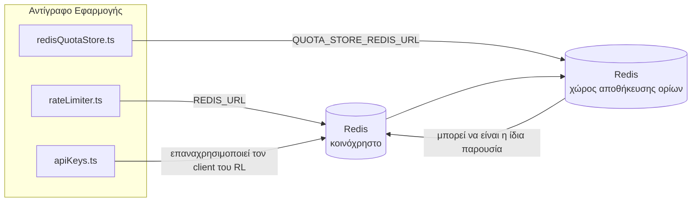

# Redis Production Configuration Guide (Ελληνικά)

🌐 **Languages:** 🇺🇸 [English](../../../../ops/REDIS_PRODUCTION_CONFIG.md) · 🇪🇹 [am](../../../am/docs/ops/REDIS_PRODUCTION_CONFIG.md) · 🇸🇦 [ar](../../../ar/docs/ops/REDIS_PRODUCTION_CONFIG.md) · 🇦🇿 [az](../../../az/docs/ops/REDIS_PRODUCTION_CONFIG.md) · 🇧🇬 [bg](../../../bg/docs/ops/REDIS_PRODUCTION_CONFIG.md) · 🇧🇩 [bn](../../../bn/docs/ops/REDIS_PRODUCTION_CONFIG.md) · 🇧🇦 [bs](../../../bs/docs/ops/REDIS_PRODUCTION_CONFIG.md) · 🇨🇿 [cs](../../../cs/docs/ops/REDIS_PRODUCTION_CONFIG.md) · 🇩🇰 [da](../../../da/docs/ops/REDIS_PRODUCTION_CONFIG.md) · 🇩🇪 [de](../../../de/docs/ops/REDIS_PRODUCTION_CONFIG.md) · 🇪🇸 [es](../../../es/docs/ops/REDIS_PRODUCTION_CONFIG.md) · 🇪🇪 [et](../../../et/docs/ops/REDIS_PRODUCTION_CONFIG.md) · 🇮🇷 [fa](../../../fa/docs/ops/REDIS_PRODUCTION_CONFIG.md) · 🇫🇮 [fi](../../../fi/docs/ops/REDIS_PRODUCTION_CONFIG.md) · 🇫🇷 [fr](../../../fr/docs/ops/REDIS_PRODUCTION_CONFIG.md) · 🇮🇪 [ga](../../../ga/docs/ops/REDIS_PRODUCTION_CONFIG.md) · 🇮🇳 [gu](../../../gu/docs/ops/REDIS_PRODUCTION_CONFIG.md) · 🇳🇬 [ha](../../../ha/docs/ops/REDIS_PRODUCTION_CONFIG.md) · 🇮🇱 [he](../../../he/docs/ops/REDIS_PRODUCTION_CONFIG.md) · 🇮🇳 [hi](../../../hi/docs/ops/REDIS_PRODUCTION_CONFIG.md) · 🇭🇷 [hr](../../../hr/docs/ops/REDIS_PRODUCTION_CONFIG.md) · 🇭🇺 [hu](../../../hu/docs/ops/REDIS_PRODUCTION_CONFIG.md) · 🇦🇲 [hy](../../../hy/docs/ops/REDIS_PRODUCTION_CONFIG.md) · 🇮🇩 [id](../../../id/docs/ops/REDIS_PRODUCTION_CONFIG.md) · 🇳🇬 [ig](../../../ig/docs/ops/REDIS_PRODUCTION_CONFIG.md) · 🇮🇹 [it](../../../it/docs/ops/REDIS_PRODUCTION_CONFIG.md) · 🇯🇵 [ja](../../../ja/docs/ops/REDIS_PRODUCTION_CONFIG.md) · 🇬🇪 [ka](../../../ka/docs/ops/REDIS_PRODUCTION_CONFIG.md) · 🇰🇭 [km](../../../km/docs/ops/REDIS_PRODUCTION_CONFIG.md) · 🇮🇳 [kn](../../../kn/docs/ops/REDIS_PRODUCTION_CONFIG.md) · 🇰🇷 [ko](../../../ko/docs/ops/REDIS_PRODUCTION_CONFIG.md) · 🇱🇹 [lt](../../../lt/docs/ops/REDIS_PRODUCTION_CONFIG.md) · 🇱🇻 [lv](../../../lv/docs/ops/REDIS_PRODUCTION_CONFIG.md) · 🇮🇳 [ml](../../../ml/docs/ops/REDIS_PRODUCTION_CONFIG.md) · 🇮🇳 [mr](../../../mr/docs/ops/REDIS_PRODUCTION_CONFIG.md) · 🇲🇾 [ms](../../../ms/docs/ops/REDIS_PRODUCTION_CONFIG.md) · 🇲🇹 [mt](../../../mt/docs/ops/REDIS_PRODUCTION_CONFIG.md) · 🇲🇲 [my](../../../my/docs/ops/REDIS_PRODUCTION_CONFIG.md) · 🇳🇵 [ne](../../../ne/docs/ops/REDIS_PRODUCTION_CONFIG.md) · 🇳🇱 [nl](../../../nl/docs/ops/REDIS_PRODUCTION_CONFIG.md) · 🇳🇴 [no](../../../no/docs/ops/REDIS_PRODUCTION_CONFIG.md) · 🇮🇳 [or](../../../or/docs/ops/REDIS_PRODUCTION_CONFIG.md) · 🇮🇳 [pa](../../../pa/docs/ops/REDIS_PRODUCTION_CONFIG.md) · 🇵🇭 [phi](../../../phi/docs/ops/REDIS_PRODUCTION_CONFIG.md) · 🇵🇱 [pl](../../../pl/docs/ops/REDIS_PRODUCTION_CONFIG.md) · 🇵🇹 [pt](../../../pt/docs/ops/REDIS_PRODUCTION_CONFIG.md) · 🇧🇷 [pt-BR](../../../pt-BR/docs/ops/REDIS_PRODUCTION_CONFIG.md) · 🇷🇴 [ro](../../../ro/docs/ops/REDIS_PRODUCTION_CONFIG.md) · 🇷🇺 [ru](../../../ru/docs/ops/REDIS_PRODUCTION_CONFIG.md) · 🇱🇰 [si](../../../si/docs/ops/REDIS_PRODUCTION_CONFIG.md) · 🇸🇰 [sk](../../../sk/docs/ops/REDIS_PRODUCTION_CONFIG.md) · 🇸🇮 [sl](../../../sl/docs/ops/REDIS_PRODUCTION_CONFIG.md) · 🇷🇸 [sr](../../../sr/docs/ops/REDIS_PRODUCTION_CONFIG.md) · 🇸🇪 [sv](../../../sv/docs/ops/REDIS_PRODUCTION_CONFIG.md) · 🇰🇪 [sw](../../../sw/docs/ops/REDIS_PRODUCTION_CONFIG.md) · 🇮🇳 [ta](../../../ta/docs/ops/REDIS_PRODUCTION_CONFIG.md) · 🇮🇳 [te](../../../te/docs/ops/REDIS_PRODUCTION_CONFIG.md) · 🇹🇭 [th](../../../th/docs/ops/REDIS_PRODUCTION_CONFIG.md) · 🇹🇷 [tr](../../../tr/docs/ops/REDIS_PRODUCTION_CONFIG.md) · 🇺🇦 [uk-UA](../../../uk-UA/docs/ops/REDIS_PRODUCTION_CONFIG.md) · 🇵🇰 [ur](../../../ur/docs/ops/REDIS_PRODUCTION_CONFIG.md) · 🇺🇿 [uz](../../../uz/docs/ops/REDIS_PRODUCTION_CONFIG.md) · 🇻🇳 [vi](../../../vi/docs/ops/REDIS_PRODUCTION_CONFIG.md) · 🇳🇬 [yo](../../../yo/docs/ops/REDIS_PRODUCTION_CONFIG.md) · 🇨🇳 [zh-CN](../../../zh-CN/docs/ops/REDIS_PRODUCTION_CONFIG.md) · 🇹🇼 [zh-TW](../../../zh-TW/docs/ops/REDIS_PRODUCTION_CONFIG.md)

---

## Επισκόπηση

Redis είναι ένα **προαιρετική, μαλακή εξάρτηση** στο OmniRoute — η εφαρμογή υποβαθμίζεται χαριτωμένα (εναλλακτικά στη μνήμη) όταν Redis δεν είναι διαθέσιμο. Στην παραγωγή, ο συντονισμός Redis μειώνει την καθυστέρηση για τέσσερις διαφορετικούς φόρτους εργασίας:

| Φόρτος εργασίας                 | Οδηγός                        | Εργοστάσιο Πελατών                                | Μοτίβο κλειδιού                                          |
| ------------------------------- | ----------------------------- | ------------------------------------------------- | -------------------------------------------------------- |
| Περιορισμός ποσοστού            | `rateLimiter.ts`              | `getRedisClient()` — τεμπέλης `ioredis` singleton | Παράθυρα ορίου ατομικού ρυθμού `<prefix>rl:*` Lua        |
| Auth cache                      | `apiKeys.ts`                  | Επαναχρησιμοποιεί τον πελάτη του `rateLimiter`    | `<prefix>auth:api_key:<sha256>` με TTL                   |
| Κατάστημα ποσοστώσεων           | `redisQuotaStore.ts`          | Ξεχωριστό μονότονο `getRedisClient(url)`          | `<prefix>quota:*` με δυνατότητα διαμόρφωσης ανά παρουσία |
| Προθέρμανση διακόπτη κυκλώματος | `redisCircuitBreakerStore.ts` | Ξεχωριστός πελάτης στο `circuitBreakerFactory.ts` | `<prefix>warmup:cb:<connectionId>`                       |

Και οι τέσσερις φόρτοι εργασίας μοιράζονται ένα πρόθεμα χώρου ονομάτων, ώστε OmniRoute να μπορεί να συνυπάρχει με άλλες εφαρμογές σε μία παρουσία Redis (π.χ. `127.0.0.1:6379`). Δείτε [το Key Namespacing](#key-namespacing).

---

## Τρέχουσα διαμόρφωση (Προεπιλογές κώδικα)

| Σύνθεση                                | Αξία                                                         | Οπου                                                                                  |
| -------------------------------------- | ------------------------------------------------------------ | ------------------------------------------------------------------------------------- |
| `REDIS_URL` env var                    | `redis://redis:6379` (σύνθεση), προαιρετικό                  | `rateLimiter.ts:5`, `.env.example`                                                    |
| `REDIS_KEY_PREFIX` env var             | `omniroute:` (προεπιλογή)                                    | `rateLimiter.ts`, `redisQuotaStore.ts`, `redisCircuitBreakerStore.ts`, `.env.example` |
| `QUOTA_STORE_REDIS_URL` env var        | ξεχωριστό, μπορεί να διαφέρει από `REDIS_URL`                | `quota/storeFactory.ts`                                                               |
| `QUOTA_STORE_DRIVER`                   | `"sqlite"` (προεπιλογή), `"redis"` προαιρετικό               | `quota/storeFactory.ts`                                                               |
| ioredis `maxRetriesPerRequest`         | `3`                                                          | Δημιουργία πελάτη `rateLimiter.ts`                                                    |
| `enableReadyCheck`                     | δεν έχει οριστεί (ioredis προεπιλογή: `true`)                | —                                                                                     |
| `lazyConnect`                          | δεν έχει οριστεί (προεπιλογή ioredis: `false`)               | —                                                                                     |
| `retryStrategy`                        | δεν έχει οριστεί (προεπιλογή ioredis: 200ms βάσης, εκθετική) | —                                                                                     |
| TLS / κωδικός πρόσβασης / ευρετήριο DB | **δεν έχει ρυθμιστεί**                                       | —                                                                                     |
| Φρουρός / Cluster                      | **δεν έχει ρυθμιστεί** — αυτόνομο μονοκόμβο μόνο             | —                                                                                     |

---

## Ονοματοδοσία κλειδιών με namespace

Το OmniRoute χρησιμοποιεί από κοινού ένα instance του Redis με οτιδήποτε άλλο εκτελείται στον host. Χωρίς namespace, κλειδιά όπως τα `auth:api_key:<sha256>` ή `rl:*` θα μπορούσαν να συγκρουστούν με κλειδιά άλλων εφαρμογών που χρησιμοποιούν το ίδιο Redis (αυτό το instance εκτελεί το Redis στη διεύθυνση `127.0.0.1:6379` μαζί με άλλες υπηρεσίες).

Ορίστε το `REDIS_KEY_PREFIX` σε μια μη κενή συμβολοσειρά, ώστε να προστεθεί πρόθεμα σε **κάθε** κλειδί του OmniRoute:

```bash
# .env — όλα τα κλειδιά του OmniRoute γίνονται omniroute:rl:*, omniroute:auth:*, omniroute:quota:*, omniroute:warmup:cb:*
REDIS_KEY_PREFIX=omniroute:
```

- **Προεπιλογή:** `omniroute:` (εφαρμόζεται όταν το `REDIS_KEY_PREFIX` δεν έχει οριστεί ή είναι κενό).
- **Εφαρμόζεται σε:** περιοριστή ρυθμού + cache αυθεντικοποίησης (κοινόχρηστος client `ioredis` μέσω του `keyPrefix`), καθώς και στον χώρο αποθήκευσης quota (`KEY_PREFIX = "${REDIS_KEY_PREFIX}quota"`) και στο circuit breaker προθέρμανσης (`KEY_PREFIX = "${REDIS_KEY_PREFIX}warmup:cb:"`).
- **Η αλλαγή του προθέματος**, όταν υπάρχουν ήδη κλειδιά στο Redis, αφήνει ορφανά τα παλιά κλειδιά (λήγουν μέσω TTL / LRU). Η αλλαγή είναι ασφαλής και δεν απαιτείται μετεγκατάσταση. Η μόνη εξαίρεση είναι ένα κλειδί του circuit breaker προθέρμανσης για μια σύνδεση που έχει επισημανθεί ως απαγορευμένη: διατηρείται χωρίς TTL, επομένως εμφανίστε τα εναπομείναντα κλειδιά με `redis-cli --scan --pattern '<old-prefix>warmup:cb:*'` και διαγράψτε τα.
- Το **`keyPrefix` του ioredis** προσθέτει αυτόματα το πρόθεμα κατά τις εγγραφές **και** το αφαιρεί κατά τις αναγνώσεις, επομένως ο κώδικας της εφαρμογής δεν βλέπει ποτέ το πρόθεμα.

---

## Προτεινόμενος συντονισμός παραγωγής

### 1. Connection Pool / Client Options (κατασκευαστής ioredis `Redis` )

Ο τρέχων κώδικας δημιουργεί ένα μόνο `new Redis(url)` χωρίς προσαρμοσμένες επιλογές. Για αναπτύξεις πολλαπλών αντιγράφων παραγωγής, περάστε τον κωδικό σε ένα εργοστάσιο πελάτη ή αναδιπλώστε `getRedisClient()`:

```typescript
const redis = new Redis(REDIS_URL, {
  maxRetriesPerRequest: null, // no retry limit; let retryStrategy decide
  enableReadyCheck: true, // verify server is ready before accepting calls
  lazyConnect: true, // don't connect on construction; wait for first call
  retryStrategy: (times) => {
    if (times > 10) return null; // give up after 10 retries → reconnect later
    return Math.min(times * 200, 5000); // 200ms, 400ms, …, 5s cap
  },
  enableAutoPipelining: true, // coalesce concurrent commands into one TCP write
  keepAlive: 10000, // TCP keep‑alive every 10s
});
```

**Βασικές ανταλλαγές:**

- `maxRetriesPerRequest: null` + `retryStrategy` — προτιμάται για παραγωγή, ώστε οι παροδικές επανεκκινήσεις Redis να μην αποτυγχάνουν αμέσως κάθε αίτημα. Η εναλλακτική στη μνήμη στο `checkRateLimit()` απορροφά τη διαδρομή αποτυχίας.
- `lazyConnect: true` — αποφεύγει την ενεργοποίηση της εξάρτησης εκκίνησης από Redis πριν ο διακομιστής αρχίσει να δέχεται συνδέσεις.
- `enableAutoPipelining: true` — μειώνει τα ταξίδια μετ' επιστροφής για ταυτόχρονους ελέγχους ορίων τιμών. επωφελής στο > 50 RPS σε μία μόνο σύνδεση.

### 2. Διαμόρφωση διακομιστή Redis (`redis.conf`)

```
# Memory
maxmemory 80%                        # leave room for OS page cache
maxmemory-policy allkeys-lru         # evict stale auth cache entries under pressure

# Persistence (optional — OmniRoute is crash‑safe without it)
save 300 1                           # snapshot at least every 5 min if ≥1 key changed
appendonly no                        # AOF not needed; data is regeneratable
appendfsync no                       # no fsync overhead (RDB is sufficient)

# Networking
timeout 0                            # no idle disconnect
tcp-keepalive 300                    # 5 min keep‑alive
tcp-backlog 511                      # connection backlog for bursty load

# Performance
hz 10                                # default; 100 for latency‑sensitive
activedefrag yes                     # auto‑defragment when fragmentation >10%
```

**Ανταλλαγή για `maxmemory-policy allkeys-lru`:** Οι εγγραφές κρυφής μνήμης Auth ενδέχεται να εξαλειφθούν υπό πίεση μνήμης. Αυτό είναι ασφαλές — `setCachedApiKey` ξανασυμπληρώνεται πάντα σε περίπτωση απώλειας και το εναλλακτικό SQLite είναι έγκυρο. Η δέσμη ενεργειών Lua με περιορισμό ρυθμού δημιουργεί μικρά πλήκτρα που είναι βραχύβια από το σχεδιασμό.

### 3. Ρυθμίσεις σύνθεσης Docker

Το prod compose (`docker-compose.prod.yml`) χρησιμοποιεί `redis:8.6.2-alpine`. Προσθέτω:

```yaml
redis:
  image: redis:8.6.2-alpine
  command:
    [
      "redis-server",
      "--maxmemory",
      "512mb",
      "--maxmemory-policy",
      "allkeys-lru",
      "--activedefrag",
      "yes",
      "--save",
      "300 1",
    ]
  healthcheck:
    test: ["CMD", "redis-cli", "ping"]
    interval: 10s
    timeout: 3s
    retries: 3
    start_period: 5s
```

### 4. Θεωρήσεις πολλαπλών περιπτώσεων / κλιμάκωσης

**Μονό Redis για όλα τα αντίγραφα** — το σενάριο Lua περιοριστή ρυθμού εξαρτάται από ένα μόνο έγκυρο χώρο κλειδιού. Πολλαπλές περιπτώσεις Redis πίσω από αντίγραφα θα έχαναν την ατομικότητα και θα διπλασίαζαν τον προϋπολογισμό. Χρησιμοποιήστε ένα μόνο Redis (ή σύμπλεγμα Redis Sentinel με ανακατεύθυνση) για όλα τα αντίγραφα εφαρμογών.

**Πλήθος συνδέσεων:** Ανοίγει κάθε αντίγραφο εφαρμογής **2 συνδέσεις TCP** σε Redis (πελάτης αποθήκευσης ποσοστώσεων + με περιορισμό τιμών). Σε 10 αντίγραφα συνδέσεων → 20, πολύ εντός του ανώτατου ορίου σύνδεσης 10 χιλιάδων μιας προεπιλεγμένης παρουσίας Redis.

### 5. Παρακολούθηση

Έκθεση μέσω καταληκτικού σημείου ελέγχου υγείας:

```typescript
// src/app/api/monitoring/health/route.ts already calls rateLimiter functions
// Add Redis-specific checks:
//   1. PING latency via ioredis .ping()
//   2. Memory usage via INFO memory
//   3. Connection count via INFO clients
//   4. Hit rate for maxmemory-policy (evicted_keys / keyspace_hits)
```

Βασικές μετρήσεις για παρακολούθηση:

- **Εξωθημένα κλειδιά / δευτ** — εάν είναι επίμονα μη μηδενικό, αυξήστε `maxmemory`
- **Αποκλεισμένοι πελάτες** — non-zero προτείνει αργά σενάρια Lua ή υψηλή διαμάχη
- **Απορριφθείσες συνδέσεις** Επίτευξη ορίου σύνδεσης —. σπάνιο σε 20 συνδέσεις

### 6. Διακομιστές συμβατοί με Redis

Κάθε διακομιστής που χρησιμοποιείται εδώ πρέπει να εκτελεί σενάρια Lua: ο περιοριστής ρυθμού είναι ένα `EVAL`. Σε έναν διακομιστή χωρίς Lua, `checkRateLimit()` καταγράφει `[RATE_LIMITER] Redis eval failed, falling back to in-memory rate limiting` και μετράει ανά διεργασία, επομένως κάθε αντίγραφο επιβάλλει το όριο από μόνο του. Το opt-in κοινόχρηστο κατάστημα συνάφειας περιόδου σύνδεσης (`OMNIROUTE_SESSION_AFFINITY_STORE=redis`) διαβάζει επίσης και ενημερώνει τα pin με `EVAL`. χωρίς Lua καταγράφει `[SESSION_AFFINITY] Redis error; falling back to SQLite.` και κάθε αντίγραφο διατηρεί τις δικές του καρφίτσες. Οι άλλοι φόρτοι εργασίας χρησιμοποιούν απλές εντολές (`SET ... EX`, `GET`, `DEL`, `MGET`, `EXPIRE`, `INCRBYFLOAT`, κατακερματισμοί και σύνολα) και το backend Redis της σημασιολογικής κρυφής μνήμης δεν στέλνει εντολές `FT.*`.

Δοκιμασμένο με OmniRoute 3.8.52: KiviDB 1.2.0 με την εικόνα Lua (`kividb/kividb:v1.2.0-lua`). Ο περιοριστής ρυθμού (συμπεριλαμβανομένης μιας δεύτερης διαδικασίας που μοιράζεται τους μετρητές), η προσωρινή μνήμη auth, η αποθήκευση ορίου, ο διακόπτης προθέρμανσης, η αποθήκευση σημασιολογικής κρυφής μνήμης και ένα αίτημα `/v1/chat/completions` μέσω του προγράμματος χειρισμού συνομιλίας πέρασαν 18 από τους 19 ελέγχους που περνούν στο Redis 8.10.3. Αυτό που διαφέρει: `INCRBYFLOAT` αποθηκεύει `0.1 + 0.2` ως `0.30000000000000004` όπου Redis αποθηκεύει `0.3` ( [kividbio/kividb#387](https://github.com/kividbio/kividb/issues/387) ). Το quota store αναλύει και τα δύο με `parseFloat`, αλλά οι δύο αριθμοί διαφέρουν στα τελευταία ψηφία, επομένως μια σύγκριση που εμπίπτει ακριβώς σε ένα όριο ποσόστωσης μπορεί να βγει διαφορετικά. Το κατάστημα συνάφειας συνεδρίας δεν ήταν μέρος αυτής της εκτέλεσης. ( [ρύθμιση](https://github.com/kividbio/kividb/blob/master/docs/integrations/omniroute.md), [αποτελέσματα](https://github.com/kividbio/kividb/tree/master/benchmarks/omniroute-compat) )

---

## Διάγραμμα Αρχιτεκτονικής



---

## Αναφορές

| Αρχείο                             | Σκοπός                                                                    |
| ---------------------------------- | ------------------------------------------------------------------------- |
| `src/shared/utils/rateLimiter.ts`  | Κύριος πελάτης Redis, σενάριο ορίου συχνότητας Lua, εναλλακτική στη μνήμη |
| `src/lib/db/apiKeys.ts`            | Auth cache — Redis→SQLite εναλλακτική                                     |
| `src/lib/quota/redisQuotaStore.ts` | Ξεχωριστό πρόγραμμα-πελάτη Redis για προαιρετικό κατάστημα ορίων          |
| `src/lib/quota/storeFactory.ts`    | Εναλλάσσεται μεταξύ προγραμμάτων οδήγησης ορίου `sqlite` και `redis`      |
| `docker-compose.prod.yml`          | Prod Redis container (εικόνα `redis:8.6.2-alpine`)                        |
| `.env.example`                     | Τεκμηρίωση Redis env vars                                                 |
| `src/app/api/local/redis/`         | Διαδρομές API για ενορχήστρωση κοντέινερ dev                              |
| `bin/cli/commands/redis.mjs`       | Εντολές CLI για ενορχήστρωση κοντέινερ dev                                |
