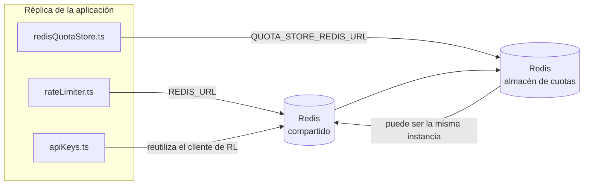

# Redis Production Configuration Guide (Español)

🌐 **Languages:** 🇺🇸 [English](../../../../ops/REDIS_PRODUCTION_CONFIG.md) · 🇪🇹 [am](../../../am/docs/ops/REDIS_PRODUCTION_CONFIG.md) · 🇸🇦 [ar](../../../ar/docs/ops/REDIS_PRODUCTION_CONFIG.md) · 🇦🇿 [az](../../../az/docs/ops/REDIS_PRODUCTION_CONFIG.md) · 🇧🇬 [bg](../../../bg/docs/ops/REDIS_PRODUCTION_CONFIG.md) · 🇧🇩 [bn](../../../bn/docs/ops/REDIS_PRODUCTION_CONFIG.md) · 🇧🇦 [bs](../../../bs/docs/ops/REDIS_PRODUCTION_CONFIG.md) · 🇨🇿 [cs](../../../cs/docs/ops/REDIS_PRODUCTION_CONFIG.md) · 🇩🇰 [da](../../../da/docs/ops/REDIS_PRODUCTION_CONFIG.md) · 🇩🇪 [de](../../../de/docs/ops/REDIS_PRODUCTION_CONFIG.md) · 🇬🇷 [el](../../../el/docs/ops/REDIS_PRODUCTION_CONFIG.md) · 🇪🇪 [et](../../../et/docs/ops/REDIS_PRODUCTION_CONFIG.md) · 🇮🇷 [fa](../../../fa/docs/ops/REDIS_PRODUCTION_CONFIG.md) · 🇫🇮 [fi](../../../fi/docs/ops/REDIS_PRODUCTION_CONFIG.md) · 🇫🇷 [fr](../../../fr/docs/ops/REDIS_PRODUCTION_CONFIG.md) · 🇮🇪 [ga](../../../ga/docs/ops/REDIS_PRODUCTION_CONFIG.md) · 🇮🇳 [gu](../../../gu/docs/ops/REDIS_PRODUCTION_CONFIG.md) · 🇳🇬 [ha](../../../ha/docs/ops/REDIS_PRODUCTION_CONFIG.md) · 🇮🇱 [he](../../../he/docs/ops/REDIS_PRODUCTION_CONFIG.md) · 🇮🇳 [hi](../../../hi/docs/ops/REDIS_PRODUCTION_CONFIG.md) · 🇭🇷 [hr](../../../hr/docs/ops/REDIS_PRODUCTION_CONFIG.md) · 🇭🇺 [hu](../../../hu/docs/ops/REDIS_PRODUCTION_CONFIG.md) · 🇦🇲 [hy](../../../hy/docs/ops/REDIS_PRODUCTION_CONFIG.md) · 🇮🇩 [id](../../../id/docs/ops/REDIS_PRODUCTION_CONFIG.md) · 🇳🇬 [ig](../../../ig/docs/ops/REDIS_PRODUCTION_CONFIG.md) · 🇮🇹 [it](../../../it/docs/ops/REDIS_PRODUCTION_CONFIG.md) · 🇯🇵 [ja](../../../ja/docs/ops/REDIS_PRODUCTION_CONFIG.md) · 🇬🇪 [ka](../../../ka/docs/ops/REDIS_PRODUCTION_CONFIG.md) · 🇰🇭 [km](../../../km/docs/ops/REDIS_PRODUCTION_CONFIG.md) · 🇮🇳 [kn](../../../kn/docs/ops/REDIS_PRODUCTION_CONFIG.md) · 🇰🇷 [ko](../../../ko/docs/ops/REDIS_PRODUCTION_CONFIG.md) · 🇱🇹 [lt](../../../lt/docs/ops/REDIS_PRODUCTION_CONFIG.md) · 🇱🇻 [lv](../../../lv/docs/ops/REDIS_PRODUCTION_CONFIG.md) · 🇮🇳 [ml](../../../ml/docs/ops/REDIS_PRODUCTION_CONFIG.md) · 🇮🇳 [mr](../../../mr/docs/ops/REDIS_PRODUCTION_CONFIG.md) · 🇲🇾 [ms](../../../ms/docs/ops/REDIS_PRODUCTION_CONFIG.md) · 🇲🇹 [mt](../../../mt/docs/ops/REDIS_PRODUCTION_CONFIG.md) · 🇲🇲 [my](../../../my/docs/ops/REDIS_PRODUCTION_CONFIG.md) · 🇳🇵 [ne](../../../ne/docs/ops/REDIS_PRODUCTION_CONFIG.md) · 🇳🇱 [nl](../../../nl/docs/ops/REDIS_PRODUCTION_CONFIG.md) · 🇳🇴 [no](../../../no/docs/ops/REDIS_PRODUCTION_CONFIG.md) · 🇮🇳 [or](../../../or/docs/ops/REDIS_PRODUCTION_CONFIG.md) · 🇮🇳 [pa](../../../pa/docs/ops/REDIS_PRODUCTION_CONFIG.md) · 🇵🇭 [phi](../../../phi/docs/ops/REDIS_PRODUCTION_CONFIG.md) · 🇵🇱 [pl](../../../pl/docs/ops/REDIS_PRODUCTION_CONFIG.md) · 🇵🇹 [pt](../../../pt/docs/ops/REDIS_PRODUCTION_CONFIG.md) · 🇧🇷 [pt-BR](../../../pt-BR/docs/ops/REDIS_PRODUCTION_CONFIG.md) · 🇷🇴 [ro](../../../ro/docs/ops/REDIS_PRODUCTION_CONFIG.md) · 🇷🇺 [ru](../../../ru/docs/ops/REDIS_PRODUCTION_CONFIG.md) · 🇱🇰 [si](../../../si/docs/ops/REDIS_PRODUCTION_CONFIG.md) · 🇸🇰 [sk](../../../sk/docs/ops/REDIS_PRODUCTION_CONFIG.md) · 🇸🇮 [sl](../../../sl/docs/ops/REDIS_PRODUCTION_CONFIG.md) · 🇷🇸 [sr](../../../sr/docs/ops/REDIS_PRODUCTION_CONFIG.md) · 🇸🇪 [sv](../../../sv/docs/ops/REDIS_PRODUCTION_CONFIG.md) · 🇰🇪 [sw](../../../sw/docs/ops/REDIS_PRODUCTION_CONFIG.md) · 🇮🇳 [ta](../../../ta/docs/ops/REDIS_PRODUCTION_CONFIG.md) · 🇮🇳 [te](../../../te/docs/ops/REDIS_PRODUCTION_CONFIG.md) · 🇹🇭 [th](../../../th/docs/ops/REDIS_PRODUCTION_CONFIG.md) · 🇹🇷 [tr](../../../tr/docs/ops/REDIS_PRODUCTION_CONFIG.md) · 🇺🇦 [uk-UA](../../../uk-UA/docs/ops/REDIS_PRODUCTION_CONFIG.md) · 🇵🇰 [ur](../../../ur/docs/ops/REDIS_PRODUCTION_CONFIG.md) · 🇺🇿 [uz](../../../uz/docs/ops/REDIS_PRODUCTION_CONFIG.md) · 🇻🇳 [vi](../../../vi/docs/ops/REDIS_PRODUCTION_CONFIG.md) · 🇳🇬 [yo](../../../yo/docs/ops/REDIS_PRODUCTION_CONFIG.md) · 🇨🇳 [zh-CN](../../../zh-CN/docs/ops/REDIS_PRODUCTION_CONFIG.md) · 🇹🇼 [zh-TW](../../../zh-TW/docs/ops/REDIS_PRODUCTION_CONFIG.md)

---

## Descripción general

Redis es una **dependencia opcional y no crítica** en OmniRoute: la aplicación reduce sus funcionalidades de forma controlada (usando
alternativas en memoria) cuando Redis no está disponible. En producción, ajustar Redis reduce la latencia de cuatro cargas de
trabajo distintas:

| Carga de trabajo           | Controlador                   | Fábrica de clientes                                         | Patrón de claves                                                              |
| -------------------------- | ----------------------------- | ----------------------------------------------------------- | ----------------------------------------------------------------------------- |
| Limitación de frecuencia   | `rateLimiter.ts`              | Singleton diferido de `ioredis` mediante `getRedisClient()` | Ventanas de limitación de frecuencia atómicas mediante Lua con `<prefix>rl:*` |
| Caché de autenticación     | `apiKeys.ts`                  | Reutiliza el cliente de `rateLimiter`                       | `<prefix>auth:api_key:<sha256>` con TTL                                       |
| Almacén de cuotas          | `redisQuotaStore.ts`          | Singleton independiente mediante `getRedisClient(url)`      | `<prefix>quota:*` configurable por instancia                                  |
| Disyuntor de calentamiento | `redisCircuitBreakerStore.ts` | Cliente independiente en `circuitBreakerFactory.ts`         | `<prefix>warmup:cb:<connectionId>`                                            |

Las cuatro cargas de trabajo comparten un único prefijo de espacio de nombres para que OmniRoute pueda coexistir con otras aplicaciones en una
sola instancia de Redis (p. ej., `127.0.0.1:6379`). Consulte [Espacios de nombres de claves](#key-namespacing).

---

## Configuración actual (valores predeterminados del código)

| Configuración                               | Valor                                                                         | Ubicación                                                                             |
| ------------------------------------------- | ----------------------------------------------------------------------------- | ------------------------------------------------------------------------------------- |
| Variable de entorno `REDIS_URL`             | `redis://redis:6379` (compose), opcional                                      | `rateLimiter.ts:5`, `.env.example`                                                    |
| Variable de entorno `REDIS_KEY_PREFIX`      | `omniroute:` (predeterminado)                                                 | `rateLimiter.ts`, `redisQuotaStore.ts`, `redisCircuitBreakerStore.ts`, `.env.example` |
| Variable de entorno `QUOTA_STORE_REDIS_URL` | independiente, puede diferir de `REDIS_URL`                                   | `quota/storeFactory.ts`                                                               |
| `QUOTA_STORE_DRIVER`                        | `"sqlite"` (predeterminado), `"redis"` opcional                               | `quota/storeFactory.ts`                                                               |
| `maxRetriesPerRequest` de ioredis           | `3`                                                                           | creación del cliente en `rateLimiter.ts`                                              |
| `enableReadyCheck`                          | no establecido (valor predeterminado de ioredis: `true`)                      | —                                                                                     |
| `lazyConnect`                               | no establecido (valor predeterminado de ioredis: `false`)                     | —                                                                                     |
| `retryStrategy`                             | no establecido (valor predeterminado de ioredis: base de 200 ms, exponencial) | —                                                                                     |
| TLS / contraseña / índice de base de datos  | **no configurados**                                                           | —                                                                                     |
| Sentinel / Cluster                          | **no configurados** — solo nodo único independiente                           | —                                                                                     |

---

## Espacios de nombres de claves

OmniRoute comparte una instancia de Redis con cualquier otro servicio que se ejecute en el host. Sin un espacio de nombres,
claves como `auth:api_key:<sha256>` o `rl:*` podrían entrar en conflicto con claves de otras aplicaciones
que utilicen el mismo Redis (esta instancia ejecuta Redis en `127.0.0.1:6379` junto con otros servicios).

Establezca `REDIS_KEY_PREFIX` en una cadena no vacía para anteponer un prefijo a **todas** las claves de OmniRoute:

```bash
# .env — todas las claves de OmniRoute pasan a ser omniroute:rl:*, omniroute:auth:*, omniroute:quota:*, omniroute:warmup:cb:*
REDIS_KEY_PREFIX=omniroute:
```

- **Valor predeterminado:** `omniroute:` (se aplica cuando `REDIS_KEY_PREFIX` no está establecido o está vacío).
- **Se aplica a:** el limitador de frecuencia y la caché de autenticación (cliente `ioredis` compartido mediante `keyPrefix`), el
  almacén de cuotas (`KEY_PREFIX = "${REDIS_KEY_PREFIX}quota"`) y el disyuntor de calentamiento
  (`KEY_PREFIX = "${REDIS_KEY_PREFIX}warmup:cb:"`).
- **Cambiar el prefijo** cuando ya existen claves en Redis deja huérfanas las claves antiguas (estas caducan
  mediante TTL / LRU). Es seguro cambiarlo; no se necesita ninguna migración. La única excepción es una clave del
  disyuntor de calentamiento para una conexión marcada como prohibida: se conserva sin TTL, por lo que debe
  enumerar los restos con `redis-cli --scan --pattern '<old-prefix>warmup:cb:*'` y eliminarlos.
- **`keyPrefix` de ioredis** antepone automáticamente el prefijo durante las escrituras **y** lo elimina durante las lecturas,
  por lo que el código de la aplicación nunca ve el prefijo.

---

## Ajuste de producción recomendado

### 1. Grupo de conexiones/Opciones de cliente (constructor ioredis `Redis` )

El código actual crea un único `new Redis(url)` sin opciones personalizadas. Para implementaciones de producción de múltiples réplicas, pase una fábrica de clientes en el código o ajuste `getRedisClient()`:

```typescript
const redis = new Redis(REDIS_URL, {
  maxRetriesPerRequest: null, // no retry limit; let retryStrategy decide
  enableReadyCheck: true, // verify server is ready before accepting calls
  lazyConnect: true, // don't connect on construction; wait for first call
  retryStrategy: (times) => {
    if (times > 10) return null; // give up after 10 retries → reconnect later
    return Math.min(times * 200, 5000); // 200ms, 400ms, …, 5s cap
  },
  enableAutoPipelining: true, // coalesce concurrent commands into one TCP write
  keepAlive: 10000, // TCP keep‑alive every 10s
});
```

**Compensaciones clave:**

- Se prefiere `maxRetriesPerRequest: null` + `retryStrategy` — para producción, de modo que los reinicios transitorios Redis no fallen inmediatamente en todas las solicitudes. El respaldo en memoria en `checkRateLimit()` absorbe la ruta de falla.
- `lazyConnect: true` — evita que el inicio dependa de que Redis esté activo antes de que el servidor comience a aceptar conexiones.
- `enableAutoPipelining: true` — reduce los viajes de ida y vuelta para verificaciones simultáneas de límites de tarifas; beneficioso a > 50 RPS en una sola conexión.

### 2. Configuración del servidor Redis (`redis.conf`)

```
# Memory
maxmemory 80%                        # leave room for OS page cache
maxmemory-policy allkeys-lru         # evict stale auth cache entries under pressure

# Persistence (optional — OmniRoute is crash‑safe without it)
save 300 1                           # snapshot at least every 5 min if ≥1 key changed
appendonly no                        # AOF not needed; data is regeneratable
appendfsync no                       # no fsync overhead (RDB is sufficient)

# Networking
timeout 0                            # no idle disconnect
tcp-keepalive 300                    # 5 min keep‑alive
tcp-backlog 511                      # connection backlog for bursty load

# Performance
hz 10                                # default; 100 for latency‑sensitive
activedefrag yes                     # auto‑defragment when fragmentation >10%
```

**Compensación por `maxmemory-policy allkeys-lru`:** Las entradas de la caché de autenticación pueden ser expulsadas bajo presión de la memoria. Esto es seguro. — `setCachedApiKey` siempre se vuelve a completar en caso de error y el respaldo SQLite tiene autoridad. El script Lua limitador de velocidad crea pequeñas claves que, por diseño, son de corta duración.

### 3. Configuración de redacción Docker

El prod compose (`docker-compose.prod.yml`) usa `redis:8.6.2-alpine`. Agregar:

```yaml
redis:
  image: redis:8.6.2-alpine
  command:
    [
      "redis-server",
      "--maxmemory",
      "512mb",
      "--maxmemory-policy",
      "allkeys-lru",
      "--activedefrag",
      "yes",
      "--save",
      "300 1",
    ]
  healthcheck:
    test: ["CMD", "redis-cli", "ping"]
    interval: 10s
    timeout: 3s
    retries: 3
    start_period: 5s
```

### 4. Consideraciones de escalamiento/multiinstancia

**Redis único para todas las réplicas.** — el script Lua limitador de velocidad depende de un único espacio de clave autorizado. Varias instancias Redis detrás de réplicas perderían atomicidad y duplicarían el presupuesto. Utilice un único Redis (o clúster Redis Sentinel con conmutación por error) para todas las réplicas de aplicaciones.

**Recuento de conexiones:** Se abre cada réplica de la aplicación.** 2 conexiones TCP** a Redis (cliente limitador de velocidad, cliente de tienda de cuotas + ). En 10 réplicas → 20 conexiones, dentro del límite máximo de conexiones de 10k de una instancia Redis predeterminada.

### 5. Monitoreo

Exponer a través del punto final de verificación de estado:

```typescript
// src/app/api/monitoring/health/route.ts already calls rateLimiter functions
// Add Redis-specific checks:
//   1. PING latency via ioredis .ping()
//   2. Memory usage via INFO memory
//   3. Connection count via INFO clients
//   4. Hit rate for maxmemory-policy (evicted_keys / keyspace_hits)
```

Métricas clave a tener en cuenta:

- **Llaves desalojadas/seg** — si persistentemente es distinto de cero, aumente `maxmemory`
- **Clientes bloqueados** — distinto de cero sugiere scripts Lua lentos o alta contención
- **Conexiones rechazadas** límite de conexión — alcanzado; raro en 20 conexiones

### 6. Servidores compatibles con Redis

Cualquier servidor utilizado aquí debe ejecutar scripts Lua: el limitador de velocidad es un `EVAL`. En un servidor sin Lua, `checkRateLimit()` registra `[RATE_LIMITER] Redis eval failed, falling back to in-memory rate limiting` y cuenta por proceso, por lo que cada réplica impone el límite por sí sola. El almacén de afinidad de sesión compartido (`OMNIROUTE_SESSION_AFFINITY_STORE=redis`) también lee y actualiza los pines con `EVAL`; sin Lua, registra `[SESSION_AFFINITY] Redis error; falling back to SQLite.` y cada réplica mantiene sus propios pines. Las otras cargas de trabajo usan comandos simples (`SET ... EX`, `GET`, `DEL`, `MGET`, `EXPIRE`, `INCRBYFLOAT`, hashes y conjuntos), y el backend Redis de la caché semántica no envía comandos `FT.*`.

Probado con OmniRoute 3.8.52: KiviDB 1.2.0 con su imagen Lua (`kividb/kividb:v1.2.0-lua`). El limitador de velocidad (incluido un segundo proceso que comparte los contadores), la caché de autenticación, el almacén de cuotas, el disyuntor de calentamiento, el almacén de caché semántica y una solicitud `/v1/chat/completions` a través del controlador de chat pasaron 18 de las 19 comprobaciones que pasan en Redis 8.10.3. El que difiere: `INCRBYFLOAT` almacena `0.1 + 0.2` como `0.30000000000000004` donde Redis almacena `0.3` ( [kividbio/kividb#387](https://github.com/kividbio/kividb/issues/387) ). El almacén de cuotas analiza ambos con `parseFloat`, pero los dos números difieren en los últimos dígitos, por lo que una comparación que cae exactamente en un límite de cuota puede resultar diferente. El almacén de afinidad de sesiones no formó parte de esa ejecución. ( [configuración](https://github.com/kividbio/kividb/blob/master/docs/integrations/omniroute.md), [resultados](https://github.com/kividbio/kividb/tree/master/benchmarks/omniroute-compat) )

---

## Diagrama de arquitectura



---

## Referencias

| Archivo                            | Propósito                                                                                    |
| ---------------------------------- | -------------------------------------------------------------------------------------------- |
| `src/shared/utils/rateLimiter.ts`  | Cliente principal de Redis, script Lua de limitación de solicitudes y alternativa en memoria |
| `src/lib/db/apiKeys.ts`            | Caché de autenticación — Redis→SQLite como alternativa                                       |
| `src/lib/quota/redisQuotaStore.ts` | Cliente de Redis independiente para el almacén de cuotas opcional                            |
| `src/lib/quota/storeFactory.ts`    | Alterna entre los controladores de cuotas `sqlite` y `redis`                                 |
| `docker-compose.prod.yml`          | Contenedor de Redis de producción (imagen `redis:8.6.2-alpine`)                              |
| `.env.example`                     | Documentación de las variables de entorno de Redis                                           |
| `src/app/api/local/redis/`         | Rutas de API para la orquestación de contenedores de desarrollo                              |
| `bin/cli/commands/redis.mjs`       | Comandos de CLI para la orquestación de contenedores de desarrollo                           |
