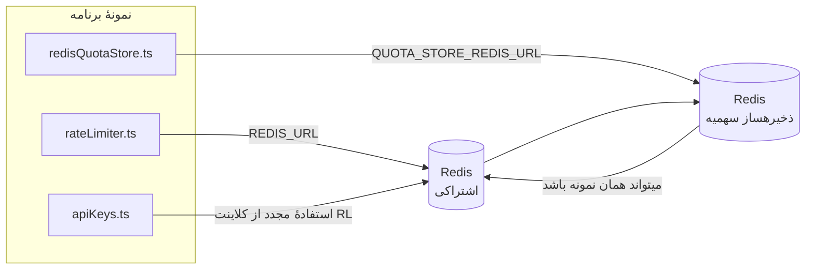

# Redis Production Configuration Guide (فارسی)

🌐 **Languages:** 🇺🇸 [English](../../../../ops/REDIS_PRODUCTION_CONFIG.md) · 🇪🇹 [am](../../../am/docs/ops/REDIS_PRODUCTION_CONFIG.md) · 🇸🇦 [ar](../../../ar/docs/ops/REDIS_PRODUCTION_CONFIG.md) · 🇦🇿 [az](../../../az/docs/ops/REDIS_PRODUCTION_CONFIG.md) · 🇧🇬 [bg](../../../bg/docs/ops/REDIS_PRODUCTION_CONFIG.md) · 🇧🇩 [bn](../../../bn/docs/ops/REDIS_PRODUCTION_CONFIG.md) · 🇧🇦 [bs](../../../bs/docs/ops/REDIS_PRODUCTION_CONFIG.md) · 🇨🇿 [cs](../../../cs/docs/ops/REDIS_PRODUCTION_CONFIG.md) · 🇩🇰 [da](../../../da/docs/ops/REDIS_PRODUCTION_CONFIG.md) · 🇩🇪 [de](../../../de/docs/ops/REDIS_PRODUCTION_CONFIG.md) · 🇬🇷 [el](../../../el/docs/ops/REDIS_PRODUCTION_CONFIG.md) · 🇪🇸 [es](../../../es/docs/ops/REDIS_PRODUCTION_CONFIG.md) · 🇪🇪 [et](../../../et/docs/ops/REDIS_PRODUCTION_CONFIG.md) · 🇫🇮 [fi](../../../fi/docs/ops/REDIS_PRODUCTION_CONFIG.md) · 🇫🇷 [fr](../../../fr/docs/ops/REDIS_PRODUCTION_CONFIG.md) · 🇮🇪 [ga](../../../ga/docs/ops/REDIS_PRODUCTION_CONFIG.md) · 🇮🇳 [gu](../../../gu/docs/ops/REDIS_PRODUCTION_CONFIG.md) · 🇳🇬 [ha](../../../ha/docs/ops/REDIS_PRODUCTION_CONFIG.md) · 🇮🇱 [he](../../../he/docs/ops/REDIS_PRODUCTION_CONFIG.md) · 🇮🇳 [hi](../../../hi/docs/ops/REDIS_PRODUCTION_CONFIG.md) · 🇭🇷 [hr](../../../hr/docs/ops/REDIS_PRODUCTION_CONFIG.md) · 🇭🇺 [hu](../../../hu/docs/ops/REDIS_PRODUCTION_CONFIG.md) · 🇦🇲 [hy](../../../hy/docs/ops/REDIS_PRODUCTION_CONFIG.md) · 🇮🇩 [id](../../../id/docs/ops/REDIS_PRODUCTION_CONFIG.md) · 🇳🇬 [ig](../../../ig/docs/ops/REDIS_PRODUCTION_CONFIG.md) · 🇮🇹 [it](../../../it/docs/ops/REDIS_PRODUCTION_CONFIG.md) · 🇯🇵 [ja](../../../ja/docs/ops/REDIS_PRODUCTION_CONFIG.md) · 🇬🇪 [ka](../../../ka/docs/ops/REDIS_PRODUCTION_CONFIG.md) · 🇰🇭 [km](../../../km/docs/ops/REDIS_PRODUCTION_CONFIG.md) · 🇮🇳 [kn](../../../kn/docs/ops/REDIS_PRODUCTION_CONFIG.md) · 🇰🇷 [ko](../../../ko/docs/ops/REDIS_PRODUCTION_CONFIG.md) · 🇱🇹 [lt](../../../lt/docs/ops/REDIS_PRODUCTION_CONFIG.md) · 🇱🇻 [lv](../../../lv/docs/ops/REDIS_PRODUCTION_CONFIG.md) · 🇮🇳 [ml](../../../ml/docs/ops/REDIS_PRODUCTION_CONFIG.md) · 🇮🇳 [mr](../../../mr/docs/ops/REDIS_PRODUCTION_CONFIG.md) · 🇲🇾 [ms](../../../ms/docs/ops/REDIS_PRODUCTION_CONFIG.md) · 🇲🇹 [mt](../../../mt/docs/ops/REDIS_PRODUCTION_CONFIG.md) · 🇲🇲 [my](../../../my/docs/ops/REDIS_PRODUCTION_CONFIG.md) · 🇳🇵 [ne](../../../ne/docs/ops/REDIS_PRODUCTION_CONFIG.md) · 🇳🇱 [nl](../../../nl/docs/ops/REDIS_PRODUCTION_CONFIG.md) · 🇳🇴 [no](../../../no/docs/ops/REDIS_PRODUCTION_CONFIG.md) · 🇮🇳 [or](../../../or/docs/ops/REDIS_PRODUCTION_CONFIG.md) · 🇮🇳 [pa](../../../pa/docs/ops/REDIS_PRODUCTION_CONFIG.md) · 🇵🇭 [phi](../../../phi/docs/ops/REDIS_PRODUCTION_CONFIG.md) · 🇵🇱 [pl](../../../pl/docs/ops/REDIS_PRODUCTION_CONFIG.md) · 🇵🇹 [pt](../../../pt/docs/ops/REDIS_PRODUCTION_CONFIG.md) · 🇧🇷 [pt-BR](../../../pt-BR/docs/ops/REDIS_PRODUCTION_CONFIG.md) · 🇷🇴 [ro](../../../ro/docs/ops/REDIS_PRODUCTION_CONFIG.md) · 🇷🇺 [ru](../../../ru/docs/ops/REDIS_PRODUCTION_CONFIG.md) · 🇱🇰 [si](../../../si/docs/ops/REDIS_PRODUCTION_CONFIG.md) · 🇸🇰 [sk](../../../sk/docs/ops/REDIS_PRODUCTION_CONFIG.md) · 🇸🇮 [sl](../../../sl/docs/ops/REDIS_PRODUCTION_CONFIG.md) · 🇷🇸 [sr](../../../sr/docs/ops/REDIS_PRODUCTION_CONFIG.md) · 🇸🇪 [sv](../../../sv/docs/ops/REDIS_PRODUCTION_CONFIG.md) · 🇰🇪 [sw](../../../sw/docs/ops/REDIS_PRODUCTION_CONFIG.md) · 🇮🇳 [ta](../../../ta/docs/ops/REDIS_PRODUCTION_CONFIG.md) · 🇮🇳 [te](../../../te/docs/ops/REDIS_PRODUCTION_CONFIG.md) · 🇹🇭 [th](../../../th/docs/ops/REDIS_PRODUCTION_CONFIG.md) · 🇹🇷 [tr](../../../tr/docs/ops/REDIS_PRODUCTION_CONFIG.md) · 🇺🇦 [uk-UA](../../../uk-UA/docs/ops/REDIS_PRODUCTION_CONFIG.md) · 🇵🇰 [ur](../../../ur/docs/ops/REDIS_PRODUCTION_CONFIG.md) · 🇺🇿 [uz](../../../uz/docs/ops/REDIS_PRODUCTION_CONFIG.md) · 🇻🇳 [vi](../../../vi/docs/ops/REDIS_PRODUCTION_CONFIG.md) · 🇳🇬 [yo](../../../yo/docs/ops/REDIS_PRODUCTION_CONFIG.md) · 🇨🇳 [zh-CN](../../../zh-CN/docs/ops/REDIS_PRODUCTION_CONFIG.md) · 🇹🇼 [zh-TW](../../../zh-TW/docs/ops/REDIS_PRODUCTION_CONFIG.md)

---

## نمای کلی

Redis یک است **اختیاری، وابستگی نرم** در OmniRoute — زمانی که Redis در دسترس نباشد، برنامه بهخوبی کاهش مییابد (بازگشتهای درون حافظه). در تولید، تنظیم Redis تأخیر را برای چهار بار کاری مجزا کاهش می دهد:

| حجم کار                  | راننده                        | کارخانه مشتری                               | الگوی کلید                                    |
| ------------------------ | ----------------------------- | ------------------------------------------- | --------------------------------------------- |
| محدود کردن نرخ           | `rateLimiter.ts`              | `getRedisClient()` — تنبل `ioredis` تک تن   | پنجره های محدودیت نرخ اتمی `<prefix>rl:*` Lua |
| حافظه پنهان تأیید اعتبار | `apiKeys.ts`                  | از مشتری `rateLimiter` مجددا استفاده می کند | `<prefix>auth:api_key:<sha256>` با TTL        |
| فروشگاه سهمیه            | `redisQuotaStore.ts`          | تک تن `getRedisClient(url)` جدا             | `<prefix>quota:*` قابل تنظیم در هر نمونه      |
| کلید گرم کردن مدار       | `redisCircuitBreakerStore.ts` | مشتری جداگانه در `circuitBreakerFactory.ts` | `<prefix>warmup:cb:<connectionId>`            |

هر چهار بار کاری یک پیشوند فضای نام مشترک دارند تا OmniRoute بتواند با برنامههای دیگر در یک نمونه Redis همزیستی داشته باشد (مثلا `127.0.0.1:6379`). به [فاصله نام کلید](#key-namespacing) مراجعه کنید.

---

## پیکربندی فعلی (پیشفرض کد)

| تنظیم                           | ارزش                                                       | کجا                                                                                   |
| ------------------------------- | ---------------------------------------------------------- | ------------------------------------------------------------------------------------- |
| `REDIS_URL` env var             | `redis://redis:6379` (نوشتن)، اختیاری                      | `rateLimiter.ts:5`, `.env.example`                                                    |
| `REDIS_KEY_PREFIX` env var      | `omniroute:` (پیشفرض)                                      | `rateLimiter.ts`, `redisQuotaStore.ts`, `redisCircuitBreakerStore.ts`, `.env.example` |
| `QUOTA_STORE_REDIS_URL` env var | جداگانه، می تواند با `REDIS_URL` متفاوت باشد               | `quota/storeFactory.ts`                                                               |
| `QUOTA_STORE_DRIVER`            | `"sqlite"` (پیشفرض)، `"redis"` اختیاری است                 | `quota/storeFactory.ts`                                                               |
| ioredis `maxRetriesPerRequest`  | `3`                                                        | ایجاد مشتری `rateLimiter.ts`                                                          |
| `enableReadyCheck`              | تنظیم نشده است (پیشفرض ioredis: `true`)                    | —                                                                                     |
| `lazyConnect`                   | تنظیم نشده است (پیشفرض ioredis: `false`)                   | —                                                                                     |
| `retryStrategy`                 | تنظیم نشده است (پیشفرض ioredis: پایه 200 میلیثانیه، نمایی) | —                                                                                     |
| TLS / رمز عبور / شاخص DB        | **پیکربندی نشده است**                                      | —                                                                                     |
| نگهبان / خوشه                   | **پیکربندی نشده است** تنها تک گره مستقل —                  | —                                                                                     |

---

## فضای نام کلیدها

OmniRoute یک نمونه Redis را با هر سرویس دیگری که روی میزبان اجرا میشود به اشتراک میگذارد. بدون فضای نام، کلیدهایی مانند `auth:api_key:<sha256>` یا `rl:*` ممکن است با کلیدهای برنامههای دیگری که از همان Redis استفاده میکنند تداخل داشته باشند (این نمونه Redis در کنار سرویسهای دیگر روی `127.0.0.1:6379` اجرا میشود).

`REDIS_KEY_PREFIX` را روی یک رشته غیرخالی تنظیم کنید تا به ابتدای **تمام** کلیدهای OmniRoute افزوده شود:

```bash
# .env — همه کلیدهای OmniRoute به omniroute:rl:*، omniroute:auth:*، omniroute:quota:* و omniroute:warmup:cb:* تبدیل میشوند
REDIS_KEY_PREFIX=omniroute:
```

- **پیشفرض:** `omniroute:` (هنگامی اعمال میشود که `REDIS_KEY_PREFIX` تنظیم نشده یا خالی باشد).
- **اعمالشده به:** محدودکننده نرخ + کش احراز هویت (کلاینت مشترک `ioredis` از طریق `keyPrefix`)، ذخیرهساز سهمیه (`KEY_PREFIX = "${REDIS_KEY_PREFIX}quota"`) و قطعکننده مدار گرمسازی (`KEY_PREFIX = "${REDIS_KEY_PREFIX}warmup:cb:"`).
- **تغییر پیشوند** در حالی که کلیدها از قبل در Redis وجود دارند، کلیدهای قدیمی را بدون مرجع باقی میگذارد (آنها از طریق TTL / LRU منقضی میشوند). تغییر آن ایمن است و به مهاجرت نیازی ندارد. تنها استثنا، کلید قطعکننده مدار گرمسازی برای اتصالی است که ممنوع علامتگذاری شده است: این کلید بدون TTL ماندگار میشود؛ بنابراین موارد باقیمانده را با `redis-cli --scan --pattern '<old-prefix>warmup:cb:*'` فهرست و سپس حذف کنید.
- **`keyPrefix` در ioredis** بهصورت خودکار هنگام نوشتن، پیشوند را اضافه میکند **و** هنگام خواندن آن را حذف میکند؛ بنابراین کد برنامه هرگز پیشوند را مشاهده نمیکند.

---

## تنظیم تولید توصیه شده

### 1. Connection Pool / Client Options (سازنده ioredis `Redis` )

کد فعلی یک `new Redis(url)` واحد بدون گزینه های سفارشی ایجاد می کند. برای استقرار چند کپی تولید، یک کارخانه مشتری را در کد ارسال کنید یا `getRedisClient()` بپیچید:

```typescript
const redis = new Redis(REDIS_URL, {
  maxRetriesPerRequest: null, // no retry limit; let retryStrategy decide
  enableReadyCheck: true, // verify server is ready before accepting calls
  lazyConnect: true, // don't connect on construction; wait for first call
  retryStrategy: (times) => {
    if (times > 10) return null; // give up after 10 retries → reconnect later
    return Math.min(times * 200, 5000); // 200ms, 400ms, …, 5s cap
  },
  enableAutoPipelining: true, // coalesce concurrent commands into one TCP write
  keepAlive: 10000, // TCP keep‑alive every 10s
});
```

**معاوضه های کلیدی:**

- `maxRetriesPerRequest: null` + `retryStrategy` — برای تولید ترجیح داده میشود، بنابراین راهاندازی مجدد Redis فوراً هر درخواستی را ناکام نمیگذارد. بازگشت به حافظه در `checkRateLimit()` مسیر شکست را جذب می کند.
- `lazyConnect: true` — از وابستگی راه اندازی به Redis قبل از شروع پذیرش اتصالات توسط سرور جلوگیری می کند.
- `enableAutoPipelining: true` — سفرهای رفت و برگشت را برای بررسیهای محدود نرخ همزمان کاهش میدهد. در > 50 RPS در یک اتصال مفید است.

### 2. پیکربندی سرور Redis (`redis.conf`)

```
# Memory
maxmemory 80%                        # leave room for OS page cache
maxmemory-policy allkeys-lru         # evict stale auth cache entries under pressure

# Persistence (optional — OmniRoute is crash‑safe without it)
save 300 1                           # snapshot at least every 5 min if ≥1 key changed
appendonly no                        # AOF not needed; data is regeneratable
appendfsync no                       # no fsync overhead (RDB is sufficient)

# Networking
timeout 0                            # no idle disconnect
tcp-keepalive 300                    # 5 min keep‑alive
tcp-backlog 511                      # connection backlog for bursty load

# Performance
hz 10                                # default; 100 for latency‑sensitive
activedefrag yes                     # auto‑defragment when fragmentation >10%
```

**معامله برای `maxmemory-policy allkeys-lru`:** ورودیهای حافظه پنهان ممکن است تحت فشار حافظه حذف شوند. این ایمن است — `setCachedApiKey` همیشه در صورت از دست دادن دوباره پر می شود و نسخه جایگزین SQLite معتبر است. اسکریپت محدود کننده نرخ Lua کلیدهای کوچکی را ایجاد می کند که با طراحی کوتاه مدت هستند.

### 3. Docker Compose Settings

Prod compose (`docker-compose.prod.yml`) از `redis:8.6.2-alpine` استفاده می کند. افزودن:

```yaml
redis:
  image: redis:8.6.2-alpine
  command:
    [
      "redis-server",
      "--maxmemory",
      "512mb",
      "--maxmemory-policy",
      "allkeys-lru",
      "--activedefrag",
      "yes",
      "--save",
      "300 1",
    ]
  healthcheck:
    test: ["CMD", "redis-cli", "ping"]
    interval: 10s
    timeout: 3s
    retries: 3
    start_period: 5s
```

### 4. ملاحظات چند نمونه ای / مقیاس بندی

**Redis واحد برای همه کپی ها** — اسکریپت Lua محدود کننده نرخ به یک فضای کلید معتبر وابسته است. چند نمونه Redis در پشت ماکت ها اتمی خود را از دست می دهند و بودجه را دو برابر می کنند. از یک Redis منفرد (یا کلاستر Redis Sentinel با failover) برای همه نسخههای برنامه استفاده کنید.

**تعداد اتصال:** هر ماکت برنامه باز می شود **2 اتصال TCP** به Redis (کلینت محدودکننده نرخ + سهمیه فروشگاه مشتری). در 10 تکرار → 20 اتصال، به خوبی در سقف اتصال 10k نمونه پیش فرض Redis.

### 5. نظارت

قرار گرفتن در معرض از طریق نقطه پایانی بررسی سلامت:

```typescript
// src/app/api/monitoring/health/route.ts already calls rateLimiter functions
// Add Redis-specific checks:
//   1. PING latency via ioredis .ping()
//   2. Memory usage via INFO memory
//   3. Connection count via INFO clients
//   4. Hit rate for maxmemory-policy (evicted_keys / keyspace_hits)
```

معیارهای کلیدی برای تماشا:

- **کلیدهای خارج شده / ثانیه** اگر — دائماً صفر نیست، `maxmemory` را افزایش دهید
- **مشتریان مسدود شده** — غیر صفر نشاندهنده اسکریپتهای کند Lua یا اختلاف زیاد است
- **اتصالات رد شده** محدودیت اتصال — رسید. در 20 اتصال نادر است

### 6. سرورهای سازگار با Redis

هر سروری که در اینجا استفاده می شود باید اسکریپت های Lua را اجرا کند: محدود کننده نرخ یک `EVAL` است. در سروری بدون Lua، `checkRateLimit()` `[RATE_LIMITER] Redis eval failed, falling back to in-memory rate limiting` را ثبت میکند و در هر فرآیند شمارش میکند، بنابراین هر کپی محدودیت را به تنهایی اعمال میکند. فروشگاه اشتراک اشتراکگذاری نشست (`OMNIROUTE_SESSION_AFFINITY_STORE=redis`) همچنین پینها را با `EVAL` میخواند و بهروزرسانی میکند. بدون Lua، `[SESSION_AFFINITY] Redis error; falling back to SQLite.` را ثبت می کند و هر ماکت پین های خود را نگه می دارد. بارهای کاری دیگر از دستورات ساده استفاده می کنند (`SET ... EX`، `GET`، `DEL`، `MGET`، `EXPIRE`، `INCRBYFLOAT`، هش ها و مجموعه ها)، و باطن Redis کش معنایی هیچ دستور `FT.*` ارسال نمی کند.

تست شده با OmniRoute 3.8.52: KiviDB 1.2.0 با تصویر Lua (`kividb/kividb:v1.2.0-lua`). محدود کننده نرخ (شامل فرآیند دوم به اشتراک گذاری شمارنده ها)، حافظه پنهان تأیید، ذخیره سهمیه، قطع کننده مدار گرم کردن، ذخیره حافظه پنهان معنایی، و یک درخواست `/v1/chat/completions` از طریق کنترل کننده چت، 18 مورد از 19 بررسی را که در Redis 8.10.3 ارسال می شود، ارسال کردند. موردی که متفاوت است: `INCRBYFLOAT` `0.1 + 0.2` به عنوان `0.30000000000000004` ذخیره می کند، در حالی که Redis `0.3` ذخیره می کند ( [kividbio/kividb#387](https://github.com/kividbio/kividb/issues/387) ). ذخیره سهمیه هر دو را با `parseFloat` تجزیه میکند، اما این دو عدد در آخرین رقمها متفاوت هستند، بنابراین مقایسهای که دقیقاً روی یک مرز سهمیه قرار میگیرد میتواند متفاوت باشد. فروشگاه session-ffinity بخشی از آن اجرا نبود. ( [تنظیم](https://github.com/kividbio/kividb/blob/master/docs/integrations/omniroute.md) ، [نتایج](https://github.com/kividbio/kividb/tree/master/benchmarks/omniroute-compat) )

---

## نمودار معماری



---

## مراجع

| فایل                               | هدف                                                            |
| ---------------------------------- | -------------------------------------------------------------- |
| `src/shared/utils/rateLimiter.ts`  | کلاینت اصلی Redis ، اسکریپت Lua rate-limit، بازگشتی درون حافظه |
| `src/lib/db/apiKeys.ts`            | Auth cache — Redis→SQLite backback                             |
| `src/lib/quota/redisQuotaStore.ts` | مشتری Redis را برای فروشگاه سهمیه اختیاری جدا کنید             |
| `src/lib/quota/storeFactory.ts`    | بین درایورهای سهمیه `sqlite` و `redis` سوئیچ می کند            |
| `docker-compose.prod.yml`          | ظرف Prod Redis (تصویر `redis:8.6.2-alpine`)                    |
| `.env.example`                     | مستندات Redis env vars                                         |
| `src/app/api/local/redis/`         | مسیرهای API برای ارکستراسیون کانتینر توسعه دهنده               |
| `bin/cli/commands/redis.mjs`       | دستورات CLI برای ارکستراسیون کانتینر توسعه دهنده               |
