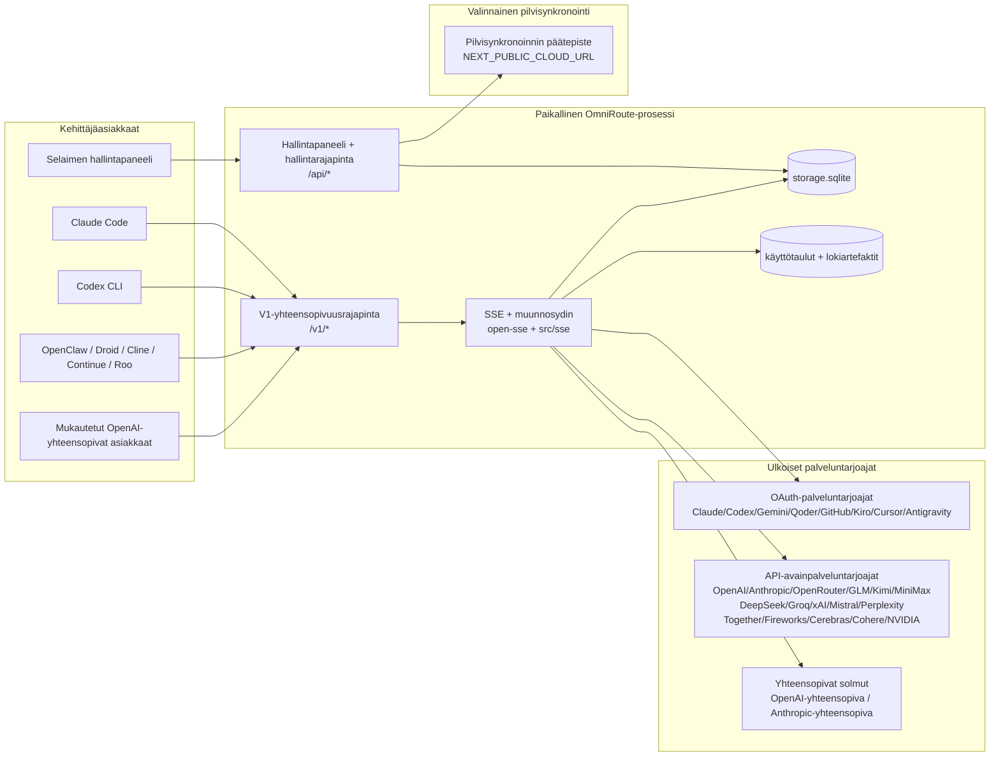
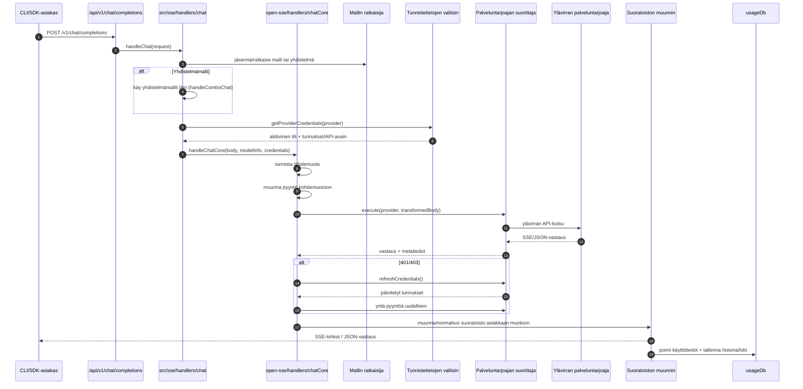
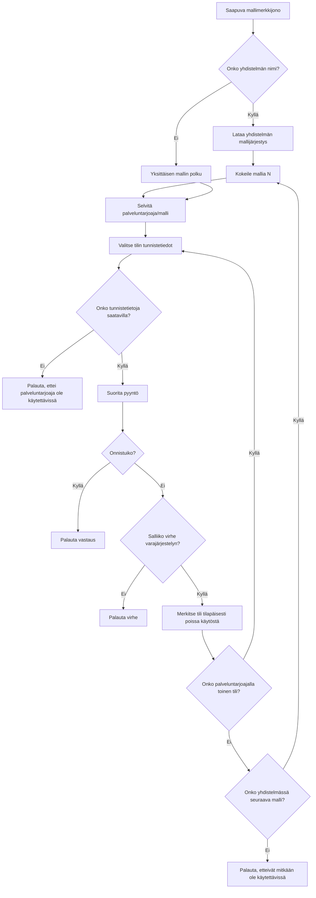
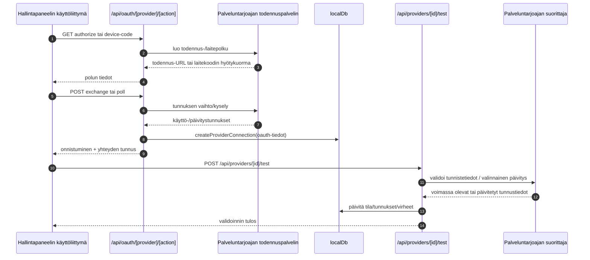
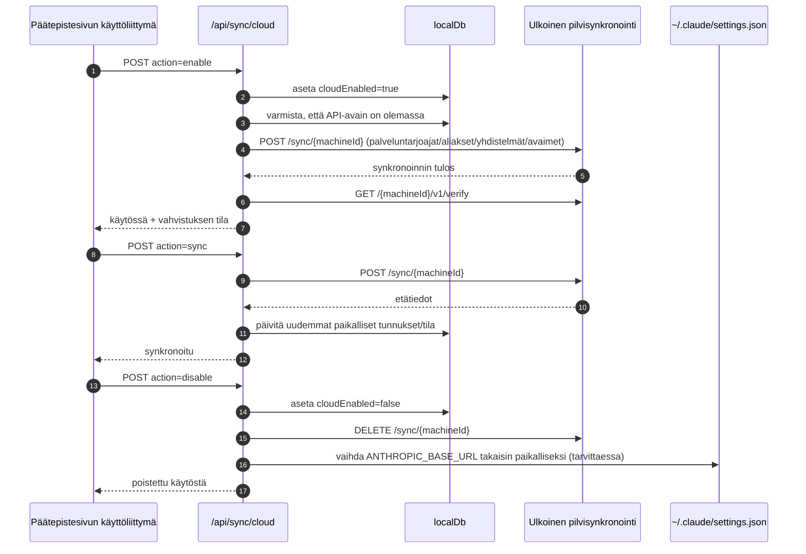
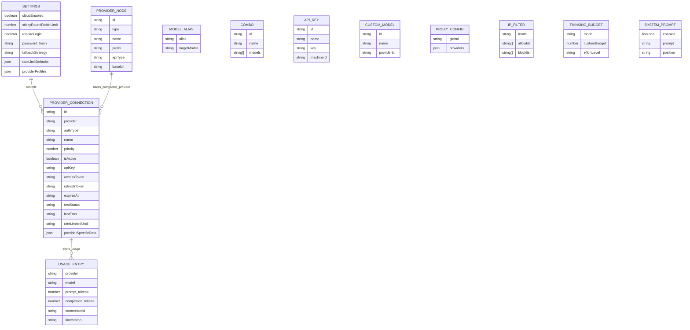
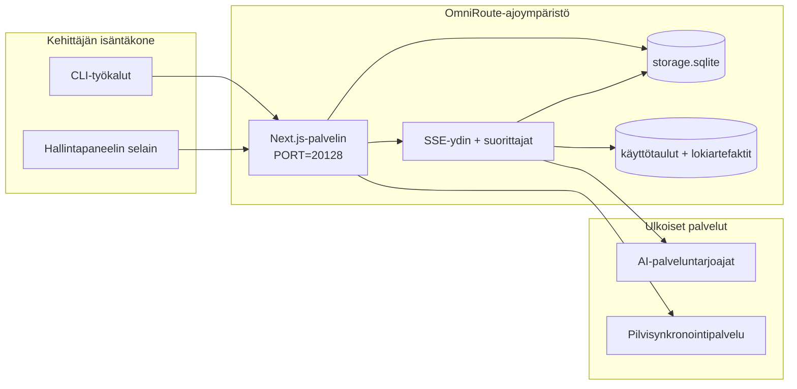

# OmniRoute Architecture (Suomi)

🌐 **Languages:** 🇺🇸 [English](../../../../architecture/ARCHITECTURE.md) · 🇪🇹 [am](../../../am/docs/architecture/ARCHITECTURE.md) · 🇸🇦 [ar](../../../ar/docs/architecture/ARCHITECTURE.md) · 🇦🇿 [az](../../../az/docs/architecture/ARCHITECTURE.md) · 🇧🇬 [bg](../../../bg/docs/architecture/ARCHITECTURE.md) · 🇧🇩 [bn](../../../bn/docs/architecture/ARCHITECTURE.md) · 🇧🇦 [bs](../../../bs/docs/architecture/ARCHITECTURE.md) · 🇨🇿 [cs](../../../cs/docs/architecture/ARCHITECTURE.md) · 🇩🇰 [da](../../../da/docs/architecture/ARCHITECTURE.md) · 🇩🇪 [de](../../../de/docs/architecture/ARCHITECTURE.md) · 🇬🇷 [el](../../../el/docs/architecture/ARCHITECTURE.md) · 🇪🇸 [es](../../../es/docs/architecture/ARCHITECTURE.md) · 🇪🇪 [et](../../../et/docs/architecture/ARCHITECTURE.md) · 🇮🇷 [fa](../../../fa/docs/architecture/ARCHITECTURE.md) · 🇫🇷 [fr](../../../fr/docs/architecture/ARCHITECTURE.md) · 🇮🇪 [ga](../../../ga/docs/architecture/ARCHITECTURE.md) · 🇮🇳 [gu](../../../gu/docs/architecture/ARCHITECTURE.md) · 🇳🇬 [ha](../../../ha/docs/architecture/ARCHITECTURE.md) · 🇮🇱 [he](../../../he/docs/architecture/ARCHITECTURE.md) · 🇮🇳 [hi](../../../hi/docs/architecture/ARCHITECTURE.md) · 🇭🇷 [hr](../../../hr/docs/architecture/ARCHITECTURE.md) · 🇭🇺 [hu](../../../hu/docs/architecture/ARCHITECTURE.md) · 🇦🇲 [hy](../../../hy/docs/architecture/ARCHITECTURE.md) · 🇮🇩 [id](../../../id/docs/architecture/ARCHITECTURE.md) · 🇳🇬 [ig](../../../ig/docs/architecture/ARCHITECTURE.md) · 🇮🇹 [it](../../../it/docs/architecture/ARCHITECTURE.md) · 🇯🇵 [ja](../../../ja/docs/architecture/ARCHITECTURE.md) · 🇬🇪 [ka](../../../ka/docs/architecture/ARCHITECTURE.md) · 🇰🇭 [km](../../../km/docs/architecture/ARCHITECTURE.md) · 🇮🇳 [kn](../../../kn/docs/architecture/ARCHITECTURE.md) · 🇰🇷 [ko](../../../ko/docs/architecture/ARCHITECTURE.md) · 🇱🇹 [lt](../../../lt/docs/architecture/ARCHITECTURE.md) · 🇱🇻 [lv](../../../lv/docs/architecture/ARCHITECTURE.md) · 🇮🇳 [ml](../../../ml/docs/architecture/ARCHITECTURE.md) · 🇮🇳 [mr](../../../mr/docs/architecture/ARCHITECTURE.md) · 🇲🇾 [ms](../../../ms/docs/architecture/ARCHITECTURE.md) · 🇲🇹 [mt](../../../mt/docs/architecture/ARCHITECTURE.md) · 🇲🇲 [my](../../../my/docs/architecture/ARCHITECTURE.md) · 🇳🇵 [ne](../../../ne/docs/architecture/ARCHITECTURE.md) · 🇳🇱 [nl](../../../nl/docs/architecture/ARCHITECTURE.md) · 🇳🇴 [no](../../../no/docs/architecture/ARCHITECTURE.md) · 🇮🇳 [or](../../../or/docs/architecture/ARCHITECTURE.md) · 🇮🇳 [pa](../../../pa/docs/architecture/ARCHITECTURE.md) · 🇵🇭 [phi](../../../phi/docs/architecture/ARCHITECTURE.md) · 🇵🇱 [pl](../../../pl/docs/architecture/ARCHITECTURE.md) · 🇵🇹 [pt](../../../pt/docs/architecture/ARCHITECTURE.md) · 🇧🇷 [pt-BR](../../../pt-BR/docs/architecture/ARCHITECTURE.md) · 🇷🇴 [ro](../../../ro/docs/architecture/ARCHITECTURE.md) · 🇷🇺 [ru](../../../ru/docs/architecture/ARCHITECTURE.md) · 🇱🇰 [si](../../../si/docs/architecture/ARCHITECTURE.md) · 🇸🇰 [sk](../../../sk/docs/architecture/ARCHITECTURE.md) · 🇸🇮 [sl](../../../sl/docs/architecture/ARCHITECTURE.md) · 🇷🇸 [sr](../../../sr/docs/architecture/ARCHITECTURE.md) · 🇸🇪 [sv](../../../sv/docs/architecture/ARCHITECTURE.md) · 🇰🇪 [sw](../../../sw/docs/architecture/ARCHITECTURE.md) · 🇮🇳 [ta](../../../ta/docs/architecture/ARCHITECTURE.md) · 🇮🇳 [te](../../../te/docs/architecture/ARCHITECTURE.md) · 🇹🇭 [th](../../../th/docs/architecture/ARCHITECTURE.md) · 🇹🇷 [tr](../../../tr/docs/architecture/ARCHITECTURE.md) · 🇺🇦 [uk-UA](../../../uk-UA/docs/architecture/ARCHITECTURE.md) · 🇵🇰 [ur](../../../ur/docs/architecture/ARCHITECTURE.md) · 🇺🇿 [uz](../../../uz/docs/architecture/ARCHITECTURE.md) · 🇻🇳 [vi](../../../vi/docs/architecture/ARCHITECTURE.md) · 🇳🇬 [yo](../../../yo/docs/architecture/ARCHITECTURE.md) · 🇨🇳 [zh-CN](../../../zh-CN/docs/architecture/ARCHITECTURE.md) · 🇹🇼 [zh-TW](../../../zh-TW/docs/architecture/ARCHITECTURE.md)

---

🌐 **Languages:** 🇺🇸 [English](../../../../architecture/ARCHITECTURE.md) · 🇪🇹 [am](../../../am/docs/architecture/ARCHITECTURE.md) · 🇸🇦 [ar](../../../ar/docs/architecture/ARCHITECTURE.md) · 🇦🇿 [az](../../../az/docs/architecture/ARCHITECTURE.md) · 🇧🇬 [bg](../../../bg/docs/architecture/ARCHITECTURE.md) · 🇧🇩 [bn](../../../bn/docs/architecture/ARCHITECTURE.md) · 🇧🇦 [bs](../../../bs/docs/architecture/ARCHITECTURE.md) · 🇨🇿 [cs](../../../cs/docs/architecture/ARCHITECTURE.md) · 🇩🇰 [da](../../../da/docs/architecture/ARCHITECTURE.md) · 🇩🇪 [de](../../../de/docs/architecture/ARCHITECTURE.md) · 🇬🇷 [el](../../../el/docs/architecture/ARCHITECTURE.md) · 🇪🇸 [es](../../../es/docs/architecture/ARCHITECTURE.md) · 🇪🇪 [et](../../../et/docs/architecture/ARCHITECTURE.md) · 🇮🇷 [fa](../../../fa/docs/architecture/ARCHITECTURE.md) · 🇫🇷 [fr](../../../fr/docs/architecture/ARCHITECTURE.md) · 🇮🇪 [ga](../../../ga/docs/architecture/ARCHITECTURE.md) · 🇮🇳 [gu](../../../gu/docs/architecture/ARCHITECTURE.md) · 🇳🇬 [ha](../../../ha/docs/architecture/ARCHITECTURE.md) · 🇮🇱 [he](../../../he/docs/architecture/ARCHITECTURE.md) · 🇮🇳 [hi](../../../hi/docs/architecture/ARCHITECTURE.md) · 🇭🇷 [hr](../../../hr/docs/architecture/ARCHITECTURE.md) · 🇭🇺 [hu](../../../hu/docs/architecture/ARCHITECTURE.md) · 🇦🇲 [hy](../../../hy/docs/architecture/ARCHITECTURE.md) · 🇮🇩 [id](../../../id/docs/architecture/ARCHITECTURE.md) · 🇳🇬 [ig](../../../ig/docs/architecture/ARCHITECTURE.md) · 🇮🇹 [it](../../../it/docs/architecture/ARCHITECTURE.md) · 🇯🇵 [ja](../../../ja/docs/architecture/ARCHITECTURE.md) · 🇬🇪 [ka](../../../ka/docs/architecture/ARCHITECTURE.md) · 🇰🇭 [km](../../../km/docs/architecture/ARCHITECTURE.md) · 🇮🇳 [kn](../../../kn/docs/architecture/ARCHITECTURE.md) · 🇰🇷 [ko](../../../ko/docs/architecture/ARCHITECTURE.md) · 🇱🇹 [lt](../../../lt/docs/architecture/ARCHITECTURE.md) · 🇱🇻 [lv](../../../lv/docs/architecture/ARCHITECTURE.md) · 🇮🇳 [ml](../../../ml/docs/architecture/ARCHITECTURE.md) · 🇮🇳 [mr](../../../mr/docs/architecture/ARCHITECTURE.md) · 🇲🇾 [ms](../../../ms/docs/architecture/ARCHITECTURE.md) · 🇲🇹 [mt](../../../mt/docs/architecture/ARCHITECTURE.md) · 🇲🇲 [my](../../../my/docs/architecture/ARCHITECTURE.md) · 🇳🇵 [ne](../../../ne/docs/architecture/ARCHITECTURE.md) · 🇳🇱 [nl](../../../nl/docs/architecture/ARCHITECTURE.md) · 🇳🇴 [no](../../../no/docs/architecture/ARCHITECTURE.md) · 🇮🇳 [or](../../../or/docs/architecture/ARCHITECTURE.md) · 🇮🇳 [pa](../../../pa/docs/architecture/ARCHITECTURE.md) · 🇵🇭 [phi](../../../phi/docs/architecture/ARCHITECTURE.md) · 🇵🇱 [pl](../../../pl/docs/architecture/ARCHITECTURE.md) · 🇵🇹 [pt](../../../pt/docs/architecture/ARCHITECTURE.md) · 🇧🇷 [pt-BR](../../../pt-BR/docs/architecture/ARCHITECTURE.md) · 🇷🇴 [ro](../../../ro/docs/architecture/ARCHITECTURE.md) · 🇷🇺 [ru](../../../ru/docs/architecture/ARCHITECTURE.md) · 🇱🇰 [si](../../../si/docs/architecture/ARCHITECTURE.md) · 🇸🇰 [sk](../../../sk/docs/architecture/ARCHITECTURE.md) · 🇸🇮 [sl](../../../sl/docs/architecture/ARCHITECTURE.md) · 🇷🇸 [sr](../../../sr/docs/architecture/ARCHITECTURE.md) · 🇸🇪 [sv](../../../sv/docs/architecture/ARCHITECTURE.md) · 🇰🇪 [sw](../../../sw/docs/architecture/ARCHITECTURE.md) · 🇮🇳 [ta](../../../ta/docs/architecture/ARCHITECTURE.md) · 🇮🇳 [te](../../../te/docs/architecture/ARCHITECTURE.md) · 🇹🇭 [th](../../../th/docs/architecture/ARCHITECTURE.md) · 🇹🇷 [tr](../../../tr/docs/architecture/ARCHITECTURE.md) · 🇺🇦 [uk-UA](../../../uk-UA/docs/architecture/ARCHITECTURE.md) · 🇵🇰 [ur](../../../ur/docs/architecture/ARCHITECTURE.md) · 🇺🇿 [uz](../../../uz/docs/architecture/ARCHITECTURE.md) · 🇻🇳 [vi](../../../vi/docs/architecture/ARCHITECTURE.md) · 🇳🇬 [yo](../../../yo/docs/architecture/ARCHITECTURE.md) · 🇨🇳 [zh-CN](../../../zh-CN/docs/architecture/ARCHITECTURE.md) · 🇹🇼 [zh-TW](../../../zh-TW/docs/architecture/ARCHITECTURE.md)

_Päivitetty viimeksi: 2026-06-28_

## Tiivistelmä

OmniRoute on paikallinen AI -reititysyhdyskäytävä ja kojelauta, joka on rakennettu Next.js. Se tarjoaa yhden OpenAI-yhteensopivan päätepisteen (`/v1/*`) ja reitittää liikenteen useiden ylävirran palveluntarjoajien kesken kääntämisen, varaosion, tunnuksen päivityksen ja käytön seurannan avulla.

Ydinominaisuudet:

- OpenAI-yhteensopiva API pinta CLI/tools (394 tarjoajaa, 159 toteuttajamoduulia)
- Request/response -käännös eri palveluntarjoajien formaateissa
- Mallin yhdistelmävara (usean mallin sarja)
- Strukturoidut yhdistelmäaskeleet (`provider + model + connection`) `compositeTiers`:n ajonaikaisessa järjestyksessä
- Tilitason varavaihtoehto (useita tiliä palveluntarjoajaa kohti)
- Kiintiön esitarkastus ja kiintiötietoinen P2C tilin valinta pääkeskustelupolulla
- OAuth + API-avain tarjoajan yhteydenhallinta (27 OAuth toimittajamoduulia)
- Upottaminen sukupolven `/v1/embeddings` kautta (18 palveluntarjoajaa)
- Kuvien luominen `/v1/images/generations` kautta (10 + toimittajaa, 20 + -mallia)
- Äänen transkriptio `/v1/audio/transcriptions` kautta (18 palveluntarjoajaa)
- Tekstistä puheeksi `/v1/audio/speech` kautta (24 sisäänrakennettua palveluntarjoajaa)
- Videon luominen `/v1/videos/generations` kautta (ComfyUI + SD WebUI)
- Musiikin luominen `/v1/music/generations` kautta (ComfyUI)
- Verkkohaku `/v1/search` kautta (20 palveluntarjoajaa)
- Moderointi `/v1/moderations` kautta
- Uudelleenjärjestys `/v1/rerank` kautta
- Ajattele tagien jäsentämistä (`<think>...</think>`) päättelymalleille
- Vastauksen desinfiointi tiukan OpenAI SDK -yhteensopivuuden takaamiseksi
- Roolin normalisointi (kehittäjä-→ järjestelmä, järjestelmän → käyttäjä) palveluntarjoajien välisen yhteensopivuuden varmistamiseksi
- Strukturoidun lähdön muunnos (json_schema → Gemini responseSchema)
- Paikallinen pysyvyys tarjoajille, avaimille, aliaksille, yhdistelmille, asetuksille, hinnoittelulle (122 DB moduulia)
- Usage/cost -seuranta ja pyyntöjen kirjaaminen
- Valinnainen pilvisynkronointi multi-device/state synkronointiin
- IP allowlist/blocklist : API kulunvalvontaan
- Ajatteleva budjetin hallinta (passthrough/auto/custom/adaptive)
- Globaali järjestelmän nopea ruiskutus
- Istunnon seuranta ja sormenjäljet
- Tilikohtainen tehostettu hintarajoitus tarjoajakohtaisilla profiileilla
- Katkaisijakuvio palveluntarjoajan joustavuuden parantamiseksi
- Ukkosta estävä laumasuoja mutex-lukolla
- Allekirjoituspohjainen pyyntöjen duplikoinnin välimuisti
- Verkkotunnustaso: kustannussäännöt, varakäytäntö, lukituskäytäntö
- Kontekstivälitys: istunnon vaihdon yhteenvedot tilin vuorottelun jatkuvuudesta
- Verkkotunnuksen tilan pysyvyys (SQLite -välimuisti varauksille, budjeteille, lukituksille, katkaisimille)
- Käytäntömoottori keskitettyä pyyntöjen arviointia varten (lockout → budget → backback)
- Pyydä telemetriaa p50/p95/p99 -latenssikoostumuksella
- Yhdistelmäkohdetelemetria ja historiallinen yhdistelmäkohdekuvio `combo_execution_key` / `combo_step_id` kautta
- Korrelaatio ID (X-Request-Id) päästä päähän -jäljitykseen
- Vaatimustenmukaisuuden tarkastuksen kirjaaminen opt-out-toiminnolla API -avaimella
- Eval-kehys LLM -laadunvarmistukselle
- Terveyskojelauta, jossa on reaaliaikainen palveluntarjoajan katkaisijan tila
- MCP palvelin (110 työkalua), 3 siirtoa (stdio/SSE/Streamable HTTP)
- A2A palvelin (JSON-RPC 2.0 + SSE) taitojen ja tehtävien elinkaarella
- Muistijärjestelmä (poisto, injektio, haku, yhteenveto)
- Taitojärjestelmä (rekisteri, toimeenpanija, hiekkalaatikko, sisäänrakennetut taidot)
- MITM -välityspalvelin varmenteiden hallinnan ja DNS -käsittelyn kanssa
- Nopea ruiskutussuojan väliohjelmisto
- Nopea pakkausputki Cavemanilla, RTK, pinotuilla putkistoilla, pakkauskomboilla, kielipaketilla ja analytiikan kanssa
- ACP (Agent Communication Protocol) -rekisteri
- Modulaariset OAuth toimittajat (22 yksittäistä moduulia `src/lib/oauth/providers/` n alla)
- Uninstall/full-uninstall -skriptit
- OAuth ympäristön korjaustoimet
- WebSocket silta OpenAI-yhteensopiville WS asiakkaille (`/v1/ws`)
- Synkronointitunnuksen hallinta (issue/revoke, ETag-version määrityspaketin lataus)
- GLM Thinking (`glmt`) ensiluokkainen palveluntarjoajan esiasetus
- Hybriditunnusten laskenta (palveluntarjoajan puoleinen `/messages/count_tokens` arvioinnin varalla)
- Mallin aliaksen automaattinen kylvö (30 + välityspalvelinten välisten murteiden normalisointia käynnistyksen yhteydessä)
- Turvallinen lähtevä nouto SSRF -suojalla, yksityinen URL -esto ja konfiguroitava uudelleenyritys
- Cooldown-tietoinen chat-yritys uudelleen määritettävillä `requestRetry` ja `maxRetryIntervalSec` llä
- Ajonaikaisen ympäristön validointi Zod käynnistyksen yhteydessä
- Vaatimustenmukaisuuden tarkastus v2, jossa on sivutus, palveluntarjoajan CRUD -tapahtumat ja SSRF-estämä vahvistusloki

Ensisijainen suoritusaikamalli:

- Next.js -sovellusreitit `src/app/api/*` alla toteuttavat sekä kojelaudan APIs että yhteensopivuuden APIs
- Jaettu SSE/routing -ydin `src/sse/*` :ssä + `open-sse/*` hoitaa palveluntarjoajan suorittamisen, käännöksen, suoratoiston, varatoiminnon ja käytön

## Viitekaaviot

v3.8.0-alustan kanoniset, versionhallinnassa olevat Mermaid-lähteet sijaitsevat hakemistossa
[`docs/diagrams/`](../diagrams/README.md). Niistä kaksi on esitetty alla yleiskuvan saamiseksi;
muihin on linkit niiden aihekohtaisissa oppaissa.


> Lähde: [diagrams/request-pipeline.mmd](../diagrams/request-pipeline.mmd)


> Lähde: [diagrams/resilience-3layers.mmd](../diagrams/resilience-3layers.mmd) — linkitetty myös
> oppaasta [RESILIENCE_GUIDE.md](./RESILIENCE_GUIDE.md) ja `CLAUDE.md`-tiedoston vikasietoisuutta käsittelevästä viitteestä.

## Laajuus ja rajaukset

### Sisältyy laajuuteen

- Paikallisen yhdyskäytävän suoritusympäristö
- Hallintapaneelin hallintasovellusliittymät
- Palveluntarjoajien todennus ja tunnisteiden päivitys
- Pyyntöjen muuntaminen ja SSE-suoratoisto
- Paikallinen tila ja käyttötietojen pysyvä tallennus
- Valinnainen pilvisynkronoinnin orkestrointi

### Ei sisälly laajuuteen

- Muuttujan `NEXT_PUBLIC_CLOUD_URL` takana olevan pilvipalvelun toteutus
- Paikallisen prosessin ulkopuolinen palveluntarjoajan SLA-/hallintataso
- Itse ulkoiset CLI-binäärit (Claude CLI, Codex CLI jne.)

## Hallintapaneelin näkymä (nykyinen)

Pääsivut hakemistossa `src/app/(dashboard)/dashboard/`:

- `/dashboard` — pika-aloitus + palveluntarjoajien yleiskatsaus
- `/dashboard/endpoint` — päätepistevälityspalvelin + MCP + A2A + API-päätepisteiden välilehdet
- `/dashboard/providers` — palveluntarjoajien yhteydet ja tunnistetiedot
- `/dashboard/combos` — yhdistelmästrategiat, mallit, vaiheittainen rakennustyökalu, mallien reitityssäännöt, manuaalisesti säilytettävä järjestys
- `/dashboard/auto-combo` — Auto Combo Engine: pisteytyspainot, tilapaketit, virtuaalitehtaiden esiasetukset, telemetria
- `/dashboard/costs` — kustannusten koostaminen ja hinnoittelun näkyvyys
- `/dashboard/analytics` — käyttöanalytiikka, arvioinnit, yhdistelmäkohteiden tila
- `/dashboard/limits` — kiintiöiden ja pyyntörajojen hallinta
- `/dashboard/cli-tools` — CLI-käyttöönotto, ajoympäristön tunnistus, määritysten luonti
- `/dashboard/agents` — havaitut ACP-agentit + mukautettujen agenttien rekisteröinti
- `/dashboard/cloud-agents` — pilvipalvelussa suoritettavat agenttitehtävät (Codex Cloud, Devin, Jules) ja tehtävien elinkaari
- `/dashboard/skills` — A2A-taitorekisteri, hiekkalaatikkosuoritus, sisäänrakennettujen taitojen luettelo
- `/dashboard/memory` — pysyvän keskustelumuistin tarkastelu ja haku
- `/dashboard/webhooks` — lähtevien webhook-kutsujen tilaukset, salaisuuksien kierrätys, uudelleenyritysten tilastot
- `/dashboard/batch` — eräajotöiden lähetys ja edistyminen
- `/dashboard/cache` — läpiluku- ja päättelyvälimuistin tilastot, tyhjennyksen hallinta
- `/dashboard/playground` — vuorovaikutteinen keskustelukokeiluympäristö mille tahansa määritetylle yhdistelmälle tai mallille
- `/dashboard/changelog` — sovelluksen sisäinen muutoslokin katselin (renderöi tiedoston `CHANGELOG.md`)
- `/dashboard/system` — ajoympäristön diagnostiikka, versiotiedot, ympäristön validointinäkymä
- `/dashboard/onboarding` — uusien asennusten ensimmäisen käyttökerran ohjattu määritys
- `/dashboard/media` — kuvien, videoiden ja musiikin kokeiluympäristö
- `/dashboard/search-tools` — hakupalveluntarjoajien testaus ja historia
- `/dashboard/health` — käytettävyysaika, katkaisijat, pyyntörajat, kiintiövalvotut istunnot
- `/dashboard/logs` — pyyntö-, välityspalvelin-, auditointi- ja konsolilokit
- `/dashboard/settings` — järjestelmäasetusten välilehdet (yleiset asetukset, reititys, yhdistelmien oletusarvot jne.)
- `/dashboard/context/caveman` — Caveman-pakkaussäännöt, kielipaketit, esikatselu ja tulostila
- `/dashboard/context/rtk` — RTK:n komentotulosteiden suodattimet, esikatselu ja ajoympäristön turvallisuusasetukset
- `/dashboard/context/combos` — nimetyt pakkausputket, jotka on määritetty reititysyhdistelmille
- `/dashboard/translator` — kääntäjän tarkastelu ja pyyntömuodon muunnoksen esikatselu
- `/dashboard/audit` — vaatimustenmukaisuuden auditointilokien selain sivutuksella ja rakenteisilla metatiedoilla
- `/dashboard/usage` — pyyntökohtainen käyttötietojen selain, joka on sidottu kohteeseen `usage_history`
- `/dashboard/compression` — pakkausanalytiikka, tilastot ja pakkausputkien määritykset
- `/dashboard/api-manager` — API-avainten elinkaari ja mallien käyttöoikeudet

Käyttöliittymäkerros: jokainen sivu renderöidään yhden kuoren sisällä — `src/app/(dashboard)/layout.tsx` →
`src/shared/components/layouts/DashboardLayout.tsx` → `DashboardShell.tsx` (paketin
`SidebarProvider`/`SidebarInset`, OmniRouten `Sidebar.tsx` ja `Header.tsx`). Sivut tuovat
rakennusosansa moduulista `@/shared/components` (sovittimet hakemistossa
`packages/ui-kit` olevaan Keak CI UI Kit -pakettiin) tai paketin komponenttien alipoluista (`@omniroute/ui-kit/table`, `…/page-header`) ja
kuvakkeet `<Icon>`-komponentin kautta (`ICON_MAP` → Lucide). Teema (oletusarvoisesti `system`, vaalea/tumma) ja tunnukset tulevat
paketista tiedostossa `src/app/globals.css` olevan sillan kautta. Lisätietoja: `docs/architecture/DESIGN_SYSTEM.md`.

## Järjestelmän yleiskuva



## Ajonaikaisen ydinjärjestelmän osat

## 1) API- ja reitityskerros (Next.js-sovellusreitit)

Päähakemistot:

- `src/app/api/v1/*` ja `src/app/api/v1beta/*` yhteensopivuusrajapinnoille
- `src/app/api/*` hallinta- ja määritysrajapinnoille
- Tiedoston `next.config.mjs` Next-uudelleenkirjoitukset yhdistävät polun `/v1/*` polkuun `/api/v1/*`

Tärkeät yhteensopivuusreitit:

- `src/app/api/v1/chat/completions/route.ts`
- `src/app/api/v1/messages/route.ts`
- `src/app/api/v1/responses/route.ts`
- `src/app/api/v1/models/route.ts` — sisältää mukautetut mallit, joilla on `custom: true`
- `src/app/api/v1/embeddings/route.ts` — upotusten luonti (6 palveluntarjoajaa)
- `src/app/api/v1/images/generations/route.ts` — kuvien luonti (vähintään 4 palveluntarjoajaa, mukaan lukien Antigravity/Nebius)
- `src/app/api/v1/messages/count_tokens/route.ts`
- `src/app/api/v1/providers/[provider]/chat/completions/route.ts` — palveluntarjoajakohtainen keskustelu
- `src/app/api/v1/providers/[provider]/embeddings/route.ts` — palveluntarjoajakohtaiset upotukset
- `src/app/api/v1/providers/[provider]/images/generations/route.ts` — palveluntarjoajakohtaiset kuvat
- `src/app/api/v1beta/models/route.ts`
- `src/app/api/v1beta/models/[...path]/route.ts`

Hallinta-alueet:

- Todennus/asetukset: `src/app/api/auth/*`, `src/app/api/settings/*`
- Palveluntarjoajat/yhteydet: `src/app/api/providers*`
- Palveluntarjoajasolmut: `src/app/api/provider-nodes*`
- Mukautetut mallit: `src/app/api/provider-models` (GET/POST/DELETE)
- Malliluettelo: `src/app/api/models/route.ts` (GET)
- Välityspalvelimen määritys: `src/app/api/settings/proxy` (GET/PUT/DELETE) + `src/app/api/settings/proxy/test` (POST)
- OAuth: `src/app/api/oauth/*`
- Avaimet/aliakset/yhdistelmät/hinnoittelu: `src/app/api/keys*`, `src/app/api/models/alias`, `src/app/api/combos*`, `src/app/api/pricing`
- Käyttö: `src/app/api/usage/*`
- Synkronointi/pilvi: `src/app/api/sync/*`, `src/app/api/cloud/*`
- CLI-työkalujen apuohjelmat: `src/app/api/cli-tools/*`
- IP-suodatin: `src/app/api/settings/ip-filter` (GET/PUT)
- Päättelybudjetti: `src/app/api/settings/thinking-budget` (GET/PUT)
- Järjestelmäkehote: `src/app/api/settings/system-prompt` (GET/PUT)
- Pakkaus: `src/app/api/settings/compression`, `src/app/api/compression/*` ja
  `src/app/api/context/*`
- Istunnot: `src/app/api/sessions` (GET)
- Nopeusrajoitukset: `src/app/api/rate-limits` (GET)
- Häiriönsietokyky: `src/app/api/resilience` (GET/PATCH) — pyyntöjono, yhteyden jäähdytysaika, palveluntarjoajan katkaisija ja jäähdytysajan odotuksen määritys
- Häiriönsietokyvyn nollaus: `src/app/api/resilience/reset` (POST) — nollaa palveluntarjoajien katkaisijat
- Välimuistitilastot: `src/app/api/cache/stats` (GET/DELETE)
- Telemetria: `src/app/api/telemetry/summary` (GET)
- Budjetti: `src/app/api/usage/budget` (GET/POST)
- Varaketjut: `src/app/api/fallback/chains` (GET/POST/DELETE)
- Vaatimustenmukaisuuden tarkastus: `src/app/api/compliance/audit-log` (GET, sivutuksella + rakenteisilla metatiedoilla)
- Arvioinnit: `src/app/api/evals` (GET/POST), `src/app/api/evals/[suiteId]` (GET)
- Käytännöt: `src/app/api/policies` (GET/POST)
- Synkronointitunnukset: `src/app/api/sync/tokens` (GET/POST), `src/app/api/sync/tokens/[id]` (GET/DELETE)
- Määrityspaketti: `src/app/api/sync/bundle` (GET, ETag-versioitu tilannevedos asetuksista, palveluntarjoajista, yhdistelmistä ja avaimista)
- WebSocket: `src/app/api/v1/ws/route.ts` — Upgrade-käsittelijä OpenAI-yhteensopiville WS-asiakkaille

## 2) SSE + Translation Core

Päävirtausmoduulit:

- Sisäänpääsy: `src/sse/handlers/chat.ts`
- Ydinorkesteri: `open-sse/handlers/chatCore.ts`
- Palveluntarjoajan suoritussovittimet: `open-sse/executors/*`
- Muoto detection/provider config: `open-sse/services/provider.ts`
- Malli parse/resolve: `src/sse/services/model.ts`, `open-sse/services/model.ts`
- Tilin varalogiikka: `open-sse/services/accountFallback.ts`
- Käännösrekisteri: `open-sse/translator/index.ts`
- Stream-muunnokset: `open-sse/utils/stream.ts`, `open-sse/utils/streamHandler.ts`
- Käyttö extraction/normalization: `open-sse/utils/usageTracking.ts`
- Ajattele tagin jäsennintä: `open-sse/utils/thinkTagParser.ts`
- Upotuskäsittelijä: `open-sse/handlers/embeddings.ts`
- Upotuspalveluntarjoajan rekisteri: `open-sse/config/embeddingRegistry.ts`
- Kuvanluontikäsittelijä: `open-sse/handlers/imageGeneration.ts`
- Kuvantarjoajan rekisteri: `open-sse/config/imageRegistry.ts`
- Vastauksen desinfiointi: `open-sse/handlers/responseSanitizer.ts`
- Roolin normalisointi: `open-sse/services/roleNormalizer.ts`

Palvelut (liiketoimintalogiikka):

- Tili selection/scoring: `open-sse/services/accountSelector.ts`
- Kontekstin elinkaarihallinta: `open-sse/services/contextManager.ts`
- IP suodattimen valvonta: `open-sse/services/ipFilter.ts`
- Istunnon seuranta: `open-sse/services/sessionManager.ts`
- Pyydä kopioiden poistoa: `open-sse/services/signatureCache.ts`
- Järjestelmän pikaruiskutus: `open-sse/services/systemPrompt.ts`
- Ajatteleva budjetin hallinta: `open-sse/services/thinkingBudget.ts`
- Jokerimerkkimallin reititys: `open-sse/services/wildcardRouter.ts`
- Hintarajan hallinta: `open-sse/services/rateLimitManager.ts`
- Katkaisija: `src/shared/utils/circuitBreaker.ts`
- Kontekstin vaihto: `open-sse/services/contextHandoff.ts` — kanavanvaihdon yhteenvedon luominen ja lisäys kontekstivälitysstrategiaa varten
- Pakkaus: `open-sse/services/compression/*` — ennakoiva pakkaus ennen palveluntarjoajan käännöstä; sisältää Caveman-säännöt, RTK -suodattimet, pinotut liukuhihnat, pakkausyhdistelmät, tilastot ja validoinnin
- Codex -kiintiön hakija: `open-sse/services/codexQuotaFetcher.ts` — hakee Codex kiintiön kontekstivälitteisen kanavanvaihtopäätöksille
- Jäähdytystietoinen uudelleenyritys: `src/sse/services/cooldownAwareRetry.ts` — mallikohtainen jäähtymisyritys konfiguroitavilla `requestRetry` / `maxRetryIntervalSec`
- Turvallinen lähtevä haku: `src/shared/network/safeOutboundFetch.ts` — suojattu provider/model -haku SSRF suojalla, yksityisen URL-osoitteen esto, uudelleenyritys ja aikakatkaisu
- Lähtevän URL suojaus: `src/shared/network/outboundUrlGuard.ts` — tarkistaa palveluntarjoajan URLs; `src/shared/network/outboundUrlGuardPolicy.ts` valitsee tilan seuraavista: `OMNIROUTE_ALLOW_LOCAL_PROVIDER_URLS`, `OMNIROUTE_ALLOW_PRIVATE_PROVIDER_URLS`, ja niiden kojelauta vaihtuu (katso `docs/reference/ENVIRONMENT.md`)
- Palveluntarjoajan pyynnön oletusasetukset: `open-sse/services/providerRequestDefaults.ts` — tarjoajatason `maxTokens`, `temperature`, `thinkingBudgetTokens` oletusasetukset
- GLM -palveluntarjoajan vakiot: `open-sse/config/glmProvider.ts` — jaetut GLM -mallit, kiintiö URLs, GLMT timeout/defaults
- Antigravity ylävirtaan: `open-sse/config/antigravityUpstream.ts` — perus- URL ja etsintäpolun vakiot
- Codex -asiakasvakiot: `open-sse/config/codexClient.ts` — versioidut käyttäjäagentin ja asiakasversion arvot
- Mallin aliaksen siemen: `src/lib/modelAliasSeed.ts` — seeds 30 + cross-proxy murrealiaksia käynnistyksen yhteydessä

Domain-kerroksen moduulit:

- Hinta rules/budgets: `src/domain/costRules.ts`
- Varakäytäntö: `src/domain/fallbackPolicy.ts`
- Varattu yhdistelmäresoluutiosopimus: `src/domain/comboResolver.ts`; live-reititys käyttää `open-sse/services/combo.ts`
- Työsulkukäytäntö: `src/domain/lockoutPolicy.ts`
- Varattu politiikan arviointisopimus: `src/domain/policyEngine.ts`; pyyntöpolku pakottaa API-avainkäytännön `src/shared/utils/apiKeyPolicy.ts` kautta ja ratkaistu kohdevaltuutus `src/sse/handlers/chat/resolvedModelPolicy.ts` kautta
- Virhekoodiluettelo: `src/shared/constants/errorCodes.ts`
- Pyydä ID: `src/shared/utils/requestId.ts`
- Noudon aikakatkaisu: `src/shared/utils/fetchTimeout.ts`
- Pyydä telemetriaa: `src/shared/utils/requestTelemetry.ts`
- Compliance/audit: `src/lib/compliance/index.ts`
- Eval juoksija: `src/lib/evals/evalRunner.ts`
- Verkkotunnuksen tilan pysyvyys: `src/lib/db/domainState.ts` — SQLite CRUD varaketjuille, budjetit, kustannushistoria, lukitustila, katkaisijat

OAuth -toimittajamoduulit (27 yksittäistä tiedostoa `src/lib/oauth/providers/` n alla):

- Rekisterihakemisto: `src/lib/oauth/providers/index.ts`
- Yksittäiset palveluntarjoajat: `agy.ts`, `antigravity.ts`, `claude.ts`, `cline.ts`, `codebuddy-cn.ts`, `codebuddy-intl.ts`, `codex.ts`, `cursor.ts`, `devin-desktop.ts`, `ghe-copilot.ts`, `github.ts`, `gitlab-duo.ts`, `grok-cli-oauth.ts`, `grok-cli.ts` `zed.ts` `kilocode.ts`, `kimi-coding.ts`, `kiro.ts` `muse-code.ts`, `openference.ts`, `qoder.ts`, `trae.ts`, `workbuddy.ts`, `xai-oauth.ts`, `zed-hosted.ts`
- Jaetut avustajat: `codebuddyDeviceAuth.ts` (CodeBuddy CN/intl laitevirta), `museCodeDeviceResponse.ts`
- Ohut kääre: `src/lib/oauth/providers.ts` — jälleenvienti yksittäisistä moduuleista

## 5) Upotetut palvelut (v3.8.4)

OmniRoute voi asentaa ja valvoa paikallisesti suoritettavia tekoälytyökaluprosesseja sekä reitittää niihin.
Näitä prosesseja kutsutaan **upotetuiksi palveluiksi**. Mukana toimitetaan viisi palvelua: 9Router, CLIProxyAPI, Bifrost, Mux ja Dario.

Arkkitehtuurikerrokset:

- **Käyttöliittymä** (`/dashboard/providers/services`) — kaksivälilehtinen sivu, jossa on elinkaaren hallintatoiminnot,
  reaaliaikainen lokien suoratoisto, API-avainten hallinta ja (9Routerin tapauksessa) upotettu natiivi käyttöliittymä
  sisäisen käänteisen välityspalvelimen kautta.
- **API** (`/api/services/{name}/*`) — 11 päätepistettä 9Routerille, 10 CLIProxyAPI:lle ja 8 kullekin palveluista Bifrost / Mux / Dario;
  kaikki on luokiteltu **LOCAL_ONLY**-luokkaan (ehdoton sääntö #17). Jaettu `GET /api/services/[name]/logs`
  SSE-päätepiste palvelee molempia palveluita.
- **Valvoja** (`src/lib/services/`) — yleiskäyttöinen `ServiceSupervisor`-luokka käärii
  `child_process.spawn`-toiminnon, ylläpitää 5 Mt:n rengaspuskuria SSE-lokien suoratoistoa varten sekä sisältää
  kuntotarkistussilmukan, atomisen toimintolukon ja hallitun SIGTERM→SIGKILL-sammutuksen.
  `bootstrap.ts` kytkee kaikki määritetyt palvelut prosessin käynnistyessä.
- **Palveluntarjoaja/suorittaja** (`open-sse/executors/ninerouter.ts`) — 9Router tarjotaan
  varsinaisena palveluntarjoajana. Mallien etuliite on `9router/{sub}/{model}`, ja ne synkronoidaan 5 minuutin välein
  9Routerin `/v1/models`-päätepisteestä.

Syvällisempi kuvaus: `docs/frameworks/EMBEDDED-SERVICES.md`

## Tärkeimmät alajärjestelmät (v3.8.0)

### A. Automaattinen yhdistelmämoottori

Automaattinen yhdistelmä tekee dynaamisesti pisteytyksen ja valitsee reitityskohteet pyynnöstä sen sijaan, että luottaisi staattiseen yhdistelmämääritykseen. Se toimii `auto/*` -mallietuliiteperheessä.

- Moottorin sisääntulo: `open-sse/services/autoCombo/` (`autoComboEngine.ts`, `scoringEngine.ts`, `virtualFactory.ts`, `modePacks.ts`)
- Live-yhdistelmätulo: `open-sse/services/combo.ts` (`handleComboChat`, `resolveComboTargets`), kutsuu `src/sse/handlers/chat.ts`
- Kojelauta: `/dashboard/auto-combo`
- Telemetria: `auto_combo_decisions` SQLite -pöytä

Tärkeimmät ominaisuudet:

- **22 reititysstrategiaa** (prioriteetti, painotettu, täytä ensin, round-robin, P2C, satunnainen, vähiten käytetty, kustannusoptimoitu, reset-tietoinen, nollausikkuna, vanheneminen ensin, varatila, kiintiöpainotettu, tiukka satunnainen,** auto** , lkp, kontekstioptimoitu, välimuistiin optimoitu, kontekstivälitys,** fuusio** , pipeline, jev) — auto on otsikon lisäys versiossa 3.8.0; `fusion` (paneelin fan-out + tuomarisynteesi, `open-sse/services/fusion.ts`) on uusi versiossa 3.8.36.
- **16-tekijän pisteytys** : kiintiö, terveys, käänteinen hinta, käänteinen latenssi, tehtävän sovitus ja kymmenen muuta. Kanoninen tekijöiden taulukko ja niiden oletuspainot elävät muodossa [`docs/routing/AUTO-COMBO.md`](../routing/AUTO-COMBO.md) —, jos se toistetaan tässä, se antaisi sille toisen paikan vanhentua.
- **Virtuaalinen tehdas** toteuttaa lyhytaikaisia komboja, kun vastaavaa nimettyä yhdistelmää ei ole olemassa, hankkien ehdokkaat terveistä aktiivisista palveluntarjoajan yhteyksistä.
- **Automaattiset etuliitteet** : `auto/coding`, `auto/cheap`, `auto/fast`, `auto/offline`, `auto/smart`, `auto/lkgp` — joista kutakin tukee viritetty painoprofiili.
- **6 tilapakettia** : `ship-fast`, `cost-saver`, `quality-first`, `offline-friendly`, `reliability-first` ja `chaos-mode` — esiasetetut painokokoonpanot, jotka voidaan kutsua kojelaudalta. (Ei pidä sekoittaa yllä oleviin `auto/*` etuliitteisiin, jotka ovat pyyntöajan muunnelmia.)

Katso täydelliset algoritmiset yksityiskohdat (kerroinkaavat, painon viritys), katso [`docs/routing/AUTO-COMBO.md`](../routing/AUTO-COMBO.md).

### B. Pilviagentit

Cloud Agents käärii kolmannen osapuolen isännöimät koodiagenttialustat (Codex Cloud, Devin, Jules) yhtenäisen DB-tuetun tehtävän elinkaaren taakse. Kaikki tehtävän creation/inspection päätepisteet vaativat hallinnan todennuksen.

- Moduulin juuri: `src/lib/cloudAgent/` (`baseAgent.ts`, `registry.ts`, `api.ts`, `types.ts`, `db.ts`, plus agenttikohtaiset alihakemistot `agents/` n alla)
- Agenttikohtaiset toteutukset: `agents/codex/`, `agents/devin/`, `agents/jules/`
- Julkiset päätepisteet: `/api/v1/agents/tasks/*` (list/create/get/cancel)
- Hallintapäätepisteet: `/api/cloud/*` (hallinta, tila, erä)
- Kojelauta: `/dashboard/cloud-agents`
- Säilytys: `cloud_agent_tasks` -pöytä

Katso agenttikohtaiset provisiot ja OAuth -tiedot kohdasta [`docs/frameworks/CLOUD_AGENT.md`](../frameworks/CLOUD_AGENT.md).

### C. Suojakaiteet

Suojakaiteet moduuli on kuumalla ladattava väliohjelmistokerros, joka tarkastaa pyynnöt ja vastaukset PII, nopean injektion ja vaarallisen näkösisällön varalta. Rikkomukset oikosulkevat pyynnön HTTP kanssa** 503** sekä jäsennellyn virhekoodin, jonka avulla alavirran soittajat voivat yrittää uudelleen tai haarautua.

- Moduulin juuri: `src/lib/guardrails/` (`base.ts`, `registry.ts`, `piiMasker.ts`, `promptInjection.ts`, `visionBridge.ts`, `visionBridgeHelpers.ts`)
- Hot reload: rekisteri tarkkailee asetusten muutoksia ja rakentaa ketjun uudelleen paikalleen
- Kytkentäpisteet: chat-käsittelijän sisäänpääsy, kuvanluontikäsittelijä, vastauspuhdistin
- HTTP -sopimus: rikkomukset näkyvät `503` :nä `error.code = "GUARDRAIL_VIOLATION"` kanssa

Katso sääntöjoukkojen luomisesta ja kynnyksen virityksestä [`docs/security/GUARDRAILS.md`](../security/GUARDRAILS.md).

### D. Domain Layer

`src/domain/` nimitila sisältää verkkotunnuspalvelut ja varatut arviointisopimukset. Se ei ole yksi pakollinen politiikan aloituspiste jokaiselle pyynnölle.

Live-chat-polku kutsuu `enforceApiKeyPolicy()` sta `src/shared/utils/apiKeyPolicy.ts`; ratkaistujen mallien ja yhdistelmäjäsenten valtuutus on toteutettu `src/sse/handlers/chat/resolvedModelPolicy.ts` ssä. Itseisännöity merkintä `src/app/api/v1/chat/completions/route.ts` ssä pakottaa myös API-avainkäytännön ennen lähettämistä. Yhdistelmäresoluutio kulkee `open-sse/services/combo.ts` läpi.

`src/domain/policyEngine.ts`, `src/domain/comboResolver.ts` ja `src/lib/container.ts` ovat testattuja sopimuksia, eivät kyseisen pyyntöpolun johdotusta. Säilö rekisteröi käytäntömoottorin, mutta tarkastettu tuotantopyyntöpolku ei ratkaise sitä. Näiden sopimusten muuttaminen yksin ei muuta live-chat-käytäntöä tai yhdistelmäreititystä. niiden liittäminen tai poistaminen vaatii erillisen suunnittelupäätöksen.

- Varattu käytäntömoottori: `src/domain/policyEngine.ts` — lockout → budjetti → varaarviointi
- Kustannussäännöt: `src/domain/costRules.ts`
- Varakäytäntö: `src/domain/fallbackPolicy.ts`
- Työsulkukäytäntö: `src/domain/lockoutPolicy.ts`
- Tunnistepohjainen reititys: `src/domain/tagRouter.ts`
- Varattu yhdistelmäratkaisu: `src/domain/comboResolver.ts` — standalone valintasopimus; live-yhdistelmäreititys on toteutettu `open-sse/services/combo.ts` ssä
- Connection/model -säännön liittäjä: `src/domain/connectionModelRules.ts`
- Mallin saatavuuden tilannekuvat: `src/domain/modelAvailability.ts`
- Palveluntarjoajan vanhenemisen seuranta: `src/domain/providerExpiration.ts`
- Kiintiön välimuisti: `src/domain/quotaCache.ts`. Palveluntarjoajat lisäävät ja poistavat kiintiöikkunoita (OpenAI pudotti 5 tunnin Codex ikkunan joissakin suunnitelmissa), joten palveluntarjoajan sovittimen käyttölukeman todistaa olevan täydellinen (`quotasComplete`, katso `src/lib/usage/usageReading.ts`) on tilin koko ikkunasarja: aiemmin tunnettu ikkuna, joka puuttuu siitä, on poistettu käytöstä, välimuistissa, rependedqreteften (rependedqretef) pysyi Codex -kiintiön tilassa ja `quota_snapshots` : Claude kyllästymisryhmissä. Osittaiset todisteet (vastausten otsikot, vanhentuneet kopiot) päivittävät vain siinä olevat ikkunat.
- Hajoamistila: `src/domain/degradation.ts`
- Kokoonpanon tarkastus: `src/domain/configAudit.ts`
- OmniRoute -vastauksen metatietojen rakentaja: `src/domain/omnirouteResponseMeta.ts`
- Arviointialijärjestelmä: `src/domain/assessment/` — säännölliset arviointityöt

### E. Valtuutusputki

Valtuutusputki luokittelee jokaisen saapuvan pyynnön ja soveltaa asianmukaista käytäntöketjua ennen lähettämistä.

- Putkilinjan sisääntulo: `src/server/authz/pipeline.ts`
- Pyynnön luokitin: `src/server/authz/classify.ts` — erottaa julkiset yhteensopivuusreitit hallintareiteistä
- Julkinen reittiluettelo: `src/shared/constants/publicApiRoutes.ts`
- Käytännöt: `src/server/authz/policies/` — koostettavat predikaatit (`requireApiKey`, `requireManagement`, `requireFreshAuth` jne.)
- Otsikkoapuohjelmat: `src/server/authz/headers.ts`
- Väiteapu: `src/server/authz/assertAuth.ts`
- Pyynnön konteksti: `src/server/authz/context.ts`

Julkiset vs. hallintareitit ovat kova raja: agent/cooldown APIs ja palveluntarjoajan mutaatiot vaativat hallinnan todennusta (HTTP 401, jos puuttuu).

Katso täydelliset reitin luokittelusäännöt kohdasta [`docs/architecture/AUTHZ_GUIDE.md`](./AUTHZ_GUIDE.md).

### F. Workflow FSM ja Task-Aware Router

Äärillisen tilan koneohjattu reititin, joka on kerrostettu yhdistelmävalinnan yläpuolelle ohjaamaan liikennettä havaitun työnkulkuvaiheen (suunnittelu, suoritus, tarkistus) ja taustatehtävän affiniteetin perusteella.

- Työnkulku FSM: `open-sse/services/workflowFSM.ts`
- Tehtävätietoinen reititin: `open-sse/services/taskAwareRouter.ts`
- Taustatehtävien ilmaisin: `open-sse/services/backgroundTaskDetector.ts`
- Tarkoitusluokitus: `open-sse/services/intentClassifier.ts`

FSM -siirtymät syötetään Auto Combon pisteytykseen, painottaen kohti halvempia malleja background/automation -tehtävissä ja kohti vahvempia malleja interaktiivisissa planning/review käännöksissä.

### G. Palveluntarjoajakohtainen joustavuus

Useat palveluntarjoajat toimittavat erityisiä joustavuus- ja varkainmoduuleja, jotka toimivat globaalien katkaisijoiden / yhteyden jäähtymisen / mallin lukituskerrosten päällä:

- Antigravity 429 -moottori: `open-sse/services/antigravity429Engine.ts` (pyörittää identiteettiä, puhdistaa vastausotsikot, käyttää credits/version -seurantaa `antigravityCredits.ts`, `antigravityHeaderScrub.ts`, `antigravityHeaders.ts`, `antigravityIdentity.ts`, `antigravityVersion.ts` kautta)
- Antigravity 429-suojaus: `open-sse/services/antigravity429Guard.ts` (pyyntökohtainen budjetti ylävirran 429:stä kaikissa isännissä, `ANTIGRAVITY_MAX_429_ATTEMPTS`; identtiseen hylätyn kappaleen uudelleenlähetykseen vastataan paikallisesti; `src/sse/handlers/chat.ts` ei käynnistä tällaista pyyntöä uudelleen jäähtymistietoisen uudelleenyrityksen kautta)
- ModelScope -kiintiöpolitiikka: `open-sse/services/modelscopePolicy.ts`
- Claude -koodi CCH (yhteensopivuuskanavan kättely): `open-sse/services/claudeCodeCCH.ts`, plus `claudeCodeCompatible.ts`, `claudeCodeConstraints.ts`, `claudeCodeExtraRemap.ts`, `claudeCodeToolRemapper.ts`
- Claude Code sormenjälkien muotoilu: `open-sse/services/claudeCodeFingerprint.ts`
- Claude Koodin hämärtäminen: `open-sse/services/claudeCodeObfuscation.ts`

Täydellinen salaperäinen pelikirja ja toimintaohjeet ovat kohdassa `docs/security/STEALTH_GUIDE.md` (git; ei käännetty `/docs` ksi).

### H. Webhooks, päättelyvälimuisti, lukuvälimuisti

- **Webhooks** — lähtevä lähetys provider/account/task tapahtumiin.
  - Lähettäjä: `src/lib/webhookDispatcher.ts`
  - Tallennus: `webhooks` SQLite -pöytä ( `src/lib/db/webhooks.ts` kautta)
  - Kojelauta: `/dashboard/webhooks` (tilaukset, salaisuudet, uudelleenyrityshistoria)
  - Katso tapahtumien taksonomia ja uudelleenyrityssemantiikka kohdasta [`docs/frameworks/WEBHOOKS.md`](../frameworks/WEBHOOKS.md).
- **Päättelyvälimuisti** — toistettavat päättelylohkot tarjoajille, jotka lähettävät ajattelumerkkejä (Claude, GLMT jne.), joten peräkkäiset käännökset voivat ohittaa uudelleenajattelun.
  - DB -kerros: `src/lib/db/reasoningCache.ts`
  - Palvelukerros: `open-sse/services/reasoningCache.ts`
  - Katso toiston semantiikka kohdasta [`docs/routing/REASONING_REPLAY.md`](../routing/REASONING_REPLAY.md).
- **Lue välimuisti** — lyhytikäinen vastausvälimuisti, joka on avattu allekirjoituksella ja jota käytetään tiivistämään identtiset uudelleenyritykset rikkinäisestä ylävirran SDKs.
  - DB -kerros: `src/lib/db/readCache.ts`
  - Tilastojen päätepiste: `GET /api/cache/stats`, dashboard at `/dashboard/cache`

## 3) Persistenssikerros

Ensisijainen tilatietokanta (SQLite):

- Ydininfrastruktuuri: `src/lib/db/core.ts` (better-sqlite3, migraatiot, WAL)
- Tietokannan käyttö: tuo yksittäiset `src/lib/db/*`-moduulit suoraan (vanha `localDb.ts`-koontimoduuli poistettiin)
- Tiedosto: `${DATA_DIR}/storage.sqlite` (tai `$XDG_CONFIG_HOME/omniroute/storage.sqlite`, kun se on määritetty; muussa tapauksessa `~/.omniroute/storage.sqlite`)
- Entiteetit (taulut + KV-nimiavaruudet): providerConnections, providerNodes, modelAliases, combos, apiKeys, settings, pricing, **customModels**, **proxyConfig**, **ipFilter**, **thinkingBudget**, **systemPrompt**

Käyttötietojen persistenssi:

- Julkisivu: `src/lib/usageDb.ts` (osiin jaetut moduulit hakemistossa `src/lib/usage/*`)
- SQLite-taulut tiedostossa `storage.sqlite`: `usage_history`, `call_logs`, `proxy_logs`
- Valinnaiset tiedostoartefaktit säilyvät yhteensopivuutta ja virheenkorjausta varten (`${DATA_DIR}/log.txt`, `${DATA_DIR}/call_logs/`, `<repo>/logs/...`)
- Vanhat JSON-tiedostot siirretään SQLiteen käynnistyksen yhteydessä suoritettavilla migraatioilla, jos niitä löytyy

Toimialueen tilatietokanta (SQLite):

- `src/lib/db/domainState.ts` — CRUD-toiminnot toimialueen tilalle
- Taulut (luodaan tiedostossa `src/lib/db/core.ts`): `domain_fallback_chains`, `domain_budgets`, `domain_cost_history`, `domain_lockout_state`, `domain_circuit_breakers`
- Läpikirjoittava välimuistimalli: muistissa olevat Maps-rakenteet ovat ajonaikaisesti määrääviä; muutokset kirjoitetaan synkronisesti SQLiteen; tila palautetaan tietokannasta kylmäkäynnistyksen yhteydessä

## 4) Todennus- ja tietoturvarajapinnat

- Hallintapaneelin evästetodennus: `src/proxy.ts`, `src/app/api/auth/login/route.ts`
- API-avainten luonti/vahvistus: `src/shared/utils/apiKey.ts`
- Palveluntarjoajien salaisuudet tallennetaan `providerConnections`-merkintöihin
- Lähtevän välityspalvelimen tuki tiedoston `open-sse/utils/proxyFetch.ts` (ympäristömuuttujat) ja tiedoston `open-sse/utils/networkProxy.ts` (määritettävissä palveluntarjoajakohtaisesti tai yleisesti) kautta
- SSRF-suojaus / lähtevien URL-osoitteiden valvonta: `src/shared/network/outboundUrlGuard.ts` — palveluntarjoajakutsujen ja webhook-kohteiden isäntätarkistukset; tila tulee tiedostosta `src/shared/network/outboundUrlGuardPolicy.ts` (valitsimet tiedostossa `docs/reference/ENVIRONMENT.md`)
- Ajonaikainen ympäristömuuttujien validointi: `src/lib/env/runtimeEnv.ts` — kaikkien ympäristömuuttujien Zod-skeema, jonka havaitsemat ongelmat esitetään käynnistysvirheinä/-varoituksina
- Synkronointitunnisteet: `src/lib/db/syncTokens.ts` — rajatut tunnisteet määrityspakettien latauspäätepisteille; taustalla on SQLiten `sync_tokens`-taulu (migraatio `024_create_sync_tokens.sql`)
- WebSocket-kättelyn todennus: `src/lib/ws/handshake.ts` — validoi WS-päivityspyynnöt API-avaimella tai istuntoevästeellä
- Hallintapaneelin reaaliaikainen WebSocket-todennus: `src/server/ws/liveServer.ts` — sivupalvelu (portti `LIVE_WS_PORT`) hyväksyy hallintapaneelin istuntoevästeen tai Bearer-API-avaimen, jolla on hallintaoikeusalue (`manage`/`admin`); pelkästään päättelyyn tarkoitetut avaimet hylätään. Sen sisäinen `POST /__omniroute_event`-julkaisupäätepiste hyväksyy loopback-vertaisilta tulevat pyynnöt vain, kun välityshypystä kertovaa otsaketta (`x-forwarded-*`, `x-real-ip`, `forwarded`, `via`) ei ole läsnä

## 5) Pilvisynkronointi

- Ajastimen alustus: `src/lib/initCloudSync.ts`, `src/shared/services/initializeCloudSync.ts`, `src/shared/services/modelSyncScheduler.ts`
- Säännöllinen tehtävä: `src/shared/services/cloudSyncScheduler.ts`
- Säännöllinen tehtävä: `src/shared/services/modelSyncScheduler.ts`
- Hallintareitti: `src/app/api/sync/cloud/route.ts`

## Pyynnön elinkaari (`/v1/chat/completions`)



## Yhdistelmä- ja tilivarauspolku



Varajärjestelypäätökset tehdään tiedostossa `open-sse/services/accountFallback.ts` tilakoodien ja virheviestiheuristiikan perusteella. Yhdistelmäreititys lisää yhden ylimääräisen tarkistuksen: palveluntarjoajakohtaiset 400-virheet, kuten ylävirran sisällön estämisestä ja roolien validoinnista aiheutuvat virheet, käsitellään mallikohtaisina virheinä, jotta yhdistelmän myöhemmät kohteet voidaan edelleen suorittaa.

## OAuth-käyttöönoton ja tunnuksen päivityksen elinkaari



Päivitys suoritetaan reaaliaikaisen liikenteen aikana tiedostossa `open-sse/handlers/chatCore.ts` suorittajan `refreshCredentials()`-toiminnolla.

## Pilvisynkronoinnin elinkaari (käyttöönotto / synkronointi / käytöstäpoisto)



`CloudSyncScheduler` käynnistää säännöllisen synkronoinnin, kun pilvi on käytössä.

## Tietomalli ja tallennuskartta



Fyysiset tallennustiedostot:

- ensisijainen ajonaikainen tietokanta: `${DATA_DIR}/storage.sqlite`
- pyyntölokin rivit: `${DATA_DIR}/log.txt` (yhteensopivuus-/virheenkorjausartefakti)
- rakenteisten kutsuhyötykuormien arkistot: `${DATA_DIR}/call_logs/`
- valinnaiset muuntimen/pyyntöjen virheenkorjausistunnot: `<repo>/logs/...`

## Käyttöönoton topologia



## Moduulikartoitus (päätöksenteon kannalta olennainen)

### Reitti- ja API-moduulit

- `src/app/api/v1/*`, `src/app/api/v1beta/*`: yhteensopivuus-API:t
- `src/app/api/v1/providers/[provider]/*`: erilliset palveluntarjoajakohtaiset reitit (keskustelu, upotukset, kuvat)
- `src/app/api/providers*`: palveluntarjoajien CRUD-toiminnot, validointi ja testaus
- `src/app/api/provider-nodes*`: mukautettujen yhteensopivien solmujen hallinta
- `src/app/api/provider-models`: mukautettujen mallien hallinta (CRUD)
- `src/app/api/models/route.ts`: malliluettelon API (aliakset + mukautetut mallit)
- `src/app/api/oauth/*`: OAuth-/laitekoodityönkulut
- `src/app/api/keys*`: paikallisten API-avainten elinkaari
- `src/app/api/models/alias`: aliasten hallinta
- `src/app/api/combos*`: varayhdistelmien hallinta
- `src/app/api/pricing`: kustannuslaskennan hinnoitteluohitukset
- `src/app/api/settings/proxy`: välityspalvelimen määritys (GET/PUT/DELETE)
- `src/app/api/settings/proxy/test`: lähtevän välityspalvelinyhteyden testi (POST)
- `src/app/api/usage/*`: käyttö- ja loki-API:t
- `src/app/api/sync/*` + `src/app/api/cloud/*`: pilvisynkronointi ja pilveen liittyvät aputoiminnot
- `src/app/api/cli-tools/*`: paikalliset CLI-määritysten kirjoittimet/tarkistimet
- `src/app/api/settings/ip-filter`: IP-osoitteiden sallittujen/estettyjen luettelo (GET/PUT)
- `src/app/api/settings/thinking-budget`: päättelytokenien budjettimääritys (GET/PUT)
- `src/app/api/settings/system-prompt`: yleinen järjestelmäkehote (GET/PUT)
- `src/app/api/settings/compression`: yleiset pakkausasetukset (GET/PUT)
- `src/app/api/compression/*`: pakkauksen esikatselu, sääntöjen metatiedot ja kielipaketit
- `src/app/api/context/caveman/config`: Caveman-asetusten alias (GET/PUT)
- `src/app/api/context/rtk/*`: RTK-määritys, suodatinluettelo, testipäätepiste ja raakatuotoksen palautus
- `src/app/api/context/combos*`: pakkausyhdistelmien CRUD-toiminnot ja reititysyhdistelmien määritykset
- `src/app/api/context/analytics`: pakkausanalytiikan alias
- `src/app/api/sessions`: aktiivisten istuntojen luettelo (GET)
- `src/app/api/rate-limits`: tilikohtainen nopeusrajoituksen tila (GET)
- `src/app/api/sync/tokens`: synkronointitokenien CRUD-toiminnot (GET/POST)
- `src/app/api/sync/tokens/[id]`: synkronointitokenin noutaminen/poistaminen (GET/DELETE)
- `src/app/api/sync/bundle`: määrityspaketin lataus (GET, ETag-versiointi)
- `src/app/api/v1/ws`: WebSocket-päivityksen käsittelijä OpenAI-yhteensopiville WS-asiakkaille

### Reititys- ja suoritusydin

- `src/sse/handlers/chat.ts`: pyynnön jäsennys, yhdistelmien käsittely ja tilinvalintasilmukka
- `open-sse/handlers/chatCore.ts`: muunnos, suorittimen välitys, uudelleenyritysten/päivitysten käsittely ja virran alustus
- `open-sse/executors/*`: palveluntarjoajakohtainen verkko- ja muotokäyttäytyminen

### Muunnosrekisteri ja muotomuuntimet

- `open-sse/translator/index.ts`: kääntäjärekisteri ja orkestrointi
- Pyyntökääntäjät: `open-sse/translator/request/*` (9 moduulia — `antigravity-to-openai`, `claude-to-gemini`, `claude-to-openai`, `gemini-to-openai`, `openai-responses`, `openai-to-claude`, `openai-to-cursor`, `openai-to-gemini`, `openai-to-kiro`)
- Vastauskääntäjät: `open-sse/translator/response/*` (11 moduulia — `claude-to-openai`, `cursor-to-openai`, `gemini-to-claude`, `gemini-to-openai`, `kiro-to-openai`, `openai-responses`, `openai-to-antigravity`, `openai-to-claude`, `openai-to-gemini`, `openai-to-gemini-sse`, `responsesToolItem`)
- Apumoduulit: `open-sse/translator/helpers/*` (12 moduulia — `claudeHelper`, `geminiHelper`, `geminiToolsSanitizer`, `jsonUtil`, `markdownBoundary`, `maxTokensHelper`, `openaiHelper`, `responsesApiHelper`, `schemaCoercion`, `strictSystemHoist`, `toolCallHelper`, `toolCallShim`)
- Muotovakiot: `open-sse/translator/formats.ts`
- Alustus ja rekisteri: `open-sse/translator/bootstrap.ts`, `open-sse/translator/registry.ts`
- Kuvamuotojen apumoduulit: `open-sse/translator/image/`

### Pysyväistallennus

- `src/lib/db/*`: pysyvät määritykset/tila ja toimialueen tietojen tallennus SQLiteen
- `src/lib/db/*`: tuo yksittäiset moduulit suoraan — ei barrel-vientiä (vanha `localDb.ts`-uudelleenvientikerros poistettiin)
- `src/lib/usageDb.ts`: käyttöhistorian ja kutsulokien rajapinta SQLite-taulujen päällä

## Palveluntarjoajan kattavuus (strategiamalli)

Jokaisella palveluntarjoajalla on erikoistunut toteuttaja, joka laajentaa `BaseExecutor` (in `open-sse/executors/base.ts`), joka tarjoaa URL rakennuksen, otsikkorakenteen, uudelleenyrityksen eksponentiaalisella perääntymisellä, valtuustietojen päivityskoukut ja `execute()` -orkesterimenetelmän.

| Toteuttaja                | Palveluntarjoaja(t)                                                                                                                                      | Erikoiskäsittely                                                                      |
| ------------------------- | -------------------------------------------------------------------------------------------------------------------------------------------------------- | ------------------------------------------------------------------------------------- |
| `DefaultExecutor`         | OpenAI, Claude, Gemini, Qwen, OpenRouter, GLM, Kimi, MiniMax, DeepSeek, Groq, xAI, Mistral, Hämmennys, Together, Fireworks, Cerebras, CohereNVIDIA, jne. | Dynaaminen URL/header konfiguraatio tarjoajakohtaisesti                               |
| `AntigravityExecutor`     | Google Antigravity                                                                                                                                       | Mukautettu project/session IDs, Yritä uudelleen jäsennyksen jälkeen, 429 hämärtäminen |
| `AzureOpenAIExecutor`     | Taivaansininen OpenAI                                                                                                                                    | Käyttöönottopohjainen reititys, api-version kyselyn pakottaminen                      |
| `BlackboxWebExecutor`     | Blackbox AI (verkkotila)                                                                                                                                 | Web-istunnon käänteinen TLS sormenjälki-emulointi                                     |
| `ClaudeIdentityExecutor`  | Claude.ai (CCH polku)                                                                                                                                    | Rajoita + työkalu-remap-liukuhihnat, sormenjälkien muotoilu                           |
| `CliProxyApiExecutor`     | CLIProxyAPI-yhteensopivat palveluntarjoajat                                                                                                              | Mukautettu todennus- ja protokollakäsittely                                           |
| `CloudflareAiExecutor`    | Cloudflare Työntekijät AI                                                                                                                                | Tilin ID injektio, Neuroneihin perustuva käytön seuranta                              |
| `CodexExecutor`           | OpenAI Codex                                                                                                                                             | Ruiskuttaa järjestelmän ohjeita, pakottaa päättelyponnistuksen                        |
| `ChatGptWebCodexExecutor` | ChatGPT Web (Codex)                                                                                                                                      | Selain-istunnon vastaukset API silta thread/turn -kiinnityksellä                      |
| `CommandCodeExecutor`     | Komentokoodi                                                                                                                                             | OAuth + istuntokohtainen otsikon kierto                                               |
| `CursorExecutor`          | Cursor IDE                                                                                                                                               | ConnectRPC protokolla, Protobuf-koodaus, pyynnön allekirjoitus tarkistussumman kautta |
| `DevinCliExecutor`        | Devin CLI                                                                                                                                                | Devin tehtävän elinkaaren siltaus pilviagenttimoduulin kautta                         |
| `GithubExecutor`          | GitHub Copilot                                                                                                                                           | Copilot token refresh, VSC-koodia jäljittelevät otsikot                               |
| `GitlabExecutor`          | GitLab Duo                                                                                                                                               | GitLab OAuth + projektikohtainen reititys                                             |
| `GlmExecutor`             | Z.AI GLM (sis. `glmt` esiasetus)                                                                                                                         | Budjettitietoinen ajattelu, GLMT esiasetetut vakiot                                   |
| `GrokWebExecutor`         | xAI Grok web                                                                                                                                             | Verkko-istunnon käänteinen, tilan valinta (think/standard)                            |
| `KieExecutor`             | KIE                                                                                                                                                      | Mukautettu tunnuksen myöntäminen pyörivillä istuntoankkureilla                        |
| `KiroExecutor`            | AWS CodeWhisperer/Kiro                                                                                                                                   | AWS EventStream binäärimuodon → SSE muunnos                                           |
| `MuseSparkWebExecutor`    | Muse Spark (verkko)                                                                                                                                      | Web-istunto käänteinen kuva-viestin siltauksella                                      |
| `NlpCloudExecutor`        | NLP Cloud                                                                                                                                                | Palveluntarjoajakohtainen kehon muoto                                                 |
| `OpenCodeExecutor`        | OpenCode                                                                                                                                                 | AI SDK -yhteensopiva palveluntarjoajan asetukset                                      |
| `PerplexityWebExecutor`   | Hämmennysverkko                                                                                                                                          | Web-istunnon käänteinen keskustelun jatkamista varten                                 |
| `PetalsExecutor`          | Terälehdet jaettu päätelmä                                                                                                                               | Hajautettu parvireititys                                                              |
| `PollinationsExecutor`    | Pölytys AI                                                                                                                                               | API -avainta ei tarvita, pyyntöjä on rajoitettu                                       |
| `QoderExecutor`           | Qoder AI                                                                                                                                                 | PAT ja OAuth -tuki, usean mallin ilmainen taso                                        |
| `VertexExecutor`          | Google Vertex AI                                                                                                                                         | Palvelutilin todennus, aluekohtaiset päätepisteet                                     |
| `DevinDesktopExecutor`    | Devin työpöytä                                                                                                                                           | Tuotu API -avain + Connect-protobuf-chat-suoratoisto                                  |

Kaikki muut palveluntarjoajat (mukaan lukien mukautetut yhteensopivat solmut) käyttävät `DefaultExecutor`.

### Automaattiset koettimet ja web-istuntotilit

Mallitestit, Testaa kaikki, yhdistelmätestit ja arvioinnit lähettävät todellisia chat-pyyntöjä. Verkkoistunnon tarjoaja toimii sisäänkirjautuneena käyttäjänä, joten jokainen pyyntö tallennettaisiin keskusteluna kyseiselle tilille. automaattiset tutkijat, jotka jättivät tällaiset keskustelut, saivat tilin jäädytetyksi (#14780). Tämän vuoksi chat-putki hylkää jokaisen kohteen, jonka automaattinen luotain tavoittaa ja jonka palveluntarjoaja ottaa verkkoistunnon valtuustiedot, kun kohteen tarjoaja on selvitetty ja ennen kuin valtuustieto on valittu (`src/lib/providers/chatProbePolicy.ts`). Kieltäytyminen on `422` ja `error.code` `chat_probe_not_isolated`, ja koettimen juoksijat raportoivat sen ohitukseksi, eivät virheeksi.

Suoritin, joka suorittaa jokaisen keskustelun palveluntarjoajan omassa ei-historia-tilassa, ilmoittaa sen komennolla `ChatProbeIsolatingExecutor` (`open-sse/executors/chatProbeIsolation.ts`); palveluntarjoajan luotaukset sallitaan. ChatGPT Web ilmoittaa `temporary-chat`. Kiinnitä ilmoitus sen mekanismiin testillä, jotta väite ei voi kestää koodia, joka tekee siitä totta.

## Palveluntarjoajien yhteensopivuusmatriisi

> **Huomautus:** Alla oleva matriisi on edustava otos OmniRoute v3.8.0:n 351 rekisteröidystä palveluntarjoajasta.
> Kanoninen ja jatkuvasti päivitettävä luettelo on saatavilla
> [`docs/reference/PROVIDER_REFERENCE.md`](../reference/PROVIDER_REFERENCE.md)-tiedostossa (luodaan automaattisesti) tai ensisijaisesta
> lähteestä `src/shared/constants/providers.ts` (Zod-validoidaan ladattaessa).

| Palveluntarjoaja    | Muoto            | Todennus                      | Suoratoisto      | Ei-suoratoisto | Tunnuksen päivitys | Käyttörajapinta                |
| ------------------- | ---------------- | ----------------------------- | ---------------- | -------------- | ------------------ | ------------------------------ |
| Claude              | claude           | API-avain / OAuth             | ✅               | ✅             | ✅                 | ⚠️ Vain järjestelmänvalvojille |
| Gemini              | gemini           | API-avain / OAuth             | ✅               | ✅             | ✅                 | ⚠️ Cloud Console               |
| Antigravity         | antigravity      | OAuth                         | ✅               | ✅             | ✅                 | ✅ Täysi kiintiörajapinta      |
| OpenAI              | openai           | API-avain                     | ✅               | ✅             | ❌                 | ❌                             |
| Codex               | openai-responses | OAuth                         | ✅ pakotettu     | ❌             | ✅                 | ✅ Nopeusrajoitukset           |
| ChatGPT Web (Codex) | openai-responses | Selainistunto                 | ✅ pakotettu     | ❌             | ❌                 | ❌                             |
| GitHub Copilot      | openai           | OAuth + Copilot-tunnus        | ✅               | ✅             | ✅                 | ✅ Kiintiön tilannekuvat       |
| Cursor              | cursor           | Mukautettu tarkistussumma     | ✅               | ✅             | ❌                 | ❌                             |
| Kiro                | kiro             | AWS SSO OIDC                  | ✅ (EventStream) | ❌             | ✅                 | ✅ Käyttörajat                 |
| Qoder               | openai           | OAuth / PAT                   | ✅               | ✅             | ✅                 | ⚠️ Pyyntökohtainen             |
| Kilo Code           | openai           | OAuth                         | ✅               | ✅             | ✅                 | ❌                             |
| Cline               | openai           | OAuth                         | ✅               | ✅             | ✅                 | ❌                             |
| Kimi Coding         | openai           | OAuth                         | ✅               | ✅             | ✅                 | ❌                             |
| OpenRouter          | openai           | API-avain                     | ✅               | ✅             | ❌                 | ❌                             |
| GLM/Kimi/MiniMax    | claude           | API-avain                     | ✅               | ✅             | ❌                 | ❌                             |
| DeepSeek            | openai           | API-avain                     | ✅               | ✅             | ❌                 | ❌                             |
| Groq                | openai           | API-avain                     | ✅               | ✅             | ❌                 | ❌                             |
| xAI (Grok)          | openai           | API-avain                     | ✅               | ✅             | ❌                 | ❌                             |
| Mistral             | openai           | API-avain                     | ✅               | ✅             | ❌                 | ❌                             |
| Perplexity          | openai           | API-avain                     | ✅               | ✅             | ❌                 | ❌                             |
| Together AI         | openai           | API-avain                     | ✅               | ✅             | ❌                 | ❌                             |
| Fireworks AI        | openai           | API-avain                     | ✅               | ✅             | ❌                 | ❌                             |
| Cerebras            | openai           | API-avain                     | ✅               | ✅             | ❌                 | ❌                             |
| Cohere              | openai           | API-avain                     | ✅               | ✅             | ❌                 | ❌                             |
| NVIDIA NIM          | openai           | API-avain                     | ✅               | ✅             | ❌                 | ❌                             |
| Cloudflare AI       | openai           | API-tunnus + tilin tunnus     | ✅               | ✅             | ❌                 | ❌                             |
| Pollinations        | openai           | Ei mitään (ei avainta)        | ✅               | ✅             | ❌                 | ❌                             |
| Scaleway AI         | openai           | API-avain                     | ✅               | ✅             | ❌                 | ❌                             |
| LongCat             | openai           | API-avain                     | ✅               | ✅             | ❌                 | ❌                             |
| Ollama Cloud        | openai           | API-avain (valinnainen)       | ✅               | ✅             | ❌                 | ❌                             |
| HuggingFace         | openai           | API-avain                     | ✅               | ✅             | ❌                 | ❌                             |
| Nebius              | openai           | API-avain                     | ✅               | ✅             | ❌                 | ❌                             |
| SiliconFlow         | openai           | API-avain                     | ✅               | ✅             | ❌                 | ❌                             |
| Hyperbolic          | openai           | API-avain                     | ✅               | ✅             | ❌                 | ❌                             |
| Vertex AI           | gemini           | Palvelutili                   | ✅               | ✅             | ✅                 | ⚠️ Cloud Console               |
| Command Code        | openai           | OAuth                         | ✅               | ✅             | ✅                 | ⚠️ Pyyntökohtainen             |
| Z.AI / GLM          | openai           | API-avain / OAuth             | ✅               | ✅             | ❌                 | ❌                             |
| GLMT (esiasetus)    | claude           | API-avain                     | ✅               | ✅             | ❌                 | ⚠️ Pyyntökohtainen             |
| Kimi Coding         | openai           | OAuth / API-avain             | ✅               | ✅             | ✅                 | ❌                             |
| KIE                 | openai           | API-avain                     | ✅               | ✅             | ❌                 | ❌                             |
| Devin Desktop       | openai           | Tuotu API-avain               | ✅ (Connect→SSE) | ✅             | ❌                 | ⚠️ Pyyntökohtainen             |
| GitLab Duo          | openai           | OAuth (GitLab)                | ✅               | ✅             | ✅                 | ❌                             |
| Devin CLI           | openai           | Paikallinen CLI-kirjautuminen | ✅               | ✅             | ❌                 | ✅ Tehtävärajapinta            |
| Codex Cloud         | openai-responses | OAuth                         | ✅               | ❌             | ✅                 | ✅ Nopeusrajoitukset           |
| Jules               | openai           | OAuth                         | ✅               | ✅             | ✅                 | ✅ Tehtävärajapinta            |
| AgentRouter         | openai           | API-avain                     | ✅               | ✅             | ❌                 | ❌                             |
| Grok-Web            | openai           | Istuntoeväste                 | ✅               | ✅             | ❌                 | ❌                             |
| Perplexity-Web      | openai           | Istuntoeväste                 | ✅               | ✅             | ❌                 | ❌                             |
| BlackBox-Web        | openai           | Istuntoeväste + TLS           | ✅               | ✅             | ❌                 | ❌                             |
| Muse-Spark-Web      | openai           | Istuntoeväste                 | ✅               | ✅             | ❌                 | ❌                             |
| ModelScope          | openai           | API-avain                     | ✅               | ✅             | ❌                 | ⚠️ Kiintiökäytäntö             |
| BazaarLink          | openai           | API-avain                     | ✅               | ✅             | ❌                 | ❌                             |
| Petals              | openai           | Ei mitään                     | ✅               | ✅             | ❌                 | ❌                             |
| Qoder               | openai           | OAuth / PAT                   | ✅               | ✅             | ✅                 | ⚠️ Pyyntökohtainen             |
| OpenCode (Go/Zen)   | openai           | OAuth                         | ✅               | ✅             | ✅                 | ❌                             |
| CLIProxyAPI         | openai           | Mukautettu                    | ✅               | ✅             | ❌                 | ❌                             |

## Muunnosmuotojen kattavuus

Tunnistettuihin lähdemuotoihin kuuluvat:

- `openai`
- `openai-responses`
- `claude`
- `gemini`

Kohdemuotoihin kuuluvat:

- OpenAI-keskustelu/Responses
- Claude
- Gemini/Antigravity-kuori
- Kiro
- Cursor

Muunnokset käyttävät **OpenAI:ta keskusmuotona** — kaikki muunnokset kulkevat OpenAI:n kautta välivaiheena:

```
Lähdemuoto → OpenAI (keskusmuoto) → Kohdemuoto
```

Muunnokset valitaan dynaamisesti lähdehyötykuorman rakenteen ja palveluntarjoajan kohdemuodon perusteella.

Muunnosputken lisäkäsittelykerrokset:

- **Vastauksen puhdistus** — Poistaa OpenAI-muotoisista vastauksista epästandardit kentät (sekä suoratoistettavista että muista vastauksista) varmistaakseen tiukan SDK-yhteensopivuuden
- **Roolien normalisointi** — Muuntaa roolin `developer` → `system` muille kuin OpenAI-kohteille; yhdistää roolin `system` → `user` malleissa, jotka eivät hyväksy järjestelmäroolia (GLM, ERNIE)
- **Ajattelutunnisteiden poiminta** — Jäsentää sisällön `<think>...</think>`-lohkot `reasoning_content`-kenttään
- **Rakenteinen tuloste** — Muuntaa OpenAI:n `response_format.json_schema`-määrityksen Geminin `responseMimeType`- ja `responseSchema`-määrityksiksi

## Tuetut API-päätepisteet

| Päätepiste                                         | Muoto                    | Käsittelijä                                                                                                   |
| -------------------------------------------------- | ------------------------ | ------------------------------------------------------------------------------------------------------------- |
| `POST /v1/chat/completions`                        | OpenAI-keskustelu        | `src/sse/handlers/chat.ts`                                                                                    |
| `POST /v1/messages`                                | Claude-viestit           | Sama käsittelijä (tunnistetaan automaattisesti)                                                               |
| `POST /v1/responses`                               | OpenAI Responses         | `open-sse/handlers/responsesHandler.ts`                                                                       |
| `POST /v1/embeddings`                              | OpenAI-upotukset         | `open-sse/handlers/embeddings.ts`                                                                             |
| `GET /v1/embeddings`                               | Mallien luettelo         | API-reitti                                                                                                    |
| `POST /v1/images/generations`                      | OpenAI-kuvat             | `open-sse/handlers/imageGeneration.ts`                                                                        |
| `GET /v1/images/generations`                       | Mallien luettelo         | API-reitti                                                                                                    |
| `POST /v1/providers/{provider}/chat/completions`   | OpenAI-keskustelu        | Palveluntarjoajakohtainen päätepiste mallin validoinnilla                                                     |
| `POST /v1/providers/{provider}/embeddings`         | OpenAI-upotukset         | Palveluntarjoajakohtainen päätepiste mallin validoinnilla                                                     |
| `POST /v1/providers/{provider}/images/generations` | OpenAI-kuvat             | Palveluntarjoajakohtainen päätepiste mallin validoinnilla                                                     |
| `POST /v1/messages/count_tokens`                   | Claude-tokenien määrä    | API-reitti                                                                                                    |
| `GET /v1/models`                                   | OpenAI-mallien luettelo  | API-reitti (keskustelu-, upotus-, kuva- ja mukautetut mallit)                                                 |
| `GET /api/models/catalog`                          | Luettelo                 | Kaikki mallit ryhmiteltyinä palveluntarjoajan ja tyypin mukaan                                                |
| `POST /v1beta/models/*:streamGenerateContent`      | Natiivi Gemini           | API-reitti                                                                                                    |
| `GET/PUT/DELETE /api/settings/proxy`               | Välityspalvelinasetukset | Verkon välityspalvelimen määritykset                                                                          |
| `POST /api/settings/proxy/test`                    | Välityspalvelinyhteys    | Välityspalvelimen kunnon ja yhteyden testauspäätepiste                                                        |
| `GET/POST/DELETE /api/provider-models`             | Palveluntarjoajan mallit | Mukautettujen ja hallittujen saatavilla olevien mallien taustalla olevat palveluntarjoajan mallien metatiedot |

## Ohituskäsittelijä

Ohituskäsittelijä (`open-sse/utils/bypassHandler.ts`) sieppaa Claude CLI:n tunnetut ”kertakäyttöiset” pyynnöt — lämmittelypingit, otsikoiden poiminnat ja tokenien laskennat — ja palauttaa **väärennetyn vastauksen** kuluttamatta ylemmän tason palveluntarjoajan tokeneita. Tämä aktivoituu vain, kun `User-Agent` sisältää arvon `claude-cli`.

## Pyyntölokitus ja artefaktit

Vanhempi tiedostopohjainen pyyntölokittaja (`open-sse/utils/requestLogger.ts`) säilytetään vain
taaksepäin yhteensopivuutta varten. Nykyinen ajonaikainen sopimus käyttää seuraavia:

- `APP_LOG_TO_FILE=true` sovellus- ja auditointilokeille, jotka kirjoitetaan hakemistoon `<repo>/logs/`
- SQLite-pohjaiset kutsulokitietueet taulussa `call_logs`
- `${DATA_DIR}/call_logs/YYYY-MM-DD/...`-artefaktit, kun kutsulokiputki on käytössä

## Vikatilat ja vikasietoisuus

## 1) Tilin/palveluntarjoajan saatavuus

- yhteyden jäähdytys uudelleen yritettävien ylemmän tason virheiden yhteydessä
- varatilin käyttö ennen pyynnön hylkäämistä
- yhdistelmämallin varavaihtoehto, kun nykyisen mallin/palveluntarjoajan polun vaihtoehdot on käytetty loppuun

## 2) Tokenin vanheneminen

- ennakkotarkistus ja päivitys uudelleenyrityksellä päivitettävissä oleville palveluntarjoajille
- uusi yritys 401/403-virheen jälkeen päivitysyrityksen jälkeen ydinkäsittelypolussa

## 3) Suoratoiston turvallisuus

- yhteyden katkeamisen huomioiva suoratoisto-ohjain
- käännössuoratoisto, jossa käsitellään suoratoiston päättymisen tyhjennys ja `[DONE]`
- käytön arviointi varamenetelmänä, kun palveluntarjoajan käytön metatiedot puuttuvat

## 4) Pilvisynkronoinnin heikentyminen

- synkronointivirheet tuodaan näkyviin, mutta paikallinen suoritus jatkuu
- ajastimessa on uudelleenyrityksiä tukeva logiikka, mutta ajoittainen suoritus kutsuu tällä hetkellä oletusarvoisesti vain yhden yrityksen synkronointia

## 5) Tietojen eheys

- SQLite-skeeman migraatiot ja automaattisen päivityksen kytkennät käynnistyksen yhteydessä
- vanhan JSON → SQLite -migraation yhteensopivuuspolku

## 6) SSRF / Outbound URL Guard

- `BaseExecutor.assertOutboundUrlAllowed` (`open-sse/executors/base.ts`) käyttää `src/shared/network/outboundUrlGuard.ts` `BaseExecutor.execute()` kautta lähetettyihin chat-pyyntöihin. Vain julkisessa tilassa (`OMNIROUTE_ALLOW_LOCAL_PROVIDER_URLS=false` kun yksityinen lippu ei ole käytössä) se estää yksityiset ja paluuisännät sekä 169.254.0.0/16; kaikissa muissa tiloissa se estää pilvi-metadata-isännät. Se tarkistaa isäntänimen tai IP -literaalin sellaisena kuin se on kirjoitettu ennen DNS hakua. Sisäänrakennetut paikalliset palveluntarjoajat ohittavat sen.
- Palveluntarjoajan mallin etsintä- ja vahvistusreitit käyttävät `src/shared/network/safeOutboundFetch.ts`, joka käyttää suojausta ennen jokaista lähtevää pyyntöä
- Suojausvirheet näkyvät `URL_GUARD_BLOCKED` na HTTP 503:lla (`getSafeOutboundFetchErrorStatus`; mallinhakureitti palauttaa 400), ja aidot SSRF lohkot validoinnin aikana kirjataan kirjausketjuun `provider.validation.ssrf_blocked` -tapahtumina

## Havainnoitavuus ja operatiiviset signaalit

Ajonaikaisen näkyvyyden lähteet:

- konsolilokit tiedostosta `src/sse/utils/logger.ts`
- pyyntökohtaiset käytön koosteet SQLitessä (`usage_history`, `call_logs`, `proxy_logs`)
- nelivaiheiset yksityiskohtaiset hyötykuvatallenteet SQLitessä (`request_detail_logs`), kun `settings.detailed_logs_enabled=true`
- tekstimuotoinen pyynnön tilaloki tiedostossa `log.txt` (valinnainen/yhteensopivuus)
- valinnaiset sovelluslokitiedostot hakemistossa `logs/`, kun `APP_LOG_TO_FILE=true`
- valinnaiset pyyntöartefaktit hakemistossa `${DATA_DIR}/call_logs/`, kun kutsulokiputki on käytössä
- koontinäytön käyttörajapinnat (`/api/usage/*`) käyttöliittymän käyttöön

Yksityiskohtainen pyyntöjen hyötykuvien tallennus säilyttää enintään neljä JSON-hyötykuvavaihetta reititettyä kutsua kohden:

- asiakkaalta vastaanotettu raakamuotoinen pyyntö
- käännetty pyyntö, joka tosiasiallisesti lähetettiin ylemmälle tasolle
- JSON-muotoon rekonstruoitu palveluntarjoajan vastaus; suoratoistetut vastaukset tiivistetään lopulliseksi yhteenvedoksi ja suoratoiston metatiedoiksi
- OmniRouten palauttama lopullinen asiakasvastaus; suoratoistetut vastaukset tallennetaan samassa tiivistetyssä yhteenvetomuodossa

## Tietoturvakriittiset rajapinnat

- JWT-salaisuus (`JWT_SECRET`) suojaa hallintapaneelin istuntoevästeiden tarkistuksen ja allekirjoituksen
- Alkuperäinen salasana (`INITIAL_PASSWORD`) tulee määrittää eksplisiittisesti ensimmäisen käynnistyksen alustusta varten
- API-avaimen HMAC-salaisuus (`API_KEY_SECRET`) suojaa luotujen paikallisten API-avainten muodon
- Palveluntarjoajien salaisuudet (API-avaimet/tunnukset) tallennetaan paikalliseen tietokantaan, ja ne tulee suojata tiedostojärjestelmätasolla
- Pilvisynkronoinnin päätepisteet perustuvat API-avainautentikointiin ja konetunnuksen semantiikkaan

## Ympäristö- ja ajonaikamatriisi

Koodin aktiivisesti käyttämät ympäristömuuttujat:

- Sovellus/autentikointi: `JWT_SECRET`, `INITIAL_PASSWORD`
- Tallennus: `DATA_DIR`
- Valinnainen tallennuksen perussijainnin ohitus (Linux/macOS, kun `DATA_DIR` ei ole asetettu): `XDG_CONFIG_HOME`
- Tietoturvahajautus: `API_KEY_SECRET`, `MACHINE_ID_SALT`
- Lokitus: `APP_LOG_TO_FILE`, `APP_LOG_RETENTION_DAYS`, `CALL_LOG_RETENTION_DAYS`
- Synkronoinnin/pilven URL-osoitteet: `NEXT_PUBLIC_BASE_URL`, `NEXT_PUBLIC_CLOUD_URL`
- Lähtevän liikenteen välityspalvelin: `HTTP_PROXY`, `HTTPS_PROXY`, `ALL_PROXY`, `NO_PROXY` ja pienillä kirjaimilla kirjoitetut variantit
- SOCKS5-ominaisuusliput: `ENABLE_SOCKS5_PROXY`, `NEXT_PUBLIC_ENABLE_SOCKS5_PROXY`
- Alusta-/ajonaikaiset apumuuttujat (eivät sovelluskohtaisia asetuksia): `APPDATA`, `NODE_ENV`, `PORT`, `HOSTNAME`

## Tunnetut arkkitehtuuria koskevat huomiot

1. `usageDb` ja `localDb` käyttävät samaa perushakemistokäytäntöä (`DATA_DIR` -> `XDG_CONFIG_HOME/omniroute` -> `~/.omniroute`) sekä vanhojen tiedostojen siirtoa.
2. `/api/v1/route.ts` delegoi samalle yhtenäiselle luettelon muodostimelle, jota `/api/v1/models` käyttää (`src/app/api/v1/models/catalog.ts`), semanttisten erojen välttämiseksi.
3. Pyyntölokittaja kirjoittaa kaikki otsakkeet ja koko rungon, kun se on käytössä; käsittele lokihakemistoa arkaluonteisena.
4. Pilvitoiminta riippuu `NEXT_PUBLIC_BASE_URL`-muuttujan oikeasta arvosta ja pilvipäätepisteen saavutettavuudesta.
5. `open-sse/`-hakemisto julkaistaan `@omniroute/open-sse`-**npm-työtilapakettina**. Lähdekoodi tuo sen polulla `@omniroute/open-sse/...` (Next.jsin `transpilePackages` ratkaisee sen). Tämän asiakirjan tiedostopoluissa käytetään edelleen johdonmukaisuuden vuoksi hakemiston nimeä `open-sse/`.
6. Hallintapaneelin kaaviot käyttävät **Recharts**-kirjastoa (SVG-pohjainen) saavutettaviin ja vuorovaikutteisiin analytiikan visualisointeihin (mallien käytön pylväskaaviot, palveluntarjoajakohtaiset taulukot onnistumisasteineen).
7. E2E-testit käyttävät **Playwright**-työkalua (`tests/e2e/`), ja ne suoritetaan komennolla `npm run test:e2e`. Yksikkötestit käyttävät **Node.jsin testiajuria** (`tests/unit/`), ja ne suoritetaan komennolla `npm run test:unit`. Hakemiston `src/` lähdekoodi on **TypeScriptiä** (`.ts`/`.tsx`); `open-sse/`-työtila säilyy JavaScriptinä (`.js`).
8. Asetussivu on jaettu seitsemään välilehteen: Yleiset, Ulkoasu, Tekoäly, Tietoturva, Reititys, Vikasietoisuus ja Lisäasetukset. Vikasietoisuus-sivulla määritetään vain pyyntöjono, yhteyden jäähdytysaika, palveluntarjoajan katkaisija ja jäähdytysajan odotuskäyttäytyminen; katkaisijan reaaliaikainen ajonaikainen tila näkyy Terveys-sivulla.
9. **Context Relay** -strategia (`context-relay`) on jaettu kahteen tasoon: `combo.ts` päättää, tuleeko siirto luoda, ja `chat.ts` lisää siirron tilin ratkaisemisen jälkeen. Siirtotiedot sijaitsevat SQLiten `context_handoffs`-taulussa. Jako on tarkoituksellinen, koska vain `chat.ts` tietää, vaihtuiko tosiasiallisesti käytetty tili.
10. **Välityspalvelimen pakotus** on nyt kattava: `tokenHealthCheck.ts` ratkaisee välityspalvelimen yhteyskohtaisesti, `/api/providers/validate` käyttää `runWithProxyContext`-toimintoa, ja `proxyFetch.ts` käyttää `undici.fetch()`-toimintoa säilyttääkseen lähettäjän yhteensopivuuden Node 22:ssa.
11. **Node.js-ajonaikakäytännön tunnistus**: `/api/settings/require-login` palauttaa `nodeVersion`- ja `nodeCompatible`-kentät. Kirjautumissivu näyttää varoituspalkin, kun ajonaikaympäristö ei kuulu tuettuihin turvallisiin Node.js-versiosarjoihin.

## Toiminnan tarkistuksen tarkistuslista

- Koosta lähdekoodista: `npm run build`
- Koosta Docker-kuva: `docker build -t omniroute .`
- Käynnistä palvelu ja tarkista:
- `GET /api/settings`
- `GET /api/v1/models`
- CLI-kohteen perus-URL-osoitteen tulee olla `http://<host>:20128/v1`, kun `PORT=20128`
