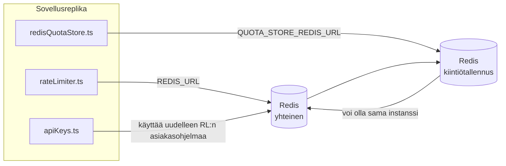

# Redis Production Configuration Guide (Suomi)

🌐 **Languages:** 🇺🇸 [English](../../../../ops/REDIS_PRODUCTION_CONFIG.md) · 🇪🇹 [am](../../../am/docs/ops/REDIS_PRODUCTION_CONFIG.md) · 🇸🇦 [ar](../../../ar/docs/ops/REDIS_PRODUCTION_CONFIG.md) · 🇦🇿 [az](../../../az/docs/ops/REDIS_PRODUCTION_CONFIG.md) · 🇧🇬 [bg](../../../bg/docs/ops/REDIS_PRODUCTION_CONFIG.md) · 🇧🇩 [bn](../../../bn/docs/ops/REDIS_PRODUCTION_CONFIG.md) · 🇧🇦 [bs](../../../bs/docs/ops/REDIS_PRODUCTION_CONFIG.md) · 🇨🇿 [cs](../../../cs/docs/ops/REDIS_PRODUCTION_CONFIG.md) · 🇩🇰 [da](../../../da/docs/ops/REDIS_PRODUCTION_CONFIG.md) · 🇩🇪 [de](../../../de/docs/ops/REDIS_PRODUCTION_CONFIG.md) · 🇬🇷 [el](../../../el/docs/ops/REDIS_PRODUCTION_CONFIG.md) · 🇪🇸 [es](../../../es/docs/ops/REDIS_PRODUCTION_CONFIG.md) · 🇪🇪 [et](../../../et/docs/ops/REDIS_PRODUCTION_CONFIG.md) · 🇮🇷 [fa](../../../fa/docs/ops/REDIS_PRODUCTION_CONFIG.md) · 🇫🇷 [fr](../../../fr/docs/ops/REDIS_PRODUCTION_CONFIG.md) · 🇮🇪 [ga](../../../ga/docs/ops/REDIS_PRODUCTION_CONFIG.md) · 🇮🇳 [gu](../../../gu/docs/ops/REDIS_PRODUCTION_CONFIG.md) · 🇳🇬 [ha](../../../ha/docs/ops/REDIS_PRODUCTION_CONFIG.md) · 🇮🇱 [he](../../../he/docs/ops/REDIS_PRODUCTION_CONFIG.md) · 🇮🇳 [hi](../../../hi/docs/ops/REDIS_PRODUCTION_CONFIG.md) · 🇭🇷 [hr](../../../hr/docs/ops/REDIS_PRODUCTION_CONFIG.md) · 🇭🇺 [hu](../../../hu/docs/ops/REDIS_PRODUCTION_CONFIG.md) · 🇦🇲 [hy](../../../hy/docs/ops/REDIS_PRODUCTION_CONFIG.md) · 🇮🇩 [id](../../../id/docs/ops/REDIS_PRODUCTION_CONFIG.md) · 🇳🇬 [ig](../../../ig/docs/ops/REDIS_PRODUCTION_CONFIG.md) · 🇮🇹 [it](../../../it/docs/ops/REDIS_PRODUCTION_CONFIG.md) · 🇯🇵 [ja](../../../ja/docs/ops/REDIS_PRODUCTION_CONFIG.md) · 🇬🇪 [ka](../../../ka/docs/ops/REDIS_PRODUCTION_CONFIG.md) · 🇰🇭 [km](../../../km/docs/ops/REDIS_PRODUCTION_CONFIG.md) · 🇮🇳 [kn](../../../kn/docs/ops/REDIS_PRODUCTION_CONFIG.md) · 🇰🇷 [ko](../../../ko/docs/ops/REDIS_PRODUCTION_CONFIG.md) · 🇱🇹 [lt](../../../lt/docs/ops/REDIS_PRODUCTION_CONFIG.md) · 🇱🇻 [lv](../../../lv/docs/ops/REDIS_PRODUCTION_CONFIG.md) · 🇮🇳 [ml](../../../ml/docs/ops/REDIS_PRODUCTION_CONFIG.md) · 🇮🇳 [mr](../../../mr/docs/ops/REDIS_PRODUCTION_CONFIG.md) · 🇲🇾 [ms](../../../ms/docs/ops/REDIS_PRODUCTION_CONFIG.md) · 🇲🇹 [mt](../../../mt/docs/ops/REDIS_PRODUCTION_CONFIG.md) · 🇲🇲 [my](../../../my/docs/ops/REDIS_PRODUCTION_CONFIG.md) · 🇳🇵 [ne](../../../ne/docs/ops/REDIS_PRODUCTION_CONFIG.md) · 🇳🇱 [nl](../../../nl/docs/ops/REDIS_PRODUCTION_CONFIG.md) · 🇳🇴 [no](../../../no/docs/ops/REDIS_PRODUCTION_CONFIG.md) · 🇮🇳 [or](../../../or/docs/ops/REDIS_PRODUCTION_CONFIG.md) · 🇮🇳 [pa](../../../pa/docs/ops/REDIS_PRODUCTION_CONFIG.md) · 🇵🇭 [phi](../../../phi/docs/ops/REDIS_PRODUCTION_CONFIG.md) · 🇵🇱 [pl](../../../pl/docs/ops/REDIS_PRODUCTION_CONFIG.md) · 🇵🇹 [pt](../../../pt/docs/ops/REDIS_PRODUCTION_CONFIG.md) · 🇧🇷 [pt-BR](../../../pt-BR/docs/ops/REDIS_PRODUCTION_CONFIG.md) · 🇷🇴 [ro](../../../ro/docs/ops/REDIS_PRODUCTION_CONFIG.md) · 🇷🇺 [ru](../../../ru/docs/ops/REDIS_PRODUCTION_CONFIG.md) · 🇱🇰 [si](../../../si/docs/ops/REDIS_PRODUCTION_CONFIG.md) · 🇸🇰 [sk](../../../sk/docs/ops/REDIS_PRODUCTION_CONFIG.md) · 🇸🇮 [sl](../../../sl/docs/ops/REDIS_PRODUCTION_CONFIG.md) · 🇷🇸 [sr](../../../sr/docs/ops/REDIS_PRODUCTION_CONFIG.md) · 🇸🇪 [sv](../../../sv/docs/ops/REDIS_PRODUCTION_CONFIG.md) · 🇰🇪 [sw](../../../sw/docs/ops/REDIS_PRODUCTION_CONFIG.md) · 🇮🇳 [ta](../../../ta/docs/ops/REDIS_PRODUCTION_CONFIG.md) · 🇮🇳 [te](../../../te/docs/ops/REDIS_PRODUCTION_CONFIG.md) · 🇹🇭 [th](../../../th/docs/ops/REDIS_PRODUCTION_CONFIG.md) · 🇹🇷 [tr](../../../tr/docs/ops/REDIS_PRODUCTION_CONFIG.md) · 🇺🇦 [uk-UA](../../../uk-UA/docs/ops/REDIS_PRODUCTION_CONFIG.md) · 🇵🇰 [ur](../../../ur/docs/ops/REDIS_PRODUCTION_CONFIG.md) · 🇺🇿 [uz](../../../uz/docs/ops/REDIS_PRODUCTION_CONFIG.md) · 🇻🇳 [vi](../../../vi/docs/ops/REDIS_PRODUCTION_CONFIG.md) · 🇳🇬 [yo](../../../yo/docs/ops/REDIS_PRODUCTION_CONFIG.md) · 🇨🇳 [zh-CN](../../../zh-CN/docs/ops/REDIS_PRODUCTION_CONFIG.md) · 🇹🇼 [zh-TW](../../../zh-TW/docs/ops/REDIS_PRODUCTION_CONFIG.md)

---

## Yleiskatsaus

Redis on **valinnainen, pehmeä riippuvuus** OmniRoute — ssä sovellus heikkenee sulavasti (muistin varaosat), kun Redis ei ole käytettävissä. Tuotannossa Redis viritys vähentää viivettä neljällä eri työkuormalla:

| Työmäärä               | Kuljettaja                    | Asiakastehdas                                    | Näppäinkuvio                                             |
| ---------------------- | ----------------------------- | ------------------------------------------------ | -------------------------------------------------------- |
| Nopeuden rajoittaminen | `rateLimiter.ts`              | `getRedisClient()` — laiska `ioredis` singleton  | `<prefix>rl:*` Lua-atomin nopeusrajoitusikkunat          |
| Auth välimuisti        | `apiKeys.ts`                  | Käyttää uudelleen `rateLimiter`:n asiakasta      | `<prefix>auth:api_key:<sha256>` TTL kanssa               |
| Kiintiökauppa          | `redisQuotaStore.ts`          | Erillinen `getRedisClient(url)` singleton        | `<prefix>quota:*` konfiguroitavissa esiintymäkohtaisesti |
| Lämmityskytkin         | `redisCircuitBreakerStore.ts` | Erillinen asiakas `circuitBreakerFactory.ts`:ssa | `<prefix>warmup:cb:<connectionId>`                       |

Kaikilla neljällä työkuormalla on yksi nimitilan etuliite, joten OmniRoute voi olla rinnakkain muiden sovellusten kanssa yhdessä Redis esiintymässä (esim. `127.0.0.1:6379`). Katso [Avaimen nimivälit](#key-namespacing).

---

## Nykyinen kokoonpano (koodin oletusasetukset)

| Asetus                          | Arvo                                                          | Jossa                                                                                 |
| ------------------------------- | ------------------------------------------------------------- | ------------------------------------------------------------------------------------- |
| `REDIS_URL` env var             | `redis://redis:6379` (kirjoita), valinnainen                  | `rateLimiter.ts:5`, `.env.example`                                                    |
| `REDIS_KEY_PREFIX` env var      | `omniroute:` (oletus)                                         | `rateLimiter.ts`, `redisQuotaStore.ts`, `redisCircuitBreakerStore.ts`, `.env.example` |
| `QUOTA_STORE_REDIS_URL` env var | erillinen, voi erota `REDIS_URL` sta                          | `quota/storeFactory.ts`                                                               |
| `QUOTA_STORE_DRIVER`            | `"sqlite"` (oletus), `"redis"` valinnainen                    | `quota/storeFactory.ts`                                                               |
| ioredis `maxRetriesPerRequest`  | `3`                                                           | `rateLimiter.ts` asiakkaan luominen                                                   |
| `enableReadyCheck`              | ei asetettu (ioredis oletusarvo: `true`)                      | —                                                                                     |
| `lazyConnect`                   | ei asetettu (ioredis oletusarvo: `false`)                     | —                                                                                     |
| `retryStrategy`                 | ei asetettu (ioredisin oletusarvo: 200 ms, eksponentiaalinen) | —                                                                                     |
| TLS / salasana / DB -indeksi    | **ei ole määritetty**                                         | —                                                                                     |
| Sentinel / klusteri             | **ei ole määritetty** Vain — erillinen yksisolmu              | —                                                                                     |

---

## Avainnimien nimiavaruudet

OmniRoute jakaa Redis-instanssin muiden samalla palvelimella suoritettavien palveluiden kanssa.
Ilman nimiavaruutta avaimet, kuten `auth:api_key:<sha256>` tai `rl:*`, voivat törmätä muiden
samaa Redis-instanssia käyttävien sovellusten avaimiin (tässä instanssissa Redis toimii osoitteessa
`127.0.0.1:6379` muiden palveluiden rinnalla).

Aseta `REDIS_KEY_PREFIX` tyhjästä poikkeavaksi merkkijonoksi, jotta **jokaisen** OmniRoute-avaimen
eteen lisätään etuliite:

```bash
# .env — kaikista OmniRoute-avaimista tulee omniroute:rl:*, omniroute:auth:*, omniroute:quota:*, omniroute:warmup:cb:*
REDIS_KEY_PREFIX=omniroute:
```

- **Oletus:** `omniroute:` (käytetään, kun `REDIS_KEY_PREFIX` on määrittämättä tai tyhjä).
- **Käyttökohteet:** pyyntönopeuden rajoitin + todennusvälimuisti (jaettu `ioredis`-asiakas
  `keyPrefix`-asetuksen kautta), kiintiötallennus (`KEY_PREFIX = "${REDIS_KEY_PREFIX}quota"`) ja
  lämmityksen katkaisija (`KEY_PREFIX = "${REDIS_KEY_PREFIX}warmup:cb:"`).
- **Etuliitteen muuttaminen**, kun Redisissä on jo avaimia, jättää vanhat avaimet orvoiksi (ne
  vanhenevat TTL:n / LRU:n kautta). Muutos on turvallinen eikä siirtoa tarvita. Ainoa poikkeus on
  kielletyksi merkityn yhteyden lämmityksen katkaisija-avain: se tallennetaan ilman TTL-arvoa, joten
  listaa jäljelle jääneet avaimet komennolla `redis-cli --scan --pattern '<old-prefix>warmup:cb:*'`
  ja poista ne.
- **ioredis-asetus `keyPrefix`** lisää etuliitteen automaattisesti kirjoitettaessa **ja** poistaa sen
  luettaessa, joten sovelluskoodi ei koskaan näe etuliitettä.

---

## Suositeltu tuotannon viritys

### 1. Yhteysvarasto/asiakasasetukset (ioredis `Redis` -konstruktori)

Nykyinen koodi luo yhden `new Redis(url)` ilman mukautettuja vaihtoehtoja. Tuotavien useiden replikoiden käyttöönotoissa välitä asiakastehdas koodiin tai kääri `getRedisClient()`:

```typescript
const redis = new Redis(REDIS_URL, {
  maxRetriesPerRequest: null, // no retry limit; let retryStrategy decide
  enableReadyCheck: true, // verify server is ready before accepting calls
  lazyConnect: true, // don't connect on construction; wait for first call
  retryStrategy: (times) => {
    if (times > 10) return null; // give up after 10 retries → reconnect later
    return Math.min(times * 200, 5000); // 200ms, 400ms, …, 5s cap
  },
  enableAutoPipelining: true, // coalesce concurrent commands into one TCP write
  keepAlive: 10000, // TCP keep‑alive every 10s
});
```

**Tärkeimmät kompromissit:**

- `maxRetriesPerRequest: null` + `retryStrategy` — suositaan tuotannossa, joten ohimenevät Redis uudelleenkäynnistykset eivät heti epäonnistu jokaisessa pyynnössä. `checkRateLimit()` :n muistin varatoiminto absorboi vikapolun.
- `lazyConnect: true` — välttää käynnistysriippuvuuden Redis toiminnasta ennen kuin palvelin alkaa hyväksyä yhteyksiä.
- `enableAutoPipelining: true` — vähentää meno-paluumatkoja samanaikaisissa nopeusrajatarkistuksissa; hyödyllinen > 50 RPS yhdellä liitännällä.

### 2. Redis palvelimen määritys (`redis.conf`)

```
# Memory
maxmemory 80%                        # leave room for OS page cache
maxmemory-policy allkeys-lru         # evict stale auth cache entries under pressure

# Persistence (optional — OmniRoute is crash‑safe without it)
save 300 1                           # snapshot at least every 5 min if ≥1 key changed
appendonly no                        # AOF not needed; data is regeneratable
appendfsync no                       # no fsync overhead (RDB is sufficient)

# Networking
timeout 0                            # no idle disconnect
tcp-keepalive 300                    # 5 min keep‑alive
tcp-backlog 511                      # connection backlog for bursty load

# Performance
hz 10                                # default; 100 for latency‑sensitive
activedefrag yes                     # auto‑defragment when fragmentation >10%
```

**Vaihtoehto `maxmemory-policy allkeys-lru`:lle:** Todennusvälimuistin merkinnät voidaan poistaa muistin paineen alaisena. Tämä on turvallista. — `setCachedApiKey` täyttyy aina uudelleen miss-tilanteessa, ja SQLite -varavaihtoehto on arvovaltainen. Nopeutta rajoittava Lua-skripti luo pieniä avaimia, jotka ovat suunnittelultaan lyhytikäisiä.

### 3. Docker Compose -asetukset

Tuotantomuodossa (`docker-compose.prod.yml`) käytetään `redis:8.6.2-alpine`. Lisätä:

```yaml
redis:
  image: redis:8.6.2-alpine
  command:
    [
      "redis-server",
      "--maxmemory",
      "512mb",
      "--maxmemory-policy",
      "allkeys-lru",
      "--activedefrag",
      "yes",
      "--save",
      "300 1",
    ]
  healthcheck:
    test: ["CMD", "redis-cli", "ping"]
    interval: 10s
    timeout: 3s
    retries: 3
    start_period: 5s
```

### 4. Moniinstanssi-/skaalausnäkökohdat

**Yksi Redis kaikille kopioille** — nopeudenrajoittimen Lua-skripti riippuu yhdestä arvovaltaisesta avainavaruudesta. Useat Redis esiintymät replikoiden takana menettäisivät atomisuutensa ja kaksinkertaistavat budjetin. Käytä yhtä Redis (tai Redis Sentinel -klusteria vikasietoineen) kaikille sovelluskopioille.

**Yhteysmäärä:** Jokainen sovelluksen replika avautuu **2 TCP -liitäntää** Redis :hen (rate limiter client + quota store client). 10 → 20 -yhteyden replikalla, selvästi Redis oletusilmentymän 10 000 yhteyskaton sisällä.

### 5. Valvonta

Paljasta terveystarkastuksen päätepisteen kautta:

```typescript
// src/app/api/monitoring/health/route.ts already calls rateLimiter functions
// Add Redis-specific checks:
//   1. PING latency via ioredis .ping()
//   2. Memory usage via INFO memory
//   3. Connection count via INFO clients
//   4. Hit rate for maxmemory-policy (evicted_keys / keyspace_hits)
```

Tärkeimmät katsottavat mittarit:

- **Häädetty avaimet / s** Jos — on jatkuvasti eri kuin nolla, lisää `maxmemory`
- **Estetyt asiakkaat** — ei-nolla ehdottaa hitaita Lua-skriptejä tai kovaa kilpailua
- **Hylätyt yhteydet** — yhteysraja osuma; harvinainen 20 yhteydellä

### 6. Redis-yhteensopivat palvelimet

Kaikkien tässä käytettävien palvelinten on suoritettava Lua-komentosarjat: nopeuden rajoitin on yksi `EVAL`. Palvelimella, jossa ei ole Luaa, `checkRateLimit()` kirjaa `[RATE_LIMITER] Redis eval failed, falling back to in-memory rate limiting` lokiin ja laskee prosessikohtaisesti, joten jokainen replika panee rajoituksen täytäntöön itse. Opt-in jaettu istunto-affinity store (`OMNIROUTE_SESSION_AFFINITY_STORE=redis`) myös lukee ja päivittää nastat `EVAL` llä; ilman Luaa se kirjaa `[SESSION_AFFINITY] Redis error; falling back to SQLite.` ja jokainen replika säilyttää omat nastansa. Muut työkuormat käyttävät tavallisia komentoja (`SET ... EX`, `GET`, `DEL`, `MGET`, `EXPIRE`, `INCRBYFLOAT`, tiivisteet ja joukot), ja semanttisen välimuistin Redis -taustaohjelma ei lähetä `FT.*` -komentoja.

Testattu OmniRoute 3.8.52:lla: KiviDB 1.2.0 ja sen Lua-kuva (`kividb/kividb:v1.2.0-lua`). Nopeuden rajoitin (mukaan lukien toinen prosessi, joka jakaa laskurit), todennusvälimuisti, kiintiövarasto, lämmityskatkaisija, semanttisen välimuistin varasto ja `/v1/chat/completions` pyyntö chat-käsittelijän kautta läpäisivät 18 19 tarkistuksesta, jotka läpäisivät Redis 8.10.3:n. Yksi, joka eroaa: `INCRBYFLOAT` tallentaa `0.1 + 0.2` :n `0.30000000000000004`, missä Redis tallentaa `0.3` ( [kividbio/kividb#387](https://github.com/kividbio/kividb/issues/387) ). Kiintiökauppa jäsentää molemmat `parseFloat`, mutta kaksi numeroa eroavat viimeisistä numeroista, joten täsmälleen kiintiön rajalle osuva vertailu voi tulla eri tavalla. Istunto-affinity store ei ollut osa tätä ajoa. ( [asetukset](https://github.com/kividbio/kividb/blob/master/docs/integrations/omniroute.md), [tulokset](https://github.com/kividbio/kividb/tree/master/benchmarks/omniroute-compat) )

---

## Arkkitehtuurikaavio



---

## Viitteet

| Tiedosto                           | Tarkoitus                                                              |
| ---------------------------------- | ---------------------------------------------------------------------- |
| `src/shared/utils/rateLimiter.ts`  | Ensisijainen Redis asiakas, Lua-nopeusrajoituskomentosarja, varamuisti |
| `src/lib/db/apiKeys.ts`            | Todennusvälimuisti — Redis→SQLite varavaihtoehto                       |
| `src/lib/quota/redisQuotaStore.ts` | Erillinen Redis asiakas valinnaista kiintiökauppaa varten              |
| `src/lib/quota/storeFactory.ts`    | Vaihtaa `sqlite` ja `redis` -kiintiöohjainten välillä                  |
| `docker-compose.prod.yml`          | Prod Redis -säiliö (kuva `redis:8.6.2-alpine`)                         |
| `.env.example`                     | Redis env vars -dokumentaatio                                          |
| `src/app/api/local/redis/`         | API -reitit kehittäjän kontin orkestrointiin                           |
| `bin/cli/commands/redis.mjs`       | CLI -komennot dev-säilön orkestrointiin                                |
