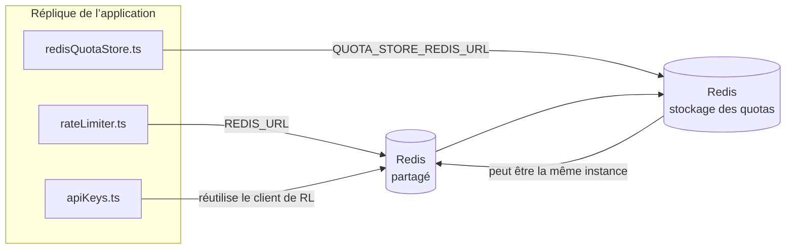

# Redis Production Configuration Guide (Français)

🌐 **Languages:** 🇺🇸 [English](../../../../ops/REDIS_PRODUCTION_CONFIG.md) · 🇪🇹 [am](../../../am/docs/ops/REDIS_PRODUCTION_CONFIG.md) · 🇸🇦 [ar](../../../ar/docs/ops/REDIS_PRODUCTION_CONFIG.md) · 🇦🇿 [az](../../../az/docs/ops/REDIS_PRODUCTION_CONFIG.md) · 🇧🇬 [bg](../../../bg/docs/ops/REDIS_PRODUCTION_CONFIG.md) · 🇧🇩 [bn](../../../bn/docs/ops/REDIS_PRODUCTION_CONFIG.md) · 🇧🇦 [bs](../../../bs/docs/ops/REDIS_PRODUCTION_CONFIG.md) · 🇨🇿 [cs](../../../cs/docs/ops/REDIS_PRODUCTION_CONFIG.md) · 🇩🇰 [da](../../../da/docs/ops/REDIS_PRODUCTION_CONFIG.md) · 🇩🇪 [de](../../../de/docs/ops/REDIS_PRODUCTION_CONFIG.md) · 🇬🇷 [el](../../../el/docs/ops/REDIS_PRODUCTION_CONFIG.md) · 🇪🇸 [es](../../../es/docs/ops/REDIS_PRODUCTION_CONFIG.md) · 🇪🇪 [et](../../../et/docs/ops/REDIS_PRODUCTION_CONFIG.md) · 🇮🇷 [fa](../../../fa/docs/ops/REDIS_PRODUCTION_CONFIG.md) · 🇫🇮 [fi](../../../fi/docs/ops/REDIS_PRODUCTION_CONFIG.md) · 🇮🇪 [ga](../../../ga/docs/ops/REDIS_PRODUCTION_CONFIG.md) · 🇮🇳 [gu](../../../gu/docs/ops/REDIS_PRODUCTION_CONFIG.md) · 🇳🇬 [ha](../../../ha/docs/ops/REDIS_PRODUCTION_CONFIG.md) · 🇮🇱 [he](../../../he/docs/ops/REDIS_PRODUCTION_CONFIG.md) · 🇮🇳 [hi](../../../hi/docs/ops/REDIS_PRODUCTION_CONFIG.md) · 🇭🇷 [hr](../../../hr/docs/ops/REDIS_PRODUCTION_CONFIG.md) · 🇭🇺 [hu](../../../hu/docs/ops/REDIS_PRODUCTION_CONFIG.md) · 🇦🇲 [hy](../../../hy/docs/ops/REDIS_PRODUCTION_CONFIG.md) · 🇮🇩 [id](../../../id/docs/ops/REDIS_PRODUCTION_CONFIG.md) · 🇳🇬 [ig](../../../ig/docs/ops/REDIS_PRODUCTION_CONFIG.md) · 🇮🇹 [it](../../../it/docs/ops/REDIS_PRODUCTION_CONFIG.md) · 🇯🇵 [ja](../../../ja/docs/ops/REDIS_PRODUCTION_CONFIG.md) · 🇬🇪 [ka](../../../ka/docs/ops/REDIS_PRODUCTION_CONFIG.md) · 🇰🇭 [km](../../../km/docs/ops/REDIS_PRODUCTION_CONFIG.md) · 🇮🇳 [kn](../../../kn/docs/ops/REDIS_PRODUCTION_CONFIG.md) · 🇰🇷 [ko](../../../ko/docs/ops/REDIS_PRODUCTION_CONFIG.md) · 🇱🇹 [lt](../../../lt/docs/ops/REDIS_PRODUCTION_CONFIG.md) · 🇱🇻 [lv](../../../lv/docs/ops/REDIS_PRODUCTION_CONFIG.md) · 🇮🇳 [ml](../../../ml/docs/ops/REDIS_PRODUCTION_CONFIG.md) · 🇮🇳 [mr](../../../mr/docs/ops/REDIS_PRODUCTION_CONFIG.md) · 🇲🇾 [ms](../../../ms/docs/ops/REDIS_PRODUCTION_CONFIG.md) · 🇲🇹 [mt](../../../mt/docs/ops/REDIS_PRODUCTION_CONFIG.md) · 🇲🇲 [my](../../../my/docs/ops/REDIS_PRODUCTION_CONFIG.md) · 🇳🇵 [ne](../../../ne/docs/ops/REDIS_PRODUCTION_CONFIG.md) · 🇳🇱 [nl](../../../nl/docs/ops/REDIS_PRODUCTION_CONFIG.md) · 🇳🇴 [no](../../../no/docs/ops/REDIS_PRODUCTION_CONFIG.md) · 🇮🇳 [or](../../../or/docs/ops/REDIS_PRODUCTION_CONFIG.md) · 🇮🇳 [pa](../../../pa/docs/ops/REDIS_PRODUCTION_CONFIG.md) · 🇵🇭 [phi](../../../phi/docs/ops/REDIS_PRODUCTION_CONFIG.md) · 🇵🇱 [pl](../../../pl/docs/ops/REDIS_PRODUCTION_CONFIG.md) · 🇵🇹 [pt](../../../pt/docs/ops/REDIS_PRODUCTION_CONFIG.md) · 🇧🇷 [pt-BR](../../../pt-BR/docs/ops/REDIS_PRODUCTION_CONFIG.md) · 🇷🇴 [ro](../../../ro/docs/ops/REDIS_PRODUCTION_CONFIG.md) · 🇷🇺 [ru](../../../ru/docs/ops/REDIS_PRODUCTION_CONFIG.md) · 🇱🇰 [si](../../../si/docs/ops/REDIS_PRODUCTION_CONFIG.md) · 🇸🇰 [sk](../../../sk/docs/ops/REDIS_PRODUCTION_CONFIG.md) · 🇸🇮 [sl](../../../sl/docs/ops/REDIS_PRODUCTION_CONFIG.md) · 🇷🇸 [sr](../../../sr/docs/ops/REDIS_PRODUCTION_CONFIG.md) · 🇸🇪 [sv](../../../sv/docs/ops/REDIS_PRODUCTION_CONFIG.md) · 🇰🇪 [sw](../../../sw/docs/ops/REDIS_PRODUCTION_CONFIG.md) · 🇮🇳 [ta](../../../ta/docs/ops/REDIS_PRODUCTION_CONFIG.md) · 🇮🇳 [te](../../../te/docs/ops/REDIS_PRODUCTION_CONFIG.md) · 🇹🇭 [th](../../../th/docs/ops/REDIS_PRODUCTION_CONFIG.md) · 🇹🇷 [tr](../../../tr/docs/ops/REDIS_PRODUCTION_CONFIG.md) · 🇺🇦 [uk-UA](../../../uk-UA/docs/ops/REDIS_PRODUCTION_CONFIG.md) · 🇵🇰 [ur](../../../ur/docs/ops/REDIS_PRODUCTION_CONFIG.md) · 🇺🇿 [uz](../../../uz/docs/ops/REDIS_PRODUCTION_CONFIG.md) · 🇻🇳 [vi](../../../vi/docs/ops/REDIS_PRODUCTION_CONFIG.md) · 🇳🇬 [yo](../../../yo/docs/ops/REDIS_PRODUCTION_CONFIG.md) · 🇨🇳 [zh-CN](../../../zh-CN/docs/ops/REDIS_PRODUCTION_CONFIG.md) · 🇹🇼 [zh-TW](../../../zh-TW/docs/ops/REDIS_PRODUCTION_CONFIG.md)

---

## Vue d’ensemble

Redis est une **dépendance facultative et non bloquante** dans OmniRoute — l’application fonctionne en mode dégradé
avec des solutions de repli en mémoire lorsque Redis est indisponible. En production, l’optimisation de Redis réduit la latence pour quatre charges de travail
distinctes :

| Charge de travail           | Pilote                        | Fabrique de clients                                | Modèle de clé                                                   |
| --------------------------- | ----------------------------- | -------------------------------------------------- | --------------------------------------------------------------- |
| Limitation de débit         | `rateLimiter.ts`              | Singleton `ioredis` différé via `getRedisClient()` | Fenêtres de limitation de débit atomiques en Lua `<prefix>rl:*` |
| Cache d’authentification    | `apiKeys.ts`                  | Réutilise le client de `rateLimiter`               | `<prefix>auth:api_key:<sha256>` avec TTL                        |
| Stockage des quotas         | `redisQuotaStore.ts`          | Singleton `getRedisClient(url)` distinct           | `<prefix>quota:*` configurable par instance                     |
| Disjoncteur de préchauffage | `redisCircuitBreakerStore.ts` | Client distinct dans `circuitBreakerFactory.ts`    | `<prefix>warmup:cb:<connectionId>`                              |

Les quatre charges de travail partagent un même préfixe d’espace de noms afin qu’OmniRoute puisse coexister avec d’autres applications sur une
même instance Redis (par exemple `127.0.0.1:6379`). Consultez [Espace de noms des clés](#key-namespacing).

---

## Configuration actuelle (valeurs par défaut du code)

| Paramètre                                        | Valeur                                                                              | Emplacement                                                                           |
| ------------------------------------------------ | ----------------------------------------------------------------------------------- | ------------------------------------------------------------------------------------- |
| Variable d’environnement `REDIS_URL`             | `redis://redis:6379` (compose), facultative                                         | `rateLimiter.ts:5`, `.env.example`                                                    |
| Variable d’environnement `REDIS_KEY_PREFIX`      | `omniroute:` (valeur par défaut)                                                    | `rateLimiter.ts`, `redisQuotaStore.ts`, `redisCircuitBreakerStore.ts`, `.env.example` |
| Variable d’environnement `QUOTA_STORE_REDIS_URL` | distincte, peut différer de `REDIS_URL`                                             | `quota/storeFactory.ts`                                                               |
| `QUOTA_STORE_DRIVER`                             | `"sqlite"` (valeur par défaut), `"redis"` facultatif                                | `quota/storeFactory.ts`                                                               |
| `maxRetriesPerRequest` d’ioredis                 | `3`                                                                                 | création du client dans `rateLimiter.ts`                                              |
| `enableReadyCheck`                               | non défini (valeur par défaut d’ioredis : `true`)                                   | —                                                                                     |
| `lazyConnect`                                    | non défini (valeur par défaut d’ioredis : `false`)                                  | —                                                                                     |
| `retryStrategy`                                  | non défini (valeur par défaut d’ioredis : base de 200 ms, croissance exponentielle) | —                                                                                     |
| TLS / mot de passe / index de base de données    | **non configurés**                                                                  | —                                                                                     |
| Sentinel / Cluster                               | **non configurés** — nœud unique autonome uniquement                                | —                                                                                     |

---

## Espace de noms des clés

OmniRoute partage une instance Redis avec les autres éléments exécutés sur l’hôte. Sans espace de noms,
des clés telles que `auth:api_key:<sha256>` ou `rl:*` pourraient entrer en collision avec celles d’autres applications
utilisant le même Redis (cette instance exécute Redis sur `127.0.0.1:6379` aux côtés d’autres services).

Définissez `REDIS_KEY_PREFIX` sur une chaîne non vide afin de préfixer **chaque** clé OmniRoute :

```bash
# .env — toutes les clés OmniRoute deviennent omniroute:rl:*, omniroute:auth:*, omniroute:quota:*, omniroute:warmup:cb:*
REDIS_KEY_PREFIX=omniroute:
```

- **Valeur par défaut :** `omniroute:` (appliquée lorsque `REDIS_KEY_PREFIX` n’est pas défini ou est vide).
- **S’applique à :** la limitation de débit et le cache d’authentification (client `ioredis` partagé via `keyPrefix`), ainsi qu’au
  stockage des quotas (`KEY_PREFIX = "${REDIS_KEY_PREFIX}quota"`) et au disjoncteur de préchauffage
  (`KEY_PREFIX = "${REDIS_KEY_PREFIX}warmup:cb:"`).
- **La modification du préfixe** lorsque des clés existent déjà dans Redis rend les anciennes clés orphelines (elles expirent
  via leur TTL / la politique LRU). Cette modification est sans risque ; aucune migration n’est nécessaire. La seule exception concerne une clé de
  disjoncteur de préchauffage associée à une connexion marquée comme interdite : elle est conservée sans TTL. Répertoriez donc
  les clés restantes avec `redis-cli --scan --pattern '<old-prefix>warmup:cb:*'`, puis supprimez-les.
- Le **`keyPrefix` d’ioredis** ajoute automatiquement le préfixe lors des écritures **et** le retire lors des lectures,
  de sorte que le code de l’application ne voit jamais le préfixe.

---

## Réglage de production recommandé

### 1. Pool de connexions / Options client (constructeur ioredis `Redis` )

Le code actuel crée un seul `new Redis(url)` sans options personnalisées. Pour les déploiements multiréplicas de production, transmettez une fabrique client dans le code ou enveloppez `getRedisClient()`:

```typescript
const redis = new Redis(REDIS_URL, {
  maxRetriesPerRequest: null, // no retry limit; let retryStrategy decide
  enableReadyCheck: true, // verify server is ready before accepting calls
  lazyConnect: true, // don't connect on construction; wait for first call
  retryStrategy: (times) => {
    if (times > 10) return null; // give up after 10 retries → reconnect later
    return Math.min(times * 200, 5000); // 200ms, 400ms, …, 5s cap
  },
  enableAutoPipelining: true, // coalesce concurrent commands into one TCP write
  keepAlive: 10000, // TCP keep‑alive every 10s
});
```

**Compromis clés :**

- `maxRetriesPerRequest: null` + `retryStrategy` — est préféré pour la production afin que les redémarrages transitoires Redis n'échouent pas immédiatement à chaque demande. Le repli en mémoire dans `checkRateLimit()` absorbe le chemin d'échec.
- `lazyConnect: true` — évite une dépendance de démarrage sur Redis avant que le serveur ne commence à accepter les connexions.
- `enableAutoPipelining: true` — réduit les allers-retours pour les vérifications simultanées des limites de débit ; avantageux à > 50 RPS sur une seule connexion.

### 2. Configuration du serveur Redis (`redis.conf`)

```
# Memory
maxmemory 80%                        # leave room for OS page cache
maxmemory-policy allkeys-lru         # evict stale auth cache entries under pressure

# Persistence (optional — OmniRoute is crash‑safe without it)
save 300 1                           # snapshot at least every 5 min if ≥1 key changed
appendonly no                        # AOF not needed; data is regeneratable
appendfsync no                       # no fsync overhead (RDB is sufficient)

# Networking
timeout 0                            # no idle disconnect
tcp-keepalive 300                    # 5 min keep‑alive
tcp-backlog 511                      # connection backlog for bursty load

# Performance
hz 10                                # default; 100 for latency‑sensitive
activedefrag yes                     # auto‑defragment when fragmentation >10%
```

**Compromis pour `maxmemory-policy allkeys-lru`:** Les entrées du cache d'authentification peuvent être supprimées en cas de pression sur la mémoire. C'est sûr — `setCachedApiKey` se remplit toujours en cas d'échec, et la solution de repli SQLite fait autorité. Le script Lua du limiteur de débit crée de petites clés qui, de par leur conception, sont de courte durée.

### 3. Paramètres de composition Docker

Le prod compose (`docker-compose.prod.yml`) utilise `redis:8.6.2-alpine`. Ajouter:

```yaml
redis:
  image: redis:8.6.2-alpine
  command:
    [
      "redis-server",
      "--maxmemory",
      "512mb",
      "--maxmemory-policy",
      "allkeys-lru",
      "--activedefrag",
      "yes",
      "--save",
      "300 1",
    ]
  healthcheck:
    test: ["CMD", "redis-cli", "ping"]
    interval: 10s
    timeout: 3s
    retries: 3
    start_period: 5s
```

### 4. Considérations relatives au multi-instance et à la mise à l'échelle

**Redis unique pour toutes les répliques** — le script Lua du limiteur de débit dépend d'un seul espace clé faisant autorité. Plusieurs instances Redis derrière des répliques perdraient leur atomicité et doubleraient le budget. Utilisez un seul cluster Redis (ou Redis Sentinel avec basculement) pour tous les réplicas d'application.

**Nombre de connexions :** Chaque réplica d'application s'ouvre** 2 connexions TCP** à Redis (client limiteur de débit client de magasin de quotas + ). À 10 répliques → 20 connexions, bien dans le plafond de 10 000 connexions d'une instance Redis par défaut.

### 5. Surveillance

Exposer via le point de terminaison de vérification de l'état :

```typescript
// src/app/api/monitoring/health/route.ts already calls rateLimiter functions
// Add Redis-specific checks:
//   1. PING latency via ioredis .ping()
//   2. Memory usage via INFO memory
//   3. Connection count via INFO clients
//   4. Hit rate for maxmemory-policy (evicted_keys / keyspace_hits)
```

Indicateurs clés à surveiller :

- **Clés expulsées / seconde** — s'il est constamment différent de zéro, augmentez `maxmemory`
- **Clients bloqués** — non nul suggère des scripts Lua lents ou des conflits élevés
- **Connexions rejetées** limite de connexion — atteinte ; rare à 20 connexions

### 6. Serveurs compatibles Redis

Tout serveur utilisé ici doit exécuter des scripts Lua : le limiteur de débit est un `EVAL`. Sur un serveur sans Lua, `checkRateLimit()` enregistre `[RATE_LIMITER] Redis eval failed, falling back to in-memory rate limiting` et compte par processus, de sorte que chaque réplique applique la limite de manière indépendante. Le magasin d'affinité de session partagé (`OMNIROUTE_SESSION_AFFINITY_STORE=redis`) lit et met également à jour les broches avec `EVAL`; sans Lua, il enregistre `[SESSION_AFFINITY] Redis error; falling back to SQLite.` et chaque réplique conserve ses propres broches. Les autres charges de travail utilisent des commandes simples (`SET ... EX`, `GET`, `DEL`, `MGET`, `EXPIRE`, `INCRBYFLOAT`, hashes et sets), et le backend Redis du cache sémantique n'envoie aucune commande `FT.*`.

Testé avec OmniRoute 3.8.52 : KiviDB 1.2.0 avec son image Lua (`kividb/kividb:v1.2.0-lua`). Le limiteur de débit (y compris un deuxième processus partageant les compteurs), le cache d'authentification, le magasin de quotas, le disjoncteur de préchauffage, le magasin de cache sémantique et une requête `/v1/chat/completions` via le gestionnaire de discussion ont réussi 18 des 19 vérifications réussies sur Redis 8.10.3. Celui qui diffère : `INCRBYFLOAT` stocke `0.1 + 0.2` sous la forme `0.30000000000000004` où Redis stocke `0.3` ( [kividbio/kividb#387](https://github.com/kividbio/kividb/issues/387) ). Le magasin de quotas analyse les deux avec `parseFloat`, mais les deux nombres diffèrent dans les derniers chiffres, donc une comparaison qui correspond exactement à une limite de quota peut donner un résultat différent. Le magasin d'affinité de session ne faisait pas partie de cette exécution. ( [mise en place](https://github.com/kividbio/kividb/blob/master/docs/integrations/omniroute.md), [résultats](https://github.com/kividbio/kividb/tree/master/benchmarks/omniroute-compat) )

---

## Diagramme d’architecture



---

## Références

| Fichier                            | Objectif                                                                                |
| ---------------------------------- | --------------------------------------------------------------------------------------- |
| `src/shared/utils/rateLimiter.ts`  | Client Redis principal, script Lua de limitation du débit, solution de repli en mémoire |
| `src/lib/db/apiKeys.ts`            | Cache d’authentification — solution de repli Redis→SQLite                               |
| `src/lib/quota/redisQuotaStore.ts` | Client Redis distinct pour le stockage facultatif des quotas                            |
| `src/lib/quota/storeFactory.ts`    | Bascule entre les pilotes de quotas `sqlite` et `redis`                                 |
| `docker-compose.prod.yml`          | Conteneur Redis de production (image `redis:8.6.2-alpine`)                              |
| `.env.example`                     | Documentation des variables d’environnement Redis                                       |
| `src/app/api/local/redis/`         | Routes d’API pour l’orchestration du conteneur de développement                         |
| `bin/cli/commands/redis.mjs`       | Commandes CLI pour l’orchestration du conteneur de développement                        |
