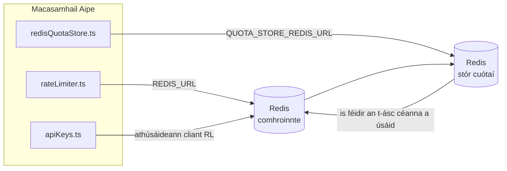

# Redis Production Configuration Guide (Gaeilge)

🌐 **Languages:** 🇺🇸 [English](../../../../ops/REDIS_PRODUCTION_CONFIG.md) · 🇪🇹 [am](../../../am/docs/ops/REDIS_PRODUCTION_CONFIG.md) · 🇸🇦 [ar](../../../ar/docs/ops/REDIS_PRODUCTION_CONFIG.md) · 🇦🇿 [az](../../../az/docs/ops/REDIS_PRODUCTION_CONFIG.md) · 🇧🇬 [bg](../../../bg/docs/ops/REDIS_PRODUCTION_CONFIG.md) · 🇧🇩 [bn](../../../bn/docs/ops/REDIS_PRODUCTION_CONFIG.md) · 🇧🇦 [bs](../../../bs/docs/ops/REDIS_PRODUCTION_CONFIG.md) · 🇨🇿 [cs](../../../cs/docs/ops/REDIS_PRODUCTION_CONFIG.md) · 🇩🇰 [da](../../../da/docs/ops/REDIS_PRODUCTION_CONFIG.md) · 🇩🇪 [de](../../../de/docs/ops/REDIS_PRODUCTION_CONFIG.md) · 🇬🇷 [el](../../../el/docs/ops/REDIS_PRODUCTION_CONFIG.md) · 🇪🇸 [es](../../../es/docs/ops/REDIS_PRODUCTION_CONFIG.md) · 🇪🇪 [et](../../../et/docs/ops/REDIS_PRODUCTION_CONFIG.md) · 🇮🇷 [fa](../../../fa/docs/ops/REDIS_PRODUCTION_CONFIG.md) · 🇫🇮 [fi](../../../fi/docs/ops/REDIS_PRODUCTION_CONFIG.md) · 🇫🇷 [fr](../../../fr/docs/ops/REDIS_PRODUCTION_CONFIG.md) · 🇮🇳 [gu](../../../gu/docs/ops/REDIS_PRODUCTION_CONFIG.md) · 🇳🇬 [ha](../../../ha/docs/ops/REDIS_PRODUCTION_CONFIG.md) · 🇮🇱 [he](../../../he/docs/ops/REDIS_PRODUCTION_CONFIG.md) · 🇮🇳 [hi](../../../hi/docs/ops/REDIS_PRODUCTION_CONFIG.md) · 🇭🇷 [hr](../../../hr/docs/ops/REDIS_PRODUCTION_CONFIG.md) · 🇭🇺 [hu](../../../hu/docs/ops/REDIS_PRODUCTION_CONFIG.md) · 🇦🇲 [hy](../../../hy/docs/ops/REDIS_PRODUCTION_CONFIG.md) · 🇮🇩 [id](../../../id/docs/ops/REDIS_PRODUCTION_CONFIG.md) · 🇳🇬 [ig](../../../ig/docs/ops/REDIS_PRODUCTION_CONFIG.md) · 🇮🇹 [it](../../../it/docs/ops/REDIS_PRODUCTION_CONFIG.md) · 🇯🇵 [ja](../../../ja/docs/ops/REDIS_PRODUCTION_CONFIG.md) · 🇬🇪 [ka](../../../ka/docs/ops/REDIS_PRODUCTION_CONFIG.md) · 🇰🇭 [km](../../../km/docs/ops/REDIS_PRODUCTION_CONFIG.md) · 🇮🇳 [kn](../../../kn/docs/ops/REDIS_PRODUCTION_CONFIG.md) · 🇰🇷 [ko](../../../ko/docs/ops/REDIS_PRODUCTION_CONFIG.md) · 🇱🇹 [lt](../../../lt/docs/ops/REDIS_PRODUCTION_CONFIG.md) · 🇱🇻 [lv](../../../lv/docs/ops/REDIS_PRODUCTION_CONFIG.md) · 🇮🇳 [ml](../../../ml/docs/ops/REDIS_PRODUCTION_CONFIG.md) · 🇮🇳 [mr](../../../mr/docs/ops/REDIS_PRODUCTION_CONFIG.md) · 🇲🇾 [ms](../../../ms/docs/ops/REDIS_PRODUCTION_CONFIG.md) · 🇲🇹 [mt](../../../mt/docs/ops/REDIS_PRODUCTION_CONFIG.md) · 🇲🇲 [my](../../../my/docs/ops/REDIS_PRODUCTION_CONFIG.md) · 🇳🇵 [ne](../../../ne/docs/ops/REDIS_PRODUCTION_CONFIG.md) · 🇳🇱 [nl](../../../nl/docs/ops/REDIS_PRODUCTION_CONFIG.md) · 🇳🇴 [no](../../../no/docs/ops/REDIS_PRODUCTION_CONFIG.md) · 🇮🇳 [or](../../../or/docs/ops/REDIS_PRODUCTION_CONFIG.md) · 🇮🇳 [pa](../../../pa/docs/ops/REDIS_PRODUCTION_CONFIG.md) · 🇵🇭 [phi](../../../phi/docs/ops/REDIS_PRODUCTION_CONFIG.md) · 🇵🇱 [pl](../../../pl/docs/ops/REDIS_PRODUCTION_CONFIG.md) · 🇵🇹 [pt](../../../pt/docs/ops/REDIS_PRODUCTION_CONFIG.md) · 🇧🇷 [pt-BR](../../../pt-BR/docs/ops/REDIS_PRODUCTION_CONFIG.md) · 🇷🇴 [ro](../../../ro/docs/ops/REDIS_PRODUCTION_CONFIG.md) · 🇷🇺 [ru](../../../ru/docs/ops/REDIS_PRODUCTION_CONFIG.md) · 🇱🇰 [si](../../../si/docs/ops/REDIS_PRODUCTION_CONFIG.md) · 🇸🇰 [sk](../../../sk/docs/ops/REDIS_PRODUCTION_CONFIG.md) · 🇸🇮 [sl](../../../sl/docs/ops/REDIS_PRODUCTION_CONFIG.md) · 🇷🇸 [sr](../../../sr/docs/ops/REDIS_PRODUCTION_CONFIG.md) · 🇸🇪 [sv](../../../sv/docs/ops/REDIS_PRODUCTION_CONFIG.md) · 🇰🇪 [sw](../../../sw/docs/ops/REDIS_PRODUCTION_CONFIG.md) · 🇮🇳 [ta](../../../ta/docs/ops/REDIS_PRODUCTION_CONFIG.md) · 🇮🇳 [te](../../../te/docs/ops/REDIS_PRODUCTION_CONFIG.md) · 🇹🇭 [th](../../../th/docs/ops/REDIS_PRODUCTION_CONFIG.md) · 🇹🇷 [tr](../../../tr/docs/ops/REDIS_PRODUCTION_CONFIG.md) · 🇺🇦 [uk-UA](../../../uk-UA/docs/ops/REDIS_PRODUCTION_CONFIG.md) · 🇵🇰 [ur](../../../ur/docs/ops/REDIS_PRODUCTION_CONFIG.md) · 🇺🇿 [uz](../../../uz/docs/ops/REDIS_PRODUCTION_CONFIG.md) · 🇻🇳 [vi](../../../vi/docs/ops/REDIS_PRODUCTION_CONFIG.md) · 🇳🇬 [yo](../../../yo/docs/ops/REDIS_PRODUCTION_CONFIG.md) · 🇨🇳 [zh-CN](../../../zh-CN/docs/ops/REDIS_PRODUCTION_CONFIG.md) · 🇹🇼 [zh-TW](../../../zh-TW/docs/ops/REDIS_PRODUCTION_CONFIG.md)

---

## Forbhreathnú

Is **spleáchas roghnach, neamhchriticiúil** é Redis in OmniRoute — leanann an feidhmchlár de bheith ag obair ar bhealach maolaithe (cúltacaí
sa chuimhne) nuair nach mbíonn Redis ar fáil. I dtimpeallacht táirgthe, laghdaíonn tiúnadh Redis an mhoill do cheithre ualach oibre
ar leith:

| Ualach oibre                  | Tiománaí                      | Monarcha Cliant                                    | Patrún Eochrach                                          |
| ----------------------------- | ----------------------------- | -------------------------------------------------- | -------------------------------------------------------- |
| Teorannú ráta                 | `rateLimiter.ts`              | `getRedisClient()` — singilton leisciúil `ioredis` | Fuinneoga teorannaithe ráta Lua-adamhacha `<prefix>rl:*` |
| Taisce fíordheimhnithe        | `apiKeys.ts`                  | Athúsáideann sé cliant `rateLimiter`               | `<prefix>auth:api_key:<sha256>` le TTL                   |
| Stór cuóta                    | `redisQuotaStore.ts`          | Singilton `getRedisClient(url)` ar leith           | `<prefix>quota:*` inchumraithe de réir áisc              |
| Scoradán ciorcaid réamhthéimh | `redisCircuitBreakerStore.ts` | Cliant ar leith in `circuitBreakerFactory.ts`      | `<prefix>warmup:cb:<connectionId>`                       |

Roinneann na ceithre ualach oibre an réimír ainmspáis céanna ionas gur féidir le OmniRoute cómhaireachtáil le feidhmchláir eile ar
áis Redis amháin (m.sh. `127.0.0.1:6379`). Féach [Ainmspású Eochrach](#key-namespacing).

---

## Cumraíocht Reatha (Réamhshocruithe Cóid)

| Socrú                                        | Luach                                                     | Cá háit                                                                               |
| -------------------------------------------- | --------------------------------------------------------- | ------------------------------------------------------------------------------------- |
| Athróg timpeallachta `REDIS_URL`             | `redis://redis:6379` (compose), roghnach                  | `rateLimiter.ts:5`, `.env.example`                                                    |
| Athróg timpeallachta `REDIS_KEY_PREFIX`      | `omniroute:` (réamhshocrú)                                | `rateLimiter.ts`, `redisQuotaStore.ts`, `redisCircuitBreakerStore.ts`, `.env.example` |
| Athróg timpeallachta `QUOTA_STORE_REDIS_URL` | ar leith, féadfaidh sí a bheith difriúil ó `REDIS_URL`    | `quota/storeFactory.ts`                                                               |
| `QUOTA_STORE_DRIVER`                         | `"sqlite"` (réamhshocrú), `"redis"` roghnach              | `quota/storeFactory.ts`                                                               |
| `maxRetriesPerRequest` ioredis               | `3`                                                       | cruthú cliaint in `rateLimiter.ts`                                                    |
| `enableReadyCheck`                           | gan socrú (réamhshocrú ioredis: `true`)                   | —                                                                                     |
| `lazyConnect`                                | gan socrú (réamhshocrú ioredis: `false`)                  | —                                                                                     |
| `retryStrategy`                              | gan socrú (réamhshocrú ioredis: bonn 200ms, easpónantúil) | —                                                                                     |
| TLS / focal faire / innéacs DB               | **gan chumrú**                                            | —                                                                                     |
| Sentinel / Cluster                           | **gan chumrú** — nód aonair neamhspleách amháin           | —                                                                                     |

---

## Ainmspású Eochrach

Roinneann OmniRoute ásc Redis le cibé rud eile a ritheann ar an óstach. Gan ainmspás,
d’fhéadfadh eochracha amhail `auth:api_key:<sha256>` nó `rl:*` teacht salach ar eochracha ó fheidhmchláir eile
a úsáideann an Redis céanna (ritheann an ásc seo Redis ar `127.0.0.1:6379` taobh le seirbhísí eile).

Socraigh `REDIS_KEY_PREFIX` mar theaghrán neamhfholamh chun réimír a chur le **gach** eochair OmniRoute:

```bash
# .env — déantar omniroute:rl:*, omniroute:auth:*, omniroute:quota:*, omniroute:warmup:cb:* de gach eochair OmniRoute
REDIS_KEY_PREFIX=omniroute:
```

- **Réamhshocrú:** `omniroute:` (cuirtear i bhfeidhm é nuair nach mbíonn `REDIS_KEY_PREFIX` socraithe nó nuair a bhíonn sé folamh).
- **Cuirtear i bhfeidhm ar:** an teorantóir ráta + an taisce fíordheimhnithe (cliant comhroinnte `ioredis` trí `keyPrefix`) agus an
  stór cuóta (`KEY_PREFIX = "${REDIS_KEY_PREFIX}quota"`) agus an scoradán ciorcaid réamhthéimh
  (`KEY_PREFIX = "${REDIS_KEY_PREFIX}warmup:cb:"`).
- Má **athraítear an réimír** nuair atá eochracha ann cheana in Redis, fágtar na seaneochracha ina ndílleachtaí (téann siad in éag
  trí TTL / LRU). Is féidir í a athrú go sábháilte; níl aon aistriú de dhíth. Is é an t-aon eisceacht amháin ná eochair
  scoradáin ciorcaid réamhthéimh do nasc atá marcáilte mar thoirmiscthe: coinnítear í gan TTL, mar sin
  liostaigh na hiarsmaí le `redis-cli --scan --pattern '<old-prefix>warmup:cb:*'` agus scrios iad.
- Cuireann **`keyPrefix` ioredis** an réimír go huathoibríoch le linn scríbhneoireachta **agus** baineann sé í le linn léitheoireachta,
  mar sin ní fheiceann cód an fheidhmchláir an réimír riamh.

---

## Tiúnadh Táirgeadh Molta

### 1. Snámha Nasctha / Roghanna Cliant (iredis `Redis` constructor)

Cruthaíonn an cód reatha `new Redis(url)` amháin gan aon roghanna saincheaptha. Le haghaidh imscaradh il-macasamhail táirgeachta, pas a fháil i monarcha cliant sa chód nó wrap `getRedisClient()`:

```typescript
const redis = new Redis(REDIS_URL, {
  maxRetriesPerRequest: null, // no retry limit; let retryStrategy decide
  enableReadyCheck: true, // verify server is ready before accepting calls
  lazyConnect: true, // don't connect on construction; wait for first call
  retryStrategy: (times) => {
    if (times > 10) return null; // give up after 10 retries → reconnect later
    return Math.min(times * 200, 5000); // 200ms, 400ms, …, 5s cap
  },
  enableAutoPipelining: true, // coalesce concurrent commands into one TCP write
  keepAlive: 10000, // TCP keep‑alive every 10s
});
```

**Comhbhabhtáil eochair:**

- `maxRetriesPerRequest: null` + `retryStrategy` — is fearr le haghaidh táirgeadh ionas nach dteipeann ar atosú Redis neamhbhuan láithreach gach iarratas. Ionsúnn an t-aischur cuimhne i `checkRateLimit()` an cosán teip.
- Seachnaíonn `lazyConnect: true` — spleáchas tosaithe ar Redis a bheith suas sula dtosaíonn an freastalaí ag glacadh le naisc.
- laghdaíonn `enableAutoPipelining: true` — turais bhabhta le haghaidh seiceálacha comhthráthacha teorainneacha ráta; tairbheach ag > 50 RPS ar nasc amháin.

### 2. Cumraíocht Freastalaí Redis (`redis.conf`)

```
# Memory
maxmemory 80%                        # leave room for OS page cache
maxmemory-policy allkeys-lru         # evict stale auth cache entries under pressure

# Persistence (optional — OmniRoute is crash‑safe without it)
save 300 1                           # snapshot at least every 5 min if ≥1 key changed
appendonly no                        # AOF not needed; data is regeneratable
appendfsync no                       # no fsync overhead (RDB is sufficient)

# Networking
timeout 0                            # no idle disconnect
tcp-keepalive 300                    # 5 min keep‑alive
tcp-backlog 511                      # connection backlog for bursty load

# Performance
hz 10                                # default; 100 for latency‑sensitive
activedefrag yes                     # auto‑defragment when fragmentation >10%
```

**Comhthrádáil le haghaidh `maxmemory-policy allkeys-lru`:** Féadfar iontrálacha taisce Údar a dhíshealbhú faoi bhrú cuimhne. Tá sé seo sábháilte — `setCachedApiKey` ag teacht arís ar an chailleann, agus tá an t-aiseolas SQLite údarásach. Cruthaíonn an script teorann-ráta Lua eochracha beaga atá gearrthéarmach ó thaobh dearaidh.

### 3. Docker Socruithe Cum

Úsáideann an cumadóireacht táirgí (`docker-compose.prod.yml`) `redis:8.6.2-alpine`. Cuir leis:

```yaml
redis:
  image: redis:8.6.2-alpine
  command:
    [
      "redis-server",
      "--maxmemory",
      "512mb",
      "--maxmemory-policy",
      "allkeys-lru",
      "--activedefrag",
      "yes",
      "--save",
      "300 1",
    ]
  healthcheck:
    test: ["CMD", "redis-cli", "ping"]
    interval: 10s
    timeout: 3s
    retries: 3
    start_period: 5s
```

### 4. Cúinsí Ilchéime / Scálú

**Redis aonair do gach macasamhail** — braitheann an script Lua teorannaithe ráta ar eochairspás amháin údarásach. Chaillfeadh cásanna iolracha Redis taobh thiar de na macasamhla adamhacht agus dhá oiread an buiséad. Úsáid Redis amháin (nó braisle Redis Sentinel le failover) le haghaidh gach macasamhail feidhmchlár.

**Comhaireamh ceangail:** Osclaíonn gach macasamhail feidhmchlár** 2 nasc TCP** go Redis (teorainn ráta cliant siopa cuóta + ). Ag 10 macasamhail → 20 nasc, go maith laistigh den uasteorainn nasc 10k de réir réamhshocraithe shampla Redis.

### 5. Monatóireacht

Nochtadh trí chríochphointe seiceála sláinte:

```typescript
// src/app/api/monitoring/health/route.ts already calls rateLimiter functions
// Add Redis-specific checks:
//   1. PING latency via ioredis .ping()
//   2. Memory usage via INFO memory
//   3. Connection count via INFO clients
//   4. Hit rate for maxmemory-policy (evicted_keys / keyspace_hits)
```

Príomhmhéadracht le féachaint:

- **Eochracha / soic díshealbhaithe** — más rud é go leanúnach neamh-nialas, méadú `maxmemory`
- **Cliaint blocáilte** molann — non-zero scripteanna Lua mall nó ard-áitiú
- **Naisc diúltaithe** bhuail teorainn nasc — ; annamh ag 20 nasc

### 6. Freastalaithe Redis-Comhoiriúnach

Caithfidh aon fhreastalaí a úsáidtear anseo scripteanna Lua a rith: is é an teorannóir rátaí ná `EVAL`. Ar fhreastalaí gan Lua, logálann `checkRateLimit()` `[RATE_LIMITER] Redis eval failed, falling back to in-memory rate limiting` agus déantar é a chomhaireamh in aghaidh an phróisis, agus mar sin forfheidhmíonn gach macasamhail an teorainn leis féin. Léann agus nuashonraíonn an siopa cleamhnais seisiún-roinnte rogha an diúltaithe (`OMNIROUTE_SESSION_AFFINITY_STORE=redis`) bioráin le `EVAL`; gan Lua logálann sé `[SESSION_AFFINITY] Redis error; falling back to SQLite.` agus coinníonn gach macasamhail a phionnaí féin. Úsáideann na hualaí oibre eile gnáthorduithe (`SET ... EX`, `GET`, `DEL`, `MGET`, `EXPIRE`, `INCRBYFLOAT`, hashes agus tacair), agus ní sheolann inneall Redis an taisce shéimeantach aon orduithe `FT.*`.

Thástáil le OmniRoute 3.8.52: KiviDB 1.2.0 lena íomhá Lua (`kividb/kividb:v1.2.0-lua`). D'éirigh leis an teorannóir rátaí (lena n-áirítear an dara próiseas a chomhroinneann na cuntair), taisce an údair, stór cuóta, scoradán ciorcaid téamh, stór taisce shéimeantach, agus iarratas `/v1/chat/completions` tríd an láimhseálaí comhrá 18 de na 19 seiceáil a théann ar aghaidh Redis 8.10.3. An ceann atá difriúil: stórálann `INCRBYFLOAT` `0.1 + 0.2` mar `0.30000000000000004` áit a stórálann Redis `0.3` ( [kividbio/kividb#387](https://github.com/kividbio/kividb/issues/387) ). Déanann an stór cuóta an dá cheann a pharsáil le `parseFloat`, ach tá difríocht idir an dá uimhir sna digití deiridh, agus mar sin is féidir comparáid a thiteann go díreach ar theorainn cuóta a bhaint amach ar bhealach difriúil. Ní raibh an siopa cleamhnais seisiúin mar chuid den rith sin. ( [socrú](https://github.com/kividbio/kividb/blob/master/docs/integrations/omniroute.md), [torthaí](https://github.com/kividbio/kividb/tree/master/benchmarks/omniroute-compat) )

---

## Léaráid Ailtireachta



---

## Tagairtí

| Comhad                             | Cuspóir                                                             |
| ---------------------------------- | ------------------------------------------------------------------- |
| `src/shared/utils/rateLimiter.ts`  | Príomhchliant Redis, script Lua um theorannú ráta, cúl-taca cuimhne |
| `src/lib/db/apiKeys.ts`            | Taisce fíordheimhnithe — Redis→cúl-taca SQLite                      |
| `src/lib/quota/redisQuotaStore.ts` | Cliant Redis ar leith don stór cuótaí roghnach                      |
| `src/lib/quota/storeFactory.ts`    | Malartaíonn sé idir tiománaithe cuótaí `sqlite` agus `redis`        |
| `docker-compose.prod.yml`          | Coimeádán Redis táirgeachta (íomhá `redis:8.6.2-alpine`)            |
| `.env.example`                     | Doiciméadúchán ar athróga timpeallachta Redis                       |
| `src/app/api/local/redis/`         | Bealaí API chun coimeádáin forbartha a chomhordú                    |
| `bin/cli/commands/redis.mjs`       | Orduithe CLI chun coimeádáin forbartha a chomhordú                  |
