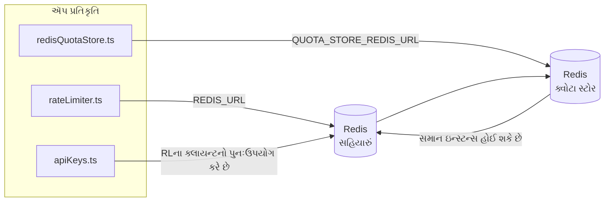

# Redis Production Configuration Guide (ગુજરાતી)

🌐 **Languages:** 🇺🇸 [English](../../../../ops/REDIS_PRODUCTION_CONFIG.md) · 🇪🇹 [am](../../../am/docs/ops/REDIS_PRODUCTION_CONFIG.md) · 🇸🇦 [ar](../../../ar/docs/ops/REDIS_PRODUCTION_CONFIG.md) · 🇦🇿 [az](../../../az/docs/ops/REDIS_PRODUCTION_CONFIG.md) · 🇧🇬 [bg](../../../bg/docs/ops/REDIS_PRODUCTION_CONFIG.md) · 🇧🇩 [bn](../../../bn/docs/ops/REDIS_PRODUCTION_CONFIG.md) · 🇧🇦 [bs](../../../bs/docs/ops/REDIS_PRODUCTION_CONFIG.md) · 🇨🇿 [cs](../../../cs/docs/ops/REDIS_PRODUCTION_CONFIG.md) · 🇩🇰 [da](../../../da/docs/ops/REDIS_PRODUCTION_CONFIG.md) · 🇩🇪 [de](../../../de/docs/ops/REDIS_PRODUCTION_CONFIG.md) · 🇬🇷 [el](../../../el/docs/ops/REDIS_PRODUCTION_CONFIG.md) · 🇪🇸 [es](../../../es/docs/ops/REDIS_PRODUCTION_CONFIG.md) · 🇪🇪 [et](../../../et/docs/ops/REDIS_PRODUCTION_CONFIG.md) · 🇮🇷 [fa](../../../fa/docs/ops/REDIS_PRODUCTION_CONFIG.md) · 🇫🇮 [fi](../../../fi/docs/ops/REDIS_PRODUCTION_CONFIG.md) · 🇫🇷 [fr](../../../fr/docs/ops/REDIS_PRODUCTION_CONFIG.md) · 🇮🇪 [ga](../../../ga/docs/ops/REDIS_PRODUCTION_CONFIG.md) · 🇳🇬 [ha](../../../ha/docs/ops/REDIS_PRODUCTION_CONFIG.md) · 🇮🇱 [he](../../../he/docs/ops/REDIS_PRODUCTION_CONFIG.md) · 🇮🇳 [hi](../../../hi/docs/ops/REDIS_PRODUCTION_CONFIG.md) · 🇭🇷 [hr](../../../hr/docs/ops/REDIS_PRODUCTION_CONFIG.md) · 🇭🇺 [hu](../../../hu/docs/ops/REDIS_PRODUCTION_CONFIG.md) · 🇦🇲 [hy](../../../hy/docs/ops/REDIS_PRODUCTION_CONFIG.md) · 🇮🇩 [id](../../../id/docs/ops/REDIS_PRODUCTION_CONFIG.md) · 🇳🇬 [ig](../../../ig/docs/ops/REDIS_PRODUCTION_CONFIG.md) · 🇮🇹 [it](../../../it/docs/ops/REDIS_PRODUCTION_CONFIG.md) · 🇯🇵 [ja](../../../ja/docs/ops/REDIS_PRODUCTION_CONFIG.md) · 🇬🇪 [ka](../../../ka/docs/ops/REDIS_PRODUCTION_CONFIG.md) · 🇰🇭 [km](../../../km/docs/ops/REDIS_PRODUCTION_CONFIG.md) · 🇮🇳 [kn](../../../kn/docs/ops/REDIS_PRODUCTION_CONFIG.md) · 🇰🇷 [ko](../../../ko/docs/ops/REDIS_PRODUCTION_CONFIG.md) · 🇱🇹 [lt](../../../lt/docs/ops/REDIS_PRODUCTION_CONFIG.md) · 🇱🇻 [lv](../../../lv/docs/ops/REDIS_PRODUCTION_CONFIG.md) · 🇮🇳 [ml](../../../ml/docs/ops/REDIS_PRODUCTION_CONFIG.md) · 🇮🇳 [mr](../../../mr/docs/ops/REDIS_PRODUCTION_CONFIG.md) · 🇲🇾 [ms](../../../ms/docs/ops/REDIS_PRODUCTION_CONFIG.md) · 🇲🇹 [mt](../../../mt/docs/ops/REDIS_PRODUCTION_CONFIG.md) · 🇲🇲 [my](../../../my/docs/ops/REDIS_PRODUCTION_CONFIG.md) · 🇳🇵 [ne](../../../ne/docs/ops/REDIS_PRODUCTION_CONFIG.md) · 🇳🇱 [nl](../../../nl/docs/ops/REDIS_PRODUCTION_CONFIG.md) · 🇳🇴 [no](../../../no/docs/ops/REDIS_PRODUCTION_CONFIG.md) · 🇮🇳 [or](../../../or/docs/ops/REDIS_PRODUCTION_CONFIG.md) · 🇮🇳 [pa](../../../pa/docs/ops/REDIS_PRODUCTION_CONFIG.md) · 🇵🇭 [phi](../../../phi/docs/ops/REDIS_PRODUCTION_CONFIG.md) · 🇵🇱 [pl](../../../pl/docs/ops/REDIS_PRODUCTION_CONFIG.md) · 🇵🇹 [pt](../../../pt/docs/ops/REDIS_PRODUCTION_CONFIG.md) · 🇧🇷 [pt-BR](../../../pt-BR/docs/ops/REDIS_PRODUCTION_CONFIG.md) · 🇷🇴 [ro](../../../ro/docs/ops/REDIS_PRODUCTION_CONFIG.md) · 🇷🇺 [ru](../../../ru/docs/ops/REDIS_PRODUCTION_CONFIG.md) · 🇱🇰 [si](../../../si/docs/ops/REDIS_PRODUCTION_CONFIG.md) · 🇸🇰 [sk](../../../sk/docs/ops/REDIS_PRODUCTION_CONFIG.md) · 🇸🇮 [sl](../../../sl/docs/ops/REDIS_PRODUCTION_CONFIG.md) · 🇷🇸 [sr](../../../sr/docs/ops/REDIS_PRODUCTION_CONFIG.md) · 🇸🇪 [sv](../../../sv/docs/ops/REDIS_PRODUCTION_CONFIG.md) · 🇰🇪 [sw](../../../sw/docs/ops/REDIS_PRODUCTION_CONFIG.md) · 🇮🇳 [ta](../../../ta/docs/ops/REDIS_PRODUCTION_CONFIG.md) · 🇮🇳 [te](../../../te/docs/ops/REDIS_PRODUCTION_CONFIG.md) · 🇹🇭 [th](../../../th/docs/ops/REDIS_PRODUCTION_CONFIG.md) · 🇹🇷 [tr](../../../tr/docs/ops/REDIS_PRODUCTION_CONFIG.md) · 🇺🇦 [uk-UA](../../../uk-UA/docs/ops/REDIS_PRODUCTION_CONFIG.md) · 🇵🇰 [ur](../../../ur/docs/ops/REDIS_PRODUCTION_CONFIG.md) · 🇺🇿 [uz](../../../uz/docs/ops/REDIS_PRODUCTION_CONFIG.md) · 🇻🇳 [vi](../../../vi/docs/ops/REDIS_PRODUCTION_CONFIG.md) · 🇳🇬 [yo](../../../yo/docs/ops/REDIS_PRODUCTION_CONFIG.md) · 🇨🇳 [zh-CN](../../../zh-CN/docs/ops/REDIS_PRODUCTION_CONFIG.md) · 🇹🇼 [zh-TW](../../../zh-TW/docs/ops/REDIS_PRODUCTION_CONFIG.md)

---

## અવલોકન

Redis એ OmniRoute માં એક **વૈકલ્પિક, નરમ નિર્ભરતા** છે — Redis ઉપલબ્ધ ન હોય ત્યારે એપ્લિકેશન સુવ્યવસ્થિત રીતે ક્ષમતા ઘટાડે છે (ઇન-મેમરી
ફૉલબૅકનો ઉપયોગ કરે છે). પ્રોડક્શનમાં, Redis ને ટ્યુન કરવાથી ચાર અલગ
વર્કલોડ માટે લેટન્સી ઘટે છે:

| વર્કલોડ               | ડ્રાઇવર                       | ક્લાયન્ટ ફેક્ટરી                             | કી પેટર્ન                                                        |
| --------------------- | ----------------------------- | -------------------------------------------- | ---------------------------------------------------------------- |
| રેટ લિમિટિંગ          | `rateLimiter.ts`              | `getRedisClient()` — લેઝી `ioredis` સિંગલટન  | `<prefix>rl:*` Lua‑એટોમિક રેટ લિમિટ વિન્ડો                       |
| ઑથ કૅશ                | `apiKeys.ts`                  | `rateLimiter` ના ક્લાયન્ટનો પુનઃઉપયોગ કરે છે | TTL સાથે `<prefix>auth:api_key:<sha256>`                         |
| ક્વોટા સ્ટોર          | `redisQuotaStore.ts`          | અલગ `getRedisClient(url)` સિંગલટન            | `<prefix>quota:*` દરેક ઇન્સ્ટન્સ માટે રૂપરેખાંકિત કરી શકાય તેવું |
| વૉર્મઅપ સર્કિટ બ્રેકર | `redisCircuitBreakerStore.ts` | `circuitBreakerFactory.ts` માં અલગ ક્લાયન્ટ  | `<prefix>warmup:cb:<connectionId>`                               |

ચારેય વર્કલોડ એક જ નેમસ્પેસ પ્રીફિક્સ શેર કરે છે, જેથી OmniRoute એક જ Redis ઇન્સ્ટન્સ પર અન્ય એપ્લિકેશનો સાથે
સહઅસ્તિત્વ રાખી શકે (દા.ત. `127.0.0.1:6379`). [કી નેમસ્પેસિંગ](#key-namespacing) જુઓ.

---

## વર્તમાન રૂપરેખાંકન (કોડ ડિફૉલ્ટ)

| સેટિંગ                          | મૂલ્ય                                                        | સ્થાન                                                                                 |
| ------------------------------- | ------------------------------------------------------------ | ------------------------------------------------------------------------------------- |
| `REDIS_URL` env var             | `redis://redis:6379` (compose), વૈકલ્પિક                     | `rateLimiter.ts:5`, `.env.example`                                                    |
| `REDIS_KEY_PREFIX` env var      | `omniroute:` (ડિફૉલ્ટ)                                       | `rateLimiter.ts`, `redisQuotaStore.ts`, `redisCircuitBreakerStore.ts`, `.env.example` |
| `QUOTA_STORE_REDIS_URL` env var | અલગ, `REDIS_URL` થી ભિન્ન હોઈ શકે છે                         | `quota/storeFactory.ts`                                                               |
| `QUOTA_STORE_DRIVER`            | `"sqlite"` (ડિફૉલ્ટ), `"redis"` વૈકલ્પિક                     | `quota/storeFactory.ts`                                                               |
| ioredis `maxRetriesPerRequest`  | `3`                                                          | `rateLimiter.ts` ક્લાયન્ટ બનાવતી વખતે                                                 |
| `enableReadyCheck`              | સેટ કરેલું નથી (ioredis ડિફૉલ્ટ: `true`)                     | —                                                                                     |
| `lazyConnect`                   | સેટ કરેલું નથી (ioredis ડિફૉલ્ટ: `false`)                    | —                                                                                     |
| `retryStrategy`                 | સેટ કરેલું નથી (ioredis ડિફૉલ્ટ: 200ms આધાર, એક્સપોનેન્શિયલ) | —                                                                                     |
| TLS / પાસવર્ડ / DB ઇન્ડેક્સ     | **રૂપરેખાંકિત કરેલા નથી**                                    | —                                                                                     |
| Sentinel / Cluster              | **રૂપરેખાંકિત કરેલા નથી** — માત્ર સ્ટૅન્ડઅલોન સિંગલ-નોડ      | —                                                                                     |

---

## કી નેમસ્પેસિંગ

OmniRoute હોસ્ટ પર ચાલતી અન્ય સેવાઓ સાથે Redis ઇન્સ્ટન્સ શેર કરે છે. નેમસ્પેસ વિના,
`auth:api_key:<sha256>` અથવા `rl:*` જેવી કીઓ સમાન Redis નો ઉપયોગ કરતી અન્ય એપ્લિકેશનોની
કીઓ સાથે અથડાઈ શકે છે (આ ઇન્સ્ટન્સ અન્ય સેવાઓની સાથે `127.0.0.1:6379` પર Redis ચલાવે છે).

OmniRoute ની **દરેક** કી પહેલાં પ્રીફિક્સ ઉમેરવા માટે `REDIS_KEY_PREFIX` ને ખાલી ન હોય તેવી સ્ટ્રિંગ પર સેટ કરો:

```bash
# .env — બધી OmniRoute કીઓ omniroute:rl:*, omniroute:auth:*, omniroute:quota:*, omniroute:warmup:cb:* બને છે
REDIS_KEY_PREFIX=omniroute:
```

- **ડિફૉલ્ટ:** `omniroute:` (`REDIS_KEY_PREFIX` સેટ ન હોય અથવા ખાલી હોય ત્યારે લાગુ પડે છે).
- **આના પર લાગુ પડે છે:** રેટ લિમિટર + ઑથ કૅશ (`keyPrefix` મારફતે શેર કરેલો `ioredis` ક્લાયન્ટ) અને
  ક્વોટા સ્ટોર (`KEY_PREFIX = "${REDIS_KEY_PREFIX}quota"`) તથા વૉર્મઅપ સર્કિટ બ્રેકર
  (`KEY_PREFIX = "${REDIS_KEY_PREFIX}warmup:cb:"`).
- Redis માં કીઓ પહેલેથી અસ્તિત્વ ધરાવતી હોય ત્યારે **પ્રીફિક્સ બદલવાથી** જૂની કીઓ અનાથ બની જાય છે (તેઓ
  TTL / LRU મારફતે સમાપ્ત થાય છે). તેને બદલવું સુરક્ષિત છે; કોઈ માઇગ્રેશનની જરૂર નથી. એકમાત્ર અપવાદ એ કનેક્શન માટેની વૉર્મઅપ
  સર્કિટ-બ્રેકર કી છે જેને પ્રતિબંધિત તરીકે ચિહ્નિત કરાયું હોય: તે TTL વિના કાયમી સંગ્રહિત થાય છે, તેથી
  બાકી રહેલી કીઓની યાદી મેળવવા માટે `redis-cli --scan --pattern '<old-prefix>warmup:cb:*'` ચલાવો અને તેમને કાઢી નાખો.
- **ioredis `keyPrefix`** લખતી વખતે આપમેળે પ્રીફિક્સ આગળ ઉમેરે છે **અને** વાંચતી વખતે તેને દૂર કરે છે,
  તેથી એપ્લિકેશન કોડને પ્રીફિક્સ ક્યારેય દેખાતો નથી.

---

## ભલામણ કરેલ ઉત્પાદન ટ્યુનિંગ

### 1. કનેક્શન પૂલ / ક્લાયન્ટ વિકલ્પો (ioredis `Redis` કન્સ્ટ્રક્ટર)

વર્તમાન કોડ કોઈ કસ્ટમ વિકલ્પો વિના એક જ `new Redis(url)` બનાવે છે. ઉત્પાદન મલ્ટિ-રેપ્લિકા ડિપ્લોયમેન્ટ માટે, કોડમાં ક્લાયંટ ફેક્ટરી પાસ કરો અથવા `getRedisClient()` લપેટી :

```typescript
const redis = new Redis(REDIS_URL, {
  maxRetriesPerRequest: null, // no retry limit; let retryStrategy decide
  enableReadyCheck: true, // verify server is ready before accepting calls
  lazyConnect: true, // don't connect on construction; wait for first call
  retryStrategy: (times) => {
    if (times > 10) return null; // give up after 10 retries → reconnect later
    return Math.min(times * 200, 5000); // 200ms, 400ms, …, 5s cap
  },
  enableAutoPipelining: true, // coalesce concurrent commands into one TCP write
  keepAlive: 10000, // TCP keep‑alive every 10s
});
```

**મુખ્ય ટ્રેડ-ઓફ:**

- ઉત્પાદન માટે`maxRetriesPerRequest: null` + `retryStrategy` — પસંદ કરવામાં આવે છે જેથી ક્ષણિક Redis પુનઃપ્રારંભ તરત જ દરેક વિનંતીને નિષ્ફળ ન કરે. `checkRateLimit()` માં ઇન-મેમરી ફોલબેક નિષ્ફળતાના માર્ગને શોષી લે છે.
- `lazyConnect: true` — સર્વર કનેક્શન્સ સ્વીકારવાનું શરૂ કરે તે પહેલાં Redis પર સ્ટાર્ટઅપ નિર્ભરતાને ટાળે છે.
- `enableAutoPipelining: true` — સહવર્તી દર-મર્યાદા તપાસ માટે રાઉન્ડ-ટ્રીપ્સ ઘટાડે છે; એક જ કનેક્શન પર > 50 RPS પર ફાયદાકારક.

### 2. Redis સર્વર રૂપરેખાંકન (`redis.conf`)

```
# Memory
maxmemory 80%                        # leave room for OS page cache
maxmemory-policy allkeys-lru         # evict stale auth cache entries under pressure

# Persistence (optional — OmniRoute is crash‑safe without it)
save 300 1                           # snapshot at least every 5 min if ≥1 key changed
appendonly no                        # AOF not needed; data is regeneratable
appendfsync no                       # no fsync overhead (RDB is sufficient)

# Networking
timeout 0                            # no idle disconnect
tcp-keepalive 300                    # 5 min keep‑alive
tcp-backlog 511                      # connection backlog for bursty load

# Performance
hz 10                                # default; 100 for latency‑sensitive
activedefrag yes                     # auto‑defragment when fragmentation >10%
```

**`maxmemory-policy allkeys-lru` માટે ટ્રેડ-ઓફ:** મેમરી પ્રેશર હેઠળ ઓથ કેશ એન્ટ્રીઓ કાઢી નાખવામાં આવી શકે છે. આ સલામત છે — `setCachedApiKey` હંમેશા ચૂકી જવા પર ફરીથી ભરાય છે, અને SQLite ફોલબેક અધિકૃત છે. રેટ-લિમિટર લુઆ સ્ક્રિપ્ટ નાની કી બનાવે છે જે ડિઝાઇન દ્વારા અલ્પજીવી હોય છે.

### 3. Docker કંપોઝ સેટિંગ્સ

પ્રોડ કંપોઝ (`docker-compose.prod.yml`) `redis:8.6.2-alpine` ઉપયોગ કરે છે. ઉમેરો:

```yaml
redis:
  image: redis:8.6.2-alpine
  command:
    [
      "redis-server",
      "--maxmemory",
      "512mb",
      "--maxmemory-policy",
      "allkeys-lru",
      "--activedefrag",
      "yes",
      "--save",
      "300 1",
    ]
  healthcheck:
    test: ["CMD", "redis-cli", "ping"]
    interval: 10s
    timeout: 3s
    retries: 3
    start_period: 5s
```

### 4. મલ્ટી-ઇન્સ્ટન્સ / સ્કેલિંગ વિચારણાઓ

**તમામ પ્રતિકૃતિઓ માટે સિંગલ Redis** — દર-મર્યાદા લુઆ સ્ક્રિપ્ટ એક અધિકૃત કી જગ્યા પર આધાર રાખે છે. પ્રતિકૃતિઓ પાછળના બહુવિધ Redis ઉદાહરણો પરમાણુ ગુમાવશે અને બજેટ બમણું કરશે. તમામ એપ્લિકેશન પ્રતિકૃતિઓ માટે એક જ Redis (અથવા ફેલઓવર સાથે Redis સેન્ટીનેલ ક્લસ્ટર) નો ઉપયોગ કરો.

**કનેક્શન સંખ્યા:** દરેક એપ્લિકેશન પ્રતિકૃતિ ખુલે છે** 2 TCP જોડાણો** માટે Redis (રેટ લિમિટર ક્લાયન્ટ + ક્વોટા સ્ટોર ક્લાયન્ટ). 10 પ્રતિકૃતિઓ → 20 જોડાણો પર, ડિફોલ્ટ Redis ઉદાહરણની 10k કનેક્શન ટોચમર્યાદાની અંદર.

### 5. મોનીટરીંગ

હેલ્થ-ચેક એન્ડપોઇન્ટ દ્વારા એક્સપોઝ કરો:

```typescript
// src/app/api/monitoring/health/route.ts already calls rateLimiter functions
// Add Redis-specific checks:
//   1. PING latency via ioredis .ping()
//   2. Memory usage via INFO memory
//   3. Connection count via INFO clients
//   4. Hit rate for maxmemory-policy (evicted_keys / keyspace_hits)
```

જોવા માટેના મુખ્ય મેટ્રિક્સ:

- **બહાર કાઢવામાં આવેલી કીઓ / સેકન્ડ** — જો સતત બિન-શૂન્ય હોય, તો `maxmemory` વધારો
- **અવરોધિત ગ્રાહકો** — નોન-ઝીરો ધીમી લુઆ સ્ક્રિપ્ટ્સ અથવા ઉચ્ચ વિવાદ સૂચવે છે
- **નકારેલ જોડાણો** — જોડાણ મર્યાદા હિટ; 20 જોડાણો પર દુર્લભ

### 6. Redis-સુસંગત સર્વર્સ

અહીં ઉપયોગમાં લેવાતા કોઈપણ સર્વરને લુઆ સ્ક્રિપ્ટ્સ ચલાવવા જોઈએ: દર મર્યાદા એક `EVAL` છે. લુઆ વગરના સર્વર પર, `checkRateLimit()` `[RATE_LIMITER] Redis eval failed, falling back to in-memory rate limiting` લોગ કરે છે અને પ્રક્રિયા દીઠ ગણતરી કરે છે, તેથી દરેક પ્રતિકૃતિ તેની પોતાની મર્યાદાને લાગુ કરે છે. પસંદ કરેલ શેર કરેલ સેશન-એફિનિટી સ્ટોર (`OMNIROUTE_SESSION_AFFINITY_STORE=redis`) પણ `EVAL` સાથે પિન વાંચે છે અને અપડેટ કરે છે; લુઆ વિના તે `[SESSION_AFFINITY] Redis error; falling back to SQLite.` લૉગ કરે છે અને દરેક પ્રતિકૃતિ તેની પોતાની પિન રાખે છે. અન્ય વર્કલોડ સાદા આદેશોનો ઉપયોગ કરે છે (`SET ... EX`, `GET`, `DEL`, `MGET`, `EXPIRE`, `INCRBYFLOAT`, હેશ અને સેટ), અને સિમેન્ટીક કેશનો Redis બેકએન્ડ કોઈ `FT.*` આદેશો મોકલતો નથી.

તેની લુઆ ઇમેજ (`kividb/kividb:v1.2.0-lua`) સાથે OmniRoute 3.8.52: KiviDB 1.2.0 સાથે પરીક્ષણ કર્યું. રેટ લિમિટર (કાઉન્ટર્સ શેર કરવાની બીજી પ્રક્રિયા સહિત), ઓથ કેશ, ક્વોટા સ્ટોર, વોર્મઅપ સર્કિટ બ્રેકર, સિમેન્ટીક કેશ સ્ટોર, અને ચેટ હેન્ડલર દ્વારા `/v1/chat/completions` વિનંતીએ 19 ચેકમાંથી 18 પાસ કર્યા છે જે Redis 8.10.3 પર પસાર થાય છે. જે અલગ છે: `INCRBYFLOAT` `0.1 + 0.2` `0.30000000000000004` તરીકે સ્ટોર કરે છે જ્યાં Redis `0.3` ( [kividbio/kividb#387](https://github.com/kividbio/kividb/issues/387) ) સ્ટોર કરે છે. ક્વોટા સ્ટોર બંનેને `parseFloat` વડે પાર્સ કરે છે, પરંતુ બે નંબરો છેલ્લા અંકોમાં અલગ પડે છે, તેથી ક્વોટા બાઉન્ડ્રી પર બરાબર આવતી સરખામણી અલગ રીતે બહાર આવી શકે છે. સેશન-એફિનિટી સ્ટોર તે રનનો ભાગ ન હતો. ( [સેટઅપ](https://github.com/kividbio/kividb/blob/master/docs/integrations/omniroute.md), [પરિણામો](https://github.com/kividbio/kividb/tree/master/benchmarks/omniroute-compat) )

---

## આર્કિટેક્ચર આકૃતિ



---

## સંદર્ભો

| ફાઇલ                               | હેતુ                                                              |
| ---------------------------------- | ----------------------------------------------------------------- |
| `src/shared/utils/rateLimiter.ts`  | પ્રાથમિક Redis ક્લાયન્ટ, Lua રેટ-લિમિટ સ્ક્રિપ્ટ, ઇન-મેમરી ફૉલબૅક |
| `src/lib/db/apiKeys.ts`            | પ્રમાણીકરણ કૅશ — Redis→SQLite ફૉલબૅક                              |
| `src/lib/quota/redisQuotaStore.ts` | વૈકલ્પિક ક્વોટા સ્ટોર માટે અલગ Redis ક્લાયન્ટ                     |
| `src/lib/quota/storeFactory.ts`    | `sqlite` અને `redis` ક્વોટા ડ્રાઇવરો વચ્ચે સ્વિચ કરે છે           |
| `docker-compose.prod.yml`          | પ્રોડક્શન Redis કન્ટેનર (ઇમેજ `redis:8.6.2-alpine`)               |
| `.env.example`                     | Redis એન્વાયર્નમેન્ટ વેરિએબલ્સનું દસ્તાવેજીકરણ                    |
| `src/app/api/local/redis/`         | ડેવલપમેન્ટ કન્ટેનર ઓર્કેસ્ટ્રેશન માટેના API રૂટ્સ                 |
| `bin/cli/commands/redis.mjs`       | ડેવલપમેન્ટ કન્ટેનર ઓર્કેસ્ટ્રેશન માટેના CLI કમાન્ડ્સ              |
