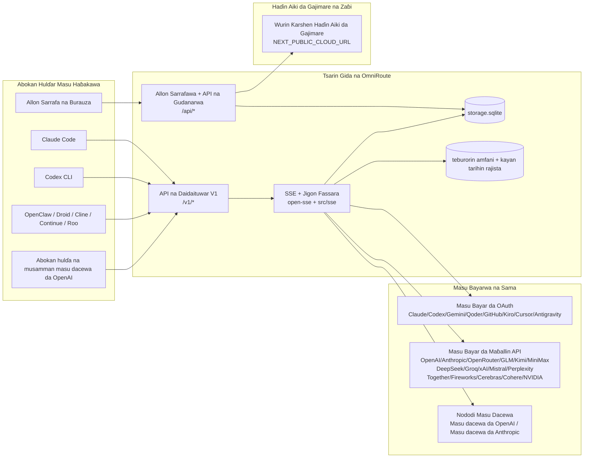
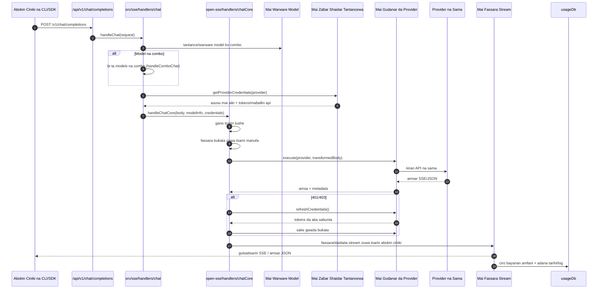
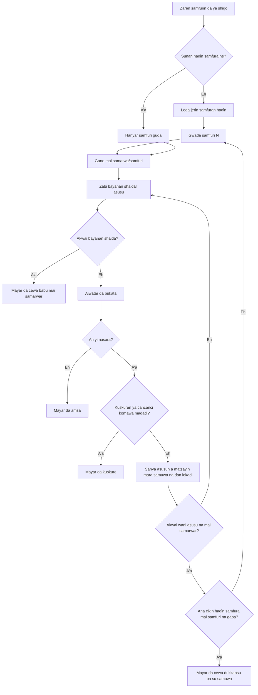
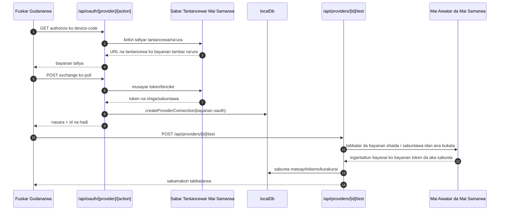
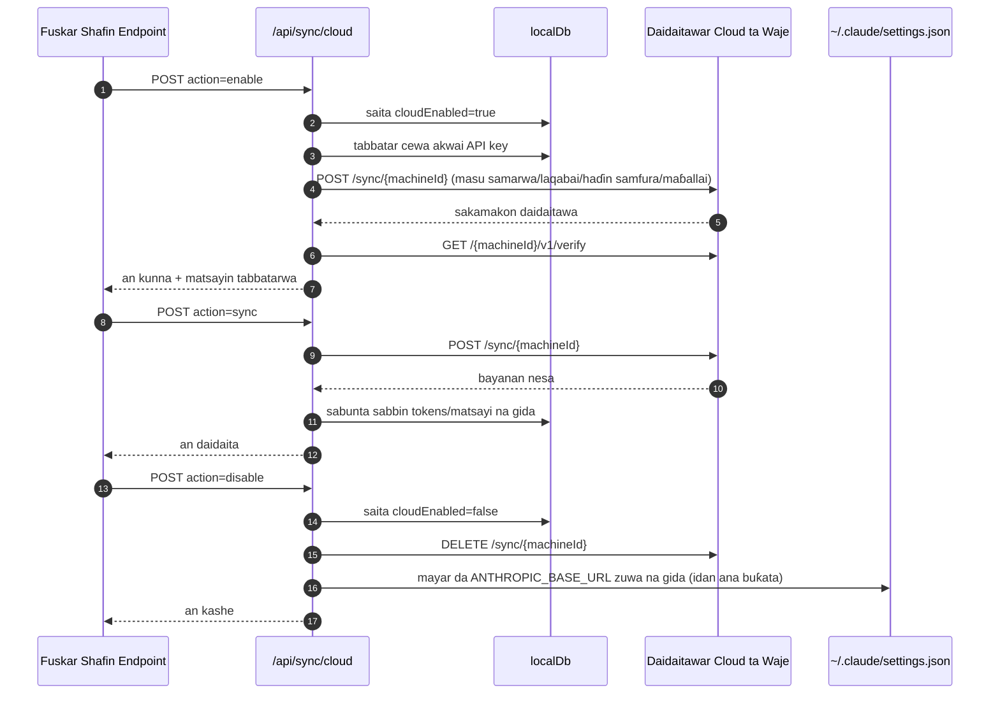
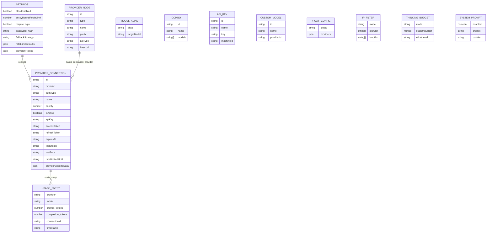
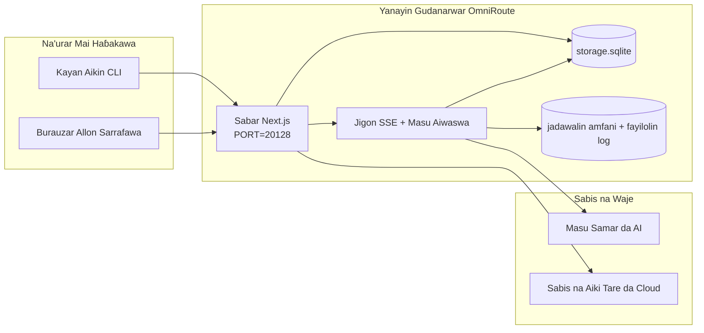

# OmniRoute Architecture (Hausa)

🌐 **Languages:** 🇺🇸 [English](../../../../architecture/ARCHITECTURE.md) · 🇪🇹 [am](../../../am/docs/architecture/ARCHITECTURE.md) · 🇸🇦 [ar](../../../ar/docs/architecture/ARCHITECTURE.md) · 🇦🇿 [az](../../../az/docs/architecture/ARCHITECTURE.md) · 🇧🇬 [bg](../../../bg/docs/architecture/ARCHITECTURE.md) · 🇧🇩 [bn](../../../bn/docs/architecture/ARCHITECTURE.md) · 🇧🇦 [bs](../../../bs/docs/architecture/ARCHITECTURE.md) · 🇨🇿 [cs](../../../cs/docs/architecture/ARCHITECTURE.md) · 🇩🇰 [da](../../../da/docs/architecture/ARCHITECTURE.md) · 🇩🇪 [de](../../../de/docs/architecture/ARCHITECTURE.md) · 🇬🇷 [el](../../../el/docs/architecture/ARCHITECTURE.md) · 🇪🇸 [es](../../../es/docs/architecture/ARCHITECTURE.md) · 🇪🇪 [et](../../../et/docs/architecture/ARCHITECTURE.md) · 🇮🇷 [fa](../../../fa/docs/architecture/ARCHITECTURE.md) · 🇫🇮 [fi](../../../fi/docs/architecture/ARCHITECTURE.md) · 🇫🇷 [fr](../../../fr/docs/architecture/ARCHITECTURE.md) · 🇮🇪 [ga](../../../ga/docs/architecture/ARCHITECTURE.md) · 🇮🇳 [gu](../../../gu/docs/architecture/ARCHITECTURE.md) · 🇮🇱 [he](../../../he/docs/architecture/ARCHITECTURE.md) · 🇮🇳 [hi](../../../hi/docs/architecture/ARCHITECTURE.md) · 🇭🇷 [hr](../../../hr/docs/architecture/ARCHITECTURE.md) · 🇭🇺 [hu](../../../hu/docs/architecture/ARCHITECTURE.md) · 🇦🇲 [hy](../../../hy/docs/architecture/ARCHITECTURE.md) · 🇮🇩 [id](../../../id/docs/architecture/ARCHITECTURE.md) · 🇳🇬 [ig](../../../ig/docs/architecture/ARCHITECTURE.md) · 🇮🇹 [it](../../../it/docs/architecture/ARCHITECTURE.md) · 🇯🇵 [ja](../../../ja/docs/architecture/ARCHITECTURE.md) · 🇬🇪 [ka](../../../ka/docs/architecture/ARCHITECTURE.md) · 🇰🇭 [km](../../../km/docs/architecture/ARCHITECTURE.md) · 🇮🇳 [kn](../../../kn/docs/architecture/ARCHITECTURE.md) · 🇰🇷 [ko](../../../ko/docs/architecture/ARCHITECTURE.md) · 🇱🇹 [lt](../../../lt/docs/architecture/ARCHITECTURE.md) · 🇱🇻 [lv](../../../lv/docs/architecture/ARCHITECTURE.md) · 🇮🇳 [ml](../../../ml/docs/architecture/ARCHITECTURE.md) · 🇮🇳 [mr](../../../mr/docs/architecture/ARCHITECTURE.md) · 🇲🇾 [ms](../../../ms/docs/architecture/ARCHITECTURE.md) · 🇲🇹 [mt](../../../mt/docs/architecture/ARCHITECTURE.md) · 🇲🇲 [my](../../../my/docs/architecture/ARCHITECTURE.md) · 🇳🇵 [ne](../../../ne/docs/architecture/ARCHITECTURE.md) · 🇳🇱 [nl](../../../nl/docs/architecture/ARCHITECTURE.md) · 🇳🇴 [no](../../../no/docs/architecture/ARCHITECTURE.md) · 🇮🇳 [or](../../../or/docs/architecture/ARCHITECTURE.md) · 🇮🇳 [pa](../../../pa/docs/architecture/ARCHITECTURE.md) · 🇵🇭 [phi](../../../phi/docs/architecture/ARCHITECTURE.md) · 🇵🇱 [pl](../../../pl/docs/architecture/ARCHITECTURE.md) · 🇵🇹 [pt](../../../pt/docs/architecture/ARCHITECTURE.md) · 🇧🇷 [pt-BR](../../../pt-BR/docs/architecture/ARCHITECTURE.md) · 🇷🇴 [ro](../../../ro/docs/architecture/ARCHITECTURE.md) · 🇷🇺 [ru](../../../ru/docs/architecture/ARCHITECTURE.md) · 🇱🇰 [si](../../../si/docs/architecture/ARCHITECTURE.md) · 🇸🇰 [sk](../../../sk/docs/architecture/ARCHITECTURE.md) · 🇸🇮 [sl](../../../sl/docs/architecture/ARCHITECTURE.md) · 🇷🇸 [sr](../../../sr/docs/architecture/ARCHITECTURE.md) · 🇸🇪 [sv](../../../sv/docs/architecture/ARCHITECTURE.md) · 🇰🇪 [sw](../../../sw/docs/architecture/ARCHITECTURE.md) · 🇮🇳 [ta](../../../ta/docs/architecture/ARCHITECTURE.md) · 🇮🇳 [te](../../../te/docs/architecture/ARCHITECTURE.md) · 🇹🇭 [th](../../../th/docs/architecture/ARCHITECTURE.md) · 🇹🇷 [tr](../../../tr/docs/architecture/ARCHITECTURE.md) · 🇺🇦 [uk-UA](../../../uk-UA/docs/architecture/ARCHITECTURE.md) · 🇵🇰 [ur](../../../ur/docs/architecture/ARCHITECTURE.md) · 🇺🇿 [uz](../../../uz/docs/architecture/ARCHITECTURE.md) · 🇻🇳 [vi](../../../vi/docs/architecture/ARCHITECTURE.md) · 🇳🇬 [yo](../../../yo/docs/architecture/ARCHITECTURE.md) · 🇨🇳 [zh-CN](../../../zh-CN/docs/architecture/ARCHITECTURE.md) · 🇹🇼 [zh-TW](../../../zh-TW/docs/architecture/ARCHITECTURE.md)

---

🌐 **Languages:** 🇺🇸 [English](../../../../architecture/ARCHITECTURE.md) · 🇪🇹 [am](../../../am/docs/architecture/ARCHITECTURE.md) · 🇸🇦 [ar](../../../ar/docs/architecture/ARCHITECTURE.md) · 🇦🇿 [az](../../../az/docs/architecture/ARCHITECTURE.md) · 🇧🇬 [bg](../../../bg/docs/architecture/ARCHITECTURE.md) · 🇧🇩 [bn](../../../bn/docs/architecture/ARCHITECTURE.md) · 🇧🇦 [bs](../../../bs/docs/architecture/ARCHITECTURE.md) · 🇨🇿 [cs](../../../cs/docs/architecture/ARCHITECTURE.md) · 🇩🇰 [da](../../../da/docs/architecture/ARCHITECTURE.md) · 🇩🇪 [de](../../../de/docs/architecture/ARCHITECTURE.md) · 🇬🇷 [el](../../../el/docs/architecture/ARCHITECTURE.md) · 🇪🇸 [es](../../../es/docs/architecture/ARCHITECTURE.md) · 🇪🇪 [et](../../../et/docs/architecture/ARCHITECTURE.md) · 🇮🇷 [fa](../../../fa/docs/architecture/ARCHITECTURE.md) · 🇫🇮 [fi](../../../fi/docs/architecture/ARCHITECTURE.md) · 🇫🇷 [fr](../../../fr/docs/architecture/ARCHITECTURE.md) · 🇮🇪 [ga](../../../ga/docs/architecture/ARCHITECTURE.md) · 🇮🇳 [gu](../../../gu/docs/architecture/ARCHITECTURE.md) · 🇮🇱 [he](../../../he/docs/architecture/ARCHITECTURE.md) · 🇮🇳 [hi](../../../hi/docs/architecture/ARCHITECTURE.md) · 🇭🇷 [hr](../../../hr/docs/architecture/ARCHITECTURE.md) · 🇭🇺 [hu](../../../hu/docs/architecture/ARCHITECTURE.md) · 🇦🇲 [hy](../../../hy/docs/architecture/ARCHITECTURE.md) · 🇮🇩 [id](../../../id/docs/architecture/ARCHITECTURE.md) · 🇳🇬 [ig](../../../ig/docs/architecture/ARCHITECTURE.md) · 🇮🇹 [it](../../../it/docs/architecture/ARCHITECTURE.md) · 🇯🇵 [ja](../../../ja/docs/architecture/ARCHITECTURE.md) · 🇬🇪 [ka](../../../ka/docs/architecture/ARCHITECTURE.md) · 🇰🇭 [km](../../../km/docs/architecture/ARCHITECTURE.md) · 🇮🇳 [kn](../../../kn/docs/architecture/ARCHITECTURE.md) · 🇰🇷 [ko](../../../ko/docs/architecture/ARCHITECTURE.md) · 🇱🇹 [lt](../../../lt/docs/architecture/ARCHITECTURE.md) · 🇱🇻 [lv](../../../lv/docs/architecture/ARCHITECTURE.md) · 🇮🇳 [ml](../../../ml/docs/architecture/ARCHITECTURE.md) · 🇮🇳 [mr](../../../mr/docs/architecture/ARCHITECTURE.md) · 🇲🇾 [ms](../../../ms/docs/architecture/ARCHITECTURE.md) · 🇲🇹 [mt](../../../mt/docs/architecture/ARCHITECTURE.md) · 🇲🇲 [my](../../../my/docs/architecture/ARCHITECTURE.md) · 🇳🇵 [ne](../../../ne/docs/architecture/ARCHITECTURE.md) · 🇳🇱 [nl](../../../nl/docs/architecture/ARCHITECTURE.md) · 🇳🇴 [no](../../../no/docs/architecture/ARCHITECTURE.md) · 🇮🇳 [or](../../../or/docs/architecture/ARCHITECTURE.md) · 🇮🇳 [pa](../../../pa/docs/architecture/ARCHITECTURE.md) · 🇵🇭 [phi](../../../phi/docs/architecture/ARCHITECTURE.md) · 🇵🇱 [pl](../../../pl/docs/architecture/ARCHITECTURE.md) · 🇵🇹 [pt](../../../pt/docs/architecture/ARCHITECTURE.md) · 🇧🇷 [pt-BR](../../../pt-BR/docs/architecture/ARCHITECTURE.md) · 🇷🇴 [ro](../../../ro/docs/architecture/ARCHITECTURE.md) · 🇷🇺 [ru](../../../ru/docs/architecture/ARCHITECTURE.md) · 🇱🇰 [si](../../../si/docs/architecture/ARCHITECTURE.md) · 🇸🇰 [sk](../../../sk/docs/architecture/ARCHITECTURE.md) · 🇸🇮 [sl](../../../sl/docs/architecture/ARCHITECTURE.md) · 🇷🇸 [sr](../../../sr/docs/architecture/ARCHITECTURE.md) · 🇸🇪 [sv](../../../sv/docs/architecture/ARCHITECTURE.md) · 🇰🇪 [sw](../../../sw/docs/architecture/ARCHITECTURE.md) · 🇮🇳 [ta](../../../ta/docs/architecture/ARCHITECTURE.md) · 🇮🇳 [te](../../../te/docs/architecture/ARCHITECTURE.md) · 🇹🇭 [th](../../../th/docs/architecture/ARCHITECTURE.md) · 🇹🇷 [tr](../../../tr/docs/architecture/ARCHITECTURE.md) · 🇺🇦 [uk-UA](../../../uk-UA/docs/architecture/ARCHITECTURE.md) · 🇵🇰 [ur](../../../ur/docs/architecture/ARCHITECTURE.md) · 🇺🇿 [uz](../../../uz/docs/architecture/ARCHITECTURE.md) · 🇻🇳 [vi](../../../vi/docs/architecture/ARCHITECTURE.md) · 🇳🇬 [yo](../../../yo/docs/architecture/ARCHITECTURE.md) · 🇨🇳 [zh-CN](../../../zh-CN/docs/architecture/ARCHITECTURE.md) · 🇹🇼 [zh-TW](../../../zh-TW/docs/architecture/ARCHITECTURE.md)

_An sabunta na ƙarshe: 2026-06-28_

## Takaitaccen Bayani

OmniRoute kofa ce ta AI da kuma dashboard da aka gina akan Next.js. Yana ba da madaidaicin madaidaicin OpenAI guda ɗaya (`/v1/*`) da hanyoyin zirga-zirgar ababen hawa da yawa tare da fassarar, faɗuwa, wartsakewa, da bin diddigin amfani.

Babban damar iyawa:

- Buɗe AI mai dacewa da API surface don CLI/tools (Masu samar da 394, 159 masu zartarwa)
- fassarar Request/response a cikin tsarin mai bayarwa
- Model combo fallback (jerin samfuri da yawa)
- Matakan haɗe-haɗe (`provider + model + connection`) tare da oda lokacin aiki ta `compositeTiers`
- koma baya matakin-asusu (asusu da yawa ga mai bayarwa)
- Ƙididdigar farko da zaɓin asusun P2C mai ƙididdigewa a babban hanyar taɗi
- OAuth + API-maɓalli mai ba da haɗin haɗin kai (na'urorin mai bada OAuth 27)
- Haɗa tsara ta hanyar `/v1/embeddings` (masu samarwa 18)
- Ƙirƙirar hoto ta hanyar `/v1/images/generations` (masu samar da + 10, ƙirar + 20)
- Rubutun sauti ta hanyar `/v1/audio/transcriptions` (masu samarwa 18)
- Rubutu-zuwa-magana ta hanyar `/v1/audio/speech` (masu samar da ciki 24)
- Ƙirƙirar bidiyo ta hanyar `/v1/videos/generations` (ComfyUI + SD WebUI)
- Ƙirƙirar kiɗa ta hanyar `/v1/music/generations` (ComfyUI)
- Binciken Yanar Gizo ta hanyar `/v1/search` (masu samarwa 20)
- Daidaitawa ta hanyar `/v1/moderations`
- Reranking via `/v1/rerank`
- Ka yi tunanin karkatar da alamar (`<think>...</think>`) don ƙirar tunani
- Tsaftatar amsawa don tsananin dacewa OpenAI SDK
- Daidaita rawar aiki (tsarin → mai haɓakawa, mai amfani da tsarin →) don daidaitawar mai bayarwa
- Canjin fitarwa da aka tsara (json_schema → Gemini responseSchema)
- Dagewar gida don masu samarwa, maɓallai, laƙabi, haɗe-haɗe, saituna, farashi (Modules 122 DB )
- bin diddigin Usage/cost da neman shiga
- Aiki tare na zaɓi na girgije don daidaita multi-device/state
- IP allowlist/blocklist don sarrafa damar API
- Gudanar da kasafin kuɗi (passthrough/auto/custom/adaptive)
- Tsarin duniya da gaggawa allura
- Bin sawun zama da buga yatsa
- Ƙididdigar ƙimar kowane-asusu tare da takamaiman bayanan mai bada sabis
- Tsarin keɓaɓɓen kewayawa don juriya na mai bayarwa
- Kariyar garken garken tsawa tare da kulle baki
- cache na tushen sa hannu
- Domain Layer: dokokin farashi, manufar koma baya, manufar kullewa
- Fassara Magana: Takaitattun abubuwan hannu don ci gaba da jujjuya asusu
- Dagewar jihar yanki (SQLite rubuta-ta hanyar cache don koma baya, kasafin kuɗi, makullai, masu watsewa)
- Injin siyasa don kimanta buƙatun tsakiya (kulle → kasafin kudin → fallback)
- Nemi na'urar sadarwa tare da tara latency p50/p95/p99
- Combo manufa na'urar hangen nesa da tarihin haduwar kiwon lafiya manufa ta hanyar `combo_execution_key` / `combo_step_id`
- Daidaita ID (X-Request-Id) don gano ƙarshen zuwa ƙarshe
- Bincika rajistan shiga tare da ficewa ta kowane maɓallin API
- Tsarin kimantawa don tabbatar da ingancin LLM
- Dashboard na lafiya tare da ainihin mai ba da sabis na keɓancewa
- MCP Server (kayan aikin 110) tare da jigilar kayayyaki 3 (stdio/SSE/Streamable HTTP)
- uwar garken A2A (JSON-RPC 2.0 + SSE) tare da ƙwarewa da zagayen rayuwa
- Tsarin ƙwaƙwalwar ajiya (hako, allura, maidowa, taƙaitawa)
- Tsarin gwaninta (rajista, mai zartarwa, akwatin sandbox, gwaninta na ciki)
- MITM wakili tare da gudanar da takaddun shaida da sarrafa DNS
- Tsakanin allura mai gadi na gaggawa
- Bututun matsawa da sauri tare da Caveman, RTK, bututun da aka dasa, damfara combos, fakitin harshe, da nazari
- ACP (Agent Communication Protocol) rajista
- Masu samar da OAuth na yau da kullun (Modules guda 22 a ƙarƙashin `src/lib/oauth/providers/`)
- rubutun Uninstall/full-uninstall
- aikin gyaran muhalli OAuth
- gadar WebSocket don abokan cinikin WS masu jituwa na OpenAI (`/v1/ws`)
- Gudanar da alamar daidaitawa (issue/revoke, ETag-versioned config bundle download)
- GLM Tunani (`glmt`) saitaccen mai bada sabis na farko
- Ƙididdiga masu haɗaka ( `/messages/count_tokens` -gefen mai bayarwa tare da ƙididdige ƙididdiga)
- Model wanda ake kira auto-seeding (30 + cross-proxy yaren daidaitawa a farawa)
- Amintaccen fitar da fita tare da gadin SSRF, toshe URL mai zaman kansa, da sake gwadawa mai daidaitawa
- Cooldown-sane ta sake yin taɗi tare da daidaitawar `requestRetry` da `maxRetryIntervalSec`
- Tabbatar da yanayin lokacin aiki tare da Zod a farawa
- Bincika v2 tare da pagination, mai bada abubuwan CRUD, da SSRF-katange rajistar tabbatarwa

Samfurin lokacin aiki na farko:

- hanyoyin Next.js app karkashin `src/app/api/*` aiwatar da duka dashboard APIs da dacewa APIs
- Zuciyar SSE/routing da aka raba a cikin `src/sse/*` + `open-sse/*` tana sarrafa aiwatar da mai badawa, fassarar, yawo, koma baya, da amfani

## Zanen Bayani

Tabbatattun tushen Mermaid masu sarrafa siga na dandalin v3.8.0 suna cikin
[`docs/diagrams/`](../diagrams/README.md). An sake nuna guda biyu a ƙasa don fahimtar tsarin;
sauran suna da hanyoyin haɗi daga jagororinsu na takamaiman fanni.


> Tushen: [diagrams/request-pipeline.mmd](../diagrams/request-pipeline.mmd)


> Tushen: [diagrams/resilience-3layers.mmd](../diagrams/resilience-3layers.mmd) — an kuma haɗa shi daga
> [RESILIENCE_GUIDE.md](./RESILIENCE_GUIDE.md) da bayanin juriya na `CLAUDE.md`.

## Iyaka da Abubuwan da Aka Ƙunsa

### Abubuwan da Aka Ƙunsa

- Yanayin gudanar da ƙofar shiga na cikin gida
- API na sarrafa dashboard
- Tabbatar da sahihancin mai samarwa da sabunta token
- Fassarar buƙata da yaɗawar SSE
- Adana halin cikin gida + bayanan amfani
- Tsara aiki tare da gajimare na zaɓi

### Abubuwan da Ba a Ƙunsa ba

- Aiwatar da sabis ɗin gajimare da ke bayan `NEXT_PUBLIC_CLOUD_URL`
- SLA/filin sarrafa mai samarwa da ke wajen tsarin cikin gida
- Su kansu binaries na CLI na waje (Claude CLI, Codex CLI, da sauransu)

## Fuskar Dashboard (A Yanzu)

Manyan shafukan da ke ƙarƙashin `src/app/(dashboard)/dashboard/`:

- `/dashboard` — farawa cikin sauri + bayani game da masu samarwa
- `/dashboard/endpoint` — wakilin endpoint + MCP + A2A + shafukan endpoint na API
- `/dashboard/providers` — haɗin masu samarwa da bayanan shaida
- `/dashboard/combos` — dabarun combo, samfura, magini mai matakai, ƙa'idojin karkatar da samfura, da jeri mai ɗorewa da ake yi da hannu
- `/dashboard/auto-combo` — Injin Auto Combo: ma'aunin maki, tarin yanayi, saitattun ƙimar masana'anta ta kama-da-wane, da telemetri
- `/dashboard/costs` — tara kuɗaɗe da bayyana farashi
- `/dashboard/analytics` — nazarin amfani, kimantawa, da lafiyar maƙasudin combo
- `/dashboard/limits` — sarrafa ƙayyadaddun kaso/sauri
- `/dashboard/cli-tools` — shiryarwar fara amfani da CLI, gano yanayin aiki, da samar da saituna
- `/dashboard/agents` — wakilan ACP da aka gano + rajistar wakili na musamman
- `/dashboard/cloud-agents` — ayyukan wakilai da aka masauƙa a gajimare (Codex Cloud, Devin, Jules) da zagayowar rayuwar aiki
- `/dashboard/skills` — rajistar ƙwarewar A2A, aiwatarwa a sandbox, da kundin ƙwarewar da aka gina a ciki
- `/dashboard/memory` — dubawa da dawo da ƙwaƙwalwar tattaunawa mai ɗorewa
- `/dashboard/webhooks` — rajistar webhook masu fita, sabunta sirri, da ƙididdigar sake gwadawa
- `/dashboard/batch` — miƙa ayyukan rukuni da bin diddigin ci gaba
- `/dashboard/cache` — ƙididdigar cache na read-through da tunani, da sarrafa gogewa
- `/dashboard/playground` — filin gwajin hira mai hulɗa da kowane combo/samfuri da aka saita
- `/dashboard/changelog` — mai nuna rajistar sauye-sauye a cikin manhaja (yana nuna `CHANGELOG.md`)
- `/dashboard/system` — binciken yanayin aiki, bayanan siga, da fuskar tabbatar da muhalli
- `/dashboard/onboarding` — mayen saitin amfani na farko don sabbin girkawa
- `/dashboard/media` — filin gwajin hoto/bidiyo/kiɗa
- `/dashboard/search-tools` — gwajin masu samar da bincike da tarihin bincike
- `/dashboard/health` — lokacin aiki, masu katse da'ira, iyakokin sauri, da zaman da ake sa ido kan ƙayyadaddun kasonsu
- `/dashboard/logs` — rajistan buƙata/wakili/binciken aiki/console
- `/dashboard/settings` — shafukan saitunan tsarin (na gaba ɗaya, karkatarwa, saitattun ƙimar combo, da sauransu)
- `/dashboard/context/caveman` — ƙa'idojin matsewa na Caveman, fakitin harsuna, samfoti, da yanayin fitarwa
- `/dashboard/context/rtk` — matatan fitarwar umarnin RTK, samfoti, da saitunan amincin yanayin aiki
- `/dashboard/context/combos` — jerin ayyukan matsewa masu suna waɗanda aka sanya wa combos na karkatarwa
- `/dashboard/translator` — duba mai fassara da samfotin sauya tsarin buƙata
- `/dashboard/audit` — burauzar rajistar binciken bin ƙa'ida mai rarraba shafuka da tsararrun metadata
- `/dashboard/usage` — burauzar amfani ta kowace buƙata da ke da alaƙa da `usage_history`
- `/dashboard/compression` — nazarin matsewa, ƙididdiga, da sanya jerin ayyuka
- `/dashboard/api-manager` — zagayowar rayuwar maɓallin API da izinin samfura

Matakin UI: kowane shafi yana bayyana a cikin shell guda — `src/app/(dashboard)/layout.tsx` →
`src/shared/components/layouts/DashboardLayout.tsx` → `DashboardShell.tsx` (`SidebarProvider`/`SidebarInset` na kit, da
`Sidebar.tsx` da `Header.tsx` na OmniRoute). Shafuka suna shigo da tubalan gina su
daga `@/shared/components` (adapters a kan Keak CI UI Kit da aka haɗa a
`packages/ui-kit`) ko daga ƙananan hanyoyin components na kit (`@omniroute/ui-kit/table`, `…/page-header`), sannan
icons ta hanyar `<Icon>` (`ICON_MAP` → Lucide). Theme (`system` ne na asali, mai haske/duhu) da tokens suna fitowa
daga kit ta hanyar bridge da ke cikin `src/app/globals.css`. Cikakkun bayanai: `docs/architecture/DESIGN_SYSTEM.md`.

## Mahallin Tsarin Gabaɗaya



## Manyan Sassan Lokacin Gudanarwa

## 1) Matakin API da Juyar da Buƙatu (Hanyoyin Manhajar Next.js)

Manyan kundin adireshi:

- `src/app/api/v1/*` da `src/app/api/v1beta/*` don API na daidaituwa
- `src/app/api/*` don API na gudanarwa/daidaitawa
- Sake rubutawa na Next a cikin `next.config.mjs` yana danganta `/v1/*` zuwa `/api/v1/*`

Muhimman hanyoyin daidaituwa:

- `src/app/api/v1/chat/completions/route.ts`
- `src/app/api/v1/messages/route.ts`
- `src/app/api/v1/responses/route.ts`
- `src/app/api/v1/models/route.ts` — ya haɗa da samfura na musamman masu `custom: true`
- `src/app/api/v1/embeddings/route.ts` — samar da embedding (masu bayarwa 6)
- `src/app/api/v1/images/generations/route.ts` — samar da hoto (masu bayarwa 4+ ciki har da Antigravity/Nebius)
- `src/app/api/v1/messages/count_tokens/route.ts`
- `src/app/api/v1/providers/[provider]/chat/completions/route.ts` — tattaunawa ta musamman ga kowane mai bayarwa
- `src/app/api/v1/providers/[provider]/embeddings/route.ts` — embeddings na musamman ga kowane mai bayarwa
- `src/app/api/v1/providers/[provider]/images/generations/route.ts` — hotuna na musamman ga kowane mai bayarwa
- `src/app/api/v1beta/models/route.ts`
- `src/app/api/v1beta/models/[...path]/route.ts`

Fannonin gudanarwa:

- Tantancewa/saituna: `src/app/api/auth/*`, `src/app/api/settings/*`
- Masu bayarwa/haɗe-haɗe: `src/app/api/providers*`
- Nododin masu bayarwa: `src/app/api/provider-nodes*`
- Samfura na musamman: `src/app/api/provider-models` (GET/POST/DELETE)
- Kundin samfura: `src/app/api/models/route.ts` (GET)
- Daidaita proxy: `src/app/api/settings/proxy` (GET/PUT/DELETE) + `src/app/api/settings/proxy/test` (POST)
- OAuth: `src/app/api/oauth/*`
- Maɓallai/laqabobi/haɗaka/farashi: `src/app/api/keys*`, `src/app/api/models/alias`, `src/app/api/combos*`, `src/app/api/pricing`
- Amfani: `src/app/api/usage/*`
- Daidaita aiki/gajimare: `src/app/api/sync/*`, `src/app/api/cloud/*`
- Mataimakan kayan aikin CLI: `src/app/api/cli-tools/*`
- Tace IP: `src/app/api/settings/ip-filter` (GET/PUT)
- Kasafin tunani: `src/app/api/settings/thinking-budget` (GET/PUT)
- Umarnin tsarin: `src/app/api/settings/system-prompt` (GET/PUT)
- Matsewa: `src/app/api/settings/compression`, `src/app/api/compression/*`, da
  `src/app/api/context/*`
- Zaman aiki: `src/app/api/sessions` (GET)
- Iyakokin ƙimar buƙatu: `src/app/api/rate-limits` (GET)
- Juriya ga matsala: `src/app/api/resilience` (GET/PATCH) — jerin jiran buƙatu, lokacin hutu na haɗi, katsewar mai bayarwa, da saitin jira-har-lokacin-hutu
- Sake saita juriya: `src/app/api/resilience/reset` (POST) — sake saita katsewar masu bayarwa
- Ƙididdigar cache: `src/app/api/cache/stats` (GET/DELETE)
- Telemetry: `src/app/api/telemetry/summary` (GET)
- Kasafin kuɗi: `src/app/api/usage/budget` (GET/POST)
- Sarƙoƙin komawa madadin: `src/app/api/fallback/chains` (GET/POST/DELETE)
- Binciken bin ƙa'ida: `src/app/api/compliance/audit-log` (GET, tare da rarraba shafuka + tsararrun metadata)
- Gwaje-gwajen kimantawa: `src/app/api/evals` (GET/POST), `src/app/api/evals/[suiteId]` (GET)
- Manufofi: `src/app/api/policies` (GET/POST)
- Token na daidaita aiki: `src/app/api/sync/tokens` (GET/POST), `src/app/api/sync/tokens/[id]` (GET/DELETE)
- Kunshin daidaitawa: `src/app/api/sync/bundle` (GET, hoton-lokaci mai sigar ETag na saituna/masu bayarwa/haɗaka/maɓallai)
- WebSocket: `src/app/api/v1/ws/route.ts` — mai sarrafa Upgrade don abokan hulɗar WS masu dacewa da OpenAI

## 2) SSE + Core Translation Core

Babban kayan aikin kwarara:

- Shiga: `src/sse/handlers/chat.ts`
- Ƙaddamar da makaɗa: `open-sse/handlers/chatCore.ts`
- Adaftar aiwatar da mai bayarwa: `open-sse/executors/*`
- Tsarin tsarin detection/provider : `open-sse/services/provider.ts`
- Model parse/resolve: `src/sse/services/model.ts`, `open-sse/services/model.ts`
- Ma'anar faɗuwar asusu: `open-sse/services/accountFallback.ts`
- Rajistan fassarar: `open-sse/translator/index.ts`
- Canje-canjen rafi: `open-sse/utils/stream.ts`, `open-sse/utils/streamHandler.ts`
- Amfani da extraction/normalization: `open-sse/utils/usageTracking.ts`
- Tunani tag parser: `open-sse/utils/thinkTagParser.ts`
- Mai sarrafa abun ciki: `open-sse/handlers/embeddings.ts`
- Saka rajistar mai bada: `open-sse/config/embeddingRegistry.ts`
- Mai sarrafa hoto: `open-sse/handlers/imageGeneration.ts`
- Rijistar mai bada hoto: `open-sse/config/imageRegistry.ts`
- Sanitization na amsawa: `open-sse/handlers/responseSanitizer.ts`
- Matsayin daidaitawa: `open-sse/services/roleNormalizer.ts`

Ayyuka (hanyoyin kasuwanci):

- Account selection/scoring: `open-sse/services/accountSelector.ts`
- Gudanar da yanayin rayuwa: `open-sse/services/contextManager.ts`
- IP tace tilastawa: `open-sse/services/ipFilter.ts`
- Bin sawun zama: `open-sse/services/sessionManager.ts`
- Neman cirewa: `open-sse/services/signatureCache.ts`
- Tsarin gaggawar allura: `open-sse/services/systemPrompt.ts`
- Gudanar da kasafin kuɗi na tunani: `open-sse/services/thinkingBudget.ts`
- Tushen samfurin Wildcard: `open-sse/services/wildcardRouter.ts`
- Gudanar da ƙimar iyaka: `open-sse/services/rateLimitManager.ts`
- Mai watsawa: `src/shared/utils/circuitBreaker.ts`
- Hannun abin da ake nufi: `open-sse/services/contextHandoff.ts` — handoff taƙaitaccen tsarawa da allura don dabarun watsa mahallin mahallin
- Matsi: `open-sse/services/compression/*` — matsawa mai aiki kafin fassarar mai bayarwa; ya haɗa da dokokin Caveman, masu tace RTK, bututun da aka tattara, damfara combos, ƙididdiga, da inganci
- Codex quota fetcher: `open-sse/services/codexQuotaFetcher.ts` — debo Codex kewayon don mahallin-sake yanke shawara
- Sake gwada sanyi-sane: `src/sse/services/cooldownAwareRetry.ts` — kowane samfuri na sanyi yana sake gwadawa tare da daidaitacce `requestRetry` / `maxRetryIntervalSec`
- Amintaccen fitar da fita: `src/shared/network/safeOutboundFetch.ts` — mai tsaron provider/model mai tsaro tare da mai gadin SSRF, toshe URL na sirri, sake gwadawa, da ƙarewar lokaci
- Mai gadin URL mai fita: `src/shared/network/outboundUrlGuard.ts` — mai masaukin baki yana duba mai bada URLs; `src/shared/network/outboundUrlGuardPolicy.ts` yana zaɓar yanayin daga `OMNIROUTE_ALLOW_LOCAL_PROVIDER_URLS`, `OMNIROUTE_ALLOW_PRIVATE_PROVIDER_URLS`, da dashboard toggles (duba `docs/reference/ENVIRONMENT.md`)
- Buƙatun mai ba da kuskure: `open-sse/services/providerRequestDefaults.ts` — -matakin mai bayarwa `maxTokens`, `temperature`, rashin kuskuren `thinkingBudgetTokens`
- GLM madaidaicin ma'auni: `open-sse/config/glmProvider.ts` — shared GLM model, quota URLs, GLMT timeout/defaults
- Antigravity na sama: `open-sse/config/antigravityUpstream.ts` — tushe URL da madaidaitan hanyoyin ganowa
- Codex madaidaicin abokin ciniki: `open-sse/config/codexClient.ts` — sigar wakilin mai amfani da ƙimar sigar abokin ciniki
- Samfurin wanda aka fi sani da iri: `src/lib/modelAliasSeed.ts` — tsaba 30 + yaren giciye da ake laƙabi a farawa

Modulolin Layer na yanki:

- Kudin rules/budgets: `src/domain/costRules.ts`
- Manufar faduwa: `src/domain/fallbackPolicy.ts`
- Ƙaddamar da kwangilar haɗin kai: `src/domain/comboResolver.ts`; live routing yana amfani da `open-sse/services/combo.ts`
- Manufar kullewa: `src/domain/lockoutPolicy.ts`
- Kwangilar kimanta manufofin da aka keɓe: `src/domain/policyEngine.ts`; Hanyar buƙatun tana tilasta manufofin maɓalli na API ta hanyar `src/shared/utils/apiKeyPolicy.ts` da kuma warware izini-manufa ta hanyar `src/sse/handlers/chat/resolvedModelPolicy.ts`
- Catalog na kurakurai: `src/shared/constants/errorCodes.ts`
- Neman ID: `src/shared/utils/requestId.ts`
- Fitar lokaci: `src/shared/utils/fetchTimeout.ts`
- Neman telemetry: `src/shared/utils/requestTelemetry.ts`
- Compliance/audit: `src/lib/compliance/index.ts`
- Eval mai gudu: `src/lib/evals/evalRunner.ts`
- Domain jihar dage: `src/lib/db/domainState.ts` — SQLite CRUD don koma baya sarƙoƙi, kasafin kudi, farashi tarihin, jihar kullewa, da'ira breakers

Samfuran masu bada OAuth (fayilolin mutum 27 a ƙarƙashin `src/lib/oauth/providers/`):

- Registry index: `src/lib/oauth/providers/index.ts`
- `muse-code.ts` `openference.ts` `qoder.ts` `codex.ts` `agy.ts` `zed.ts` `antigravity.ts` `xai-oauth.ts` `claude.ts` `workbuddy.ts` `cline.ts` `gitlab-duo.ts` `codebuddy-cn.ts` `ghe-copilot.ts` `github.ts` `cursor.ts` `grok-cli.ts` `devin-desktop.ts` `kimi-coding.ts` `kilocode.ts` `kiro.ts` `codebuddy-intl.ts` `zed-hosted.ts` `trae.ts` `grok-cli-oauth.ts`
- Mataimakan da aka raba: `codebuddyDeviceAuth.ts` ( kwararar na'urar CodeBuddy CN/intl ), `museCodeDeviceResponse.ts`
- Nadin bakin ciki: `src/lib/oauth/providers.ts` — yana sake fitar da shi daga kowane nau'i

## 5) Sabis na Ciki (v3.8.4)

OmniRoute na iya girkawa, sa ido, da kuma tura buƙatu zuwa matakan aiki na kayan aikin AI da ke gudana a cikin gida
waɗanda ake kira **sabis na ciki**. Ana kawo guda biyar: 9Router, CLIProxyAPI, Bifrost, Mux da Dario.

Matakan gine-gine:

- **UI** (`/dashboard/providers/services`) — shafi mai shafuka biyu tare da sarrafa zagayowar rayuwa,
  watsa rajista kai tsaye, sarrafa maɓallan API, da kuma (ga 9Router) UI na asali da aka saka ta
  cikin reverse proxy na ciki.
- **API** (`/api/services/{name}/*`) — endpoints 11 don 9Router, 10 don CLIProxyAPI, 8 kowanne don Bifrost / Mux / Dario,
  duk an ware su a matsayin **LOCAL_ONLY** (ƙa'ida mai tsauri #17). Endpoint na SSE na bai ɗaya `GET /api/services/[name]/logs`
  yana hidimtawa dukkan sabis biyun.
- **Supervisor** (`src/lib/services/`) — ajin `ServiceSupervisor` na gama-gari yana naɗe
  `child_process.spawn`, yana riƙe da ring buffer na 5 MB don watsa rajistar SSE, zagayen
  binciken lafiya, makullin aiki na atomic, da rufewa cikin tsari ta SIGTERM→SIGKILL.
  `bootstrap.ts` yana haɗa duk sabis ɗin da aka saita lokacin fara process.
- **Provider/executor** (`open-sse/executors/ninerouter.ts`) — ana gabatar da 9Router a matsayin
  provider na gaske. Ana sanya wa models gabatarwa `9router/{sub}/{model}` kuma ana daidaita su kowane minti 5
  daga endpoint na 9Router na `/v1/models`.

Cikakken bayani: `docs/frameworks/EMBEDDED-SERVICES.md`

## Manyan Tsarin Mulki (v3.8.0)

### A. Injin Combo

Auto Combo yana ƙididdige ƙima kuma yana zaɓar maƙasudin tuƙi a lokacin buƙata, maimakon dogaro da ma'anar haɗaɗɗiyar ma'ana. Yana ba da ikon ƙirar prefix iyali `auto/*`.

- Shigar injin: `open-sse/services/autoCombo/` (`autoComboEngine.ts`, `scoringEngine.ts`, `virtualFactory.ts`, `modePacks.ts`)
- Shigar da haɗin kai kai tsaye: `open-sse/services/combo.ts` (`handleComboChat`, `resolveComboTargets`), wanda ake kira da `src/sse/handlers/chat.ts`
- Dashboard: `/dashboard/auto-combo`
- Telemetry: tebur `auto_combo_decisions` SQLite

Mabuɗin iyawa:

- **22 dabarun kwatance** (fififi, ma'auni, cika-farko, zagaye-robin, P2C, bazuwar, mafi ƙarancin amfani, ingantaccen farashi, sake saiti-sane, sake saiti-taga, ƙarewa-farko, ɗakin kai, ƙididdiga-nauyi, tsattsauran bazuwar,** mota** , lkgp, ingantaccen mahallin mahallin, ingantaccen cache-sabuntawa, watsa mahallin mahallin,** hadewa** , bututun, jev) — auto shine ƙarin kanun labarai a cikin v3.8.0; `fusion` (panel fan-out + alkali kira, `open-sse/services/fusion.ts`) sabo ne a cikin v3.8.36.
- **Maki 16-factor** : ƙididdiga, kiwon lafiya, ƙidayar farashi, rashin jinkiri, dacewa da aiki da wasu goma. Taswirar abubuwan da ke cikin canonical da tsoffin ma'auninsu suna rayuwa a cikin [`docs/routing/AUTO-COMBO.md`](../routing/AUTO-COMBO.md) — suna sake maimaita shi a nan zai ba shi wuri na biyu don tsayawa.
- **Ma'aikata na zahiri** yana haɓaka haɗaɗɗun ephemeral lokacin da babu mai daidaitawa mai suna combo da ya wanzu, yana samar da ƴan takara daga ingantattun hanyoyin sadarwa masu aiki.
- **Prefixes ta atomatik** : `auto/coding`, `auto/cheap`, `auto/fast`, `auto/offline`, `auto/smart`, `auto/lkgp` — kowanne yana goyan bayan bayanin martabar nauyi.
- **6 fakitin yanayin** : `ship-fast`, `cost-saver`, `quality-first`, `offline-friendly`, `reliability-first` da `chaos-mode` — saitattun saitattun ma'aunin nauyi da ake iya kira daga dashboard. (Kada a ruɗe da prefixes `auto/*` da ke sama, waɗanda bambance-bambancen lokacin buƙatun ne.)

Don cikakkun cikakkun bayanai na algorithm (kasuwanci masu mahimmanci, daidaita nauyi), duba [`docs/routing/AUTO-COMBO.md`](../routing/AUTO-COMBO.md).

### B. Cloud Agents

Agents Cloud sun nannade dandamali na wakilai na lamba na ɓangare na uku (Codex Cloud, Devin, Jules) a bayan tsarin rayuwa mai goyan bayan DB uniform. Duk wuraren ƙarshen aikin creation/inspection suna buƙatar amincin gudanarwa.

- Tushen Module: `src/lib/cloudAgent/` (`baseAgent.ts`, `registry.ts`, `api.ts`, `types.ts`, `db.ts`, da kowane-agent subdirectories ƙarƙashin `agents/`)
- Aiwatar da kowane wakili: `agents/codex/`, `agents/devin/`, `agents/jules/`
- Ƙarshen jama'a: `/api/v1/agents/tasks/*` (list/create/get/cancel)
- Ƙarshen gudanarwa: `/api/cloud/*` (samarwa, matsayi, tsari)
- Dashboard: `/dashboard/cloud-agents`
- Adana: tebur `cloud_agent_tasks`

Don samar da kowane wakili da takamaiman OAuth, duba [`docs/frameworks/CLOUD_AGENT.md`](../frameworks/CLOUD_AGENT.md).

### C. Tsare-tsare

Ƙididdiga na Guardrails Layer na tsakiya ne mai zafi wanda za'a iya sake saukewa wanda ke duba buƙatu da amsoshi don PII, alluran gaggawa, da abun cikin hangen nesa mara aminci. Cin zarafi yana taƙaita buƙatun tare da HTTP** 503** da ingantaccen lambar kuskure, barin masu kira na ƙasa su sake gwadawa ko reshe.

- Tushen Module: `src/lib/guardrails/` (`base.ts`, `registry.ts`, `piiMasker.ts`, `promptInjection.ts`, `visionBridge.ts`, `visionBridgeHelpers.ts`)
- Sake kaya mai zafi: agogon rajista don sauye-sauyen saiti da sake gina sarkar a wurin
- Wuraren shigar waya: shigarwar mai sarrafa taɗi, mai sarrafa hoto, sanitizer amsawa
- kwangilar HTTP : cin zarafi ya bayyana kamar `503` tare da `error.code = "GUARDRAIL_VIOLATION"`

Don rubuta dokoki da daidaita ƙofa, duba [`docs/security/GUARDRAILS.md`](../security/GUARDRAILS.md).

### D. Domain Layer

Wurin suna `src/domain/` ya ƙunshi sabis na yanki da ƙayyadaddun kwangilar kimantawa. Ba hanya ɗaya ce ta tilas ba ce ga kowace buƙata.

Hanyar taɗi kai tsaye tana kiran `enforceApiKeyPolicy()` daga `src/shared/utils/apiKeyPolicy.ts`; Ana aiwatar da izini na ƙirar ƙira da membobin haɗin gwiwa a cikin `src/sse/handlers/chat/resolvedModelPolicy.ts`. Shigar da kai a cikin `src/app/api/v1/chat/completions/route.ts` kuma yana aiwatar da manufofin maɓalli na API kafin aikawa. Ƙaddamar da haɗin kai yana gudana ta hanyar `open-sse/services/combo.ts`.

`src/domain/policyEngine.ts`, `src/domain/comboResolver.ts` da `src/lib/container.ts` sun kasance kwangilolin da aka gwada, ba wayoyi na wannan hanyar neman ba. Akwatin yana yin rajistar injin manufofin, amma hanyar buƙatar samarwa da aka bincika baya warware shi. Canza waɗancan kwangilolin kaɗai baya canza manufofin taɗi kai tsaye ko haɗa hanyar sadarwa; haɗi ko cire su yana buƙatar yanke shawara daban.

- Injin manufofin da aka keɓance: `src/domain/policyEngine.ts` — kullewa → kasafin kuɗi → kimanta koma baya
- Dokokin farashi: `src/domain/costRules.ts`
- Manufar faduwa: `src/domain/fallbackPolicy.ts`
- Manufar kullewa: `src/domain/lockoutPolicy.ts`
- Tushen tushen tag: `src/domain/tagRouter.ts`
- Adana mai warware haɗakarwa: `src/domain/comboResolver.ts` — kwangilar zaɓi na tsaye; ana aiwatar da hanyar haɗin kai kai tsaye a cikin `open-sse/services/combo.ts`
- Connection/model mulki joiner: `src/domain/connectionModelRules.ts`
- Samfurin samuwan hotuna: `src/domain/modelAvailability.ts`
- Bibiyar ƙarewar mai bayarwa: `src/domain/providerExpiration.ts`
- Quota cache: `src/domain/quotaCache.ts`. Masu samarwa suna ƙarawa da cire windows keɓaɓɓu (OpenAI ya watsar da taga Codex na awa 5 don wasu tsare-tsare), don haka amfani da karanta adaftar mai bayarwa ya tabbatar da cikakke (`quotasComplete`, duba `src/lib/usage/usageReading.ts`) cikakken saitin taga asusu: taga da aka sani a baya amma babu shi an yi ritaya, a cikin cache, a cikin `quota_snapshots` a sake kunnawa a cikin rehydrates da nacirewar jita-jita , dagewar da aka samu a cikin jihar ClaudeCodex jikewa buckets. Shaidar juzu'i (masu kan amsa, kwafi mara kyau) kawai ke sabunta tagogin da take ɗauka.
- Lalacewar yanayi: `src/domain/degradation.ts`
- Binciken tsari: `src/domain/configAudit.ts`
- amsa OmniRoute mai ginin metadata: `src/domain/omnirouteResponseMeta.ts`
- Tsarin ƙima: `src/domain/assessment/` — ayyukan kimanta lokaci-lokaci

### E. Bututun Izini

Bututun izini yana rarraba kowane buƙatun mai shigowa kuma yana aiki da sarkar manufofin da suka dace kafin aikawa.

- Bututun shiga: `src/server/authz/pipeline.ts`
- Rarraba nema: `src/server/authz/classify.ts` — yana bambanta hanyoyin dacewa da jama'a daga hanyoyin gudanarwa
- Lissafin hanyoyin jama'a: `src/shared/constants/publicApiRoutes.ts`
- Manufofin: `src/server/authz/policies/` — masu iya haɗawa (`requireApiKey`, `requireManagement`, `requireFreshAuth`, da sauransu)
- Kayan aikin kai: `src/server/authz/headers.ts`
- Taimakon tabbatarwa: `src/server/authz/assertAuth.ts`
- Neman mahallin: `src/server/authz/context.ts`

Hanyoyin gudanarwa da jama'a suna da ƙaƙƙarfan iyaka: agent/cooldown APIs da maye gurbi na masu samarwa suna buƙatar auth gudanarwa (HTTP 401 idan ya ɓace).

Don cikakkun ƙa'idodin rarraba hanya, duba [`docs/architecture/AUTHZ_GUIDE.md`](./AUTHZ_GUIDE.md).

### F. Gudun aiki FSM da Task-Aware Router

Madaidaicin na'ura mai sarrafa na'ura mai ba da hanya tsakanin hanyoyin sadarwa da aka jera sama da zaɓin haɗakarwa don jagorantar zirga-zirga dangane da matakin gudanawar aiki da aka gano (tsari, aiwatarwa, bita) da alaƙar ɗawainiya ta baya.

- FSM aiki: `open-sse/services/workflowFSM.ts`
- Mai ba da hanya tsakanin hanyoyin sadarwa: `open-sse/services/taskAwareRouter.ts`
- Mai gano aikin bango: `open-sse/services/backgroundTaskDetector.ts`
- Mai rarraba niyya: `open-sse/services/intentClassifier.ts`

Canje-canjen FSM suna ciyarwa cikin ci gaban Auto Combo, nuna son kai ga ƙira mai rahusa don ayyukan background/automation da kuma zuwa ga ƙira masu ƙarfi don jujjuyawar planning/review.

### G. Takamaiman Juriya na Mai Ba da Agaji

Yawancin masu samarwa suna jigilar sadaukarwar juriya da kayan aikin sata waɗanda ke mayar da baya akan mai watsewar kewayawa na duniya / sanyin haɗi / ƙirar kullewa:

- Injin Antigravity 429: `open-sse/services/antigravity429Engine.ts` (yana jujjuya ainihi, goge bayanan amsawa, yana tafiyar da bin diddigin credits/version ta hanyar `antigravityCredits.ts`, `antigravityHeaderScrub.ts`, `antigravityHeaders.ts`, `antigravityIdentity.ts`, `antigravityVersion.ts`)
- Antigravity 429 gadi: `open-sse/services/antigravity429Guard.ts` (kowace kasafin kuɗi na sama da 429s a duk faɗin runduna, `ANTIGRAVITY_MAX_429_ATTEMPTS`; sake aika irin wannan na jikin da aka ƙi ana amsawa a cikin gida; `src/sse/handlers/chat.ts` baya sake farawa irin wannan buƙatar ta hanyar sake gwadawa-sanyi)
- ModelScope tsarin rabo: `open-sse/services/modelscopePolicy.ts`
- Claude Code CCH (hannun hannu Channel mai dacewa): `open-sse/services/claudeCodeCCH.ts`, plus `claudeCodeCompatible.ts`, `claudeCodeConstraints.ts`, `claudeCodeExtraRemap.ts`, `claudeCodeToolRemapper.ts`
- Claude Code siffata sawun yatsa: `open-sse/services/claudeCodeFingerprint.ts`
- Claude Code obfuscation: `open-sse/services/claudeCodeObfuscation.ts`

Don cikakken littafin wasan leƙen asiri da jagorar aiki, duba `docs/security/STEALTH_GUIDE.md` (git; ba a haɗa shi cikin `/docs`).

### H. Webhooks, Ma'ajiyar Hannu, Karanta Cache

- **Webhooks** aika fitar da — don abubuwan provider/account/task.
  - Dispatcher: `src/lib/webhookDispatcher.ts`
  - Adana: tebur `webhooks` SQLite (ta hanyar `src/lib/db/webhooks.ts`)
  - Dashboard: `/dashboard/webhooks` (biyan kuɗi, sirri, sake gwada tarihi)
  - Don biyan haraji da kuma sake gwada ilimin tarukan, duba [`docs/frameworks/WEBHOOKS.md`](../frameworks/WEBHOOKS.md).
- **Dalilin Cache** tubalan dalilai na sake kunnawa — ga masu samarwa waɗanda ke fitar da alamun tunani (Claude, GLMT, da sauransu) don haka juzu'i a jere na iya tsallake sake tunani.
  - DB : `src/lib/db/reasoningCache.ts`
  - Layer sabis: `open-sse/services/reasoningCache.ts`
  - Don sake kunna tatsuniyoyi, duba [`docs/routing/REASONING_REPLAY.md`](../routing/REASONING_REPLAY.md).
- **Karanta Cache** — ma'ajiyar amsa na ɗan gajeren lokaci da aka sanya ta sa hannu kuma ana amfani da ita don rugujewa iri ɗaya na sake gwadawa daga fashe SDKs na sama.
  - DB : `src/lib/db/readCache.ts`
  - Ƙarshen ƙididdiga: `GET /api/cache/stats`, dashboard a `/dashboard/cache`

## 3) Matakin Adana Bayanai

Babban DB na yanayi (SQLite):

- Muhimman abubuwan more rayuwa: `src/lib/db/core.ts` (better-sqlite3, ƙaura, WAL)
- Samun damar DB: shigo da takamaiman modules na `src/lib/db/*` kai tsaye (an cire tsohon barrel na `localDb.ts`)
- fayil: `${DATA_DIR}/storage.sqlite` (ko `$XDG_CONFIG_HOME/omniroute/storage.sqlite` idan an saita shi, in ba haka ba `~/.omniroute/storage.sqlite`)
- abubuwa (teburori + wuraren sunaye na KV): providerConnections, providerNodes, modelAliases, combos, apiKeys, settings, pricing, **customModels**, **proxyConfig**, **ipFilter**, **thinkingBudget**, **systemPrompt**

Adana bayanan amfani:

- facade: `src/lib/usageDb.ts` (modules da aka rarraba a cikin `src/lib/usage/*`)
- Teburorin SQLite a cikin `storage.sqlite`: `usage_history`, `call_logs`, `proxy_logs`
- kayan fayil na zaɓi suna nan don dacewa/gyaran kurakurai (`${DATA_DIR}/log.txt`, `${DATA_DIR}/call_logs/`, `<repo>/logs/...`)
- ƙaura na farawa suna ƙaura da tsofaffin fayilolin JSON zuwa SQLite idan suna nan

DB na Yanayin Domain (SQLite):

- `src/lib/db/domainState.ts` — ayyukan CRUD don yanayin domain
- Teburori (wanda aka ƙirƙira a cikin `src/lib/db/core.ts`): `domain_fallback_chains`, `domain_budgets`, `domain_cost_history`, `domain_lockout_state`, `domain_circuit_breakers`
- Tsarin cache na write-through: Maps na cikin ƙwaƙwalwa su ne tushen gaskiya a lokacin gudana; ana rubuta sauye-sauye zuwa SQLite nan take; ana dawo da yanayi daga DB yayin farawa daga farko

## 4) Tabbatar da Shaida + Fannonin Tsaro

- Tabbatar da shaidar kuki ta dashboard: `src/proxy.ts`, `src/app/api/auth/login/route.ts`
- Ƙirƙira/tabbatar da maɓallin API: `src/shared/utils/apiKey.ts`
- Ana adana sirrin masu samarwa a cikin shigarwar `providerConnections`
- Goyon bayan proxy mai fita ta hanyar `open-sse/utils/proxyFetch.ts` (masu canjin muhalli) da `open-sse/utils/networkProxy.ts` (ana iya saita shi ga kowane mai samarwa ko gaba ɗaya)
- Kariyar SSRF / URL mai fita: `src/shared/network/outboundUrlGuard.ts` — binciken host a kan kiran masu samarwa da wuraren webhook; ana samo yanayin daga `src/shared/network/outboundUrlGuardPolicy.ts` (alamomi a cikin `docs/reference/ENVIRONMENT.md`)
- Tabbatar da masu canjin muhalli yayin aiki: `src/lib/env/runtimeEnv.ts` — tsarin Zod don duk masu canjin muhalli, wanda ake nuna matsalolinsa a matsayin kurakurai/gargaɗin farawa
- Token ɗin daidaitawa: `src/lib/db/syncTokens.ts` — token masu iyakantaccen izini don endpoint na sauke tarin saituna; teburin SQLite na `sync_tokens` ne ke tallafa musu (ƙaura `024_create_sync_tokens.sql`)
- Tabbatar da shaida yayin musayar farko ta WebSocket: `src/lib/ws/handshake.ts` — yana tabbatar da buƙatun haɓakawa zuwa WS ta amfani da maɓallin API ko kukin zaman aiki
- Tabbatar da shaidar WebSocket na dashboard kai-tsaye: `src/server/ws/liveServer.ts` — sidecar ɗin (port `LIVE_WS_PORT`) yana karɓar kukin zaman dashboard ko maɓallin Bearer API mai izinin gudanarwa (`manage`/`admin`); ana ƙin maɓallan da aka keɓe ga inference kawai. Endpoint ɗinsa na ciki mai wallafa bayanai, `POST /__omniroute_event`, yana karɓar peers na loopback ne kawai idan babu header na tsallake proxy (`x-forwarded-*`, `x-real-ip`, `forwarded`, `via`)

## 5) Daidaitawa da Cloud

- Fara scheduler: `src/lib/initCloudSync.ts`, `src/shared/services/initializeCloudSync.ts`, `src/shared/services/modelSyncScheduler.ts`
- Aikin lokaci-lokaci: `src/shared/services/cloudSyncScheduler.ts`
- Aikin lokaci-lokaci: `src/shared/services/modelSyncScheduler.ts`
- Route na sarrafawa: `src/app/api/sync/cloud/route.ts`

## Zagayen Rayuwar Buƙata (`/v1/chat/completions`)



## Tafiyar Haɗin Samfura + Komawa Madadin Asusu



Ana gudanar da shawarar komawa madadi ta `open-sse/services/accountFallback.ts` ta amfani da lambobin matsayi da dabarun tantance saƙonnin kuskure. Zaɓen hanyar haɗin samfura yana ƙara ƙarin kariya guda ɗaya: kurakuran 400 da suka keɓanta ga mai samarwa, kamar toshe abun ciki daga tushe da gazawar tabbatar da rawar aiki, ana ɗaukar su a matsayin gazawar da ta shafi wannan samfurin kaɗai domin a ci gaba da gudanar da sauran samfuran haɗin da ke biye.

## Tsarin Fara Amfani da OAuth da Sabunta Token



Ana aiwatar da sabuntawa yayin zirga-zirgar kai tsaye a cikin `open-sse/handlers/chatCore.ts` ta hanyar `refreshCredentials()` na mai aiwatarwa.

## Tsarin Daidaitawar Cloud (Kunnawa / Daidaitawa / Kashewa)



`CloudSyncScheduler` ne ke fara daidaitawa lokaci-lokaci idan an kunna cloud.

## Samfurin Bayanai da Taswirar Ma’ajiya



Fayilolin ma’ajiya na zahiri:

- babban DB na lokacin aiki: `${DATA_DIR}/storage.sqlite`
- layukan kundin buƙatu: `${DATA_DIR}/log.txt` (abin tarihi na dacewa/gyaran kurakurai)
- rumbunan bayanan kira masu tsari: `${DATA_DIR}/call_logs/`
- zaman gyaran kurakurai na mai fassara/buƙata na zaɓi: `<repo>/logs/...`

## Tsarin Girke Aiki



## Taswirar Modula (Mai Muhimmanci ga Yanke Shawara)

### Modulolin Hanya da API

- `src/app/api/v1/*`, `src/app/api/v1beta/*`: APIs na dacewa
- `src/app/api/v1/providers/[provider]/*`: hanyoyi na musamman ga kowane mai samarwa (taɗi, embeddings, hotuna)
- `src/app/api/providers*`: CRUD, tantancewa, da gwajin masu samarwa
- `src/app/api/provider-nodes*`: sarrafa nodes na musamman masu dacewa
- `src/app/api/provider-models`: sarrafa samfura na musamman (CRUD)
- `src/app/api/models/route.ts`: API na kundin samfura (laƙabobi + samfura na musamman)
- `src/app/api/oauth/*`: tafiyar OAuth/lambar na’ura
- `src/app/api/keys*`: tsarin rayuwar maɓallin API na gida
- `src/app/api/models/alias`: sarrafa laƙabobi
- `src/app/api/combos*`: sarrafa haɗin komawa-baya
- `src/app/api/pricing`: sauya farashi don ƙididdigar kuɗi
- `src/app/api/settings/proxy`: saitin proxy (GET/PUT/DELETE)
- `src/app/api/settings/proxy/test`: gwajin haɗin proxy mai fita (POST)
- `src/app/api/usage/*`: APIs na amfani da kundin bayanai
- `src/app/api/sync/*` + `src/app/api/cloud/*`: aiki tare ta cloud da mataimakan da ke hulɗa da cloud
- `src/app/api/cli-tools/*`: masu rubutawa/dubawa na saitin CLI na gida
- `src/app/api/settings/ip-filter`: jerin IP da aka yarda/an toshe (GET/PUT)
- `src/app/api/settings/thinking-budget`: saitin kasafin token na tunani (GET/PUT)
- `src/app/api/settings/system-prompt`: umarnin tsarin duniya baki ɗaya (GET/PUT)
- `src/app/api/settings/compression`: saitunan matsewa na duniya baki ɗaya (GET/PUT)
- `src/app/api/compression/*`: samfotin matsewa, metadata na ƙa’ida, da kunshin harsuna
- `src/app/api/context/caveman/config`: laƙabin saitunan Caveman (GET/PUT)
- `src/app/api/context/rtk/*`: saitin RTK, kundin matattara, endpoint na gwaji, da dawo da fitarwa marar sarrafawa
- `src/app/api/context/combos*`: CRUD na haɗin matsewa da sanya haɗin hanyantarwa
- `src/app/api/context/analytics`: laƙabin nazarin matsewa
- `src/app/api/sessions`: jera zaman da ke aiki (GET)
- `src/app/api/rate-limits`: matsayin iyakar ƙimar kowane asusu (GET)
- `src/app/api/sync/tokens`: CRUD na token na aiki tare (GET/POST)
- `src/app/api/sync/tokens/[id]`: samo/goge token na aiki tare (GET/DELETE)
- `src/app/api/sync/bundle`: sauke kunshin saiti (GET, sarrafa sigar ETag)
- `src/app/api/v1/ws`: mai kula da haɓaka WebSocket don abokan cinikin WS masu dacewa da OpenAI

### Jigon Hanyantarwa da Aiwatarwa

- `src/sse/handlers/chat.ts`: fassara buƙata, sarrafa haɗin, da madaukin zaɓen asusu
- `open-sse/handlers/chatCore.ts`: fassara, tura aikin executor, sarrafa sake-gwaji/sabuntawa, da kafa stream
- `open-sse/executors/*`: halayen hanyar sadarwa da tsari na musamman ga kowane mai samarwa

### Rijistar Fassara da Masu Sauya Tsari

- `open-sse/translator/index.ts`: rajistar masu fassara da tsara gudanarwarsu
- Masu fassara buƙata: `open-sse/translator/request/*` (modula 9 — `antigravity-to-openai`, `claude-to-gemini`, `claude-to-openai`, `gemini-to-openai`, `openai-responses`, `openai-to-claude`, `openai-to-cursor`, `openai-to-gemini`, `openai-to-kiro`)
- Masu fassara amsa: `open-sse/translator/response/*` (modula 11 — `claude-to-openai`, `cursor-to-openai`, `gemini-to-claude`, `gemini-to-openai`, `kiro-to-openai`, `openai-responses`, `openai-to-antigravity`, `openai-to-claude`, `openai-to-gemini`, `openai-to-gemini-sse`, `responsesToolItem`)
- Mataimaka: `open-sse/translator/helpers/*` (modula 12 — `claudeHelper`, `geminiHelper`, `geminiToolsSanitizer`, `jsonUtil`, `markdownBoundary`, `maxTokensHelper`, `openaiHelper`, `responsesApiHelper`, `schemaCoercion`, `strictSystemHoist`, `toolCallHelper`, `toolCallShim`)
- Kafaffun ƙimomin tsari: `open-sse/translator/formats.ts`
- Fara aiki da rajista: `open-sse/translator/bootstrap.ts`, `open-sse/translator/registry.ts`
- Mataimakan tsarin hoto: `open-sse/translator/image/`

### Adanawa na dindindin

- `src/lib/db/*`: saituna/yanayi na dindindin da adana bayanan fanni a kan SQLite
- `src/lib/db/*`: shigo da takamaiman modula kai tsaye — babu barrel (an cire tsohon shimfiɗar sake-fitarwa ta `localDb.ts`)
- `src/lib/usageDb.ts`: facade na tarihin amfani/rajistan kira a saman jadawalan SQLite

## Rubutun Mai Ba da Shafi (Tsarin Dabaru)

Kowane mai bada sabis yana da ƙwararren mai zartarwa wanda ke faɗaɗa `BaseExecutor` (a cikin `open-sse/executors/base.ts`), wanda ke ba da ginin URL, ginin kai, sake gwadawa tare da juzu'i mai fa'ida, ƙugiya masu wartsakewa, da kuma hanyar kaɗe-kaɗe `execute()`.

| Mai zartarwa              | Mai bayarwa(s)                                                                                                                                                      | Gudanarwa na Musamman                                                       |
| ------------------------- | ------------------------------------------------------------------------------------------------------------------------------------------------------------------- | --------------------------------------------------------------------------- |
| `DefaultExecutor`         | OpenAI, Claude, Gemini, Qwen, OpenRouter, GLM, Kimi, MiniMax, DeepSeek, Groq, xAI, Mistral, ruɗani, Together, Fireworks, Cerebras, Cohere, NVIDIA, da dai sauransu. | Saitin URL/header mai ƙarfi ga kowane mai bayarwa                           |
| `AntigravityExecutor`     | Google Antigravity                                                                                                                                                  | Custom project/session IDs, Sake gwadawa-Bayan yin nazari, 429 obfuscation  |
| `AzureOpenAIExecutor`     | Azure OpenAI                                                                                                                                                        | Tushen turawa, aiwatar da tambayar api-version                              |
| `BlackboxWebExecutor`     | Blackbox AI (yanayin yanar gizo)                                                                                                                                    | Juya-zaman gidan yanar gizo tare da kwaikwayi TLS                           |
| `ClaudeIdentityExecutor`  | Claude.ai ( hanyar CCH )                                                                                                                                            | Ƙuntataccen + kayan aikin-sake taswira, ƙirar sawun yatsa                   |
| `CliProxyApiExecutor`     | CLIProxyAPI masu dacewa                                                                                                                                             | Tabbacin al'ada da sarrafa ladabi                                           |
| `CloudflareAiExecutor`    | Cloudflare Ma'aikata AI                                                                                                                                             | allurar ID asusu, bin diddigin amfani da tushen Neuron                      |
| `CodexExecutor`           | OpenAI Codex                                                                                                                                                        | Injects umarnin tsarin, tilasta ƙoƙarin tunani                              |
| `ChatGptWebCodexExecutor` | ChatGPT gizo (Codex)                                                                                                                                                | Martani-zaman mai lilo yana amsa gadar API tare da liƙa thread/turn         |
| `CommandCodeExecutor`     | Lambar Umurni                                                                                                                                                       | OAuth + juyi juyi na kowane lokaci                                          |
| `CursorExecutor`          | Cursor IDE                                                                                                                                                          | ConnectRPC protocol, Protobuf encoding, buƙatar sa hannu ta hanyar checksum |
| `DevinCliExecutor`        | Devin CLI                                                                                                                                                           | Devin ɗawainiyar hawan keke ta hanyar ƙirar wakilin girgije                 |
| `GithubExecutor`          | GitHub Copilot                                                                                                                                                      | sabunta alamar Copilot, masu kwaikwayi VSCode                               |
| `GitlabExecutor`          | GitLab Duo                                                                                                                                                          | GitLab OAuth + tsarin tafiyar da aikin                                      |
| `GlmExecutor`             | Z.AI GLM (ciki har da saitattun `glmt` )                                                                                                                            | Tunani-kasafin kuɗi sane, GLMT saitattu akai akai                           |
| `GrokWebExecutor`         | xAI Grok web                                                                                                                                                        | Juyin zaman gidan yanar gizo, zaɓin yanayi (think/standard)                 |
| `KieExecutor`             | KIE                                                                                                                                                                 | Bayar da alamar al'ada tare da jujjuyawar zama                              |
| `KiroExecutor`            | AWS CodeWhisperer/Kiro                                                                                                                                              | AWS EventStream binary format → SSE maida                                   |
| `MuseSparkWebExecutor`    | Muse Spark (yanar gizo)                                                                                                                                             | Zama yana juyawa tare da haɗin saƙon hoto                                   |
| `NlpCloudExecutor`        | NLP Cloud                                                                                                                                                           | Siffar jiki ta musamman na mai bayarwa                                      |
| `OpenCodeExecutor`        | OpenCode                                                                                                                                                            | saitin mai bayarwa AI SDK mai jituwa                                        |
| `PerplexityWebExecutor`   | Yanar gizo mai ruɗani                                                                                                                                               | Juya zaman gidan yanar gizo don ci gaba da taɗi                             |
| `PetalsExecutor`          | Petals sun rarraba ra'ayi                                                                                                                                           | Rarraba karkatar da zirga-zirgar zirga-zirga                                |
| `PollinationsExecutor`    | Pollinations AI                                                                                                                                                     | Babu maɓallin API da ake buƙata, ƙayyadaddun buƙatun ƙima                   |
| `QoderExecutor`           | Qoder AI                                                                                                                                                            | goyan bayan PAT da OAuth, ƙirar ƙira da yawa                                |
| `VertexExecutor`          | Google Vertex AI                                                                                                                                                    | Tabbacin asusun sabis, ƙarshen tushen yanki                                 |
| `DevinDesktopExecutor`    | Devin Desktop                                                                                                                                                       | Shigo da maɓallin API + Haɗa-protobuf taɗi yawo                             |

Duk sauran masu samarwa (ciki har da nodes masu jituwa na al'ada) suna amfani da `DefaultExecutor`.

### Bincike na atomatik da asusun zaman yanar gizo

Gwaje-gwajen samfuri, Gwaji duka, gwaje-gwajen haɗaka da kimantawa suna aika buƙatun taɗi na gaske. Mai ba da zaman gidan yanar gizo yana aiki azaman mai amfani da ya shiga, don haka kowane ɗayan waɗannan buƙatun za a adana su azaman tattaunawa akan wannan asusun; bincike mai sarrafa kansa wanda ya bar irin waɗannan maganganun sun sami dakatarwar asusu (#14780). Don haka bututun taɗi ya ƙi kowane manufa bincike mai sarrafa kansa ya kai wanda mai ba da sabis ya ɗauki shaidar zaman yanar gizo, da zarar an warware mai ba da manufa kuma kafin a zaɓi takardar shaidar (`src/lib/providers/chatProbePolicy.ts`). Ƙin shine `422` tare da `error.code` `chat_probe_not_isolated`, kuma masu gudu na bincike sun ba da rahoton shi a matsayin tsalle, ba gazawa ba.

Mai zartarwa wanda ke gudanar da kowane taɗi a cikin yanayin ba da tarihin mai bayarwa ya bayyana shi da `ChatProbeIsolatingExecutor` (`open-sse/executors/chatProbeIsolation.ts`); Ana ba da izinin bincike ga mai ba da sabis. ChatGPT Gizo yana bayyana `temporary-chat`. Sanya sanarwa zuwa tsarin sa tare da gwaji, don haka da'awar ba za ta iya wuce lambar da ta sa ta zama gaskiya ba.

## Jadawalin Daidaituwar Masu Bayar da Sabis

> **Lura:** Jadawalin da ke ƙasa samfurin wakilci ne na masu bayar da sabis 351 da aka yi wa rajista a cikin
> OmniRoute v3.8.0. Don jerin da aka amince da shi kuma ake sabunta shi a kai a kai, duba
> [`docs/reference/PROVIDER_REFERENCE.md`](../reference/PROVIDER_REFERENCE.md) (wanda aka samar ta atomatik) ko tushen
> ingantaccen bayani a `src/shared/constants/providers.ts` (wanda Zod ke tabbatar da ingancinsa yayin lodawa).

| Mai Bayarwa            | Tsari            | Tabbatar da Izini           | Yawo             | Ba Yawo ba | Sabunta Token | API na Amfani                       |
| ---------------------- | ---------------- | --------------------------- | ---------------- | ---------- | ------------- | ----------------------------------- |
| Claude                 | claude           | API Key / OAuth             | ✅               | ✅         | ✅            | ⚠️ Na mai gudanarwa kawai           |
| Gemini                 | gemini           | API Key / OAuth             | ✅               | ✅         | ✅            | ⚠️ Cloud Console                    |
| Antigravity            | antigravity      | OAuth                       | ✅               | ✅         | ✅            | ✅ API na cikakken ƙayyadadden kaso |
| OpenAI                 | openai           | API Key                     | ✅               | ✅         | ❌            | ❌                                  |
| Codex                  | openai-responses | OAuth                       | ✅ tilas         | ❌         | ✅            | ✅ Iyakokin ƙimar buƙata            |
| ChatGPT Web (Codex)    | openai-responses | Zaman burauza               | ✅ tilas         | ❌         | ❌            | ❌                                  |
| GitHub Copilot         | openai           | OAuth + Copilot Token       | ✅               | ✅         | ✅            | ✅ Hotunan halin ƙayyadadden kaso   |
| Cursor                 | cursor           | Jimillar dubawa ta musamman | ✅               | ✅         | ❌            | ❌                                  |
| Kiro                   | kiro             | AWS SSO OIDC                | ✅ (EventStream) | ❌         | ✅            | ✅ Iyakokin amfani                  |
| Qoder                  | openai           | OAuth / PAT                 | ✅               | ✅         | ✅            | ⚠️ Ga kowace buƙata                 |
| Kilo Code              | openai           | OAuth                       | ✅               | ✅         | ✅            | ❌                                  |
| Cline                  | openai           | OAuth                       | ✅               | ✅         | ✅            | ❌                                  |
| Kimi Coding            | openai           | OAuth                       | ✅               | ✅         | ✅            | ❌                                  |
| OpenRouter             | openai           | API Key                     | ✅               | ✅         | ❌            | ❌                                  |
| GLM/Kimi/MiniMax       | claude           | API Key                     | ✅               | ✅         | ❌            | ❌                                  |
| DeepSeek               | openai           | API Key                     | ✅               | ✅         | ❌            | ❌                                  |
| Groq                   | openai           | API Key                     | ✅               | ✅         | ❌            | ❌                                  |
| xAI (Grok)             | openai           | API Key                     | ✅               | ✅         | ❌            | ❌                                  |
| Mistral                | openai           | API Key                     | ✅               | ✅         | ❌            | ❌                                  |
| Perplexity             | openai           | API Key                     | ✅               | ✅         | ❌            | ❌                                  |
| Together AI            | openai           | API Key                     | ✅               | ✅         | ❌            | ❌                                  |
| Fireworks AI           | openai           | API Key                     | ✅               | ✅         | ❌            | ❌                                  |
| Cerebras               | openai           | API Key                     | ✅               | ✅         | ❌            | ❌                                  |
| Cohere                 | openai           | API Key                     | ✅               | ✅         | ❌            | ❌                                  |
| NVIDIA NIM             | openai           | API Key                     | ✅               | ✅         | ❌            | ❌                                  |
| Cloudflare AI          | openai           | API Token + Acct ID         | ✅               | ✅         | ❌            | ❌                                  |
| Pollinations           | openai           | Babu (ba maɓalli)           | ✅               | ✅         | ❌            | ❌                                  |
| Scaleway AI            | openai           | API Key                     | ✅               | ✅         | ❌            | ❌                                  |
| LongCat                | openai           | API Key                     | ✅               | ✅         | ❌            | ❌                                  |
| Ollama Cloud           | openai           | API Key (na zaɓi)           | ✅               | ✅         | ❌            | ❌                                  |
| HuggingFace            | openai           | API Key                     | ✅               | ✅         | ❌            | ❌                                  |
| Nebius                 | openai           | API Key                     | ✅               | ✅         | ❌            | ❌                                  |
| SiliconFlow            | openai           | API Key                     | ✅               | ✅         | ❌            | ❌                                  |
| Hyperbolic             | openai           | API Key                     | ✅               | ✅         | ❌            | ❌                                  |
| Vertex AI              | gemini           | Service Account             | ✅               | ✅         | ✅            | ⚠️ Cloud Console                    |
| Command Code           | openai           | OAuth                       | ✅               | ✅         | ✅            | ⚠️ Ga kowace buƙata                 |
| Z.AI / GLM             | openai           | API Key / OAuth             | ✅               | ✅         | ❌            | ❌                                  |
| GLMT (saitaccen tsari) | claude           | API Key                     | ✅               | ✅         | ❌            | ⚠️ Ga kowace buƙata                 |
| Kimi Coding            | openai           | OAuth / API Key             | ✅               | ✅         | ✅            | ❌                                  |
| KIE                    | openai           | API Key                     | ✅               | ✅         | ❌            | ❌                                  |
| Devin Desktop          | openai           | API key da aka shigo da shi | ✅ (Connect→SSE) | ✅         | ❌            | ⚠️ Ga kowace buƙata                 |
| GitLab Duo             | openai           | OAuth (GitLab)              | ✅               | ✅         | ✅            | ❌                                  |
| Devin CLI              | openai           | Shigar CLI na gida          | ✅               | ✅         | ❌            | ✅ API na aiki                      |
| Codex Cloud            | openai-responses | OAuth                       | ✅               | ❌         | ✅            | ✅ Iyakokin ƙimar buƙata            |
| Jules                  | openai           | OAuth                       | ✅               | ✅         | ✅            | ✅ API na aiki                      |
| AgentRouter            | openai           | API Key                     | ✅               | ✅         | ❌            | ❌                                  |
| Grok-Web               | openai           | Kukin zama                  | ✅               | ✅         | ❌            | ❌                                  |
| Perplexity-Web         | openai           | Kukin zama                  | ✅               | ✅         | ❌            | ❌                                  |
| BlackBox-Web           | openai           | Kukin zama + TLS            | ✅               | ✅         | ❌            | ❌                                  |
| Muse-Spark-Web         | openai           | Kukin zama                  | ✅               | ✅         | ❌            | ❌                                  |
| ModelScope             | openai           | API Key                     | ✅               | ✅         | ❌            | ⚠️ Manufar ƙayyadadden kaso         |
| BazaarLink             | openai           | API Key                     | ✅               | ✅         | ❌            | ❌                                  |
| Petals                 | openai           | Babu                        | ✅               | ✅         | ❌            | ❌                                  |
| Qoder                  | openai           | OAuth / PAT                 | ✅               | ✅         | ✅            | ⚠️ Ga kowace buƙata                 |
| OpenCode (Go/Zen)      | openai           | OAuth                       | ✅               | ✅         | ✅            | ❌                                  |
| CLIProxyAPI            | openai           | Na musamman                 | ✅               | ✅         | ❌            | ❌                                  |

## Iyakokin Fassarar Tsare-tsare

Tsare-tsaren tushe da aka gano sun haɗa da:

- `openai`
- `openai-responses`
- `claude`
- `gemini`

Tsare-tsaren manufa sun haɗa da:

- Hirar OpenAI/Responses
- Claude
- Kunshin Gemini/Antigravity
- Kiro
- Cursor

Fassarori suna amfani da **OpenAI a matsayin tsarin cibiya** — duk sauye-sauye suna bi ta OpenAI a matsayin matsakaici:

```
Tsarin Tushe → OpenAI (cibiya) → Tsarin Manufa
```

Ana zaɓar fassarori ta atomatik bisa tsarin bayanan tushe da tsarin manufa na mai samarwa.

Ƙarin matakan sarrafawa a cikin bututun fassara:

- **Tsaftace martani** — Yana cire filayen da ba na ƙa'ida ba daga martanin tsarin OpenAI (na watsawa da marar watsawa) don tabbatar da cikakken bin ƙa'idodin SDK
- **Daidaita matsayin saƙo** — Yana sauya `developer` → `system` ga manufofin da ba na OpenAI ba; yana haɗa `system` → `user` ga samfuran da ba sa karɓar matsayin system (GLM, ERNIE)
- **Ciro alamar tunani** — Yana tantance tubalan `<think>...</think>` daga abun ciki zuwa filin `reasoning_content`
- **Tsararren fitarwa** — Yana sauya `response_format.json_schema` na OpenAI zuwa `responseMimeType` + `responseSchema` na Gemini

## Ƙarshen API da Ake Tallafawa

| Ƙarshen API                                        | Tsari                   | Mai Gudanarwa                                                                                 |
| -------------------------------------------------- | ----------------------- | --------------------------------------------------------------------------------------------- |
| `POST /v1/chat/completions`                        | Hirar OpenAI            | `src/sse/handlers/chat.ts`                                                                    |
| `POST /v1/messages`                                | Saƙonnin Claude         | Mai gudanarwa iri ɗaya (ana ganowa ta atomatik)                                               |
| `POST /v1/responses`                               | Martanin OpenAI         | `open-sse/handlers/responsesHandler.ts`                                                       |
| `POST /v1/embeddings`                              | Embeddings na OpenAI    | `open-sse/handlers/embeddings.ts`                                                             |
| `GET /v1/embeddings`                               | Jerin samfura           | Hanyar API                                                                                    |
| `POST /v1/images/generations`                      | Hotunan OpenAI          | `open-sse/handlers/imageGeneration.ts`                                                        |
| `GET /v1/images/generations`                       | Jerin samfura           | Hanyar API                                                                                    |
| `POST /v1/providers/{provider}/chat/completions`   | Hirar OpenAI            | Keɓaɓɓe ga kowane mai samarwa tare da tabbatar da samfur                                      |
| `POST /v1/providers/{provider}/embeddings`         | Embeddings na OpenAI    | Keɓaɓɓe ga kowane mai samarwa tare da tabbatar da samfur                                      |
| `POST /v1/providers/{provider}/images/generations` | Hotunan OpenAI          | Keɓaɓɓe ga kowane mai samarwa tare da tabbatar da samfur                                      |
| `POST /v1/messages/count_tokens`                   | Ƙidayar Token ta Claude | Hanyar API                                                                                    |
| `GET /v1/models`                                   | Jerin Samfuran OpenAI   | Hanyar API (hira + embedding + hoto + samfura na musamman)                                    |
| `GET /api/models/catalog`                          | Kasida                  | Duk samfura da aka haɗa rukuni-rukuni bisa mai samarwa + nau'i                                |
| `POST /v1beta/models/*:streamGenerateContent`      | Gemini na asali         | Hanyar API                                                                                    |
| `GET/PUT/DELETE /api/settings/proxy`               | Tsarin Proxy            | Saitin proxy na hanyar sadarwa                                                                |
| `POST /api/settings/proxy/test`                    | Haɗin Proxy             | Ƙarshen gwajin lafiya/haɗin proxy                                                             |
| `GET/POST/DELETE /api/provider-models`             | Samfuran Mai Samarwa    | Bayanan metadata na samfurin mai samarwa da ke tallafa wa samfura na musamman da na sarrafawa |

## Mai Kula da Kewayewa

Mai kula da kewayewa (`open-sse/utils/bypassHandler.ts`) yana tare sanannun buƙatun "wucin-gadi" daga Claude CLI — saƙonnin ping na dumama, ciro take, da ƙidayar token — sannan ya mayar da **amsar bogi** ba tare da cin token na mai samar da sabis na sama ba. Ana kunna wannan ne kawai idan `User-Agent` ya ƙunshi `claude-cli`.

## Rajistar Buƙatu da Kayan Tarihi

An riƙe tsohon mai rajistar buƙatu mai amfani da fayil (`open-sse/utils/requestLogger.ts`) ne kawai don
dacewa da tsofaffin tsare-tsare. Yarjejeniyar lokacin aiki ta yanzu tana amfani da:

- `APP_LOG_TO_FILE=true` don rajistan manhaja da na binciken bin ƙa'ida da ake rubutawa a ƙarƙashin `<repo>/logs/`
- bayanan rajistar kira masu amfani da SQLite a cikin `call_logs`
- kayan tarihi na `${DATA_DIR}/call_logs/YYYY-MM-DD/...` lokacin da aka kunna tsarin sarrafa rajistar kira

## Yanayin Gazawa da Juriya

## 1) Samuwar Asusun/Mai Samar da Sabis

- lokacin jira na haɗi bayan gazawar sabis na sama da za a iya sake gwadawa
- komawa wani asusu kafin a ayyana buƙatar a matsayin wadda ta gaza
- komawa samfurin haɗaka lokacin da aka ƙare duk hanyoyin samfurin/mai samar da sabis na yanzu

## 2) Ƙarewar Token

- dubawa da sabuntawa tun da wuri tare da sake gwadawa ga masu samar da sabis masu goyon bayan sabuntawa
- sake gwadawa bayan yunƙurin sabuntawa idan an samu 401/403 a babbar hanyar sarrafawa

## 3) Tsaron Rafi

- mai sarrafa rafi da ke lura da yanke haɗi
- rafin fassara tare da fitar da ragowar bayanai a ƙarshen rafi da sarrafa `[DONE]`
- komawa ga ƙiyasin amfani lokacin da metadata na amfani daga mai samar da sabis ya ɓace

## 4) Raunin Aiki na Aiki Tare da Gajimare

- ana bayyana kurakuran aiki tare, amma lokacin aikin gida yana ci gaba
- mai tsara lokaci yana da dabarar da ke iya sake gwadawa, amma aiwatarwar lokaci-lokaci a halin yanzu tana kiran aiki tare na yunƙuri guda ne ta tsohuwa

## 5) Amincin Bayanai

- ƙaura da sabunta schema na SQLite ta atomatik yayin farawa
- hanyar dacewa don ƙaura daga tsohon JSON → SQLite

## 6) SSRF / Mai fita URL Guard

- `BaseExecutor.assertOutboundUrlAllowed` (`open-sse/executors/base.ts`) yana shafi `src/shared/network/outboundUrlGuard.ts` don buƙatun taɗi da aka aika ta `BaseExecutor.execute()`. A cikin yanayin jama'a kawai (`OMNIROUTE_ALLOW_LOCAL_PROVIDER_URLS=false` tare da tutar sirri a kashe) yana toshe masu zaman kansu da madauki da kuma 169.254.0.0/16; a kowane yanayi yana toshe rundunonin girgije-metadata. Yana duba sunan mai masauki ko IP na zahiri kamar yadda aka rubuta, kafin duk wani binciken DNS. Gina-in masu samar da gida sun tsallake shi.
- Gano samfurin samarwa da hanyoyin tabbatarwa suna amfani da `src/shared/network/safeOutboundFetch.ts` wanda ke amfani da gadi kafin kowace buƙatun fita
- Kurakurai masu tsaro suna fitowa kamar `URL_GUARD_BLOCKED` tare da HTTP 503 (`getSafeOutboundFetchErrorStatus`; hanyar gano samfuri ta dawo 400), kuma ainihin tubalan SSRF yayin tabbatarwa ana shiga cikin hanyar tantancewa azaman abubuwan `provider.validation.ssrf_blocked`

## Sa Ido da Alamomin Aiki

Tushen bayanan gani na lokacin aiki:

- rajistan na'ura mai ba da umarni daga `src/sse/utils/logger.ts`
- jimillar amfani ta kowace buƙata a cikin SQLite (`usage_history`, `call_logs`, `proxy_logs`)
- cikakken ɗaukar payload mai matakai huɗu a cikin SQLite (`request_detail_logs`) lokacin da `settings.detailed_logs_enabled=true`
- rajistar matsayin buƙata na rubutu a cikin `log.txt` (na zaɓi/dacewa)
- fayilolin rajistar manhaja na zaɓi a ƙarƙashin `logs/` lokacin da `APP_LOG_TO_FILE=true`
- kayan tarihin buƙata na zaɓi a ƙarƙashin `${DATA_DIR}/call_logs/` lokacin da aka kunna tsarin sarrafa rajistar kira
- wuraren samun bayanan amfani na dashboard (`/api/usage/*`) don amfani da UI

Cikakken ɗaukar payload na buƙata yana adana har zuwa matakai huɗu na payload na JSON ga kowane kira da aka bi da shi ta wata hanya:

- ɗanyen buƙatar da aka karɓa daga abokin hulɗa
- buƙatar da aka fassara wadda aka aika zuwa sabis na sama a zahiri
- amsar mai samar da sabis da aka sake gina ta a matsayin JSON; ana taƙaita amsoshin rafi zuwa taƙaitaccen bayani na ƙarshe tare da metadata na rafi
- amsar ƙarshe ga abokin hulɗa da OmniRoute ya mayar; ana adana amsoshin rafi a cikin irin wannan taƙaitaccen tsari

## Iyakoki Masu Muhimmanci ga Tsaro

- Sirrin JWT (`JWT_SECRET`) yana kare tabbatarwa/sa hannun kukin zaman dashboard
- Ya kamata a saita kalmar sirrin farawa (`INITIAL_PASSWORD`) a sarari domin tanadin farko lokacin fara gudanarwa
- Sirrin HMAC na maɓallin API (`API_KEY_SECRET`) yana kare tsarin maɓallin API na gida da aka ƙirƙira
- Ana adana sirrin masu samarwa (maɓallan API/tokens) a cikin DB na gida, kuma ya kamata a kare su a matakin tsarin fayiloli
- Wuraren ƙarshen daidaitawar cloud suna dogaro da tantancewa ta maɓallin API + ka'idojin machine id

## Jadawalin Muhalli da Runtime

Sauye-sauyen muhalli da lambar ke amfani da su kai tsaye:

- Manhaja/tantancewa: `JWT_SECRET`, `INITIAL_PASSWORD`
- Ma'ajiya: `DATA_DIR`
- Zaɓin sauya tushen ma'ajiya (Linux/macOS lokacin da ba a saita `DATA_DIR` ba): `XDG_CONFIG_HOME`
- Hashing na tsaro: `API_KEY_SECRET`, `MACHINE_ID_SALT`
- Rubuta bayanai: `APP_LOG_TO_FILE`, `APP_LOG_RETENTION_DAYS`, `CALL_LOG_RETENTION_DAYS`
- URLs na daidaitawa/cloud: `NEXT_PUBLIC_BASE_URL`, `NEXT_PUBLIC_CLOUD_URL`
- Wakilin sadarwar fita: `HTTP_PROXY`, `HTTPS_PROXY`, `ALL_PROXY`, `NO_PROXY` da nau'ikansu na ƙananan haruffa
- Tutocin fasalin SOCKS5: `ENABLE_SOCKS5_PROXY`, `NEXT_PUBLIC_ENABLE_SOCKS5_PROXY`
- Mataimakan dandali/runtime (ba saitunan musamman na manhaja ba): `APPDATA`, `NODE_ENV`, `PORT`, `HOSTNAME`

## Sanannun Bayanan Tsarin Gine-gine

1. `usageDb` da `localDb` suna amfani da manufa guda ta kundin tushe (`DATA_DIR` -> `XDG_CONFIG_HOME/omniroute` -> `~/.omniroute`) tare da ƙaura daga tsoffin fayiloli.
2. `/api/v1/route.ts` yana miƙa aiki ga maginin kundin bayanai guda ɗaya da `/api/v1/models` (`src/app/api/v1/models/catalog.ts`) ke amfani da shi domin guje wa saɓanin ma'ana.
3. Mai rubuta bayanan buƙata yana rubuta cikakkun headers/body idan an kunna shi; a ɗauki kundin log a matsayin mai muhimmanci ga tsaro.
4. Halayen cloud sun dogara da daidaiton `NEXT_PUBLIC_BASE_URL` da samun damar isa wurin ƙarshen cloud.
5. Ana wallafa kundin `open-sse/` a matsayin **npm workspace package** na `@omniroute/open-sse`. Lambar tushe tana shigo da shi ta `@omniroute/open-sse/...` (wanda Next.js `transpilePackages` ke warwarewa). Har yanzu hanyoyin fayiloli a wannan takarda suna amfani da sunan kundin `open-sse/` domin daidaito.
6. Charts da ke cikin dashboard suna amfani da **Recharts** (mai tushe a SVG) domin zane-zanen nazari masu sauƙin isa da hulɗa (bar charts na amfani da model, teburan rarrabuwar masu samarwa tare da ƙimar nasara).
7. Gwaje-gwajen E2E suna amfani da **Playwright** (`tests/e2e/`), ana gudanar da su ta `npm run test:e2e`. Gwaje-gwajen unit suna amfani da **Node.js test runner** (`tests/unit/`), ana gudanar da su ta `npm run test:unit`. Lambar tushe da ke ƙarƙashin `src/` **TypeScript** ce (`.ts`/`.tsx`); workspace na `open-sse/` ya ci gaba da kasancewa JavaScript (`.js`).
8. An tsara shafin saituna zuwa tabs guda 7: Gabaɗaya, Bayyanar, AI, Tsaro, Routing, Juriya, Na Ci-gaba. Shafin Juriya yana saita request queue, connection cooldown, provider breaker, da halayen wait-for-cooldown kawai; ana nuna halin breaker na runtime kai tsaye a shafin Health.
9. An raba dabarar **Context Relay** (`context-relay`) zuwa matakai biyu: `combo.ts` yana yanke shawarar ko ya kamata a ƙirƙiri handoff, `chat.ts` kuma yana saka handoff bayan warware account. Bayanai na handoff suna cikin teburin SQLite na `context_handoffs`. Wannan rabuwar da gangan aka yi ta domin `chat.ts` ne kawai ya san ko ainihin account ya canza.
10. **Tilasta amfani da proxy** yanzu ya zama cikakke: `tokenHealthCheck.ts` yana warware proxy ga kowace connection, `/api/providers/validate` yana amfani da `runWithProxyContext`, sannan `proxyFetch.ts` yana amfani da `undici.fetch()` domin kiyaye dacewa da dispatcher a Node 22.
11. **Gano manufofin runtime na Node.js**: `/api/settings/require-login` yana mayar da filayen `nodeVersion` da `nodeCompatible`. Shafin shiga yana nuna banner na gargaɗi idan runtime ya fita daga layukan Node.js masu tsaro da ake tallafawa.

## Jerin Dubawa na Tabbatar da Aiki

- Gina daga lambar tushe: `npm run build`
- Gina hoton Docker: `docker build -t omniroute .`
- Fara sabis ɗin sannan a tabbatar da:
- `GET /api/settings`
- `GET /api/v1/models`
- Asalin URL na manufa ga CLI ya kamata ya kasance `http://<host>:20128/v1` lokacin da `PORT=20128`
