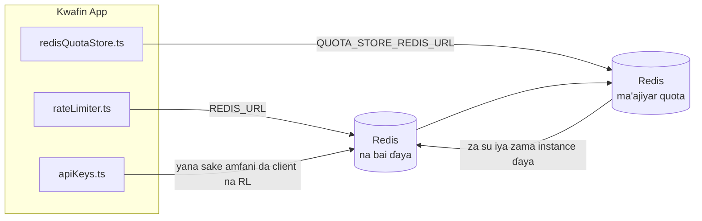

# Redis Production Configuration Guide (Hausa)

🌐 **Languages:** 🇺🇸 [English](../../../../ops/REDIS_PRODUCTION_CONFIG.md) · 🇪🇹 [am](../../../am/docs/ops/REDIS_PRODUCTION_CONFIG.md) · 🇸🇦 [ar](../../../ar/docs/ops/REDIS_PRODUCTION_CONFIG.md) · 🇦🇿 [az](../../../az/docs/ops/REDIS_PRODUCTION_CONFIG.md) · 🇧🇬 [bg](../../../bg/docs/ops/REDIS_PRODUCTION_CONFIG.md) · 🇧🇩 [bn](../../../bn/docs/ops/REDIS_PRODUCTION_CONFIG.md) · 🇧🇦 [bs](../../../bs/docs/ops/REDIS_PRODUCTION_CONFIG.md) · 🇨🇿 [cs](../../../cs/docs/ops/REDIS_PRODUCTION_CONFIG.md) · 🇩🇰 [da](../../../da/docs/ops/REDIS_PRODUCTION_CONFIG.md) · 🇩🇪 [de](../../../de/docs/ops/REDIS_PRODUCTION_CONFIG.md) · 🇬🇷 [el](../../../el/docs/ops/REDIS_PRODUCTION_CONFIG.md) · 🇪🇸 [es](../../../es/docs/ops/REDIS_PRODUCTION_CONFIG.md) · 🇪🇪 [et](../../../et/docs/ops/REDIS_PRODUCTION_CONFIG.md) · 🇮🇷 [fa](../../../fa/docs/ops/REDIS_PRODUCTION_CONFIG.md) · 🇫🇮 [fi](../../../fi/docs/ops/REDIS_PRODUCTION_CONFIG.md) · 🇫🇷 [fr](../../../fr/docs/ops/REDIS_PRODUCTION_CONFIG.md) · 🇮🇪 [ga](../../../ga/docs/ops/REDIS_PRODUCTION_CONFIG.md) · 🇮🇳 [gu](../../../gu/docs/ops/REDIS_PRODUCTION_CONFIG.md) · 🇮🇱 [he](../../../he/docs/ops/REDIS_PRODUCTION_CONFIG.md) · 🇮🇳 [hi](../../../hi/docs/ops/REDIS_PRODUCTION_CONFIG.md) · 🇭🇷 [hr](../../../hr/docs/ops/REDIS_PRODUCTION_CONFIG.md) · 🇭🇺 [hu](../../../hu/docs/ops/REDIS_PRODUCTION_CONFIG.md) · 🇦🇲 [hy](../../../hy/docs/ops/REDIS_PRODUCTION_CONFIG.md) · 🇮🇩 [id](../../../id/docs/ops/REDIS_PRODUCTION_CONFIG.md) · 🇳🇬 [ig](../../../ig/docs/ops/REDIS_PRODUCTION_CONFIG.md) · 🇮🇹 [it](../../../it/docs/ops/REDIS_PRODUCTION_CONFIG.md) · 🇯🇵 [ja](../../../ja/docs/ops/REDIS_PRODUCTION_CONFIG.md) · 🇬🇪 [ka](../../../ka/docs/ops/REDIS_PRODUCTION_CONFIG.md) · 🇰🇭 [km](../../../km/docs/ops/REDIS_PRODUCTION_CONFIG.md) · 🇮🇳 [kn](../../../kn/docs/ops/REDIS_PRODUCTION_CONFIG.md) · 🇰🇷 [ko](../../../ko/docs/ops/REDIS_PRODUCTION_CONFIG.md) · 🇱🇹 [lt](../../../lt/docs/ops/REDIS_PRODUCTION_CONFIG.md) · 🇱🇻 [lv](../../../lv/docs/ops/REDIS_PRODUCTION_CONFIG.md) · 🇮🇳 [ml](../../../ml/docs/ops/REDIS_PRODUCTION_CONFIG.md) · 🇮🇳 [mr](../../../mr/docs/ops/REDIS_PRODUCTION_CONFIG.md) · 🇲🇾 [ms](../../../ms/docs/ops/REDIS_PRODUCTION_CONFIG.md) · 🇲🇹 [mt](../../../mt/docs/ops/REDIS_PRODUCTION_CONFIG.md) · 🇲🇲 [my](../../../my/docs/ops/REDIS_PRODUCTION_CONFIG.md) · 🇳🇵 [ne](../../../ne/docs/ops/REDIS_PRODUCTION_CONFIG.md) · 🇳🇱 [nl](../../../nl/docs/ops/REDIS_PRODUCTION_CONFIG.md) · 🇳🇴 [no](../../../no/docs/ops/REDIS_PRODUCTION_CONFIG.md) · 🇮🇳 [or](../../../or/docs/ops/REDIS_PRODUCTION_CONFIG.md) · 🇮🇳 [pa](../../../pa/docs/ops/REDIS_PRODUCTION_CONFIG.md) · 🇵🇭 [phi](../../../phi/docs/ops/REDIS_PRODUCTION_CONFIG.md) · 🇵🇱 [pl](../../../pl/docs/ops/REDIS_PRODUCTION_CONFIG.md) · 🇵🇹 [pt](../../../pt/docs/ops/REDIS_PRODUCTION_CONFIG.md) · 🇧🇷 [pt-BR](../../../pt-BR/docs/ops/REDIS_PRODUCTION_CONFIG.md) · 🇷🇴 [ro](../../../ro/docs/ops/REDIS_PRODUCTION_CONFIG.md) · 🇷🇺 [ru](../../../ru/docs/ops/REDIS_PRODUCTION_CONFIG.md) · 🇱🇰 [si](../../../si/docs/ops/REDIS_PRODUCTION_CONFIG.md) · 🇸🇰 [sk](../../../sk/docs/ops/REDIS_PRODUCTION_CONFIG.md) · 🇸🇮 [sl](../../../sl/docs/ops/REDIS_PRODUCTION_CONFIG.md) · 🇷🇸 [sr](../../../sr/docs/ops/REDIS_PRODUCTION_CONFIG.md) · 🇸🇪 [sv](../../../sv/docs/ops/REDIS_PRODUCTION_CONFIG.md) · 🇰🇪 [sw](../../../sw/docs/ops/REDIS_PRODUCTION_CONFIG.md) · 🇮🇳 [ta](../../../ta/docs/ops/REDIS_PRODUCTION_CONFIG.md) · 🇮🇳 [te](../../../te/docs/ops/REDIS_PRODUCTION_CONFIG.md) · 🇹🇭 [th](../../../th/docs/ops/REDIS_PRODUCTION_CONFIG.md) · 🇹🇷 [tr](../../../tr/docs/ops/REDIS_PRODUCTION_CONFIG.md) · 🇺🇦 [uk-UA](../../../uk-UA/docs/ops/REDIS_PRODUCTION_CONFIG.md) · 🇵🇰 [ur](../../../ur/docs/ops/REDIS_PRODUCTION_CONFIG.md) · 🇺🇿 [uz](../../../uz/docs/ops/REDIS_PRODUCTION_CONFIG.md) · 🇻🇳 [vi](../../../vi/docs/ops/REDIS_PRODUCTION_CONFIG.md) · 🇳🇬 [yo](../../../yo/docs/ops/REDIS_PRODUCTION_CONFIG.md) · 🇨🇳 [zh-CN](../../../zh-CN/docs/ops/REDIS_PRODUCTION_CONFIG.md) · 🇹🇼 [zh-TW](../../../zh-TW/docs/ops/REDIS_PRODUCTION_CONFIG.md)

---

## Dubawa

Redis da **na zaɓi, dogaro mai laushi** a cikin OmniRoute — aikace-aikacen yana ƙasƙantar da ni'ima (a cikin ƙwaƙwalwar ajiya) lokacin da babu Redis. A cikin samarwa, kunna Redis yana rage jinkiri don nau'ikan ayyuka guda huɗu:

| Nauyin aiki            | Direba                        | Kamfanin Abokin ciniki                                   | Tsarin Maɓalli                                 |
| ---------------------- | ----------------------------- | -------------------------------------------------------- | ---------------------------------------------- |
| Ƙayyadadden ƙima       | `rateLimiter.ts`              | `getRedisClient()` — lazy `ioredis` singleton            | `<prefix>rl:*` Lua-atomic rate iyaka windows   |
| Amintaccen cache       | `apiKeys.ts`                  | Yana sake amfani da abokin ciniki na `rateLimiter`       | `<prefix>auth:api_key:<sha256>` tare da TTL    |
| kantin sayar da ƙima   | `redisQuotaStore.ts`          | Rarrabe `getRedisClient(url)` singleton                  | `<prefix>quota:*` daidaitacce ta kowane misali |
| Warmup circuit breaker | `redisCircuitBreakerStore.ts` | Rarrabe abokin ciniki a cikin `circuitBreakerFactory.ts` | `<prefix>warmup:cb:<connectionId>`             |

Duk nau'ikan ayyuka guda huɗu suna raba prefix na sarari ɗaya don haka OmniRoute zata iya kasancewa tare da wasu ƙa'idodi akan misalin Redis ɗaya (misali `127.0.0.1:6379`). Duba [Maɓallin Sunaye](#key-namespacing).

---

## Kanfigareshan Yanzu (Tsaffin Lambobi)

| Saita                           | Daraja                                                | Ina                                                                                   |
| ------------------------------- | ----------------------------------------------------- | ------------------------------------------------------------------------------------- |
| `REDIS_URL` env var             | `redis://redis:6379` (hada), na zaɓi                  | `rateLimiter.ts:5`, `.env.example`                                                    |
| `REDIS_KEY_PREFIX` env var      | `omniroute:` (tsoho)                                  | `rateLimiter.ts`, `redisQuotaStore.ts`, `redisCircuitBreakerStore.ts`, `.env.example` |
| `QUOTA_STORE_REDIS_URL` env var | daban, na iya bambanta da `REDIS_URL`                 | `quota/storeFactory.ts`                                                               |
| `QUOTA_STORE_DRIVER`            | `"sqlite"` (tsoho), `"redis"` na zaɓi                 | `quota/storeFactory.ts`                                                               |
| ioredis `maxRetriesPerRequest`  | `3`                                                   | Ƙirƙirar abokin ciniki `rateLimiter.ts`                                               |
| `enableReadyCheck`              | ba a saita ba (tsoho ioredis: `true`)                 | —                                                                                     |
| `lazyConnect`                   | ba a saita ba (tsoho ioredis: `false`)                | —                                                                                     |
| `retryStrategy`                 | ba a saita ba (tsoho ioredis: 200ms tushe, maɗaukaki) | —                                                                                     |
| TLS / kalmar sirri / DB index   | **ba a saita ba**                                     | —                                                                                     |
| Sentinel / Kungiya              | **ba a saita ba** — tsayayye guda-ƙulli kawai         | —                                                                                     |

---

## Rarraba Sunayen Maɓalli

OmniRoute yana amfani da instance ɗin Redis tare da duk wani abu da ke gudana a kan host ɗin. Ba tare da namespace ba,
maɓallai kamar `auth:api_key:<sha256>` ko `rl:*` za su iya karo da maɓallan wasu manhajoji
masu amfani da Redis ɗin guda ɗaya (wannan instance ɗin yana gudanar da Redis a `127.0.0.1:6379` tare da sauran ayyuka).

Saita `REDIS_KEY_PREFIX` zuwa wani rubutu marar fanko domin saka prefix ga **kowane** maɓallin OmniRoute:

```bash
# .env — duk maɓallan OmniRoute za su zama omniroute:rl:*, omniroute:auth:*, omniroute:quota:*, omniroute:warmup:cb:*
REDIS_KEY_PREFIX=omniroute:
```

- **Tsoho:** `omniroute:` (ana amfani da shi idan ba a saita `REDIS_KEY_PREFIX` ba ko kuma babu komai a cikinsa).
- **Ana amfani da shi ga:** mai iyakance ƙimar buƙatu + ma'ajiyar tantancewa (kliyantar `ioredis` da ake rabawa ta hanyar `keyPrefix`) da kuma
  ma'ajiyar ƙayyadadden kaso (`KEY_PREFIX = "${REDIS_KEY_PREFIX}quota"`) da circuit breaker na warmup
  (`KEY_PREFIX = "${REDIS_KEY_PREFIX}warmup:cb:"`).
- **Canza prefix** yayin da maɓallai suka riga suka kasance a Redis yana barin tsoffin maɓallan ba tare da mai amfani da su ba (za su ƙare
  ta hanyar TTL / LRU). Ana iya canza shi lafiya; ba a buƙatar migration. Banda guda ɗaya shi ne maɓallin
  circuit-breaker na warmup na connection da aka yi wa alamar haramun: ana adana shi ba tare da TTL ba, saboda haka
  jera ragowar da `redis-cli --scan --pattern '<old-prefix>warmup:cb:*'` sannan a share su.
- **`keyPrefix` na ioredis** yana ƙara prefix ɗin kai tsaye yayin rubutawa **kuma** yana cire shi yayin karantawa,
  saboda haka lambar manhajar ba ta taɓa ganin prefix ɗin.

---

## Gyaran Samar da Nasiha

### 1. Pool Connection / Abokin Ciniki Zaɓuɓɓuka (ioredis `Redis` constructor)

Lambar yanzu tana ƙirƙirar `new Redis(url)` guda ɗaya ba tare da zaɓuɓɓukan al'ada ba. Don samar da kayan aiki iri-iri, wuce masana'antar abokin ciniki a cikin lambar ko kunsa `getRedisClient()`:

```typescript
const redis = new Redis(REDIS_URL, {
  maxRetriesPerRequest: null, // no retry limit; let retryStrategy decide
  enableReadyCheck: true, // verify server is ready before accepting calls
  lazyConnect: true, // don't connect on construction; wait for first call
  retryStrategy: (times) => {
    if (times > 10) return null; // give up after 10 retries → reconnect later
    return Math.min(times * 200, 5000); // 200ms, 400ms, …, 5s cap
  },
  enableAutoPipelining: true, // coalesce concurrent commands into one TCP write
  keepAlive: 10000, // TCP keep‑alive every 10s
});
```

**Mabuɗin ciniki:**

- `maxRetriesPerRequest: null` + `retryStrategy` — ya fi so don samarwa don haka sake kunnawa Redis na wucin gadi kada nan da nan ya gaza kowane buƙatu. Faɗuwar cikin ƙwaƙwalwar ajiya a cikin `checkRateLimit()` tana ɗaukar hanyar gazawar.
- `lazyConnect: true` — yana guje wa dogaron farawa akan Redis kasancewa sama kafin sabar ta fara karɓar haɗin gwiwa.
- `enableAutoPipelining: true` — yana rage tafiye-tafiye-tafiye-tafiye don dubawa-iyakan adadin lokaci-lokaci; mai amfani a > 50 RPS akan haɗin guda ɗaya.

### 2. Kanfigareshan Sabar Redis (`redis.conf`)

```
# Memory
maxmemory 80%                        # leave room for OS page cache
maxmemory-policy allkeys-lru         # evict stale auth cache entries under pressure

# Persistence (optional — OmniRoute is crash‑safe without it)
save 300 1                           # snapshot at least every 5 min if ≥1 key changed
appendonly no                        # AOF not needed; data is regeneratable
appendfsync no                       # no fsync overhead (RDB is sufficient)

# Networking
timeout 0                            # no idle disconnect
tcp-keepalive 300                    # 5 min keep‑alive
tcp-backlog 511                      # connection backlog for bursty load

# Performance
hz 10                                # default; 100 for latency‑sensitive
activedefrag yes                     # auto‑defragment when fragmentation >10%
```

**Kasuwanci don `maxmemory-policy allkeys-lru`:** Ana iya fitar da shigarwar bayanan cache a ƙarƙashin matsin ƙwaƙwalwar ajiya. Wannan amintaccen — `setCachedApiKey` koyaushe yana sake cikawa akan kuskure, kuma faɗuwar SQLite tana da iko. Rubutun Lua mai iyaka-ƙididdigar ƙirƙira ƙananan maɓalli waɗanda ba su daɗe da ƙira.

### 3. Docker Shirya Saituna

Samfurin tsara (`docker-compose.prod.yml`) yana amfani da `redis:8.6.2-alpine`. Ƙara:

```yaml
redis:
  image: redis:8.6.2-alpine
  command:
    [
      "redis-server",
      "--maxmemory",
      "512mb",
      "--maxmemory-policy",
      "allkeys-lru",
      "--activedefrag",
      "yes",
      "--save",
      "300 1",
    ]
  healthcheck:
    test: ["CMD", "redis-cli", "ping"]
    interval: 10s
    timeout: 3s
    retries: 3
    start_period: 5s
```

### 4. La'akari da Matsaloli da yawa / Sikeli

**Redis guda ɗaya don duk kwafi** — rubutun Lua mai ƙayyadaddun ƙima ya dogara da sarari maɓalli ɗaya mai iko. Misalin Redis da yawa a bayan kwafi zai rasa atomity kuma ya ninka kasafin kuɗi. Yi amfani da Redis guda ɗaya (ko Redis Sentinel cluster tare da gazawa) don duk kwafin aikace-aikacen.

**Ƙididdigar haɗin kai:** Kowane kwafin aikace-aikacen yana buɗewa **2 Haɗin TCP** zuwa Redis (masu iyakance ƙimar abokin ciniki + keɓaɓɓen kantin sayar da abokin ciniki). A 10 kwafi na haɗin → 20, da kyau a cikin tsohuwar silin haɗin haɗin 10k na Redis.

### 5. Kulawa

Bayyana ta hanyar ƙarshen duba lafiya:

```typescript
// src/app/api/monitoring/health/route.ts already calls rateLimiter functions
// Add Redis-specific checks:
//   1. PING latency via ioredis .ping()
//   2. Memory usage via INFO memory
//   3. Connection count via INFO clients
//   4. Hit rate for maxmemory-policy (evicted_keys / keyspace_hits)
```

Mabuɗin ma'auni don kallo:

- **Maɓallai da aka fitar / s** — idan nacire ba sifili ba, ƙara `maxmemory`
- **Abokan ciniki da aka toshe** — mara sifili yana nuna jinkirin rubutun Lua ko babban hatsaniya
- **An ƙi haɗin haɗin gwiwa** Iyakar haɗin — ya buga; rare a 20 haɗi

### 6. Sabis masu dacewa da Redis

Duk wani uwar garken da aka yi amfani da shi anan dole ne ya gudanar da rubutun Lua: madaidaicin ƙimar `EVAL` ɗaya ne. A kan uwar garken ba tare da Lua ba, `checkRateLimit()` yana yin rajistar `[RATE_LIMITER] Redis eval failed, falling back to in-memory rate limiting` kuma yana ƙididdige kowane tsari, don haka kowane kwafi yana tilasta iyaka da kansa. The ficewa a raba zaman-abokin ciniki (`OMNIROUTE_SESSION_AFFINITY_STORE=redis`) yana karantawa da sabunta fil tare da `EVAL`; ba tare da Lua ba yana shigar da `[SESSION_AFFINITY] Redis error; falling back to SQLite.` kuma kowane kwafi yana riƙe da nasa fil. Sauran kayan aikin suna amfani da umarni a sarari (`SET ... EX`, `GET`, `DEL`, `MGET`, `EXPIRE`, `INCRBYFLOAT`, hashes da saiti ), kuma bayanan baya na Redis na ma'anar cache baya aika ba umarnin `FT.*`.

An gwada shi da OmniRoute 3.8.52: KiviDB 1.2.0 tare da hoton Lua (`kividb/kividb:v1.2.0-lua`). Ƙididdigar ƙima (ciki har da tsari na biyu na raba ƙididdiga), cache na auth, kantin keɓaɓɓu, mai kashe wutar lantarki, kantin ma'auni, da buƙatun `/v1/chat/completions` ta hanyar mai kula da taɗi ya wuce 18 daga cikin cak 19 waɗanda suka wuce Redis 8.10.3. Wanda ya bambanta: `INCRBYFLOAT` yana adana `0.1 + 0.2` a matsayin `0.30000000000000004` inda Redis ke adana `0.3` ( [kividbio/kividb#387](https://github.com/kividbio/kividb/issues/387) ). Kantin sayar da keɓaɓɓun yana rarraba duka biyu tare da `parseFloat`, amma lambobi biyu sun bambanta a cikin lambobi na ƙarshe, don haka kwatancen da ya faɗi daidai a kan iyakar keɓe zai iya fitowa daban. Kantin sayar da zaman-dangin ba ya cikin wannan gudu. ( [saitin](https://github.com/kividbio/kividb/blob/master/docs/integrations/omniroute.md), [sakamako](https://github.com/kividbio/kividb/tree/master/benchmarks/omniroute-compat) )

---

## Zanen Tsarin Gine-gine



---

## Magana

| Fayil                              | Manufar                                                                                            |
| ---------------------------------- | -------------------------------------------------------------------------------------------------- |
| `src/shared/utils/rateLimiter.ts`  | Abokin ciniki na farko Redis, Rubutun iyaka-ƙididdigar ƙimar Lua, koma baya cikin ƙwaƙwalwar ajiya |
| `src/lib/db/apiKeys.ts`            | Amintaccen cache — Redis→SQLite koma baya                                                          |
| `src/lib/quota/redisQuotaStore.ts` | Ware abokin ciniki Redis don kantin keɓaɓɓen zaɓi                                                  |
| `src/lib/quota/storeFactory.ts`    | Yana canzawa tsakanin direbobin keɓaɓɓun `sqlite` da `redis`                                       |
| `docker-compose.prod.yml`          | Prod Redis ganga (hoton `redis:8.6.2-alpine`)                                                      |
| `.env.example`                     | Redis env vars takardun shaida                                                                     |
| `src/app/api/local/redis/`         | Hanyoyin API don kade-kaden kwantena                                                               |
| `bin/cli/commands/redis.mjs`       | CLI yana ba da umarni don ƙungiyar kayan aikin dev                                                 |
