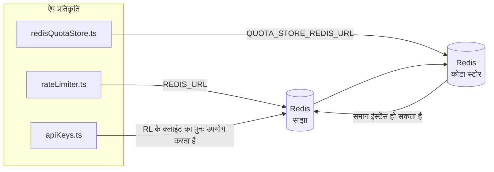

# Redis Production Configuration Guide (हिन्दी)

🌐 **Languages:** 🇺🇸 [English](../../../../ops/REDIS_PRODUCTION_CONFIG.md) · 🇪🇹 [am](../../../am/docs/ops/REDIS_PRODUCTION_CONFIG.md) · 🇸🇦 [ar](../../../ar/docs/ops/REDIS_PRODUCTION_CONFIG.md) · 🇦🇿 [az](../../../az/docs/ops/REDIS_PRODUCTION_CONFIG.md) · 🇧🇬 [bg](../../../bg/docs/ops/REDIS_PRODUCTION_CONFIG.md) · 🇧🇩 [bn](../../../bn/docs/ops/REDIS_PRODUCTION_CONFIG.md) · 🇧🇦 [bs](../../../bs/docs/ops/REDIS_PRODUCTION_CONFIG.md) · 🇨🇿 [cs](../../../cs/docs/ops/REDIS_PRODUCTION_CONFIG.md) · 🇩🇰 [da](../../../da/docs/ops/REDIS_PRODUCTION_CONFIG.md) · 🇩🇪 [de](../../../de/docs/ops/REDIS_PRODUCTION_CONFIG.md) · 🇬🇷 [el](../../../el/docs/ops/REDIS_PRODUCTION_CONFIG.md) · 🇪🇸 [es](../../../es/docs/ops/REDIS_PRODUCTION_CONFIG.md) · 🇪🇪 [et](../../../et/docs/ops/REDIS_PRODUCTION_CONFIG.md) · 🇮🇷 [fa](../../../fa/docs/ops/REDIS_PRODUCTION_CONFIG.md) · 🇫🇮 [fi](../../../fi/docs/ops/REDIS_PRODUCTION_CONFIG.md) · 🇫🇷 [fr](../../../fr/docs/ops/REDIS_PRODUCTION_CONFIG.md) · 🇮🇪 [ga](../../../ga/docs/ops/REDIS_PRODUCTION_CONFIG.md) · 🇮🇳 [gu](../../../gu/docs/ops/REDIS_PRODUCTION_CONFIG.md) · 🇳🇬 [ha](../../../ha/docs/ops/REDIS_PRODUCTION_CONFIG.md) · 🇮🇱 [he](../../../he/docs/ops/REDIS_PRODUCTION_CONFIG.md) · 🇭🇷 [hr](../../../hr/docs/ops/REDIS_PRODUCTION_CONFIG.md) · 🇭🇺 [hu](../../../hu/docs/ops/REDIS_PRODUCTION_CONFIG.md) · 🇦🇲 [hy](../../../hy/docs/ops/REDIS_PRODUCTION_CONFIG.md) · 🇮🇩 [id](../../../id/docs/ops/REDIS_PRODUCTION_CONFIG.md) · 🇳🇬 [ig](../../../ig/docs/ops/REDIS_PRODUCTION_CONFIG.md) · 🇮🇹 [it](../../../it/docs/ops/REDIS_PRODUCTION_CONFIG.md) · 🇯🇵 [ja](../../../ja/docs/ops/REDIS_PRODUCTION_CONFIG.md) · 🇬🇪 [ka](../../../ka/docs/ops/REDIS_PRODUCTION_CONFIG.md) · 🇰🇭 [km](../../../km/docs/ops/REDIS_PRODUCTION_CONFIG.md) · 🇮🇳 [kn](../../../kn/docs/ops/REDIS_PRODUCTION_CONFIG.md) · 🇰🇷 [ko](../../../ko/docs/ops/REDIS_PRODUCTION_CONFIG.md) · 🇱🇹 [lt](../../../lt/docs/ops/REDIS_PRODUCTION_CONFIG.md) · 🇱🇻 [lv](../../../lv/docs/ops/REDIS_PRODUCTION_CONFIG.md) · 🇮🇳 [ml](../../../ml/docs/ops/REDIS_PRODUCTION_CONFIG.md) · 🇮🇳 [mr](../../../mr/docs/ops/REDIS_PRODUCTION_CONFIG.md) · 🇲🇾 [ms](../../../ms/docs/ops/REDIS_PRODUCTION_CONFIG.md) · 🇲🇹 [mt](../../../mt/docs/ops/REDIS_PRODUCTION_CONFIG.md) · 🇲🇲 [my](../../../my/docs/ops/REDIS_PRODUCTION_CONFIG.md) · 🇳🇵 [ne](../../../ne/docs/ops/REDIS_PRODUCTION_CONFIG.md) · 🇳🇱 [nl](../../../nl/docs/ops/REDIS_PRODUCTION_CONFIG.md) · 🇳🇴 [no](../../../no/docs/ops/REDIS_PRODUCTION_CONFIG.md) · 🇮🇳 [or](../../../or/docs/ops/REDIS_PRODUCTION_CONFIG.md) · 🇮🇳 [pa](../../../pa/docs/ops/REDIS_PRODUCTION_CONFIG.md) · 🇵🇭 [phi](../../../phi/docs/ops/REDIS_PRODUCTION_CONFIG.md) · 🇵🇱 [pl](../../../pl/docs/ops/REDIS_PRODUCTION_CONFIG.md) · 🇵🇹 [pt](../../../pt/docs/ops/REDIS_PRODUCTION_CONFIG.md) · 🇧🇷 [pt-BR](../../../pt-BR/docs/ops/REDIS_PRODUCTION_CONFIG.md) · 🇷🇴 [ro](../../../ro/docs/ops/REDIS_PRODUCTION_CONFIG.md) · 🇷🇺 [ru](../../../ru/docs/ops/REDIS_PRODUCTION_CONFIG.md) · 🇱🇰 [si](../../../si/docs/ops/REDIS_PRODUCTION_CONFIG.md) · 🇸🇰 [sk](../../../sk/docs/ops/REDIS_PRODUCTION_CONFIG.md) · 🇸🇮 [sl](../../../sl/docs/ops/REDIS_PRODUCTION_CONFIG.md) · 🇷🇸 [sr](../../../sr/docs/ops/REDIS_PRODUCTION_CONFIG.md) · 🇸🇪 [sv](../../../sv/docs/ops/REDIS_PRODUCTION_CONFIG.md) · 🇰🇪 [sw](../../../sw/docs/ops/REDIS_PRODUCTION_CONFIG.md) · 🇮🇳 [ta](../../../ta/docs/ops/REDIS_PRODUCTION_CONFIG.md) · 🇮🇳 [te](../../../te/docs/ops/REDIS_PRODUCTION_CONFIG.md) · 🇹🇭 [th](../../../th/docs/ops/REDIS_PRODUCTION_CONFIG.md) · 🇹🇷 [tr](../../../tr/docs/ops/REDIS_PRODUCTION_CONFIG.md) · 🇺🇦 [uk-UA](../../../uk-UA/docs/ops/REDIS_PRODUCTION_CONFIG.md) · 🇵🇰 [ur](../../../ur/docs/ops/REDIS_PRODUCTION_CONFIG.md) · 🇺🇿 [uz](../../../uz/docs/ops/REDIS_PRODUCTION_CONFIG.md) · 🇻🇳 [vi](../../../vi/docs/ops/REDIS_PRODUCTION_CONFIG.md) · 🇳🇬 [yo](../../../yo/docs/ops/REDIS_PRODUCTION_CONFIG.md) · 🇨🇳 [zh-CN](../../../zh-CN/docs/ops/REDIS_PRODUCTION_CONFIG.md) · 🇹🇼 [zh-TW](../../../zh-TW/docs/ops/REDIS_PRODUCTION_CONFIG.md)

---

## सिंहावलोकन

Redis एक है**वैकल्पिक, नरम निर्भरता** OmniRoute — में Redis अनुपलब्ध होने पर एप्लिकेशन शानदार ढंग से ख़राब हो जाता है (इन-मेमोरी फ़ॉलबैक)। उत्पादन में, Redis ट्यून करने से चार अलग-अलग कार्यभार के लिए विलंबता कम हो जाती है:

| कार्यभार              | चालक                          | ग्राहक फैक्टरी                                 | मुख्य पैटर्न                                 |
| --------------------- | ----------------------------- | ---------------------------------------------- | -------------------------------------------- |
| दर सीमित करना         | `rateLimiter.ts`              | `getRedisClient()` — आलसी `ioredis` सिंगलटन    | `<prefix>rl:*` लुआ-परमाणु दर सीमा विंडो      |
| प्रामाणिक कैश         | `apiKeys.ts`                  | `rateLimiter` के क्लाइंट का पुन: उपयोग करता है | TTL के साथ `<prefix>auth:api_key:<sha256>`   |
| कोटा भंडार            | `redisQuotaStore.ts`          | अलग `getRedisClient(url)` सिंगलटन              | `<prefix>quota:*` प्रति-उदाहरण विन्यास योग्य |
| वार्मअप सर्किट ब्रेकर | `redisCircuitBreakerStore.ts` | `circuitBreakerFactory.ts` में अलग ग्राहक      | `<prefix>warmup:cb:<connectionId>`           |

सभी चार वर्कलोड एक नेमस्पेस उपसर्ग साझा करते हैं ताकि OmniRoute एक ही Redis इंस्टेंस (जैसे `127.0.0.1:6379`) पर अन्य ऐप्स के साथ सह-अस्तित्व में रह सके। [मुख्य नामस्थान](#key-namespacing) देखें.

---

## वर्तमान कॉन्फ़िगरेशन (कोड डिफ़ॉल्ट)

| सेटिंग                                   | कीमत                                                        | कहाँ                                                                                  |
| ---------------------------------------- | ----------------------------------------------------------- | ------------------------------------------------------------------------------------- |
| `REDIS_URL` पर्यावरण संस्करण             | `redis://redis:6379` (लिखें), वैकल्पिक                      | `rateLimiter.ts:5`, `.env.example`                                                    |
| `REDIS_KEY_PREFIX` पर्यावरण संस्करण      | `omniroute:` (डिफ़ॉल्ट)                                     | `rateLimiter.ts`, `redisQuotaStore.ts`, `redisCircuitBreakerStore.ts`, `.env.example` |
| `QUOTA_STORE_REDIS_URL` पर्यावरण संस्करण | अलग, `REDIS_URL` से भिन्न हो सकता है                        | `quota/storeFactory.ts`                                                               |
| `QUOTA_STORE_DRIVER`                     | `"sqlite"` (डिफ़ॉल्ट), `"redis"` वैकल्पिक                   | `quota/storeFactory.ts`                                                               |
| आयोरेडिस `maxRetriesPerRequest`          | `3`                                                         | `rateLimiter.ts` क्लाइंट निर्माण                                                      |
| `enableReadyCheck`                       | सेट नहीं है (आयोडीस डिफ़ॉल्ट: `true`)                       | —                                                                                     |
| `lazyConnect`                            | सेट नहीं है (आयोडीस डिफ़ॉल्ट: `false`)                      | —                                                                                     |
| `retryStrategy`                          | सेट नहीं है (इओरेडिस डिफ़ॉल्ट: 200 एमएस बेस, एक्सपोनेंशियल) | —                                                                                     |
| TLS / पासवर्ड / DB इंडेक्स               | **कॉन्फ़िगर नहीं किया गया**                                 | —                                                                                     |
| प्रहरी/क्लस्टर                           | **कॉन्फ़िगर नहीं किया गया** — केवल स्टैंडअलोन सिंगल-नोड     | —                                                                                     |

---

## कुंजी नेमस्पेसिंग

OmniRoute, होस्ट पर चलने वाली अन्य सभी चीज़ों के साथ एक Redis इंस्टेंस साझा करता है। नेमस्पेस के बिना,
`auth:api_key:<sha256>` या `rl:*` जैसी कुंजियाँ उसी Redis का उपयोग करने वाले अन्य एप्लिकेशन की कुंजियों
से टकरा सकती हैं (यह इंस्टेंस अन्य सेवाओं के साथ `127.0.0.1:6379` पर Redis चलाता है)।

OmniRoute की **प्रत्येक** कुंजी के आगे प्रीफ़िक्स लगाने के लिए `REDIS_KEY_PREFIX` को किसी गैर-रिक्त स्ट्रिंग पर सेट करें:

```bash
# .env — OmniRoute की सभी कुंजियाँ omniroute:rl:*, omniroute:auth:*, omniroute:quota:*, omniroute:warmup:cb:* बन जाती हैं
REDIS_KEY_PREFIX=omniroute:
```

- **डिफ़ॉल्ट:** `omniroute:` (`REDIS_KEY_PREFIX` के सेट न होने या रिक्त होने पर लागू होता है)।
- **इन पर लागू:** दर सीमक + प्रमाणीकरण कैश (`keyPrefix` के माध्यम से साझा `ioredis` क्लाइंट), और
  कोटा स्टोर (`KEY_PREFIX = "${REDIS_KEY_PREFIX}quota"`) तथा वार्मअप सर्किट ब्रेकर
  (`KEY_PREFIX = "${REDIS_KEY_PREFIX}warmup:cb:"`)।
- Redis में कुंजियाँ पहले से मौजूद होने पर **प्रीफ़िक्स बदलने से** पुरानी कुंजियाँ अनाथ हो जाती हैं (वे
  TTL / LRU के माध्यम से समाप्त हो जाती हैं)। इसे बदलना सुरक्षित है; किसी माइग्रेशन की आवश्यकता नहीं है। इसका एक अपवाद
  निषिद्ध के रूप में चिह्नित कनेक्शन की वार्मअप सर्किट-ब्रेकर कुंजी है: इसे TTL के बिना स्थायी रखा जाता है, इसलिए
  बची हुई कुंजियों को `redis-cli --scan --pattern '<old-prefix>warmup:cb:*'` से सूचीबद्ध करें और उन्हें हटाएँ।
- **ioredis `keyPrefix`** लिखते समय प्रीफ़िक्स को स्वचालित रूप से आगे जोड़ता है **और** पढ़ते समय उसे हटा देता है,
  इसलिए एप्लिकेशन कोड को प्रीफ़िक्स कभी दिखाई नहीं देता।

---

## अनुशंसित उत्पादन ट्यूनिंग

### 1. कनेक्शन पूल/क्लाइंट विकल्प (इओरेडिस `Redis` कंस्ट्रक्टर)

वर्तमान कोड बिना किसी कस्टम विकल्प के एकल `new Redis(url)` बनाता है। उत्पादन बहु-प्रतिकृति परिनियोजन के लिए, कोड में क्लाइंट फ़ैक्टरी पास करें या `getRedisClient()` लपेटें:

```typescript
const redis = new Redis(REDIS_URL, {
  maxRetriesPerRequest: null, // no retry limit; let retryStrategy decide
  enableReadyCheck: true, // verify server is ready before accepting calls
  lazyConnect: true, // don't connect on construction; wait for first call
  retryStrategy: (times) => {
    if (times > 10) return null; // give up after 10 retries → reconnect later
    return Math.min(times * 200, 5000); // 200ms, 400ms, …, 5s cap
  },
  enableAutoPipelining: true, // coalesce concurrent commands into one TCP write
  keepAlive: 10000, // TCP keep‑alive every 10s
});
```

**प्रमुख व्यापार-बंद:**

- `maxRetriesPerRequest: null` + `retryStrategy` — उत्पादन के लिए प्राथमिकता दी गई है ताकि क्षणिक Redis पुनरारंभ हर अनुरोध को तुरंत विफल न करे। `checkRateLimit()` में इन-मेमोरी फ़ॉलबैक विफलता पथ को अवशोषित करता है।
- `lazyConnect: true` — सर्वर द्वारा कनेक्शन स्वीकार करना शुरू करने से पहले Redis पर स्टार्टअप निर्भरता से बचाता है।
- `enableAutoPipelining: true` — समवर्ती दर-सीमा जांच के लिए राउंड-ट्रिप को कम करता है; एकल कनेक्शन पर > 50 RPS पर लाभकारी।

### 2. Redis सर्वर कॉन्फ़िगरेशन (`redis.conf`)

```
# Memory
maxmemory 80%                        # leave room for OS page cache
maxmemory-policy allkeys-lru         # evict stale auth cache entries under pressure

# Persistence (optional — OmniRoute is crash‑safe without it)
save 300 1                           # snapshot at least every 5 min if ≥1 key changed
appendonly no                        # AOF not needed; data is regeneratable
appendfsync no                       # no fsync overhead (RDB is sufficient)

# Networking
timeout 0                            # no idle disconnect
tcp-keepalive 300                    # 5 min keep‑alive
tcp-backlog 511                      # connection backlog for bursty load

# Performance
hz 10                                # default; 100 for latency‑sensitive
activedefrag yes                     # auto‑defragment when fragmentation >10%
```

**`maxmemory-policy allkeys-lru` के लिए व्यापार-बंद:** मेमोरी दबाव के कारण प्रामाणिक कैश प्रविष्टियाँ निकाली जा सकती हैं। यह सुरक्षित है — `setCachedApiKey` हमेशा छूटने पर पुनः आबाद हो जाता है, और SQLite फ़ॉलबैक आधिकारिक है। दर-सीमक लुआ स्क्रिप्ट छोटी कुंजियाँ बनाती है जो डिज़ाइन द्वारा अल्पकालिक होती हैं।

### 3. Docker कंपोज़ सेटिंग्स

उत्पाद कंपोज़ (`docker-compose.prod.yml`) `redis:8.6.2-alpine` का उपयोग करता है। जोड़ना:

```yaml
redis:
  image: redis:8.6.2-alpine
  command:
    [
      "redis-server",
      "--maxmemory",
      "512mb",
      "--maxmemory-policy",
      "allkeys-lru",
      "--activedefrag",
      "yes",
      "--save",
      "300 1",
    ]
  healthcheck:
    test: ["CMD", "redis-cli", "ping"]
    interval: 10s
    timeout: 3s
    retries: 3
    start_period: 5s
```

### 4. मल्टी-इंस्टेंस/स्केलिंग संबंधी विचार

**सभी प्रतिकृतियों के लिए एकल Redis** — दर-सीमक लुआ स्क्रिप्ट एकल आधिकारिक कुंजी स्थान पर निर्भर करती है। प्रतिकृतियों के पीछे एकाधिक Redis उदाहरण परमाणुता खो देंगे और बजट दोगुना हो जाएगा। सभी एप्लिकेशन प्रतिकृतियों के लिए एकल Redis (या फ़ेलओवर के साथ Redis सेंटिनल क्लस्टर) का उपयोग करें।

**कनेक्शन संख्या:** प्रत्येक एप्लिकेशन प्रतिकृति खुलती है**2 TCP कनेक्शन** Redis (दर सीमक ग्राहक + कोटा स्टोर ग्राहक) के लिए। 10 प्रतिकृतियों → 20 कनेक्शनों पर, डिफ़ॉल्ट Redis इंस्टेंस की 10k कनेक्शन सीमा के भीतर।

### 5. निगरानी

स्वास्थ्य-जाँच समापन बिंदु के माध्यम से उजागर करें:

```typescript
// src/app/api/monitoring/health/route.ts already calls rateLimiter functions
// Add Redis-specific checks:
//   1. PING latency via ioredis .ping()
//   2. Memory usage via INFO memory
//   3. Connection count via INFO clients
//   4. Hit rate for maxmemory-policy (evicted_keys / keyspace_hits)
```

देखने के लिए मुख्य मेट्रिक्स:

- **बेदखल चाबियाँ / सेकंड** यदि — लगातार शून्य नहीं है, तो `maxmemory` बढ़ाएँ
- **अवरुद्ध ग्राहक** — गैर-शून्य धीमी लुआ स्क्रिप्ट या उच्च विवाद का सुझाव देता है
- **अस्वीकृत कनेक्शन** — कनेक्शन सीमा प्रभावित; 20 कनेक्शन पर दुर्लभ

### 6. रेडिस-संगत सर्वर

यहां उपयोग किए जाने वाले किसी भी सर्वर को लुआ स्क्रिप्ट चलानी होगी: दर सीमक एक `EVAL` है। लुआ के बिना सर्वर पर, `checkRateLimit()` `[RATE_LIMITER] Redis eval failed, falling back to in-memory rate limiting` को लॉग करता है और प्रति प्रक्रिया की गणना करता है, इसलिए प्रत्येक प्रतिकृति अपने आप ही सीमा लागू करती है। ऑप्ट-इन साझा सत्र-एफ़िनिटी स्टोर (`OMNIROUTE_SESSION_AFFINITY_STORE=redis`) `EVAL` के साथ पिन भी पढ़ता है और अपडेट करता है; लुआ के बिना यह `[SESSION_AFFINITY] Redis error; falling back to SQLite.` लॉग करता है और प्रत्येक प्रतिकृति अपने स्वयं के पिन रखती है। अन्य वर्कलोड सादे कमांड (`SET ... EX`, `GET`, `DEL`, `MGET`, `EXPIRE`, `INCRBYFLOAT`, हैश और सेट) का उपयोग करते हैं, और सिमेंटिक कैश का Redis बैकएंड कोई `FT.*` कमांड नहीं भेजता है।

OmniRoute 3.8.52 के साथ परीक्षण किया गया: KiviDB 1.2.0 इसकी लुआ छवि (`kividb/kividb:v1.2.0-lua`) के साथ। रेट लिमिटर (काउंटर साझा करने वाली दूसरी प्रक्रिया सहित), ऑथ कैश, कोटा स्टोर, वार्मअप सर्किट ब्रेकर, सिमेंटिक कैश स्टोर और चैट हैंडलर के माध्यम से एक `/v1/chat/completions` अनुरोध Redis 8.10.3 पर पास होने वाले 19 में से 18 चेक पास कर गया। जो अलग है: `INCRBYFLOAT` `0.1 + 0.2` `0.30000000000000004` के रूप में संग्रहीत करता है जहां Redis `0.3` ( [kividbio/kividb#387](https://github.com/kividbio/kividb/issues/387) ) को संग्रहीत करता है। कोटा स्टोर दोनों को `parseFloat` के साथ पार्स करता है, लेकिन दोनों संख्याएँ अंतिम अंकों में भिन्न होती हैं, इसलिए कोटा सीमा पर सटीक तुलना करने पर अलग-अलग परिणाम आ सकते हैं। सत्र-एफ़िनिटी स्टोर उस रन का हिस्सा नहीं था। ( [सेटअप](https://github.com/kividbio/kividb/blob/master/docs/integrations/omniroute.md), [परिणाम](https://github.com/kividbio/kividb/tree/master/benchmarks/omniroute-compat) )

---

## आर्किटेक्चर आरेख



---

## संदर्भ

| फ़ाइल                              | उद्देश्य                                                         |
| ---------------------------------- | ---------------------------------------------------------------- |
| `src/shared/utils/rateLimiter.ts`  | प्राथमिक Redis क्लाइंट, लुआ दर-सीमा स्क्रिप्ट, इन-मेमोरी फ़ॉलबैक |
| `src/lib/db/apiKeys.ts`            | प्रामाणिक कैश — Redis→SQLite फ़ॉलबैक                             |
| `src/lib/quota/redisQuotaStore.ts` | वैकल्पिक कोटा स्टोर के लिए अलग Redis क्लाइंट                     |
| `src/lib/quota/storeFactory.ts`    | `sqlite` और `redis` कोटा ड्राइवरों के बीच स्विच करता है          |
| `docker-compose.prod.yml`          | उत्पाद Redis कंटेनर (छवि `redis:8.6.2-alpine`)                   |
| `.env.example`                     | Redis env vars दस्तावेज़ीकरण                                     |
| `src/app/api/local/redis/`         | डेव कंटेनर ऑर्केस्ट्रेशन के लिए API मार्ग                        |
| `bin/cli/commands/redis.mjs`       | डेव कंटेनर ऑर्केस्ट्रेशन के लिए CLI कमांड                        |
