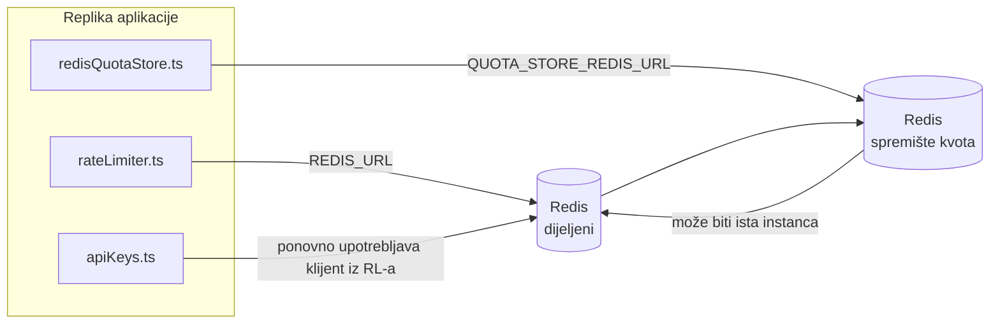

# Redis Production Configuration Guide (Hrvatski)

🌐 **Languages:** 🇺🇸 [English](../../../../ops/REDIS_PRODUCTION_CONFIG.md) · 🇪🇹 [am](../../../am/docs/ops/REDIS_PRODUCTION_CONFIG.md) · 🇸🇦 [ar](../../../ar/docs/ops/REDIS_PRODUCTION_CONFIG.md) · 🇦🇿 [az](../../../az/docs/ops/REDIS_PRODUCTION_CONFIG.md) · 🇧🇬 [bg](../../../bg/docs/ops/REDIS_PRODUCTION_CONFIG.md) · 🇧🇩 [bn](../../../bn/docs/ops/REDIS_PRODUCTION_CONFIG.md) · 🇧🇦 [bs](../../../bs/docs/ops/REDIS_PRODUCTION_CONFIG.md) · 🇨🇿 [cs](../../../cs/docs/ops/REDIS_PRODUCTION_CONFIG.md) · 🇩🇰 [da](../../../da/docs/ops/REDIS_PRODUCTION_CONFIG.md) · 🇩🇪 [de](../../../de/docs/ops/REDIS_PRODUCTION_CONFIG.md) · 🇬🇷 [el](../../../el/docs/ops/REDIS_PRODUCTION_CONFIG.md) · 🇪🇸 [es](../../../es/docs/ops/REDIS_PRODUCTION_CONFIG.md) · 🇪🇪 [et](../../../et/docs/ops/REDIS_PRODUCTION_CONFIG.md) · 🇮🇷 [fa](../../../fa/docs/ops/REDIS_PRODUCTION_CONFIG.md) · 🇫🇮 [fi](../../../fi/docs/ops/REDIS_PRODUCTION_CONFIG.md) · 🇫🇷 [fr](../../../fr/docs/ops/REDIS_PRODUCTION_CONFIG.md) · 🇮🇪 [ga](../../../ga/docs/ops/REDIS_PRODUCTION_CONFIG.md) · 🇮🇳 [gu](../../../gu/docs/ops/REDIS_PRODUCTION_CONFIG.md) · 🇳🇬 [ha](../../../ha/docs/ops/REDIS_PRODUCTION_CONFIG.md) · 🇮🇱 [he](../../../he/docs/ops/REDIS_PRODUCTION_CONFIG.md) · 🇮🇳 [hi](../../../hi/docs/ops/REDIS_PRODUCTION_CONFIG.md) · 🇭🇺 [hu](../../../hu/docs/ops/REDIS_PRODUCTION_CONFIG.md) · 🇦🇲 [hy](../../../hy/docs/ops/REDIS_PRODUCTION_CONFIG.md) · 🇮🇩 [id](../../../id/docs/ops/REDIS_PRODUCTION_CONFIG.md) · 🇳🇬 [ig](../../../ig/docs/ops/REDIS_PRODUCTION_CONFIG.md) · 🇮🇹 [it](../../../it/docs/ops/REDIS_PRODUCTION_CONFIG.md) · 🇯🇵 [ja](../../../ja/docs/ops/REDIS_PRODUCTION_CONFIG.md) · 🇬🇪 [ka](../../../ka/docs/ops/REDIS_PRODUCTION_CONFIG.md) · 🇰🇭 [km](../../../km/docs/ops/REDIS_PRODUCTION_CONFIG.md) · 🇮🇳 [kn](../../../kn/docs/ops/REDIS_PRODUCTION_CONFIG.md) · 🇰🇷 [ko](../../../ko/docs/ops/REDIS_PRODUCTION_CONFIG.md) · 🇱🇹 [lt](../../../lt/docs/ops/REDIS_PRODUCTION_CONFIG.md) · 🇱🇻 [lv](../../../lv/docs/ops/REDIS_PRODUCTION_CONFIG.md) · 🇮🇳 [ml](../../../ml/docs/ops/REDIS_PRODUCTION_CONFIG.md) · 🇮🇳 [mr](../../../mr/docs/ops/REDIS_PRODUCTION_CONFIG.md) · 🇲🇾 [ms](../../../ms/docs/ops/REDIS_PRODUCTION_CONFIG.md) · 🇲🇹 [mt](../../../mt/docs/ops/REDIS_PRODUCTION_CONFIG.md) · 🇲🇲 [my](../../../my/docs/ops/REDIS_PRODUCTION_CONFIG.md) · 🇳🇵 [ne](../../../ne/docs/ops/REDIS_PRODUCTION_CONFIG.md) · 🇳🇱 [nl](../../../nl/docs/ops/REDIS_PRODUCTION_CONFIG.md) · 🇳🇴 [no](../../../no/docs/ops/REDIS_PRODUCTION_CONFIG.md) · 🇮🇳 [or](../../../or/docs/ops/REDIS_PRODUCTION_CONFIG.md) · 🇮🇳 [pa](../../../pa/docs/ops/REDIS_PRODUCTION_CONFIG.md) · 🇵🇭 [phi](../../../phi/docs/ops/REDIS_PRODUCTION_CONFIG.md) · 🇵🇱 [pl](../../../pl/docs/ops/REDIS_PRODUCTION_CONFIG.md) · 🇵🇹 [pt](../../../pt/docs/ops/REDIS_PRODUCTION_CONFIG.md) · 🇧🇷 [pt-BR](../../../pt-BR/docs/ops/REDIS_PRODUCTION_CONFIG.md) · 🇷🇴 [ro](../../../ro/docs/ops/REDIS_PRODUCTION_CONFIG.md) · 🇷🇺 [ru](../../../ru/docs/ops/REDIS_PRODUCTION_CONFIG.md) · 🇱🇰 [si](../../../si/docs/ops/REDIS_PRODUCTION_CONFIG.md) · 🇸🇰 [sk](../../../sk/docs/ops/REDIS_PRODUCTION_CONFIG.md) · 🇸🇮 [sl](../../../sl/docs/ops/REDIS_PRODUCTION_CONFIG.md) · 🇷🇸 [sr](../../../sr/docs/ops/REDIS_PRODUCTION_CONFIG.md) · 🇸🇪 [sv](../../../sv/docs/ops/REDIS_PRODUCTION_CONFIG.md) · 🇰🇪 [sw](../../../sw/docs/ops/REDIS_PRODUCTION_CONFIG.md) · 🇮🇳 [ta](../../../ta/docs/ops/REDIS_PRODUCTION_CONFIG.md) · 🇮🇳 [te](../../../te/docs/ops/REDIS_PRODUCTION_CONFIG.md) · 🇹🇭 [th](../../../th/docs/ops/REDIS_PRODUCTION_CONFIG.md) · 🇹🇷 [tr](../../../tr/docs/ops/REDIS_PRODUCTION_CONFIG.md) · 🇺🇦 [uk-UA](../../../uk-UA/docs/ops/REDIS_PRODUCTION_CONFIG.md) · 🇵🇰 [ur](../../../ur/docs/ops/REDIS_PRODUCTION_CONFIG.md) · 🇺🇿 [uz](../../../uz/docs/ops/REDIS_PRODUCTION_CONFIG.md) · 🇻🇳 [vi](../../../vi/docs/ops/REDIS_PRODUCTION_CONFIG.md) · 🇳🇬 [yo](../../../yo/docs/ops/REDIS_PRODUCTION_CONFIG.md) · 🇨🇳 [zh-CN](../../../zh-CN/docs/ops/REDIS_PRODUCTION_CONFIG.md) · 🇹🇼 [zh-TW](../../../zh-TW/docs/ops/REDIS_PRODUCTION_CONFIG.md)

---

## Pregled

Redis je **neobavezna, slaba ovisnost** u aplikaciji OmniRoute — kada Redis nije dostupan, aplikacija nastavlja raditi uz smanjene mogućnosti (pričuvna rješenja u memoriji). U produkciji podešavanje Redisa smanjuje latenciju za četiri različita radna opterećenja:

| Radno opterećenje           | Pokretač                      | Tvornica klijenta                                               | Uzorak ključa                                                        |
| --------------------------- | ----------------------------- | --------------------------------------------------------------- | -------------------------------------------------------------------- |
| Ograničavanje brzine        | `rateLimiter.ts`              | `getRedisClient()` — lijeno inicijalizirani singleton `ioredis` | `<prefix>rl:*` prozori ograničenja brzine, atomski putem Lua skripte |
| Predmemorija autentikacije  | `apiKeys.ts`                  | Ponovno upotrebljava klijent iz `rateLimiter`                   | `<prefix>auth:api_key:<sha256>` s TTL-om                             |
| Spremište kvota             | `redisQuotaStore.ts`          | Zaseban singleton `getRedisClient(url)`                         | `<prefix>quota:*`, podesivo po instanci                              |
| Prekidač kruga zagrijavanja | `redisCircuitBreakerStore.ts` | Zaseban klijent u `circuitBreakerFactory.ts`                    | `<prefix>warmup:cb:<connectionId>`                                   |

Sva četiri radna opterećenja dijele jedan prefiks prostora naziva kako bi OmniRoute mogao istodobno raditi s drugim aplikacijama na jednoj instanci Redisa (npr. `127.0.0.1:6379`). Pogledajte [Prostor naziva ključeva](#key-namespacing).

---

## Trenutačna konfiguracija (zadane vrijednosti u kodu)

| Postavka                                    | Vrijednost                                                                       | Lokacija                                                                              |
| ------------------------------------------- | -------------------------------------------------------------------------------- | ------------------------------------------------------------------------------------- |
| Varijabla okruženja `REDIS_URL`             | `redis://redis:6379` (compose), neobavezno                                       | `rateLimiter.ts:5`, `.env.example`                                                    |
| Varijabla okruženja `REDIS_KEY_PREFIX`      | `omniroute:` (zadano)                                                            | `rateLimiter.ts`, `redisQuotaStore.ts`, `redisCircuitBreakerStore.ts`, `.env.example` |
| Varijabla okruženja `QUOTA_STORE_REDIS_URL` | zasebna, može se razlikovati od `REDIS_URL`                                      | `quota/storeFactory.ts`                                                               |
| `QUOTA_STORE_DRIVER`                        | `"sqlite"` (zadano), `"redis"` neobavezno                                        | `quota/storeFactory.ts`                                                               |
| ioredis `maxRetriesPerRequest`              | `3`                                                                              | stvaranje klijenta u `rateLimiter.ts`                                                 |
| `enableReadyCheck`                          | nije postavljeno (zadana vrijednost za ioredis: `true`)                          | —                                                                                     |
| `lazyConnect`                               | nije postavljeno (zadana vrijednost za ioredis: `false`)                         | —                                                                                     |
| `retryStrategy`                             | nije postavljeno (zadana vrijednost za ioredis: baza od 200 ms, eksponencijalno) | —                                                                                     |
| TLS / lozinka / indeks baze podataka        | **nije konfigurirano**                                                           | —                                                                                     |
| Sentinel / Cluster                          | **nije konfigurirano** — podržan je samo samostalni način rada s jednim čvorom   | —                                                                                     |

---

## Prostor naziva ključeva

OmniRoute dijeli instancu Redisa sa svim ostalim što se izvršava na poslužitelju. Bez prostora naziva ključevi poput `auth:api_key:<sha256>` ili `rl:*` mogli bi se preklapati s ključevima drugih aplikacija koje upotrebljavaju isti Redis (ova instanca pokreće Redis na `127.0.0.1:6379` zajedno s drugim servisima).

Postavite `REDIS_KEY_PREFIX` na neprazan niz kako biste dodali prefiks **svakom** ključu aplikacije OmniRoute:

```bash
# .env — svi OmniRoute ključevi postaju omniroute:rl:*, omniroute:auth:*, omniroute:quota:*, omniroute:warmup:cb:*
REDIS_KEY_PREFIX=omniroute:
```

- **Zadano:** `omniroute:` (primjenjuje se kada `REDIS_KEY_PREFIX` nije postavljen ili je prazan).
- **Primjenjuje se na:** ograničivač brzine + predmemoriju autentikacije (dijeljeni klijent `ioredis` putem `keyPrefix`) i
  spremište kvota (`KEY_PREFIX = "${REDIS_KEY_PREFIX}quota"`) te prekidač kruga zagrijavanja
  (`KEY_PREFIX = "${REDIS_KEY_PREFIX}warmup:cb:"`).
- **Promjena prefiksa** kada ključevi već postoje u Redisu ostavlja stare ključeve bez poveznice (ističu
  putem TTL-a / LRU-a). Promjena je sigurna; migracija nije potrebna. Jedina je iznimka ključ prekidača
  kruga zagrijavanja za vezu označenu kao zabranjenu: sprema se bez TTL-a, stoga pronađite preostale
  ključeve pomoću `redis-cli --scan --pattern '<old-prefix>warmup:cb:*'` i izbrišite ih.
- **ioredis `keyPrefix`** automatski dodaje prefiks pri zapisivanju **i** uklanja ga pri čitanju,
  tako da aplikacijski kod nikada ne vidi prefiks.

---

## Preporučeno podešavanje proizvodnje

### 1. Skup veza/Klijentske opcije (ioredis `Redis` konstruktor)

Trenutačni kod stvara jedan `new Redis(url)` bez prilagođenih opcija. Za produkcijske implementacije s više replika, proslijedite tvornicu klijenta u kodu ili omotajte `getRedisClient()`:

```typescript
const redis = new Redis(REDIS_URL, {
  maxRetriesPerRequest: null, // no retry limit; let retryStrategy decide
  enableReadyCheck: true, // verify server is ready before accepting calls
  lazyConnect: true, // don't connect on construction; wait for first call
  retryStrategy: (times) => {
    if (times > 10) return null; // give up after 10 retries → reconnect later
    return Math.min(times * 200, 5000); // 200ms, 400ms, …, 5s cap
  },
  enableAutoPipelining: true, // coalesce concurrent commands into one TCP write
  keepAlive: 10000, // TCP keep‑alive every 10s
});
```

**Ključni kompromisi:**

- `maxRetriesPerRequest: null` + `retryStrategy` — preferira se za proizvodnju tako da prolazna Redis ponovna pokretanja ne padaju odmah na svaki zahtjev. Zamjena u memoriji u `checkRateLimit()` apsorbira putanju kvara.
- `lazyConnect: true` — izbjegava ovisnost o pokretanju Redis prije nego što poslužitelj počne prihvaćati veze.
- `enableAutoPipelining: true` — smanjuje povratna putovanja za istodobne provjere ograničenja brzine; povoljno na > 50 RPS na jednoj vezi.

### 2. Konfiguracija Redis poslužitelja (`redis.conf`)

```
# Memory
maxmemory 80%                        # leave room for OS page cache
maxmemory-policy allkeys-lru         # evict stale auth cache entries under pressure

# Persistence (optional — OmniRoute is crash‑safe without it)
save 300 1                           # snapshot at least every 5 min if ≥1 key changed
appendonly no                        # AOF not needed; data is regeneratable
appendfsync no                       # no fsync overhead (RDB is sufficient)

# Networking
timeout 0                            # no idle disconnect
tcp-keepalive 300                    # 5 min keep‑alive
tcp-backlog 511                      # connection backlog for bursty load

# Performance
hz 10                                # default; 100 for latency‑sensitive
activedefrag yes                     # auto‑defragment when fragmentation >10%
```

**Trade-off for `maxmemory-policy allkeys-lru`:** Auth cache entries may be evicted under memory pressure. This is safe — `setCachedApiKey` always re-populates on miss, and the SQLite fallback is authoritative. The rate-limiter Lua script creates small keys that are short-lived by design.

### 3. Docker Postavke sastavljanja

Prod compose (`docker-compose.prod.yml`) koristi `redis:8.6.2-alpine`. Dodati:

```yaml
redis:
  image: redis:8.6.2-alpine
  command:
    [
      "redis-server",
      "--maxmemory",
      "512mb",
      "--maxmemory-policy",
      "allkeys-lru",
      "--activedefrag",
      "yes",
      "--save",
      "300 1",
    ]
  healthcheck:
    test: ["CMD", "redis-cli", "ping"]
    interval: 10s
    timeout: 3s
    retries: 3
    start_period: 5s
```

### 4. Razmatranja više instanci/skaliranja

**Jedan Redis za sve replike** — Lua skripta za ograničavanje brzine ovisi o jednom autoritativnom ključnom prostoru. Više Redis instanci iza replika izgubilo bi atomičnost i udvostručilo proračun. Upotrijebite jedan Redis (ili Redis Sentinel klaster s prelaskom u slučaju greške) za sve replike aplikacija.

**Broj veza:** Otvara se svaka replika aplikacije** 2 TCP veze** na Redis (klijent limitera brzine + klijent kvote pohrane). Na 10 replika → 20 veza, unutar zadane gornje granice od 10 k veza zadane instance Redis.

### 5. Praćenje

Izlaganje putem krajnje točke provjere zdravlja:

```typescript
// src/app/api/monitoring/health/route.ts already calls rateLimiter functions
// Add Redis-specific checks:
//   1. PING latency via ioredis .ping()
//   2. Memory usage via INFO memory
//   3. Connection count via INFO clients
//   4. Hit rate for maxmemory-policy (evicted_keys / keyspace_hits)
```

Ključni pokazatelji koje treba pratiti:

- **Iseljeni ključevi / sek** — ako je stalno različit od nule, povećajte `maxmemory`
- **Blokirani klijenti** — različit od nule sugerira spore Lua skripte ili veliku konkurenciju
- **Odbijene veze** pogodak ograničenja — veze; rijetko na 20 veza

### 6. Poslužitelji kompatibilni s Redisom

Svaki poslužitelj koji se ovdje koristi mora pokretati Lua skripte: limitator brzine je jedan `EVAL`. Na poslužitelju bez Lua, `checkRateLimit()` bilježi `[RATE_LIMITER] Redis eval failed, falling back to in-memory rate limiting` i broji po procesu, tako da svaka replika sama provodi ograničenje. Opt-in dijeljena trgovina afiniteta sesije (`OMNIROUTE_SESSION_AFFINITY_STORE=redis`) također čita i ažurira pinove sa `EVAL`; bez Lua-e zapisuje `[SESSION_AFFINITY] Redis error; falling back to SQLite.` i svaka replika čuva svoje pinove. Ostala radna opterećenja koriste obične naredbe (`SET ... EX`, `GET`, `DEL`, `MGET`, `EXPIRE`, `INCRBYFLOAT`, hashes i skupovi), a Redis backend semantičke predmemorije ne šalje `FT.*` naredbe.

Testirano sa OmniRoute 3.8.52: KiviDB 1.2.0 sa svojom Lua slikom (`kividb/kividb:v1.2.0-lua`). Ograničivač brzine (uključujući drugi proces koji dijeli brojače), predmemorija autentifikacije, pohrana kvota, prekidač strujnog kruga zagrijavanja, semantička pohrana predmemorije i `/v1/chat/completions` zahtjev kroz rukovatelj chatom prošli su 18 od 19 provjera koje prolaze na Redis 8.10.3. Onaj koji se razlikuje: `INCRBYFLOAT` pohranjuje `0.1 + 0.2` kao `0.30000000000000004` gdje Redis pohranjuje `0.3` ( [kividbio/kividb#387](https://github.com/kividbio/kividb/issues/387) ). Pohrana kvota analizira oba pomoću `parseFloat`, ali se dva broja razlikuju u zadnjim znamenkama, tako da usporedba koja pada točno na granicu kvote može ispasti drugačije. Pohrana afiniteta sesije nije bila dio tog pokretanja. ( [postavljanje](https://github.com/kividbio/kividb/blob/master/docs/integrations/omniroute.md), [rezultati](https://github.com/kividbio/kividb/tree/master/benchmarks/omniroute-compat) )

---

## Dijagram arhitekture



---

## Reference

| Datoteka                           | Svrha                                                                                                   |
| ---------------------------------- | ------------------------------------------------------------------------------------------------------- |
| `src/shared/utils/rateLimiter.ts`  | Primarni Redis klijent, Lua skripta za ograničavanje učestalosti zahtjeva, pričuvno rješenje u memoriji |
| `src/lib/db/apiKeys.ts`            | Predmemorija autentifikacije — Redis→SQLite pričuvno rješenje                                           |
| `src/lib/quota/redisQuotaStore.ts` | Zaseban Redis klijent za opcionalno spremište kvota                                                     |
| `src/lib/quota/storeFactory.ts`    | Prebacuje se između upravljačkih programa za kvote `sqlite` i `redis`                                   |
| `docker-compose.prod.yml`          | Produkcijski Redis spremnik (slika `redis:8.6.2-alpine`)                                                |
| `.env.example`                     | Dokumentacija varijabli okruženja za Redis                                                              |
| `src/app/api/local/redis/`         | API rute za orkestraciju razvojnog spremnika                                                            |
| `bin/cli/commands/redis.mjs`       | CLI naredbe za orkestraciju razvojnog spremnika                                                         |
