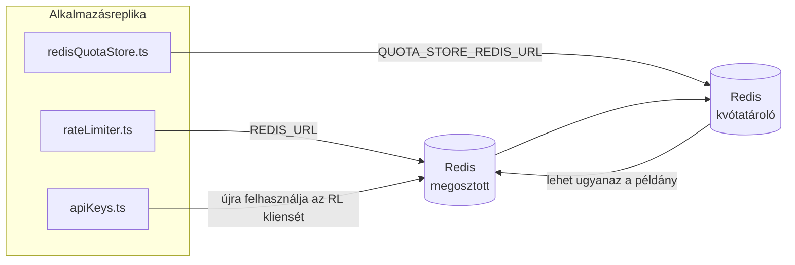

# Redis Production Configuration Guide (Magyar)

🌐 **Languages:** 🇺🇸 [English](../../../../ops/REDIS_PRODUCTION_CONFIG.md) · 🇪🇹 [am](../../../am/docs/ops/REDIS_PRODUCTION_CONFIG.md) · 🇸🇦 [ar](../../../ar/docs/ops/REDIS_PRODUCTION_CONFIG.md) · 🇦🇿 [az](../../../az/docs/ops/REDIS_PRODUCTION_CONFIG.md) · 🇧🇬 [bg](../../../bg/docs/ops/REDIS_PRODUCTION_CONFIG.md) · 🇧🇩 [bn](../../../bn/docs/ops/REDIS_PRODUCTION_CONFIG.md) · 🇧🇦 [bs](../../../bs/docs/ops/REDIS_PRODUCTION_CONFIG.md) · 🇨🇿 [cs](../../../cs/docs/ops/REDIS_PRODUCTION_CONFIG.md) · 🇩🇰 [da](../../../da/docs/ops/REDIS_PRODUCTION_CONFIG.md) · 🇩🇪 [de](../../../de/docs/ops/REDIS_PRODUCTION_CONFIG.md) · 🇬🇷 [el](../../../el/docs/ops/REDIS_PRODUCTION_CONFIG.md) · 🇪🇸 [es](../../../es/docs/ops/REDIS_PRODUCTION_CONFIG.md) · 🇪🇪 [et](../../../et/docs/ops/REDIS_PRODUCTION_CONFIG.md) · 🇮🇷 [fa](../../../fa/docs/ops/REDIS_PRODUCTION_CONFIG.md) · 🇫🇮 [fi](../../../fi/docs/ops/REDIS_PRODUCTION_CONFIG.md) · 🇫🇷 [fr](../../../fr/docs/ops/REDIS_PRODUCTION_CONFIG.md) · 🇮🇪 [ga](../../../ga/docs/ops/REDIS_PRODUCTION_CONFIG.md) · 🇮🇳 [gu](../../../gu/docs/ops/REDIS_PRODUCTION_CONFIG.md) · 🇳🇬 [ha](../../../ha/docs/ops/REDIS_PRODUCTION_CONFIG.md) · 🇮🇱 [he](../../../he/docs/ops/REDIS_PRODUCTION_CONFIG.md) · 🇮🇳 [hi](../../../hi/docs/ops/REDIS_PRODUCTION_CONFIG.md) · 🇭🇷 [hr](../../../hr/docs/ops/REDIS_PRODUCTION_CONFIG.md) · 🇦🇲 [hy](../../../hy/docs/ops/REDIS_PRODUCTION_CONFIG.md) · 🇮🇩 [id](../../../id/docs/ops/REDIS_PRODUCTION_CONFIG.md) · 🇳🇬 [ig](../../../ig/docs/ops/REDIS_PRODUCTION_CONFIG.md) · 🇮🇹 [it](../../../it/docs/ops/REDIS_PRODUCTION_CONFIG.md) · 🇯🇵 [ja](../../../ja/docs/ops/REDIS_PRODUCTION_CONFIG.md) · 🇬🇪 [ka](../../../ka/docs/ops/REDIS_PRODUCTION_CONFIG.md) · 🇰🇭 [km](../../../km/docs/ops/REDIS_PRODUCTION_CONFIG.md) · 🇮🇳 [kn](../../../kn/docs/ops/REDIS_PRODUCTION_CONFIG.md) · 🇰🇷 [ko](../../../ko/docs/ops/REDIS_PRODUCTION_CONFIG.md) · 🇱🇹 [lt](../../../lt/docs/ops/REDIS_PRODUCTION_CONFIG.md) · 🇱🇻 [lv](../../../lv/docs/ops/REDIS_PRODUCTION_CONFIG.md) · 🇮🇳 [ml](../../../ml/docs/ops/REDIS_PRODUCTION_CONFIG.md) · 🇮🇳 [mr](../../../mr/docs/ops/REDIS_PRODUCTION_CONFIG.md) · 🇲🇾 [ms](../../../ms/docs/ops/REDIS_PRODUCTION_CONFIG.md) · 🇲🇹 [mt](../../../mt/docs/ops/REDIS_PRODUCTION_CONFIG.md) · 🇲🇲 [my](../../../my/docs/ops/REDIS_PRODUCTION_CONFIG.md) · 🇳🇵 [ne](../../../ne/docs/ops/REDIS_PRODUCTION_CONFIG.md) · 🇳🇱 [nl](../../../nl/docs/ops/REDIS_PRODUCTION_CONFIG.md) · 🇳🇴 [no](../../../no/docs/ops/REDIS_PRODUCTION_CONFIG.md) · 🇮🇳 [or](../../../or/docs/ops/REDIS_PRODUCTION_CONFIG.md) · 🇮🇳 [pa](../../../pa/docs/ops/REDIS_PRODUCTION_CONFIG.md) · 🇵🇭 [phi](../../../phi/docs/ops/REDIS_PRODUCTION_CONFIG.md) · 🇵🇱 [pl](../../../pl/docs/ops/REDIS_PRODUCTION_CONFIG.md) · 🇵🇹 [pt](../../../pt/docs/ops/REDIS_PRODUCTION_CONFIG.md) · 🇧🇷 [pt-BR](../../../pt-BR/docs/ops/REDIS_PRODUCTION_CONFIG.md) · 🇷🇴 [ro](../../../ro/docs/ops/REDIS_PRODUCTION_CONFIG.md) · 🇷🇺 [ru](../../../ru/docs/ops/REDIS_PRODUCTION_CONFIG.md) · 🇱🇰 [si](../../../si/docs/ops/REDIS_PRODUCTION_CONFIG.md) · 🇸🇰 [sk](../../../sk/docs/ops/REDIS_PRODUCTION_CONFIG.md) · 🇸🇮 [sl](../../../sl/docs/ops/REDIS_PRODUCTION_CONFIG.md) · 🇷🇸 [sr](../../../sr/docs/ops/REDIS_PRODUCTION_CONFIG.md) · 🇸🇪 [sv](../../../sv/docs/ops/REDIS_PRODUCTION_CONFIG.md) · 🇰🇪 [sw](../../../sw/docs/ops/REDIS_PRODUCTION_CONFIG.md) · 🇮🇳 [ta](../../../ta/docs/ops/REDIS_PRODUCTION_CONFIG.md) · 🇮🇳 [te](../../../te/docs/ops/REDIS_PRODUCTION_CONFIG.md) · 🇹🇭 [th](../../../th/docs/ops/REDIS_PRODUCTION_CONFIG.md) · 🇹🇷 [tr](../../../tr/docs/ops/REDIS_PRODUCTION_CONFIG.md) · 🇺🇦 [uk-UA](../../../uk-UA/docs/ops/REDIS_PRODUCTION_CONFIG.md) · 🇵🇰 [ur](../../../ur/docs/ops/REDIS_PRODUCTION_CONFIG.md) · 🇺🇿 [uz](../../../uz/docs/ops/REDIS_PRODUCTION_CONFIG.md) · 🇻🇳 [vi](../../../vi/docs/ops/REDIS_PRODUCTION_CONFIG.md) · 🇳🇬 [yo](../../../yo/docs/ops/REDIS_PRODUCTION_CONFIG.md) · 🇨🇳 [zh-CN](../../../zh-CN/docs/ops/REDIS_PRODUCTION_CONFIG.md) · 🇹🇼 [zh-TW](../../../zh-TW/docs/ops/REDIS_PRODUCTION_CONFIG.md)

---

## Áttekintés

A Redis egy **opcionális, laza függőség** az OmniRoute-ban — ha a Redis nem érhető el, az alkalmazás szabályozottan csökkentett funkcionalitásra vált (memórián belüli tartalékmegoldásokra). Éles környezetben a Redis finomhangolása négy különböző feladattípus késleltetését csökkenti:

| Feladattípus                    | Megvalósító                   | Klienspéldányosító                                            | Kulcsminta                                              |
| ------------------------------- | ----------------------------- | ------------------------------------------------------------- | ------------------------------------------------------- |
| Sebességkorlátozás              | `rateLimiter.ts`              | `getRedisClient()` — lusta inicializálású `ioredis` singleton | `<prefix>rl:*` Lua‑atomi sebességkorlátozási időablakok |
| Hitelesítési gyorsítótár        | `apiKeys.ts`                  | Újra felhasználja a `rateLimiter` kliensét                    | `<prefix>auth:api_key:<sha256>` TTL-lel                 |
| Kvótatároló                     | `redisQuotaStore.ts`          | Különálló `getRedisClient(url)` singleton                     | `<prefix>quota:*`, példányonként konfigurálható         |
| Bemelegítési áramkör-megszakító | `redisCircuitBreakerStore.ts` | Különálló kliens a `circuitBreakerFactory.ts` fájlban         | `<prefix>warmup:cb:<connectionId>`                      |

Mind a négy feladattípus közös névtérelőtagot használ, így az OmniRoute más alkalmazásokkal együtt is használhat egyetlen Redis-példányt (például `127.0.0.1:6379`). Lásd: [Kulcsok névterezése](#key-namespacing).

---

## Jelenlegi konfiguráció (kódbeli alapértékek)

| Beállítás                                  | Érték                                                                   | Hely                                                                                  |
| ------------------------------------------ | ----------------------------------------------------------------------- | ------------------------------------------------------------------------------------- |
| `REDIS_URL` környezeti változó             | `redis://redis:6379` (compose), opcionális                              | `rateLimiter.ts:5`, `.env.example`                                                    |
| `REDIS_KEY_PREFIX` környezeti változó      | `omniroute:` (alapértelmezett)                                          | `rateLimiter.ts`, `redisQuotaStore.ts`, `redisCircuitBreakerStore.ts`, `.env.example` |
| `QUOTA_STORE_REDIS_URL` környezeti változó | különálló, eltérhet a `REDIS_URL` értékétől                             | `quota/storeFactory.ts`                                                               |
| `QUOTA_STORE_DRIVER`                       | `"sqlite"` (alapértelmezett), opcionálisan `"redis"`                    | `quota/storeFactory.ts`                                                               |
| ioredis `maxRetriesPerRequest`             | `3`                                                                     | kliens létrehozása a `rateLimiter.ts` fájlban                                         |
| `enableReadyCheck`                         | nincs beállítva (ioredis-alapérték: `true`)                             | —                                                                                     |
| `lazyConnect`                              | nincs beállítva (ioredis-alapérték: `false`)                            | —                                                                                     |
| `retryStrategy`                            | nincs beállítva (ioredis-alapérték: 200 ms-os alapérték, exponenciális) | —                                                                                     |
| TLS / jelszó / adatbázisindex              | **nincs konfigurálva**                                                  | —                                                                                     |
| Sentinel / Cluster                         | **nincs konfigurálva** — csak önálló, egycsomópontos üzemmód            | —                                                                                     |

---

## Kulcsok névterezése

Az OmniRoute ugyanazt a Redis-példányt használja, mint a gazdagépen futó egyéb szolgáltatások. Névtér nélkül az olyan kulcsok, mint az `auth:api_key:<sha256>` vagy az `rl:*`, ütközhetnek az ugyanazt a Redist használó más alkalmazások kulcsaival (ezen a példányon a Redis a `127.0.0.1:6379` címen fut más szolgáltatások mellett).

Állítsa a `REDIS_KEY_PREFIX` értékét nem üres karakterláncra, hogy az OmniRoute **minden** kulcsa előtagot kapjon:

```bash
# .env — minden OmniRoute-kulcs a következővé válik: omniroute:rl:*, omniroute:auth:*, omniroute:quota:*, omniroute:warmup:cb:*
REDIS_KEY_PREFIX=omniroute:
```

- **Alapértelmezett érték:** `omniroute:` (akkor alkalmazva, ha a `REDIS_KEY_PREFIX` nincs beállítva vagy üres).
- **A következőkre vonatkozik:** sebességkorlátozó + hitelesítési gyorsítótár (megosztott `ioredis` kliens a `keyPrefix` használatával), valamint a kvótatároló (`KEY_PREFIX = "${REDIS_KEY_PREFIX}quota"`) és a bemelegítési áramkör-megszakító (`KEY_PREFIX = "${REDIS_KEY_PREFIX}warmup:cb:"`).
- **Az előtag módosítása**, amikor már léteznek kulcsok a Redisben, árván hagyja a régi kulcsokat (ezek TTL / LRU alapján lejárnak). Biztonságosan módosítható; nincs szükség migrációra. Az egyetlen kivétel egy tiltottként megjelölt kapcsolat bemelegítési áramkör-megszakítójának kulcsa: ez TTL nélkül marad meg, ezért listázza a hátramaradt kulcsokat a `redis-cli --scan --pattern '<old-prefix>warmup:cb:*'` paranccsal, majd törölje őket.
- Az **ioredis `keyPrefix`** íráskor automatikusan hozzáfűzi az előtagot, olvasáskor pedig **eltávolítja** azt, így az alkalmazáskód soha nem látja az előtagot.

---

## Javasolt gyártási hangolás

### 1. Csatlakozási készlet/kliens opciók (ioredis `Redis` konstruktor)

A jelenlegi kód egyetlen `new Redis(url)` hoz létre egyéni beállítások nélkül. Éles többreplika telepítésekhez adjon át egy ügyfélgyárat a kódban vagy csomagolja be `getRedisClient()`:

```typescript
const redis = new Redis(REDIS_URL, {
  maxRetriesPerRequest: null, // no retry limit; let retryStrategy decide
  enableReadyCheck: true, // verify server is ready before accepting calls
  lazyConnect: true, // don't connect on construction; wait for first call
  retryStrategy: (times) => {
    if (times > 10) return null; // give up after 10 retries → reconnect later
    return Math.min(times * 200, 5000); // 200ms, 400ms, …, 5s cap
  },
  enableAutoPipelining: true, // coalesce concurrent commands into one TCP write
  keepAlive: 10000, // TCP keep‑alive every 10s
});
```

**Főbb kompromisszumok:**

- `maxRetriesPerRequest: null` + `retryStrategy` — előnyben részesített éles környezetben, így a tranziens Redis újraindítások nem tesznek azonnal kudarcot minden kérés esetén. A `checkRateLimit()` memórián belüli tartaléka elnyeli a hibaútvonalat.
- `lazyConnect: true` — elkerüli az indítási függőséget Redis től, mielőtt a kiszolgáló elkezdené fogadni a kapcsolatokat.
- `enableAutoPipelining: true` — csökkenti az oda-vissza utak számát az egyidejű díjkorlát-ellenőrzéseknél; előnyös > 50 RPS -nél egyetlen csatlakozáson.

### 2. Redis szerver konfiguráció (`redis.conf`)

```
# Memory
maxmemory 80%                        # leave room for OS page cache
maxmemory-policy allkeys-lru         # evict stale auth cache entries under pressure

# Persistence (optional — OmniRoute is crash‑safe without it)
save 300 1                           # snapshot at least every 5 min if ≥1 key changed
appendonly no                        # AOF not needed; data is regeneratable
appendfsync no                       # no fsync overhead (RDB is sufficient)

# Networking
timeout 0                            # no idle disconnect
tcp-keepalive 300                    # 5 min keep‑alive
tcp-backlog 511                      # connection backlog for bursty load

# Performance
hz 10                                # default; 100 for latency‑sensitive
activedefrag yes                     # auto‑defragment when fragmentation >10%
```

**Kompromisszum `maxmemory-policy allkeys-lru`-hoz:** A gyorsítótár hitelesítési bejegyzései a memória nyomására kiüríthetők. Ez biztonságos — `setCachedApiKey` mindig újratelepül kihagyáskor, és a SQLite tartalék a mérvadó. A sebességkorlátozó Lua szkript kis kulcsokat hoz létre, amelyek tervezésüknél fogva rövid életűek.

### 3. Docker Beállítások írása

A prod compose (`docker-compose.prod.yml`) `redis:8.6.2-alpine` használja. Hozzáadás:

```yaml
redis:
  image: redis:8.6.2-alpine
  command:
    [
      "redis-server",
      "--maxmemory",
      "512mb",
      "--maxmemory-policy",
      "allkeys-lru",
      "--activedefrag",
      "yes",
      "--save",
      "300 1",
    ]
  healthcheck:
    test: ["CMD", "redis-cli", "ping"]
    interval: 10s
    timeout: 3s
    retries: 3
    start_period: 5s
```

### 4. Többpéldányos/méretezési szempontok

**Egyetlen Redis az összes replikához** — a sebességkorlátozó Lua szkript egyetlen mérvadó kulcstértől függ. Több Redis példány a replikák mögött elveszítené az atomerőt, és megduplázná a költségvetést. Használjon egyetlen Redis (vagy Redis Sentinel-fürtöt feladatátvétellel) az összes alkalmazásreplikához.

**Csatlakozások száma:** Minden alkalmazás replika megnyílik** 2 TCP csatlakozás** a Redis (rate limiter client + kvótatároló kliens). 10 replikánál → 20 kapcsolatok, jóval az alapértelmezett Redis példány 10 000 kapcsolati plafonján belül.

### 5. Monitoring

Exponálás állapotellenőrzési végponton keresztül:

```typescript
// src/app/api/monitoring/health/route.ts already calls rateLimiter functions
// Add Redis-specific checks:
//   1. PING latency via ioredis .ping()
//   2. Memory usage via INFO memory
//   3. Connection count via INFO clients
//   4. Hit rate for maxmemory-policy (evicted_keys / keyspace_hits)
```

A legfontosabb figyelendő mutatók:

- **Kilakoltatott kulcsok / mp** — ha tartósan nem nulla, növelje `maxmemory`
- **Letiltott ügyfelek** — nem nulla lassú Lua szkripteket vagy magas versenyt javasol
- **Elutasított kapcsolatok** — csatlakozási határérték; ritka 20 csatlakozásnál

### 6. Redis-kompatibilis szerverek

Minden itt használt szervernek Lua szkripteket kell futtatnia: a sebességkorlátozó egy `EVAL`. Lua nélküli szerveren `checkRateLimit()` naplózza `[RATE_LIMITER] Redis eval failed, falling back to in-memory rate limiting`, és folyamatonként számol, így minden replika önmagában érvényesíti a korlátot. Az opt-in megosztott munkamenet-affinitástároló (`OMNIROUTE_SESSION_AFFINITY_STORE=redis`) `EVAL`-vel is olvassa és frissíti a tűket; Lua nélkül naplózza `[SESSION_AFFINITY] Redis error; falling back to SQLite.`, és minden replika megtartja a saját tűit. A többi munkaterhelés egyszerű parancsokat használ (`SET ... EX`, `GET`, `DEL`, `MGET`, `EXPIRE`, `INCRBYFLOAT`, hash-ek és halmazok), és a szemantikai gyorsítótár Redis háttérrendszere nem küld `FT.*` parancsokat.

OmniRoute 3.8.52-vel tesztelve: KiviDB 1.2.0 a Lua képpel (`kividb/kividb:v1.2.0-lua`). A sebességkorlátozó (beleértve a számlálókat megosztó második folyamatot), a hitelesítési gyorsítótár, a kvótatároló, a bemelegítő áramköri megszakító, a szemantikus gyorsítótár tárolója és a csevegéskezelőn keresztül érkező `/v1/chat/completions` kérés Redis 8.10.3-on átmenő 19 ellenőrzés közül 18-at teljesített. Az, amelyik különbözik: `INCRBYFLOAT` `0.1 + 0.2` `0.30000000000000004` ként tárolja, ahol a Redis `0.3` t ( [kividbio/kividb#387](https://github.com/kividbio/kividb/issues/387) ). A kvótatároló mindkettőt `parseFloat`-lel elemzi, de a két szám az utolsó számjegyekben különbözik, így egy pontosan kvótahatárra eső összehasonlítás másképp jöhet ki. A munkamenet-affinitástároló nem volt része ennek a futtatásnak. ( [beállítás](https://github.com/kividbio/kividb/blob/master/docs/integrations/omniroute.md), [eredmények](https://github.com/kividbio/kividb/tree/master/benchmarks/omniroute-compat) )

---

## Architektúra-diagram



---

## Hivatkozások

| Fájl                               | Rendeltetés                                                                          |
| ---------------------------------- | ------------------------------------------------------------------------------------ |
| `src/shared/utils/rateLimiter.ts`  | Elsődleges Redis-kliens, Lua sebességkorlátozó szkript, memóriabeli tartalékmegoldás |
| `src/lib/db/apiKeys.ts`            | Hitelesítési gyorsítótár — Redis→SQLite tartalékmegoldással                          |
| `src/lib/quota/redisQuotaStore.ts` | Különálló Redis-kliens az opcionális kvótatárolóhoz                                  |
| `src/lib/quota/storeFactory.ts`    | Váltás a `sqlite` és a `redis` kvótameghajtók között                                 |
| `docker-compose.prod.yml`          | Éles környezetbeli Redis-konténer (`redis:8.6.2-alpine` rendszerképpel)              |
| `.env.example`                     | A Redis környezeti változóinak dokumentációja                                        |
| `src/app/api/local/redis/`         | API-útvonalak a fejlesztői konténerek vezérléséhez                                   |
| `bin/cli/commands/redis.mjs`       | CLI-parancsok a fejlesztői konténerek vezérléséhez                                   |
