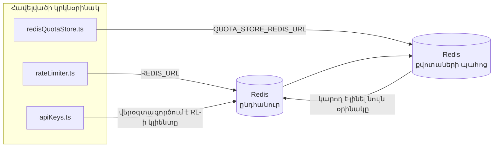

# Redis Production Configuration Guide (Հայերեն)

🌐 **Languages:** 🇺🇸 [English](../../../../ops/REDIS_PRODUCTION_CONFIG.md) · 🇪🇹 [am](../../../am/docs/ops/REDIS_PRODUCTION_CONFIG.md) · 🇸🇦 [ar](../../../ar/docs/ops/REDIS_PRODUCTION_CONFIG.md) · 🇦🇿 [az](../../../az/docs/ops/REDIS_PRODUCTION_CONFIG.md) · 🇧🇬 [bg](../../../bg/docs/ops/REDIS_PRODUCTION_CONFIG.md) · 🇧🇩 [bn](../../../bn/docs/ops/REDIS_PRODUCTION_CONFIG.md) · 🇧🇦 [bs](../../../bs/docs/ops/REDIS_PRODUCTION_CONFIG.md) · 🇨🇿 [cs](../../../cs/docs/ops/REDIS_PRODUCTION_CONFIG.md) · 🇩🇰 [da](../../../da/docs/ops/REDIS_PRODUCTION_CONFIG.md) · 🇩🇪 [de](../../../de/docs/ops/REDIS_PRODUCTION_CONFIG.md) · 🇬🇷 [el](../../../el/docs/ops/REDIS_PRODUCTION_CONFIG.md) · 🇪🇸 [es](../../../es/docs/ops/REDIS_PRODUCTION_CONFIG.md) · 🇪🇪 [et](../../../et/docs/ops/REDIS_PRODUCTION_CONFIG.md) · 🇮🇷 [fa](../../../fa/docs/ops/REDIS_PRODUCTION_CONFIG.md) · 🇫🇮 [fi](../../../fi/docs/ops/REDIS_PRODUCTION_CONFIG.md) · 🇫🇷 [fr](../../../fr/docs/ops/REDIS_PRODUCTION_CONFIG.md) · 🇮🇪 [ga](../../../ga/docs/ops/REDIS_PRODUCTION_CONFIG.md) · 🇮🇳 [gu](../../../gu/docs/ops/REDIS_PRODUCTION_CONFIG.md) · 🇳🇬 [ha](../../../ha/docs/ops/REDIS_PRODUCTION_CONFIG.md) · 🇮🇱 [he](../../../he/docs/ops/REDIS_PRODUCTION_CONFIG.md) · 🇮🇳 [hi](../../../hi/docs/ops/REDIS_PRODUCTION_CONFIG.md) · 🇭🇷 [hr](../../../hr/docs/ops/REDIS_PRODUCTION_CONFIG.md) · 🇭🇺 [hu](../../../hu/docs/ops/REDIS_PRODUCTION_CONFIG.md) · 🇮🇩 [id](../../../id/docs/ops/REDIS_PRODUCTION_CONFIG.md) · 🇳🇬 [ig](../../../ig/docs/ops/REDIS_PRODUCTION_CONFIG.md) · 🇮🇹 [it](../../../it/docs/ops/REDIS_PRODUCTION_CONFIG.md) · 🇯🇵 [ja](../../../ja/docs/ops/REDIS_PRODUCTION_CONFIG.md) · 🇬🇪 [ka](../../../ka/docs/ops/REDIS_PRODUCTION_CONFIG.md) · 🇰🇭 [km](../../../km/docs/ops/REDIS_PRODUCTION_CONFIG.md) · 🇮🇳 [kn](../../../kn/docs/ops/REDIS_PRODUCTION_CONFIG.md) · 🇰🇷 [ko](../../../ko/docs/ops/REDIS_PRODUCTION_CONFIG.md) · 🇱🇹 [lt](../../../lt/docs/ops/REDIS_PRODUCTION_CONFIG.md) · 🇱🇻 [lv](../../../lv/docs/ops/REDIS_PRODUCTION_CONFIG.md) · 🇮🇳 [ml](../../../ml/docs/ops/REDIS_PRODUCTION_CONFIG.md) · 🇮🇳 [mr](../../../mr/docs/ops/REDIS_PRODUCTION_CONFIG.md) · 🇲🇾 [ms](../../../ms/docs/ops/REDIS_PRODUCTION_CONFIG.md) · 🇲🇹 [mt](../../../mt/docs/ops/REDIS_PRODUCTION_CONFIG.md) · 🇲🇲 [my](../../../my/docs/ops/REDIS_PRODUCTION_CONFIG.md) · 🇳🇵 [ne](../../../ne/docs/ops/REDIS_PRODUCTION_CONFIG.md) · 🇳🇱 [nl](../../../nl/docs/ops/REDIS_PRODUCTION_CONFIG.md) · 🇳🇴 [no](../../../no/docs/ops/REDIS_PRODUCTION_CONFIG.md) · 🇮🇳 [or](../../../or/docs/ops/REDIS_PRODUCTION_CONFIG.md) · 🇮🇳 [pa](../../../pa/docs/ops/REDIS_PRODUCTION_CONFIG.md) · 🇵🇭 [phi](../../../phi/docs/ops/REDIS_PRODUCTION_CONFIG.md) · 🇵🇱 [pl](../../../pl/docs/ops/REDIS_PRODUCTION_CONFIG.md) · 🇵🇹 [pt](../../../pt/docs/ops/REDIS_PRODUCTION_CONFIG.md) · 🇧🇷 [pt-BR](../../../pt-BR/docs/ops/REDIS_PRODUCTION_CONFIG.md) · 🇷🇴 [ro](../../../ro/docs/ops/REDIS_PRODUCTION_CONFIG.md) · 🇷🇺 [ru](../../../ru/docs/ops/REDIS_PRODUCTION_CONFIG.md) · 🇱🇰 [si](../../../si/docs/ops/REDIS_PRODUCTION_CONFIG.md) · 🇸🇰 [sk](../../../sk/docs/ops/REDIS_PRODUCTION_CONFIG.md) · 🇸🇮 [sl](../../../sl/docs/ops/REDIS_PRODUCTION_CONFIG.md) · 🇷🇸 [sr](../../../sr/docs/ops/REDIS_PRODUCTION_CONFIG.md) · 🇸🇪 [sv](../../../sv/docs/ops/REDIS_PRODUCTION_CONFIG.md) · 🇰🇪 [sw](../../../sw/docs/ops/REDIS_PRODUCTION_CONFIG.md) · 🇮🇳 [ta](../../../ta/docs/ops/REDIS_PRODUCTION_CONFIG.md) · 🇮🇳 [te](../../../te/docs/ops/REDIS_PRODUCTION_CONFIG.md) · 🇹🇭 [th](../../../th/docs/ops/REDIS_PRODUCTION_CONFIG.md) · 🇹🇷 [tr](../../../tr/docs/ops/REDIS_PRODUCTION_CONFIG.md) · 🇺🇦 [uk-UA](../../../uk-UA/docs/ops/REDIS_PRODUCTION_CONFIG.md) · 🇵🇰 [ur](../../../ur/docs/ops/REDIS_PRODUCTION_CONFIG.md) · 🇺🇿 [uz](../../../uz/docs/ops/REDIS_PRODUCTION_CONFIG.md) · 🇻🇳 [vi](../../../vi/docs/ops/REDIS_PRODUCTION_CONFIG.md) · 🇳🇬 [yo](../../../yo/docs/ops/REDIS_PRODUCTION_CONFIG.md) · 🇨🇳 [zh-CN](../../../zh-CN/docs/ops/REDIS_PRODUCTION_CONFIG.md) · 🇹🇼 [zh-TW](../../../zh-TW/docs/ops/REDIS_PRODUCTION_CONFIG.md)

---

## Ընդհանուր ակնարկ

Redis-ը OmniRoute-ում **ըստ ցանկության օգտագործվող, ոչ պարտադիր կախվածություն** է․ երբ Redis-ն անհասանելի է, հավելվածը շարունակում է աշխատել սահմանափակված հնարավորություններով՝ օգտագործելով հիշողության վրա հիմնված պահուստային մեխանիզմներ։ Արտադրական միջավայրում Redis-ի կարգաբերումը նվազեցնում է ուշացումը չորս տարբեր աշխատանքային ծանրաբեռնվածությունների համար.

| Աշխատանքային ծանրաբեռնվածություն          | Դրայվեր                       | Հաճախորդի գործարան                                          | Բանալու ձևանմուշ                                                                             |
| ----------------------------------------- | ----------------------------- | ----------------------------------------------------------- | -------------------------------------------------------------------------------------------- |
| Հարցումների հաճախականության սահմանափակում | `rateLimiter.ts`              | `getRedisClient()` — ծույլ սկզբնավորվող `ioredis` singleton | `<prefix>rl:*` Lua-ի միջոցով ատոմային՝ հարցումների հաճախականության սահմանափակման պատուհաններ |
| Նույնականացման քեշ                        | `apiKeys.ts`                  | Վերօգտագործում է `rateLimiter`-ի հաճախորդը                  | `<prefix>auth:api_key:<sha256>`՝ TTL-ով                                                      |
| Քվոտաների պահոց                           | `redisQuotaStore.ts`          | Առանձին `getRedisClient(url)` singleton                     | `<prefix>quota:*`՝ կարգավորվող յուրաքանչյուր օրինակի համար                                   |
| Նախնական տաքացման շղթայի անջատիչ          | `redisCircuitBreakerStore.ts` | Առանձին հաճախորդ `circuitBreakerFactory.ts`-ում             | `<prefix>warmup:cb:<connectionId>`                                                           |

Բոլոր չորս աշխատանքային ծանրաբեռնվածություններն օգտագործում են անվանատարածքի մեկ ընդհանուր նախածանց, որպեսզի OmniRoute-ը կարողանա մեկ Redis օրինակում համատեղ աշխատել այլ հավելվածների հետ (օրինակ՝ `127.0.0.1:6379`)։ Տե՛ս [Բանալիների անվանատարածքը](#key-namespacing)։

---

## Ընթացիկ կազմաձևում (կոդի լռելյայն արժեքներ)

| Կարգավորում                                 | Արժեք                                                                 | Որտեղ                                                                                 |
| ------------------------------------------- | --------------------------------------------------------------------- | ------------------------------------------------------------------------------------- |
| `REDIS_URL` միջավայրի փոփոխական             | `redis://redis:6379` (compose), ըստ ցանկության                        | `rateLimiter.ts:5`, `.env.example`                                                    |
| `REDIS_KEY_PREFIX` միջավայրի փոփոխական      | `omniroute:` (լռելյայն)                                               | `rateLimiter.ts`, `redisQuotaStore.ts`, `redisCircuitBreakerStore.ts`, `.env.example` |
| `QUOTA_STORE_REDIS_URL` միջավայրի փոփոխական | առանձին է, կարող է տարբերվել `REDIS_URL`-ից                           | `quota/storeFactory.ts`                                                               |
| `QUOTA_STORE_DRIVER`                        | `"sqlite"` (լռելյայն), `"redis"`՝ ըստ ցանկության                      | `quota/storeFactory.ts`                                                               |
| ioredis-ի `maxRetriesPerRequest`            | `3`                                                                   | հաճախորդի ստեղծումը `rateLimiter.ts`-ում                                              |
| `enableReadyCheck`                          | սահմանված չէ (ioredis-ի լռելյայն արժեքը՝ `true`)                      | —                                                                                     |
| `lazyConnect`                               | սահմանված չէ (ioredis-ի լռելյայն արժեքը՝ `false`)                     | —                                                                                     |
| `retryStrategy`                             | սահմանված չէ (ioredis-ի լռելյայն արժեքը՝ 200ms բազային, էքսպոնենցիալ) | —                                                                                     |
| TLS / գաղտնաբառ / DB ինդեքս                 | **կազմաձևված չէ**                                                     | —                                                                                     |
| Sentinel / Cluster                          | **կազմաձևված չէ** — միայն ինքնուրույն մեկ հանգույց                    | —                                                                                     |

---

## Բանալիների անվանատարածքը

OmniRoute-ը Redis-ի օրինակը համատեղ օգտագործում է հոսթում աշխատող ցանկացած այլ համակարգի հետ։ Առանց անվանատարածքի՝ `auth:api_key:<sha256>` կամ `rl:*` տեսակի բանալիները կարող են բախվել նույն Redis-ն օգտագործող այլ հավելվածների բանալիների հետ (այս օրինակում Redis-ն աշխատում է `127.0.0.1:6379` հասցեում՝ այլ ծառայությունների կողքին)։

Սահմանեք `REDIS_KEY_PREFIX`-ը որպես ոչ դատարկ տող՝ OmniRoute-ի **յուրաքանչյուր** բանալուն նախածանց ավելացնելու համար.

```bash
# .env — OmniRoute-ի բոլոր բանալիները դառնում են omniroute:rl:*, omniroute:auth:*, omniroute:quota:*, omniroute:warmup:cb:*
REDIS_KEY_PREFIX=omniroute:
```

- **Լռելյայն՝** `omniroute:` (կիրառվում է, երբ `REDIS_KEY_PREFIX`-ը սահմանված չէ կամ դատարկ է)։
- **Կիրառվում է՝** հարցումների հաճախականության սահմանափակիչի + նույնականացման քեշի (ընդհանուր `ioredis` հաճախորդ՝ `keyPrefix`-ի միջոցով), քվոտաների պահոցի (`KEY_PREFIX = "${REDIS_KEY_PREFIX}quota"`) և նախնական տաքացման շղթայի անջատիչի (`KEY_PREFIX = "${REDIS_KEY_PREFIX}warmup:cb:"`) նկատմամբ։
- **Նախածանցը փոխելիս**, երբ Redis-ում արդեն բանալիներ կան, հին բանալիները դառնում են որբ (դրանց ժամկետը լրանում է TTL / LRU-ի միջոցով)։ Փոփոխությունն անվտանգ է, տեղափոխում չի պահանջվում։ Միակ բացառությունը արգելված նշված կապի նախնական տաքացման շղթայի անջատիչի բանալին է․ այն պահպանվում է առանց TTL-ի, ուստի մնացորդները ցուցակագրեք `redis-cli --scan --pattern '<old-prefix>warmup:cb:*'` հրամանով և ջնջեք դրանք։
- **ioredis-ի `keyPrefix`-ը** գրելու ժամանակ ինքնաբերաբար ավելացնում է նախածանցը, իսկ կարդալու ժամանակ՝ **հեռացնում** այն, այնպես որ հավելվածի կոդը երբեք չի տեսնում նախածանցը։

---

## Առաջարկվող արտադրության թյունինգ

### 1. Միացման լողավազան / Հաճախորդի ընտրանքներ (ioredis `Redis` կոնստրուկտոր)

Ընթացիկ կոդը ստեղծում է մեկ `new Redis(url)` առանց հատուկ ընտրանքների: Արտադրության բազմակի կրկնօրինակների տեղադրման համար փոխանցեք հաճախորդի գործարանը ծածկագրով կամ փաթեթավորեք `getRedisClient()`.

```typescript
const redis = new Redis(REDIS_URL, {
  maxRetriesPerRequest: null, // no retry limit; let retryStrategy decide
  enableReadyCheck: true, // verify server is ready before accepting calls
  lazyConnect: true, // don't connect on construction; wait for first call
  retryStrategy: (times) => {
    if (times > 10) return null; // give up after 10 retries → reconnect later
    return Math.min(times * 200, 5000); // 200ms, 400ms, …, 5s cap
  },
  enableAutoPipelining: true, // coalesce concurrent commands into one TCP write
  keepAlive: 10000, // TCP keep‑alive every 10s
});
```

**Հիմնական փոխզիջումներ.**

- `maxRetriesPerRequest: null` + `retryStrategy` — նախընտրելի է արտադրության համար, այնպես որ Redis անցողիկ վերագործարկումները անմիջապես չտապալեն յուրաքանչյուր հարցում: `checkRateLimit()` ում հիշողության հետադարձ կապը կլանում է ձախողման ճանապարհը:
- `lazyConnect: true` — խուսափում է գործարկման կախվածությունից Redis ից մինչև սերվերը կսկսի միացումներ ընդունել:
- `enableAutoPipelining: true` — նվազեցնում է երկկողմանի երթուղիները միաժամանակյա փոխարժեքի սահմանաչափի ստուգումների համար. շահավետ է > 50 RPS մեկ կապով:

### 2. Redis սերվերի կազմաձևում (`redis.conf`)

```
# Memory
maxmemory 80%                        # leave room for OS page cache
maxmemory-policy allkeys-lru         # evict stale auth cache entries under pressure

# Persistence (optional — OmniRoute is crash‑safe without it)
save 300 1                           # snapshot at least every 5 min if ≥1 key changed
appendonly no                        # AOF not needed; data is regeneratable
appendfsync no                       # no fsync overhead (RDB is sufficient)

# Networking
timeout 0                            # no idle disconnect
tcp-keepalive 300                    # 5 min keep‑alive
tcp-backlog 511                      # connection backlog for bursty load

# Performance
hz 10                                # default; 100 for latency‑sensitive
activedefrag yes                     # auto‑defragment when fragmentation >10%
```

**Փոխանակում `maxmemory-policy allkeys-lru` համար.** Auth քեշի գրառումները կարող են հեռացվել հիշողության ճնշման տակ: Սա անվտանգ է — `setCachedApiKey` միշտ վերաբնակեցվում է բաց թողնելու ժամանակ, իսկ SQLite հետադարձ տարբերակը հեղինակավոր է: Փոխարժեքը սահմանափակող Lua սցենարը ստեղծում է փոքր ստեղներ, որոնք կարճատև են դիզայնով:

### 3. Docker Compose Settings

Prod compose (`docker-compose.prod.yml`) օգտագործում է `redis:8.6.2-alpine`: Ավելացնել:

```yaml
redis:
  image: redis:8.6.2-alpine
  command:
    [
      "redis-server",
      "--maxmemory",
      "512mb",
      "--maxmemory-policy",
      "allkeys-lru",
      "--activedefrag",
      "yes",
      "--save",
      "300 1",
    ]
  healthcheck:
    test: ["CMD", "redis-cli", "ping"]
    interval: 10s
    timeout: 3s
    retries: 3
    start_period: 5s
```

### 4. Բազմաթիվ / մասշտաբային նկատառումներ

**Մեկ Redis բոլոր կրկնօրինակների համար** — տոկոսադրույքը սահմանափակող Lua սկրիպտը կախված է մեկ հեղինակավոր բանալի տարածությունից: Կրկնօրինակների հետևում գտնվող Redis բազմաթիվ դեպքերը կկորցնեն ատոմականությունը և կկրկնապատկեն բյուջեն: Օգտագործեք մեկ Redis (կամ Redis Sentinel կլաստեր՝ ձախողմամբ) բոլոր հավելվածների կրկնօրինակների համար:

**Կապի քանակը.** Յուրաքանչյուր հավելվածի կրկնօրինակը բացվում է** 2 TCP միացումներ** դեպի Redis (դրույքաչափերի սահմանափակող հաճախորդ + քվոտա խանութի հաճախորդ): 10 կրկնօրինակներով → 20 միացումներով, լավ լռելյայն Redis օրինակի 10k կապի առաստաղի սահմաններում:

### 5. Մոնիտորինգ

Բացահայտեք առողջության ստուգման վերջնական կետի միջոցով.

```typescript
// src/app/api/monitoring/health/route.ts already calls rateLimiter functions
// Add Redis-specific checks:
//   1. PING latency via ioredis .ping()
//   2. Memory usage via INFO memory
//   3. Connection count via INFO clients
//   4. Hit rate for maxmemory-policy (evicted_keys / keyspace_hits)
```

Դիտելու հիմնական չափորոշիչները.

- **Վտարված բանալիներ / վրկ** — եթե համառորեն ոչ զրոյական է, ավելացրեք `maxmemory`
- **Արգելափակված հաճախորդներ** — non-zero-ն առաջարկում է դանդաղ Lua սցենարներ կամ բարձր վեճ
- **Մերժված կապերը** — կապի սահմանաչափի հարված; հազվադեպ է 20 միացումներով

### 6. Redis-համատեղելի սերվերներ

Այստեղ օգտագործվող ցանկացած սերվեր պետք է գործարկի Lua սկրիպտները. տոկոսադրույքի սահմանափակիչը մեկ `EVAL` է: Առանց Lua սերվերի վրա `checkRateLimit()` գրանցում է `[RATE_LIMITER] Redis eval failed, falling back to in-memory rate limiting` և հաշվում է յուրաքանչյուր գործընթացի համար, այնպես որ յուրաքանչյուր կրկնօրինակն ինքնուրույն է սահմանում: Համօգտագործվող նստաշրջանի հետ կապված խանութը (`OMNIROUTE_SESSION_AFFINITY_STORE=redis`) նաև կարդում և թարմացնում է կապում `EVAL` ով; առանց Lua-ն գրանցում է `[SESSION_AFFINITY] Redis error; falling back to SQLite.` և յուրաքանչյուր կրկնօրինակ պահում է իր կապում: Մյուս աշխատանքային ծանրաբեռնվածություններն օգտագործում են պարզ հրամաններ (`SET ... EX`, `GET`, `DEL`, `MGET`, `EXPIRE`, `INCRBYFLOAT`, հեշեր և հավաքածուներ), իսկ իմաստային քեշի Redis հետին մասը ոչ մի `FT.*` հրաման չի ուղարկում:

Փորձարկվել է OmniRoute 3.8.52-ով: KiviDB 1.2.0-ն իր Lua պատկերով (`kividb/kividb:v1.2.0-lua`): Փոխարժեքի սահմանափակիչը (ներառյալ երկրորդ պրոցեսը, որը կիսում է հաշվիչները), վավերացման քեշը, քվոտայի պահեստը, տաքացման անջատիչը, իմաստային քեշի պահեստը և `/v1/chat/completions` հարցումը չաթի մշակողի միջոցով փոխանցել են 19 ստուգումներից 18-ը, որոնք անցնում են Redis 8.10.3-ին: Մեկը, որը տարբերվում է. `INCRBYFLOAT` `0.1 + 0.2` պահում է որպես `0.30000000000000004` որտեղ Redis պահպանում է `0.3` ( [kividbio/kividb#387](https://github.com/kividbio/kividb/issues/387) ): Քվոտաների խանութը վերլուծում է երկուսն էլ `parseFloat` ով, սակայն երկու թվերը տարբերվում են վերջին թվանշաններով, ուստի համեմատությունը, որն ընկնում է հենց քվոտայի սահմանի վրա, կարող է տարբեր կերպ դուրս գալ: Sesion-affinity խանութն այդ վազքի մաս չէր: ( [տեղադրում](https://github.com/kividbio/kividb/blob/master/docs/integrations/omniroute.md), [արդյունքներ](https://github.com/kividbio/kividb/tree/master/benchmarks/omniroute-compat) )

---

## Ճարտարապետության դիագրամ



---

## Հղումներ

| Ֆայլ                               | Նպատակ                                                                                                         |
| ---------------------------------- | -------------------------------------------------------------------------------------------------------------- |
| `src/shared/utils/rateLimiter.ts`  | Հիմնական Redis կլիենտ, հարցումների հաճախականության սահմանափակման Lua սկրիպտ, ներհիշողային պահուստային տարբերակ |
| `src/lib/db/apiKeys.ts`            | Նույնականացման քեշ — Redis→SQLite պահուստային անցում                                                           |
| `src/lib/quota/redisQuotaStore.ts` | Առանձին Redis կլիենտ՝ քվոտաների ընտրովի պահոցի համար                                                           |
| `src/lib/quota/storeFactory.ts`    | Փոխարկում է `sqlite` և `redis` քվոտաների դրայվերների միջև                                                      |
| `docker-compose.prod.yml`          | Արտադրական միջավայրի Redis կոնտեյներ (`redis:8.6.2-alpine` պատկեր)                                             |
| `.env.example`                     | Redis միջավայրի փոփոխականների փաստաթղթեր                                                                       |
| `src/app/api/local/redis/`         | API երթուղիներ՝ մշակման միջավայրի կոնտեյների կառավարման համար                                                  |
| `bin/cli/commands/redis.mjs`       | CLI հրամաններ՝ մշակման միջավայրի կոնտեյների կառավարման համար                                                   |
