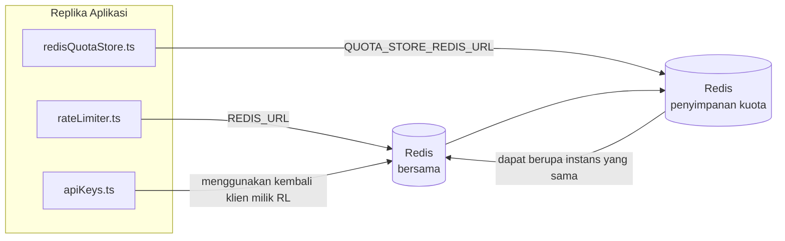

# Redis Production Configuration Guide (Bahasa Indonesia)

🌐 **Languages:** 🇺🇸 [English](../../../../ops/REDIS_PRODUCTION_CONFIG.md) · 🇪🇹 [am](../../../am/docs/ops/REDIS_PRODUCTION_CONFIG.md) · 🇸🇦 [ar](../../../ar/docs/ops/REDIS_PRODUCTION_CONFIG.md) · 🇦🇿 [az](../../../az/docs/ops/REDIS_PRODUCTION_CONFIG.md) · 🇧🇬 [bg](../../../bg/docs/ops/REDIS_PRODUCTION_CONFIG.md) · 🇧🇩 [bn](../../../bn/docs/ops/REDIS_PRODUCTION_CONFIG.md) · 🇧🇦 [bs](../../../bs/docs/ops/REDIS_PRODUCTION_CONFIG.md) · 🇨🇿 [cs](../../../cs/docs/ops/REDIS_PRODUCTION_CONFIG.md) · 🇩🇰 [da](../../../da/docs/ops/REDIS_PRODUCTION_CONFIG.md) · 🇩🇪 [de](../../../de/docs/ops/REDIS_PRODUCTION_CONFIG.md) · 🇬🇷 [el](../../../el/docs/ops/REDIS_PRODUCTION_CONFIG.md) · 🇪🇸 [es](../../../es/docs/ops/REDIS_PRODUCTION_CONFIG.md) · 🇪🇪 [et](../../../et/docs/ops/REDIS_PRODUCTION_CONFIG.md) · 🇮🇷 [fa](../../../fa/docs/ops/REDIS_PRODUCTION_CONFIG.md) · 🇫🇮 [fi](../../../fi/docs/ops/REDIS_PRODUCTION_CONFIG.md) · 🇫🇷 [fr](../../../fr/docs/ops/REDIS_PRODUCTION_CONFIG.md) · 🇮🇪 [ga](../../../ga/docs/ops/REDIS_PRODUCTION_CONFIG.md) · 🇮🇳 [gu](../../../gu/docs/ops/REDIS_PRODUCTION_CONFIG.md) · 🇳🇬 [ha](../../../ha/docs/ops/REDIS_PRODUCTION_CONFIG.md) · 🇮🇱 [he](../../../he/docs/ops/REDIS_PRODUCTION_CONFIG.md) · 🇮🇳 [hi](../../../hi/docs/ops/REDIS_PRODUCTION_CONFIG.md) · 🇭🇷 [hr](../../../hr/docs/ops/REDIS_PRODUCTION_CONFIG.md) · 🇭🇺 [hu](../../../hu/docs/ops/REDIS_PRODUCTION_CONFIG.md) · 🇦🇲 [hy](../../../hy/docs/ops/REDIS_PRODUCTION_CONFIG.md) · 🇳🇬 [ig](../../../ig/docs/ops/REDIS_PRODUCTION_CONFIG.md) · 🇮🇹 [it](../../../it/docs/ops/REDIS_PRODUCTION_CONFIG.md) · 🇯🇵 [ja](../../../ja/docs/ops/REDIS_PRODUCTION_CONFIG.md) · 🇬🇪 [ka](../../../ka/docs/ops/REDIS_PRODUCTION_CONFIG.md) · 🇰🇭 [km](../../../km/docs/ops/REDIS_PRODUCTION_CONFIG.md) · 🇮🇳 [kn](../../../kn/docs/ops/REDIS_PRODUCTION_CONFIG.md) · 🇰🇷 [ko](../../../ko/docs/ops/REDIS_PRODUCTION_CONFIG.md) · 🇱🇹 [lt](../../../lt/docs/ops/REDIS_PRODUCTION_CONFIG.md) · 🇱🇻 [lv](../../../lv/docs/ops/REDIS_PRODUCTION_CONFIG.md) · 🇮🇳 [ml](../../../ml/docs/ops/REDIS_PRODUCTION_CONFIG.md) · 🇮🇳 [mr](../../../mr/docs/ops/REDIS_PRODUCTION_CONFIG.md) · 🇲🇾 [ms](../../../ms/docs/ops/REDIS_PRODUCTION_CONFIG.md) · 🇲🇹 [mt](../../../mt/docs/ops/REDIS_PRODUCTION_CONFIG.md) · 🇲🇲 [my](../../../my/docs/ops/REDIS_PRODUCTION_CONFIG.md) · 🇳🇵 [ne](../../../ne/docs/ops/REDIS_PRODUCTION_CONFIG.md) · 🇳🇱 [nl](../../../nl/docs/ops/REDIS_PRODUCTION_CONFIG.md) · 🇳🇴 [no](../../../no/docs/ops/REDIS_PRODUCTION_CONFIG.md) · 🇮🇳 [or](../../../or/docs/ops/REDIS_PRODUCTION_CONFIG.md) · 🇮🇳 [pa](../../../pa/docs/ops/REDIS_PRODUCTION_CONFIG.md) · 🇵🇭 [phi](../../../phi/docs/ops/REDIS_PRODUCTION_CONFIG.md) · 🇵🇱 [pl](../../../pl/docs/ops/REDIS_PRODUCTION_CONFIG.md) · 🇵🇹 [pt](../../../pt/docs/ops/REDIS_PRODUCTION_CONFIG.md) · 🇧🇷 [pt-BR](../../../pt-BR/docs/ops/REDIS_PRODUCTION_CONFIG.md) · 🇷🇴 [ro](../../../ro/docs/ops/REDIS_PRODUCTION_CONFIG.md) · 🇷🇺 [ru](../../../ru/docs/ops/REDIS_PRODUCTION_CONFIG.md) · 🇱🇰 [si](../../../si/docs/ops/REDIS_PRODUCTION_CONFIG.md) · 🇸🇰 [sk](../../../sk/docs/ops/REDIS_PRODUCTION_CONFIG.md) · 🇸🇮 [sl](../../../sl/docs/ops/REDIS_PRODUCTION_CONFIG.md) · 🇷🇸 [sr](../../../sr/docs/ops/REDIS_PRODUCTION_CONFIG.md) · 🇸🇪 [sv](../../../sv/docs/ops/REDIS_PRODUCTION_CONFIG.md) · 🇰🇪 [sw](../../../sw/docs/ops/REDIS_PRODUCTION_CONFIG.md) · 🇮🇳 [ta](../../../ta/docs/ops/REDIS_PRODUCTION_CONFIG.md) · 🇮🇳 [te](../../../te/docs/ops/REDIS_PRODUCTION_CONFIG.md) · 🇹🇭 [th](../../../th/docs/ops/REDIS_PRODUCTION_CONFIG.md) · 🇹🇷 [tr](../../../tr/docs/ops/REDIS_PRODUCTION_CONFIG.md) · 🇺🇦 [uk-UA](../../../uk-UA/docs/ops/REDIS_PRODUCTION_CONFIG.md) · 🇵🇰 [ur](../../../ur/docs/ops/REDIS_PRODUCTION_CONFIG.md) · 🇺🇿 [uz](../../../uz/docs/ops/REDIS_PRODUCTION_CONFIG.md) · 🇻🇳 [vi](../../../vi/docs/ops/REDIS_PRODUCTION_CONFIG.md) · 🇳🇬 [yo](../../../yo/docs/ops/REDIS_PRODUCTION_CONFIG.md) · 🇨🇳 [zh-CN](../../../zh-CN/docs/ops/REDIS_PRODUCTION_CONFIG.md) · 🇹🇼 [zh-TW](../../../zh-TW/docs/ops/REDIS_PRODUCTION_CONFIG.md)

---

## Ringkasan

Redis adalah **opsional, ketergantungan lunak** di OmniRoute — aplikasi terdegradasi dengan baik (fallback dalam memori) ketika Redis tidak tersedia. Dalam produksi, penyetelan Redis mengurangi latensi untuk empat beban kerja berbeda:

| Beban kerja               | Pengemudi                     | Pabrik Klien                                   | Pola Kunci                                        |
| ------------------------- | ----------------------------- | ---------------------------------------------- | ------------------------------------------------- |
| Pembatasan tarif          | `rateLimiter.ts`              | `getRedisClient()` — malas `ioredis` singleton | Jendela batas laju atom `<prefix>rl:*` Lua        |
| Cache autentikasi         | `apiKeys.ts`                  | Menggunakan kembali klien `rateLimiter`        | `<prefix>auth:api_key:<sha256>` dengan TTL        |
| Toko kuota                | `redisQuotaStore.ts`          | Pisahkan `getRedisClient(url)` tunggal         | `<prefix>quota:*` dapat dikonfigurasi per instans |
| Pemutus sirkuit pemanasan | `redisCircuitBreakerStore.ts` | Pisahkan klien di `circuitBreakerFactory.ts`   | `<prefix>warmup:cb:<connectionId>`                |

Keempat beban kerja berbagi satu awalan namespace sehingga OmniRoute dapat hidup berdampingan dengan aplikasi lain pada satu instans Redis (misalnya `127.0.0.1:6379`). Lihat [Penspasian Nama Kunci](#key-namespacing).

---

## Konfigurasi Saat Ini (Default Kode)

| Pengaturan                      | Nilai                                                             | Di mana                                                                               |
| ------------------------------- | ----------------------------------------------------------------- | ------------------------------------------------------------------------------------- |
| `REDIS_URL` env var             | `redis://redis:6379` (menulis), opsional                          | `rateLimiter.ts:5`, `.env.example`                                                    |
| `REDIS_KEY_PREFIX` env var      | `omniroute:` (bawaan)                                             | `rateLimiter.ts`, `redisQuotaStore.ts`, `redisCircuitBreakerStore.ts`, `.env.example` |
| `QUOTA_STORE_REDIS_URL` env var | terpisah, dapat berbeda dari `REDIS_URL`                          | `quota/storeFactory.ts`                                                               |
| `QUOTA_STORE_DRIVER`            | `"sqlite"` (default), `"redis"` opsional                          | `quota/storeFactory.ts`                                                               |
| ioredis `maxRetriesPerRequest`  | `3`                                                               | Pembuatan klien `rateLimiter.ts`                                                      |
| `enableReadyCheck`              | tidak disetel (ioredis default: `true`)                           | —                                                                                     |
| `lazyConnect`                   | tidak disetel (ioredis default: `false`)                          | —                                                                                     |
| `retryStrategy`                 | tidak disetel (default ioredis: basis 200 md, eksponensial)       | —                                                                                     |
| TLS / kata sandi / indeks DB    | **tidak dikonfigurasi**                                           | —                                                                                     |
| Penjaga / Cluster               | **tidak dikonfigurasi** — hanya node tunggal yang berdiri sendiri | —                                                                                     |

---

## Namespace Kunci

OmniRoute berbagi sebuah instans Redis dengan layanan lain apa pun yang berjalan pada host tersebut. Tanpa namespace,
kunci seperti `auth:api_key:<sha256>` atau `rl:*` dapat bertabrakan dengan kunci dari aplikasi lain
yang menggunakan Redis yang sama (instans ini menjalankan Redis pada `127.0.0.1:6379` bersama layanan lain).

Tetapkan `REDIS_KEY_PREFIX` ke string yang tidak kosong untuk menambahkan prefiks ke **setiap** kunci OmniRoute:

```bash
# .env — semua kunci OmniRoute menjadi omniroute:rl:*, omniroute:auth:*, omniroute:quota:*, omniroute:warmup:cb:*
REDIS_KEY_PREFIX=omniroute:
```

- **Default:** `omniroute:` (diterapkan ketika `REDIS_KEY_PREFIX` tidak ditetapkan atau kosong).
- **Diterapkan pada:** pembatas laju + cache autentikasi (klien `ioredis` bersama melalui `keyPrefix`) dan
  penyimpanan kuota (`KEY_PREFIX = "${REDIS_KEY_PREFIX}quota"`) serta circuit breaker pemanasan
  (`KEY_PREFIX = "${REDIS_KEY_PREFIX}warmup:cb:"`).
- **Mengubah prefiks** ketika kunci sudah ada di Redis akan membuat kunci lama tidak lagi terhubung
  (kunci tersebut kedaluwarsa melalui TTL / LRU). Aman untuk diubah; tidak diperlukan migrasi. Satu-satunya pengecualian adalah kunci
  circuit breaker pemanasan untuk koneksi yang ditandai terlarang: kunci tersebut disimpan tanpa TTL, jadi
  tampilkan sisa kunci dengan `redis-cli --scan --pattern '<old-prefix>warmup:cb:*'` lalu hapus.
- **`keyPrefix` ioredis** secara otomatis menambahkan prefiks saat penulisan **dan** menghapusnya saat pembacaan,
  sehingga kode aplikasi tidak pernah melihat prefiks tersebut.

---

## Penyetelan Produksi yang Direkomendasikan

### 1. Kumpulan Koneksi / Opsi Klien (konstruktor ioredis `Redis` )

Kode saat ini membuat satu `new Redis(url)` tanpa opsi khusus. Untuk penerapan multi-replika produksi, teruskan kode ke pabrik klien atau gabungkan `getRedisClient()`:

```typescript
const redis = new Redis(REDIS_URL, {
  maxRetriesPerRequest: null, // no retry limit; let retryStrategy decide
  enableReadyCheck: true, // verify server is ready before accepting calls
  lazyConnect: true, // don't connect on construction; wait for first call
  retryStrategy: (times) => {
    if (times > 10) return null; // give up after 10 retries → reconnect later
    return Math.min(times * 200, 5000); // 200ms, 400ms, …, 5s cap
  },
  enableAutoPipelining: true, // coalesce concurrent commands into one TCP write
  keepAlive: 10000, // TCP keep‑alive every 10s
});
```

**Pertukaran utama:**

- `maxRetriesPerRequest: null` + `retryStrategy` — lebih disukai untuk produksi sehingga restart Redis sementara tidak langsung menggagalkan setiap permintaan. Fallback dalam memori di `checkRateLimit()` menyerap jalur kegagalan.
- `lazyConnect: true` — menghindari ketergantungan startup pada Redis yang aktif sebelum server mulai menerima koneksi.
- `enableAutoPipelining: true` — mengurangi perjalanan pulang pergi untuk pemeriksaan batas tarif secara bersamaan; bermanfaat di > 50 RPS pada satu koneksi.

### 2. Konfigurasi Server Redis (`redis.conf`)

```
# Memory
maxmemory 80%                        # leave room for OS page cache
maxmemory-policy allkeys-lru         # evict stale auth cache entries under pressure

# Persistence (optional — OmniRoute is crash‑safe without it)
save 300 1                           # snapshot at least every 5 min if ≥1 key changed
appendonly no                        # AOF not needed; data is regeneratable
appendfsync no                       # no fsync overhead (RDB is sufficient)

# Networking
timeout 0                            # no idle disconnect
tcp-keepalive 300                    # 5 min keep‑alive
tcp-backlog 511                      # connection backlog for bursty load

# Performance
hz 10                                # default; 100 for latency‑sensitive
activedefrag yes                     # auto‑defragment when fragmentation >10%
```

**Pertukaran untuk `maxmemory-policy allkeys-lru`:** Entri cache autentikasi mungkin dikeluarkan karena tekanan memori. Ini aman — `setCachedApiKey` selalu terisi kembali jika ada yang terlewat, dan fallback SQLite bersifat otoritatif. Skrip Lua pembatas kecepatan menciptakan kunci-kunci kecil yang dirancang untuk berumur pendek.

### 3. Pengaturan Penulisan Docker

Pembuatan produk (`docker-compose.prod.yml`) menggunakan `redis:8.6.2-alpine`. Menambahkan:

```yaml
redis:
  image: redis:8.6.2-alpine
  command:
    [
      "redis-server",
      "--maxmemory",
      "512mb",
      "--maxmemory-policy",
      "allkeys-lru",
      "--activedefrag",
      "yes",
      "--save",
      "300 1",
    ]
  healthcheck:
    test: ["CMD", "redis-cli", "ping"]
    interval: 10s
    timeout: 3s
    retries: 3
    start_period: 5s
```

### 4. Pertimbangan MultiInstance / Penskalaan

**Redis tunggal untuk semua replika** — skrip Lua pembatas kecepatan bergantung pada satu ruang kunci otoritatif. Beberapa instance Redis di belakang replika akan kehilangan atomisitasnya dan menggandakan anggaran. Gunakan satu Redis (atau kluster Redis Sentinel dengan failover) untuk semua replika aplikasi.

**Jumlah koneksi:** Setiap replika aplikasi terbuka **2 koneksi TCP** ke Redis (klien pembatas tarif klien penyimpanan kuota + ). Dengan 10 replika koneksi → 20, berada dalam batas maksimum koneksi 10k instans Redis default.

### 5. Pemantauan

Ekspos melalui titik akhir pemeriksaan kesehatan:

```typescript
// src/app/api/monitoring/health/route.ts already calls rateLimiter functions
// Add Redis-specific checks:
//   1. PING latency via ioredis .ping()
//   2. Memory usage via INFO memory
//   3. Connection count via INFO clients
//   4. Hit rate for maxmemory-policy (evicted_keys / keyspace_hits)
```

Metrik utama yang harus diperhatikan:

- **Kunci yang dikeluarkan / detik** — jika terus-menerus bukan nol, naikkan `maxmemory`
- **Klien yang diblokir** — bukan nol menyarankan skrip Lua yang lambat atau perselisihan yang tinggi
- **Koneksi yang ditolak** Batas koneksi — tercapai; jarang pada 20 koneksi

### 6. Server yang Kompatibel dengan Redis

Server mana pun yang digunakan di sini harus menjalankan skrip Lua: pembatas lajunya adalah satu `EVAL`. Pada server tanpa Lua, `checkRateLimit()` mencatat `[RATE_LIMITER] Redis eval failed, falling back to in-memory rate limiting` dan menghitung per proses, sehingga setiap replika menerapkan batasannya sendiri. Penyimpanan sesi-afinitas bersama (`OMNIROUTE_SESSION_AFFINITY_STORE=redis`) yang ikut serta juga membaca dan memperbarui pin dengan `EVAL`; tanpa Lua ia mencatat `[SESSION_AFFINITY] Redis error; falling back to SQLite.` dan setiap replika menyimpan pinnya sendiri. Beban kerja lainnya menggunakan perintah biasa (`SET ... EX`, `GET`, `DEL`, `MGET`, `EXPIRE`, `INCRBYFLOAT`, hash dan set), dan backend Redis cache semantik tidak mengirimkan perintah `FT.*`.

Diuji dengan OmniRoute 3.8.52: KiviDB 1.2.0 dengan gambar Lua-nya (`kividb/kividb:v1.2.0-lua`). Pembatas kecepatan (termasuk proses kedua yang berbagi penghitung), cache auth, penyimpanan kuota, pemutus sirkuit pemanasan, penyimpanan cache semantik, dan permintaan `/v1/chat/completions` melalui pengendali obrolan melewati 18 dari 19 pemeriksaan yang meneruskan Redis 8.10.3. Yang berbeda: `INCRBYFLOAT` menyimpan `0.1 + 0.2` sebagai `0.30000000000000004` di mana Redis menyimpan `0.3` ( [kividbio/kividb#387](https://github.com/kividbio/kividb/issues/387) ). Penyimpanan kuota menguraikan keduanya dengan `parseFloat`, namun kedua angka tersebut berbeda pada digit terakhirnya, sehingga perbandingan yang berada tepat pada batas kuota dapat menghasilkan hasil yang berbeda. Penyimpanan afinitas sesi bukan bagian dari proses tersebut. ( [pengaturan](https://github.com/kividbio/kividb/blob/master/docs/integrations/omniroute.md), [hasil](https://github.com/kividbio/kividb/tree/master/benchmarks/omniroute-compat) )

---

## Diagram Arsitektur



---

## Referensi

| Mengajukan                         | Tujuan                                                               |
| ---------------------------------- | -------------------------------------------------------------------- |
| `src/shared/utils/rateLimiter.ts`  | Klien Redis primer, skrip batas kecepatan Lua, fallback dalam memori |
| `src/lib/db/apiKeys.ts`            | Cache autentikasi pengganti — Redis→SQLite                           |
| `src/lib/quota/redisQuotaStore.ts` | Pisahkan klien Redis untuk penyimpanan kuota opsional                |
| `src/lib/quota/storeFactory.ts`    | Beralih antara driver kuota `sqlite` dan `redis`                     |
| `docker-compose.prod.yml`          | Kontainer Prod Redis (gambar `redis:8.6.2-alpine`)                   |
| `.env.example`                     | Dokumentasi Redis env vars                                           |
| `src/app/api/local/redis/`         | Rute API untuk orkestrasi kontainer dev                              |
| `bin/cli/commands/redis.mjs`       | Perintah CLI untuk orkestrasi kontainer dev                          |
