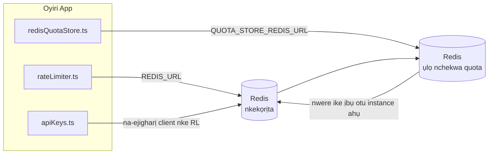

# Redis Production Configuration Guide (Igbo)

🌐 **Languages:** 🇺🇸 [English](../../../../ops/REDIS_PRODUCTION_CONFIG.md) · 🇪🇹 [am](../../../am/docs/ops/REDIS_PRODUCTION_CONFIG.md) · 🇸🇦 [ar](../../../ar/docs/ops/REDIS_PRODUCTION_CONFIG.md) · 🇦🇿 [az](../../../az/docs/ops/REDIS_PRODUCTION_CONFIG.md) · 🇧🇬 [bg](../../../bg/docs/ops/REDIS_PRODUCTION_CONFIG.md) · 🇧🇩 [bn](../../../bn/docs/ops/REDIS_PRODUCTION_CONFIG.md) · 🇧🇦 [bs](../../../bs/docs/ops/REDIS_PRODUCTION_CONFIG.md) · 🇨🇿 [cs](../../../cs/docs/ops/REDIS_PRODUCTION_CONFIG.md) · 🇩🇰 [da](../../../da/docs/ops/REDIS_PRODUCTION_CONFIG.md) · 🇩🇪 [de](../../../de/docs/ops/REDIS_PRODUCTION_CONFIG.md) · 🇬🇷 [el](../../../el/docs/ops/REDIS_PRODUCTION_CONFIG.md) · 🇪🇸 [es](../../../es/docs/ops/REDIS_PRODUCTION_CONFIG.md) · 🇪🇪 [et](../../../et/docs/ops/REDIS_PRODUCTION_CONFIG.md) · 🇮🇷 [fa](../../../fa/docs/ops/REDIS_PRODUCTION_CONFIG.md) · 🇫🇮 [fi](../../../fi/docs/ops/REDIS_PRODUCTION_CONFIG.md) · 🇫🇷 [fr](../../../fr/docs/ops/REDIS_PRODUCTION_CONFIG.md) · 🇮🇪 [ga](../../../ga/docs/ops/REDIS_PRODUCTION_CONFIG.md) · 🇮🇳 [gu](../../../gu/docs/ops/REDIS_PRODUCTION_CONFIG.md) · 🇳🇬 [ha](../../../ha/docs/ops/REDIS_PRODUCTION_CONFIG.md) · 🇮🇱 [he](../../../he/docs/ops/REDIS_PRODUCTION_CONFIG.md) · 🇮🇳 [hi](../../../hi/docs/ops/REDIS_PRODUCTION_CONFIG.md) · 🇭🇷 [hr](../../../hr/docs/ops/REDIS_PRODUCTION_CONFIG.md) · 🇭🇺 [hu](../../../hu/docs/ops/REDIS_PRODUCTION_CONFIG.md) · 🇦🇲 [hy](../../../hy/docs/ops/REDIS_PRODUCTION_CONFIG.md) · 🇮🇩 [id](../../../id/docs/ops/REDIS_PRODUCTION_CONFIG.md) · 🇮🇹 [it](../../../it/docs/ops/REDIS_PRODUCTION_CONFIG.md) · 🇯🇵 [ja](../../../ja/docs/ops/REDIS_PRODUCTION_CONFIG.md) · 🇬🇪 [ka](../../../ka/docs/ops/REDIS_PRODUCTION_CONFIG.md) · 🇰🇭 [km](../../../km/docs/ops/REDIS_PRODUCTION_CONFIG.md) · 🇮🇳 [kn](../../../kn/docs/ops/REDIS_PRODUCTION_CONFIG.md) · 🇰🇷 [ko](../../../ko/docs/ops/REDIS_PRODUCTION_CONFIG.md) · 🇱🇹 [lt](../../../lt/docs/ops/REDIS_PRODUCTION_CONFIG.md) · 🇱🇻 [lv](../../../lv/docs/ops/REDIS_PRODUCTION_CONFIG.md) · 🇮🇳 [ml](../../../ml/docs/ops/REDIS_PRODUCTION_CONFIG.md) · 🇮🇳 [mr](../../../mr/docs/ops/REDIS_PRODUCTION_CONFIG.md) · 🇲🇾 [ms](../../../ms/docs/ops/REDIS_PRODUCTION_CONFIG.md) · 🇲🇹 [mt](../../../mt/docs/ops/REDIS_PRODUCTION_CONFIG.md) · 🇲🇲 [my](../../../my/docs/ops/REDIS_PRODUCTION_CONFIG.md) · 🇳🇵 [ne](../../../ne/docs/ops/REDIS_PRODUCTION_CONFIG.md) · 🇳🇱 [nl](../../../nl/docs/ops/REDIS_PRODUCTION_CONFIG.md) · 🇳🇴 [no](../../../no/docs/ops/REDIS_PRODUCTION_CONFIG.md) · 🇮🇳 [or](../../../or/docs/ops/REDIS_PRODUCTION_CONFIG.md) · 🇮🇳 [pa](../../../pa/docs/ops/REDIS_PRODUCTION_CONFIG.md) · 🇵🇭 [phi](../../../phi/docs/ops/REDIS_PRODUCTION_CONFIG.md) · 🇵🇱 [pl](../../../pl/docs/ops/REDIS_PRODUCTION_CONFIG.md) · 🇵🇹 [pt](../../../pt/docs/ops/REDIS_PRODUCTION_CONFIG.md) · 🇧🇷 [pt-BR](../../../pt-BR/docs/ops/REDIS_PRODUCTION_CONFIG.md) · 🇷🇴 [ro](../../../ro/docs/ops/REDIS_PRODUCTION_CONFIG.md) · 🇷🇺 [ru](../../../ru/docs/ops/REDIS_PRODUCTION_CONFIG.md) · 🇱🇰 [si](../../../si/docs/ops/REDIS_PRODUCTION_CONFIG.md) · 🇸🇰 [sk](../../../sk/docs/ops/REDIS_PRODUCTION_CONFIG.md) · 🇸🇮 [sl](../../../sl/docs/ops/REDIS_PRODUCTION_CONFIG.md) · 🇷🇸 [sr](../../../sr/docs/ops/REDIS_PRODUCTION_CONFIG.md) · 🇸🇪 [sv](../../../sv/docs/ops/REDIS_PRODUCTION_CONFIG.md) · 🇰🇪 [sw](../../../sw/docs/ops/REDIS_PRODUCTION_CONFIG.md) · 🇮🇳 [ta](../../../ta/docs/ops/REDIS_PRODUCTION_CONFIG.md) · 🇮🇳 [te](../../../te/docs/ops/REDIS_PRODUCTION_CONFIG.md) · 🇹🇭 [th](../../../th/docs/ops/REDIS_PRODUCTION_CONFIG.md) · 🇹🇷 [tr](../../../tr/docs/ops/REDIS_PRODUCTION_CONFIG.md) · 🇺🇦 [uk-UA](../../../uk-UA/docs/ops/REDIS_PRODUCTION_CONFIG.md) · 🇵🇰 [ur](../../../ur/docs/ops/REDIS_PRODUCTION_CONFIG.md) · 🇺🇿 [uz](../../../uz/docs/ops/REDIS_PRODUCTION_CONFIG.md) · 🇻🇳 [vi](../../../vi/docs/ops/REDIS_PRODUCTION_CONFIG.md) · 🇳🇬 [yo](../../../yo/docs/ops/REDIS_PRODUCTION_CONFIG.md) · 🇨🇳 [zh-CN](../../../zh-CN/docs/ops/REDIS_PRODUCTION_CONFIG.md) · 🇹🇼 [zh-TW](../../../zh-TW/docs/ops/REDIS_PRODUCTION_CONFIG.md)

---

## Nchịkọta

Redis bụ **dependency dị nro, nke a na-eji ma ọ bụrụ na achọrọ** na OmniRoute — ngwa ahụ na-aga n'ihu ịrụ ọrụ nke ọma site n'iji usoro ndị nọ na ebe nchekwa
dị ka ndabere mgbe Redis adịghị. Na production, ịhazi Redis nke ọma na-ebelata latency maka ụdị ọrụ anọ
dị iche iche:

| Ụdị ọrụ                | Driver                        | Client Factory                                                               | Usoro Key                                               |
| ---------------------- | ----------------------------- | ---------------------------------------------------------------------------- | ------------------------------------------------------- |
| Ịkpa oke ọnụego        | `rateLimiter.ts`              | `getRedisClient()` — singleton `ioredis` nke a na-ebido naanị mgbe achọrọ ya | `<prefix>rl:*` windo oke ọnụego Lua‑atomic              |
| Cache auth             | `apiKeys.ts`                  | Na-eji client nke `rateLimiter` ọzọ                                          | `<prefix>auth:api_key:<sha256>` nwere TTL               |
| Ebe nchekwa quota      | `redisQuotaStore.ts`          | Singleton `getRedisClient(url)` dị iche                                      | `<prefix>quota:*` nke a pụrụ ịhazi maka instance ọ bụla |
| Circuit breaker warmup | `redisCircuitBreakerStore.ts` | Client dị iche na `circuitBreakerFactory.ts`                                 | `<prefix>warmup:cb:<connectionId>`                      |

Ụdị ọrụ anọ ahụ niile na-ekekọrịta otu prefix namespace ka OmniRoute nwee ike ibikọ na ngwa ndị ọzọ n'otu
instance Redis (dịka `127.0.0.1:6379`). Lee [Nhazi Namespace nke Key](#key-namespacing).

---

## Nhazi Dị Ugbu a (Ụkpụrụ Ndabara nke Code)

| Ntọala                             | Uru                                                           | Ebe                                                                                   |
| ---------------------------------- | ------------------------------------------------------------- | ------------------------------------------------------------------------------------- |
| env var `REDIS_URL`                | `redis://redis:6379` (compose), ọ bụghị iwu na a ga-etinye ya | `rateLimiter.ts:5`, `.env.example`                                                    |
| env var `REDIS_KEY_PREFIX`         | `omniroute:` (ndabara)                                        | `rateLimiter.ts`, `redisQuotaStore.ts`, `redisCircuitBreakerStore.ts`, `.env.example` |
| env var `QUOTA_STORE_REDIS_URL`    | dị iche, nwere ike ịdị iche na `REDIS_URL`                    | `quota/storeFactory.ts`                                                               |
| `QUOTA_STORE_DRIVER`               | `"sqlite"` (ndabara), `"redis"` ma ọ bụrụ na achọrọ           | `quota/storeFactory.ts`                                                               |
| `maxRetriesPerRequest` nke ioredis | `3`                                                           | imepụta client na `rateLimiter.ts`                                                    |
| `enableReadyCheck`                 | edoghị ya (ndabara ioredis: `true`)                           | —                                                                                     |
| `lazyConnect`                      | edoghị ya (ndabara ioredis: `false`)                          | —                                                                                     |
| `retryStrategy`                    | edoghị ya (ndabara ioredis: ntọala 200ms, exponential)        | —                                                                                     |
| TLS / password / index DB          | **ahazibeghị**                                                | —                                                                                     |
| Sentinel / Cluster                 | **ahazibeghị** — naanị standalone single-node                 | —                                                                                     |

---

## Nhazi Namespace nke Key

OmniRoute na ihe ọ bụla ọzọ na-arụ ọrụ na host na-ekekọrịta otu instance Redis. Na-enweghị namespace,
key ndị dịka `auth:api_key:<sha256>` ma ọ bụ `rl:*` nwere ike ịdakọta na key sitere na ngwa ndị ọzọ
na-eji otu Redis ahụ (instance a na-agba Redis na `127.0.0.1:6379` n'akụkụ service ndị ọzọ).

Tọọ `REDIS_KEY_PREFIX` ka ọ bụrụ string na-adịghị efu iji tinye prefix n'ihu key OmniRoute **ọ bụla**:

```bash
# .env — key OmniRoute niile ga-abụ omniroute:rl:*, omniroute:auth:*, omniroute:quota:*, omniroute:warmup:cb:*
REDIS_KEY_PREFIX=omniroute:
```

- **Ndabara:** `omniroute:` (a na-etinye ya mgbe edoghị `REDIS_KEY_PREFIX` ma ọ bụ mgbe ọ tọgbọ chakoo).
- **A na-etinye ya na:** rate limiter + cache auth (client `ioredis` ha na-ekekọrịta site na `keyPrefix`) na
  ebe nchekwa quota (`KEY_PREFIX = "${REDIS_KEY_PREFIX}quota"`) yana circuit breaker warmup
  (`KEY_PREFIX = "${REDIS_KEY_PREFIX}warmup:cb:"`).
- **Ịgbanwe prefix** mgbe key ndị ahụ adịlarị na Redis na-eme ka key ochie ghara inwe njikọ (ha na-ekubi ume
  site na TTL / LRU). Ọ dị nchebe ịgbanwe ya; migration adịghị mkpa. Naanị ihe dị iche bụ key
  circuit-breaker warmup maka connection e depụtara dị ka nke a machibidoro: a na-echekwa ya na-enweghị TTL, ya mere
  jiri `redis-cli --scan --pattern '<old-prefix>warmup:cb:*'` depụta ihe fọdụrụ wee hichapụ ha.
- **`keyPrefix` nke ioredis** na-etinye prefix na-akpaghị aka mgbe a na-ede data **ma** na-ewepụ ya mgbe a na-agụ data,
  ya mere code ngwa anaghị ahụ prefix ahụ ma ọlị.

---

## Ntụgharị mmepụta ihe akwadoro

### 1. Njikọ ọdọ mmiri / Nhọrọ ndị ahịa (ioredis `Redis` constructor)

Koodu dị ugbu a na-emepụta otu `new Redis(url)` na-enweghị nhọrọ omenala. Maka nrụpụta multi-replica deployments, nyefee ụlọ ọrụ ndị ahịa na koodu ma ọ bụ kechie `getRedisClient()`:

```typescript
const redis = new Redis(REDIS_URL, {
  maxRetriesPerRequest: null, // no retry limit; let retryStrategy decide
  enableReadyCheck: true, // verify server is ready before accepting calls
  lazyConnect: true, // don't connect on construction; wait for first call
  retryStrategy: (times) => {
    if (times > 10) return null; // give up after 10 retries → reconnect later
    return Math.min(times * 200, 5000); // 200ms, 400ms, …, 5s cap
  },
  enableAutoPipelining: true, // coalesce concurrent commands into one TCP write
  keepAlive: 10000, // TCP keep‑alive every 10s
});
```

**Isi azụmaahịa:**

- `maxRetriesPerRequest: null` + `retryStrategy` — họọrọ maka mmepụta ya mere Redis malitegharịa anaghị ada ngwa ngwa ọ bụla arịrịọ. Ndaghachi azụ na ebe nchekwa na `checkRateLimit()` na-amịkọrọ ụzọ ọdịda.
- `lazyConnect: true` — na-ezere ndabere mmalite na Redis ịdị elu tupu sava amalite ịnakwere njikọ.
- `enableAutoPipelining: true` — na-ebelata njem nlegharị anya maka nlele oke ọnụ ahịa n'otu oge; bara uru na > 50 RPS n'otu njikọ.

### 2. Nhazi nkesa Redis (`redis.conf`)

```
# Memory
maxmemory 80%                        # leave room for OS page cache
maxmemory-policy allkeys-lru         # evict stale auth cache entries under pressure

# Persistence (optional — OmniRoute is crash‑safe without it)
save 300 1                           # snapshot at least every 5 min if ≥1 key changed
appendonly no                        # AOF not needed; data is regeneratable
appendfsync no                       # no fsync overhead (RDB is sufficient)

# Networking
timeout 0                            # no idle disconnect
tcp-keepalive 300                    # 5 min keep‑alive
tcp-backlog 511                      # connection backlog for bursty load

# Performance
hz 10                                # default; 100 for latency‑sensitive
activedefrag yes                     # auto‑defragment when fragmentation >10%
```

**Ahịa maka `maxmemory-policy allkeys-lru`:** Enwere ike ịchụpụ ndenye cache a n'okpuru nrụgide ebe nchekwa. Nke a dị mma — `setCachedApiKey` na-ebigharị mgbe niile na miss, na ndaghachi azụ SQLite bụ ikike. Ederede Lua na-amachi ọnụego na-emepụta obere igodo ndị na-adịte aka site na imewe.

### 3. Docker Dee Ntọala

The prod dere (`docker-compose.prod.yml`) na-eji `redis:8.6.2-alpine`. Tinye:

```yaml
redis:
  image: redis:8.6.2-alpine
  command:
    [
      "redis-server",
      "--maxmemory",
      "512mb",
      "--maxmemory-policy",
      "allkeys-lru",
      "--activedefrag",
      "yes",
      "--save",
      "300 1",
    ]
  healthcheck:
    test: ["CMD", "redis-cli", "ping"]
    interval: 10s
    timeout: 3s
    retries: 3
    start_period: 5s
```

### 4. Ọtụtụ ihe atụ / nlebara anya

**Otu Redis maka oyiri niile** — ederede Lua na-amachi ọnụego dabere na otu oghere igodo ikike. Ọtụtụ ihe atụ Redis n'azụ oyiri ga-atụfu atomity na mmefu ego okpukpu abụọ. Jiri otu Redis (ma ọ bụ ụyọkọ Redis Sentinel nwere ọdịda) maka ụdị ngwa niile.

**Ọnụọgụ njikọ:** Ngwa oyiri ọ bụla ga-emepe** 2 TCP njikọ** ka Redis (ọnụahịa limiter ahịa + oke ụlọ ahịa ahịa). Na njikọ 10 → 20, nke ọma n'ime ụlọ njikọ 10k nke ndabara Redis.

### 5. Nleba anya

Gosipụta site na njedebe nyocha ahụike:

```typescript
// src/app/api/monitoring/health/route.ts already calls rateLimiter functions
// Add Redis-specific checks:
//   1. PING latency via ioredis .ping()
//   2. Memory usage via INFO memory
//   3. Connection count via INFO clients
//   4. Hit rate for maxmemory-policy (evicted_keys / keyspace_hits)
```

Merik isi ihe ị ga-elele:

- **Igodo achụpụrụ / sk** — ma ọ bụrụ na ọ nọgidere na-abụghị efu, mụbaa `maxmemory`
- **Ndị ahịa egbochiri** — na-abụghị efu na-atụ aro edemede Lua nwayọ ma ọ bụ esemokwu dị elu
- **Njikọ ndị jụrụ** oke njikọ — kụrụ; obere na njikọ 20

### 6. Redis-Dakọtara Sava

Ihe nkesa ọ bụla a na-eji ebe a ga-emerịrị edemede Lua: njedebe ọnụego bụ otu `EVAL`. Na ihe nkesa na-enweghị Lua, `checkRateLimit()` na-edekọ `[RATE_LIMITER] Redis eval failed, falling back to in-memory rate limiting` wee gụọ usoro ọ bụla, yabụ oyiri ọ bụla na-amanye oke n'onwe ya. Ụlọ ahịa nwekọrịta nnọkọ-mmekọrịta (`OMNIROUTE_SESSION_AFFINITY_STORE=redis`) na-agụkwa ma na-eji `EVAL` na-emelite atụdo; na-enweghị Lua ọ na-edekọ `[SESSION_AFFINITY] Redis error; falling back to SQLite.` na oyiri ọ bụla na-edobe ntụtụ nke ya. Ọrụ ndị ọzọ na-eji iwu dị larịị (`SET ... EX`, `GET`, `DEL`, `MGET`, `EXPIRE`, `INCRBYFLOAT`, hashes na setịpụ), na azụ azụ Redis cache semantic anaghị ezipụ iwu `FT.*`.

A nwalere ya na OmniRoute 3.8.52: KiviDB 1.2.0 jiri onyonyo Lua ya (`kividb/kividb:v1.2.0-lua`). Ihe njedebe ọnụego (gụnyere usoro nke abụọ na-ekekọrịta ọnụ ọgụgụ), cache auth, ụlọ ahịa oke, igwe ọkụ sekit, ụlọ ahịa cache semantic, na arịrịọ `/v1/chat/completions` site n'aka onye na-ahụ maka nkata gafere 18 n'ime nlele 19 na-agafe na Redis 8.10.3. Nke dị iche: `INCRBYFLOAT` na-echekwa `0.1 + 0.2` dị ka `0.30000000000000004` ebe Redis na-echekwa `0.3` ( [kividbio/kividb#387](https://github.com/kividbio/kividb/issues/387) ). Ụlọ ahịa oke na-atụgharị ma na `parseFloat`, ma ọnụọgụ abụọ ahụ dị iche na ọnụọgụ ikpeazụ, ya mere ntụnyere nke dabara kpọmkwem na oke oke nwere ike ịpụta dị iche iche. Ụlọ ahịa mmekọ ọnụ abụghị akụkụ nke ọsọ ahụ. ( [ntọlite](https://github.com/kividbio/kividb/blob/master/docs/integrations/omniroute.md), [nsonaazụ](https://github.com/kividbio/kividb/tree/master/benchmarks/omniroute-compat) )

---

## Eserese Nhazi Sistemụ



---

## Ntụaka

| Faịlụ                              | Ebumnuche                                                                      |
| ---------------------------------- | ------------------------------------------------------------------------------ |
| `src/shared/utils/rateLimiter.ts`  | Client Redis bụ isi, script Lua maka rate-limit, na fallback dị na ebe nchekwa |
| `src/lib/db/apiKeys.ts`            | Cache nyocha njirimara — fallback Redis→SQLite                                 |
| `src/lib/quota/redisQuotaStore.ts` | Client Redis dị iche maka ụlọ nchekwa quota nke bụ nhọrọ                       |
| `src/lib/quota/storeFactory.ts`    | Na-agbanwe n'etiti driver quota `sqlite` na `redis`                            |
| `docker-compose.prod.yml`          | Container Redis maka mmepụta (image `redis:8.6.2-alpine`)                      |
| `.env.example`                     | Akwụkwọ nkọwa env vars Redis                                                   |
| `src/app/api/local/redis/`         | Route API maka nhazi container mmepe                                           |
| `bin/cli/commands/redis.mjs`       | Iwu CLI maka nhazi container mmepe                                             |
