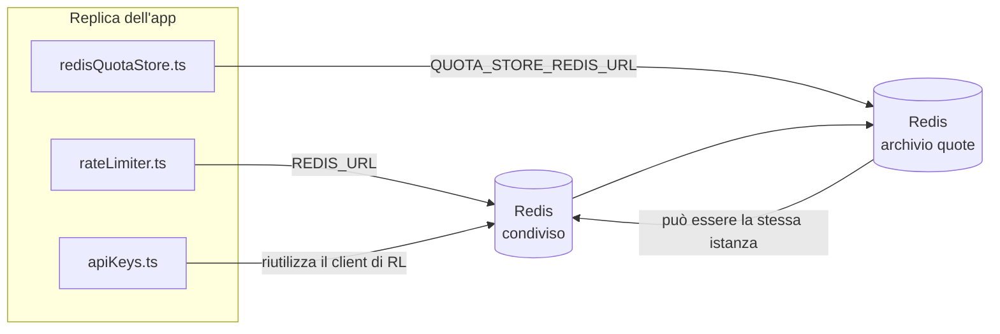

# Redis Production Configuration Guide (Italiano)

🌐 **Languages:** 🇺🇸 [English](../../../../ops/REDIS_PRODUCTION_CONFIG.md) · 🇪🇹 [am](../../../am/docs/ops/REDIS_PRODUCTION_CONFIG.md) · 🇸🇦 [ar](../../../ar/docs/ops/REDIS_PRODUCTION_CONFIG.md) · 🇦🇿 [az](../../../az/docs/ops/REDIS_PRODUCTION_CONFIG.md) · 🇧🇬 [bg](../../../bg/docs/ops/REDIS_PRODUCTION_CONFIG.md) · 🇧🇩 [bn](../../../bn/docs/ops/REDIS_PRODUCTION_CONFIG.md) · 🇧🇦 [bs](../../../bs/docs/ops/REDIS_PRODUCTION_CONFIG.md) · 🇨🇿 [cs](../../../cs/docs/ops/REDIS_PRODUCTION_CONFIG.md) · 🇩🇰 [da](../../../da/docs/ops/REDIS_PRODUCTION_CONFIG.md) · 🇩🇪 [de](../../../de/docs/ops/REDIS_PRODUCTION_CONFIG.md) · 🇬🇷 [el](../../../el/docs/ops/REDIS_PRODUCTION_CONFIG.md) · 🇪🇸 [es](../../../es/docs/ops/REDIS_PRODUCTION_CONFIG.md) · 🇪🇪 [et](../../../et/docs/ops/REDIS_PRODUCTION_CONFIG.md) · 🇮🇷 [fa](../../../fa/docs/ops/REDIS_PRODUCTION_CONFIG.md) · 🇫🇮 [fi](../../../fi/docs/ops/REDIS_PRODUCTION_CONFIG.md) · 🇫🇷 [fr](../../../fr/docs/ops/REDIS_PRODUCTION_CONFIG.md) · 🇮🇪 [ga](../../../ga/docs/ops/REDIS_PRODUCTION_CONFIG.md) · 🇮🇳 [gu](../../../gu/docs/ops/REDIS_PRODUCTION_CONFIG.md) · 🇳🇬 [ha](../../../ha/docs/ops/REDIS_PRODUCTION_CONFIG.md) · 🇮🇱 [he](../../../he/docs/ops/REDIS_PRODUCTION_CONFIG.md) · 🇮🇳 [hi](../../../hi/docs/ops/REDIS_PRODUCTION_CONFIG.md) · 🇭🇷 [hr](../../../hr/docs/ops/REDIS_PRODUCTION_CONFIG.md) · 🇭🇺 [hu](../../../hu/docs/ops/REDIS_PRODUCTION_CONFIG.md) · 🇦🇲 [hy](../../../hy/docs/ops/REDIS_PRODUCTION_CONFIG.md) · 🇮🇩 [id](../../../id/docs/ops/REDIS_PRODUCTION_CONFIG.md) · 🇳🇬 [ig](../../../ig/docs/ops/REDIS_PRODUCTION_CONFIG.md) · 🇯🇵 [ja](../../../ja/docs/ops/REDIS_PRODUCTION_CONFIG.md) · 🇬🇪 [ka](../../../ka/docs/ops/REDIS_PRODUCTION_CONFIG.md) · 🇰🇭 [km](../../../km/docs/ops/REDIS_PRODUCTION_CONFIG.md) · 🇮🇳 [kn](../../../kn/docs/ops/REDIS_PRODUCTION_CONFIG.md) · 🇰🇷 [ko](../../../ko/docs/ops/REDIS_PRODUCTION_CONFIG.md) · 🇱🇹 [lt](../../../lt/docs/ops/REDIS_PRODUCTION_CONFIG.md) · 🇱🇻 [lv](../../../lv/docs/ops/REDIS_PRODUCTION_CONFIG.md) · 🇮🇳 [ml](../../../ml/docs/ops/REDIS_PRODUCTION_CONFIG.md) · 🇮🇳 [mr](../../../mr/docs/ops/REDIS_PRODUCTION_CONFIG.md) · 🇲🇾 [ms](../../../ms/docs/ops/REDIS_PRODUCTION_CONFIG.md) · 🇲🇹 [mt](../../../mt/docs/ops/REDIS_PRODUCTION_CONFIG.md) · 🇲🇲 [my](../../../my/docs/ops/REDIS_PRODUCTION_CONFIG.md) · 🇳🇵 [ne](../../../ne/docs/ops/REDIS_PRODUCTION_CONFIG.md) · 🇳🇱 [nl](../../../nl/docs/ops/REDIS_PRODUCTION_CONFIG.md) · 🇳🇴 [no](../../../no/docs/ops/REDIS_PRODUCTION_CONFIG.md) · 🇮🇳 [or](../../../or/docs/ops/REDIS_PRODUCTION_CONFIG.md) · 🇮🇳 [pa](../../../pa/docs/ops/REDIS_PRODUCTION_CONFIG.md) · 🇵🇭 [phi](../../../phi/docs/ops/REDIS_PRODUCTION_CONFIG.md) · 🇵🇱 [pl](../../../pl/docs/ops/REDIS_PRODUCTION_CONFIG.md) · 🇵🇹 [pt](../../../pt/docs/ops/REDIS_PRODUCTION_CONFIG.md) · 🇧🇷 [pt-BR](../../../pt-BR/docs/ops/REDIS_PRODUCTION_CONFIG.md) · 🇷🇴 [ro](../../../ro/docs/ops/REDIS_PRODUCTION_CONFIG.md) · 🇷🇺 [ru](../../../ru/docs/ops/REDIS_PRODUCTION_CONFIG.md) · 🇱🇰 [si](../../../si/docs/ops/REDIS_PRODUCTION_CONFIG.md) · 🇸🇰 [sk](../../../sk/docs/ops/REDIS_PRODUCTION_CONFIG.md) · 🇸🇮 [sl](../../../sl/docs/ops/REDIS_PRODUCTION_CONFIG.md) · 🇷🇸 [sr](../../../sr/docs/ops/REDIS_PRODUCTION_CONFIG.md) · 🇸🇪 [sv](../../../sv/docs/ops/REDIS_PRODUCTION_CONFIG.md) · 🇰🇪 [sw](../../../sw/docs/ops/REDIS_PRODUCTION_CONFIG.md) · 🇮🇳 [ta](../../../ta/docs/ops/REDIS_PRODUCTION_CONFIG.md) · 🇮🇳 [te](../../../te/docs/ops/REDIS_PRODUCTION_CONFIG.md) · 🇹🇭 [th](../../../th/docs/ops/REDIS_PRODUCTION_CONFIG.md) · 🇹🇷 [tr](../../../tr/docs/ops/REDIS_PRODUCTION_CONFIG.md) · 🇺🇦 [uk-UA](../../../uk-UA/docs/ops/REDIS_PRODUCTION_CONFIG.md) · 🇵🇰 [ur](../../../ur/docs/ops/REDIS_PRODUCTION_CONFIG.md) · 🇺🇿 [uz](../../../uz/docs/ops/REDIS_PRODUCTION_CONFIG.md) · 🇻🇳 [vi](../../../vi/docs/ops/REDIS_PRODUCTION_CONFIG.md) · 🇳🇬 [yo](../../../yo/docs/ops/REDIS_PRODUCTION_CONFIG.md) · 🇨🇳 [zh-CN](../../../zh-CN/docs/ops/REDIS_PRODUCTION_CONFIG.md) · 🇹🇼 [zh-TW](../../../zh-TW/docs/ops/REDIS_PRODUCTION_CONFIG.md)

---

## Panoramica

Redis è un **dipendenza facoltativa e morbida** in OmniRoute — l'applicazione si degrada normalmente (fallback in memoria) quando Redis non è disponibile. In produzione, l'ottimizzazione Redis riduce la latenza per quattro carichi di lavoro distinti:

| Carico di lavoro                         | Autista                       | Fabbrica cliente                               | Modello chiave                                            |
| ---------------------------------------- | ----------------------------- | ---------------------------------------------- | --------------------------------------------------------- |
| Limitazione della velocità               | `rateLimiter.ts`              | `getRedisClient()` — pigro `ioredis` singleton | Finestre dei limiti di velocità `<prefix>rl:*` Lua‑atomic |
| Cache di autenticazione                  | `apiKeys.ts`                  | Riutilizza il client di `rateLimiter`          | `<prefix>auth:api_key:<sha256>` con TTL                   |
| Negozio di quote                         | `redisQuotaStore.ts`          | Singleton `getRedisClient(url)` separato       | `<prefix>quota:*` configurabile per istanza               |
| Interruttore automatico di riscaldamento | `redisCircuitBreakerStore.ts` | Cliente separato in `circuitBreakerFactory.ts` | `<prefix>warmup:cb:<connectionId>`                        |

Tutti e quattro i carichi di lavoro condividono un prefisso dello spazio dei nomi in modo che OmniRoute possa coesistere con altre app su una singola istanza Redis (ad esempio `127.0.0.1:6379`). Vedere [Spaziatura dei nomi delle chiavi](#key-namespacing).

---

## Configurazione corrente (codice predefinito)

| Collocamento                   | Valore                                                         | Dove                                                                                  |
| ------------------------------ | -------------------------------------------------------------- | ------------------------------------------------------------------------------------- |
| `REDIS_URL` var                | `redis://redis:6379` (comporre), facoltativo                   | `rateLimiter.ts:5`, `.env.example`                                                    |
| `REDIS_KEY_PREFIX` var         | `omniroute:` (predefinito)                                     | `rateLimiter.ts`, `redisQuotaStore.ts`, `redisCircuitBreakerStore.ts`, `.env.example` |
| `QUOTA_STORE_REDIS_URL` var    | separato, può differire da `REDIS_URL`                         | `quota/storeFactory.ts`                                                               |
| `QUOTA_STORE_DRIVER`           | `"sqlite"` (predefinito), `"redis"` opzionale                  | `quota/storeFactory.ts`                                                               |
| ioredis `maxRetriesPerRequest` | `3`                                                            | Creazione del cliente `rateLimiter.ts`                                                |
| `enableReadyCheck`             | non impostato (predefinito ioredis: `true`)                    | —                                                                                     |
| `lazyConnect`                  | non impostato (predefinito ioredis: `false`)                   | —                                                                                     |
| `retryStrategy`                | non impostato (predefinito ioredis: base 200 ms, esponenziale) | —                                                                                     |
| TLS /password/indice DB        | **non configurato**                                            | —                                                                                     |
| Sentinella/Ammasso             | **non configurato** Solo nodo singolo autonomo —               | —                                                                                     |

---

## Spazio dei nomi delle chiavi

OmniRoute condivide un'istanza Redis con qualsiasi altro servizio in esecuzione sull'host. Senza uno spazio dei nomi,
chiavi come `auth:api_key:<sha256>` o `rl:*` potrebbero entrare in conflitto con chiavi di altre applicazioni
che utilizzano lo stesso Redis (questa istanza esegue Redis su `127.0.0.1:6379` insieme ad altri servizi).

Impostare `REDIS_KEY_PREFIX` su una stringa non vuota per aggiungere un prefisso a **ogni** chiave OmniRoute:

```bash
# .env — tutte le chiavi OmniRoute diventano omniroute:rl:*, omniroute:auth:*, omniroute:quota:*, omniroute:warmup:cb:*
REDIS_KEY_PREFIX=omniroute:
```

- **Valore predefinito:** `omniroute:` (applicato quando `REDIS_KEY_PREFIX` non è impostato o è vuoto).
- **Applicato a:** limitatore della frequenza + cache di autenticazione (client `ioredis` condiviso tramite `keyPrefix`), nonché
  archivio delle quote (`KEY_PREFIX = "${REDIS_KEY_PREFIX}quota"`) e circuit breaker di warmup
  (`KEY_PREFIX = "${REDIS_KEY_PREFIX}warmup:cb:"`).
- **La modifica del prefisso** quando esistono già chiavi in Redis rende orfane le vecchie chiavi (che scadono
  tramite TTL / LRU). La modifica è sicura e non richiede alcuna migrazione. L'unica eccezione è una chiave del
  circuit breaker di warmup relativa a una connessione contrassegnata come vietata: viene conservata senza TTL, quindi
  elencare le chiavi residue con `redis-cli --scan --pattern '<old-prefix>warmup:cb:*'` ed eliminarle.
- **`keyPrefix` di ioredis** antepone automaticamente il prefisso durante le scritture **e** lo rimuove durante le letture,
  pertanto il codice dell'applicazione non visualizza mai il prefisso.

---

## Ottimizzazione della produzione consigliata

### 1. Pool di connessioni/Opzioni client (costruttore ioredis `Redis` )

Il codice attuale crea un singolo `new Redis(url)` senza opzioni personalizzate. Per distribuzioni di produzione con più repliche, passa una factory client nel codice o esegui il wrapper `getRedisClient()`:

```typescript
const redis = new Redis(REDIS_URL, {
  maxRetriesPerRequest: null, // no retry limit; let retryStrategy decide
  enableReadyCheck: true, // verify server is ready before accepting calls
  lazyConnect: true, // don't connect on construction; wait for first call
  retryStrategy: (times) => {
    if (times > 10) return null; // give up after 10 retries → reconnect later
    return Math.min(times * 200, 5000); // 200ms, 400ms, …, 5s cap
  },
  enableAutoPipelining: true, // coalesce concurrent commands into one TCP write
  keepAlive: 10000, // TCP keep‑alive every 10s
});
```

**Principali compromessi:**

- `maxRetriesPerRequest: null` + `retryStrategy` — preferito per la produzione in modo che i riavvii Redis transitori non falliscano immediatamente ogni richiesta. Il fallback in memoria in `checkRateLimit()` assorbe il percorso di errore.
- `lazyConnect: true` — evita una dipendenza di avvio dall'attivazione di Redis prima che il server inizi ad accettare le connessioni.
- `enableAutoPipelining: true` — riduce i viaggi di andata e ritorno per controlli simultanei sui limiti di tariffa; vantaggioso a > 50 RPS su un'unica connessione.

### 2. Configurazione del server Redis (`redis.conf`)

```
# Memory
maxmemory 80%                        # leave room for OS page cache
maxmemory-policy allkeys-lru         # evict stale auth cache entries under pressure

# Persistence (optional — OmniRoute is crash‑safe without it)
save 300 1                           # snapshot at least every 5 min if ≥1 key changed
appendonly no                        # AOF not needed; data is regeneratable
appendfsync no                       # no fsync overhead (RDB is sufficient)

# Networking
timeout 0                            # no idle disconnect
tcp-keepalive 300                    # 5 min keep‑alive
tcp-backlog 511                      # connection backlog for bursty load

# Performance
hz 10                                # default; 100 for latency‑sensitive
activedefrag yes                     # auto‑defragment when fragmentation >10%
```

**Compromesso per `maxmemory-policy allkeys-lru`:** Le voci della cache di autenticazione potrebbero essere eliminate a causa di un sovraccarico della memoria. Questo è sicuro — `setCachedApiKey` si ripopola sempre in caso di errore e il fallback SQLite è autorevole. Lo script Lua del limitatore di velocità crea piccole chiavi che sono di breve durata in base alla progettazione.

### 3. Impostazioni di composizione Docker

Il prod compose (`docker-compose.prod.yml`) utilizza `redis:8.6.2-alpine`. Aggiungere:

```yaml
redis:
  image: redis:8.6.2-alpine
  command:
    [
      "redis-server",
      "--maxmemory",
      "512mb",
      "--maxmemory-policy",
      "allkeys-lru",
      "--activedefrag",
      "yes",
      "--save",
      "300 1",
    ]
  healthcheck:
    test: ["CMD", "redis-cli", "ping"]
    interval: 10s
    timeout: 3s
    retries: 3
    start_period: 5s
```

### 4. Considerazioni su multiistanza/ridimensionamento

**Redis singolo per tutte le repliche** — lo script Lua limitatore di velocità dipende da un singolo spazio chiave autorevole. Più istanze Redis dietro le repliche perderebbero atomicità e raddoppierebbero il budget. Utilizza un singolo Redis (o cluster Redis Sentinel con failover) per tutte le repliche dell'applicazione.

**Conteggio connessioni:** Si apre ogni replica dell'applicazione **2 connessioni TCP** a Redis (client limitatore di velocità, client archivio quote + ). A 10 repliche → 20 connessioni, ben entro il limite massimo di connessioni di 10k di un'istanza Redis predefinita.

### 5. Monitoraggio

Esporre tramite endpoint di controllo dello stato:

```typescript
// src/app/api/monitoring/health/route.ts already calls rateLimiter functions
// Add Redis-specific checks:
//   1. PING latency via ioredis .ping()
//   2. Memory usage via INFO memory
//   3. Connection count via INFO clients
//   4. Hit rate for maxmemory-policy (evicted_keys / keyspace_hits)
```

Metriche chiave da tenere d'occhio:

- **Chiavi sfrattate/sec** — se persistentemente diverso da zero, aumenta `maxmemory`
- **Clienti bloccati** — diverso da zero suggerisce script Lua lenti o contesa elevata
- **Connessioni rifiutate** Raggiunto il limite di connessione — ; raro a 20 connessioni

### 6. Server compatibili con Redis

Qualsiasi server utilizzato qui deve eseguire script Lua: il limitatore di velocità è uno `EVAL`. Su un server senza Lua, `checkRateLimit()` registra `[RATE_LIMITER] Redis eval failed, falling back to in-memory rate limiting` e conta per processo, quindi ogni replica applica il limite da sola. Anche l'archivio di affinità di sessione condivisa (`OMNIROUTE_SESSION_AFFINITY_STORE=redis`) legge e aggiorna i pin con `EVAL`; senza Lua registra `[SESSION_AFFINITY] Redis error; falling back to SQLite.` e ogni replica mantiene i propri pin. Gli altri carichi di lavoro utilizzano comandi semplici (`SET ... EX`, `GET`, `DEL`, `MGET`, `EXPIRE`, `INCRBYFLOAT`, hash e set) e il backend Redis della cache semantica non invia comandi `FT.*`.

Testato con OmniRoute 3.8.52: KiviDB 1.2.0 con la sua immagine Lua (`kividb/kividb:v1.2.0-lua`). Il limitatore di velocità (incluso un secondo processo che condivide i contatori), la cache di autenticazione, l'archivio quote, l'interruttore di riscaldamento, l'archivio cache semantica e una richiesta `/v1/chat/completions` tramite il gestore della chat hanno superato 18 dei 19 controlli che passano su Redis 8.10.3. Quello che differisce: `INCRBYFLOAT` memorizza `0.1 + 0.2` come `0.30000000000000004` dove Redis memorizza `0.3` ( [kividbio/kividb#387](https://github.com/kividbio/kividb/issues/387) ). L'archivio quote analizza entrambi con `parseFloat`, ma i due numeri differiscono nelle ultime cifre, quindi un confronto che cade esattamente sul limite della quota può risultare diverso. L'archivio di affinità di sessione non faceva parte di tale esecuzione. ( [impostazione](https://github.com/kividbio/kividb/blob/master/docs/integrations/omniroute.md), [risultati](https://github.com/kividbio/kividb/tree/master/benchmarks/omniroute-compat) )

---

## Diagramma dell'architettura



---

## Riferimenti

| File                               | Scopo                                                                         |
| ---------------------------------- | ----------------------------------------------------------------------------- |
| `src/shared/utils/rateLimiter.ts`  | Client Redis primario, script Lua con limite di velocità, fallback in memoria |
| `src/lib/db/apiKeys.ts`            | Cache di autenticazione — Redis→SQLite fallback                               |
| `src/lib/quota/redisQuotaStore.ts` | Client Redis separato per archivio quote opzionale                            |
| `src/lib/quota/storeFactory.ts`    | Passa tra i driver di quota `sqlite` e `redis`                                |
| `docker-compose.prod.yml`          | Contenitore Prod Redis (immagine `redis:8.6.2-alpine`)                        |
| `.env.example`                     | Documentazione Redis env vars                                                 |
| `src/app/api/local/redis/`         | Percorsi API per l'orchestrazione dei contenitori di sviluppo                 |
| `bin/cli/commands/redis.mjs`       | Comandi CLI per l'orchestrazione del contenitore di sviluppo                  |
