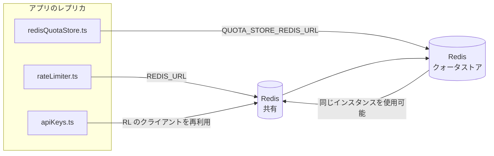

# Redis Production Configuration Guide (日本語)

🌐 **Languages:** 🇺🇸 [English](../../../../ops/REDIS_PRODUCTION_CONFIG.md) · 🇪🇹 [am](../../../am/docs/ops/REDIS_PRODUCTION_CONFIG.md) · 🇸🇦 [ar](../../../ar/docs/ops/REDIS_PRODUCTION_CONFIG.md) · 🇦🇿 [az](../../../az/docs/ops/REDIS_PRODUCTION_CONFIG.md) · 🇧🇬 [bg](../../../bg/docs/ops/REDIS_PRODUCTION_CONFIG.md) · 🇧🇩 [bn](../../../bn/docs/ops/REDIS_PRODUCTION_CONFIG.md) · 🇧🇦 [bs](../../../bs/docs/ops/REDIS_PRODUCTION_CONFIG.md) · 🇨🇿 [cs](../../../cs/docs/ops/REDIS_PRODUCTION_CONFIG.md) · 🇩🇰 [da](../../../da/docs/ops/REDIS_PRODUCTION_CONFIG.md) · 🇩🇪 [de](../../../de/docs/ops/REDIS_PRODUCTION_CONFIG.md) · 🇬🇷 [el](../../../el/docs/ops/REDIS_PRODUCTION_CONFIG.md) · 🇪🇸 [es](../../../es/docs/ops/REDIS_PRODUCTION_CONFIG.md) · 🇪🇪 [et](../../../et/docs/ops/REDIS_PRODUCTION_CONFIG.md) · 🇮🇷 [fa](../../../fa/docs/ops/REDIS_PRODUCTION_CONFIG.md) · 🇫🇮 [fi](../../../fi/docs/ops/REDIS_PRODUCTION_CONFIG.md) · 🇫🇷 [fr](../../../fr/docs/ops/REDIS_PRODUCTION_CONFIG.md) · 🇮🇪 [ga](../../../ga/docs/ops/REDIS_PRODUCTION_CONFIG.md) · 🇮🇳 [gu](../../../gu/docs/ops/REDIS_PRODUCTION_CONFIG.md) · 🇳🇬 [ha](../../../ha/docs/ops/REDIS_PRODUCTION_CONFIG.md) · 🇮🇱 [he](../../../he/docs/ops/REDIS_PRODUCTION_CONFIG.md) · 🇮🇳 [hi](../../../hi/docs/ops/REDIS_PRODUCTION_CONFIG.md) · 🇭🇷 [hr](../../../hr/docs/ops/REDIS_PRODUCTION_CONFIG.md) · 🇭🇺 [hu](../../../hu/docs/ops/REDIS_PRODUCTION_CONFIG.md) · 🇦🇲 [hy](../../../hy/docs/ops/REDIS_PRODUCTION_CONFIG.md) · 🇮🇩 [id](../../../id/docs/ops/REDIS_PRODUCTION_CONFIG.md) · 🇳🇬 [ig](../../../ig/docs/ops/REDIS_PRODUCTION_CONFIG.md) · 🇮🇹 [it](../../../it/docs/ops/REDIS_PRODUCTION_CONFIG.md) · 🇬🇪 [ka](../../../ka/docs/ops/REDIS_PRODUCTION_CONFIG.md) · 🇰🇭 [km](../../../km/docs/ops/REDIS_PRODUCTION_CONFIG.md) · 🇮🇳 [kn](../../../kn/docs/ops/REDIS_PRODUCTION_CONFIG.md) · 🇰🇷 [ko](../../../ko/docs/ops/REDIS_PRODUCTION_CONFIG.md) · 🇱🇹 [lt](../../../lt/docs/ops/REDIS_PRODUCTION_CONFIG.md) · 🇱🇻 [lv](../../../lv/docs/ops/REDIS_PRODUCTION_CONFIG.md) · 🇮🇳 [ml](../../../ml/docs/ops/REDIS_PRODUCTION_CONFIG.md) · 🇮🇳 [mr](../../../mr/docs/ops/REDIS_PRODUCTION_CONFIG.md) · 🇲🇾 [ms](../../../ms/docs/ops/REDIS_PRODUCTION_CONFIG.md) · 🇲🇹 [mt](../../../mt/docs/ops/REDIS_PRODUCTION_CONFIG.md) · 🇲🇲 [my](../../../my/docs/ops/REDIS_PRODUCTION_CONFIG.md) · 🇳🇵 [ne](../../../ne/docs/ops/REDIS_PRODUCTION_CONFIG.md) · 🇳🇱 [nl](../../../nl/docs/ops/REDIS_PRODUCTION_CONFIG.md) · 🇳🇴 [no](../../../no/docs/ops/REDIS_PRODUCTION_CONFIG.md) · 🇮🇳 [or](../../../or/docs/ops/REDIS_PRODUCTION_CONFIG.md) · 🇮🇳 [pa](../../../pa/docs/ops/REDIS_PRODUCTION_CONFIG.md) · 🇵🇭 [phi](../../../phi/docs/ops/REDIS_PRODUCTION_CONFIG.md) · 🇵🇱 [pl](../../../pl/docs/ops/REDIS_PRODUCTION_CONFIG.md) · 🇵🇹 [pt](../../../pt/docs/ops/REDIS_PRODUCTION_CONFIG.md) · 🇧🇷 [pt-BR](../../../pt-BR/docs/ops/REDIS_PRODUCTION_CONFIG.md) · 🇷🇴 [ro](../../../ro/docs/ops/REDIS_PRODUCTION_CONFIG.md) · 🇷🇺 [ru](../../../ru/docs/ops/REDIS_PRODUCTION_CONFIG.md) · 🇱🇰 [si](../../../si/docs/ops/REDIS_PRODUCTION_CONFIG.md) · 🇸🇰 [sk](../../../sk/docs/ops/REDIS_PRODUCTION_CONFIG.md) · 🇸🇮 [sl](../../../sl/docs/ops/REDIS_PRODUCTION_CONFIG.md) · 🇷🇸 [sr](../../../sr/docs/ops/REDIS_PRODUCTION_CONFIG.md) · 🇸🇪 [sv](../../../sv/docs/ops/REDIS_PRODUCTION_CONFIG.md) · 🇰🇪 [sw](../../../sw/docs/ops/REDIS_PRODUCTION_CONFIG.md) · 🇮🇳 [ta](../../../ta/docs/ops/REDIS_PRODUCTION_CONFIG.md) · 🇮🇳 [te](../../../te/docs/ops/REDIS_PRODUCTION_CONFIG.md) · 🇹🇭 [th](../../../th/docs/ops/REDIS_PRODUCTION_CONFIG.md) · 🇹🇷 [tr](../../../tr/docs/ops/REDIS_PRODUCTION_CONFIG.md) · 🇺🇦 [uk-UA](../../../uk-UA/docs/ops/REDIS_PRODUCTION_CONFIG.md) · 🇵🇰 [ur](../../../ur/docs/ops/REDIS_PRODUCTION_CONFIG.md) · 🇺🇿 [uz](../../../uz/docs/ops/REDIS_PRODUCTION_CONFIG.md) · 🇻🇳 [vi](../../../vi/docs/ops/REDIS_PRODUCTION_CONFIG.md) · 🇳🇬 [yo](../../../yo/docs/ops/REDIS_PRODUCTION_CONFIG.md) · 🇨🇳 [zh-CN](../../../zh-CN/docs/ops/REDIS_PRODUCTION_CONFIG.md) · 🇹🇼 [zh-TW](../../../zh-TW/docs/ops/REDIS_PRODUCTION_CONFIG.md)

---

## 概要

Redisは、**オプションのソフト依存関係**OmniRoute —では、 Redisが使用できない場合、アプリケーションは正常に機能低下します (メモリ内フォールバック)。運用環境では、 Redisをチューニングすると、次の 4 つの異なるワークロードのレイテンシが短縮されます。

| ワークロード                       | ドライバ                      | クライアントファクトリー                          | キーパターン                                      |
| ---------------------------------- | ----------------------------- | ------------------------------------------------- | ------------------------------------------------- |
| レート制限                         | `rateLimiter.ts`              | `getRedisClient()` —レイジー`ioredis`シングルトン | `<prefix>rl:*` Lua‑アトミックレート制限ウィンドウ |
| 認証キャッシュ                     | `apiKeys.ts`                  | `rateLimiter`のクライアントを再利用します         | `<prefix>auth:api_key:<sha256>`とTTL              |
| クォータストア                     | `redisQuotaStore.ts`          | 個別の`getRedisClient(url)`シングルトン           | `<prefix>quota:*`インスタンスごとに構成可能       |
| ウォームアップサーキットブレーカー | `redisCircuitBreakerStore.ts` | `circuitBreakerFactory.ts`の別のクライアント      | `<prefix>warmup:cb:<connectionId>`                |

4 つのワークロードはすべて 1 つの名前空間プレフィックスを共有するため、 OmniRoute単一のRedisインスタンス (例: `127.0.0.1:6379`) 上の他のアプリと共存できます。 [「キーの名前空間」](#key-namespacing)を参照してください。

---

## 現在の構成 (コードのデフォルト)

| 設定                               | 価値                                                     | どこ                                                                                  |
| ---------------------------------- | -------------------------------------------------------- | ------------------------------------------------------------------------------------- |
| `REDIS_URL`環境変数                | `redis://redis:6379` (作成)、オプション                  | `rateLimiter.ts:5`, `.env.example`                                                    |
| `REDIS_KEY_PREFIX`環境変数         | `omniroute:` (デフォルト)                                | `rateLimiter.ts`, `redisQuotaStore.ts`, `redisCircuitBreakerStore.ts`, `.env.example` |
| `QUOTA_STORE_REDIS_URL`環境変数    | 別途、 `REDIS_URL`とは異なる場合があります               | `quota/storeFactory.ts`                                                               |
| `QUOTA_STORE_DRIVER`               | `"sqlite"` (デフォルト)、 `"redis"`オプション            | `quota/storeFactory.ts`                                                               |
| イオレディス`maxRetriesPerRequest` | `3`                                                      | `rateLimiter.ts`クライアントの作成                                                    |
| `enableReadyCheck`                 | 設定されていません (ioredis のデフォルト: `true`)        | —                                                                                     |
| `lazyConnect`                      | 設定されていません (ioredis のデフォルト: `false`)       | —                                                                                     |
| `retryStrategy`                    | 未設定 (ioredis のデフォルト: 200ms ベース、指数)        | —                                                                                     |
| TLS / パスワード / DBインデックス  | **設定されていません**                                   | —                                                                                     |
| センチネル/クラスター              | **設定されていません**—スタンドアロン シングルノードのみ | —                                                                                     |

---

## キーの名前空間

OmniRoute は、ホスト上で稼働する他のサービスと Redis インスタンスを共有します。名前空間がない場合、`auth:api_key:<sha256>` や `rl:*` などのキーが、同じ Redis を使用する他のアプリケーションのキーと衝突する可能性があります（このインスタンスでは、他のサービスとともに Redis が `127.0.0.1:6379` で稼働します）。

すべての OmniRoute キーにプレフィックスを付けるには、`REDIS_KEY_PREFIX` に空でない文字列を設定します。

```bash
# .env — すべての OmniRoute キーは omniroute:rl:*、omniroute:auth:*、omniroute:quota:*、omniroute:warmup:cb:* になります
REDIS_KEY_PREFIX=omniroute:
```

- **デフォルト:** `omniroute:`（`REDIS_KEY_PREFIX` が未設定または空の場合に適用）。
- **適用対象:** レートリミッターと認証キャッシュ（`keyPrefix` を介して共有される `ioredis` クライアント）、クォータストア（`KEY_PREFIX = "${REDIS_KEY_PREFIX}quota"`）、およびウォームアップ用サーキットブレーカー（`KEY_PREFIX = "${REDIS_KEY_PREFIX}warmup:cb:"`）。
- Redis にキーがすでに存在する状態で**プレフィックスを変更すると**、古いキーは孤立します（TTL / LRU によって期限切れになります）。安全に変更でき、移行は不要です。唯一の例外は、禁止としてマークされた接続に対応するウォームアップ用サーキットブレーカーキーです。このキーは TTL なしで永続化されるため、`redis-cli --scan --pattern '<old-prefix>warmup:cb:*'` で残存キーを一覧表示し、削除してください。
- **ioredis の `keyPrefix`** は、書き込み時にプレフィックスを自動的に追加し、読み取り時に自動的に取り除くため、アプリケーションコードからプレフィックスが見えることはありません。

---

## 推奨されるプロダクションチューニング

### 1. 接続プール/クライアント オプション (ioredis `Redis`コンストラクター)

現在のコードは、カスタム オプションなしで単一の`new Redis(url)`を作成します。運用環境のマルチレプリカ展開の場合は、コード内でクライアント ファクトリを渡すか、 `getRedisClient()`をラップします。

```typescript
const redis = new Redis(REDIS_URL, {
  maxRetriesPerRequest: null, // no retry limit; let retryStrategy decide
  enableReadyCheck: true, // verify server is ready before accepting calls
  lazyConnect: true, // don't connect on construction; wait for first call
  retryStrategy: (times) => {
    if (times > 10) return null; // give up after 10 retries → reconnect later
    return Math.min(times * 200, 5000); // 200ms, 400ms, …, 5s cap
  },
  enableAutoPipelining: true, // coalesce concurrent commands into one TCP write
  keepAlive: 10000, // TCP keep‑alive every 10s
});
```

**主なトレードオフ:**

- `maxRetriesPerRequest: null` + `retryStrategy` —運用環境に優先されるため、一時的なRedis再起動によってすべてのリクエストがすぐに失敗することはありません。 `checkRateLimit()`のメモリ内フォールバックは障害パスを吸収します。
- `lazyConnect: true` — 、サーバーが接続の受け入れを開始する前に起動しているRedisに対する起動の依存関係を回避します。
- `enableAutoPipelining: true` — 、同時レート制限チェックのラウンドトリップを削減します。単一接続で> 50 RPSで有益です。

### 2. Redisサーバー構成(`redis.conf`)

```
# Memory
maxmemory 80%                        # leave room for OS page cache
maxmemory-policy allkeys-lru         # evict stale auth cache entries under pressure

# Persistence (optional — OmniRoute is crash‑safe without it)
save 300 1                           # snapshot at least every 5 min if ≥1 key changed
appendonly no                        # AOF not needed; data is regeneratable
appendfsync no                       # no fsync overhead (RDB is sufficient)

# Networking
timeout 0                            # no idle disconnect
tcp-keepalive 300                    # 5 min keep‑alive
tcp-backlog 511                      # connection backlog for bursty load

# Performance
hz 10                                # default; 100 for latency‑sensitive
activedefrag yes                     # auto‑defragment when fragmentation >10%
```

**`maxmemory-policy allkeys-lru`のトレードオフ:**メモリ不足により、認証キャッシュ エントリが削除される場合があります。これは安全な— `setCachedApiKey`ミス時に常に再入力され、 SQLiteフォールバックは権威があります。レート リミッターの Lua スクリプトは、設計上、有効期間が短い小さなキーを作成します。

### 3. Docker構成設定

prod compose (`docker-compose.prod.yml`) は`redis:8.6.2-alpine`を使用します。追加：

```yaml
redis:
  image: redis:8.6.2-alpine
  command:
    [
      "redis-server",
      "--maxmemory",
      "512mb",
      "--maxmemory-policy",
      "allkeys-lru",
      "--activedefrag",
      "yes",
      "--save",
      "300 1",
    ]
  healthcheck:
    test: ["CMD", "redis-cli", "ping"]
    interval: 10s
    timeout: 3s
    retries: 3
    start_period: 5s
```

### 4. マルチインスタンス/スケーリングに関する考慮事項

**すべてのレプリカに対する単一のRedis** —レート リミッター Lua スクリプトは、単一の権限のあるキー スペースに依存します。レプリカの背後に複数のRedisインスタンスがあると、アトミック性が失われ、予算が 2 倍になります。すべてのアプリケーション レプリカに単一のRedis (またはフェイルオーバーを備えたRedis Sentinel クラスター) を使用します。

**接続数:**各アプリケーションのレプリカが開きます**2 TCP接続**Redis (レート リミッター クライアント+クォータ ストア クライアント) へ。 10 個のレプリカ→では 20 個の接続があり、これはデフォルトのRedisインスタンスの 10k 接続上限内に十分収まります。

### 5. モニタリング

ヘルスチェックエンドポイント経由で公開します。

```typescript
// src/app/api/monitoring/health/route.ts already calls rateLimiter functions
// Add Redis-specific checks:
//   1. PING latency via ioredis .ping()
//   2. Memory usage via INFO memory
//   3. Connection count via INFO clients
//   4. Hit rate for maxmemory-policy (evicted_keys / keyspace_hits)
```

注目すべき主要な指標:

- **削除されたキー/秒**—ゼロ以外の状態が続く場合は、 `maxmemory`を増やします
- **ブロックされたクライアント**—ゼロ以外の場合は、Lua スクリプトが遅いか、競合が多いことを示します
- **拒否された接続**—接続制限に達しました。 20接続では稀

### 6. Redis互換サーバー

ここで使用されるサーバーはすべて Lua スクリプトを実行する必要があります。レート リミッターは 1 つの`EVAL`です。 Lua のないサーバーでは、 `checkRateLimit()` `[RATE_LIMITER] Redis eval failed, falling back to in-memory rate limiting`ログに記録し、プロセスごとにカウントするため、各レプリカが独自に制限を適用します。オプトイン共有セッション アフィニティ ストア (`OMNIROUTE_SESSION_AFFINITY_STORE=redis`) も、 `EVAL`を使用してピンを読み取り、更新します。 Lua を使用しないと`[SESSION_AFFINITY] Redis error; falling back to SQLite.`が記録され、各レプリカは独自のピンを保持します。他のワークロードはプレーン コマンド (`SET ... EX`、 `GET`、 `DEL`、 `MGET`、 `EXPIRE`、 `INCRBYFLOAT`、ハッシュおよびセット) を使用し、セマンティック キャッシュのRedisバックエンドは`FT.*`コマンドを送信しません。

OmniRoute 3.8.52: KiviDB 1.2.0 とその Lua イメージ (`kividb/kividb:v1.2.0-lua`) でテストされました。レート リミッター (カウンターを共有する 2 番目のプロセスを含む)、認証キャッシュ、クォータ ストア、ウォームアップ サーキット ブレーカー、セマンティック キャッシュ ストア、およびチャット ハンドラーを介した`/v1/chat/completions`リクエストは、 Redis 8.10.3 で合格する 19 チェックのうち 18 に合格しました。異なる点: `INCRBYFLOAT` `0.1 + 0.2` `0.30000000000000004`として保存しますが、 Redis `0.3`保存します ( [kividbio/kividb#387](https://github.com/kividbio/kividb/issues/387) )。クォータ ストアは両方を`parseFloat`で解析しますが、2 つの数値は最後の桁が異なるため、クォータ境界に正確に当てはまる比較では異なる結果が得られる可能性があります。セッション アフィニティ ストアはその実行の一部ではありませんでした。 ([セットアップ](https://github.com/kividbio/kividb/blob/master/docs/integrations/omniroute.md)、[結果](https://github.com/kividbio/kividb/tree/master/benchmarks/omniroute-compat))

---

## アーキテクチャ図



---

## 参考文献

| ファイル                           | 目的                                                                             |
| ---------------------------------- | -------------------------------------------------------------------------------- |
| `src/shared/utils/rateLimiter.ts`  | プライマリRedisクライアント、Lua レート制限スクリプト、インメモリ フォールバック |
| `src/lib/db/apiKeys.ts`            | 認証キャッシュ— Redis→SQLiteフォールバック                                       |
| `src/lib/quota/redisQuotaStore.ts` | オプションのクォータ ストア用に個別のRedisクライアント                           |
| `src/lib/quota/storeFactory.ts`    | `sqlite`と`redis`クォータ ドライバー間の切り替え                                 |
| `docker-compose.prod.yml`          | 製品Redisコンテナ (イメージ`redis:8.6.2-alpine`)                                 |
| `.env.example`                     | Redis環境変数のドキュメント                                                      |
| `src/app/api/local/redis/`         | 開発コンテナ オーケストレーション用のAPIルート                                   |
| `bin/cli/commands/redis.mjs`       | 開発コンテナ オーケストレーション用のCLIコマンド                                 |
