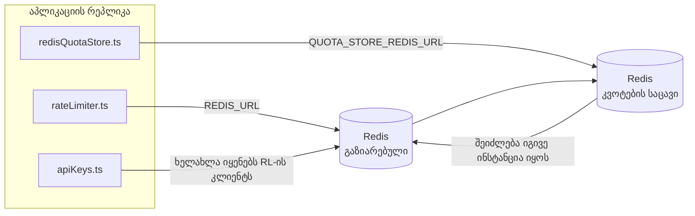

# Redis Production Configuration Guide (ქართული)

🌐 **Languages:** 🇺🇸 [English](../../../../ops/REDIS_PRODUCTION_CONFIG.md) · 🇪🇹 [am](../../../am/docs/ops/REDIS_PRODUCTION_CONFIG.md) · 🇸🇦 [ar](../../../ar/docs/ops/REDIS_PRODUCTION_CONFIG.md) · 🇦🇿 [az](../../../az/docs/ops/REDIS_PRODUCTION_CONFIG.md) · 🇧🇬 [bg](../../../bg/docs/ops/REDIS_PRODUCTION_CONFIG.md) · 🇧🇩 [bn](../../../bn/docs/ops/REDIS_PRODUCTION_CONFIG.md) · 🇧🇦 [bs](../../../bs/docs/ops/REDIS_PRODUCTION_CONFIG.md) · 🇨🇿 [cs](../../../cs/docs/ops/REDIS_PRODUCTION_CONFIG.md) · 🇩🇰 [da](../../../da/docs/ops/REDIS_PRODUCTION_CONFIG.md) · 🇩🇪 [de](../../../de/docs/ops/REDIS_PRODUCTION_CONFIG.md) · 🇬🇷 [el](../../../el/docs/ops/REDIS_PRODUCTION_CONFIG.md) · 🇪🇸 [es](../../../es/docs/ops/REDIS_PRODUCTION_CONFIG.md) · 🇪🇪 [et](../../../et/docs/ops/REDIS_PRODUCTION_CONFIG.md) · 🇮🇷 [fa](../../../fa/docs/ops/REDIS_PRODUCTION_CONFIG.md) · 🇫🇮 [fi](../../../fi/docs/ops/REDIS_PRODUCTION_CONFIG.md) · 🇫🇷 [fr](../../../fr/docs/ops/REDIS_PRODUCTION_CONFIG.md) · 🇮🇪 [ga](../../../ga/docs/ops/REDIS_PRODUCTION_CONFIG.md) · 🇮🇳 [gu](../../../gu/docs/ops/REDIS_PRODUCTION_CONFIG.md) · 🇳🇬 [ha](../../../ha/docs/ops/REDIS_PRODUCTION_CONFIG.md) · 🇮🇱 [he](../../../he/docs/ops/REDIS_PRODUCTION_CONFIG.md) · 🇮🇳 [hi](../../../hi/docs/ops/REDIS_PRODUCTION_CONFIG.md) · 🇭🇷 [hr](../../../hr/docs/ops/REDIS_PRODUCTION_CONFIG.md) · 🇭🇺 [hu](../../../hu/docs/ops/REDIS_PRODUCTION_CONFIG.md) · 🇦🇲 [hy](../../../hy/docs/ops/REDIS_PRODUCTION_CONFIG.md) · 🇮🇩 [id](../../../id/docs/ops/REDIS_PRODUCTION_CONFIG.md) · 🇳🇬 [ig](../../../ig/docs/ops/REDIS_PRODUCTION_CONFIG.md) · 🇮🇹 [it](../../../it/docs/ops/REDIS_PRODUCTION_CONFIG.md) · 🇯🇵 [ja](../../../ja/docs/ops/REDIS_PRODUCTION_CONFIG.md) · 🇰🇭 [km](../../../km/docs/ops/REDIS_PRODUCTION_CONFIG.md) · 🇮🇳 [kn](../../../kn/docs/ops/REDIS_PRODUCTION_CONFIG.md) · 🇰🇷 [ko](../../../ko/docs/ops/REDIS_PRODUCTION_CONFIG.md) · 🇱🇹 [lt](../../../lt/docs/ops/REDIS_PRODUCTION_CONFIG.md) · 🇱🇻 [lv](../../../lv/docs/ops/REDIS_PRODUCTION_CONFIG.md) · 🇮🇳 [ml](../../../ml/docs/ops/REDIS_PRODUCTION_CONFIG.md) · 🇮🇳 [mr](../../../mr/docs/ops/REDIS_PRODUCTION_CONFIG.md) · 🇲🇾 [ms](../../../ms/docs/ops/REDIS_PRODUCTION_CONFIG.md) · 🇲🇹 [mt](../../../mt/docs/ops/REDIS_PRODUCTION_CONFIG.md) · 🇲🇲 [my](../../../my/docs/ops/REDIS_PRODUCTION_CONFIG.md) · 🇳🇵 [ne](../../../ne/docs/ops/REDIS_PRODUCTION_CONFIG.md) · 🇳🇱 [nl](../../../nl/docs/ops/REDIS_PRODUCTION_CONFIG.md) · 🇳🇴 [no](../../../no/docs/ops/REDIS_PRODUCTION_CONFIG.md) · 🇮🇳 [or](../../../or/docs/ops/REDIS_PRODUCTION_CONFIG.md) · 🇮🇳 [pa](../../../pa/docs/ops/REDIS_PRODUCTION_CONFIG.md) · 🇵🇭 [phi](../../../phi/docs/ops/REDIS_PRODUCTION_CONFIG.md) · 🇵🇱 [pl](../../../pl/docs/ops/REDIS_PRODUCTION_CONFIG.md) · 🇵🇹 [pt](../../../pt/docs/ops/REDIS_PRODUCTION_CONFIG.md) · 🇧🇷 [pt-BR](../../../pt-BR/docs/ops/REDIS_PRODUCTION_CONFIG.md) · 🇷🇴 [ro](../../../ro/docs/ops/REDIS_PRODUCTION_CONFIG.md) · 🇷🇺 [ru](../../../ru/docs/ops/REDIS_PRODUCTION_CONFIG.md) · 🇱🇰 [si](../../../si/docs/ops/REDIS_PRODUCTION_CONFIG.md) · 🇸🇰 [sk](../../../sk/docs/ops/REDIS_PRODUCTION_CONFIG.md) · 🇸🇮 [sl](../../../sl/docs/ops/REDIS_PRODUCTION_CONFIG.md) · 🇷🇸 [sr](../../../sr/docs/ops/REDIS_PRODUCTION_CONFIG.md) · 🇸🇪 [sv](../../../sv/docs/ops/REDIS_PRODUCTION_CONFIG.md) · 🇰🇪 [sw](../../../sw/docs/ops/REDIS_PRODUCTION_CONFIG.md) · 🇮🇳 [ta](../../../ta/docs/ops/REDIS_PRODUCTION_CONFIG.md) · 🇮🇳 [te](../../../te/docs/ops/REDIS_PRODUCTION_CONFIG.md) · 🇹🇭 [th](../../../th/docs/ops/REDIS_PRODUCTION_CONFIG.md) · 🇹🇷 [tr](../../../tr/docs/ops/REDIS_PRODUCTION_CONFIG.md) · 🇺🇦 [uk-UA](../../../uk-UA/docs/ops/REDIS_PRODUCTION_CONFIG.md) · 🇵🇰 [ur](../../../ur/docs/ops/REDIS_PRODUCTION_CONFIG.md) · 🇺🇿 [uz](../../../uz/docs/ops/REDIS_PRODUCTION_CONFIG.md) · 🇻🇳 [vi](../../../vi/docs/ops/REDIS_PRODUCTION_CONFIG.md) · 🇳🇬 [yo](../../../yo/docs/ops/REDIS_PRODUCTION_CONFIG.md) · 🇨🇳 [zh-CN](../../../zh-CN/docs/ops/REDIS_PRODUCTION_CONFIG.md) · 🇹🇼 [zh-TW](../../../zh-TW/docs/ops/REDIS_PRODUCTION_CONFIG.md)

---

## მიმოხილვა

Redis არის **სურვილისამებრ, რბილი დამოკიდებულება** OmniRoute — ში აპლიკაცია მშვენივრად მცირდება (მეხსიერების ჩანაცვლება), როდესაც Redis მიუწვდომელია. წარმოებაში, Redis დარეგულირება ამცირებს შეყოვნებას ოთხი განსხვავებული დატვირთვისთვის:

| დატვირთვა              | მძღოლი                        | კლიენტების ქარხანა                               | გასაღები ნიმუში                                      |
| ---------------------- | ----------------------------- | ------------------------------------------------ | ---------------------------------------------------- |
| განაკვეთის შეზღუდვა    | `rateLimiter.ts`              | `getRedisClient()` — ზარმაცი `ioredis` სინგლტონი | `<prefix>rl:*` Lua-ატომური სიჩქარის ლიმიტის ფანჯრები |
| ავტორიზაციის ქეში      | `apiKeys.ts`                  | ხელახლა იყენებს `rateLimiter` კლიენტს            | `<prefix>auth:api_key:<sha256>` TTL ით               |
| კვოტის მაღაზია         | `redisQuotaStore.ts`          | ცალკე `getRedisClient(url)` singleton            | `<prefix>quota:*` კონფიგურირებადი თითო ინსტანციაზე   |
| გამათბობელი ამომრთველი | `redisCircuitBreakerStore.ts` | ცალკე კლიენტი `circuitBreakerFactory.ts` ში      | `<prefix>warmup:cb:<connectionId>`                   |

ოთხივე სამუშაო დატვირთვა იზიარებს სახელთა სივრცის ერთ პრეფიქსს, რათა OmniRoute შეძლოს სხვა აპებთან ერთად არსებობა Redis ერთ ეგზემპლარზე (მაგ. `127.0.0.1:6379`). იხილეთ [გასაღები სახელების ინტერვალი](#key-namespacing).

---

## მიმდინარე კონფიგურაცია (კოდის ნაგულისხმევი)

| დაყენება                        | ღირებულება                                                             | სად                                                                                   |
| ------------------------------- | ---------------------------------------------------------------------- | ------------------------------------------------------------------------------------- |
| `REDIS_URL` env var             | `redis://redis:6379` (შედგენა), სურვილისამებრ                          | `rateLimiter.ts:5`, `.env.example`                                                    |
| `REDIS_KEY_PREFIX` env var      | `omniroute:` (ნაგულისხმევი)                                            | `rateLimiter.ts`, `redisQuotaStore.ts`, `redisCircuitBreakerStore.ts`, `.env.example` |
| `QUOTA_STORE_REDIS_URL` env var | ცალკე, შეიძლება განსხვავდებოდეს `REDIS_URL` სგან                       | `quota/storeFactory.ts`                                                               |
| `QUOTA_STORE_DRIVER`            | `"sqlite"` (ნაგულისხმევი), `"redis"` სურვილისამებრ                     | `quota/storeFactory.ts`                                                               |
| ioredis `maxRetriesPerRequest`  | `3`                                                                    | `rateLimiter.ts` კლიენტის შექმნა                                                      |
| `enableReadyCheck`              | არ არის დაყენებული (ioredis default: `true`)                           | —                                                                                     |
| `lazyConnect`                   | არ არის დაყენებული (ioredis default: `false`)                          | —                                                                                     |
| `retryStrategy`                 | არ არის დაყენებული (ioredis ნაგულისხმევი: 200ms ბაზა, ექსპონენციალური) | —                                                                                     |
| TLS / პაროლი / DB ინდექსი       | **არ არის კონფიგურირებული**                                            | —                                                                                     |
| Sentinel / კლასტერი             | **არ არის კონფიგურირებული** — დამოუკიდებლად მხოლოდ ერთი კვანძი         | —                                                                                     |

---

## გასაღებების სახელთა სივრცე

OmniRoute Redis-ის ეგზემპლარს ჰოსტზე გაშვებულ სხვა სისტემებთან ერთად იყენებს. სახელთა სივრცის გარეშე,
ისეთი გასაღებები, როგორიცაა `auth:api_key:<sha256>` ან `rl:*`, შეიძლება იმავე Redis-ის გამომყენებელი
სხვა აპლიკაციების გასაღებებს დაემთხვეს (ეს ეგზემპლარი Redis-ს `127.0.0.1:6379`-ზე, სხვა სერვისებთან ერთად უშვებს).

დააყენეთ `REDIS_KEY_PREFIX` არაცარიელ სტრიქონად, რათა პრეფიქსი OmniRoute-ის **ყველა** გასაღებს დაემატოს:

```bash
# .env — OmniRoute-ის ყველა გასაღები ხდება omniroute:rl:*, omniroute:auth:*, omniroute:quota:*, omniroute:warmup:cb:*
REDIS_KEY_PREFIX=omniroute:
```

- **ნაგულისხმევი:** `omniroute:` (გამოიყენება, როდესაც `REDIS_KEY_PREFIX` დაყენებული არ არის ან ცარიელია).
- **გამოიყენება შემდეგზე:** სიხშირის შემზღუდველი + ავთენტიფიკაციის კეში (საერთო `ioredis` კლიენტი `keyPrefix`-ის მეშვეობით), ასევე
  კვოტების საცავი (`KEY_PREFIX = "${REDIS_KEY_PREFIX}quota"`) და გახურების circuit breaker
  (`KEY_PREFIX = "${REDIS_KEY_PREFIX}warmup:cb:"`).
- **პრეფიქსის შეცვლისას**, თუ გასაღებები Redis-ში უკვე არსებობს, ძველი გასაღებები მიუწვდომელი რჩება (მათ ვადა
  TTL / LRU-ის მეშვეობით გასდით). შეცვლა უსაფრთხოა; მიგრაცია საჭირო არ არის. ერთადერთი გამონაკლისია გახურების
  circuit-breaker-ის გასაღები იმ კავშირისთვის, რომელიც აკრძალულად არის მონიშნული: ის TTL-ის გარეშე ინახება, ამიტომ
  დარჩენილი გასაღებები ჩამოთვალეთ `redis-cli --scan --pattern '<old-prefix>warmup:cb:*'`-ით და წაშალეთ.
- **ioredis `keyPrefix`** პრეფიქსს ავტომატურად ამატებს ჩაწერისას **და** აშორებს წაკითხვისას,
  ამიტომ აპლიკაციის კოდი პრეფიქსს ვერასოდეს ხედავს.

---

## რეკომენდირებული წარმოების ტიუნინგი

### 1. კავშირის ფონდი / კლიენტის ოფციები (ioredis `Redis` კონსტრუქტორი)

მიმდინარე კოდი ქმნის ერთ `new Redis(url)` მორგებული ვარიანტების გარეშე. საწარმოო მრავალ რეპლიკა განლაგებისთვის, ჩაატარეთ კლიენტის ქარხანა კოდით ან შეფუთეთ `getRedisClient()`:

```typescript
const redis = new Redis(REDIS_URL, {
  maxRetriesPerRequest: null, // no retry limit; let retryStrategy decide
  enableReadyCheck: true, // verify server is ready before accepting calls
  lazyConnect: true, // don't connect on construction; wait for first call
  retryStrategy: (times) => {
    if (times > 10) return null; // give up after 10 retries → reconnect later
    return Math.min(times * 200, 5000); // 200ms, 400ms, …, 5s cap
  },
  enableAutoPipelining: true, // coalesce concurrent commands into one TCP write
  keepAlive: 10000, // TCP keep‑alive every 10s
});
```

**ძირითადი კომპრომისები:**

- `maxRetriesPerRequest: null` + `retryStrategy` — სასურველია წარმოებისთვის, ასე რომ, დროებითი Redis გადატვირთვები დაუყოვნებლივ არ დაასრულებს ყველა მოთხოვნას. მეხსიერებაში ჩანაცვლება `checkRateLimit()` ში შთანთქავს წარუმატებლობის გზას.
- `lazyConnect: true` — თავიდან აიცილებს გაშვების დამოკიდებულებას Redis ზე, სანამ სერვერი დაიწყებს კავშირების მიღებას.
- `enableAutoPipelining: true` — ამცირებს ორმხრივ მგზავრობას თანმხლები განაკვეთის ლიმიტის შემოწმებისთვის; მომგებიანი > 50 RPS ზე ერთი კავშირით.

### 2. Redis სერვერის კონფიგურაცია (`redis.conf`)

```
# Memory
maxmemory 80%                        # leave room for OS page cache
maxmemory-policy allkeys-lru         # evict stale auth cache entries under pressure

# Persistence (optional — OmniRoute is crash‑safe without it)
save 300 1                           # snapshot at least every 5 min if ≥1 key changed
appendonly no                        # AOF not needed; data is regeneratable
appendfsync no                       # no fsync overhead (RDB is sufficient)

# Networking
timeout 0                            # no idle disconnect
tcp-keepalive 300                    # 5 min keep‑alive
tcp-backlog 511                      # connection backlog for bursty load

# Performance
hz 10                                # default; 100 for latency‑sensitive
activedefrag yes                     # auto‑defragment when fragmentation >10%
```

**გაცვლა `maxmemory-policy allkeys-lru` სთვის:** Auth ქეში ჩანაწერები შეიძლება ამოღებულ იქნეს მეხსიერების წნევის ქვეშ. SQLite `setCachedApiKey` — სიჩქარის შემზღუდველი Lua სკრიპტი ქმნის მცირე კლავიშებს, რომლებიც მოკლევადიანია დიზაინით.

### 3. Docker შედგენის პარამეტრები

პროდ შედგენა (`docker-compose.prod.yml`) იყენებს `redis:8.6.2-alpine`. დამატება:

```yaml
redis:
  image: redis:8.6.2-alpine
  command:
    [
      "redis-server",
      "--maxmemory",
      "512mb",
      "--maxmemory-policy",
      "allkeys-lru",
      "--activedefrag",
      "yes",
      "--save",
      "300 1",
    ]
  healthcheck:
    test: ["CMD", "redis-cli", "ping"]
    interval: 10s
    timeout: 3s
    retries: 3
    start_period: 5s
```

### 4. მრავალ ინსტანციის / სკალირების მოსაზრებები

**ერთი Redis ყველა რეპლიკისთვის** — სიჩქარის შემზღუდველი Lua სკრიპტი დამოკიდებულია ერთ ავტორიტეტულ საკვანძო სივრცეზე. მრავალი Redis შემთხვევა რეპლიკების უკან დაკარგავს ატომურობას და გააორმაგებს ბიუჯეტს. გამოიყენეთ ერთი Redis (ან Redis Sentinel კლასტერი failover-ით) ყველა აპლიკაციის რეპლიკისთვის.

**კავშირის რაოდენობა:** თითოეული განაცხადის რეპლიკა იხსნება **2 TCP კავშირი** Redis მდე (განაკვეთის შემზღუდველი კლიენტი + კვოტის მაღაზიის კლიენტი). → 20 კავშირების 10 რეპლიკაზე, ნაგულისხმევი Redis მაგალითის 10k კავშირის ჭერის ფარგლებში.

### 5. მონიტორინგი

გამოავლინეთ ჯანმრთელობის შემოწმების საბოლოო წერტილის მეშვეობით:

```typescript
// src/app/api/monitoring/health/route.ts already calls rateLimiter functions
// Add Redis-specific checks:
//   1. PING latency via ioredis .ping()
//   2. Memory usage via INFO memory
//   3. Connection count via INFO clients
//   4. Hit rate for maxmemory-policy (evicted_keys / keyspace_hits)
```

საყურებელი ძირითადი მეტრიკა:

- **გამოძევებული გასაღებები / წმ** — თუ მუდმივად არ არის ნულოვანი, გაზარდეთ `maxmemory`
- **დაბლოკილი კლიენტები** — არა-ნულოვანი ვარაუდობს ნელი Lua სკრიპტები ან მაღალი კამათი
- **უარყოფილი კავშირები** — კავშირის ლიმიტის დარტყმა; იშვიათია 20 კავშირზე

### 6. Redis-თავსებადი სერვერები

აქ გამოყენებული ნებისმიერი სერვერი უნდა აწარმოებდეს Lua სკრიპტებს: სიჩქარის შემზღუდველი არის ერთი `EVAL`. სერვერზე Lua-ს გარეშე, `checkRateLimit()` აღრიცხავს `[RATE_LIMITER] Redis eval failed, falling back to in-memory rate limiting` და ითვლის თითოეულ პროცესს, ასე რომ, თითოეული რეპლიკა დამოუკიდებლად ახორციელებს ლიმიტს. გაზიარებული სესიის-აფინურობის მაღაზია (`OMNIROUTE_SESSION_AFFINITY_STORE=redis`) ასევე კითხულობს და განაახლებს პინებს `EVAL` ით; ლუას გარეშე ის იწერს `[SESSION_AFFINITY] Redis error; falling back to SQLite.` და თითოეული რეპლიკა ინახავს საკუთარ ქინძისთავებს. სხვა სამუშაო დატვირთვები იყენებს უბრალო ბრძანებებს (`SET ... EX`, `GET`, `DEL`, `MGET`, `EXPIRE`, `INCRBYFLOAT`, ჰეშები და ნაკრები), ხოლო სემანტიკური ქეშის Redis backend არ აგზავნის `FT.*` ბრძანებებს.

ტესტირება OmniRoute 3.8.52-ით: KiviDB 1.2.0 თავისი Lua გამოსახულებით (`kividb/kividb:v1.2.0-lua`). სიჩქარის შემზღუდველი (მათ შორის მეორე პროცესის გაზიარების მრიცხველები), auth cache, quota store, warmup circuit breaker, semantic cache store და `/v1/chat/completions` მოთხოვნა ჩატის დამმუშავებლის მეშვეობით, გაიარა 19 შემოწმებიდან 18, რომელიც გადადის Redis 8.10.3-ზე. ის, რომელიც განსხვავდება: `INCRBYFLOAT` ინახავს `0.1 + 0.2`, როგორც `0.30000000000000004`, სადაც Redis ინახავს `0.3` ( [kividbio/kividb#387](https://github.com/kividbio/kividb/issues/387) ). კვოტების მაღაზია აანალიზებს ორივეს `parseFloat` ით, მაგრამ ეს ორი რიცხვი განსხვავდება ბოლო ციფრებში, ამიტომ შედარება, რომელიც ზუსტად კვოტის ზღვარზე მოდის, შეიძლება სხვაგვარად გამოვიდეს. Sesion-affinity store არ იყო ამ პერსპექტივის ნაწილი. ( [დაყენება](https://github.com/kividbio/kividb/blob/master/docs/integrations/omniroute.md), [შედეგები](https://github.com/kividbio/kividb/tree/master/benchmarks/omniroute-compat) )

---

## არქიტექტურის დიაგრამა



---

## ცნობები

| ფაილი                              | მიზანი                                                                         |
| ---------------------------------- | ------------------------------------------------------------------------------ |
| `src/shared/utils/rateLimiter.ts`  | ძირითადი Redis კლიენტი, ლუას სიჩქარის ლიმიტის სკრიპტი, მეხსიერებაში ჩანაცვლება |
| `src/lib/db/apiKeys.ts`            | Auth cache — Redis→SQLite სარეზერვო                                            |
| `src/lib/quota/redisQuotaStore.ts` | ცალკე Redis კლიენტი არასავალდებულო კვოტის მაღაზიისთვის                         |
| `src/lib/quota/storeFactory.ts`    | გადართვა `sqlite` და `redis` კვოტის დრაივერებს შორის                           |
| `docker-compose.prod.yml`          | Prod Redis კონტეინერი (სურათი `redis:8.6.2-alpine`)                            |
| `.env.example`                     | Redis env vars დოკუმენტაცია                                                    |
| `src/app/api/local/redis/`         | API მარშრუტები დეველოპმენტის კონტეინერების ორკესტრირებისთვის                   |
| `bin/cli/commands/redis.mjs`       | CLI ბრძანებები დეველ კონტეინერების ორკესტრირებისთვის                           |
