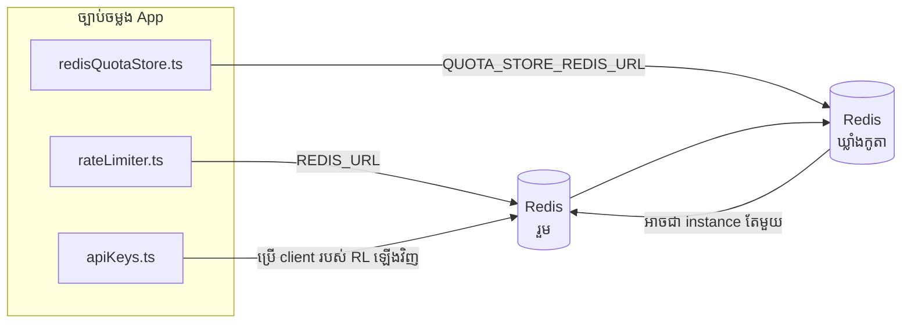

# Redis Production Configuration Guide (ខ្មែរ)

🌐 **Languages:** 🇺🇸 [English](../../../../ops/REDIS_PRODUCTION_CONFIG.md) · 🇪🇹 [am](../../../am/docs/ops/REDIS_PRODUCTION_CONFIG.md) · 🇸🇦 [ar](../../../ar/docs/ops/REDIS_PRODUCTION_CONFIG.md) · 🇦🇿 [az](../../../az/docs/ops/REDIS_PRODUCTION_CONFIG.md) · 🇧🇬 [bg](../../../bg/docs/ops/REDIS_PRODUCTION_CONFIG.md) · 🇧🇩 [bn](../../../bn/docs/ops/REDIS_PRODUCTION_CONFIG.md) · 🇧🇦 [bs](../../../bs/docs/ops/REDIS_PRODUCTION_CONFIG.md) · 🇨🇿 [cs](../../../cs/docs/ops/REDIS_PRODUCTION_CONFIG.md) · 🇩🇰 [da](../../../da/docs/ops/REDIS_PRODUCTION_CONFIG.md) · 🇩🇪 [de](../../../de/docs/ops/REDIS_PRODUCTION_CONFIG.md) · 🇬🇷 [el](../../../el/docs/ops/REDIS_PRODUCTION_CONFIG.md) · 🇪🇸 [es](../../../es/docs/ops/REDIS_PRODUCTION_CONFIG.md) · 🇪🇪 [et](../../../et/docs/ops/REDIS_PRODUCTION_CONFIG.md) · 🇮🇷 [fa](../../../fa/docs/ops/REDIS_PRODUCTION_CONFIG.md) · 🇫🇮 [fi](../../../fi/docs/ops/REDIS_PRODUCTION_CONFIG.md) · 🇫🇷 [fr](../../../fr/docs/ops/REDIS_PRODUCTION_CONFIG.md) · 🇮🇪 [ga](../../../ga/docs/ops/REDIS_PRODUCTION_CONFIG.md) · 🇮🇳 [gu](../../../gu/docs/ops/REDIS_PRODUCTION_CONFIG.md) · 🇳🇬 [ha](../../../ha/docs/ops/REDIS_PRODUCTION_CONFIG.md) · 🇮🇱 [he](../../../he/docs/ops/REDIS_PRODUCTION_CONFIG.md) · 🇮🇳 [hi](../../../hi/docs/ops/REDIS_PRODUCTION_CONFIG.md) · 🇭🇷 [hr](../../../hr/docs/ops/REDIS_PRODUCTION_CONFIG.md) · 🇭🇺 [hu](../../../hu/docs/ops/REDIS_PRODUCTION_CONFIG.md) · 🇦🇲 [hy](../../../hy/docs/ops/REDIS_PRODUCTION_CONFIG.md) · 🇮🇩 [id](../../../id/docs/ops/REDIS_PRODUCTION_CONFIG.md) · 🇳🇬 [ig](../../../ig/docs/ops/REDIS_PRODUCTION_CONFIG.md) · 🇮🇹 [it](../../../it/docs/ops/REDIS_PRODUCTION_CONFIG.md) · 🇯🇵 [ja](../../../ja/docs/ops/REDIS_PRODUCTION_CONFIG.md) · 🇬🇪 [ka](../../../ka/docs/ops/REDIS_PRODUCTION_CONFIG.md) · 🇮🇳 [kn](../../../kn/docs/ops/REDIS_PRODUCTION_CONFIG.md) · 🇰🇷 [ko](../../../ko/docs/ops/REDIS_PRODUCTION_CONFIG.md) · 🇱🇹 [lt](../../../lt/docs/ops/REDIS_PRODUCTION_CONFIG.md) · 🇱🇻 [lv](../../../lv/docs/ops/REDIS_PRODUCTION_CONFIG.md) · 🇮🇳 [ml](../../../ml/docs/ops/REDIS_PRODUCTION_CONFIG.md) · 🇮🇳 [mr](../../../mr/docs/ops/REDIS_PRODUCTION_CONFIG.md) · 🇲🇾 [ms](../../../ms/docs/ops/REDIS_PRODUCTION_CONFIG.md) · 🇲🇹 [mt](../../../mt/docs/ops/REDIS_PRODUCTION_CONFIG.md) · 🇲🇲 [my](../../../my/docs/ops/REDIS_PRODUCTION_CONFIG.md) · 🇳🇵 [ne](../../../ne/docs/ops/REDIS_PRODUCTION_CONFIG.md) · 🇳🇱 [nl](../../../nl/docs/ops/REDIS_PRODUCTION_CONFIG.md) · 🇳🇴 [no](../../../no/docs/ops/REDIS_PRODUCTION_CONFIG.md) · 🇮🇳 [or](../../../or/docs/ops/REDIS_PRODUCTION_CONFIG.md) · 🇮🇳 [pa](../../../pa/docs/ops/REDIS_PRODUCTION_CONFIG.md) · 🇵🇭 [phi](../../../phi/docs/ops/REDIS_PRODUCTION_CONFIG.md) · 🇵🇱 [pl](../../../pl/docs/ops/REDIS_PRODUCTION_CONFIG.md) · 🇵🇹 [pt](../../../pt/docs/ops/REDIS_PRODUCTION_CONFIG.md) · 🇧🇷 [pt-BR](../../../pt-BR/docs/ops/REDIS_PRODUCTION_CONFIG.md) · 🇷🇴 [ro](../../../ro/docs/ops/REDIS_PRODUCTION_CONFIG.md) · 🇷🇺 [ru](../../../ru/docs/ops/REDIS_PRODUCTION_CONFIG.md) · 🇱🇰 [si](../../../si/docs/ops/REDIS_PRODUCTION_CONFIG.md) · 🇸🇰 [sk](../../../sk/docs/ops/REDIS_PRODUCTION_CONFIG.md) · 🇸🇮 [sl](../../../sl/docs/ops/REDIS_PRODUCTION_CONFIG.md) · 🇷🇸 [sr](../../../sr/docs/ops/REDIS_PRODUCTION_CONFIG.md) · 🇸🇪 [sv](../../../sv/docs/ops/REDIS_PRODUCTION_CONFIG.md) · 🇰🇪 [sw](../../../sw/docs/ops/REDIS_PRODUCTION_CONFIG.md) · 🇮🇳 [ta](../../../ta/docs/ops/REDIS_PRODUCTION_CONFIG.md) · 🇮🇳 [te](../../../te/docs/ops/REDIS_PRODUCTION_CONFIG.md) · 🇹🇭 [th](../../../th/docs/ops/REDIS_PRODUCTION_CONFIG.md) · 🇹🇷 [tr](../../../tr/docs/ops/REDIS_PRODUCTION_CONFIG.md) · 🇺🇦 [uk-UA](../../../uk-UA/docs/ops/REDIS_PRODUCTION_CONFIG.md) · 🇵🇰 [ur](../../../ur/docs/ops/REDIS_PRODUCTION_CONFIG.md) · 🇺🇿 [uz](../../../uz/docs/ops/REDIS_PRODUCTION_CONFIG.md) · 🇻🇳 [vi](../../../vi/docs/ops/REDIS_PRODUCTION_CONFIG.md) · 🇳🇬 [yo](../../../yo/docs/ops/REDIS_PRODUCTION_CONFIG.md) · 🇨🇳 [zh-CN](../../../zh-CN/docs/ops/REDIS_PRODUCTION_CONFIG.md) · 🇹🇼 [zh-TW](../../../zh-TW/docs/ops/REDIS_PRODUCTION_CONFIG.md)

---

## ទិដ្ឋភាពទូទៅ

Redis គឺជា**ស្រេចចិត្ត ភាពអាស្រ័យទន់** នៅក្នុង OmniRoute — កម្មវិធីនឹងបន្ថយយ៉ាងទន់ភ្លន់ (កំហុសក្នុងអង្គចងចាំ) នៅពេលដែល Redis មិនអាចប្រើបាន។ នៅក្នុងការផលិត ការលៃតម្រូវ Redis កាត់បន្ថយភាពយឺតយ៉ាវសម្រាប់បន្ទុកការងារចំនួនបួនផ្សេងគ្នា៖

| បន្ទុកការងារ             | អ្នកបើកបរ                     | រោងចក្រអតិថិជន                                      | លំនាំគន្លឹះ                                           |
| ------------------------ | ----------------------------- | --------------------------------------------------- | ----------------------------------------------------- |
| ការកំណត់អត្រា            | `rateLimiter.ts`              | `getRedisClient()` — ខ្ជិល `ioredis` singleton      | បង្អួចកំណត់អត្រាអាតូមិក `<prefix>rl:*` Lua            |
| ឃ្លាំងសម្ងាត់ផ្ទៀងផ្ទាត់ | `apiKeys.ts`                  | ប្រើអតិថិជនរបស់ `rateLimiter` ឡើងវិញ                | `<prefix>auth:api_key:<sha256>` ជាមួយ TTL             |
| ហាងកូតា                  | `redisQuotaStore.ts`          | ដាច់ដោយឡែក `getRedisClient(url)` singleton          | `<prefix>quota:*` អាចកំណត់រចនាសម្ព័ន្ធបានក្នុងមួយករណី |
| ឧបករណ៍បំបែកសៀគ្វីកំដៅ    | `redisCircuitBreakerStore.ts` | អតិថិជនដាច់ដោយឡែកនៅក្នុង `circuitBreakerFactory.ts` | `<prefix>warmup:cb:<connectionId>`                    |

បន្ទុកការងារទាំងបួនចែករំលែកបុព្វបទ namespace មួយ ដូច្នេះ OmniRoute អាចរួមរស់ជាមួយកម្មវិធីផ្សេងទៀតនៅលើឧទាហរណ៍ Redis តែមួយ (ឧទាហរណ៍ `127.0.0.1:6379`) ។ សូមមើល [Key Namespacing](#key-namespacing) ។

---

## ការកំណត់រចនាសម្ព័ន្ធបច្ចុប្បន្ន (កូដលំនាំដើម)

| ការកំណត់                        | តម្លៃ                                                       | កន្លែងណា                                                                              |
| ------------------------------- | ----------------------------------------------------------- | ------------------------------------------------------------------------------------- |
| `REDIS_URL` env var             | `redis://redis:6379` (តែង) ស្រេចចិត្ត                       | `rateLimiter.ts:5`, `.env.example`                                                    |
| `REDIS_KEY_PREFIX` env var      | `omniroute:` (លំនាំដើម)                                     | `rateLimiter.ts`, `redisQuotaStore.ts`, `redisCircuitBreakerStore.ts`, `.env.example` |
| `QUOTA_STORE_REDIS_URL` env var | ដាច់ដោយឡែកអាចខុសគ្នាពី `REDIS_URL`                          | `quota/storeFactory.ts`                                                               |
| `QUOTA_STORE_DRIVER`            | `"sqlite"` (លំនាំដើម), `"redis"` ជាជម្រើស                   | `quota/storeFactory.ts`                                                               |
| ioredis `maxRetriesPerRequest`  | `3`                                                         | ការបង្កើតអតិថិជន `rateLimiter.ts`                                                     |
| `enableReadyCheck`              | មិនបានកំណត់ (លំនាំដើម ioredis៖ `true`)                      | —                                                                                     |
| `lazyConnect`                   | មិនបានកំណត់ (លំនាំដើម ioredis៖ `false`)                     | —                                                                                     |
| `retryStrategy`                 | មិនបានកំណត់ (លំនាំដើម ioredis៖ មូលដ្ឋាន 200ms និទស្សន្ត)    | —                                                                                     |
| TLS / លេខសម្ងាត់ / សន្ទស្សន៍ DB | **មិនបានកំណត់រចនាសម្ព័ន្ធ**                                 | —                                                                                     |
| Sentinel / ចង្កោម               | **មិនបានកំណត់រចនាសម្ព័ន្ធ** — ឯករាជ្យតែថ្នាំងតែមួយប៉ុណ្ណោះ។ | —                                                                                     |

---

## ការបែងចែក Namespace សម្រាប់ Key

OmniRoute ប្រើ Redis instance រួមជាមួយអ្វីផ្សេងទៀតដែលដំណើរការលើ host។ បើគ្មាន namespace ទេ
key ដូចជា `auth:api_key:<sha256>` ឬ `rl:*` អាចប៉ះទង្គិចជាមួយ key ពីកម្មវិធីផ្សេងទៀត
ដែលប្រើ Redis ដូចគ្នា (instance នេះដំណើរការ Redis នៅលើ `127.0.0.1:6379` រួមជាមួយ service ផ្សេងទៀត)។

កំណត់ `REDIS_KEY_PREFIX` ជា string ដែលមិនទទេ ដើម្បីបន្ថែម prefix ទៅខាងមុខ key **ទាំងអស់** របស់ OmniRoute៖

```bash
# .env — key ទាំងអស់របស់ OmniRoute ក្លាយជា omniroute:rl:*, omniroute:auth:*, omniroute:quota:*, omniroute:warmup:cb:*
REDIS_KEY_PREFIX=omniroute:
```

- **លំនាំដើម៖** `omniroute:` (ត្រូវបានអនុវត្តនៅពេល `REDIS_KEY_PREFIX` មិនបានកំណត់ ឬទទេ)។
- **អនុវត្តចំពោះ៖** rate limiter + auth cache (ប្រើ `ioredis` client រួមគ្នាតាមរយៈ `keyPrefix`) និង
  quota store (`KEY_PREFIX = "${REDIS_KEY_PREFIX}quota"`) ព្រមទាំង warmup circuit breaker
  (`KEY_PREFIX = "${REDIS_KEY_PREFIX}warmup:cb:"`)។
- **ការផ្លាស់ប្តូរ prefix** នៅពេលមាន key រួចហើយក្នុង Redis នឹងធ្វើឱ្យ key ចាស់ៗលែងត្រូវបានយោង (ពួកវានឹងផុតកំណត់
  តាមរយៈ TTL / LRU)។ អាចផ្លាស់ប្តូរបានដោយសុវត្ថិភាព ហើយមិនចាំបាច់ធ្វើ migration ទេ។ ករណីលើកលែងតែមួយគត់គឺ key របស់ warmup
  circuit-breaker សម្រាប់ connection ដែលបានសម្គាល់ថា forbidden៖ វាត្រូវបានរក្សាទុកដោយគ្មាន TTL ដូច្នេះ
  សូមរាយបញ្ជី key ដែលនៅសេសសល់ដោយប្រើ `redis-cli --scan --pattern '<old-prefix>warmup:cb:*'` ហើយលុបពួកវា។
- **`keyPrefix` របស់ ioredis** បន្ថែម prefix ទៅខាងមុខដោយស្វ័យប្រវត្តិពេលសរសេរ **និង** ដកវាចេញពេលអាន
  ដូច្នេះកូដកម្មវិធីមិនឃើញ prefix ឡើយ។

---

## ការលៃតម្រូវផលិតកម្មដែលបានណែនាំ

### 1. Connection Pool/Client Options (ioredis `Redis` constructor)

លេខកូដបច្ចុប្បន្នបង្កើត `new Redis(url)` តែមួយដោយគ្មានជម្រើសផ្ទាល់ខ្លួន។ សម្រាប់ការដាក់ពង្រាយការចម្លងពហុផលិតកម្ម សូមឆ្លងកាត់រោងចក្រអតិថិជននៅក្នុងកូដ ឬរុំ `getRedisClient()`៖

```typescript
const redis = new Redis(REDIS_URL, {
  maxRetriesPerRequest: null, // no retry limit; let retryStrategy decide
  enableReadyCheck: true, // verify server is ready before accepting calls
  lazyConnect: true, // don't connect on construction; wait for first call
  retryStrategy: (times) => {
    if (times > 10) return null; // give up after 10 retries → reconnect later
    return Math.min(times * 200, 5000); // 200ms, 400ms, …, 5s cap
  },
  enableAutoPipelining: true, // coalesce concurrent commands into one TCP write
  keepAlive: 10000, // TCP keep‑alive every 10s
});
```

**ការដោះដូរសំខាន់ៗ៖**

- `maxRetriesPerRequest: null` + `retryStrategy` — ពេញចិត្តសម្រាប់ផលិតកម្ម ដូច្នេះការចាប់ផ្ដើម Redis បណ្តោះអាសន្នឡើងវិញមិនបរាជ័យភ្លាមៗរាល់សំណើនោះទេ។ ការធ្លាក់ចុះនៅក្នុងសតិនៅក្នុង `checkRateLimit()` ស្រូបយកផ្លូវបរាជ័យ។
- `lazyConnect: true` — ជៀសវាងការពឹងផ្អែកលើការចាប់ផ្តើម Redis មុនពេលម៉ាស៊ីនមេចាប់ផ្តើមទទួលយកការតភ្ជាប់។
- `enableAutoPipelining: true` — កាត់បន្ថយការធ្វើដំណើរទៅមកសម្រាប់ការត្រួតពិនិត្យដែនកំណត់អត្រាស្របគ្នា។ អត្ថប្រយោជន៍នៅ > 50 RPS នៅលើការតភ្ជាប់តែមួយ។

### 2. ការកំណត់រចនាសម្ព័ន្ធម៉ាស៊ីនមេ Redis (`redis.conf`)

```
# Memory
maxmemory 80%                        # leave room for OS page cache
maxmemory-policy allkeys-lru         # evict stale auth cache entries under pressure

# Persistence (optional — OmniRoute is crash‑safe without it)
save 300 1                           # snapshot at least every 5 min if ≥1 key changed
appendonly no                        # AOF not needed; data is regeneratable
appendfsync no                       # no fsync overhead (RDB is sufficient)

# Networking
timeout 0                            # no idle disconnect
tcp-keepalive 300                    # 5 min keep‑alive
tcp-backlog 511                      # connection backlog for bursty load

# Performance
hz 10                                # default; 100 for latency‑sensitive
activedefrag yes                     # auto‑defragment when fragmentation >10%
```

**ការដោះដូរសម្រាប់ `maxmemory-policy allkeys-lru`៖** ធាតុឃ្លាំងសម្ងាត់អាចត្រូវបានបណ្តេញចេញក្រោមសម្ពាធនៃអង្គចងចាំ។ នេះមានសុវត្ថិភាព — `setCachedApiKey` តែងតែបង្ហាញសារជាថ្មីនៅពេលខកខាន ហើយ SQLite ត្រលប់មកវិញគឺជាការអនុញ្ញាត។ ស្គ្រីប Lua កំណត់អត្រាការប្រាក់បង្កើតកូនសោតូចៗដែលប្រើរយៈពេលខ្លីតាមការរចនា។

### 3. Docker តែងការកំណត់

ការតែងផលិតផល (`docker-compose.prod.yml`) ប្រើ `redis:8.6.2-alpine`។ បន្ថែម៖

```yaml
redis:
  image: redis:8.6.2-alpine
  command:
    [
      "redis-server",
      "--maxmemory",
      "512mb",
      "--maxmemory-policy",
      "allkeys-lru",
      "--activedefrag",
      "yes",
      "--save",
      "300 1",
    ]
  healthcheck:
    test: ["CMD", "redis-cli", "ping"]
    interval: 10s
    timeout: 3s
    retries: 3
    start_period: 5s
```

### 4. Multi-Instance/Scaling Considerations

**Redis តែមួយសម្រាប់ការចម្លងទាំងអស់។** — ការកំណត់អត្រាអត្រាអក្សរ Lua អាស្រ័យលើចន្លោះគន្លឹះអនុញ្ញាតតែមួយ។ ករណី Redis ច្រើននៅពីក្រោយការចម្លងនឹងបាត់បង់អាតូមិក និងបង្កើនថវិកាទ្វេដង។ ប្រើ Redis តែមួយ (ឬ Redis Sentinel cluster with failover) សម្រាប់ការចម្លងកម្មវិធីទាំងអស់។

**ចំនួននៃការតភ្ជាប់៖** ការចម្លងកម្មវិធីនីមួយៗបើក **2 ការតភ្ជាប់ TCP** ទៅ Redis (អតិថិជនកំណត់អត្រាអតិថិជន + កូតាហាងអតិថិជន) ។ នៅការភ្ជាប់ → 20 ចម្លងចំនួន 10 ល្អនៅក្នុងពិដានការតភ្ជាប់ 10k របស់ Redis លំនាំដើម។

### 5. ការត្រួតពិនិត្យ

បង្ហាញតាមរយៈចំណុចពិនិត្យសុខភាព៖

```typescript
// src/app/api/monitoring/health/route.ts already calls rateLimiter functions
// Add Redis-specific checks:
//   1. PING latency via ioredis .ping()
//   2. Memory usage via INFO memory
//   3. Connection count via INFO clients
//   4. Hit rate for maxmemory-policy (evicted_keys / keyspace_hits)
```

សូចនាករសំខាន់ៗដែលត្រូវមើល៖

- **គ្រាប់ចុចបណ្តេញចេញ / វិ** — ប្រសិនបើមិនជាប់លាប់ បង្កើន `maxmemory`
- **អតិថិជនដែលបានទប់ស្កាត់** — មិនសូន្យបង្ហាញស្គ្រីប Lua យឺត ឬការឈ្លោះគ្នាខ្លាំង
- **ការតភ្ជាប់ដែលបានបដិសេធ** ដែនកំណត់នៃការតភ្ជាប់ — បានប៉ះ; កម្រមាន 20 ការតភ្ជាប់

### 6. ម៉ាស៊ីនមេដែលត្រូវគ្នានឹង Redis

ម៉ាស៊ីនមេណាមួយដែលប្រើនៅទីនេះត្រូវតែដំណើរការស្គ្រីប Lua៖ ការកំណត់អត្រាគឺ `EVAL` មួយ។ នៅលើម៉ាស៊ីនមេដោយគ្មាន Lua `checkRateLimit()` កត់ត្រា `[RATE_LIMITER] Redis eval failed, falling back to in-memory rate limiting` និងរាប់ក្នុងមួយដំណើរការ ដូច្នេះការចម្លងនីមួយៗអនុវត្តដែនកំណត់ដោយខ្លួនឯង។ ហាងដែលជ្រើសរើសចូលរួមជាមួយនឹង Session-affinity store (`OMNIROUTE_SESSION_AFFINITY_STORE=redis`) ក៏អាននិងធ្វើបច្ចុប្បន្នភាពម្ជុលជាមួយ `EVAL` ដែរ។ ដោយគ្មាន Lua វាកត់ត្រា `[SESSION_AFFINITY] Redis error; falling back to SQLite.` ហើយការចម្លងនីមួយៗរក្សាម្ជុលផ្ទាល់ខ្លួន។ បន្ទុកការងារផ្សេងទៀតប្រើពាក្យបញ្ជាធម្មតា (`SET ... EX`, `GET`, `DEL`, `MGET`, `EXPIRE`, `INCRBYFLOAT`, hashes and sets) ហើយផ្នែកខាងក្រោយ Redis របស់ semantic cache មិនផ្ញើពាក្យបញ្ជា `FT.*` ទេ។

សាកល្បងជាមួយ OmniRoute 3.8.52៖ KiviDB 1.2.0 ជាមួយនឹងរូបភាព Lua របស់វា (`kividb/kividb:v1.2.0-lua`)។ ការកំណត់អត្រាការប្រាក់ (រួមទាំងដំណើរការទីពីរដែលចែករំលែកបញ្ជរ) ឃ្លាំងសម្ងាត់ផ្ទៀងផ្ទាត់ ហាងលក់កូតា ឧបករណ៍បំប្លែងសៀគ្វីកម្ដៅ ឃ្លាំងផ្ទុកទិន្នន័យ និងសំណើ `/v1/chat/completions` តាមរយៈអ្នកដោះស្រាយការជជែកបានឆ្លងកាត់ការត្រួតពិនិត្យ 18 ក្នុងចំណោម 19 ដែលឆ្លងកាត់ Redis 8.10.3 ។ អ្វីដែលខុសគ្នា៖ `INCRBYFLOAT` រក្សាទុក `0.1 + 0.2` ជា `0.30000000000000004` ដែល Redis រក្សាទុក `0.3` ( [kividbio/kividb#387](https://github.com/kividbio/kividb/issues/387) ) ។ ហាងកូតាញែកទាំងពីរជាមួយ `parseFloat` ប៉ុន្តែលេខទាំងពីរខុសគ្នានៅក្នុងខ្ទង់ចុងក្រោយ ដូច្នេះការប្រៀបធៀបដែលស្ថិតនៅលើព្រំដែនកូតាអាចចេញមកខុសគ្នា។ ហាង Session-affinity មិនមែនជាផ្នែកនៃការដំណើរការនោះទេ។ ( [setup](https://github.com/kividbio/kividb/blob/master/docs/integrations/omniroute.md), [results](https://github.com/kividbio/kividb/tree/master/benchmarks/omniroute-compat) )

---

## ដ្យាក្រាមស្ថាបត្យកម្ម



---

## ឯកសារយោង

| ឯកសារ                              | គោលបំណង                                                                |
| ---------------------------------- | ---------------------------------------------------------------------- |
| `src/shared/utils/rateLimiter.ts`  | ម៉ាស៊ីនភ្ញៀវ Redis ចម្បង, ស្គ្រីបកំណត់អត្រា Lua, ថយក្រោយក្នុងអង្គចងចាំ |
| `src/lib/db/apiKeys.ts`            | ឃ្លាំងសម្ងាត់ផ្ទៀងផ្ទាត់ — Redis→SQLite ត្រលប់មកវិញ                    |
| `src/lib/quota/redisQuotaStore.ts` | ញែកអតិថិជន Redis ដាច់ដោយឡែកសម្រាប់ហាងកូតាស្រេចចិត្ត                    |
| `src/lib/quota/storeFactory.ts`    | ប្តូររវាងកម្មវិធីបញ្ជាកូតា `sqlite` និង `redis`                        |
| `docker-compose.prod.yml`          | ធុងផលិត Redis (រូបភាព `redis:8.6.2-alpine`)                            |
| `.env.example`                     | ឯកសារ Redis env vars                                                   |
| `src/app/api/local/redis/`         | ផ្លូវ API សម្រាប់ការរៀបចំកុងតឺន័រអ្នកអភិវឌ្ឍន៍                         |
| `bin/cli/commands/redis.mjs`       | ពាក្យបញ្ជាCLI សម្រាប់ការរៀបចំឧបករណ៍ផ្ទុកអ្នកអភិវឌ្ឍន៍                  |
