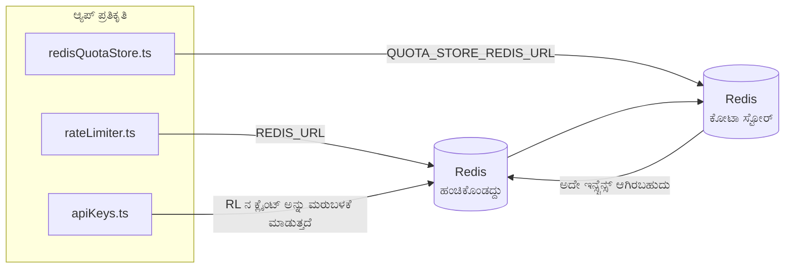

# Redis Production Configuration Guide (ಕನ್ನಡ)

🌐 **Languages:** 🇺🇸 [English](../../../../ops/REDIS_PRODUCTION_CONFIG.md) · 🇪🇹 [am](../../../am/docs/ops/REDIS_PRODUCTION_CONFIG.md) · 🇸🇦 [ar](../../../ar/docs/ops/REDIS_PRODUCTION_CONFIG.md) · 🇦🇿 [az](../../../az/docs/ops/REDIS_PRODUCTION_CONFIG.md) · 🇧🇬 [bg](../../../bg/docs/ops/REDIS_PRODUCTION_CONFIG.md) · 🇧🇩 [bn](../../../bn/docs/ops/REDIS_PRODUCTION_CONFIG.md) · 🇧🇦 [bs](../../../bs/docs/ops/REDIS_PRODUCTION_CONFIG.md) · 🇨🇿 [cs](../../../cs/docs/ops/REDIS_PRODUCTION_CONFIG.md) · 🇩🇰 [da](../../../da/docs/ops/REDIS_PRODUCTION_CONFIG.md) · 🇩🇪 [de](../../../de/docs/ops/REDIS_PRODUCTION_CONFIG.md) · 🇬🇷 [el](../../../el/docs/ops/REDIS_PRODUCTION_CONFIG.md) · 🇪🇸 [es](../../../es/docs/ops/REDIS_PRODUCTION_CONFIG.md) · 🇪🇪 [et](../../../et/docs/ops/REDIS_PRODUCTION_CONFIG.md) · 🇮🇷 [fa](../../../fa/docs/ops/REDIS_PRODUCTION_CONFIG.md) · 🇫🇮 [fi](../../../fi/docs/ops/REDIS_PRODUCTION_CONFIG.md) · 🇫🇷 [fr](../../../fr/docs/ops/REDIS_PRODUCTION_CONFIG.md) · 🇮🇪 [ga](../../../ga/docs/ops/REDIS_PRODUCTION_CONFIG.md) · 🇮🇳 [gu](../../../gu/docs/ops/REDIS_PRODUCTION_CONFIG.md) · 🇳🇬 [ha](../../../ha/docs/ops/REDIS_PRODUCTION_CONFIG.md) · 🇮🇱 [he](../../../he/docs/ops/REDIS_PRODUCTION_CONFIG.md) · 🇮🇳 [hi](../../../hi/docs/ops/REDIS_PRODUCTION_CONFIG.md) · 🇭🇷 [hr](../../../hr/docs/ops/REDIS_PRODUCTION_CONFIG.md) · 🇭🇺 [hu](../../../hu/docs/ops/REDIS_PRODUCTION_CONFIG.md) · 🇦🇲 [hy](../../../hy/docs/ops/REDIS_PRODUCTION_CONFIG.md) · 🇮🇩 [id](../../../id/docs/ops/REDIS_PRODUCTION_CONFIG.md) · 🇳🇬 [ig](../../../ig/docs/ops/REDIS_PRODUCTION_CONFIG.md) · 🇮🇹 [it](../../../it/docs/ops/REDIS_PRODUCTION_CONFIG.md) · 🇯🇵 [ja](../../../ja/docs/ops/REDIS_PRODUCTION_CONFIG.md) · 🇬🇪 [ka](../../../ka/docs/ops/REDIS_PRODUCTION_CONFIG.md) · 🇰🇭 [km](../../../km/docs/ops/REDIS_PRODUCTION_CONFIG.md) · 🇰🇷 [ko](../../../ko/docs/ops/REDIS_PRODUCTION_CONFIG.md) · 🇱🇹 [lt](../../../lt/docs/ops/REDIS_PRODUCTION_CONFIG.md) · 🇱🇻 [lv](../../../lv/docs/ops/REDIS_PRODUCTION_CONFIG.md) · 🇮🇳 [ml](../../../ml/docs/ops/REDIS_PRODUCTION_CONFIG.md) · 🇮🇳 [mr](../../../mr/docs/ops/REDIS_PRODUCTION_CONFIG.md) · 🇲🇾 [ms](../../../ms/docs/ops/REDIS_PRODUCTION_CONFIG.md) · 🇲🇹 [mt](../../../mt/docs/ops/REDIS_PRODUCTION_CONFIG.md) · 🇲🇲 [my](../../../my/docs/ops/REDIS_PRODUCTION_CONFIG.md) · 🇳🇵 [ne](../../../ne/docs/ops/REDIS_PRODUCTION_CONFIG.md) · 🇳🇱 [nl](../../../nl/docs/ops/REDIS_PRODUCTION_CONFIG.md) · 🇳🇴 [no](../../../no/docs/ops/REDIS_PRODUCTION_CONFIG.md) · 🇮🇳 [or](../../../or/docs/ops/REDIS_PRODUCTION_CONFIG.md) · 🇮🇳 [pa](../../../pa/docs/ops/REDIS_PRODUCTION_CONFIG.md) · 🇵🇭 [phi](../../../phi/docs/ops/REDIS_PRODUCTION_CONFIG.md) · 🇵🇱 [pl](../../../pl/docs/ops/REDIS_PRODUCTION_CONFIG.md) · 🇵🇹 [pt](../../../pt/docs/ops/REDIS_PRODUCTION_CONFIG.md) · 🇧🇷 [pt-BR](../../../pt-BR/docs/ops/REDIS_PRODUCTION_CONFIG.md) · 🇷🇴 [ro](../../../ro/docs/ops/REDIS_PRODUCTION_CONFIG.md) · 🇷🇺 [ru](../../../ru/docs/ops/REDIS_PRODUCTION_CONFIG.md) · 🇱🇰 [si](../../../si/docs/ops/REDIS_PRODUCTION_CONFIG.md) · 🇸🇰 [sk](../../../sk/docs/ops/REDIS_PRODUCTION_CONFIG.md) · 🇸🇮 [sl](../../../sl/docs/ops/REDIS_PRODUCTION_CONFIG.md) · 🇷🇸 [sr](../../../sr/docs/ops/REDIS_PRODUCTION_CONFIG.md) · 🇸🇪 [sv](../../../sv/docs/ops/REDIS_PRODUCTION_CONFIG.md) · 🇰🇪 [sw](../../../sw/docs/ops/REDIS_PRODUCTION_CONFIG.md) · 🇮🇳 [ta](../../../ta/docs/ops/REDIS_PRODUCTION_CONFIG.md) · 🇮🇳 [te](../../../te/docs/ops/REDIS_PRODUCTION_CONFIG.md) · 🇹🇭 [th](../../../th/docs/ops/REDIS_PRODUCTION_CONFIG.md) · 🇹🇷 [tr](../../../tr/docs/ops/REDIS_PRODUCTION_CONFIG.md) · 🇺🇦 [uk-UA](../../../uk-UA/docs/ops/REDIS_PRODUCTION_CONFIG.md) · 🇵🇰 [ur](../../../ur/docs/ops/REDIS_PRODUCTION_CONFIG.md) · 🇺🇿 [uz](../../../uz/docs/ops/REDIS_PRODUCTION_CONFIG.md) · 🇻🇳 [vi](../../../vi/docs/ops/REDIS_PRODUCTION_CONFIG.md) · 🇳🇬 [yo](../../../yo/docs/ops/REDIS_PRODUCTION_CONFIG.md) · 🇨🇳 [zh-CN](../../../zh-CN/docs/ops/REDIS_PRODUCTION_CONFIG.md) · 🇹🇼 [zh-TW](../../../zh-TW/docs/ops/REDIS_PRODUCTION_CONFIG.md)

---

## ಅವಲೋಕನ

Redis ಒಂದು**ಐಚ್ಛಿಕ, ಮೃದು ಅವಲಂಬನೆ** OmniRoute — ನಲ್ಲಿ Redis ಲಭ್ಯವಿಲ್ಲದಿದ್ದಾಗ ಅಪ್ಲಿಕೇಶನ್ ಆಕರ್ಷಕವಾಗಿ (ಇನ್-ಮೆಮೊರಿ ಫಾಲ್ಬ್ಯಾಕ್ಗಳು) ಕ್ಷೀಣಿಸುತ್ತದೆ. ಉತ್ಪಾದನೆಯಲ್ಲಿ, ಟ್ಯೂನಿಂಗ್ Redis ನಾಲ್ಕು ವಿಭಿನ್ನ ಕೆಲಸದ ಹೊರೆಗಳಿಗೆ ಸುಪ್ತತೆಯನ್ನು ಕಡಿಮೆ ಮಾಡುತ್ತದೆ:

| ಕೆಲಸದ ಹೊರೆ                | ಚಾಲಕ                          | ಕ್ಲೈಂಟ್ ಫ್ಯಾಕ್ಟರಿ                                  | ಕೀ ಪ್ಯಾಟರ್ನ್                                        |
| ------------------------- | ----------------------------- | -------------------------------------------------- | --------------------------------------------------- |
| ದರ ಮಿತಿಗೊಳಿಸುವಿಕೆ         | `rateLimiter.ts`              | `getRedisClient()` — ಸೋಮಾರಿಯಾದ `ioredis` ಸಿಂಗಲ್ಟನ್ | `<prefix>rl:*` Lua-ಪರಮಾಣು ದರ ಮಿತಿ ವಿಂಡೋಗಳು          |
| ದೃಢೀಕರಣ ಸಂಗ್ರಹ            | `apiKeys.ts`                  | `rateLimiter` ನ ಕ್ಲೈಂಟ್ ಅನ್ನು ಮರುಬಳಕೆ ಮಾಡುತ್ತದೆ    | TTL ಜೊತೆಗೆ`<prefix>auth:api_key:<sha256>`           |
| ಕೋಟಾ ಅಂಗಡಿ                | `redisQuotaStore.ts`          | ಪ್ರತ್ಯೇಕ `getRedisClient(url)` ಸಿಂಗಲ್ಟನ್           | `<prefix>quota:*` ಕಾನ್ಫಿಗರ್ ಮಾಡಬಹುದಾದ ಪ್ರತಿ ನಿದರ್ಶನ |
| ವಾರ್ಮಪ್ ಸರ್ಕ್ಯೂಟ್ ಬ್ರೇಕರ್ | `redisCircuitBreakerStore.ts` | `circuitBreakerFactory.ts` ನಲ್ಲಿ ಪ್ರತ್ಯೇಕ ಕ್ಲೈಂಟ್  | `<prefix>warmup:cb:<connectionId>`                  |

ಎಲ್ಲಾ ನಾಲ್ಕು ಕೆಲಸದ ಹೊರೆಗಳು ಒಂದು ನೇಮ್ಸ್ಪೇಸ್ ಪೂರ್ವಪ್ರತ್ಯಯವನ್ನು ಹಂಚಿಕೊಳ್ಳುತ್ತವೆ ಆದ್ದರಿಂದ OmniRoute ಒಂದೇ Redis ನಿದರ್ಶನದಲ್ಲಿ (ಉದಾ `127.0.0.1:6379`) ಇತರ ಅಪ್ಲಿಕೇಶನ್ಗಳೊಂದಿಗೆ ಸಹ ಅಸ್ತಿತ್ವದಲ್ಲಿರುತ್ತದೆ. [ಕೀ ನೇಮ್ಸ್ಪೇಸಿಂಗ್ ಅನ್ನು](#key-namespacing) ನೋಡಿ.

---

## ಪ್ರಸ್ತುತ ಕಾನ್ಫಿಗರೇಶನ್ (ಕೋಡ್ ಡೀಫಾಲ್ಟ್)

| ಸೆಟ್ಟಿಂಗ್                       | ಮೌಲ್ಯ                                               | ಎಲ್ಲಿ                                                                                 |
| ------------------------------- | --------------------------------------------------- | ------------------------------------------------------------------------------------- |
| `REDIS_URL` env var             | `redis://redis:6379` (ರಚನೆ), ಐಚ್ಛಿಕ                 | `rateLimiter.ts:5`, `.env.example`                                                    |
| `REDIS_KEY_PREFIX` env var      | `omniroute:` (ಡೀಫಾಲ್ಟ್)                             | `rateLimiter.ts`, `redisQuotaStore.ts`, `redisCircuitBreakerStore.ts`, `.env.example` |
| `QUOTA_STORE_REDIS_URL` env var | ಪ್ರತ್ಯೇಕ, `REDIS_URL` ಯಿಂದ ಭಿನ್ನವಾಗಿರಬಹುದು          | `quota/storeFactory.ts`                                                               |
| `QUOTA_STORE_DRIVER`            | `"sqlite"` (ಡೀಫಾಲ್ಟ್), `"redis"` ಐಚ್ಛಿಕ             | `quota/storeFactory.ts`                                                               |
| ioredis `maxRetriesPerRequest`  | `3`                                                 | `rateLimiter.ts` ಕ್ಲೈಂಟ್ ರಚನೆ                                                         |
| `enableReadyCheck`              | ಹೊಂದಿಸಲಾಗಿಲ್ಲ (ioredis ಡೀಫಾಲ್ಟ್: `true`)            | —                                                                                     |
| `lazyConnect`                   | ಹೊಂದಿಸಲಾಗಿಲ್ಲ (ioredis ಡೀಫಾಲ್ಟ್: `false`)           | —                                                                                     |
| `retryStrategy`                 | ಹೊಂದಿಸಲಾಗಿಲ್ಲ (ioredis ಡೀಫಾಲ್ಟ್: 200ms ಬೇಸ್, ಘಾತೀಯ) | —                                                                                     |
| TLS / ಪಾಸ್ವರ್ಡ್ / DB ಸೂಚ್ಯಂಕ    | **ಕಾನ್ಫಿಗರ್ ಮಾಡಲಾಗಿಲ್ಲ**                            | —                                                                                     |
| ಸೆಂಟಿನೆಲ್ / ಕ್ಲಸ್ಟರ್            | **ಕಾನ್ಫಿಗರ್ ಮಾಡಲಾಗಿಲ್ಲ** — ಸ್ವತಂತ್ರ ಏಕ-ನೋಡ್ ಮಾತ್ರ   | —                                                                                     |

---

## ಕೀ ನೇಮ್ಸ್ಪೇಸಿಂಗ್

OmniRoute, ಹೋಸ್ಟ್ನಲ್ಲಿ ಚಾಲನೆಯಲ್ಲಿರುವ ಇತರ ಸೇವೆಗಳೊಂದಿಗೆ Redis ಇನ್ಸ್ಟನ್ಸ್ ಅನ್ನು ಹಂಚಿಕೊಳ್ಳುತ್ತದೆ. ನೇಮ್ಸ್ಪೇಸ್ ಇಲ್ಲದೆ,
`auth:api_key:<sha256>` ಅಥವಾ `rl:*` ನಂತಹ ಕೀಗಳು ಅದೇ Redis ಬಳಸುವ ಇತರ ಅಪ್ಲಿಕೇಶನ್ಗಳ
ಕೀಗಳೊಂದಿಗೆ ಘರ್ಷಿಸಬಹುದು (ಈ ಇನ್ಸ್ಟನ್ಸ್ ಇತರ ಸೇವೆಗಳೊಂದಿಗೆ `127.0.0.1:6379` ನಲ್ಲಿ Redis ಅನ್ನು ಚಾಲನೆ ಮಾಡುತ್ತದೆ).

**ಪ್ರತಿಯೊಂದು** OmniRoute ಕೀಗೆ ಪ್ರಿಫಿಕ್ಸ್ ಸೇರಿಸಲು `REDIS_KEY_PREFIX` ಅನ್ನು ಖಾಲಿಯಲ್ಲದ ಸ್ಟ್ರಿಂಗ್ಗೆ ಹೊಂದಿಸಿ:

```bash
# .env — ಎಲ್ಲಾ OmniRoute ಕೀಗಳು omniroute:rl:*, omniroute:auth:*, omniroute:quota:*, omniroute:warmup:cb:* ಆಗುತ್ತವೆ
REDIS_KEY_PREFIX=omniroute:
```

- **ಡೀಫಾಲ್ಟ್:** `omniroute:` (`REDIS_KEY_PREFIX` ಹೊಂದಿಸದಿದ್ದಾಗ ಅಥವಾ ಖಾಲಿಯಾಗಿದ್ದಾಗ ಅನ್ವಯಿಸಲಾಗುತ್ತದೆ).
- **ಇವುಗಳಿಗೆ ಅನ್ವಯಿಸುತ್ತದೆ:** ರೇಟ್ ಲಿಮಿಟರ್ + ದೃಢೀಕರಣ ಕ್ಯಾಶ್ (`keyPrefix` ಮೂಲಕ ಹಂಚಿಕೊಳ್ಳಲಾದ `ioredis` ಕ್ಲೈಂಟ್) ಮತ್ತು
  ಕೋಟಾ ಸ್ಟೋರ್ (`KEY_PREFIX = "${REDIS_KEY_PREFIX}quota"`) ಹಾಗೂ ವಾರ್ಮ್ಅಪ್ ಸರ್ಕ್ಯೂಟ್ ಬ್ರೇಕರ್
  (`KEY_PREFIX = "${REDIS_KEY_PREFIX}warmup:cb:"`).
- Redis ನಲ್ಲಿ ಕೀಗಳು ಈಗಾಗಲೇ ಇರುವಾಗ **ಪ್ರಿಫಿಕ್ಸ್ ಬದಲಾಯಿಸುವುದು** ಹಳೆಯ ಕೀಗಳನ್ನು ಅನಾಥವಾಗಿಸುತ್ತದೆ (ಅವು TTL / LRU
  ಮೂಲಕ ಅವಧಿ ಮೀರುತ್ತವೆ). ಬದಲಾಯಿಸುವುದು ಸುರಕ್ಷಿತ; ಮೈಗ್ರೇಶನ್ ಅಗತ್ಯವಿಲ್ಲ. ಇದಕ್ಕೆ ಇರುವ ಏಕೈಕ ಅಪವಾದವೆಂದರೆ ನಿಷೇಧಿತ ಎಂದು ಗುರುತಿಸಲಾದ
  ಕನೆಕ್ಷನ್ನ ವಾರ್ಮ್ಅಪ್ ಸರ್ಕ್ಯೂಟ್-ಬ್ರೇಕರ್ ಕೀ: ಅದನ್ನು TTL ಇಲ್ಲದೆ ಉಳಿಸಲಾಗುತ್ತದೆ, ಆದ್ದರಿಂದ ಉಳಿದಿರುವ ಕೀಗಳನ್ನು
  `redis-cli --scan --pattern '<old-prefix>warmup:cb:*'` ಮೂಲಕ ಪಟ್ಟಿ ಮಾಡಿ ಮತ್ತು ಅವುಗಳನ್ನು ಅಳಿಸಿ.
- **ioredis `keyPrefix`** ರೈಟ್ಗಳಲ್ಲಿ ಪ್ರಿಫಿಕ್ಸ್ ಅನ್ನು ಸ್ವಯಂಚಾಲಿತವಾಗಿ ಸೇರಿಸುತ್ತದೆ **ಮತ್ತು** ರೀಡ್ಗಳಲ್ಲಿ ಅದನ್ನು ತೆಗೆದುಹಾಕುತ್ತದೆ,
  ಆದ್ದರಿಂದ ಅಪ್ಲಿಕೇಶನ್ ಕೋಡ್ಗೆ ಪ್ರಿಫಿಕ್ಸ್ ಎಂದಿಗೂ ಕಾಣಿಸುವುದಿಲ್ಲ.

---

## ಶಿಫಾರಸು ಮಾಡಲಾದ ಪ್ರೊಡಕ್ಷನ್ ಟ್ಯೂನಿಂಗ್

### 1. ಸಂಪರ್ಕ ಪೂಲ್ / ಕ್ಲೈಂಟ್ ಆಯ್ಕೆಗಳು (ioredis `Redis` ಕನ್ಸ್ಟ್ರಕ್ಟರ್)

ಪ್ರಸ್ತುತ ಕೋಡ್ ಯಾವುದೇ ಕಸ್ಟಮ್ ಆಯ್ಕೆಗಳಿಲ್ಲದೆ ಒಂದೇ `new Redis(url)` ರಚಿಸುತ್ತದೆ. ಉತ್ಪಾದನಾ ಬಹು-ಪ್ರತಿಕೃತಿ ನಿಯೋಜನೆಗಳಿಗಾಗಿ, ಕ್ಲೈಂಟ್ ಫ್ಯಾಕ್ಟರಿಯನ್ನು ಕೋಡ್ನಲ್ಲಿ ರವಾನಿಸಿ ಅಥವಾ `getRedisClient()` ಸುತ್ತಿಕೊಳ್ಳಿ:

```typescript
const redis = new Redis(REDIS_URL, {
  maxRetriesPerRequest: null, // no retry limit; let retryStrategy decide
  enableReadyCheck: true, // verify server is ready before accepting calls
  lazyConnect: true, // don't connect on construction; wait for first call
  retryStrategy: (times) => {
    if (times > 10) return null; // give up after 10 retries → reconnect later
    return Math.min(times * 200, 5000); // 200ms, 400ms, …, 5s cap
  },
  enableAutoPipelining: true, // coalesce concurrent commands into one TCP write
  keepAlive: 10000, // TCP keep‑alive every 10s
});
```

**ಪ್ರಮುಖ ವಹಿವಾಟುಗಳು:**

- `maxRetriesPerRequest: null` + `retryStrategy` — ಉತ್ಪಾದನೆಗೆ ಆದ್ಯತೆ ನೀಡಲಾಗಿದೆ ಆದ್ದರಿಂದ ಕ್ಷಣಿಕ Redis ಮರುಪ್ರಾರಂಭಗಳು ತಕ್ಷಣವೇ ಪ್ರತಿ ವಿನಂತಿಯನ್ನು ವಿಫಲಗೊಳಿಸುವುದಿಲ್ಲ. `checkRateLimit()` ನಲ್ಲಿನ ಇನ್-ಮೆಮೊರಿ ಫಾಲ್ಬ್ಯಾಕ್ ವೈಫಲ್ಯದ ಹಾದಿಯನ್ನು ಹೀರಿಕೊಳ್ಳುತ್ತದೆ.
- `lazyConnect: true` — ಸರ್ವರ್ ಸಂಪರ್ಕಗಳನ್ನು ಸ್ವೀಕರಿಸಲು ಪ್ರಾರಂಭಿಸುವ ಮೊದಲು Redis ಮೇಲೆ ಆರಂಭಿಕ ಅವಲಂಬನೆಯನ್ನು ತಪ್ಪಿಸುತ್ತದೆ.
- `enableAutoPipelining: true` — ಏಕಕಾಲೀನ ದರ-ಮಿತಿ ಪರಿಶೀಲನೆಗಳಿಗಾಗಿ ರೌಂಡ್-ಟ್ರಿಪ್ಗಳನ್ನು ಕಡಿಮೆ ಮಾಡುತ್ತದೆ; ಒಂದೇ ಸಂಪರ್ಕದಲ್ಲಿ > 50 RPS ನಲ್ಲಿ ಪ್ರಯೋಜನಕಾರಿ.

### 2. Redis ಸರ್ವರ್ ಕಾನ್ಫಿಗರೇಶನ್ (`redis.conf`)

```
# Memory
maxmemory 80%                        # leave room for OS page cache
maxmemory-policy allkeys-lru         # evict stale auth cache entries under pressure

# Persistence (optional — OmniRoute is crash‑safe without it)
save 300 1                           # snapshot at least every 5 min if ≥1 key changed
appendonly no                        # AOF not needed; data is regeneratable
appendfsync no                       # no fsync overhead (RDB is sufficient)

# Networking
timeout 0                            # no idle disconnect
tcp-keepalive 300                    # 5 min keep‑alive
tcp-backlog 511                      # connection backlog for bursty load

# Performance
hz 10                                # default; 100 for latency‑sensitive
activedefrag yes                     # auto‑defragment when fragmentation >10%
```

**`maxmemory-policy allkeys-lru` ಗಾಗಿ ಟ್ರೇಡ್ ಆಫ್:** ದೃಢೀಕರಣ ಸಂಗ್ರಹ ನಮೂದುಗಳನ್ನು ಮೆಮೊರಿ ಒತ್ತಡದಲ್ಲಿ ಹೊರಹಾಕಬಹುದು. ಇದು ಸುರಕ್ಷಿತ — `setCachedApiKey` ಯಾವಾಗಲೂ ಮಿಸ್ನಲ್ಲಿ ಮರು-ಜನಪ್ರೇರಣೆ ಮಾಡುತ್ತದೆ ಮತ್ತು SQLite ಫಾಲ್ಬ್ಯಾಕ್ ಅಧಿಕೃತವಾಗಿದೆ. ದರ-ಮಿತಿ ಲುವಾ ಸ್ಕ್ರಿಪ್ಟ್ ವಿನ್ಯಾಸದಿಂದ ಅಲ್ಪಾವಧಿಯ ಸಣ್ಣ ಕೀಗಳನ್ನು ರಚಿಸುತ್ತದೆ.

### 3. Docker ಸಂಯೋಜನೆ ಸೆಟ್ಟಿಂಗ್ಗಳು

ಉತ್ಪನ್ನ ಸಂಯೋಜನೆ (`docker-compose.prod.yml`) `redis:8.6.2-alpine` ಬಳಸುತ್ತದೆ. ಸೇರಿಸಿ:

```yaml
redis:
  image: redis:8.6.2-alpine
  command:
    [
      "redis-server",
      "--maxmemory",
      "512mb",
      "--maxmemory-policy",
      "allkeys-lru",
      "--activedefrag",
      "yes",
      "--save",
      "300 1",
    ]
  healthcheck:
    test: ["CMD", "redis-cli", "ping"]
    interval: 10s
    timeout: 3s
    retries: 3
    start_period: 5s
```

### 4. ಬಹು ನಿದರ್ಶನ / ಸ್ಕೇಲಿಂಗ್ ಪರಿಗಣನೆಗಳು

**ಎಲ್ಲಾ ಪ್ರತಿಕೃತಿಗಳಿಗೆ ಒಂದೇ Redis** — ದರ-ಮಿತಿ ಲುವಾ ಸ್ಕ್ರಿಪ್ಟ್ ಒಂದೇ ಅಧಿಕೃತ ಕೀ ಸ್ಪೇಸ್ ಅನ್ನು ಅವಲಂಬಿಸಿರುತ್ತದೆ. ಪ್ರತಿಕೃತಿಗಳ ಹಿಂದೆ ಬಹು Redis ನಿದರ್ಶನಗಳು ಪರಮಾಣುತ್ವವನ್ನು ಕಳೆದುಕೊಳ್ಳುತ್ತವೆ ಮತ್ತು ಬಜೆಟ್ ಅನ್ನು ದ್ವಿಗುಣಗೊಳಿಸುತ್ತವೆ. ಎಲ್ಲಾ ಅಪ್ಲಿಕೇಶನ್ ಪ್ರತಿಕೃತಿಗಳಿಗಾಗಿ ಒಂದೇ Redis (ಅಥವಾ ವೈಫಲ್ಯದೊಂದಿಗೆ Redis ಸೆಂಟಿನೆಲ್ ಕ್ಲಸ್ಟರ್) ಬಳಸಿ.

**ಸಂಪರ್ಕ ಎಣಿಕೆ:** ಪ್ರತಿ ಅಪ್ಲಿಕೇಶನ್ ಪ್ರತಿಕೃತಿ ತೆರೆಯುತ್ತದೆ**2 TCP ಸಂಪರ್ಕಗಳು** Redis ಗೆ (ದರ ಲಿಮಿಟರ್ ಕ್ಲೈಂಟ್ + ಕೋಟಾ ಸ್ಟೋರ್ ಕ್ಲೈಂಟ್). 10 ಪ್ರತಿಕೃತಿಗಳಲ್ಲಿ → 20 ಸಂಪರ್ಕಗಳು, ಡಿಫಾಲ್ಟ್ Redis ನಿದರ್ಶನದ 10k ಸಂಪರ್ಕ ಸೀಲಿಂಗ್ನಲ್ಲಿ.

### 5. ಮಾನಿಟರಿಂಗ್

ಆರೋಗ್ಯ ತಪಾಸಣೆ ಅಂತಿಮ ಬಿಂದುವಿನ ಮೂಲಕ ಬಹಿರಂಗಪಡಿಸಿ:

```typescript
// src/app/api/monitoring/health/route.ts already calls rateLimiter functions
// Add Redis-specific checks:
//   1. PING latency via ioredis .ping()
//   2. Memory usage via INFO memory
//   3. Connection count via INFO clients
//   4. Hit rate for maxmemory-policy (evicted_keys / keyspace_hits)
```

ವೀಕ್ಷಿಸಲು ಪ್ರಮುಖ ಮೆಟ್ರಿಕ್ಗಳು:

- **ಹೊರಹಾಕಿದ ಕೀಗಳು / ಸೆಕೆಂಡ್** — ನಿರಂತರವಾಗಿ ಶೂನ್ಯವಲ್ಲದಿದ್ದರೆ, `maxmemory` ಹೆಚ್ಚಿಸಿ
- **ನಿರ್ಬಂಧಿಸಿದ ಗ್ರಾಹಕರು** — ಶೂನ್ಯವಲ್ಲದ ನಿಧಾನ ಲುವಾ ಸ್ಕ್ರಿಪ್ಟ್ಗಳು ಅಥವಾ ಹೆಚ್ಚಿನ ವಿವಾದವನ್ನು ಸೂಚಿಸುತ್ತದೆ
- **ತಿರಸ್ಕರಿಸಿದ ಸಂಪರ್ಕಗಳು** — ಸಂಪರ್ಕ ಮಿತಿ ಹಿಟ್; 20 ಸಂಪರ್ಕಗಳಲ್ಲಿ ಅಪರೂಪ

### 6. ರೆಡಿಸ್-ಹೊಂದಾಣಿಕೆಯ ಸರ್ವರ್ಗಳು

ಇಲ್ಲಿ ಬಳಸಲಾದ ಯಾವುದೇ ಸರ್ವರ್ ಲುವಾ ಸ್ಕ್ರಿಪ್ಟ್ಗಳನ್ನು ರನ್ ಮಾಡಬೇಕು: ದರ ಮಿತಿಯು ಒಂದು `EVAL` ಆಗಿದೆ. ಲುವಾ ಇಲ್ಲದ ಸರ್ವರ್ನಲ್ಲಿ, `checkRateLimit()` `[RATE_LIMITER] Redis eval failed, falling back to in-memory rate limiting` ಲಾಗ್ ಮಾಡುತ್ತದೆ ಮತ್ತು ಪ್ರತಿ ಪ್ರಕ್ರಿಯೆಗೆ ಎಣಿಕೆ ಮಾಡುತ್ತದೆ, ಆದ್ದರಿಂದ ಪ್ರತಿ ಪ್ರತಿಕೃತಿ ತನ್ನದೇ ಆದ ಮಿತಿಯನ್ನು ಜಾರಿಗೊಳಿಸುತ್ತದೆ. ಆಪ್ಟ್-ಇನ್ ಹಂಚಿಕೆಯ ಸೆಷನ್-ಅಫಿನಿಟಿ ಸ್ಟೋರ್ (`OMNIROUTE_SESSION_AFFINITY_STORE=redis`) `EVAL` ನೊಂದಿಗೆ ಪಿನ್ಗಳನ್ನು ಓದುತ್ತದೆ ಮತ್ತು ನವೀಕರಿಸುತ್ತದೆ ; ಲುವಾ ಇಲ್ಲದೆ ಅದು `[SESSION_AFFINITY] Redis error; falling back to SQLite.` ಲಾಗ್ ಮಾಡುತ್ತದೆ ಮತ್ತು ಪ್ರತಿ ಪ್ರತಿಕೃತಿಯು ತನ್ನದೇ ಆದ ಪಿನ್ಗಳನ್ನು ಇಡುತ್ತದೆ. ಇತರ ಕೆಲಸದ ಹೊರೆಗಳು ಸರಳ ಆಜ್ಞೆಗಳನ್ನು ಬಳಸುತ್ತವೆ (`SET ... EX`, `GET`, `DEL`, `MGET`, `EXPIRE`, `INCRBYFLOAT`, ಹ್ಯಾಶ್ಗಳು ಮತ್ತು ಸೆಟ್ಗಳು), ಮತ್ತು ಶಬ್ದಾರ್ಥದ ಸಂಗ್ರಹದ Redis ಬ್ಯಾಕೆಂಡ್ ಯಾವುದೇ `FT.*` ಆಜ್ಞೆಗಳನ್ನು ಕಳುಹಿಸುವುದಿಲ್ಲ.

OmniRoute 3.8.52 ನೊಂದಿಗೆ ಪರೀಕ್ಷಿಸಲಾಗಿದೆ: KiviDB 1.2.0 ಅದರ Lua ಚಿತ್ರದೊಂದಿಗೆ (`kividb/kividb:v1.2.0-lua`). ದರ ಮಿತಿ (ಕೌಂಟರ್ಗಳನ್ನು ಹಂಚಿಕೊಳ್ಳುವ ಎರಡನೇ ಪ್ರಕ್ರಿಯೆ ಸೇರಿದಂತೆ), ದೃಢೀಕರಣ ಸಂಗ್ರಹ, ಕೋಟಾ ಸ್ಟೋರ್, ವಾರ್ಮಪ್ ಸರ್ಕ್ಯೂಟ್ ಬ್ರೇಕರ್, ಸೆಮ್ಯಾಂಟಿಕ್ ಕ್ಯಾಶ್ ಸ್ಟೋರ್ ಮತ್ತು ಚಾಟ್ ಹ್ಯಾಂಡ್ಲರ್ ಮೂಲಕ `/v1/chat/completions` ವಿನಂತಿಯು Redis 8.10.3 ರಲ್ಲಿ ಹಾದುಹೋಗುವ 19 ಚೆಕ್ಗಳಲ್ಲಿ 18 ಅನ್ನು ರವಾನಿಸಿದೆ. ಭಿನ್ನವಾದದ್ದು: `INCRBYFLOAT` `0.1 + 0.2` `0.30000000000000004` ಎಂದು ಸಂಗ್ರಹಿಸುತ್ತದೆ, ಅಲ್ಲಿ Redis `0.3` ( [kividbio/kividb#387](https://github.com/kividbio/kividb/issues/387) ) ಅನ್ನು ಸಂಗ್ರಹಿಸುತ್ತದೆ. ಕೋಟಾ ಸ್ಟೋರ್ ಎರಡನ್ನೂ `parseFloat` ನೊಂದಿಗೆ ಪಾರ್ಸ್ ಮಾಡುತ್ತದೆ, ಆದರೆ ಎರಡು ಸಂಖ್ಯೆಗಳು ಕೊನೆಯ ಅಂಕೆಗಳಲ್ಲಿ ಭಿನ್ನವಾಗಿರುತ್ತವೆ, ಆದ್ದರಿಂದ ಕೋಟಾ ಗಡಿಯಲ್ಲಿ ನಿಖರವಾಗಿ ಬೀಳುವ ಹೋಲಿಕೆ ವಿಭಿನ್ನವಾಗಿ ಹೊರಬರಬಹುದು. ಸೆಷನ್-ಅಫಿನಿಟಿ ಸ್ಟೋರ್ ಆ ಓಟದ ಭಾಗವಾಗಿರಲಿಲ್ಲ. ( [ಸೆಟಪ್](https://github.com/kividbio/kividb/blob/master/docs/integrations/omniroute.md), [ಫಲಿತಾಂಶಗಳು](https://github.com/kividbio/kividb/tree/master/benchmarks/omniroute-compat) )

---

## ಆರ್ಕಿಟೆಕ್ಚರ್ ರೇಖಾಚಿತ್ರ



---

## ಉಲ್ಲೇಖಗಳು

| ಫೈಲ್                               | ಉದ್ದೇಶ                                                                 |
| ---------------------------------- | ---------------------------------------------------------------------- |
| `src/shared/utils/rateLimiter.ts`  | ಪ್ರಾಥಮಿಕ Redis ಕ್ಲೈಂಟ್, ಲುವಾ ದರ-ಮಿತಿ ಸ್ಕ್ರಿಪ್ಟ್, ಇನ್-ಮೆಮೊರಿ ಫಾಲ್ಬ್ಯಾಕ್ |
| `src/lib/db/apiKeys.ts`            | ದೃಢೀಕರಣ ಸಂಗ್ರಹ — Redis→SQLite ಫಾಲ್ಬ್ಯಾಕ್                               |
| `src/lib/quota/redisQuotaStore.ts` | ಐಚ್ಛಿಕ ಕೋಟಾ ಸ್ಟೋರ್ಗಾಗಿ ಪ್ರತ್ಯೇಕ Redis ಕ್ಲೈಂಟ್                          |
| `src/lib/quota/storeFactory.ts`    | `sqlite` ಮತ್ತು `redis` ಕೋಟಾ ಡ್ರೈವರ್ಗಳ ನಡುವೆ ಬದಲಾಯಿಸುತ್ತದೆ              |
| `docker-compose.prod.yml`          | ಉತ್ಪನ್ನ Redis ಕಂಟೇನರ್ (ಚಿತ್ರ `redis:8.6.2-alpine`)                     |
| `.env.example`                     | Redis env vars ದಸ್ತಾವೇಜನ್ನು                                            |
| `src/app/api/local/redis/`         | ದೇವ್ ಕಂಟೇನರ್ ಆರ್ಕೆಸ್ಟ್ರೇಶನ್ಗಾಗಿAPI ಮಾರ್ಗಗಳು                            |
| `bin/cli/commands/redis.mjs`       | ದೇವ್ ಕಂಟೇನರ್ ಆರ್ಕೆಸ್ಟ್ರೇಶನ್ಗಾಗಿCLI ಆದೇಶಗಳು                             |
