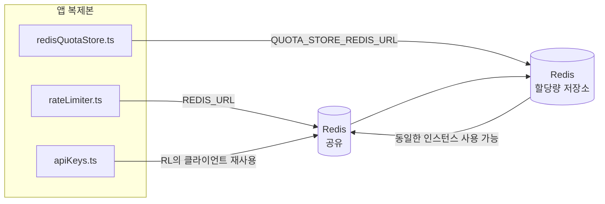

# Redis Production Configuration Guide (한국어)

🌐 **Languages:** 🇺🇸 [English](../../../../ops/REDIS_PRODUCTION_CONFIG.md) · 🇪🇹 [am](../../../am/docs/ops/REDIS_PRODUCTION_CONFIG.md) · 🇸🇦 [ar](../../../ar/docs/ops/REDIS_PRODUCTION_CONFIG.md) · 🇦🇿 [az](../../../az/docs/ops/REDIS_PRODUCTION_CONFIG.md) · 🇧🇬 [bg](../../../bg/docs/ops/REDIS_PRODUCTION_CONFIG.md) · 🇧🇩 [bn](../../../bn/docs/ops/REDIS_PRODUCTION_CONFIG.md) · 🇧🇦 [bs](../../../bs/docs/ops/REDIS_PRODUCTION_CONFIG.md) · 🇨🇿 [cs](../../../cs/docs/ops/REDIS_PRODUCTION_CONFIG.md) · 🇩🇰 [da](../../../da/docs/ops/REDIS_PRODUCTION_CONFIG.md) · 🇩🇪 [de](../../../de/docs/ops/REDIS_PRODUCTION_CONFIG.md) · 🇬🇷 [el](../../../el/docs/ops/REDIS_PRODUCTION_CONFIG.md) · 🇪🇸 [es](../../../es/docs/ops/REDIS_PRODUCTION_CONFIG.md) · 🇪🇪 [et](../../../et/docs/ops/REDIS_PRODUCTION_CONFIG.md) · 🇮🇷 [fa](../../../fa/docs/ops/REDIS_PRODUCTION_CONFIG.md) · 🇫🇮 [fi](../../../fi/docs/ops/REDIS_PRODUCTION_CONFIG.md) · 🇫🇷 [fr](../../../fr/docs/ops/REDIS_PRODUCTION_CONFIG.md) · 🇮🇪 [ga](../../../ga/docs/ops/REDIS_PRODUCTION_CONFIG.md) · 🇮🇳 [gu](../../../gu/docs/ops/REDIS_PRODUCTION_CONFIG.md) · 🇳🇬 [ha](../../../ha/docs/ops/REDIS_PRODUCTION_CONFIG.md) · 🇮🇱 [he](../../../he/docs/ops/REDIS_PRODUCTION_CONFIG.md) · 🇮🇳 [hi](../../../hi/docs/ops/REDIS_PRODUCTION_CONFIG.md) · 🇭🇷 [hr](../../../hr/docs/ops/REDIS_PRODUCTION_CONFIG.md) · 🇭🇺 [hu](../../../hu/docs/ops/REDIS_PRODUCTION_CONFIG.md) · 🇦🇲 [hy](../../../hy/docs/ops/REDIS_PRODUCTION_CONFIG.md) · 🇮🇩 [id](../../../id/docs/ops/REDIS_PRODUCTION_CONFIG.md) · 🇳🇬 [ig](../../../ig/docs/ops/REDIS_PRODUCTION_CONFIG.md) · 🇮🇹 [it](../../../it/docs/ops/REDIS_PRODUCTION_CONFIG.md) · 🇯🇵 [ja](../../../ja/docs/ops/REDIS_PRODUCTION_CONFIG.md) · 🇬🇪 [ka](../../../ka/docs/ops/REDIS_PRODUCTION_CONFIG.md) · 🇰🇭 [km](../../../km/docs/ops/REDIS_PRODUCTION_CONFIG.md) · 🇮🇳 [kn](../../../kn/docs/ops/REDIS_PRODUCTION_CONFIG.md) · 🇱🇹 [lt](../../../lt/docs/ops/REDIS_PRODUCTION_CONFIG.md) · 🇱🇻 [lv](../../../lv/docs/ops/REDIS_PRODUCTION_CONFIG.md) · 🇮🇳 [ml](../../../ml/docs/ops/REDIS_PRODUCTION_CONFIG.md) · 🇮🇳 [mr](../../../mr/docs/ops/REDIS_PRODUCTION_CONFIG.md) · 🇲🇾 [ms](../../../ms/docs/ops/REDIS_PRODUCTION_CONFIG.md) · 🇲🇹 [mt](../../../mt/docs/ops/REDIS_PRODUCTION_CONFIG.md) · 🇲🇲 [my](../../../my/docs/ops/REDIS_PRODUCTION_CONFIG.md) · 🇳🇵 [ne](../../../ne/docs/ops/REDIS_PRODUCTION_CONFIG.md) · 🇳🇱 [nl](../../../nl/docs/ops/REDIS_PRODUCTION_CONFIG.md) · 🇳🇴 [no](../../../no/docs/ops/REDIS_PRODUCTION_CONFIG.md) · 🇮🇳 [or](../../../or/docs/ops/REDIS_PRODUCTION_CONFIG.md) · 🇮🇳 [pa](../../../pa/docs/ops/REDIS_PRODUCTION_CONFIG.md) · 🇵🇭 [phi](../../../phi/docs/ops/REDIS_PRODUCTION_CONFIG.md) · 🇵🇱 [pl](../../../pl/docs/ops/REDIS_PRODUCTION_CONFIG.md) · 🇵🇹 [pt](../../../pt/docs/ops/REDIS_PRODUCTION_CONFIG.md) · 🇧🇷 [pt-BR](../../../pt-BR/docs/ops/REDIS_PRODUCTION_CONFIG.md) · 🇷🇴 [ro](../../../ro/docs/ops/REDIS_PRODUCTION_CONFIG.md) · 🇷🇺 [ru](../../../ru/docs/ops/REDIS_PRODUCTION_CONFIG.md) · 🇱🇰 [si](../../../si/docs/ops/REDIS_PRODUCTION_CONFIG.md) · 🇸🇰 [sk](../../../sk/docs/ops/REDIS_PRODUCTION_CONFIG.md) · 🇸🇮 [sl](../../../sl/docs/ops/REDIS_PRODUCTION_CONFIG.md) · 🇷🇸 [sr](../../../sr/docs/ops/REDIS_PRODUCTION_CONFIG.md) · 🇸🇪 [sv](../../../sv/docs/ops/REDIS_PRODUCTION_CONFIG.md) · 🇰🇪 [sw](../../../sw/docs/ops/REDIS_PRODUCTION_CONFIG.md) · 🇮🇳 [ta](../../../ta/docs/ops/REDIS_PRODUCTION_CONFIG.md) · 🇮🇳 [te](../../../te/docs/ops/REDIS_PRODUCTION_CONFIG.md) · 🇹🇭 [th](../../../th/docs/ops/REDIS_PRODUCTION_CONFIG.md) · 🇹🇷 [tr](../../../tr/docs/ops/REDIS_PRODUCTION_CONFIG.md) · 🇺🇦 [uk-UA](../../../uk-UA/docs/ops/REDIS_PRODUCTION_CONFIG.md) · 🇵🇰 [ur](../../../ur/docs/ops/REDIS_PRODUCTION_CONFIG.md) · 🇺🇿 [uz](../../../uz/docs/ops/REDIS_PRODUCTION_CONFIG.md) · 🇻🇳 [vi](../../../vi/docs/ops/REDIS_PRODUCTION_CONFIG.md) · 🇳🇬 [yo](../../../yo/docs/ops/REDIS_PRODUCTION_CONFIG.md) · 🇨🇳 [zh-CN](../../../zh-CN/docs/ops/REDIS_PRODUCTION_CONFIG.md) · 🇹🇼 [zh-TW](../../../zh-TW/docs/ops/REDIS_PRODUCTION_CONFIG.md)

---

## 개요

Redis 는 **선택적, 소프트 종속성** OmniRoute — 에서는 Redis 사용할 수 없을 때 애플리케이션의 성능이 정상적으로 저하됩니다(인메모리 폴백). 프로덕션에서 Redis 조정하면 네 가지 고유한 워크로드에 대한 대기 시간이 줄어듭니다.

| 작업량           | 운전사                        | 클라이언트 공장                               | 주요 패턴                                |
| ---------------- | ----------------------------- | --------------------------------------------- | ---------------------------------------- |
| 비율 제한        | `rateLimiter.ts`              | `getRedisClient()` — 게으른 `ioredis` 싱글톤  | `<prefix>rl:*` Lua-atomic 속도 제한 창   |
| 인증 캐시        | `apiKeys.ts`                  | `rateLimiter` 의 클라이언트를 재사용합니다.   | `<prefix>auth:api_key:<sha256>` 와 TTL   |
| 할당량 저장소    | `redisQuotaStore.ts`          | 별도의 `getRedisClient(url)` 싱글톤           | 인스턴스별로 `<prefix>quota:*` 구성 가능 |
| 예열 회로 차단기 | `redisCircuitBreakerStore.ts` | `circuitBreakerFactory.ts` 의 별도 클라이언트 | `<prefix>warmup:cb:<connectionId>`       |

4개의 워크로드는 모두 하나의 네임스페이스 접두사를 공유하므로 OmniRoute 단일 Redis 인스턴스(예: `127.0.0.1:6379`)에서 다른 앱과 공존할 수 있습니다. [키 네임스페이스를](#key-namespacing) 참조하세요.

---

## 현재 구성(코드 기본값)

| 환경                                | 값                                              | 어디                                                                                  |
| ----------------------------------- | ----------------------------------------------- | ------------------------------------------------------------------------------------- |
| `REDIS_URL` 환경 변수               | `redis://redis:6379` (작성), 선택 사항          | `rateLimiter.ts:5`, `.env.example`                                                    |
| `REDIS_KEY_PREFIX` 환경 변수        | `omniroute:` (기본값)                           | `rateLimiter.ts`, `redisQuotaStore.ts`, `redisCircuitBreakerStore.ts`, `.env.example` |
| `QUOTA_STORE_REDIS_URL` 환경 변수   | 별도, `REDIS_URL` 와 다를 수 있음               | `quota/storeFactory.ts`                                                               |
| `QUOTA_STORE_DRIVER`                | `"sqlite"` (기본값), `"redis"` 옵션             | `quota/storeFactory.ts`                                                               |
| 아이오레디스 `maxRetriesPerRequest` | `3`                                             | `rateLimiter.ts` 클라이언트 생성                                                      |
| `enableReadyCheck`                  | 설정되지 않음 (ioredis 기본값: `true`)          | —                                                                                     |
| `lazyConnect`                       | 설정되지 않음 (ioredis 기본값: `false`)         | —                                                                                     |
| `retryStrategy`                     | 설정되지 않음(ioredis 기본값: 200ms 기본, 지수) | —                                                                                     |
| TLS / 비밀번호 / DB 색인            | **구성되지 않음**                               | —                                                                                     |
| 센티넬/클러스터                     | **구성되지 않음** — 독립형 단일 노드 전용       | —                                                                                     |

---

## 키 네임스페이스

OmniRoute는 호스트에서 실행되는 다른 서비스와 Redis 인스턴스를 공유합니다. 네임스페이스가 없으면 `auth:api_key:<sha256>` 또는 `rl:*` 같은 키가 동일한 Redis를 사용하는 다른 애플리케이션의 키와 충돌할 수 있습니다(이 인스턴스는 다른 서비스와 함께 `127.0.0.1:6379`에서 Redis를 실행합니다).

**모든** OmniRoute 키에 접두사를 추가하려면 `REDIS_KEY_PREFIX`를 비어 있지 않은 문자열로 설정하세요.

```bash
# .env — 모든 OmniRoute 키가 omniroute:rl:*, omniroute:auth:*, omniroute:quota:*, omniroute:warmup:cb:* 형식이 됩니다.
REDIS_KEY_PREFIX=omniroute:
```

- **기본값:** `omniroute:`(`REDIS_KEY_PREFIX`가 설정되지 않았거나 비어 있을 때 적용).
- **적용 대상:** 속도 제한기 + 인증 캐시(`keyPrefix`를 통해 공유 `ioredis` 클라이언트 사용), 할당량 저장소(`KEY_PREFIX = "${REDIS_KEY_PREFIX}quota"`), 워밍업 회로 차단기(`KEY_PREFIX = "${REDIS_KEY_PREFIX}warmup:cb:"`).
- Redis에 키가 이미 존재할 때 **접두사를 변경하면** 기존 키는 고립됩니다(TTL / LRU를 통해 만료됨). 안전하게 변경할 수 있으며 마이그레이션은 필요하지 않습니다. 단, 금지된 것으로 표시된 연결의 워밍업 회로 차단기 키는 예외입니다. 이 키는 TTL 없이 영구 저장되므로 `redis-cli --scan --pattern '<old-prefix>warmup:cb:*'`로 남은 키를 나열하고 삭제하세요.
- **ioredis `keyPrefix`**는 쓰기 시 자동으로 접두사를 추가하고 읽기 시에는 접두사를 제거하므로 애플리케이션 코드에는 접두사가 표시되지 않습니다.

---

## 권장 프로덕션 튜닝

### 1. 연결 풀/클라이언트 옵션(ioredis `Redis` 생성자)

현재 코드는 사용자 정의 옵션 없이 단일 `new Redis(url)` 생성합니다. 프로덕션 다중 복제본 배포의 경우 코드에 클라이언트 팩터리를 전달하거나 `getRedisClient()` 래핑합니다.

```typescript
const redis = new Redis(REDIS_URL, {
  maxRetriesPerRequest: null, // no retry limit; let retryStrategy decide
  enableReadyCheck: true, // verify server is ready before accepting calls
  lazyConnect: true, // don't connect on construction; wait for first call
  retryStrategy: (times) => {
    if (times > 10) return null; // give up after 10 retries → reconnect later
    return Math.min(times * 200, 5000); // 200ms, 400ms, …, 5s cap
  },
  enableAutoPipelining: true, // coalesce concurrent commands into one TCP write
  keepAlive: 10000, // TCP keep‑alive every 10s
});
```

**주요 장단점:**

- `maxRetriesPerRequest: null` + `retryStrategy` — 프로덕션에 선호되므로 일시적인 Redis 재시작으로 인해 모든 요청이 즉시 실패하지 않습니다. `checkRateLimit()` 의 메모리 내 폴백은 오류 경로를 흡수합니다.
- `lazyConnect: true` — 서버가 연결 수락을 시작하기 전에 작동 중인 Redis 에 대한 시작 종속성을 방지합니다.
- `enableAutoPipelining: true` — 는 동시 속도 제한 확인을 위한 왕복 횟수를 줄입니다. 단일 연결에서 > 50 RPS 의 이점을 누릴 수 있습니다.

### 2. Redis 서버 구성(`redis.conf`)

```
# Memory
maxmemory 80%                        # leave room for OS page cache
maxmemory-policy allkeys-lru         # evict stale auth cache entries under pressure

# Persistence (optional — OmniRoute is crash‑safe without it)
save 300 1                           # snapshot at least every 5 min if ≥1 key changed
appendonly no                        # AOF not needed; data is regeneratable
appendfsync no                       # no fsync overhead (RDB is sufficient)

# Networking
timeout 0                            # no idle disconnect
tcp-keepalive 300                    # 5 min keep‑alive
tcp-backlog 511                      # connection backlog for bursty load

# Performance
hz 10                                # default; 100 for latency‑sensitive
activedefrag yes                     # auto‑defragment when fragmentation >10%
```

**`maxmemory-policy allkeys-lru` 의 절충안:** 인증 캐시 항목은 메모리 부족으로 인해 제거될 수 있습니다. 이는 안전합니다. — `setCachedApiKey` 실수 시 항상 다시 채워지며 SQLite 폴백은 신뢰할 수 있습니다. 속도 제한기 Lua 스크립트는 설계상 수명이 짧은 작은 키를 생성합니다.

### 3. Docker 작성 설정

프로덕션 작성(`docker-compose.prod.yml`)은 `redis:8.6.2-alpine` 사용합니다. 추가하다:

```yaml
redis:
  image: redis:8.6.2-alpine
  command:
    [
      "redis-server",
      "--maxmemory",
      "512mb",
      "--maxmemory-policy",
      "allkeys-lru",
      "--activedefrag",
      "yes",
      "--save",
      "300 1",
    ]
  healthcheck:
    test: ["CMD", "redis-cli", "ping"]
    interval: 10s
    timeout: 3s
    retries: 3
    start_period: 5s
```

### 4. 다중 인스턴스/확장 고려 사항

**모든 복제본에 대한 단일 Redis** — 속도 제한기 Lua 스크립트는 신뢰할 수 있는 단일 키 공간에 의존합니다. 복제본 뒤의 여러 Redis 인스턴스는 원자성을 잃고 예산이 두 배로 늘어납니다. 모든 애플리케이션 복제본에 대해 단일 Redis (또는 장애 조치 기능이 있는 Redis Sentinel 클러스터)를 사용하십시오.

**연결 수:** 각 애플리케이션 복제본이 열립니다.**2개의 TCP 연결** Redis (속도 제한기 클라이언트 + 할당량 저장소 클라이언트)로. 10개 복제본에서는 → 20개 연결이 기본 Redis 인스턴스의 10,000개 연결 한도 내에 있습니다.

### 5. 모니터링

상태 확인 엔드포인트를 통해 노출:

```typescript
// src/app/api/monitoring/health/route.ts already calls rateLimiter functions
// Add Redis-specific checks:
//   1. PING latency via ioredis .ping()
//   2. Memory usage via INFO memory
//   3. Connection count via INFO clients
//   4. Hit rate for maxmemory-policy (evicted_keys / keyspace_hits)
```

주목해야 할 주요 지표:

- **제거된 키/초** — 지속적으로 0이 아니면 `maxmemory` 늘립니다.
- **차단된 클라이언트** 0이 아닌 — 느린 Lua 스크립트 또는 높은 경합을 나타냅니다.
- **거부된 연결** — 연결 제한에 도달했습니다. 20개 연결에서 드물다

### 6. Redis 호환 서버

여기에 사용되는 모든 서버는 Lua 스크립트를 실행해야 합니다. 속도 제한기는 하나의 `EVAL` 입니다. Lua가 없는 서버에서 `checkRateLimit()` `[RATE_LIMITER] Redis eval failed, falling back to in-memory rate limiting` 기록하고 프로세스당 개수를 계산하므로 각 복제본은 자체적으로 제한을 적용합니다. 또한 옵트인 공유 세션 선호도 저장소(`OMNIROUTE_SESSION_AFFINITY_STORE=redis`)는 `EVAL` 사용하여 핀을 읽고 업데이트합니다. Lua가 없으면 `[SESSION_AFFINITY] Redis error; falling back to SQLite.` 기록하고 각 복제본은 자체 핀을 유지합니다. 다른 워크로드는 일반 명령(`SET ... EX`, `GET`, `DEL`, `MGET`, `EXPIRE`, `INCRBYFLOAT`, 해시 및 세트)을 사용하며 의미 체계 캐시의 Redis 백엔드는 `FT.*` 명령을 보내지 않습니다.

OmniRoute 3.8.52로 테스트됨: Lua 이미지(`kividb/kividb:v1.2.0-lua`)가 포함된 KiviDB 1.2.0. 속도 제한기(카운터를 공유하는 두 번째 프로세스 포함), 인증 캐시, 할당량 저장소, 워밍업 회로 차단기, 의미론적 캐시 저장소 및 채팅 핸들러를 통한 `/v1/chat/completions` 요청은 Redis 8.10.3을 통과하는 19개 검사 중 18개를 통과했습니다. 다른 점: `INCRBYFLOAT` `0.1 + 0.2` `0.30000000000000004` 로 저장하고 여기서 Redis `0.3` ( [kividbio/kividb#387](https://github.com/kividbio/kividb/issues/387) )를 저장합니다. 할당량 저장소는 `parseFloat` 사용하여 두 숫자를 모두 구문 분석하지만 두 숫자의 마지막 숫자가 다르므로 정확히 할당량 경계에 해당하는 비교가 다르게 나올 수 있습니다. 세션 선호도 저장소는 해당 실행의 일부가 아닙니다. ( [설정](https://github.com/kividbio/kividb/blob/master/docs/integrations/omniroute.md), [결과](https://github.com/kividbio/kividb/tree/master/benchmarks/omniroute-compat) )

---

## 아키텍처 다이어그램



---

## 참고자료

| 파일                               | 목적                                                         |
| ---------------------------------- | ------------------------------------------------------------ |
| `src/shared/utils/rateLimiter.ts`  | 기본 Redis 클라이언트, Lua 속도 제한 스크립트, 인메모리 폴백 |
| `src/lib/db/apiKeys.ts`            | 인증 캐시 — Redis→SQLite 대체                                |
| `src/lib/quota/redisQuotaStore.ts` | 선택적 할당량 저장소를 위한 별도의 Redis 클라이언트          |
| `src/lib/quota/storeFactory.ts`    | `sqlite` 와 `redis` 할당량 드라이버 간 전환                  |
| `docker-compose.prod.yml`          | Redis 컨테이너 제작(이미지 `redis:8.6.2-alpine`)             |
| `.env.example`                     | Redis 환경 변수 문서                                         |
| `src/app/api/local/redis/`         | 개발 컨테이너 오케스트레이션을 위한 API 경로                 |
| `bin/cli/commands/redis.mjs`       | 개발 컨테이너 오케스트레이션을 위한 CLI 명령                 |
