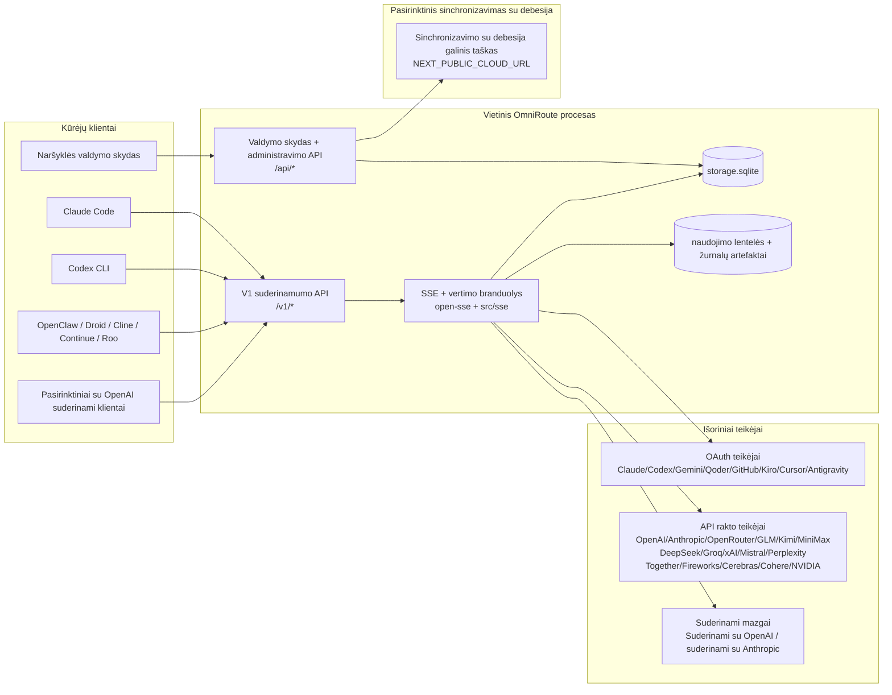
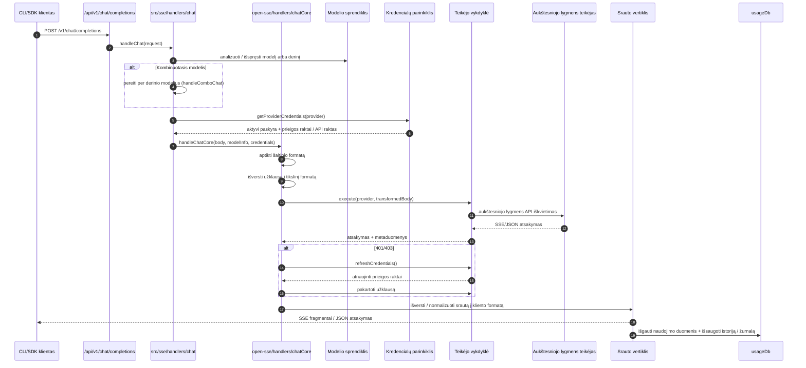
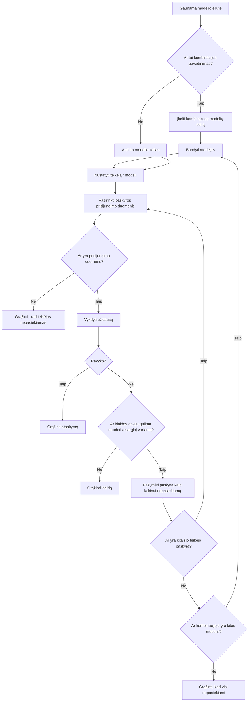
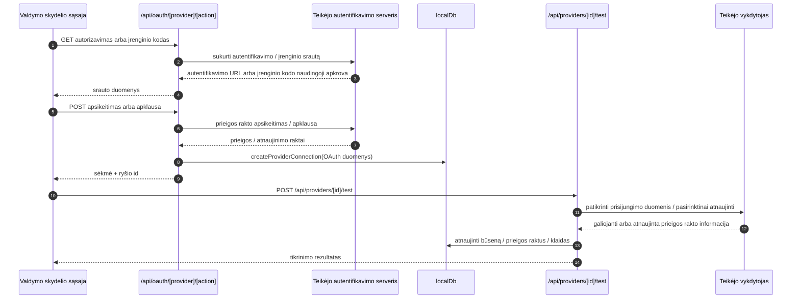
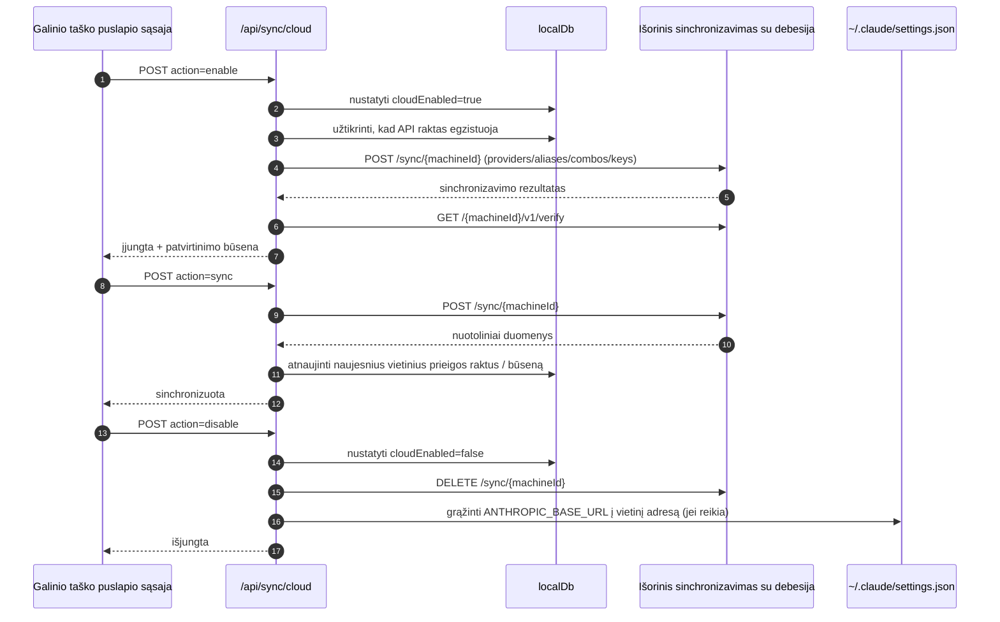
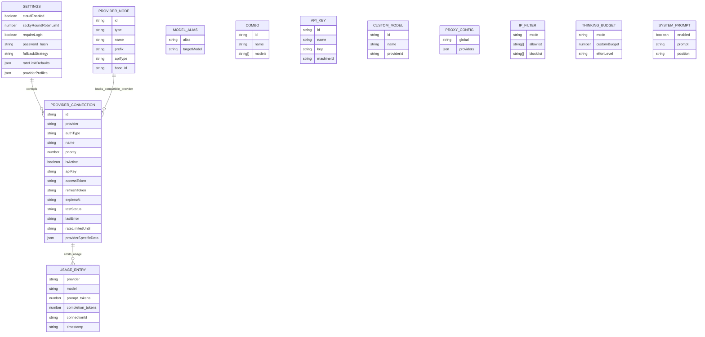
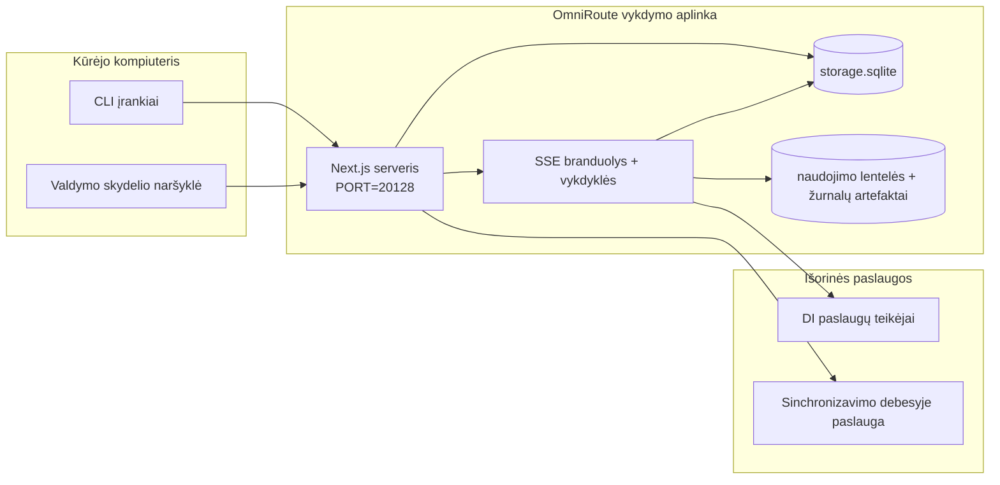

# OmniRoute Architecture (Lietuvių)

🌐 **Languages:** 🇺🇸 [English](../../../../architecture/ARCHITECTURE.md) · 🇪🇹 [am](../../../am/docs/architecture/ARCHITECTURE.md) · 🇸🇦 [ar](../../../ar/docs/architecture/ARCHITECTURE.md) · 🇦🇿 [az](../../../az/docs/architecture/ARCHITECTURE.md) · 🇧🇬 [bg](../../../bg/docs/architecture/ARCHITECTURE.md) · 🇧🇩 [bn](../../../bn/docs/architecture/ARCHITECTURE.md) · 🇧🇦 [bs](../../../bs/docs/architecture/ARCHITECTURE.md) · 🇨🇿 [cs](../../../cs/docs/architecture/ARCHITECTURE.md) · 🇩🇰 [da](../../../da/docs/architecture/ARCHITECTURE.md) · 🇩🇪 [de](../../../de/docs/architecture/ARCHITECTURE.md) · 🇬🇷 [el](../../../el/docs/architecture/ARCHITECTURE.md) · 🇪🇸 [es](../../../es/docs/architecture/ARCHITECTURE.md) · 🇪🇪 [et](../../../et/docs/architecture/ARCHITECTURE.md) · 🇮🇷 [fa](../../../fa/docs/architecture/ARCHITECTURE.md) · 🇫🇮 [fi](../../../fi/docs/architecture/ARCHITECTURE.md) · 🇫🇷 [fr](../../../fr/docs/architecture/ARCHITECTURE.md) · 🇮🇪 [ga](../../../ga/docs/architecture/ARCHITECTURE.md) · 🇮🇳 [gu](../../../gu/docs/architecture/ARCHITECTURE.md) · 🇳🇬 [ha](../../../ha/docs/architecture/ARCHITECTURE.md) · 🇮🇱 [he](../../../he/docs/architecture/ARCHITECTURE.md) · 🇮🇳 [hi](../../../hi/docs/architecture/ARCHITECTURE.md) · 🇭🇷 [hr](../../../hr/docs/architecture/ARCHITECTURE.md) · 🇭🇺 [hu](../../../hu/docs/architecture/ARCHITECTURE.md) · 🇦🇲 [hy](../../../hy/docs/architecture/ARCHITECTURE.md) · 🇮🇩 [id](../../../id/docs/architecture/ARCHITECTURE.md) · 🇳🇬 [ig](../../../ig/docs/architecture/ARCHITECTURE.md) · 🇮🇹 [it](../../../it/docs/architecture/ARCHITECTURE.md) · 🇯🇵 [ja](../../../ja/docs/architecture/ARCHITECTURE.md) · 🇬🇪 [ka](../../../ka/docs/architecture/ARCHITECTURE.md) · 🇰🇭 [km](../../../km/docs/architecture/ARCHITECTURE.md) · 🇮🇳 [kn](../../../kn/docs/architecture/ARCHITECTURE.md) · 🇰🇷 [ko](../../../ko/docs/architecture/ARCHITECTURE.md) · 🇱🇻 [lv](../../../lv/docs/architecture/ARCHITECTURE.md) · 🇮🇳 [ml](../../../ml/docs/architecture/ARCHITECTURE.md) · 🇮🇳 [mr](../../../mr/docs/architecture/ARCHITECTURE.md) · 🇲🇾 [ms](../../../ms/docs/architecture/ARCHITECTURE.md) · 🇲🇹 [mt](../../../mt/docs/architecture/ARCHITECTURE.md) · 🇲🇲 [my](../../../my/docs/architecture/ARCHITECTURE.md) · 🇳🇵 [ne](../../../ne/docs/architecture/ARCHITECTURE.md) · 🇳🇱 [nl](../../../nl/docs/architecture/ARCHITECTURE.md) · 🇳🇴 [no](../../../no/docs/architecture/ARCHITECTURE.md) · 🇮🇳 [or](../../../or/docs/architecture/ARCHITECTURE.md) · 🇮🇳 [pa](../../../pa/docs/architecture/ARCHITECTURE.md) · 🇵🇭 [phi](../../../phi/docs/architecture/ARCHITECTURE.md) · 🇵🇱 [pl](../../../pl/docs/architecture/ARCHITECTURE.md) · 🇵🇹 [pt](../../../pt/docs/architecture/ARCHITECTURE.md) · 🇧🇷 [pt-BR](../../../pt-BR/docs/architecture/ARCHITECTURE.md) · 🇷🇴 [ro](../../../ro/docs/architecture/ARCHITECTURE.md) · 🇷🇺 [ru](../../../ru/docs/architecture/ARCHITECTURE.md) · 🇱🇰 [si](../../../si/docs/architecture/ARCHITECTURE.md) · 🇸🇰 [sk](../../../sk/docs/architecture/ARCHITECTURE.md) · 🇸🇮 [sl](../../../sl/docs/architecture/ARCHITECTURE.md) · 🇷🇸 [sr](../../../sr/docs/architecture/ARCHITECTURE.md) · 🇸🇪 [sv](../../../sv/docs/architecture/ARCHITECTURE.md) · 🇰🇪 [sw](../../../sw/docs/architecture/ARCHITECTURE.md) · 🇮🇳 [ta](../../../ta/docs/architecture/ARCHITECTURE.md) · 🇮🇳 [te](../../../te/docs/architecture/ARCHITECTURE.md) · 🇹🇭 [th](../../../th/docs/architecture/ARCHITECTURE.md) · 🇹🇷 [tr](../../../tr/docs/architecture/ARCHITECTURE.md) · 🇺🇦 [uk-UA](../../../uk-UA/docs/architecture/ARCHITECTURE.md) · 🇵🇰 [ur](../../../ur/docs/architecture/ARCHITECTURE.md) · 🇺🇿 [uz](../../../uz/docs/architecture/ARCHITECTURE.md) · 🇻🇳 [vi](../../../vi/docs/architecture/ARCHITECTURE.md) · 🇳🇬 [yo](../../../yo/docs/architecture/ARCHITECTURE.md) · 🇨🇳 [zh-CN](../../../zh-CN/docs/architecture/ARCHITECTURE.md) · 🇹🇼 [zh-TW](../../../zh-TW/docs/architecture/ARCHITECTURE.md)

---

🌐 **Languages:** 🇺🇸 [English](../../../../architecture/ARCHITECTURE.md) · 🇪🇹 [am](../../../am/docs/architecture/ARCHITECTURE.md) · 🇸🇦 [ar](../../../ar/docs/architecture/ARCHITECTURE.md) · 🇦🇿 [az](../../../az/docs/architecture/ARCHITECTURE.md) · 🇧🇬 [bg](../../../bg/docs/architecture/ARCHITECTURE.md) · 🇧🇩 [bn](../../../bn/docs/architecture/ARCHITECTURE.md) · 🇧🇦 [bs](../../../bs/docs/architecture/ARCHITECTURE.md) · 🇨🇿 [cs](../../../cs/docs/architecture/ARCHITECTURE.md) · 🇩🇰 [da](../../../da/docs/architecture/ARCHITECTURE.md) · 🇩🇪 [de](../../../de/docs/architecture/ARCHITECTURE.md) · 🇬🇷 [el](../../../el/docs/architecture/ARCHITECTURE.md) · 🇪🇸 [es](../../../es/docs/architecture/ARCHITECTURE.md) · 🇪🇪 [et](../../../et/docs/architecture/ARCHITECTURE.md) · 🇮🇷 [fa](../../../fa/docs/architecture/ARCHITECTURE.md) · 🇫🇮 [fi](../../../fi/docs/architecture/ARCHITECTURE.md) · 🇫🇷 [fr](../../../fr/docs/architecture/ARCHITECTURE.md) · 🇮🇪 [ga](../../../ga/docs/architecture/ARCHITECTURE.md) · 🇮🇳 [gu](../../../gu/docs/architecture/ARCHITECTURE.md) · 🇳🇬 [ha](../../../ha/docs/architecture/ARCHITECTURE.md) · 🇮🇱 [he](../../../he/docs/architecture/ARCHITECTURE.md) · 🇮🇳 [hi](../../../hi/docs/architecture/ARCHITECTURE.md) · 🇭🇷 [hr](../../../hr/docs/architecture/ARCHITECTURE.md) · 🇭🇺 [hu](../../../hu/docs/architecture/ARCHITECTURE.md) · 🇦🇲 [hy](../../../hy/docs/architecture/ARCHITECTURE.md) · 🇮🇩 [id](../../../id/docs/architecture/ARCHITECTURE.md) · 🇳🇬 [ig](../../../ig/docs/architecture/ARCHITECTURE.md) · 🇮🇹 [it](../../../it/docs/architecture/ARCHITECTURE.md) · 🇯🇵 [ja](../../../ja/docs/architecture/ARCHITECTURE.md) · 🇬🇪 [ka](../../../ka/docs/architecture/ARCHITECTURE.md) · 🇰🇭 [km](../../../km/docs/architecture/ARCHITECTURE.md) · 🇮🇳 [kn](../../../kn/docs/architecture/ARCHITECTURE.md) · 🇰🇷 [ko](../../../ko/docs/architecture/ARCHITECTURE.md) · 🇱🇻 [lv](../../../lv/docs/architecture/ARCHITECTURE.md) · 🇮🇳 [ml](../../../ml/docs/architecture/ARCHITECTURE.md) · 🇮🇳 [mr](../../../mr/docs/architecture/ARCHITECTURE.md) · 🇲🇾 [ms](../../../ms/docs/architecture/ARCHITECTURE.md) · 🇲🇹 [mt](../../../mt/docs/architecture/ARCHITECTURE.md) · 🇲🇲 [my](../../../my/docs/architecture/ARCHITECTURE.md) · 🇳🇵 [ne](../../../ne/docs/architecture/ARCHITECTURE.md) · 🇳🇱 [nl](../../../nl/docs/architecture/ARCHITECTURE.md) · 🇳🇴 [no](../../../no/docs/architecture/ARCHITECTURE.md) · 🇮🇳 [or](../../../or/docs/architecture/ARCHITECTURE.md) · 🇮🇳 [pa](../../../pa/docs/architecture/ARCHITECTURE.md) · 🇵🇭 [phi](../../../phi/docs/architecture/ARCHITECTURE.md) · 🇵🇱 [pl](../../../pl/docs/architecture/ARCHITECTURE.md) · 🇵🇹 [pt](../../../pt/docs/architecture/ARCHITECTURE.md) · 🇧🇷 [pt-BR](../../../pt-BR/docs/architecture/ARCHITECTURE.md) · 🇷🇴 [ro](../../../ro/docs/architecture/ARCHITECTURE.md) · 🇷🇺 [ru](../../../ru/docs/architecture/ARCHITECTURE.md) · 🇱🇰 [si](../../../si/docs/architecture/ARCHITECTURE.md) · 🇸🇰 [sk](../../../sk/docs/architecture/ARCHITECTURE.md) · 🇸🇮 [sl](../../../sl/docs/architecture/ARCHITECTURE.md) · 🇷🇸 [sr](../../../sr/docs/architecture/ARCHITECTURE.md) · 🇸🇪 [sv](../../../sv/docs/architecture/ARCHITECTURE.md) · 🇰🇪 [sw](../../../sw/docs/architecture/ARCHITECTURE.md) · 🇮🇳 [ta](../../../ta/docs/architecture/ARCHITECTURE.md) · 🇮🇳 [te](../../../te/docs/architecture/ARCHITECTURE.md) · 🇹🇭 [th](../../../th/docs/architecture/ARCHITECTURE.md) · 🇹🇷 [tr](../../../tr/docs/architecture/ARCHITECTURE.md) · 🇺🇦 [uk-UA](../../../uk-UA/docs/architecture/ARCHITECTURE.md) · 🇵🇰 [ur](../../../ur/docs/architecture/ARCHITECTURE.md) · 🇺🇿 [uz](../../../uz/docs/architecture/ARCHITECTURE.md) · 🇻🇳 [vi](../../../vi/docs/architecture/ARCHITECTURE.md) · 🇳🇬 [yo](../../../yo/docs/architecture/ARCHITECTURE.md) · 🇨🇳 [zh-CN](../../../zh-CN/docs/architecture/ARCHITECTURE.md) · 🇹🇼 [zh-TW](../../../zh-TW/docs/architecture/ARCHITECTURE.md)

_Paskutinį kartą atnaujinta: 2026-06-28_

## Santrauka

OmniRoute yra vietinis AI maršruto parinkimo šliuzas ir prietaisų skydelis, sukurtas naudojant Next.js. Jis suteikia vieną su OpenAI suderinamą galinį tašką (`/v1/*`) ir nukreipia srautą tarp kelių tiekėjų, naudodamas vertimą, atsarginį kodą, prieigos rakto atnaujinimą ir naudojimo stebėjimą.

Pagrindinės galimybės:

- Su OpenAI suderinamas API paviršius, skirtas CLI/tools (377 teikėjai, 156 vykdymo moduliai)
- Request/response vertimas iš įvairių teikėjų formatų
- Atsarginis modelio derinys (kelių modelių seka)
- Struktūriniai kombinuoti žingsniai (`provider + model + connection`) su vykdymo laiko tvarka pagal `compositeTiers`
- Atsarginis paskyros lygis (kelios paskyros vienam teikėjui)
- Kvotos išankstinis patikrinimas ir P2C paskyros pasirinkimas pagal kvotą pagrindiniame pokalbio kelyje
- OAuth + API rakto teikėjo ryšio valdymas (27 OAuth teikėjo moduliai)
- Generavimo įterpimas per `/v1/embeddings` (18 teikėjų)
- Vaizdo generavimas per `/v1/images/generations` (10 + teikėjų, 20 + modelių)
- Garso transkripcija per `/v1/audio/transcriptions` (18 teikėjų)
- Tekstas į kalbą per `/v1/audio/speech` (24 integruoti teikėjai)
- Vaizdo įrašų generavimas per `/v1/videos/generations` (ComfyUI + SD WebUI)
- Muzikos generavimas per `/v1/music/generations` (ComfyUI)
- Interneto paieška per `/v1/search` (20 teikėjų)
- Moderavimas per `/v1/moderations`
- Reitingavimas per `/v1/rerank`
- Pagalvokite apie žymų analizavimą (`<think>...</think>`) samprotavimo modeliams
- Reagavimo dezinfekcija siekiant griežto OpenAI SDK suderinamumo
- Vaidmenų normalizavimas (kūrėjo → sistema, sistemos → vartotojas), kad būtų suderinti keli teikėjai
- Struktūrinės išvesties konvertavimas (json_schema → Gemini responseSchema)
- Vietinis teikėjų, raktų, slapyvardžių, derinių, nustatymų, kainodaros (122 DB modulių) patvarumas
- Usage/cost sekimas ir užklausų registravimas
- Pasirenkamas debesies sinchronizavimas, skirtas multi-device/state sinchronizavimui
- IP allowlist/blocklist, skirtas API prieigos kontrolei
- Mąstantis biudžeto valdymas (passthrough/auto/custom/adaptive)
- Visuotinės sistemos greitas įpurškimas
- Sesijos stebėjimas ir pirštų atspaudų ėmimas
- Patobulintas tarifų ribojimas kiekvienai paskyrai naudojant konkretaus teikėjo profilius
- Grandinės pertraukiklio modelis, užtikrinantis teikėjo atsparumą
- Apsauga nuo griaustinio su mutex užraktu
- Parašu pagrįsta užklausos dubliavimosi talpykla
- Domeno sluoksnis: išlaidų taisyklės, atsarginė politika, blokavimo politika
- Konteksto perdavimas: seanso perdavimo suvestinės, skirtos paskyros rotacijos tęstinumui
- Domeno būsenos išlikimas (SQLite įrašymo talpykla, skirta atsarginėms priemonėms, biudžetams, blokavimui, grandinės pertraukikliams)
- Centralizuoto užklausų vertinimo politikos variklis (atsarginis blokavimas → budget → )
- Prašyti telemetrijos su p50/p95/p99 delsos agregavimu
- Kombinuota tikslinė telemetrija ir istorinė kombinuota tikslinė būklė per `combo_execution_key` / `combo_step_id`
- Koreliacija ID (X-Request-Id) sekimui nuo galo iki galo
- Atitikties audito registravimas su atsisakymu pagal API raktą
- Eval LLM kokybės užtikrinimo sistema
- Sveikatos prietaisų skydelis su realaus laiko teikėjo grandinės pertraukiklio būsena
- MCP serveris (110 įrankių) su 3 pernešimais (stdio/SSE/Streamable HTTP)
- A2A serveris (JSON-RPC 2.0 + SSE) su įgūdžių ir užduočių gyvavimo ciklu
- Atminties sistema (ištraukimas, įpurškimas, iškvietimas, apibendrinimas)
- Įgūdžių sistema (registras, vykdytojas, smėlio dėžė, integruoti įgūdžiai)
- MITM tarpinis serveris su sertifikatų valdymu ir DNS tvarkymu
- Greita įpurškimo apsaugos tarpinė programinė įranga
- Greitas glaudinimo vamzdynas su „Caveman“, RTK, sudėtiniais vamzdynais, glaudinimo kombinacijomis, kalbų paketais ir analize
- ACP (Agent Communication Protocol) registras
- Moduliniai OAuth tiekėjai (22 atskiri moduliai pagal `src/lib/oauth/providers/`)
- Uninstall/full-uninstall scenarijus
- OAuth aplinkos remonto veiksmas
- WebSocket tiltas, skirtas su OpenAI suderinamiems WS klientams (`/v1/ws`)
- Sinchronizavimo prieigos rakto valdymas (issue/revoke, ETag versijos konfigūracijos paketo atsisiuntimas)
- GLM Thinking (`glmt`) pirmos klasės teikėjo iš anksto nustatytas
- Hibridinis prieigos raktų skaičiavimas (tiekėjo pusės `/messages/count_tokens` su atsarginiu įvertinimu)
- Modelio slapyvardžio automatinis sėjimas (30 + kryžminio tarpinio serverio dialekto normalizavimas paleidžiant)
- Saugus išsiunčiamas gavimas su SSRF apsauga, privatus URL blokavimas ir konfigūruojamas pakartotinis bandymas
- Atvėsus pokalbiui su konfigūruojamais `requestRetry` ir `maxRetryIntervalSec`
- Vykdymo aplinkos patvirtinimas naudojant Zod paleidžiant
- Atitikties auditas v2 su puslapiais, teikėjo CRUD įvykiais ir SSRF blokuojamu patvirtinimo registravimu

Pirminis vykdymo laikas:

- Next.js programos maršrutai pagal `src/app/api/*` įgyvendina ir prietaisų skydelio APIs, ir suderinamumo APIs
- Bendrinamas SSE/routing branduolys `src/sse/*` + `open-sse/*` tvarko teikėjo vykdymą, vertimą, srautinį perdavimą, atsarginę dalį ir naudojimą

## Etaloninės diagramos

Kanoniniai, versijomis valdomi v3.8.0 platformos Mermaid šaltiniai yra
[`docs/diagrams/`](../diagrams/README.md). Toliau orientacijai pateikiamos dvi diagramos;
likusios susietos su konkrečioms sritims skirtais vadovais.


> Šaltinis: [diagrams/request-pipeline.mmd](../diagrams/request-pipeline.mmd)


> Šaltinis: [diagrams/resilience-3layers.mmd](../diagrams/resilience-3layers.mmd) — taip pat susietas su
> [RESILIENCE_GUIDE.md](./RESILIENCE_GUIDE.md) ir `CLAUDE.md` atsparumo dokumentacija.

## Apimtis ir ribos

### Į apimtį įtraukta

- Vietinio šliuzo vykdymo aplinka
- Valdymo skydelio administravimo API
- Teikėjų autentifikavimas ir prieigos raktų atnaujinimas
- Užklausų transformavimas ir SSE srautinis perdavimas
- Vietinė būsena ir naudojimo duomenų išsaugojimas
- Pasirinktinis sinchronizavimo su debesija koordinavimas

### Į apimtį neįtraukta

- Už `NEXT_PUBLIC_CLOUD_URL` esanti debesijos paslaugos realizacija
- Teikėjo SLA / valdymo sluoksnis už vietinio proceso ribų
- Patys išoriniai CLI vykdomieji failai (Claude CLI, Codex CLI ir kt.)

## Valdymo skydelio sąsaja (dabartinė)

Pagrindiniai puslapiai, esantys `src/app/(dashboard)/dashboard/`:

- `/dashboard` — greitoji pradžia ir teikėjų apžvalga
- `/dashboard/endpoint` — galinio taško tarpinis serveris ir MCP, A2A bei API galinių taškų skirtukai
- `/dashboard/providers` — teikėjų ryšiai ir prisijungimo duomenys
- `/dashboard/combos` — derinių strategijos, šablonai, veiksmais pagrįsta kūrimo priemonė, modelių maršruto parinkimo taisyklės, rankiniu būdu išsaugoma tvarka
- `/dashboard/auto-combo` — automatinio derinių variklio vertinimo svoriai, režimų rinkiniai, virtualios gamyklos išankstinės parinktys ir telemetrija
- `/dashboard/costs` — išlaidų agregavimas ir kainodaros matomumas
- `/dashboard/analytics` — naudojimo analitika, vertinimai, derinių paskirties vietų būklė
- `/dashboard/limits` — kvotų ir užklausų dažnio valdikliai
- `/dashboard/cli-tools` — CLI pradinis parengimas, vykdymo aplinkos aptikimas, konfigūracijos generavimas
- `/dashboard/agents` — aptikti ACP agentai ir pasirinktinių agentų registravimas
- `/dashboard/cloud-agents` — debesijoje talpinamos agentų užduotys (Codex Cloud, Devin, Jules) ir užduočių gyvavimo ciklas
- `/dashboard/skills` — A2A įgūdžių registras, vykdymas izoliuotoje aplinkoje, integruotų įgūdžių katalogas
- `/dashboard/memory` — nuolatinės pokalbių atminties tikrinimas ir gavimas
- `/dashboard/webhooks` — išeinančių „webhook“ prenumeratos, paslapčių rotacija, pakartotinių bandymų statistika
- `/dashboard/batch` — paketinių užduočių pateikimas ir eiga
- `/dashboard/cache` — skaidriai skaitomos ir samprotavimo podėlių statistika, šalinimo valdikliai
- `/dashboard/playground` — interaktyvi pokalbių bandymų aplinka, skirta bet kuriam sukonfigūruotam deriniui ar modeliui
- `/dashboard/changelog` — programoje pateikiama pakeitimų žurnalo peržiūros priemonė (atvaizduoja `CHANGELOG.md`)
- `/dashboard/system` — vykdymo aplinkos diagnostika, versijos informacija, aplinkos tikrinimo sąsaja
- `/dashboard/onboarding` — pirmojo paleidimo sąrankos vediklis naujiems diegimams
- `/dashboard/media` — vaizdų, vaizdo įrašų ir muzikos bandymų aplinka
- `/dashboard/search-tools` — paieškos teikėjų testavimas ir istorija
- `/dashboard/health` — veikimo laikas, grandinės išjungikliai, užklausų dažnio apribojimai, pagal kvotas stebimos sesijos
- `/dashboard/logs` — užklausų, tarpinio serverio, audito ir konsolės žurnalai
- `/dashboard/settings` — sistemos nustatymų skirtukai (bendrieji, maršruto parinkimo, numatytųjų derinių ir kt.)
- `/dashboard/context/caveman` — Caveman glaudinimo taisyklės, kalbų paketai, peržiūra ir išvesties režimas
- `/dashboard/context/rtk` — RTK komandų išvesties filtrai, peržiūra ir vykdymo aplinkos saugos nustatymai
- `/dashboard/context/combos` — įvardyti glaudinimo konvejeriai, priskirti maršruto parinkimo deriniams
- `/dashboard/translator` — vertėjo tikrinimas ir užklausos formato konvertavimo peržiūra
- `/dashboard/audit` — atitikties audito žurnalo naršyklė su puslapių numeracija ir struktūriniais metaduomenimis
- `/dashboard/usage` — atskirų užklausų naudojimo naršyklė, susieta su `usage_history`
- `/dashboard/compression` — glaudinimo analitika, statistika ir konvejerių priskyrimas
- `/dashboard/api-manager` — API raktų gyvavimo ciklas ir modelių leidimai

UI sluoksnis: kiekvienas puslapis atvaizduojamas viename apvalkale — `src/app/(dashboard)/layout.tsx` →
`src/shared/components/layouts/DashboardLayout.tsx` → `DashboardShell.tsx` (rinkinio
`SidebarProvider`/`SidebarInset`, OmniRoute `Sidebar.tsx` ir `Header.tsx`). Puslapiai importuoja savo
kūrimo blokus iš `@/shared/components` (adapteriai, naudojami virš projekte pateikto Keak CI UI Kit,
esančio `packages/ui-kit`) arba iš rinkinio komponentų vidinių kelių (`@omniroute/ui-kit/table`, `…/page-header`), o
piktogramas — per `<Icon>` (`ICON_MAP` → Lucide). Tema (numatytoji — `system`, šviesi / tamsi) ir dizaino kintamieji gaunami
iš rinkinio per susiejimo sluoksnį faile `src/app/globals.css`. Išsami informacija: `docs/architecture/DESIGN_SYSTEM.md`.

## Aukšto lygio sistemos kontekstas



## Pagrindiniai vykdymo aplinkos komponentai

## 1) API ir maršruto parinkimo sluoksnis (Next.js programos maršrutai)

Pagrindiniai katalogai:

- `src/app/api/v1/*` ir `src/app/api/v1beta/*`, skirti suderinamumo API
- `src/app/api/*`, skirti administravimo ir konfigūravimo API
- Next perrašymo taisyklės faile `next.config.mjs` susieja `/v1/*` su `/api/v1/*`

Svarbūs suderinamumo maršrutai:

- `src/app/api/v1/chat/completions/route.ts`
- `src/app/api/v1/messages/route.ts`
- `src/app/api/v1/responses/route.ts`
- `src/app/api/v1/models/route.ts` — apima pasirinktinius modelius su `custom: true`
- `src/app/api/v1/embeddings/route.ts` — vektorinių reprezentacijų generavimas (6 teikėjai)
- `src/app/api/v1/images/generations/route.ts` — vaizdų generavimas (4 ar daugiau teikėjų, įskaitant Antigravity/Nebius)
- `src/app/api/v1/messages/count_tokens/route.ts`
- `src/app/api/v1/providers/[provider]/chat/completions/route.ts` — atskiras kiekvieno teikėjo pokalbių maršrutas
- `src/app/api/v1/providers/[provider]/embeddings/route.ts` — atskiras kiekvieno teikėjo vektorinių reprezentacijų maršrutas
- `src/app/api/v1/providers/[provider]/images/generations/route.ts` — atskiras kiekvieno teikėjo vaizdų maršrutas
- `src/app/api/v1beta/models/route.ts`
- `src/app/api/v1beta/models/[...path]/route.ts`

Administravimo sritys:

- Autentifikavimas / nustatymai: `src/app/api/auth/*`, `src/app/api/settings/*`
- Teikėjai / ryšiai: `src/app/api/providers*`
- Teikėjų mazgai: `src/app/api/provider-nodes*`
- Pasirinktiniai modeliai: `src/app/api/provider-models` (GET/POST/DELETE)
- Modelių katalogas: `src/app/api/models/route.ts` (GET)
- Įgaliotojo serverio konfigūracija: `src/app/api/settings/proxy` (GET/PUT/DELETE) + `src/app/api/settings/proxy/test` (POST)
- OAuth: `src/app/api/oauth/*`
- Raktai / alternatyvūs vardai / deriniai / kainodara: `src/app/api/keys*`, `src/app/api/models/alias`, `src/app/api/combos*`, `src/app/api/pricing`
- Naudojimas: `src/app/api/usage/*`
- Sinchronizavimas / debesija: `src/app/api/sync/*`, `src/app/api/cloud/*`
- CLI įrankių pagalbinės priemonės: `src/app/api/cli-tools/*`
- IP filtras: `src/app/api/settings/ip-filter` (GET/PUT)
- Samprotavimo biudžetas: `src/app/api/settings/thinking-budget` (GET/PUT)
- Sistemos raginimas: `src/app/api/settings/system-prompt` (GET/PUT)
- Glaudinimas: `src/app/api/settings/compression`, `src/app/api/compression/*` ir
  `src/app/api/context/*`
- Seansai: `src/app/api/sessions` (GET)
- Užklausų dažnio apribojimai: `src/app/api/rate-limits` (GET)
- Atsparumas: `src/app/api/resilience` (GET/PATCH) — užklausų eilė, ryšio atvėsimo laikotarpis, teikėjo grandinės pertraukiklis, laukimo, kol baigsis atvėsimo laikotarpis, konfigūracija
- Atsparumo būsenos atkūrimas: `src/app/api/resilience/reset` (POST) — iš naujo nustato teikėjų grandinės pertraukiklius
- Podėlio statistika: `src/app/api/cache/stats` (GET/DELETE)
- Telemetrija: `src/app/api/telemetry/summary` (GET)
- Biudžetas: `src/app/api/usage/budget` (GET/POST)
- Atsarginių variantų grandinės: `src/app/api/fallback/chains` (GET/POST/DELETE)
- Atitikties auditas: `src/app/api/compliance/audit-log` (GET, su puslapiavimu ir struktūrizuotais metaduomenimis)
- Vertinimai: `src/app/api/evals` (GET/POST), `src/app/api/evals/[suiteId]` (GET)
- Strategijos: `src/app/api/policies` (GET/POST)
- Sinchronizavimo prieigos raktai: `src/app/api/sync/tokens` (GET/POST), `src/app/api/sync/tokens/[id]` (GET/DELETE)
- Konfigūracijos paketas: `src/app/api/sync/bundle` (GET, pagal ETag versijuojama nustatymų, teikėjų, derinių ir raktų momentinė kopija)
- WebSocket: `src/app/api/v1/ws/route.ts` — Upgrade apdorojimo priemonė su OpenAI suderinamiems WS klientams

## 2) SSE + vertimo branduolys

Pagrindinio srauto moduliai:

- Įėjimo taškas: `src/sse/handlers/chat.ts`
- Pagrindinis orkestravimas: `open-sse/handlers/chatCore.ts`
- Teikėjų vykdymo adapteriai: `open-sse/executors/*`
- Formato aptikimas / teikėjo konfigūracija: `open-sse/services/provider.ts`
- Modelio analizavimas / nustatymas: `src/sse/services/model.ts`, `open-sse/services/model.ts`
- Paskyros atsarginio parinkimo logika: `open-sse/services/accountFallback.ts`
- Vertimų registras: `open-sse/translator/index.ts`
- Srauto transformacijos: `open-sse/utils/stream.ts`, `open-sse/utils/streamHandler.ts`
- Naudojimo duomenų išgavimas / normalizavimas: `open-sse/utils/usageTracking.ts`
- „Think“ žymų analizatorius: `open-sse/utils/thinkTagParser.ts`
- Įterpinių apdorojimo programa: `open-sse/handlers/embeddings.ts`
- Įterpinių teikėjų registras: `open-sse/config/embeddingRegistry.ts`
- Vaizdų generavimo apdorojimo programa: `open-sse/handlers/imageGeneration.ts`
- Vaizdų teikėjų registras: `open-sse/config/imageRegistry.ts`
- Atsakymų išvalymas: `open-sse/handlers/responseSanitizer.ts`
- Vaidmenų normalizavimas: `open-sse/services/roleNormalizer.ts`

Paslaugos (verslo logika):

- Paskyrų parinkimas / vertinimas: `open-sse/services/accountSelector.ts`
- Konteksto gyvavimo ciklo valdymas: `open-sse/services/contextManager.ts`
- IP filtro taikymas: `open-sse/services/ipFilter.ts`
- Seansų stebėjimas: `open-sse/services/sessionManager.ts`
- Užklausų dubliavimosi šalinimas: `open-sse/services/signatureCache.ts`
- Sisteminės instrukcijos įterpimas: `open-sse/services/systemPrompt.ts`
- Mąstymo biudžeto valdymas: `open-sse/services/thinkingBudget.ts`
- Modelių nukreipimas pagal pakaitos simbolius: `open-sse/services/wildcardRouter.ts`
- Užklausų dažnio ribojimo valdymas: `open-sse/services/rateLimitManager.ts`
- Grandinės pertraukiklis: `src/shared/utils/circuitBreaker.ts`
- Konteksto perdavimas: `open-sse/services/contextHandoff.ts` — perdavimo santraukos generavimas ir įterpimas, skirtas konteksto perdavimo strategijai
- Glaudinimas: `open-sse/services/compression/*` — išankstinis glaudinimas prieš vertimą į teikėjo formatą;
  apima „Caveman“ taisykles, RTK filtrus, nuosekliąsias konvejerines grandines, glaudinimo derinius, statistiką ir tikrinimą
- „Codex“ kvotos gavimo priemonė: `open-sse/services/codexQuotaFetcher.ts` — gauna „Codex“ kvotą konteksto perdavimo sprendimams priimti
- Pakartotiniai bandymai atsižvelgiant į atvėsimo laikotarpį: `src/sse/services/cooldownAwareRetry.ts` — kiekvienam modeliui skirti pakartotiniai bandymai po atvėsimo laikotarpio su konfigūruojamais `requestRetry` / `maxRetryIntervalSec`
- Saugus išeinantis duomenų gavimas: `src/shared/network/safeOutboundFetch.ts` — apsaugotas teikėjo / modelio duomenų gavimas su SSRF apsauga, privačių URL blokavimu, pakartotiniais bandymais ir skirtuoju laiku
- Išeinančių URL apsauga: `src/shared/network/outboundUrlGuard.ts` — teikėjų URL pagrindinių kompiuterių patikros; `src/shared/network/outboundUrlGuardPolicy.ts` parenka režimą pagal `OMNIROUTE_ALLOW_LOCAL_PROVIDER_URLS`, `OMNIROUTE_ALLOW_PRIVATE_PROVIDER_URLS` ir atitinkamus jų valdymo skydelio perjungiklius (žr. `docs/reference/ENVIRONMENT.md`)
- Numatytosios teikėjo užklausų reikšmės: `open-sse/services/providerRequestDefaults.ts` — teikėjo lygmens numatytosios `maxTokens`, `temperature`, `thinkingBudgetTokens` reikšmės
- GLM teikėjo konstantos: `open-sse/config/glmProvider.ts` — bendrinami GLM modeliai, kvotų URL, GLMT skirtasis laikas / numatytosios reikšmės
- „Antigravity“ pirminė tarnyba: `open-sse/config/antigravityUpstream.ts` — bazinio URL ir aptikimo kelio konstantos
- „Codex“ kliento konstantos: `open-sse/config/codexClient.ts` — versijuotos naudotojo agento ir kliento versijos reikšmės
- Modelių alternatyviųjų pavadinimų pradiniai duomenys: `src/lib/modelAliasSeed.ts` — paleidimo metu užpildo daugiau kaip 30 skirtingų tarpinių serverių dialektų alternatyviųjų pavadinimų

Domeno sluoksnio moduliai:

- Sąnaudų taisyklės / biudžetai: `src/domain/costRules.ts`
- Atsarginio parinkimo politika: `src/domain/fallbackPolicy.ts`
- Derinių sprendimo priemonė: `src/domain/comboResolver.ts`
- Blokavimo politika: `src/domain/lockoutPolicy.ts`
- Politikos variklis: `src/domain/policyEngine.ts` — centralizuotas blokavimo → biudžeto → atsarginio parinkimo vertinimas
- Klaidų kodų katalogas: `src/shared/constants/errorCodes.ts`
- Užklausos ID: `src/shared/utils/requestId.ts`
- Duomenų gavimo skirtasis laikas: `src/shared/utils/fetchTimeout.ts`
- Užklausų telemetrija: `src/shared/utils/requestTelemetry.ts`
- Atitiktis / auditas: `src/lib/compliance/index.ts`
- Vertinimų vykdymo priemonė: `src/lib/evals/evalRunner.ts`
- Domeno būsenos išlaikymas: `src/lib/db/domainState.ts` — SQLite CRUD operacijos, skirtos atsarginio parinkimo grandinėms, biudžetams, sąnaudų istorijai, blokavimo būsenai ir grandinės pertraukikliams

OAuth teikėjų moduliai (27 atskiri failai kataloge `src/lib/oauth/providers/`):

- Registro rodyklė: `src/lib/oauth/providers/index.ts`
- Atskiri teikėjai: `agy.ts`, `antigravity.ts`, `claude.ts`, `cline.ts`, `codebuddy-cn.ts`, `codebuddy-intl.ts`, `codex.ts`, `cursor.ts`, `devin-desktop.ts`, `ghe-copilot.ts`, `github.ts`, `gitlab-duo.ts`, `grok-cli-oauth.ts`, `grok-cli.ts`, `kilocode.ts`, `kimi-coding.ts`, `kiro.ts`, `muse-code.ts`, `openference.ts`, `qoder.ts`, `trae.ts`, `workbuddy.ts`, `xai-oauth.ts`, `zed-hosted.ts`, `zed.ts`
- Bendrinamos pagalbinės priemonės: `codebuddyDeviceAuth.ts` („CodeBuddy“ CN / tarptautinis įrenginio srautas), `museCodeDeviceResponse.ts`
- Plonas apvalkalas: `src/lib/oauth/providers.ts` — pakartotinai eksportuoja iš atskirų modulių

## 5) Įterptosios paslaugos (v3.8.4)

OmniRoute gali įdiegti, prižiūrėti ir nukreipti užklausas į vietoje veikiančius DI įrankių procesus,
vadinamus **įterptosiomis paslaugomis**. Pateikiamos penkios: 9Router, CLIProxyAPI, Bifrost, Mux ir Dario.

Architektūros sluoksniai:

- **Naudotojo sąsaja** (`/dashboard/providers/services`) — dviejų skirtukų puslapis su gyvavimo ciklo valdikliais,
  tiesioginiu žurnalų srautiniu perdavimu, API raktų valdymu ir (9Router atveju) įterptąja savąja naudotojo sąsaja,
  pasiekiama per vidinį atvirkštinį tarpinį serverį.
- **API** (`/api/services/{name}/*`) — 11 galinių taškų, skirtų 9Router, 10 — CLIProxyAPI, po 8 — Bifrost / Mux / Dario;
  visi jie klasifikuojami kaip **LOCAL_ONLY** (griežta taisyklė #17). Bendras `GET /api/services/[name]/logs`
  SSE galinis taškas aptarnauja abi paslaugas.
- **Prižiūrėtojas** (`src/lib/services/`) — bendroji `ServiceSupervisor` klasė apgaubia
  `child_process.spawn`, naudoja 5 MB žiedinį buferį SSE žurnalų srautiniam perdavimui, vykdo sveikatos
  patikros ciklą, turi atominį operacijų užraktą ir atlieka sklandų išjungimą SIGTERM→SIGKILL būdu.
  `bootstrap.ts` proceso paleidimo metu susieja visas sukonfigūruotas paslaugas.
- **Teikėjas / vykdytojas** (`open-sse/executors/ninerouter.ts`) — 9Router pateikiamas kaip
  tikras teikėjas. Modeliams pridedamas priešdėlis `9router/{sub}/{model}`, o jie kas 5 min.
  sinchronizuojami iš 9Router galinio taško `/v1/models`.

Išsamiau: `docs/frameworks/EMBEDDED-SERVICES.md`

## Pagrindiniai posistemiai (v3.8.0)

### A. Kombinuotas automatinis variklis

„Auto Combo“ dinamiškai įvertina ir parenka maršruto taikinius užklausos metu, o ne pasikliauja statiniu derinio apibrėžimu. Tai suteikia `auto/*` modelio priešdėlių šeimą.

- Variklio įvadas: `open-sse/services/autoCombo/` (`autoComboEngine.ts`, `scoringEngine.ts`, `virtualFactory.ts`, `modePacks.ts`)
- Sprendimas: `src/domain/comboResolver.ts` (automatinis `auto/` priešdėlio aptikimas)
- Prietaisų skydelis: `/dashboard/auto-combo`
- Telemetrija: `auto_combo_decisions` SQLite lentelė

Pagrindinės galimybės:

- **20 maršruto parinkimo strategijų** (prioritetinis, svertinis, užpildomas pirmiausia, apvalus, P2C, atsitiktinis, mažiausiai naudojamas, optimizuotas sąnaudoms, atpažįstamas iš naujo, nustatymo iš naujo langas, aukštis, svertinis pagal kvotą, griežtas atsitiktinis,** auto** , lkgp, optimizuotas kontekstui, optimizuotas talpyklai, konteksto perdavimas,** susiliejimas** , vamzdynas) — auto yra antraštės papildymas 3.8.0 versijoje; `fusion` (panel fan-out + teisėj synthesis, `open-sse/services/fusion.ts`) yra nauja 3.8.36 versijoje.
- **16 faktorių balas** : kvota, sveikata, atvirkštinė kaina, atvirkštinė delsa, užduoties pritaikymas ir dar dešimt. Kanoninė veiksnių lentelė ir numatytieji jų svoriai yra [`docs/routing/AUTO-COMBO.md`](../routing/AUTO-COMBO.md) — jei ją čia pakartojus, ji būtų antroje vietoje.
- **Virtuali gamykla** materializuojasi trumpalaikiai deriniai, kai nėra atitinkamo pavadinimo derinio, kandidatai tiekiami iš sveikų aktyvių paslaugų teikėjų ryšių.
- **Automatiniai priešdėliai** : `auto/coding`, `auto/cheap`, `auto/fast`, `auto/offline`, `auto/smart`, `auto/lkgp` — kiekvienas paremtas suderintu svorio profiliu.
- **6 režimų paketai** : `ship-fast`, `cost-saver`, `quality-first`, `offline-friendly`, `reliability-first` ir `chaos-mode` — iš anksto nustatytos svorio konfigūracijos, kurias galima iškviesti iš prietaisų skydelio. (Nereikia painioti su anksčiau pateiktais `auto/*` priešdėliais, kurie yra užklausos laiko variantai.)

Išsamią algoritmo informaciją (faktorių formules, svorio derinimą) rasite [`docs/routing/AUTO-COMBO.md`](../routing/AUTO-COMBO.md).

### B. Debesų agentai

„Cloud Agents“ apima trečiųjų šalių priglobtas kodų agentų platformas (Codex Cloud, Devin, Jules) pagal vienodą DB palaikomą užduočių gyvavimo ciklą. Visiems užduočių creation/inspection galutiniams taškams reikalingas valdymo autentifikavimas.

- Modulio šaknis: `src/lib/cloudAgent/` (`baseAgent.ts`, `registry.ts`, `api.ts`, `types.ts`, `db.ts`, plius kiekvieno agento pakatalogiai, esantys `agents/`)
- Įdiegimai per agentą: `agents/codex/`, `agents/devin/`, `agents/jules/`
- Viešieji galiniai taškai: `/api/v1/agents/tasks/*` (list/create/get/cancel)
- Valdymo galutiniai taškai: `/api/cloud/*` (teikimas, būsena, paketas)
- Prietaisų skydelis: `/dashboard/cloud-agents`
- Sandėliavimas: `cloud_agent_tasks` staliukas

Norėdami sužinoti apie kiekvieno agento aprūpinimą ir OAuth specifiką, žr. [`docs/frameworks/CLOUD_AGENT.md`](../frameworks/CLOUD_AGENT.md).

### C. Apsauginiai turėklai

Apsauginių turėklų modulis yra karštai įkeliamas tarpinės programinės įrangos sluoksnis, kuris tikrina užklausas ir atsakymus dėl PII, greito įpurškimo ir nesaugaus regėjimo turinio. Pažeidimai trumpai sujungia prašymą su HTTP** 503** plius struktūrinis klaidos kodas, leidžiantis tolesniems skambintojams bandyti dar kartą arba išsišakoti.

- Modulio šaknis: `src/lib/guardrails/` (`base.ts`, `registry.ts`, `piiMasker.ts`, `promptInjection.ts`, `visionBridge.ts`, `visionBridgeHelpers.ts`)
- Karštas perkrovimas: registras stebi konfigūracijos pakeitimus ir atkuria grandinę vietoje
- Prijungimo taškai: pokalbių tvarkyklės įėjimas, vaizdų generavimo tvarkyklė, atsako dezinfekavimo priemonė
- HTTP sutartis: pažeidimai matomi kaip `503` su `error.code = "GUARDRAIL_VIOLATION"`

Dėl taisyklių rinkinio kūrimo ir slenksčio derinimo žr. [`docs/security/GUARDRAILS.md`](../security/GUARDRAILS.md).

### D. Domeno sluoksnis

`src/domain/` vardų erdvė centralizuoja politikos sprendimus, todėl maršruto tvarkytojams nereikės patiems rinkti lockout/budget/fallback logikos.

- Politikos variklis: `src/domain/policyEngine.ts` — vienas įėjimo taškas, skirtas išankstiniam vykdymui įvertinti (blokavimo → biudžeto → atsarginis užsakymas)
- Išlaidų taisyklės: `src/domain/costRules.ts`
- Atsarginė politika: `src/domain/fallbackPolicy.ts`
- Lokauto politika: `src/domain/lockoutPolicy.ts`
- Žymėmis pagrįstas maršrutas: `src/domain/tagRouter.ts`
- Kombinuotas sprendimas: `src/domain/comboResolver.ts` — išsprendžia kombinuotųjų pavadinimų, auto/\* priešdėlių ir pakaitos simbolių modelio taikinius pagal konkrečius vykdymo planus
- Connection/model taisyklių stalius: `src/domain/connectionModelRules.ts`
- Modelio prieinamumo momentinės nuotraukos: `src/domain/modelAvailability.ts`
- Teikėjo galiojimo pabaigos stebėjimas: `src/domain/providerExpiration.ts`
- Kvotos talpykla: `src/domain/quotaCache.ts`
- Skilimo būsena: `src/domain/degradation.ts`
- Konfigūracijos auditas: `src/domain/configAudit.ts`
- OmniRoute atsako metaduomenų kūrimo priemonė: `src/domain/omnirouteResponseMeta.ts`
- Vertinimo posistemis: `src/domain/assessment/` — periodinio vertinimo darbai

### E. Leidimų sistema

Prieigos sistema klasifikuoja kiekvieną gaunamą užklausą ir taiko atitinkamą politikos grandinę prieš išsiuntimą.

- Dujotiekio įvadas: `src/server/authz/pipeline.ts`
- Užklausos klasifikatorius: `src/server/authz/classify.ts` — atskiria viešus suderinamumo maršrutus nuo valdymo maršrutų
- Viešo maršruto inventorius: `src/shared/constants/publicApiRoutes.ts`
- Politika: `src/server/authz/policies/` — sudaromi predikatai (`requireApiKey`, `requireManagement`, `requireFreshAuth` ir kt.)
- Antraštės komunalinės paslaugos: `src/server/authz/headers.ts`
- Tvirtinimo pagalbininkas: `src/server/authz/assertAuth.ts`
- Užklausos kontekstas: `src/server/authz/context.ts`

Viešieji ir valdymo maršrutai yra griežta riba: agent/cooldown APIs ir teikėjo mutacijos reikalauja valdymo autentifikavimo (jei jo nėra HTTP 401).

Visas maršruto klasifikavimo taisykles žr. [`docs/architecture/AUTHZ_GUIDE.md`](./AUTHZ_GUIDE.md).

### F. Darbo eigos FSM ir Task-Aware Router

Baigtinės būsenos mašina valdomas maršruto parinktuvas, sudarytas virš kombinuoto pasirinkimo, kad nukreiptų srautą pagal aptiktą darbo eigos etapą (planavimas, vykdymas, peržiūra) ir foninės užduoties giminingumą.

- Darbo eiga FSM: `open-sse/services/workflowFSM.ts`
- Užduotį suprantantis maršrutizatorius: `open-sse/services/taskAwareRouter.ts`
- Fono užduočių detektorius: `open-sse/services/backgroundTaskDetector.ts`
- Tikslų klasifikatorius: `open-sse/services/intentClassifier.ts`

FSM perėjimai įtraukiami į „Auto Combo“ balus, nukreipdami į pigesnius modelius atliekant background/automation užduotis ir į stipresnius modelius, skirtus interaktyviems planning/review posūkiams.

### G. Paslaugų teikėjui būdingas atsparumas

Keletas paslaugų teikėjų pristato specialius atsparumo ir slaptumo modulius, kurie palaiko visuotinio grandinės pertraukiklio / ryšio aušinimo / modelio blokavimo sluoksnius:

- Antigravity 429 variklis: `open-sse/services/antigravity429Engine.ts` (pasuka tapatybę, išvalo atsakymų antraštes, valdo credits/version sekimą per `antigravityCredits.ts`, `antigravityHeaderScrub.ts`, `antigravityHeaders.ts`, `antigravityIdentity.ts`, `antigravityVersion.ts`)
- Antigravity 429 apsauga: `open-sse/services/antigravity429Guard.ts` (pagal užklausą 429s biudžetas prieš srovę visuose pagrindiniuose kompiuteriuose, `ANTIGRAVITY_MAX_429_ATTEMPTS`; identiškas pakartotinis atmesto kūno siuntimas atsakomas vietoje; `src/sse/handlers/chat.ts` nepaleidžia tokios užklausos iš naujo, kai bandoma atvėsti)
- ModelScope kvotų politika: `open-sse/services/modelscopePolicy.ts`
- Claude kodas CCH (suderinamumo kanalo rankos paspaudimas): `open-sse/services/claudeCodeCCH.ts`, plius `claudeCodeCompatible.ts`, `claudeCodeConstraints.ts`, `claudeCodeExtraRemap.ts`, `claudeCodeToolRemapper.ts`
- Claude Kodo pirštų atspaudų formavimas: `open-sse/services/claudeCodeFingerprint.ts`
- Claude Kodo užmaskavimas: `open-sse/services/claudeCodeObfuscation.ts`

Išsamų slaptų veiksmų knygą ir naudojimo gaires rasite `docs/security/STEALTH_GUIDE.md` (git; nesudaryta į `/docs`).

### H. Webhooks, samprotavimo talpykla, skaitymo talpykla

- **Webhooks** — išsiuntimas provider/account/task renginiams.
  - Dispečeris: `src/lib/webhookDispatcher.ts`
  - Saugykla: `webhooks` SQLite stalas (per `src/lib/db/webhooks.ts`)
  - Prietaisų skydelis: `/dashboard/webhooks` (prenumeratos, paslaptys, pakartotinių bandymų istorija)
  - Norėdami sužinoti įvykių taksonomiją ir pakartotinio bandymo semantiką, žr. [`docs/frameworks/WEBHOOKS.md`](../frameworks/WEBHOOKS.md).
- **Samprotavimo talpykla** — atkuriami samprotavimo blokai teikėjams, kurie skleidžia mąstymo žetonus (Claude, GLMT ir kt.), todėl nuoseklūs posūkiai gali praleisti permąstymą.
  - DB sluoksnis: `src/lib/db/reasoningCache.ts`
  - Aptarnavimo sluoksnis: `open-sse/services/reasoningCache.ts`
  - Norėdami sužinoti pakartojimo semantiką, žr. [`docs/routing/REASONING_REPLAY.md`](../routing/REASONING_REPLAY.md).
- **Skaityti talpyklą** — trumpalaikė atsako talpykla, įvedama parašu ir naudojama identiškiems pakartotiniams bandymams iš sugadinto SDKs sutraukti.
  - DB sluoksnis: `src/lib/db/readCache.ts`
  - Statistikos galutinis taškas: `GET /api/cache/stats`, prietaisų skydelis prie `/dashboard/cache`

## 3) Išliekamumo sluoksnis

Pirminė būsenos DB (SQLite):

- Pagrindinė infrastruktūra: `src/lib/db/core.ts` (better-sqlite3, migracijos, WAL)
- Prieiga prie DB: tiesiogiai importuokite konkrečius `src/lib/db/*` modulius (senasis `localDb.ts` agregavimo modulis buvo pašalintas)
- failas: `${DATA_DIR}/storage.sqlite` (arba `$XDG_CONFIG_HOME/omniroute/storage.sqlite`, kai nustatyta, kitu atveju `~/.omniroute/storage.sqlite`)
- esybės (lentelės + KV vardų sritys): providerConnections, providerNodes, modelAliases, combos, apiKeys, settings, pricing, **customModels**, **proxyConfig**, **ipFilter**, **thinkingBudget**, **systemPrompt**

Naudojimo duomenų išliekamumas:

- fasadas: `src/lib/usageDb.ts` (į modulius išskaidyta `src/lib/usage/*`)
- SQLite lentelės faile `storage.sqlite`: `usage_history`, `call_logs`, `proxy_logs`
- pasirenkami failų artefaktai išlieka suderinamumui / derinimui (`${DATA_DIR}/log.txt`, `${DATA_DIR}/call_logs/`, `<repo>/logs/...`)
- paleidimo migracijos perkelia senus JSON failus į SQLite, jei jie yra

Domeno būsenos DB (SQLite):

- `src/lib/db/domainState.ts` — domeno būsenos CRUD operacijos
- Lentelės (sukuriamos `src/lib/db/core.ts`): `domain_fallback_chains`, `domain_budgets`, `domain_cost_history`, `domain_lockout_state`, `domain_circuit_breakers`
- Tiesioginio įrašymo podėlio šablonas: vykdymo metu atmintyje esantys Maps yra pagrindinis duomenų šaltinis; pakeitimai sinchroniškai įrašomi į SQLite; po šaltojo paleidimo būsena atkuriama iš DB

## 4) Autentifikavimo ir saugumo sritys

- Valdymo skydelio autentifikavimas slapuku: `src/proxy.ts`, `src/app/api/auth/login/route.ts`
- API raktų generavimas / tikrinimas: `src/shared/utils/apiKey.ts`
- Teikėjų paslaptys saugomos `providerConnections` įrašuose
- Išeinančiojo tarpinio serverio palaikymas per `open-sse/utils/proxyFetch.ts` (aplinkos kintamieji) ir `open-sse/utils/networkProxy.ts` (konfigūruojama kiekvienam teikėjui atskirai arba visuotinai)
- SSRF / išeinančiųjų URL apsauga: `src/shared/network/outboundUrlGuard.ts` — teikėjų užklausų ir webhook paskirties vietų pagrindinio kompiuterio patikros; režimas gaunamas iš `src/shared/network/outboundUrlGuardPolicy.ts` (vėliavėlės aprašytos `docs/reference/ENVIRONMENT.md`)
- Vykdymo aplinkos kintamųjų tikrinimas: `src/lib/env/runtimeEnv.ts` — visų aplinkos kintamųjų Zod schema, kurios klaidos ir įspėjimai pateikiami paleidimo metu
- Sinchronizavimo prieigos raktai: `src/lib/db/syncTokens.ts` — aprėptimi apriboti prieigos raktai, skirti konfigūracijos paketų atsisiuntimo galiniams taškams; saugomi SQLite lentelėje `sync_tokens` (migracija `024_create_sync_tokens.sql`)
- WebSocket pradinio ryšio autentifikavimas: `src/lib/ws/handshake.ts` — tikrina WS protokolo atnaujinimo užklausas naudodamas API raktą arba seanso slapuką
- Tiesioginio valdymo skydelio WebSocket autentifikavimas: `src/server/ws/liveServer.ts` — pagalbinis procesas (prievadas `LIVE_WS_PORT`) priima valdymo skydelio seanso slapuką arba Bearer API raktą, turintį valdymo aprėptį (`manage`/`admin`); tik išvedimui skirti raktai atmetami. Jo vidinis `POST /__omniroute_event` publikavimo galinis taškas priima vietinio grįžtamojo ryšio mazgus tik tada, kai nėra tarpinio serverio perėjimo antraštės (`x-forwarded-*`, `x-real-ip`, `forwarded`, `via`)

## 5) Sinchronizavimas su debesija

- Planuoklio inicijavimas: `src/lib/initCloudSync.ts`, `src/shared/services/initializeCloudSync.ts`, `src/shared/services/modelSyncScheduler.ts`
- Periodinė užduotis: `src/shared/services/cloudSyncScheduler.ts`
- Periodinė užduotis: `src/shared/services/modelSyncScheduler.ts`
- Valdymo maršrutas: `src/app/api/sync/cloud/route.ts`

## Užklausos gyvavimo ciklas (`/v1/chat/completions`)



## Kombinacijos ir atsarginės paskyros srautas



Atsarginio varianto pasirinkimą valdo `open-sse/services/accountFallback.ts`, naudodamas būsenos kodus ir klaidų pranešimų euristikas. Kombinacijų maršruto parinkimas prideda dar vieną apsaugą: su teikėju susijusios 400 klaidos, pvz., pirminio šaltinio turinio blokavimo ir vaidmens tikrinimo klaidos, laikomos konkretaus modelio klaidomis, todėl vėlesni kombinacijos tikslai vis tiek gali būti vykdomi.

## OAuth pradinės sąrankos ir prieigos rakto atnaujinimo gyvavimo ciklas



Atnaujinimą tiesioginio srauto metu vykdo `open-sse/handlers/chatCore.ts`, naudodamas vykdytojo `refreshCredentials()`.

## Sinchronizavimo su debesija gyvavimo ciklas (įjungimas / sinchronizavimas / išjungimas)



Periodinį sinchronizavimą paleidžia `CloudSyncScheduler`, kai debesija yra įjungta.

## Duomenų modelis ir saugyklos schema



Fizinės saugyklos failai:

- pagrindinė vykdymo aplinkos DB: `${DATA_DIR}/storage.sqlite`
- užklausų žurnalo eilutės: `${DATA_DIR}/log.txt` (suderinamumo / derinimo artefaktas)
- struktūrizuoti iškvietimų naudingųjų duomenų archyvai: `${DATA_DIR}/call_logs/`
- pasirenkamos vertiklio / užklausų derinimo sesijos: `<repo>/logs/...`

## Diegimo topologija



## Modulių atvaizdavimas (svarbus priimant sprendimus)

### Maršrutų ir API moduliai

- `src/app/api/v1/*`, `src/app/api/v1beta/*`: suderinamumo API
- `src/app/api/v1/providers/[provider]/*`: kiekvienam teikėjui skirti maršrutai (pokalbiai, vektoriniai įterpiniai, vaizdai)
- `src/app/api/providers*`: teikėjų CRUD, tikrinimas ir testavimas
- `src/app/api/provider-nodes*`: tinkintų suderinamų mazgų valdymas
- `src/app/api/provider-models`: tinkintų modelių valdymas (CRUD)
- `src/app/api/models/route.ts`: modelių katalogo API (alternatyvūs pavadinimai + tinkinti modeliai)
- `src/app/api/oauth/*`: OAuth / įrenginio kodo srautai
- `src/app/api/keys*`: vietinių API raktų gyvavimo ciklas
- `src/app/api/models/alias`: alternatyvių pavadinimų valdymas
- `src/app/api/combos*`: atsarginių kombinacijų valdymas
- `src/app/api/pricing`: kainodaros perrašymai sąnaudoms apskaičiuoti
- `src/app/api/settings/proxy`: įgaliotojo serverio konfigūracija (GET/PUT/DELETE)
- `src/app/api/settings/proxy/test`: išeinančio ryšio per įgaliotąjį serverį patikra (POST)
- `src/app/api/usage/*`: naudojimo ir žurnalų API
- `src/app/api/sync/*` + `src/app/api/cloud/*`: sinchronizavimas su debesija ir debesijai skirti pagalbiniai komponentai
- `src/app/api/cli-tools/*`: vietiniai CLI konfigūracijos rašymo ir tikrinimo įrankiai
- `src/app/api/settings/ip-filter`: leidžiamų / blokuojamų IP adresų sąrašas (GET/PUT)
- `src/app/api/settings/thinking-budget`: mąstymo žetonų biudžeto konfigūracija (GET/PUT)
- `src/app/api/settings/system-prompt`: visuotinis sistemos raginimas (GET/PUT)
- `src/app/api/settings/compression`: visuotiniai glaudinimo nustatymai (GET/PUT)
- `src/app/api/compression/*`: glaudinimo peržiūra, taisyklių metaduomenys ir kalbų paketai
- `src/app/api/context/caveman/config`: Caveman nustatymų alternatyvus pavadinimas (GET/PUT)
- `src/app/api/context/rtk/*`: RTK konfigūracija, filtrų katalogas, testavimo galinis taškas ir neapdorotos išvesties atkūrimas
- `src/app/api/context/combos*`: glaudinimo kombinacijų CRUD ir priskyrimas maršruto parinkimo kombinacijoms
- `src/app/api/context/analytics`: alternatyvus glaudinimo analizės pavadinimas
- `src/app/api/sessions`: aktyvių sesijų sąrašas (GET)
- `src/app/api/rate-limits`: kiekvienos paskyros užklausų dažnio apribojimo būsena (GET)
- `src/app/api/sync/tokens`: sinchronizavimo žetonų CRUD (GET/POST)
- `src/app/api/sync/tokens/[id]`: sinchronizavimo žetono gavimas / ištrynimas (GET/DELETE)
- `src/app/api/sync/bundle`: konfigūracijos paketo atsisiuntimas (GET, versijavimas naudojant ETag)
- `src/app/api/v1/ws`: WebSocket protokolo naujinimo apdorojimo priemonė, skirta su OpenAI suderinamiems WS klientams

### Maršruto parinkimo ir vykdymo branduolys

- `src/sse/handlers/chat.ts`: užklausos analizavimas, kombinacijų apdorojimas, paskyros pasirinkimo ciklas
- `open-sse/handlers/chatCore.ts`: vertimas, vykdytojo iškvietimas, pakartotinių bandymų / atnaujinimo apdorojimas, srauto nustatymas
- `open-sse/executors/*`: konkretiems teikėjams pritaikyta tinklo ir formato elgsena

### Vertiklių registras ir formatų keitikliai

- `open-sse/translator/index.ts`: vertiklių registras ir jų veikimo koordinavimas
- Užklausų vertikliai: `open-sse/translator/request/*` (9 moduliai — `antigravity-to-openai`, `claude-to-gemini`, `claude-to-openai`, `gemini-to-openai`, `openai-responses`, `openai-to-claude`, `openai-to-cursor`, `openai-to-gemini`, `openai-to-kiro`)
- Atsakymų vertikliai: `open-sse/translator/response/*` (11 modulių — `claude-to-openai`, `cursor-to-openai`, `gemini-to-claude`, `gemini-to-openai`, `kiro-to-openai`, `openai-responses`, `openai-to-antigravity`, `openai-to-claude`, `openai-to-gemini`, `openai-to-gemini-sse`, `responsesToolItem`)
- Pagalbiniai komponentai: `open-sse/translator/helpers/*` (12 modulių — `claudeHelper`, `geminiHelper`, `geminiToolsSanitizer`, `jsonUtil`, `markdownBoundary`, `maxTokensHelper`, `openaiHelper`, `responsesApiHelper`, `schemaCoercion`, `strictSystemHoist`, `toolCallHelper`, `toolCallShim`)
- Formatų konstantos: `open-sse/translator/formats.ts`
- Paleidimas ir registras: `open-sse/translator/bootstrap.ts`, `open-sse/translator/registry.ts`
- Vaizdų formatų pagalbiniai komponentai: `open-sse/translator/image/`

### Išsaugojimas

- `src/lib/db/*`: nuolatinė konfigūracija / būsena ir domeno duomenų išsaugojimas SQLite duomenų bazėje
- `src/lib/db/*`: konkrečius modulius importuokite tiesiogiai — bendras eksportavimo modulis nenaudojamas (senasis `localDb.ts` pakartotinio eksportavimo sluoksnis buvo pašalintas)
- `src/lib/usageDb.ts`: naudojimo istorijos / iškvietimų žurnalų sąsaja, veikianti virš SQLite lentelių

## Teikėjų vykdytojų aprėptis (strategijos šablonas)

Kiekvienas teikėjas turi specializuotą vykdytoją, išplečiantį `BaseExecutor` (faile `open-sse/executors/base.ts`), kuris suteikia URL kūrimo, antraščių sudarymo, pakartotinių bandymų su eksponentiniu delsos didinimu, prisijungimo duomenų atnaujinimo kablių ir `execute()` orkestravimo metodo funkcijas.

| Vykdytojas                | Teikėjas (-ai)                                                                                                                                               | Specialus apdorojimas                                                                     |
| ------------------------- | ------------------------------------------------------------------------------------------------------------------------------------------------------------ | ----------------------------------------------------------------------------------------- |
| `DefaultExecutor`         | OpenAI, Claude, Gemini, Qwen, OpenRouter, GLM, Kimi, MiniMax, DeepSeek, Groq, xAI, Mistral, Perplexity, Together, Fireworks, Cerebras, Cohere, NVIDIA ir kt. | Dinaminė kiekvieno teikėjo URL ir antraščių konfigūracija                                 |
| `AntigravityExecutor`     | Google Antigravity                                                                                                                                           | Pasirinktiniai projekto ir sesijos ID, Retry-After analizė, 429 maskavimas                |
| `AzureOpenAIExecutor`     | Azure OpenAI                                                                                                                                                 | Diegimu pagrįstas maršruto parinkimas, privalomas api-version užklausos parametras        |
| `BlackboxWebExecutor`     | Blackbox AI (žiniatinklio režimas)                                                                                                                           | Žiniatinklio sesijos atvirkštinė inžinerija su TLS piršto atspaudo emuliavimu             |
| `ClaudeIdentityExecutor`  | Claude.ai (CCH kelias)                                                                                                                                       | Apribojimų ir įrankių persiejimo konvejeriai, piršto atspaudo formavimas                  |
| `CliProxyApiExecutor`     | Su CLIProxyAPI suderinami teikėjai                                                                                                                           | Pasirinktinis autentifikavimas ir protokolo apdorojimas                                   |
| `CloudflareAiExecutor`    | Cloudflare Workers AI                                                                                                                                        | Paskyros ID įterpimas, Neurons pagrįstas naudojimo stebėjimas                             |
| `CodexExecutor`           | OpenAI Codex                                                                                                                                                 | Įterpia sistemos instrukcijas, priverstinai nustato samprotavimo intensyvumą              |
| `ChatGptWebCodexExecutor` | ChatGPT Web (Codex)                                                                                                                                          | Naršyklės sesijos Responses API tiltas su gijos ir replikos fiksavimu                     |
| `CommandCodeExecutor`     | Command Code                                                                                                                                                 | OAuth ir kiekvienai sesijai taikoma antraščių rotacija                                    |
| `CursorExecutor`          | Cursor IDE                                                                                                                                                   | ConnectRPC protokolas, Protobuf kodavimas, užklausų pasirašymas kontroline suma           |
| `DevinCliExecutor`        | Devin CLI                                                                                                                                                    | Devin užduočių gyvavimo ciklo susiejimas per debesies agento modulį                       |
| `GithubExecutor`          | GitHub Copilot                                                                                                                                               | Copilot prieigos rakto atnaujinimas, VSCode imituojančios antraštės                       |
| `GitlabExecutor`          | GitLab Duo                                                                                                                                                   | GitLab OAuth ir projekto aprėptimi pagrįstas maršruto parinkimas                          |
| `GlmExecutor`             | Z.AI GLM (įskaitant `glmt` išankstinę parinktį)                                                                                                              | Atsižvelgia į samprotavimo biudžetą, GLMT išankstinės parinkties konstantos               |
| `GrokWebExecutor`         | xAI Grok žiniatinklis                                                                                                                                        | Žiniatinklio sesijos atvirkštinė inžinerija, režimo pasirinkimas (mąstymo / standartinis) |
| `KieExecutor`             | KIE                                                                                                                                                          | Pasirinktinis prieigos raktų išdavimas naudojant rotuojamus sesijos inkarus               |
| `KiroExecutor`            | AWS CodeWhisperer/Kiro                                                                                                                                       | AWS EventStream dvejetainio formato → SSE konvertavimas                                   |
| `MuseSparkWebExecutor`    | Muse Spark (žiniatinklis)                                                                                                                                    | Žiniatinklio sesijos atvirkštinė inžinerija su vaizdų ir pranešimų susiejimu              |
| `NlpCloudExecutor`        | NLP Cloud                                                                                                                                                    | Teikėjui būdinga užklausos turinio struktūra                                              |
| `OpenCodeExecutor`        | OpenCode                                                                                                                                                     | Su AI SDK suderinama teikėjo konfigūracija                                                |
| `PerplexityWebExecutor`   | Perplexity žiniatinklis                                                                                                                                      | Žiniatinklio sesijos atvirkštinė inžinerija pokalbiui tęsti                               |
| `PetalsExecutor`          | Petals paskirstytasis išvedimas                                                                                                                              | Decentralizuotas spiečiaus maršruto parinkimas                                            |
| `PollinationsExecutor`    | Pollinations AI                                                                                                                                              | API raktas nereikalingas, užklausų dažnis ribojamas                                       |
| `QoderExecutor`           | Qoder AI                                                                                                                                                     | PAT ir OAuth palaikymas, nemokama kelių modelių pakopa                                    |
| `VertexExecutor`          | Google Vertex AI                                                                                                                                             | Paslaugos paskyros autentifikavimas, regionais pagrįsti galiniai taškai                   |
| `DevinDesktopExecutor`    | Devin Desktop                                                                                                                                                | Importuotas API raktas ir Connect-protobuf pokalbių srautinis perdavimas                  |

Visi kiti teikėjai (įskaitant pasirinktinius suderinamus mazgus) naudoja `DefaultExecutor`.

## Teikėjų suderinamumo matrica

> **Pastaba:** Toliau pateikta matrica yra tipinė 351 „OmniRoute v3.8.0“ užregistruoto teikėjo imtis.
> Kanoninį ir nuolat atnaujinamą sąrašą rasite
> [`docs/reference/PROVIDER_REFERENCE.md`](../reference/PROVIDER_REFERENCE.md) (sugeneruotas automatiškai) arba pirminiame
> šaltinyje `src/shared/constants/providers.ts` (įkeliant tikrinamas naudojant „Zod“).

| Teikėjas                   | Formatas         | Autentifikavimas                  | Srautinis režimas | Ne srautinis | Rakto atnaujinimas | Naudojimo API                |
| -------------------------- | ---------------- | --------------------------------- | ----------------- | ------------ | ------------------ | ---------------------------- |
| Claude                     | claude           | API raktas / OAuth                | ✅                | ✅           | ✅                 | ⚠️ Tik administratoriams     |
| Gemini                     | gemini           | API raktas / OAuth                | ✅                | ✅           | ✅                 | ⚠️ Debesijos konsolė         |
| Antigravity                | antigravity      | OAuth                             | ✅                | ✅           | ✅                 | ✅ Visos kvotos API          |
| OpenAI                     | openai           | API raktas                        | ✅                | ✅           | ❌                 | ❌                           |
| Codex                      | openai-responses | OAuth                             | ✅ privalomas     | ❌           | ✅                 | ✅ Spartos limitai           |
| ChatGPT Web (Codex)        | openai-responses | Naršyklės seansas                 | ✅ privalomas     | ❌           | ❌                 | ❌                           |
| GitHub Copilot             | openai           | OAuth + Copilot prieigos raktas   | ✅                | ✅           | ✅                 | ✅ Kvotos momentinės kopijos |
| Cursor                     | cursor           | Pasirinktinė kontrolinė suma      | ✅                | ✅           | ❌                 | ❌                           |
| Kiro                       | kiro             | AWS SSO OIDC                      | ✅ (EventStream)  | ❌           | ✅                 | ✅ Naudojimo limitai         |
| Qoder                      | openai           | OAuth / PAT                       | ✅                | ✅           | ✅                 | ⚠️ Kiekvienai užklausai      |
| Kilo Code                  | openai           | OAuth                             | ✅                | ✅           | ✅                 | ❌                           |
| Cline                      | openai           | OAuth                             | ✅                | ✅           | ✅                 | ❌                           |
| Kimi Coding                | openai           | OAuth                             | ✅                | ✅           | ✅                 | ❌                           |
| OpenRouter                 | openai           | API raktas                        | ✅                | ✅           | ❌                 | ❌                           |
| GLM/Kimi/MiniMax           | claude           | API raktas                        | ✅                | ✅           | ❌                 | ❌                           |
| DeepSeek                   | openai           | API raktas                        | ✅                | ✅           | ❌                 | ❌                           |
| Groq                       | openai           | API raktas                        | ✅                | ✅           | ❌                 | ❌                           |
| xAI (Grok)                 | openai           | API raktas                        | ✅                | ✅           | ❌                 | ❌                           |
| Mistral                    | openai           | API raktas                        | ✅                | ✅           | ❌                 | ❌                           |
| Perplexity                 | openai           | API raktas                        | ✅                | ✅           | ❌                 | ❌                           |
| Together AI                | openai           | API raktas                        | ✅                | ✅           | ❌                 | ❌                           |
| Fireworks AI               | openai           | API raktas                        | ✅                | ✅           | ❌                 | ❌                           |
| Cerebras                   | openai           | API raktas                        | ✅                | ✅           | ❌                 | ❌                           |
| Cohere                     | openai           | API raktas                        | ✅                | ✅           | ❌                 | ❌                           |
| NVIDIA NIM                 | openai           | API raktas                        | ✅                | ✅           | ❌                 | ❌                           |
| Cloudflare AI              | openai           | API prieigos raktas + paskyros ID | ✅                | ✅           | ❌                 | ❌                           |
| Pollinations               | openai           | Nėra (rakto nereikia)             | ✅                | ✅           | ❌                 | ❌                           |
| Scaleway AI                | openai           | API raktas                        | ✅                | ✅           | ❌                 | ❌                           |
| LongCat                    | openai           | API raktas                        | ✅                | ✅           | ❌                 | ❌                           |
| Ollama Cloud               | openai           | API raktas (pasirenkamas)         | ✅                | ✅           | ❌                 | ❌                           |
| HuggingFace                | openai           | API raktas                        | ✅                | ✅           | ❌                 | ❌                           |
| Nebius                     | openai           | API raktas                        | ✅                | ✅           | ❌                 | ❌                           |
| SiliconFlow                | openai           | API raktas                        | ✅                | ✅           | ❌                 | ❌                           |
| Hyperbolic                 | openai           | API raktas                        | ✅                | ✅           | ❌                 | ❌                           |
| Vertex AI                  | gemini           | Paslaugos paskyra                 | ✅                | ✅           | ✅                 | ⚠️ Debesijos konsolė         |
| Command Code               | openai           | OAuth                             | ✅                | ✅           | ✅                 | ⚠️ Kiekvienai užklausai      |
| Z.AI / GLM                 | openai           | API raktas / OAuth                | ✅                | ✅           | ❌                 | ❌                           |
| GLMT (išankstinė nuostata) | claude           | API raktas                        | ✅                | ✅           | ❌                 | ⚠️ Kiekvienai užklausai      |
| Kimi Coding                | openai           | OAuth / API raktas                | ✅                | ✅           | ✅                 | ❌                           |
| KIE                        | openai           | API raktas                        | ✅                | ✅           | ❌                 | ❌                           |
| Devin Desktop              | openai           | Importuotas API raktas            | ✅ (Connect→SSE)  | ✅           | ❌                 | ⚠️ Kiekvienai užklausai      |
| GitLab Duo                 | openai           | OAuth (GitLab)                    | ✅                | ✅           | ✅                 | ❌                           |
| Devin CLI                  | openai           | Vietinis CLI prisijungimas        | ✅                | ✅           | ❌                 | ✅ Užduočių API              |
| Codex Cloud                | openai-responses | OAuth                             | ✅                | ❌           | ✅                 | ✅ Spartos limitai           |
| Jules                      | openai           | OAuth                             | ✅                | ✅           | ✅                 | ✅ Užduočių API              |
| AgentRouter                | openai           | API raktas                        | ✅                | ✅           | ❌                 | ❌                           |
| Grok-Web                   | openai           | Seanso slapukas                   | ✅                | ✅           | ❌                 | ❌                           |
| Perplexity-Web             | openai           | Seanso slapukas                   | ✅                | ✅           | ❌                 | ❌                           |
| BlackBox-Web               | openai           | Seanso slapukas + TLS             | ✅                | ✅           | ❌                 | ❌                           |
| Muse-Spark-Web             | openai           | Seanso slapukas                   | ✅                | ✅           | ❌                 | ❌                           |
| ModelScope                 | openai           | API raktas                        | ✅                | ✅           | ❌                 | ⚠️ Kvotų politika            |
| BazaarLink                 | openai           | API raktas                        | ✅                | ✅           | ❌                 | ❌                           |
| Petals                     | openai           | Nėra                              | ✅                | ✅           | ❌                 | ❌                           |
| Qoder                      | openai           | OAuth / PAT                       | ✅                | ✅           | ✅                 | ⚠️ Kiekvienai užklausai      |
| OpenCode (Go/Zen)          | openai           | OAuth                             | ✅                | ✅           | ✅                 | ❌                           |
| CLIProxyAPI                | openai           | Pasirinktinis                     | ✅                | ✅           | ❌                 | ❌                           |

## Formatų konvertavimo aprėptis

Aptikti šaltinio formatai:

- `openai`
- `openai-responses`
- `claude`
- `gemini`

Palaikomi paskirties formatai:

- OpenAI pokalbių / Responses
- Claude
- Gemini/Antigravity apvalkalas
- Kiro
- Cursor

Konvertavimui **OpenAI naudojamas kaip centrinis formatas** — visi konvertavimai atliekami per tarpinį OpenAI formatą:

```
Šaltinio formatas → OpenAI (centrinis formatas) → Paskirties formatas
```

Konvertavimo būdai dinamiškai parenkami pagal šaltinio naudingosios apkrovos struktūrą ir paskirties paslaugų teikėjo formatą.

Papildomi apdorojimo sluoksniai konvertavimo grandinėje:

- **Atsakymų išvalymas** — pašalina nestandartinius laukus iš OpenAI formato atsakymų (tiek srautinių, tiek nesrautinių), kad būtų užtikrintas griežtas suderinamumas su SDK
- **Vaidmenų normalizavimas** — ne OpenAI paskirties formatams konvertuoja `developer` → `system`; modeliams, kurie nepalaiko sistemos vaidmens (GLM, ERNIE), sujungia `system` → `user`
- **Mąstymo žymų išskyrimas** — iš turinio išanalizuoja `<think>...</think>` blokus ir perkelia juos į lauką `reasoning_content`
- **Struktūrizuota išvestis** — konvertuoja OpenAI `response_format.json_schema` į Gemini `responseMimeType` + `responseSchema`

## Palaikomi API galiniai taškai

| Galinis taškas                                     | Formatas                        | Apdorojimo priemonė                                                                                   |
| -------------------------------------------------- | ------------------------------- | ----------------------------------------------------------------------------------------------------- |
| `POST /v1/chat/completions`                        | OpenAI Chat                     | `src/sse/handlers/chat.ts`                                                                            |
| `POST /v1/messages`                                | Claude Messages                 | Ta pati apdorojimo priemonė (aptinkama automatiškai)                                                  |
| `POST /v1/responses`                               | OpenAI Responses                | `open-sse/handlers/responsesHandler.ts`                                                               |
| `POST /v1/embeddings`                              | OpenAI Embeddings               | `open-sse/handlers/embeddings.ts`                                                                     |
| `GET /v1/embeddings`                               | Modelių sąrašas                 | API maršrutas                                                                                         |
| `POST /v1/images/generations`                      | OpenAI Images                   | `open-sse/handlers/imageGeneration.ts`                                                                |
| `GET /v1/images/generations`                       | Modelių sąrašas                 | API maršrutas                                                                                         |
| `POST /v1/providers/{provider}/chat/completions`   | OpenAI Chat                     | Atskiras kiekvieno paslaugų teikėjo galinis taškas su modelio tikrinimu                               |
| `POST /v1/providers/{provider}/embeddings`         | OpenAI Embeddings               | Atskiras kiekvieno paslaugų teikėjo galinis taškas su modelio tikrinimu                               |
| `POST /v1/providers/{provider}/images/generations` | OpenAI Images                   | Atskiras kiekvieno paslaugų teikėjo galinis taškas su modelio tikrinimu                               |
| `POST /v1/messages/count_tokens`                   | Claude žetonų skaičiavimas      | API maršrutas                                                                                         |
| `GET /v1/models`                                   | OpenAI modelių sąrašas          | API maršrutas (pokalbių + įterpinių + vaizdų + pasirinktiniai modeliai)                               |
| `GET /api/models/catalog`                          | Katalogas                       | Visi modeliai, sugrupuoti pagal paslaugų teikėją ir tipą                                              |
| `POST /v1beta/models/*:streamGenerateContent`      | Savasis Gemini formatas         | API maršrutas                                                                                         |
| `GET/PUT/DELETE /api/settings/proxy`               | Tarpinio serverio konfigūracija | Tinklo tarpinio serverio konfigūracija                                                                |
| `POST /api/settings/proxy/test`                    | Tarpinio serverio ryšys         | Tarpinio serverio būsenos ir ryšio tikrinimo galinis taškas                                           |
| `GET/POST/DELETE /api/provider-models`             | Paslaugų teikėjo modeliai       | Paslaugų teikėjo modelių metaduomenys, naudojami pasirinktiniams ir valdomiems prieinamiems modeliams |

## Apėjimo apdorojimo priemonė

Apėjimo apdorojimo priemonė (`open-sse/utils/bypassHandler.ts`) perima žinomas „vienkartines“ Claude CLI užklausas — parengiamuosius signalus, pavadinimų išgavimą ir žetonų skaičiavimą — ir grąžina **suklastotą atsakymą**, nenaudodama išorinio teikėjo žetonų. Ji suaktyvinama tik tada, kai `User-Agent` yra `claude-cli`.

## Užklausų žurnalai ir artefaktai

Senesnė failais pagrįsta užklausų žurnalų priemonė (`open-sse/utils/requestLogger.ts`) išlaikoma tik dėl
suderinamumo su senosiomis versijomis. Dabartinė vykdymo aplinkos sutartis naudoja:

- `APP_LOG_TO_FILE=true` programos ir audito žurnalams, įrašomiems kataloge `<repo>/logs/`
- SQLite pagrįstus iškvietimų žurnalo įrašus lentelėje `call_logs`
- `${DATA_DIR}/call_logs/YYYY-MM-DD/...` artefaktus, kai įjungtas iškvietimų žurnalo konvejeris

## Gedimų režimai ir atsparumas

## 1) Paskyros / teikėjo pasiekiamumas

- ryšio laukimo laikotarpis po pakartotinai bandytinų išorinio teikėjo klaidų
- atsarginės paskyros naudojimas prieš paskelbiant užklausą nepavykusia
- perėjimas prie atsarginio kombinuoto modelio, kai išnaudojamas esamas modelio / teikėjo kelias

## 2) Žetono galiojimo pabaiga

- išankstinis patikrinimas ir atnaujinimas su pakartotiniu bandymu teikėjams, palaikantiems atnaujinimą
- pakartotinis bandymas po atnaujinimo, gavus 401/403 pagrindiniame vykdymo kelyje

## 3) Srauto sauga

- atsijungimą aptinkantis srauto valdiklis
- vertimo srautas su buferio ištuštinimu srauto pabaigoje ir `[DONE]` apdorojimu
- atsarginis naudojimo įvertinimas, kai trūksta teikėjo naudojimo metaduomenų

## 4) Sinchronizavimo su debesija sutrikimai

- apie sinchronizavimo klaidas pranešama, tačiau vietinė vykdymo aplinka veikia toliau
- planuoklėje yra pakartotinius bandymus palaikanti logika, tačiau periodinis vykdymas šiuo metu pagal numatytuosius nustatymus iškviečia vienkartinį sinchronizavimo bandymą

## 5) Duomenų vientisumas

- SQLite schemos migracijos ir automatinio naujovinimo procedūros paleidimo metu
- suderinamumo kelias senųjų JSON duomenų migracijai į SQLite

## 6) SSRF / siunčiamų URL apsauga

- `src/shared/network/outboundUrlGuard.ts` blokuoja visus privačius, grįžtamojo ryšio ir vietinio ryšio paskirties URL prieš jiems pasiekiant teikėjo vykdymo priemones
- teikėjo modelių aptikimo ir tikrinimo maršrutai naudoja `src/shared/network/safeOutboundFetch.ts`, kuri pritaiko apsaugą prieš kiekvieną siunčiamą užklausą
- apsaugos klaidos pateikiamos kaip `URL_GUARD_BLOCKED` su HTTP 422 ir registruojamos atitikties audito žurnale naudojant `providerAudit.ts`

## Stebimumas ir veikimo signalai

Vykdymo aplinkos matomumo šaltiniai:

- konsolės žurnalai iš `src/sse/utils/logger.ts`
- kiekvienos užklausos naudojimo suvestinės SQLite lentelėse (`usage_history`, `call_logs`, `proxy_logs`)
- keturių etapų išsamūs naudingųjų apkrovų įrašai SQLite lentelėje (`request_detail_logs`), kai `settings.detailed_logs_enabled=true`
- tekstinis užklausų būsenos žurnalas faile `log.txt` (pasirinktinis / skirtas suderinamumui)
- pasirinktiniai programos žurnalų failai kataloge `logs/`, kai `APP_LOG_TO_FILE=true`
- pasirinktiniai užklausų artefaktai kataloge `${DATA_DIR}/call_logs/`, kai įjungtas iškvietimų žurnalo konvejeris
- valdymo skydelio naudojimo galiniai taškai (`/api/usage/*`), skirti naudotojo sąsajai

Išsamus užklausos naudingosios apkrovos fiksavimas išsaugo iki keturių JSON naudingosios apkrovos etapų kiekvienam nukreiptam iškvietimui:

- neapdorota iš kliento gauta užklausa
- išversta užklausa, kuri faktiškai išsiųsta išoriniam teikėjui
- teikėjo atsakymas, atkurtas kaip JSON; srautiniai atsakymai sutraukiami iki galutinės suvestinės ir srauto metaduomenų
- galutinis kliento atsakymas, kurį grąžino OmniRoute; srautiniai atsakymai saugomi tokia pačia sutrumpintos suvestinės forma

## Saugumui jautrios ribos

- JWT paslaptis (`JWT_SECRET`) apsaugo valdymo skydelio seanso slapuko tikrinimą ir pasirašymą
- Pradinio slaptažodžio nustatymas (`INITIAL_PASSWORD`) turėtų būti aiškiai sukonfigūruotas pirminiam parengimui pirmojo paleidimo metu
- API rakto HMAC paslaptis (`API_KEY_SECRET`) apsaugo generuojamo vietinio API rakto formatą
- Teikėjų paslaptys (API raktai / prieigos raktai) saugomos vietinėje DB ir turėtų būti apsaugotos failų sistemos lygmeniu
- Sinchronizavimo su debesija galiniai taškai remiasi autentifikavimu API raktu ir įrenginio ID semantika

## Aplinkos ir vykdymo aplinkos matrica

Kodo aktyviai naudojami aplinkos kintamieji:

- Programa / autentifikavimas: `JWT_SECRET`, `INITIAL_PASSWORD`
- Saugykla: `DATA_DIR`
- Pasirinktinis bazinio saugyklos katalogo perrašymas („Linux“ / „macOS“, kai `DATA_DIR` nenustatytas): `XDG_CONFIG_HOME`
- Saugos maiša: `API_KEY_SECRET`, `MACHINE_ID_SALT`
- Žurnalų rašymas: `APP_LOG_TO_FILE`, `APP_LOG_RETENTION_DAYS`, `CALL_LOG_RETENTION_DAYS`
- Sinchronizavimo / debesijos URL: `NEXT_PUBLIC_BASE_URL`, `NEXT_PUBLIC_CLOUD_URL`
- Išeinantis tarpinis serveris: `HTTP_PROXY`, `HTTPS_PROXY`, `ALL_PROXY`, `NO_PROXY` ir variantai mažosiomis raidėmis
- SOCKS5 funkcijos vėliavėlės: `ENABLE_SOCKS5_PROXY`, `NEXT_PUBLIC_ENABLE_SOCKS5_PROXY`
- Platformos / vykdymo aplinkos pagalbiniai kintamieji (ne konkrečios programos konfigūracija): `APPDATA`, `NODE_ENV`, `PORT`, `HOSTNAME`

## Žinomos architektūros pastabos

1. `usageDb` ir `localDb` taiko tą pačią bazinio katalogo strategiją (`DATA_DIR` -> `XDG_CONFIG_HOME/omniroute` -> `~/.omniroute`) ir palaiko senų failų migravimą.
2. `/api/v1/route.ts` perduoda vykdymą tam pačiam suvienodinto katalogo kūrimo komponentui, kurį naudoja `/api/v1/models` (`src/app/api/v1/models/catalog.ts`), kad būtų išvengta semantinių neatitikimų.
3. Kai užklausų žurnalas įjungtas, į jį įrašomos visos antraštės ir visas turinys; žurnalo katalogą laikykite jautriu.
4. Debesijos veikimas priklauso nuo tinkamos `NEXT_PUBLIC_BASE_URL` reikšmės ir debesijos galinio taško pasiekiamumo.
5. Katalogas `open-sse/` publikuojamas kaip **npm darbo srities paketas** `@omniroute/open-sse`. Šaltinio kodas jį importuoja per `@omniroute/open-sse/...` (išsprendžiama naudojant Next.js `transpilePackages`). Siekiant nuoseklumo, failų keliuose šiame dokumente ir toliau naudojamas katalogo pavadinimas `open-sse/`.
6. Valdymo skydelio diagramose naudojamas **Recharts** (pagrįstas SVG), skirtas prieinamoms, interaktyvioms analitinėms vizualizacijoms (modelių naudojimo stulpelinėms diagramoms, teikėjų suskirstymo lentelėms su sėkmės rodikliais).
7. E2E testams naudojamas **Playwright** (`tests/e2e/`), jie paleidžiami vykdant `npm run test:e2e`. Vienetiniams testams naudojama **Node.js testų vykdymo priemonė** (`tests/unit/`), jie paleidžiami vykdant `npm run test:unit`. Šaltinio kodas kataloge `src/` yra **TypeScript** (`.ts`/`.tsx`); darbo sritis `open-sse/` išlieka JavaScript (`.js`).
8. Nustatymų puslapis suskirstytas į 7 skirtukus: Bendrieji, Išvaizda, DI, Saugumas, Maršruto parinkimas, Atsparumas, Išplėstiniai. Atsparumo puslapyje konfigūruojama tik užklausų eilė, ryšio atvėsimo laikotarpis, teikėjo grandinės pertraukiklis ir laukimo, kol pasibaigs atvėsimo laikotarpis, elgsena; tiesioginė grandinės pertraukiklio vykdymo būsena rodoma Būklės puslapyje.
9. **Konteksto perdavimo** strategija (`context-relay`) padalyta į du sluoksnius: `combo.ts` nustato, ar turėtų būti sukurtas perdavimas, o `chat.ts` įterpia perdavimą nustačius paskyrą. Perdavimo duomenys saugomi SQLite lentelėje `context_handoffs`. Toks padalijimas yra tyčinis, nes tik `chat.ts` žino, ar faktinė paskyra pasikeitė.
10. **Tarpinio serverio naudojimo užtikrinimas** dabar yra visapusiškas: `tokenHealthCheck.ts` nustato tarpinį serverį kiekvienam ryšiui, `/api/providers/validate` naudoja `runWithProxyContext`, o `proxyFetch.ts` naudoja `undici.fetch()`, kad būtų išlaikytas suderinamumas su dispatcher mechanizmu Node 22 aplinkoje.
11. **Node.js vykdymo aplinkos strategijos aptikimas**: `/api/settings/require-login` grąžina laukus `nodeVersion` ir `nodeCompatible`. Prisijungimo puslapyje rodoma įspėjamoji juosta, kai vykdymo aplinka nepatenka į palaikomas saugias Node.js versijų linijas.

## Veikimo patikros kontrolinis sąrašas

- Sukurkite iš pirminio kodo: `npm run build`
- Sukurkite Docker atvaizdą: `docker build -t omniroute .`
- Paleiskite paslaugą ir patikrinkite:
- `GET /api/settings`
- `GET /api/v1/models`
- CLI tikslinis bazinis URL turėtų būti `http://<host>:20128/v1`, kai `PORT=20128`
