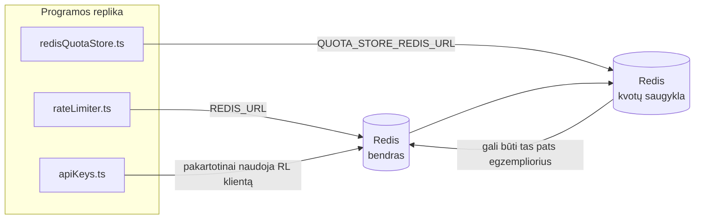

# Redis Production Configuration Guide (Lietuvių)

🌐 **Languages:** 🇺🇸 [English](../../../../ops/REDIS_PRODUCTION_CONFIG.md) · 🇪🇹 [am](../../../am/docs/ops/REDIS_PRODUCTION_CONFIG.md) · 🇸🇦 [ar](../../../ar/docs/ops/REDIS_PRODUCTION_CONFIG.md) · 🇦🇿 [az](../../../az/docs/ops/REDIS_PRODUCTION_CONFIG.md) · 🇧🇬 [bg](../../../bg/docs/ops/REDIS_PRODUCTION_CONFIG.md) · 🇧🇩 [bn](../../../bn/docs/ops/REDIS_PRODUCTION_CONFIG.md) · 🇧🇦 [bs](../../../bs/docs/ops/REDIS_PRODUCTION_CONFIG.md) · 🇨🇿 [cs](../../../cs/docs/ops/REDIS_PRODUCTION_CONFIG.md) · 🇩🇰 [da](../../../da/docs/ops/REDIS_PRODUCTION_CONFIG.md) · 🇩🇪 [de](../../../de/docs/ops/REDIS_PRODUCTION_CONFIG.md) · 🇬🇷 [el](../../../el/docs/ops/REDIS_PRODUCTION_CONFIG.md) · 🇪🇸 [es](../../../es/docs/ops/REDIS_PRODUCTION_CONFIG.md) · 🇪🇪 [et](../../../et/docs/ops/REDIS_PRODUCTION_CONFIG.md) · 🇮🇷 [fa](../../../fa/docs/ops/REDIS_PRODUCTION_CONFIG.md) · 🇫🇮 [fi](../../../fi/docs/ops/REDIS_PRODUCTION_CONFIG.md) · 🇫🇷 [fr](../../../fr/docs/ops/REDIS_PRODUCTION_CONFIG.md) · 🇮🇪 [ga](../../../ga/docs/ops/REDIS_PRODUCTION_CONFIG.md) · 🇮🇳 [gu](../../../gu/docs/ops/REDIS_PRODUCTION_CONFIG.md) · 🇳🇬 [ha](../../../ha/docs/ops/REDIS_PRODUCTION_CONFIG.md) · 🇮🇱 [he](../../../he/docs/ops/REDIS_PRODUCTION_CONFIG.md) · 🇮🇳 [hi](../../../hi/docs/ops/REDIS_PRODUCTION_CONFIG.md) · 🇭🇷 [hr](../../../hr/docs/ops/REDIS_PRODUCTION_CONFIG.md) · 🇭🇺 [hu](../../../hu/docs/ops/REDIS_PRODUCTION_CONFIG.md) · 🇦🇲 [hy](../../../hy/docs/ops/REDIS_PRODUCTION_CONFIG.md) · 🇮🇩 [id](../../../id/docs/ops/REDIS_PRODUCTION_CONFIG.md) · 🇳🇬 [ig](../../../ig/docs/ops/REDIS_PRODUCTION_CONFIG.md) · 🇮🇹 [it](../../../it/docs/ops/REDIS_PRODUCTION_CONFIG.md) · 🇯🇵 [ja](../../../ja/docs/ops/REDIS_PRODUCTION_CONFIG.md) · 🇬🇪 [ka](../../../ka/docs/ops/REDIS_PRODUCTION_CONFIG.md) · 🇰🇭 [km](../../../km/docs/ops/REDIS_PRODUCTION_CONFIG.md) · 🇮🇳 [kn](../../../kn/docs/ops/REDIS_PRODUCTION_CONFIG.md) · 🇰🇷 [ko](../../../ko/docs/ops/REDIS_PRODUCTION_CONFIG.md) · 🇱🇻 [lv](../../../lv/docs/ops/REDIS_PRODUCTION_CONFIG.md) · 🇮🇳 [ml](../../../ml/docs/ops/REDIS_PRODUCTION_CONFIG.md) · 🇮🇳 [mr](../../../mr/docs/ops/REDIS_PRODUCTION_CONFIG.md) · 🇲🇾 [ms](../../../ms/docs/ops/REDIS_PRODUCTION_CONFIG.md) · 🇲🇹 [mt](../../../mt/docs/ops/REDIS_PRODUCTION_CONFIG.md) · 🇲🇲 [my](../../../my/docs/ops/REDIS_PRODUCTION_CONFIG.md) · 🇳🇵 [ne](../../../ne/docs/ops/REDIS_PRODUCTION_CONFIG.md) · 🇳🇱 [nl](../../../nl/docs/ops/REDIS_PRODUCTION_CONFIG.md) · 🇳🇴 [no](../../../no/docs/ops/REDIS_PRODUCTION_CONFIG.md) · 🇮🇳 [or](../../../or/docs/ops/REDIS_PRODUCTION_CONFIG.md) · 🇮🇳 [pa](../../../pa/docs/ops/REDIS_PRODUCTION_CONFIG.md) · 🇵🇭 [phi](../../../phi/docs/ops/REDIS_PRODUCTION_CONFIG.md) · 🇵🇱 [pl](../../../pl/docs/ops/REDIS_PRODUCTION_CONFIG.md) · 🇵🇹 [pt](../../../pt/docs/ops/REDIS_PRODUCTION_CONFIG.md) · 🇧🇷 [pt-BR](../../../pt-BR/docs/ops/REDIS_PRODUCTION_CONFIG.md) · 🇷🇴 [ro](../../../ro/docs/ops/REDIS_PRODUCTION_CONFIG.md) · 🇷🇺 [ru](../../../ru/docs/ops/REDIS_PRODUCTION_CONFIG.md) · 🇱🇰 [si](../../../si/docs/ops/REDIS_PRODUCTION_CONFIG.md) · 🇸🇰 [sk](../../../sk/docs/ops/REDIS_PRODUCTION_CONFIG.md) · 🇸🇮 [sl](../../../sl/docs/ops/REDIS_PRODUCTION_CONFIG.md) · 🇷🇸 [sr](../../../sr/docs/ops/REDIS_PRODUCTION_CONFIG.md) · 🇸🇪 [sv](../../../sv/docs/ops/REDIS_PRODUCTION_CONFIG.md) · 🇰🇪 [sw](../../../sw/docs/ops/REDIS_PRODUCTION_CONFIG.md) · 🇮🇳 [ta](../../../ta/docs/ops/REDIS_PRODUCTION_CONFIG.md) · 🇮🇳 [te](../../../te/docs/ops/REDIS_PRODUCTION_CONFIG.md) · 🇹🇭 [th](../../../th/docs/ops/REDIS_PRODUCTION_CONFIG.md) · 🇹🇷 [tr](../../../tr/docs/ops/REDIS_PRODUCTION_CONFIG.md) · 🇺🇦 [uk-UA](../../../uk-UA/docs/ops/REDIS_PRODUCTION_CONFIG.md) · 🇵🇰 [ur](../../../ur/docs/ops/REDIS_PRODUCTION_CONFIG.md) · 🇺🇿 [uz](../../../uz/docs/ops/REDIS_PRODUCTION_CONFIG.md) · 🇻🇳 [vi](../../../vi/docs/ops/REDIS_PRODUCTION_CONFIG.md) · 🇳🇬 [yo](../../../yo/docs/ops/REDIS_PRODUCTION_CONFIG.md) · 🇨🇳 [zh-CN](../../../zh-CN/docs/ops/REDIS_PRODUCTION_CONFIG.md) · 🇹🇼 [zh-TW](../../../zh-TW/docs/ops/REDIS_PRODUCTION_CONFIG.md)

---

## Apžvalga

Redis yra **neprivaloma, švelni priklausomybė** OmniRoute — programa grakščiai pablogėja (atminties atsargos), kai Redis nepasiekiamas. Gamyboje derinant Redis sumažėja keturių skirtingų darbo krūvių delsa:

| Darbo krūvis                     | Vairuotojas                   | Klientų gamykla                                  | Raktų raštas                                               |
| -------------------------------- | ----------------------------- | ------------------------------------------------ | ---------------------------------------------------------- |
| Normos ribojimas                 | `rateLimiter.ts`              | `getRedisClient()` — tingus `ioredis` vienvietis | `<prefix>rl:*` Lua-atominis greičio apribojimo langai      |
| Auth cache                       | `apiKeys.ts`                  | Pakartotinai naudoja `rateLimiter` klientą       | `<prefix>auth:api_key:<sha256>` su TTL                     |
| Kvotos parduotuvė                | `redisQuotaStore.ts`          | Atskiras `getRedisClient(url)` vienvietis        | `<prefix>quota:*` konfigūruojamas kiekvienam egzemplioriui |
| Apšilimo grandinės pertraukiklis | `redisCircuitBreakerStore.ts` | Atskiras klientas `circuitBreakerFactory.ts`     | `<prefix>warmup:cb:<connectionId>`                         |

Visi keturi darbo krūviai turi vieną vardų srities priešdėlį, todėl OmniRoute gali egzistuoti kartu su kitomis programomis viename Redis egzemplioriuje (pvz., `127.0.0.1:6379`). Žr. [Tarpai tarp raktų](#key-namespacing).

---

## Dabartinė konfigūracija (numatytieji kodo nustatymai)

| Nustatymas                      | Vertė                                                           | Kur                                                                                   |
| ------------------------------- | --------------------------------------------------------------- | ------------------------------------------------------------------------------------- |
| `REDIS_URL` env var             | `redis://redis:6379` (sudaryti), pasirinktinai                  | `rateLimiter.ts:5`, `.env.example`                                                    |
| `REDIS_KEY_PREFIX` env var      | `omniroute:` (numatytasis)                                      | `rateLimiter.ts`, `redisQuotaStore.ts`, `redisCircuitBreakerStore.ts`, `.env.example` |
| `QUOTA_STORE_REDIS_URL` env var | atskiras, gali skirtis nuo `REDIS_URL`                          | `quota/storeFactory.ts`                                                               |
| `QUOTA_STORE_DRIVER`            | `"sqlite"` (numatytasis), `"redis"` neprivalomas                | `quota/storeFactory.ts`                                                               |
| ioredis `maxRetriesPerRequest`  | `3`                                                             | `rateLimiter.ts` kliento kūrimas                                                      |
| `enableReadyCheck`              | nenustatyta (numatytoji funkcija: `true`)                       | —                                                                                     |
| `lazyConnect`                   | nenustatyta (numatytoji funkcija: `false`)                      | —                                                                                     |
| `retryStrategy`                 | nenustatyta (numatytasis „ioredis“: 200 ms bazė, eksponentinis) | —                                                                                     |
| TLS / slaptažodis / DB indeksas | **nesukonfigūruotas**                                           | —                                                                                     |
| Sentinel / klasteris            | **nesukonfigūruotas** Tik — atskiras vienas mazgas              | —                                                                                     |

---

## Raktų vardų sričių naudojimas

„OmniRoute“ naudoja bendrą Redis egzempliorių kartu su kitomis pagrindiniame kompiuteryje veikiančiomis sistemomis. Nenaudojant vardų srities, tokie raktai kaip `auth:api_key:<sha256>` arba `rl:*` gali sutapti su kitų tą patį Redis naudojančių programų raktais (šiame egzemplioriuje Redis veikia adresu `127.0.0.1:6379` kartu su kitomis paslaugomis).

Nustatykite netuščią `REDIS_KEY_PREFIX` eilutę, kad prieš **kiekvieną** „OmniRoute“ raktą būtų pridedamas priešdėlis:

```bash
# .env — visi „OmniRoute“ raktai tampa omniroute:rl:*, omniroute:auth:*, omniroute:quota:*, omniroute:warmup:cb:*
REDIS_KEY_PREFIX=omniroute:
```

- **Numatytoji reikšmė:** `omniroute:` (taikoma, kai `REDIS_KEY_PREFIX` nenustatytas arba yra tuščias).
- **Taikoma:** užklausų dažnio ribotuvui ir autentifikavimo podėliui (bendras `ioredis` klientas per `keyPrefix`), kvotų saugyklai (`KEY_PREFIX = "${REDIS_KEY_PREFIX}quota"`) ir parengiamojo paleidimo grandinės pertraukikliui (`KEY_PREFIX = "${REDIS_KEY_PREFIX}warmup:cb:"`).
- **Pakeitus priešdėlį**, kai Redis jau yra raktų, senieji raktai tampa nebepasiekiami (jie pašalinami pasibaigus TTL arba taikant LRU). Keisti saugu; perkėlimas nereikalingas. Vienintelė išimtis — uždraustu pažymėto ryšio parengiamojo paleidimo grandinės pertraukiklio raktas: jis išsaugomas be TTL, todėl likusius raktus raskite naudodami `redis-cli --scan --pattern '<old-prefix>warmup:cb:*'` ir juos pašalinkite.
- **ioredis `keyPrefix`** automatiškai prideda priešdėlį įrašant **ir** pašalina jį skaitant, todėl programos kodas niekada nemato priešdėlio.

---

## Rekomenduojamas gamybos derinimas

### 1. Ryšio telkinys / kliento parinktys (ioredis `Redis` konstruktorius)

Dabartinis kodas sukuria vieną `new Redis(url)` be jokių pasirinktinių parinkčių. Jei norite diegti gamybinę kelių kopijų versiją, nurodykite kliento gamyklą į kodą arba apvyniokite `getRedisClient()`:

```typescript
const redis = new Redis(REDIS_URL, {
  maxRetriesPerRequest: null, // no retry limit; let retryStrategy decide
  enableReadyCheck: true, // verify server is ready before accepting calls
  lazyConnect: true, // don't connect on construction; wait for first call
  retryStrategy: (times) => {
    if (times > 10) return null; // give up after 10 retries → reconnect later
    return Math.min(times * 200, 5000); // 200ms, 400ms, …, 5s cap
  },
  enableAutoPipelining: true, // coalesce concurrent commands into one TCP write
  keepAlive: 10000, // TCP keep‑alive every 10s
});
```

**Pagrindiniai kompromisai:**

- `maxRetriesPerRequest: null` + `retryStrategy` — pirmenybė teikiama gamybai, todėl trumpalaikiai Redis paleidimai iš naujo neįvykdo kiekvieno užklausos iš karto. Atmintyje esantis atsarginis `checkRateLimit()` sugeria gedimo kelią.
- `lazyConnect: true` — išvengia paleisties priklausomybės nuo Redis, kol serveris pradeda priimti ryšius.
- `enableAutoPipelining: true` — sumažina kelionių pirmyn ir atgal tuo pačiu metu atliekamų normos ribos patikrų skaičių; naudinga > 50 RPS naudojant vieną jungtį.

### 2. Redis serverio konfigūracija (`redis.conf`)

```
# Memory
maxmemory 80%                        # leave room for OS page cache
maxmemory-policy allkeys-lru         # evict stale auth cache entries under pressure

# Persistence (optional — OmniRoute is crash‑safe without it)
save 300 1                           # snapshot at least every 5 min if ≥1 key changed
appendonly no                        # AOF not needed; data is regeneratable
appendfsync no                       # no fsync overhead (RDB is sufficient)

# Networking
timeout 0                            # no idle disconnect
tcp-keepalive 300                    # 5 min keep‑alive
tcp-backlog 511                      # connection backlog for bursty load

# Performance
hz 10                                # default; 100 for latency‑sensitive
activedefrag yes                     # auto‑defragment when fragmentation >10%
```

**`maxmemory-policy allkeys-lru` kompromisas:** Auth talpyklos įrašai gali būti iškeldinti esant atminties spaudimui. Tai saugu. — `setCachedApiKey` visada iš naujo užpildomas praleidus, o SQLite atsarginis variantas yra autoritetingas. Greitį ribojantis Lua scenarijus sukuria mažus raktus, kurių dizainas yra trumpalaikis.

### 3. Docker Compose Settings

Gamybos kūrimas (`docker-compose.prod.yml`) naudoja `redis:8.6.2-alpine`. Pridėti:

```yaml
redis:
  image: redis:8.6.2-alpine
  command:
    [
      "redis-server",
      "--maxmemory",
      "512mb",
      "--maxmemory-policy",
      "allkeys-lru",
      "--activedefrag",
      "yes",
      "--save",
      "300 1",
    ]
  healthcheck:
    test: ["CMD", "redis-cli", "ping"]
    interval: 10s
    timeout: 3s
    retries: 3
    start_period: 5s
```

### 4. Kelių egzempliorių / mastelio svarstymai

**Viena Redis visoms kopijoms** — greičio ribotuvo Lua scenarijus priklauso nuo vienos autoritetingos rakto erdvės. Keli Redis egzemplioriai už kopijų prarastų atomiškumą ir padvigubintų biudžetą. Visoms programų kopijoms naudokite vieną Redis (arba Redis Sentinel klasterį su perkėlimu).

**Ryšių skaičius:** Atsidaro kiekviena programos kopija **2 TCP jungtys** į Redis (kainos ribotuvo klientas + kvotos parduotuvės klientas). Esant 10 → 20 jungčių kopijų, gerai neviršijant numatytosios Redis egzemplioriaus 10 000 ryšio ribos.

### 5. Stebėjimas

Atskleisti per sveikatos patikrinimo galutinį tašką:

```typescript
// src/app/api/monitoring/health/route.ts already calls rateLimiter functions
// Add Redis-specific checks:
//   1. PING latency via ioredis .ping()
//   2. Memory usage via INFO memory
//   3. Connection count via INFO clients
//   4. Hit rate for maxmemory-policy (evicted_keys / keyspace_hits)
```

Pagrindinės metrikos, kurias reikia žiūrėti:

- **Iškeldinti raktai / sek** Jei — nuolat nesiskiria nuo nulio, padidinkite `maxmemory`
- **Užblokuoti klientai** — ne nulis siūlo lėtus Lua scenarijus arba didelį konkurenciją
- **Atmesti ryšiai** Nukentėjo — ryšio riba; retas 20 jungčių

### 6. Redis suderinami serveriai

Bet kuris čia naudojamas serveris turi paleisti Lua scenarijus: greičio ribotuvas yra vienas `EVAL`. Serveryje be Lua `checkRateLimit()` registruoja `[RATE_LIMITER] Redis eval failed, falling back to in-memory rate limiting` ir skaičiuoja kiekvieną procesą, todėl kiekviena replika taiko apribojimą atskirai. Pasirenkama bendrinamo seanso giminingumo saugykla (`OMNIROUTE_SESSION_AFFINITY_STORE=redis`) taip pat nuskaito ir atnaujina kaiščius su `EVAL`; be Lua ji registruoja `[SESSION_AFFINITY] Redis error; falling back to SQLite.` ir kiekviena kopija turi savo kaiščius. Kitose darbo apkrovose naudojamos paprastos komandos (`SET ... EX`, `GET`, `DEL`, `MGET`, `EXPIRE`, `INCRBYFLOAT`, maišos ir rinkiniai), o semantinės talpyklos Redis užpakalinė programa nesiunčia `FT.*` komandų.

Išbandyta naudojant OmniRoute 3.8.52: KiviDB 1.2.0 su Lua vaizdu (`kividb/kividb:v1.2.0-lua`). Greičio ribotuvas (įskaitant antrąjį procesą, dalijantį skaitiklius), autentifikavimo talpykla, kvotų saugykla, pašildymo grandinės pertraukiklis, semantinės talpyklos saugykla ir `/v1/chat/completions` užklausa per pokalbių tvarkyklę išlaikė 18 iš 19 patikrų, atitinkančių Redis 8.10.3. Tas, kuris skiriasi: `INCRBYFLOAT` saugo `0.1 + 0.2` kaip `0.30000000000000004`, kur Redis saugo `0.3` ( [kividbio/kividb#387](https://github.com/kividbio/kividb/issues/387) ). Kvotų saugykla analizuoja abu su `parseFloat`, tačiau du skaičiai skiriasi paskutiniais skaitmenimis, todėl palyginimas, kuris tiksliai patenka į kvotos ribą, gali pasirodyti kitaip. Seanso bendrų interesų parduotuvė nebuvo to vykdymo dalis. ( [sąranka](https://github.com/kividbio/kividb/blob/master/docs/integrations/omniroute.md), [rezultatai](https://github.com/kividbio/kividb/tree/master/benchmarks/omniroute-compat) )

---

## Architektūros diagrama



---

## Nuorodos

| Failas                             | Tikslas                                                                      |
| ---------------------------------- | ---------------------------------------------------------------------------- |
| `src/shared/utils/rateLimiter.ts`  | Pirminis Redis klientas, Lua greičio ribojimo scenarijus, atsarginė atmintis |
| `src/lib/db/apiKeys.ts`            | Auth talpyklos — Redis→SQLite atsarginė                                      |
| `src/lib/quota/redisQuotaStore.ts` | Atskiras Redis klientas pasirenkamai kvotų saugyklai                         |
| `src/lib/quota/storeFactory.ts`    | Perjungiama tarp `sqlite` ir `redis` kvotų tvarkyklių                        |
| `docker-compose.prod.yml`          | Prod Redis konteineris (vaizdas `redis:8.6.2-alpine`)                        |
| `.env.example`                     | Redis env vars dokumentacija                                                 |
| `src/app/api/local/redis/`         | API maršrutai, skirti dev konteinerių orkestravimui                          |
| `bin/cli/commands/redis.mjs`       | CLI komandos, skirtos dev konteinerių orkestravimui                          |
