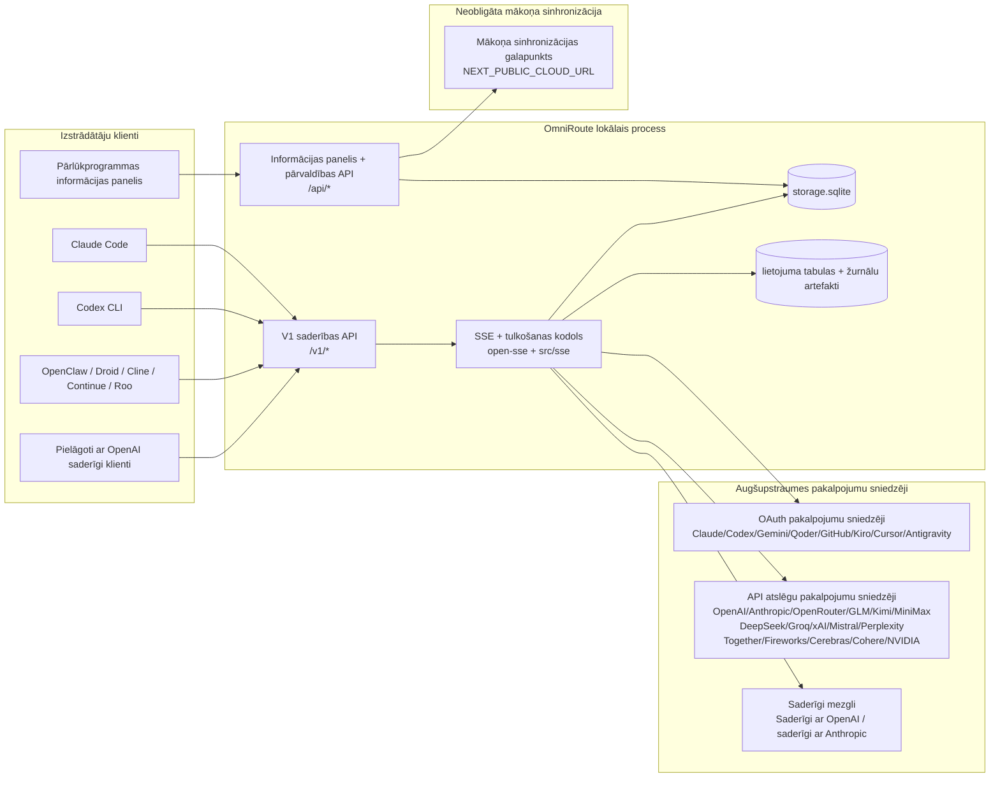
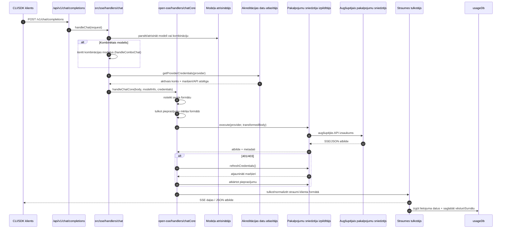
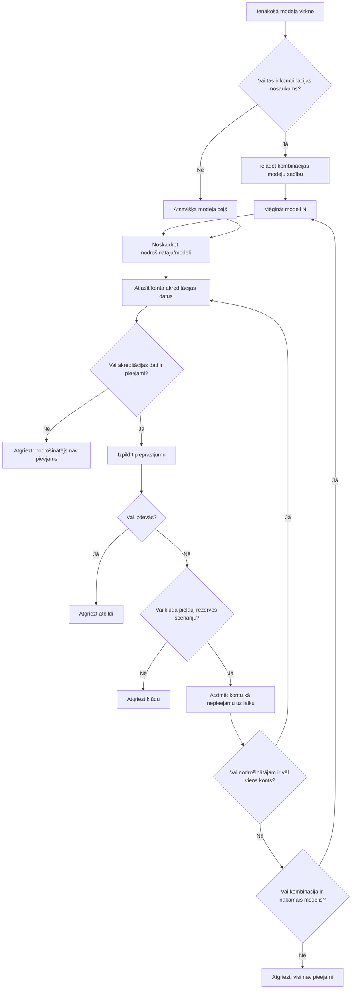
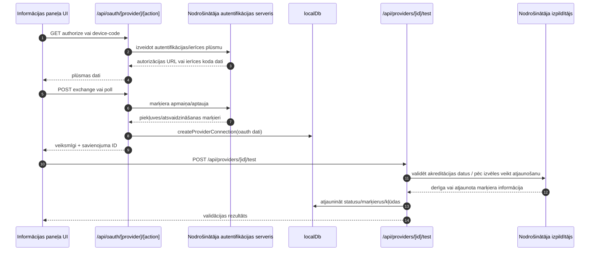
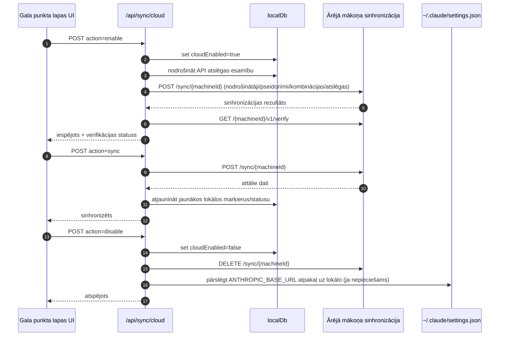
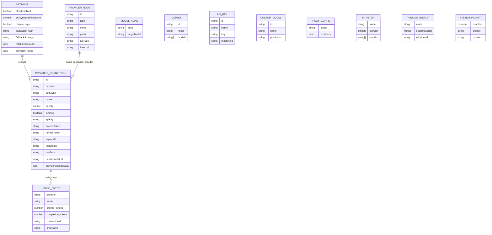
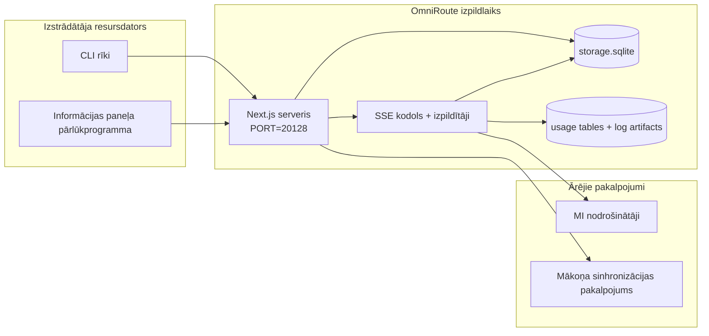

# OmniRoute Architecture (Latviešu)

🌐 **Languages:** 🇺🇸 [English](../../../../architecture/ARCHITECTURE.md) · 🇪🇹 [am](../../../am/docs/architecture/ARCHITECTURE.md) · 🇸🇦 [ar](../../../ar/docs/architecture/ARCHITECTURE.md) · 🇦🇿 [az](../../../az/docs/architecture/ARCHITECTURE.md) · 🇧🇬 [bg](../../../bg/docs/architecture/ARCHITECTURE.md) · 🇧🇩 [bn](../../../bn/docs/architecture/ARCHITECTURE.md) · 🇧🇦 [bs](../../../bs/docs/architecture/ARCHITECTURE.md) · 🇨🇿 [cs](../../../cs/docs/architecture/ARCHITECTURE.md) · 🇩🇰 [da](../../../da/docs/architecture/ARCHITECTURE.md) · 🇩🇪 [de](../../../de/docs/architecture/ARCHITECTURE.md) · 🇬🇷 [el](../../../el/docs/architecture/ARCHITECTURE.md) · 🇪🇸 [es](../../../es/docs/architecture/ARCHITECTURE.md) · 🇪🇪 [et](../../../et/docs/architecture/ARCHITECTURE.md) · 🇮🇷 [fa](../../../fa/docs/architecture/ARCHITECTURE.md) · 🇫🇮 [fi](../../../fi/docs/architecture/ARCHITECTURE.md) · 🇫🇷 [fr](../../../fr/docs/architecture/ARCHITECTURE.md) · 🇮🇪 [ga](../../../ga/docs/architecture/ARCHITECTURE.md) · 🇮🇳 [gu](../../../gu/docs/architecture/ARCHITECTURE.md) · 🇳🇬 [ha](../../../ha/docs/architecture/ARCHITECTURE.md) · 🇮🇱 [he](../../../he/docs/architecture/ARCHITECTURE.md) · 🇮🇳 [hi](../../../hi/docs/architecture/ARCHITECTURE.md) · 🇭🇷 [hr](../../../hr/docs/architecture/ARCHITECTURE.md) · 🇭🇺 [hu](../../../hu/docs/architecture/ARCHITECTURE.md) · 🇦🇲 [hy](../../../hy/docs/architecture/ARCHITECTURE.md) · 🇮🇩 [id](../../../id/docs/architecture/ARCHITECTURE.md) · 🇳🇬 [ig](../../../ig/docs/architecture/ARCHITECTURE.md) · 🇮🇹 [it](../../../it/docs/architecture/ARCHITECTURE.md) · 🇯🇵 [ja](../../../ja/docs/architecture/ARCHITECTURE.md) · 🇬🇪 [ka](../../../ka/docs/architecture/ARCHITECTURE.md) · 🇰🇭 [km](../../../km/docs/architecture/ARCHITECTURE.md) · 🇮🇳 [kn](../../../kn/docs/architecture/ARCHITECTURE.md) · 🇰🇷 [ko](../../../ko/docs/architecture/ARCHITECTURE.md) · 🇱🇹 [lt](../../../lt/docs/architecture/ARCHITECTURE.md) · 🇮🇳 [ml](../../../ml/docs/architecture/ARCHITECTURE.md) · 🇮🇳 [mr](../../../mr/docs/architecture/ARCHITECTURE.md) · 🇲🇾 [ms](../../../ms/docs/architecture/ARCHITECTURE.md) · 🇲🇹 [mt](../../../mt/docs/architecture/ARCHITECTURE.md) · 🇲🇲 [my](../../../my/docs/architecture/ARCHITECTURE.md) · 🇳🇵 [ne](../../../ne/docs/architecture/ARCHITECTURE.md) · 🇳🇱 [nl](../../../nl/docs/architecture/ARCHITECTURE.md) · 🇳🇴 [no](../../../no/docs/architecture/ARCHITECTURE.md) · 🇮🇳 [or](../../../or/docs/architecture/ARCHITECTURE.md) · 🇮🇳 [pa](../../../pa/docs/architecture/ARCHITECTURE.md) · 🇵🇭 [phi](../../../phi/docs/architecture/ARCHITECTURE.md) · 🇵🇱 [pl](../../../pl/docs/architecture/ARCHITECTURE.md) · 🇵🇹 [pt](../../../pt/docs/architecture/ARCHITECTURE.md) · 🇧🇷 [pt-BR](../../../pt-BR/docs/architecture/ARCHITECTURE.md) · 🇷🇴 [ro](../../../ro/docs/architecture/ARCHITECTURE.md) · 🇷🇺 [ru](../../../ru/docs/architecture/ARCHITECTURE.md) · 🇱🇰 [si](../../../si/docs/architecture/ARCHITECTURE.md) · 🇸🇰 [sk](../../../sk/docs/architecture/ARCHITECTURE.md) · 🇸🇮 [sl](../../../sl/docs/architecture/ARCHITECTURE.md) · 🇷🇸 [sr](../../../sr/docs/architecture/ARCHITECTURE.md) · 🇸🇪 [sv](../../../sv/docs/architecture/ARCHITECTURE.md) · 🇰🇪 [sw](../../../sw/docs/architecture/ARCHITECTURE.md) · 🇮🇳 [ta](../../../ta/docs/architecture/ARCHITECTURE.md) · 🇮🇳 [te](../../../te/docs/architecture/ARCHITECTURE.md) · 🇹🇭 [th](../../../th/docs/architecture/ARCHITECTURE.md) · 🇹🇷 [tr](../../../tr/docs/architecture/ARCHITECTURE.md) · 🇺🇦 [uk-UA](../../../uk-UA/docs/architecture/ARCHITECTURE.md) · 🇵🇰 [ur](../../../ur/docs/architecture/ARCHITECTURE.md) · 🇺🇿 [uz](../../../uz/docs/architecture/ARCHITECTURE.md) · 🇻🇳 [vi](../../../vi/docs/architecture/ARCHITECTURE.md) · 🇳🇬 [yo](../../../yo/docs/architecture/ARCHITECTURE.md) · 🇨🇳 [zh-CN](../../../zh-CN/docs/architecture/ARCHITECTURE.md) · 🇹🇼 [zh-TW](../../../zh-TW/docs/architecture/ARCHITECTURE.md)

---

🌐 **Languages:** 🇺🇸 [English](../../../../architecture/ARCHITECTURE.md) · 🇪🇹 [am](../../../am/docs/architecture/ARCHITECTURE.md) · 🇸🇦 [ar](../../../ar/docs/architecture/ARCHITECTURE.md) · 🇦🇿 [az](../../../az/docs/architecture/ARCHITECTURE.md) · 🇧🇬 [bg](../../../bg/docs/architecture/ARCHITECTURE.md) · 🇧🇩 [bn](../../../bn/docs/architecture/ARCHITECTURE.md) · 🇧🇦 [bs](../../../bs/docs/architecture/ARCHITECTURE.md) · 🇨🇿 [cs](../../../cs/docs/architecture/ARCHITECTURE.md) · 🇩🇰 [da](../../../da/docs/architecture/ARCHITECTURE.md) · 🇩🇪 [de](../../../de/docs/architecture/ARCHITECTURE.md) · 🇬🇷 [el](../../../el/docs/architecture/ARCHITECTURE.md) · 🇪🇸 [es](../../../es/docs/architecture/ARCHITECTURE.md) · 🇪🇪 [et](../../../et/docs/architecture/ARCHITECTURE.md) · 🇮🇷 [fa](../../../fa/docs/architecture/ARCHITECTURE.md) · 🇫🇮 [fi](../../../fi/docs/architecture/ARCHITECTURE.md) · 🇫🇷 [fr](../../../fr/docs/architecture/ARCHITECTURE.md) · 🇮🇪 [ga](../../../ga/docs/architecture/ARCHITECTURE.md) · 🇮🇳 [gu](../../../gu/docs/architecture/ARCHITECTURE.md) · 🇳🇬 [ha](../../../ha/docs/architecture/ARCHITECTURE.md) · 🇮🇱 [he](../../../he/docs/architecture/ARCHITECTURE.md) · 🇮🇳 [hi](../../../hi/docs/architecture/ARCHITECTURE.md) · 🇭🇷 [hr](../../../hr/docs/architecture/ARCHITECTURE.md) · 🇭🇺 [hu](../../../hu/docs/architecture/ARCHITECTURE.md) · 🇦🇲 [hy](../../../hy/docs/architecture/ARCHITECTURE.md) · 🇮🇩 [id](../../../id/docs/architecture/ARCHITECTURE.md) · 🇳🇬 [ig](../../../ig/docs/architecture/ARCHITECTURE.md) · 🇮🇹 [it](../../../it/docs/architecture/ARCHITECTURE.md) · 🇯🇵 [ja](../../../ja/docs/architecture/ARCHITECTURE.md) · 🇬🇪 [ka](../../../ka/docs/architecture/ARCHITECTURE.md) · 🇰🇭 [km](../../../km/docs/architecture/ARCHITECTURE.md) · 🇮🇳 [kn](../../../kn/docs/architecture/ARCHITECTURE.md) · 🇰🇷 [ko](../../../ko/docs/architecture/ARCHITECTURE.md) · 🇱🇹 [lt](../../../lt/docs/architecture/ARCHITECTURE.md) · 🇮🇳 [ml](../../../ml/docs/architecture/ARCHITECTURE.md) · 🇮🇳 [mr](../../../mr/docs/architecture/ARCHITECTURE.md) · 🇲🇾 [ms](../../../ms/docs/architecture/ARCHITECTURE.md) · 🇲🇹 [mt](../../../mt/docs/architecture/ARCHITECTURE.md) · 🇲🇲 [my](../../../my/docs/architecture/ARCHITECTURE.md) · 🇳🇵 [ne](../../../ne/docs/architecture/ARCHITECTURE.md) · 🇳🇱 [nl](../../../nl/docs/architecture/ARCHITECTURE.md) · 🇳🇴 [no](../../../no/docs/architecture/ARCHITECTURE.md) · 🇮🇳 [or](../../../or/docs/architecture/ARCHITECTURE.md) · 🇮🇳 [pa](../../../pa/docs/architecture/ARCHITECTURE.md) · 🇵🇭 [phi](../../../phi/docs/architecture/ARCHITECTURE.md) · 🇵🇱 [pl](../../../pl/docs/architecture/ARCHITECTURE.md) · 🇵🇹 [pt](../../../pt/docs/architecture/ARCHITECTURE.md) · 🇧🇷 [pt-BR](../../../pt-BR/docs/architecture/ARCHITECTURE.md) · 🇷🇴 [ro](../../../ro/docs/architecture/ARCHITECTURE.md) · 🇷🇺 [ru](../../../ru/docs/architecture/ARCHITECTURE.md) · 🇱🇰 [si](../../../si/docs/architecture/ARCHITECTURE.md) · 🇸🇰 [sk](../../../sk/docs/architecture/ARCHITECTURE.md) · 🇸🇮 [sl](../../../sl/docs/architecture/ARCHITECTURE.md) · 🇷🇸 [sr](../../../sr/docs/architecture/ARCHITECTURE.md) · 🇸🇪 [sv](../../../sv/docs/architecture/ARCHITECTURE.md) · 🇰🇪 [sw](../../../sw/docs/architecture/ARCHITECTURE.md) · 🇮🇳 [ta](../../../ta/docs/architecture/ARCHITECTURE.md) · 🇮🇳 [te](../../../te/docs/architecture/ARCHITECTURE.md) · 🇹🇭 [th](../../../th/docs/architecture/ARCHITECTURE.md) · 🇹🇷 [tr](../../../tr/docs/architecture/ARCHITECTURE.md) · 🇺🇦 [uk-UA](../../../uk-UA/docs/architecture/ARCHITECTURE.md) · 🇵🇰 [ur](../../../ur/docs/architecture/ARCHITECTURE.md) · 🇺🇿 [uz](../../../uz/docs/architecture/ARCHITECTURE.md) · 🇻🇳 [vi](../../../vi/docs/architecture/ARCHITECTURE.md) · 🇳🇬 [yo](../../../yo/docs/architecture/ARCHITECTURE.md) · 🇨🇳 [zh-CN](../../../zh-CN/docs/architecture/ARCHITECTURE.md) · 🇹🇼 [zh-TW](../../../zh-TW/docs/architecture/ARCHITECTURE.md)

_Pēdējoreiz atjaunināts: 2026-06-28_

## Kopsavilkums

OmniRoute ir vietējā AI maršrutēšanas vārteja un informācijas panelis, kas izveidots uz Next.js. Tas nodrošina vienu ar OpenAI saderīgu galapunktu (`/v1/*`) un maršrutē trafiku starp vairākiem augšupējiem pakalpojumu sniedzējiem, izmantojot tulkošanu, atkāpšanos, marķiera atsvaidzināšanu un lietojuma izsekošanu.

Galvenās iespējas:

- Ar OpenAI saderīga API virsma priekš CLI/tools (394 nodrošinātāji, 159 izpildītāja moduļi)
- Request/response tulkojums starp pakalpojumu sniedzēju formātiem
- Modeļa kombinācijas atkāpšanās (vairāku modeļu secība)
- Strukturētas kombinētās darbības (`provider + model + connection`) ar izpildlaika secību pēc `compositeTiers`
- Atkāpšanās konta līmenī (vairāki konti vienam pakalpojumu sniedzējam)
- Kvotas pirmspārbaudes un kvotas P2C konta atlase galvenajā tērzēšanas ceļā
- OAuth + API atslēgas nodrošinātāja savienojuma pārvaldība (27 OAuth nodrošinātāja moduļi)
- Iegulšana, izmantojot `/v1/embeddings` (18 pakalpojumu sniedzēji)
- Attēlu ģenerēšana, izmantojot `/v1/images/generations` (10 + nodrošinātāji, 20 + modeļi)
- Audio transkripcija, izmantojot `/v1/audio/transcriptions` (18 pakalpojumu sniedzēji)
- Teksta pārvēršana runā, izmantojot `/v1/audio/speech` (24 iebūvēti pakalpojumu sniedzēji)
- Video ģenerēšana, izmantojot `/v1/videos/generations` (ComfyUI + SD WebUI)
- Mūzikas ģenerēšana, izmantojot `/v1/music/generations` (ComfyUI)
- Meklēšana tīmeklī, izmantojot `/v1/search` (20 pakalpojumu sniedzēji)
- Moderēšana, izmantojot `/v1/moderations`
- Pārkārtošana, izmantojot `/v1/rerank`
- Padomājiet par tagu parsēšanu (`<think>...</think>`) argumentācijas modeļiem
- Atbildes dezinfekcija stingrai OpenAI SDK saderībai
- Lomas normalizēšana (izstrādātāja → sistēma, sistēmas → lietotājs) vairāku pakalpojumu sniedzēju saderībai
- Strukturētās izvades konvertēšana (json_schema → Gemini responseSchema)
- Vietējā noturība pakalpojumu sniedzējiem, atslēgas, aizstājvārdi, kombinācijas, iestatījumi, cenas (122 DB moduļi)
- Usage/cost izsekošana un pieprasījumu reģistrēšana
- Izvēles mākoņa sinhronizācija multi-device/state sinhronizācijai
- IP allowlist/blocklist API piekļuves kontrolei
- Domājoša budžeta vadība (passthrough/auto/custom/adaptive)
- Globālās sistēmas tūlītēja injekcija
- Sesijas izsekošana un pirkstu nospiedumu noņemšana
- Uzlabots tarifu ierobežojums katram kontam ar pakalpojumu sniedzēja profiliem
- Strāvas slēdža modelis nodrošinātāja noturībai
- Ganāmpulka aizsardzība pret pērkonu ar mutex bloķēšanu
- Uz parakstu balstīta pieprasījuma dedublikācijas kešatmiņa
- Domēna slānis: izmaksu noteikumi, rezerves politika, bloķēšanas politika
- Konteksta relejs: sesijas nodošanas kopsavilkumi konta rotācijas nepārtrauktībai
- Domēna stāvokļa noturība (SQLite ierakstīšanas kešatmiņa atkāpšanās gadījumiem, budžetiem, bloķēšanām, slēdžiem)
- Politikas dzinējs centralizētai pieprasījumu novērtēšanai (lockout → budget → rezerves)
- Pieprasīt telemetriju ar p50/p95/p99 latentuma apkopošanu
- Kombinētā mērķa telemetrija un vēsturiskā kombinētā mērķa veselība, izmantojot `combo_execution_key` / `combo_step_id`
- Korelācija ID (X-Request-Id) pilnīgai izsekošanai
- Atbilstības audita reģistrēšana ar atteikšanos no katras API atslēgas
- Eval ietvars LLM kvalitātes nodrošināšanai
- Veselības informācijas panelis ar reāllaika nodrošinātāja ķēdes pārtraucēja statusu
- MCP serveris (110 rīki) ar 3 transportiem (stdio/SSE/Streamable HTTP)
- A2A serveris (JSON-RPC 2.0 + SSE) ar prasmēm un uzdevumu dzīves ciklu
- Atmiņas sistēma (izvilkšana, injekcija, izguve, apkopošana)
- Prasmju sistēma (reģistrs, izpildītājs, smilškaste, iebūvētās prasmes)
- MITM starpniekserveris ar sertifikātu pārvaldību un DNS apstrādi
- Ātra injekcijas aizsarga starpprogrammatūra
- Ātra saspiešanas konveijers ar Caveman, RTK, stacked konveijeriem, saspiešanas kombinācijām, valodu pakotnēm un analīzi
- ACP (Agent Communication Protocol) reģistrs
- Moduļu OAuth nodrošinātāji (22 atsevišķi moduļi zem `src/lib/oauth/providers/`)
- Uninstall/full-uninstall skripti
- OAuth vides remonta darbība
- WebSocket tilts ar OpenAI saderīgiem WS klientiem (`/v1/ws`)
- Sinhronizācijas pilnvaru pārvaldība (issue/revoke, ETag versijas konfigurācijas komplekta lejupielāde)
- GLM Thinking (`glmt`) pirmās klases nodrošinātāja iepriekšiestatījums
- Hibrīda pilnvaru skaitīšana (pakalpojumu sniedzēja puses `/messages/count_tokens` ar aprēķinu atkāpšanos)
- Modeļa aizstājvārda automātiskā iesēšana (30 + starpniekservera dialektu normalizēšana startēšanas laikā)
- Droša izejošā ielāde ar SSRF aizsargu, privātu URL bloķēšanu un konfigurējamu atkārtotu mēģinājumu
- Atkārtoti tērzēšanas mēģinājumi ar atdzišanu, izmantojot konfigurējamus `requestRetry` un `maxRetryIntervalSec`
- Izpildlaika vides validācija ar Zod startēšanas laikā
- Atbilstības audits v2 ar lappušu noteikšanu, pakalpojumu sniedzēja CRUD notikumiem un SSRF bloķētu validācijas reģistrēšanu

Primārais izpildlaika modelis:

- Next.js lietotņu maršruti zem `src/app/api/*` ievieš gan informācijas paneli APIs, gan saderības APIs
- Koplietots SSE/routing kodols pakalpojumā `src/sse/*` + `open-sse/*` nodrošina nodrošinātāja izpildi, tulkošanu, straumēšanu, atkāpšanos un lietošanu

## Atsauces diagrammas

Kanoniskie, versiju kontrolētie Mermaid avoti v3.8.0 platformai atrodas mapē
[`docs/diagrams/`](../diagrams/README.md). Tālāk orientācijai ir atkārtoti divi diagrammu piemēri;
pārējās ir pieejamas saitēs to domēnspecifiskajās rokasgrāmatās.


> Avots: [diagrams/request-pipeline.mmd](../diagrams/request-pipeline.mmd)


> Avots: [diagrams/resilience-3layers.mmd](../diagrams/resilience-3layers.mmd) — pieejams arī saitēs
> [RESILIENCE_GUIDE.md](./RESILIENCE_GUIDE.md) un `CLAUDE.md` noturības atsaucē.

## Tvērums un robežas

### Ietilpst tvērumā

- Lokālais vārtejas izpildlaiks
- Informācijas paneļa pārvaldības API
- Nodrošinātāju autentifikācija un pilnvaru atjaunošana
- Pieprasījumu tulkošana un SSE straumēšana
- Lokālā stāvokļa un lietojuma persistēšana
- Neobligāta mākoņa sinhronizācijas orķestrēšana

### Neietilpst tvērumā

- Mākoņpakalpojuma implementācija aiz `NEXT_PUBLIC_CLOUD_URL`
- Nodrošinātāja SLA/vadības plakne ārpus lokālā procesa
- Paši ārējie CLI binārie faili (Claude CLI, Codex CLI u. c.)

## Informācijas paneļa sadaļas (pašlaik)

Galvenās lapas zem `src/app/(dashboard)/dashboard/`:

- `/dashboard` — ātrā darba sākšana un pakalpojumu sniedzēju pārskats
- `/dashboard/endpoint` — galapunktu starpniekservera, MCP, A2A un API galapunktu cilnes
- `/dashboard/providers` — pakalpojumu sniedzēju savienojumi un akreditācijas dati
- `/dashboard/combos` — kombināciju stratēģijas, veidnes, soļos balstīts veidotājs, modeļu maršrutēšanas kārtulas un manuāli saglabāta secība
- `/dashboard/auto-combo` — Auto Combo Engine: vērtēšanas svari, režīmu pakotnes, virtuālās rūpnīcas priekšiestatījumi un telemetrija
- `/dashboard/costs` — izmaksu apkopošana un cenu pārskatāmība
- `/dashboard/analytics` — lietojuma analītika, novērtējumi un kombināciju mērķu stāvoklis
- `/dashboard/limits` — kvotu un pieprasījumu biežuma vadīklas
- `/dashboard/cli-tools` — CLI darba sākšana, izpildvides noteikšana un konfigurācijas ģenerēšana
- `/dashboard/agents` — noteiktie ACP aģenti un pielāgotu aģentu reģistrācija
- `/dashboard/cloud-agents` — mākonī mitināto aģentu uzdevumi (Codex Cloud, Devin, Jules) un uzdevumu dzīves cikls
- `/dashboard/skills` — A2A prasmju reģistrs, izpilde smilškastē un iebūvēto prasmju katalogs
- `/dashboard/memory` — pastāvīgās sarunu atmiņas pārbaude un izgūšana
- `/dashboard/webhooks` — izejošo tīmekļa aizķeru abonementi, noslēpumu rotācija un atkārtotu mēģinājumu statistika
- `/dashboard/batch` — pakešuzdevumu iesniegšana un izpildes progress
- `/dashboard/cache` — nolasīšanas un spriešanas kešatmiņas statistika un izstumšanas vadīklas
- `/dashboard/playground` — interaktīva tērzēšanas izmēģinājumu vide jebkurai konfigurētai kombinācijai vai modelim
- `/dashboard/changelog` — lietotnē iebūvēts izmaiņu žurnāla skatītājs (atveido `CHANGELOG.md`)
- `/dashboard/system` — izpildvides diagnostika, versijas informācija un vides validācijas saskarne
- `/dashboard/onboarding` — pirmās palaišanas iestatīšanas vednis jaunām instalācijām
- `/dashboard/media` — attēlu, video un mūzikas izmēģinājumu vide
- `/dashboard/search-tools` — meklēšanas pakalpojumu sniedzēju testēšana un vēsture
- `/dashboard/health` — darbspējas laiks, ķēdes pārtraucēji, pieprasījumu biežuma ierobežojumi un sesijas ar kvotu uzraudzību
- `/dashboard/logs` — pieprasījumu, starpniekservera, audita un konsoles žurnāli
- `/dashboard/settings` — sistēmas iestatījumu cilnes (vispārīgie iestatījumi, maršrutēšana, kombināciju noklusējumi utt.)
- `/dashboard/context/caveman` — Caveman saspiešanas kārtulas, valodu pakotnes, priekšskatījums un izvades režīms
- `/dashboard/context/rtk` — RTK komandu izvades filtri, priekšskatījums un izpildvides drošības iestatījumi
- `/dashboard/context/combos` — nosaukti saspiešanas konveijeri, kas piešķirti maršrutēšanas kombinācijām
- `/dashboard/translator` — tulkotāja pārbaude un pieprasījuma formāta pārveidošanas priekšskatījums
- `/dashboard/audit` — atbilstības audita žurnāla pārlūks ar lappušu dalījumu un strukturētiem metadatiem
- `/dashboard/usage` — atsevišķu pieprasījumu lietojuma pārlūks, kas piesaistīts `usage_history`
- `/dashboard/compression` — saspiešanas analītika, statistika un konveijeru piešķiršana
- `/dashboard/api-manager` — API atslēgu dzīves cikls un modeļu atļaujas

UI slānis: katra lapa tiek atveidota vienā čaulā — `src/app/(dashboard)/layout.tsx` →
`src/shared/components/layouts/DashboardLayout.tsx` → `DashboardShell.tsx` (komplekta
`SidebarProvider`/`SidebarInset`, OmniRoute `Sidebar.tsx` un `Header.tsx`). Lapas importē savus
veidojošos blokus no `@/shared/components` (adapteri repozitorijā iekļautajam Keak CI UI Kit, kas atrodas
`packages/ui-kit`) vai no komplekta komponentu apakšceļiem (`@omniroute/ui-kit/table`, `…/page-header`), bet
ikonas — ar `<Icon>` (`ICON_MAP` → Lucide). Dizains (`system` pēc noklusējuma, gaišs/tumšs) un marķieri tiek
iegūti no komplekta, izmantojot tiltu failā `src/app/globals.css`. Plašāka informācija: `docs/architecture/DESIGN_SYSTEM.md`.

## Augsta līmeņa sistēmas konteksts



## Galvenie izpildlaika komponenti

## 1) API un maršrutēšanas slānis (Next.js lietotnes maršruti)

Galvenie direktoriji:

- `src/app/api/v1/*` un `src/app/api/v1beta/*` saderības API
- `src/app/api/*` pārvaldības/konfigurācijas API
- Next pārrakstīšanas noteikumi failā `next.config.mjs` kartē `/v1/*` uz `/api/v1/*`

Svarīgi saderības maršruti:

- `src/app/api/v1/chat/completions/route.ts`
- `src/app/api/v1/messages/route.ts`
- `src/app/api/v1/responses/route.ts`
- `src/app/api/v1/models/route.ts` — ietver pielāgotus modeļus ar `custom: true`
- `src/app/api/v1/embeddings/route.ts` — iegulumu ģenerēšana (6 pakalpojumu sniedzēji)
- `src/app/api/v1/images/generations/route.ts` — attēlu ģenerēšana (4+ pakalpojumu sniedzēji, tostarp Antigravity/Nebius)
- `src/app/api/v1/messages/count_tokens/route.ts`
- `src/app/api/v1/providers/[provider]/chat/completions/route.ts` — īpašs tērzēšanas maršruts katram pakalpojumu sniedzējam
- `src/app/api/v1/providers/[provider]/embeddings/route.ts` — īpašs iegulumu maršruts katram pakalpojumu sniedzējam
- `src/app/api/v1/providers/[provider]/images/generations/route.ts` — īpašs attēlu maršruts katram pakalpojumu sniedzējam
- `src/app/api/v1beta/models/route.ts`
- `src/app/api/v1beta/models/[...path]/route.ts`

Pārvaldības jomas:

- Autentifikācija/iestatījumi: `src/app/api/auth/*`, `src/app/api/settings/*`
- Pakalpojumu sniedzēji/savienojumi: `src/app/api/providers*`
- Pakalpojumu sniedzēju mezgli: `src/app/api/provider-nodes*`
- Pielāgotie modeļi: `src/app/api/provider-models` (GET/POST/DELETE)
- Modeļu katalogs: `src/app/api/models/route.ts` (GET)
- Starpniekservera konfigurācija: `src/app/api/settings/proxy` (GET/PUT/DELETE) + `src/app/api/settings/proxy/test` (POST)
- OAuth: `src/app/api/oauth/*`
- Atslēgas/aliasi/kombinācijas/cenas: `src/app/api/keys*`, `src/app/api/models/alias`, `src/app/api/combos*`, `src/app/api/pricing`
- Lietojums: `src/app/api/usage/*`
- Sinhronizācija/mākonis: `src/app/api/sync/*`, `src/app/api/cloud/*`
- CLI rīku palīgfunkcijas: `src/app/api/cli-tools/*`
- IP filtrs: `src/app/api/settings/ip-filter` (GET/PUT)
- Domāšanas budžets: `src/app/api/settings/thinking-budget` (GET/PUT)
- Sistēmas uzvedne: `src/app/api/settings/system-prompt` (GET/PUT)
- Saspiešana: `src/app/api/settings/compression`, `src/app/api/compression/*` un
  `src/app/api/context/*`
- Sesijas: `src/app/api/sessions` (GET)
- Ātruma ierobežojumi: `src/app/api/rate-limits` (GET)
- Noturība: `src/app/api/resilience` (GET/PATCH) — pieprasījumu rinda, savienojuma atdzišana, pakalpojumu sniedzēja pārtraucējs, gaidīšanas līdz atdzišanai konfigurācija
- Noturības atiestatīšana: `src/app/api/resilience/reset` (POST) — pakalpojumu sniedzēju pārtraucēju atiestatīšana
- Kešatmiņas statistika: `src/app/api/cache/stats` (GET/DELETE)
- Telemetrija: `src/app/api/telemetry/summary` (GET)
- Budžets: `src/app/api/usage/budget` (GET/POST)
- Atkāpšanās ķēdes: `src/app/api/fallback/chains` (GET/POST/DELETE)
- Atbilstības audits: `src/app/api/compliance/audit-log` (GET, ar lappušu dalīšanu + strukturētiem metadatiem)
- Novērtējumi: `src/app/api/evals` (GET/POST), `src/app/api/evals/[suiteId]` (GET)
- Politikas: `src/app/api/policies` (GET/POST)
- Sinhronizācijas marķieri: `src/app/api/sync/tokens` (GET/POST), `src/app/api/sync/tokens/[id]` (GET/DELETE)
- Konfigurācijas pakotne: `src/app/api/sync/bundle` (GET, iestatījumu/pakalpojumu sniedzēju/kombināciju/atslēgu momentuzņēmums ar ETag versijām)
- WebSocket: `src/app/api/v1/ws/route.ts` — jaunināšanas apstrādātājs OpenAI saderīgiem WS klientiem.

## 2) SSE + Translation Core

Galvenie plūsmas moduļi:

- Ieeja: `src/sse/handlers/chat.ts`
- Pamata orķestrēšana: `open-sse/handlers/chatCore.ts`
- Pakalpojumu sniedzēja izpildes adapteri: `open-sse/executors/*`
- detection/provider konfigurācijas formāts: `open-sse/services/provider.ts`
- Modelis parse/resolve: `src/sse/services/model.ts`, `open-sse/services/model.ts`
- Konta rezerves loģika: `open-sse/services/accountFallback.ts`
- Tulkošanas reģistrs: `open-sse/translator/index.ts`
- Straumes transformācijas: `open-sse/utils/stream.ts`, `open-sse/utils/streamHandler.ts`
- Lietošanas extraction/normalization: `open-sse/utils/usageTracking.ts`
- Padomājiet par tagu parsētāju: `open-sse/utils/thinkTagParser.ts`
- Iegulšanas apstrādātājs: `open-sse/handlers/embeddings.ts`
- Iegulšanas pakalpojumu sniedzēju reģistrs: `open-sse/config/embeddingRegistry.ts`
- Attēlu ģenerēšanas apstrādātājs: `open-sse/handlers/imageGeneration.ts`
- Attēlu nodrošinātāja reģistrs: `open-sse/config/imageRegistry.ts`
- Atbildes dezinfekcija: `open-sse/handlers/responseSanitizer.ts`
- Lomas normalizācija: `open-sse/services/roleNormalizer.ts`

Pakalpojumi (biznesa loģika):

- Konts selection/scoring: `open-sse/services/accountSelector.ts`
- Konteksta dzīves cikla pārvaldība: `open-sse/services/contextManager.ts`
- IP filtra izpilde: `open-sse/services/ipFilter.ts`
- Sesijas izsekošana: `open-sse/services/sessionManager.ts`
- Pieprasīt dublēšanu: `open-sse/services/signatureCache.ts`
- Sistēmas tūlītēja iesmidzināšana: `open-sse/services/systemPrompt.ts`
- Domājoša budžeta vadība: `open-sse/services/thinkingBudget.ts`
- Aizstājējzīmju modeļa maršrutēšana: `open-sse/services/wildcardRouter.ts`
- Likmes ierobežojumu pārvaldība: `open-sse/services/rateLimitManager.ts`
- Strāvas slēdzis: `src/shared/utils/circuitBreaker.ts`
- Konteksta pārsūtīšana: `open-sse/services/contextHandoff.ts` — nodošanas kopsavilkuma ģenerēšana un ievadīšana konteksta pārraides stratēģijai
- Saspiešana: `open-sse/services/compression/*` — proaktīva saspiešana pirms pakalpojumu sniedzēja tulkošanas; ietver Caveman noteikumus, RTK filtrus, stacked konveijerus, saspiešanas kombinācijas, statistiku un validāciju
- Codex kvotu ienese: `open-sse/services/codexQuotaFetcher.ts` — ienes Codex kvotu konteksta pārraides nodošanas lēmumiem
- Atkārtots mēģinājums pēc atdzišanas: `src/sse/services/cooldownAwareRetry.ts` — katram modelim atdzišanas mēģinājums ar konfigurējamu `requestRetry` / `maxRetryIntervalSec`
- Droša izejošā ielāde: `src/shared/network/safeOutboundFetch.ts` — aizsargāta provider/model ielāde ar SSRF aizsargu, privātā URL bloķēšana, atkārtots mēģinājums un taimauts
- Izejošais URL aizsargs: `src/shared/network/outboundUrlGuard.ts` — saimniekdators pārbauda nodrošinātāja URLs; `src/shared/network/outboundUrlGuardPolicy.ts` izvēlas režīmu no `OMNIROUTE_ALLOW_LOCAL_PROVIDER_URLS`, `OMNIROUTE_ALLOW_PRIVATE_PROVIDER_URLS`, un to informācijas panelis pārslēdzas (skatiet `docs/reference/ENVIRONMENT.md`)
- Pakalpojumu sniedzēja pieprasījuma noklusējuma iestatījumi: `open-sse/services/providerRequestDefaults.ts` — nodrošinātāja līmeņa `maxTokens`, `temperature`, `thinkingBudgetTokens` noklusējuma iestatījumi
- GLM nodrošinātāja konstantes: `open-sse/config/glmProvider.ts` — koplietotie GLM modeļi, kvota URLs, GLMT timeout/defaults
- Antigravity augšpus: `open-sse/config/antigravityUpstream.ts` — bāzes URL un atklāšanas ceļa konstantes
- Codex klienta konstantes: `open-sse/config/codexClient.ts` — versijas lietotāja aģenta un klienta versijas vērtības
- Modeļa aizstājvārdu sēkla: `src/lib/modelAliasSeed.ts` — seeds 30 + starpniekservera dialektu aizstājvārdi startēšanas laikā

Domēna slāņa moduļi:

- Izmaksas rules/budgets: `src/domain/costRules.ts`
- Atkāpšanās politika: `src/domain/fallbackPolicy.ts`
- Rezervēts kombinētās izšķirtspējas līgums: `src/domain/comboResolver.ts`; tiešajā maršrutēšanā tiek izmantots `open-sse/services/combo.ts`
- Lokauta politika: `src/domain/lockoutPolicy.ts`
- Rezervēts polises novērtēšanas līgums: `src/domain/policyEngine.ts`; pieprasījuma ceļš ievieš API atslēgas politiku, izmantojot `src/shared/utils/apiKeyPolicy.ts`, un atrisinātā mērķa autorizāciju, izmantojot `src/sse/handlers/chat/resolvedModelPolicy.ts`
- Kļūdu kodu katalogs: `src/shared/constants/errorCodes.ts`
- Pieprasīt ID: `src/shared/utils/requestId.ts`
- Ieneses taimauts: `src/shared/utils/fetchTimeout.ts`
- Pieprasīt telemetriju: `src/shared/utils/requestTelemetry.ts`
- Compliance/audit: `src/lib/compliance/index.ts`
- Eval skrējējs: `src/lib/evals/evalRunner.ts`
- Domēna stāvokļa noturība: `src/lib/db/domainState.ts` — SQLite CRUD rezerves ķēdēm, budžetiem, izmaksu vēsturei, bloķēšanas stāvoklim, automātiskiem slēdžiem

OAuth nodrošinātāja moduļi (27 atsevišķi faili zem `src/lib/oauth/providers/`):

- Reģistra indekss: `src/lib/oauth/providers/index.ts`
- Individuālie `gitlab-duo.ts` sniedzēji: `agy.ts`, `antigravity.ts`, `claude.ts`, `cline.ts`, `codebuddy-cn.ts`, `codebuddy-intl.ts`, `codex.ts`, `cursor.ts`, `devin-desktop.ts`, `ghe-copilot.ts`, `github.ts`, `grok-cli-oauth.ts`, `grok-cli.ts` `zed.ts` `kilocode.ts`, `kimi-coding.ts`, `kiro.ts` `muse-code.ts`, `openference.ts`, `qoder.ts`, `trae.ts`, `workbuddy.ts`, `xai-oauth.ts`, `zed-hosted.ts`
- Kopīgie palīgi: `codebuddyDeviceAuth.ts` (CodeBuddy CN/intl ierīces plūsma), `museCodeDeviceResponse.ts`
- Plāns iesaiņojums: `src/lib/oauth/providers.ts` — reeksportē no atsevišķiem moduļiem

## 5) Iegultie pakalpojumi (v3.8.4)

OmniRoute var instalēt, uzraudzīt un novirzīt uz lokāli darbojošos AI rīku procesus, ko sauc** iegultie pakalpojumi** . Tiek piegādāti pieci: 9Router, CLIProxyAPI, Bifrost, Mux un Dario.

Arhitektūras slāņi:

- **UI** (`/dashboard/providers/services`) — divu cilņu lapa ar dzīves cikla vadīklām, tiešraides žurnālu straumēšanu, API atslēgu pārvaldību un (9Router) iegulto vietējo UI, izmantojot iekšējo reverso starpniekserveri.
- **API** (`/api/services/{name}/*`) — 11 galapunkti 9Router, 10 CLIProxyAPI, 8 katrs Bifrost/Mux/Dario, visi klasificēti**LOCAL_ONLY** (cietais noteikums #17). Koplietots `GET /api/services/[name]/logs` SSE galapunkts apkalpo abus pakalpojumus.
- **uzraugs** (`src/lib/services/`) — vispārējā `ServiceSupervisor` klase aptver `child_process.spawn`, satur 5 MB gredzena buferi SSE žurnālu straumēšanai, veselības zondes cilpu, atomu darbības bloķēšanu un SIGTERM→SIGKILL graciozu izslēgšanu. `bootstrap.ts` savieno visus konfigurētos pakalpojumus procesa sākumā.
- **Provider/executor** (`open-sse/executors/ninerouter.ts`) — 9Router ir pakļauts kā īsts pakalpojumu sniedzējs. Modeļiem tiek pievienots prefikss `9router/{sub}/{model}` un tie tiek sinhronizēti ik pēc 5 minūtēm no 9Router `/v1/models` galapunkta.

Dziļā niršana: `docs/frameworks/EMBEDDED-SERVICES.md`

## Galvenās apakšsistēmas (v3.8.0)

### A. Auto Combo Engine

Automātiskā kombinācija dinamiski novērtē un izvēlas maršrutēšanas mērķus pēc pieprasījuma, nevis paļaujas uz statisku kombinācijas definīciju. Tas nodrošina `auto/*` modeļu prefiksu saimi.

- Dzinēja ieeja: `open-sse/services/autoCombo/` (`autoComboEngine.ts`, `scoringEngine.ts`, `virtualFactory.ts`, `modePacks.ts`)
- Tiešraides kombinācija: `open-sse/services/combo.ts` (`handleComboChat`, `resolveComboTargets`), izsauc `src/sse/handlers/chat.ts`
- Informācijas panelis: `/dashboard/auto-combo`
- Telemetrija: `auto_combo_decisions` SQLite tabula

Galvenās iespējas:

- **22 maršrutēšanas stratēģijas** (prioritāte, svērtais, aizpildiet vispirms, round-robin, P2C, nejaušs, vismazāk izmantots, izmaksu optimizēts, reset-aware, reset-window, expiry-first, roomroom, kvotas svērtais, stingri nejaušs,** auto** , lkgp, konteksta optimizēta, optimizēta kešatmiņai, konteksta pārraide,** saplūšana** , cauruļvads, jev) — auto ir virsraksta papildinājums v3.8.0; `fusion` (paneļa ventilatora izvadīšanas + tiesnešu sintēze, `open-sse/services/fusion.ts`) ir jaunums versijā 3.8.36.
- **16 faktoru punktu skaits** : kvota, veselība, apgrieztās izmaksas, apgrieztais latentums, uzdevuma atbilstība un vēl desmit. Kanoniskā faktoru tabula un to noklusējuma svērumi ir [`docs/routing/AUTO-COMBO.md`](../routing/AUTO-COMBO.md) — ja to šeit atkārto, tas dotu otro vietu, lai novecotu.
- **Virtuālā rūpnīca** materializē īslaicīgas kombinācijas, ja nepastāv atbilstoša nosaukta kombinācija, iegūstot kandidātus no veselīgiem aktīviem pakalpojumu sniedzēju savienojumiem.
- **Automātiskie prefiksi** : `auto/coding`, `auto/cheap`, `auto/fast`, `auto/offline`, `auto/smart`, `auto/lkgp` — katram no tiem ir pielāgots svara profils.
- **6 režīmu paketes** : `ship-fast`, `cost-saver`, `quality-first`, `offline-friendly`, `reliability-first` un `chaos-mode` — iepriekš iestatītas svara konfigurācijas, kuras var izsaukt no informācijas paneļa. (Nejaukt ar iepriekš minētajiem `auto/*` prefiksiem, kas ir pieprasījuma laika varianti.)

Lai iegūtu pilnu algoritma informāciju (faktoru formulas, svara regulēšana), skatiet [`docs/routing/AUTO-COMBO.md`](../routing/AUTO-COMBO.md).

### B. Mākoņu aģenti

Cloud Agents aptver trešo pušu mitinātās koda aģentu platformas (Codex Cloud, Devin, Jules) aiz vienota DB nodrošināta uzdevumu dzīves cikla. Visiem uzdevuma creation/inspection galapunktiem ir nepieciešama pārvaldības autentifikācija.

- Moduļa sakne: `src/lib/cloudAgent/` (`baseAgent.ts`, `registry.ts`, `api.ts`, `types.ts`, `db.ts`, kā arī katra aģenta apakšdirektorijas zem `agents/`)
- Katra aģenta ieviešana: `agents/codex/`, `agents/devin/`, `agents/jules/`
- Publiskie galapunkti: `/api/v1/agents/tasks/*` (list/create/get/cancel)
- Pārvaldības galapunkti: `/api/cloud/*` (nodrošināšana, statuss, grupa)
- Informācijas panelis: `/dashboard/cloud-agents`
- Uzglabāšana: `cloud_agent_tasks` galds

Lai iegūtu informāciju par katra aģenta nodrošināšanu un OAuth specifiku, skatiet [`docs/frameworks/CLOUD_AGENT.md`](../frameworks/CLOUD_AGENT.md).

### C. Aizsargi

Aizsargmargu modulis ir karsti atkārtoti ielādējams starpprogrammatūras slānis, kas pārbauda pieprasījumus un atbildes attiecībā uz PII, tūlītēju injekciju un nedrošu redzes saturu. Pārkāpumi īssavieno pieprasījumu ar HTTP** 503** plus strukturēts kļūdas kods, kas ļauj pakārtotajiem zvanītājiem mēģināt vēlreiz vai sazaroties.

- Moduļa sakne: `src/lib/guardrails/` (`base.ts`, `registry.ts`, `piiMasker.ts`, `promptInjection.ts`, `visionBridge.ts`, `visionBridgeHelpers.ts`)
- Karstā pārlādēšana: reģistrs novēro konfigurācijas izmaiņas un atjauno ķēdi vietā
- Savienojuma punkti: tērzēšanas apdarinātāja ievade, attēlu ģenerēšanas apstrādātājs, atbildes dezinfekcijas līdzeklis
- HTTP līgums: pārkāpumi parādās kā `503` ar `error.code = "GUARDRAIL_VIOLATION"`

Lai iegūtu informāciju par kārtulu kopas izveidi un sliekšņa regulēšanu, skatiet [`docs/security/GUARDRAILS.md`](../security/GUARDRAILS.md).

### D. Domēna slānis

`src/domain/` nosaukumvietā ir domēna pakalpojumi un rezervēti novērtēšanas līgumi. Tas nav viens obligāts politikas ievades punkts katram pieprasījumam.

Tiešraides tērzēšanas ceļš izsauc `enforceApiKeyPolicy()` no `src/shared/utils/apiKeyPolicy.ts`; atrisināto modeļu un kombinēto dalībnieku autorizācija ir ieviesta `src/sse/handlers/chat/resolvedModelPolicy.ts`. Pašmitinātais ieraksts `src/app/api/v1/chat/completions/route.ts` arī ievieš API atslēgas politiku pirms nosūtīšanas. Kombinētā izšķirtspēja darbojas caur `open-sse/services/combo.ts`.

`src/domain/policyEngine.ts`, `src/domain/comboResolver.ts` un `src/lib/container.ts` paliek pārbaudīti līgumi, nevis šī pieprasījuma ceļa vadi. Konteiners reģistrē politikas programmu, bet pārbaudītais ražošanas pieprasījuma ceļš to neatrisina. Šo līgumu maiņa pati par sevi nemaina tiešsaistes tērzēšanas politiku vai kombinēto maršrutēšanu; lai tos savienotu vai noņemtu, ir jāpieņem atsevišķs projektēšanas lēmums.

- Rezervētās politikas programma: `src/domain/policyEngine.ts` — bloķēšana → budžeta → rezerves novērtējums
- Izmaksu noteikumi: `src/domain/costRules.ts`
- Atkāpšanās politika: `src/domain/fallbackPolicy.ts`
- Lokauta politika: `src/domain/lockoutPolicy.ts`
- Uz tagiem balstīta maršrutēšana: `src/domain/tagRouter.ts`
- Rezervēts kombinētais atrisinātājs: `src/domain/comboResolver.ts` — savrupais atlases līgums; tiešraides kombinētā maršrutēšana ir ieviesta `open-sse/services/combo.ts`
- Connection/model noteikumu galdnieks: `src/domain/connectionModelRules.ts`
- Modeļu pieejamības momentuzņēmumi: `src/domain/modelAvailability.ts`
- Pakalpojumu sniedzēja derīguma termiņa izsekošana: `src/domain/providerExpiration.ts`
- Kvotas kešatmiņa: `src/domain/quotaCache.ts`. Pakalpojumu sniedzēji pievieno un noņem kvotu logus (dažos plānos OpenAI atcēla 5 stundu Codex logu), tāpēc pakalpojumu sniedzēja adaptera izmantošanas nolasīšana apliecina, ka tā ir pilnīga (`quotasComplete`, sk. `src/lib/usage/usageReading.ts`) ir visa konta logu kopa: logs, kas bija zināms agrāk, bet tajā nav Claude `quota_snapshots` Codex. Daļēji pierādījumi (atbilžu galvenes, novecojušas kopijas) atjaunina tikai tajā esošos logus.
- Noārdīšanās stāvoklis: `src/domain/degradation.ts`
- Konfigurācijas audits: `src/domain/configAudit.ts`
- OmniRoute atbildes metadatu veidotājs: `src/domain/omnirouteResponseMeta.ts`
- Novērtēšanas apakšsistēma: `src/domain/assessment/` — periodiskas novērtēšanas darbi

### E. Autorizācijas sistēma

Autorizācijas konveijers klasificē katru ienākošo pieprasījumu un piemēro atbilstošo politikas ķēdi pirms nosūtīšanas.

- Cauruļvada ievade: `src/server/authz/pipeline.ts`
- Pieprasījuma klasifikators: `src/server/authz/classify.ts` — atšķir publiskos saderības maršrutus no pārvaldības maršrutiem
- Publiskā maršruta inventārs: `src/shared/constants/publicApiRoutes.ts`
- Politikas: `src/server/authz/policies/` — komponējami predikāti (`requireApiKey`, `requireManagement`, `requireFreshAuth` utt.)
- Galvenes utilītas: `src/server/authz/headers.ts`
- Apgalvojumu palīgs: `src/server/authz/assertAuth.ts`
- Pieprasījuma konteksts: `src/server/authz/context.ts`

Publiskie un pārvaldības maršruti ir stingra robeža: agent/cooldown APIs un nodrošinātāja mutācijām ir nepieciešama pārvaldības autentifikācija (ja trūkst HTTP 401).

Pilnus maršrutu klasifikācijas noteikumus skatiet [`docs/architecture/AUTHZ_GUIDE.md`](./AUTHZ_GUIDE.md).

### F. Workflow FSM un Task-Aware Router

Ierobežota stāvokļa mašīnas vadīts maršrutētājs, kas ir slāņots virs kombinētās atlases, lai novirzītu trafiku, pamatojoties uz konstatēto darbplūsmas posmu (plānošana, izpilde, pārskatīšana) un fona uzdevuma afinitāti.

- Darbplūsma FSM: `open-sse/services/workflowFSM.ts`
- Uzdevumu apzinošs maršrutētājs: `open-sse/services/taskAwareRouter.ts`
- Fona uzdevumu detektors: `open-sse/services/backgroundTaskDetector.ts`
- Nolūku klasifikators: `open-sse/services/intentClassifier.ts`

FSM pārejas tiek iekļautas Auto Combo vērtēšanā, orientējoties uz lētākiem modeļiem background/automation uzdevumiem un uz spēcīgākiem modeļiem interaktīviem planning/review pagriezieniem.

### G. Pakalpojumu sniedzējam specifiskā noturība

Vairāki pakalpojumu sniedzēji piegādā īpašus elastīguma un slepenības moduļus, kas nodrošina globālo automātisko slēdžu / savienojuma dzesēšanas / modeļa bloķēšanas slāņus:

- Antigravity 429 dzinējs: `open-sse/services/antigravity429Engine.ts` (pagriež identitāti, notīra atbildes galvenes, veic credits/version izsekošanu, izmantojot `antigravityCredits.ts`, `antigravityHeaderScrub.ts`, `antigravityHeaders.ts`, `antigravityIdentity.ts`, `antigravityVersion.ts`)
- Antigravity 429 aizsargs: `open-sse/services/antigravity429Guard.ts` (pēc pieprasījuma budžets augšpus 429s visos saimniekdatoros, `ANTIGRAVITY_MAX_429_ATTEMPTS`; uz identisku atkārtotu atteiktā teksta sūtīšanu tiek atbildēts lokāli; `src/sse/handlers/chat.ts` nerestartē šādu pieprasījumu, izmantojot atdzišanas mēģinājumu)
- ModelScope kvotu politika: `open-sse/services/modelscopePolicy.ts`
- Claude kods CCH (saderības kanāla rokasspiediens): `open-sse/services/claudeCodeCCH.ts`, plus `claudeCodeCompatible.ts`, `claudeCodeConstraints.ts`, `claudeCodeExtraRemap.ts`, `claudeCodeToolRemapper.ts`
- Claude Koda pirkstu nospiedumu veidošana: `open-sse/services/claudeCodeFingerprint.ts`
- Claude Koda neskaidrība: `open-sse/services/claudeCodeObfuscation.ts`

Pilnu slepeno rokasgrāmatu un darbības norādījumus skatiet `docs/security/STEALTH_GUIDE.md` (git; nav apkopots `/docs`).

### H. Webhooks, argumentācijas kešatmiņa, lasīšanas kešatmiņa

- **Tīmekļa aizķeres** — izejošs sūtījums provider/account/task pasākumiem.
  - Dispečers: `src/lib/webhookDispatcher.ts`
  - Uzglabāšana: `webhooks` SQLite galds (izmantojot `src/lib/db/webhooks.ts`)
  - Informācijas panelis: `/dashboard/webhooks` (abonementi, noslēpumi, atkārtota mēģinājuma vēsture)
  - Lai uzzinātu par notikumu taksonomiju un atkārtotas mēģinājuma semantiku, skatiet [`docs/frameworks/WEBHOOKS.md`](../frameworks/WEBHOOKS.md).
- **Spriešanas kešatmiņa** — atkārtoti atskaņojami argumentācijas bloki pakalpojumu sniedzējiem, kuri izstaro domāšanas marķierus (Claude, GLMT u.c.), tāpēc secīgi pagriezieni var izlaist pārdomāšanu.
  - DB slānis: `src/lib/db/reasoningCache.ts`
  - Servisa slānis: `open-sse/services/reasoningCache.ts`
  - Atkārtošanas semantiku skatiet [`docs/routing/REASONING_REPLAY.md`](../routing/REASONING_REPLAY.md).
- **Lasīt kešatmiņu** — īslaicīga atbildes kešatmiņa ar parakstu un tiek izmantota, lai sakļautu identiskus atkārtotus mēģinājumus no bojāta augšpus SDKs.
  - DB slānis: `src/lib/db/readCache.ts`
  - Statistikas galapunkts: `GET /api/cache/stats`, informācijas panelis pie `/dashboard/cache`

## 3) Noturības slānis

Primārā stāvokļa DB (SQLite):

- Pamatinfrastruktūra: `src/lib/db/core.ts` (better-sqlite3, migrācijas, WAL)
- Piekļuve DB: importējiet konkrētus `src/lib/db/*` moduļus tieši (vecais `localDb.ts` barelis tika noņemts)
- fails: `${DATA_DIR}/storage.sqlite` (vai `$XDG_CONFIG_HOME/omniroute/storage.sqlite`, ja iestatīts, citādi `~/.omniroute/storage.sqlite`)
- entītijas (tabulas + KV nosaukumvietas): providerConnections, providerNodes, modelAliases, combos, apiKeys, settings, pricing, **customModels**, **proxyConfig**, **ipFilter**, **thinkingBudget**, **systemPrompt**

Lietošanas datu noturība:

- fasāde: `src/lib/usageDb.ts` (sadalītie moduļi atrodas `src/lib/usage/*`)
- SQLite tabulas failā `storage.sqlite`: `usage_history`, `call_logs`, `proxy_logs`
- neobligāti failu artefakti saglabāti saderībai/atkļūdošanai (`${DATA_DIR}/log.txt`, `${DATA_DIR}/call_logs/`, `<repo>/logs/...`)
- mantotie JSON faili, ja tie pastāv, startēšanas migrāciju laikā tiek migrēti uz SQLite

Domēna stāvokļa DB (SQLite):

- `src/lib/db/domainState.ts` — CRUD darbības domēna stāvoklim
- Tabulas (izveidotas failā `src/lib/db/core.ts`): `domain_fallback_chains`, `domain_budgets`, `domain_cost_history`, `domain_lockout_state`, `domain_circuit_breakers`
- Kešatmiņas raksts ar tūlītēju ierakstīšanu: izpildes laikā autoritatīvas ir atmiņas kartes; izmaiņas tiek sinhroni ierakstītas SQLite; stāvoklis tiek atjaunots no DB aukstās palaišanas laikā

## 4) Autentifikācija un drošības saskarnes

- Informācijas paneļa autentifikācija ar sīkfailu: `src/proxy.ts`, `src/app/api/auth/login/route.ts`
- API atslēgu ģenerēšana/verificēšana: `src/shared/utils/apiKey.ts`
- Pakalpojumu sniedzēju noslēpumi tiek glabāti `providerConnections` ierakstos
- Izejošā starpniekservera atbalsts, izmantojot `open-sse/utils/proxyFetch.ts` (vides mainīgie) un `open-sse/utils/networkProxy.ts` (konfigurējams katram pakalpojumu sniedzējam atsevišķi vai globāli)
- SSRF / izejošo URL aizsardzība: `src/shared/network/outboundUrlGuard.ts` — resursdatoru pārbaudes pakalpojumu sniedzēju izsaukumiem un tīmekļa aizķeru mērķiem; režīms tiek iegūts no `src/shared/network/outboundUrlGuardPolicy.ts` (karodziņi failā `docs/reference/ENVIRONMENT.md`)
- Izpildlaika vides validācija: `src/lib/env/runtimeEnv.ts` — Zod shēma visiem vides mainīgajiem; kļūdas un brīdinājumi tiek parādīti startēšanas laikā
- Sinhronizācijas marķieri: `src/lib/db/syncTokens.ts` — tvērumiem piesaistīti marķieri konfigurācijas pakotņu lejupielādes galapunktiem; tos nodrošina `sync_tokens` SQLite tabula (migrācija `024_create_sync_tokens.sql`)
- WebSocket savienojuma izveides autentifikācija: `src/lib/ws/handshake.ts` — validē WS jaunināšanas pieprasījumus, izmantojot API atslēgu vai sesijas sīkfailu
- Informācijas paneļa tiešsaistes WebSocket autentifikācija: `src/server/ws/liveServer.ts` — blakusprocess (ports `LIVE_WS_PORT`) pieņem informācijas paneļa sesijas sīkfailu vai Bearer API atslēgu ar pārvaldības tvērumu (`manage`/`admin`); atslēgas, kas paredzētas tikai inferenču veikšanai, tiek noraidītas. Tā iekšējais `POST /__omniroute_event` publicētāja galapunkts pieņem lokālā atgriezeniskā savienojuma vienādranga mezglus tikai tad, ja nav norādīta neviena starpniekservera posma galvene (`x-forwarded-*`, `x-real-ip`, `forwarded`, `via`)

## 5) Mākoņa sinhronizācija

- Plānotāja inicializācija: `src/lib/initCloudSync.ts`, `src/shared/services/initializeCloudSync.ts`, `src/shared/services/modelSyncScheduler.ts`
- Periodisks uzdevums: `src/shared/services/cloudSyncScheduler.ts`
- Periodisks uzdevums: `src/shared/services/modelSyncScheduler.ts`
- Vadības maršruts: `src/app/api/sync/cloud/route.ts`

## Pieprasījuma dzīves cikls (`/v1/chat/completions`)



## Kombinētais + konta rezerves scenārijs



Rezerves scenārija lēmumus nosaka `open-sse/services/accountFallback.ts`, izmantojot statusa kodus un kļūdu ziņojumu heuristiku. Kombinācijas maršrutēšana pievieno vēl vienu aizsardzības nosacījumu: ar nodrošinātāju saistītas 400. kļūdas, piemēram, augšupējā servisa satura bloķēšanas un lomu validācijas kļūdas, tiek uzskatītas par lokālām modeļa kļūmēm, lai vēlākie kombinācijas mērķi joprojām varētu tikt izpildīti.

## OAuth ieviešana un pilnais marķiera atjaunošanas dzīves cikls



Atjaunošana aktīvas datplūsmas laikā tiek veikta `open-sse/handlers/chatCore.ts`, izmantojot izpildītāja `refreshCredentials()`.

## Mākoņa sinhronizācijas dzīves cikls (iespējošana / sinhronizēšana / atspējošana)



Periodisko sinhronizāciju aktivizē `CloudSyncScheduler`, kad mākonis ir iespējots.

## Datu modelis un glabāšanas karte



Fiziskās glabāšanas datnes:

- primārā izpildlaika DB: `${DATA_DIR}/storage.sqlite`
- pieprasījumu žurnāla rindas: `${DATA_DIR}/log.txt` (saderības/atkļūdošanas artefakts)
- strukturētu izsaukumu lietderīgās slodzes arhīvi: `${DATA_DIR}/call_logs/`
- neobligātās tulkotāja/pieprasījumu atkļūdošanas sesijas: `<repo>/logs/...`

## Izvietošanas topoloģija



## Moduļu kartējums (būtisks lēmumu pieņemšanai)

### Maršrutu un API moduļi

- `src/app/api/v1/*`, `src/app/api/v1beta/*`: saderības API
- `src/app/api/v1/providers/[provider]/*`: atsevišķa maršrutēšana katram nodrošinātājam (tērzēšana, iegulumi, attēli)
- `src/app/api/providers*`: nodrošinātāju CRUD, validēšana, testēšana
- `src/app/api/provider-nodes*`: pielāgotu saderīgu mezglu pārvaldība
- `src/app/api/provider-models`: pielāgotu modeļu pārvaldība (CRUD)
- `src/app/api/models/route.ts`: modeļu kataloga API (aliasi + pielāgoti modeļi)
- `src/app/api/oauth/*`: OAuth/ierīces koda plūsmas
- `src/app/api/keys*`: lokālo API atslēgu dzīves cikls
- `src/app/api/models/alias`: aliasu pārvaldība
- `src/app/api/combos*`: rezerves kombināciju pārvaldība
- `src/app/api/pricing`: cenu pārrakstīšana izmaksu aprēķinam
- `src/app/api/settings/proxy`: starpniekservera konfigurācija (GET/PUT/DELETE)
- `src/app/api/settings/proxy/test`: izejošā starpniekservera savienojamības tests (POST)
- `src/app/api/usage/*`: lietojuma un žurnālu API
- `src/app/api/sync/*` + `src/app/api/cloud/*`: mākoņa sinhronizācija un ar mākoni saistītie palīgrīki
- `src/app/api/cli-tools/*`: lokālās CLI konfigurācijas rakstītāji/pārbaudītāji
- `src/app/api/settings/ip-filter`: IP atļauju/liegumu saraksts (GET/PUT)
- `src/app/api/settings/thinking-budget`: domāšanas marķieru budžeta konfigurācija (GET/PUT)
- `src/app/api/settings/system-prompt`: globālā sistēmas uzvedne (GET/PUT)
- `src/app/api/settings/compression`: globālie saspiešanas iestatījumi (GET/PUT)
- `src/app/api/compression/*`: saspiešanas priekšskatījums, kārtulu metadati un valodu pakotnes
- `src/app/api/context/caveman/config`: Caveman iestatījumu aizstājvārds (GET/PUT)
- `src/app/api/context/rtk/*`: RTK konfigurācija, filtru katalogs, testa galapunkts un neapstrādātas izvades atkopšana
- `src/app/api/context/combos*`: saspiešanas kombināciju CRUD un maršrutēšanas kombināciju piešķires
- `src/app/api/context/analytics`: saspiešanas analītikas aizstājvārds
- `src/app/api/sessions`: aktīvo sesiju saraksts (GET)
- `src/app/api/rate-limits`: kontu līmeņa ātruma ierobežojumu statuss (GET)
- `src/app/api/sync/tokens`: sinhronizācijas marķieru CRUD (GET/POST)
- `src/app/api/sync/tokens/[id]`: sinhronizācijas marķiera iegūšana/dzēšana (GET/DELETE)
- `src/app/api/sync/bundle`: konfigurācijas pakotnes lejupielāde (GET, ETag versiju pārvaldība)
- `src/app/api/v1/ws`: WebSocket jaunināšanas apstrādātājs ar OpenAI saderīgiem WS klientiem

### Maršrutēšanas un izpildes kodols

- `src/sse/handlers/chat.ts`: pieprasījuma parsēšana, kombināciju apstrāde, konta atlases cikls
- `open-sse/handlers/chatCore.ts`: tulkošana, izpildītāja izsaukšana, atkārtota mēģināšana/atsvaidzināšanas apstrāde, straumes iestatīšana
- `open-sse/executors/*`: nodrošinātājam specifiska tīkla un formāta darbība

### Tulkošanas reģistrs un formātu pārveidotāji

- `open-sse/translator/index.ts`: tulkotāju reģistrs un orķestrēšana
- Pieprasījumu tulkotāji: `open-sse/translator/request/*` (9 moduļi — `antigravity-to-openai`, `claude-to-gemini`, `claude-to-openai`, `gemini-to-openai`, `openai-responses`, `openai-to-claude`, `openai-to-cursor`, `openai-to-gemini`, `openai-to-kiro`)
- Atbilžu tulkotāji: `open-sse/translator/response/*` (11 moduļi — `claude-to-openai`, `cursor-to-openai`, `gemini-to-claude`, `gemini-to-openai`, `kiro-to-openai`, `openai-responses`, `openai-to-antigravity`, `openai-to-claude`, `openai-to-gemini`, `openai-to-gemini-sse`, `responsesToolItem`)
- Palīgrīki: `open-sse/translator/helpers/*` (12 moduļi — `claudeHelper`, `geminiHelper`, `geminiToolsSanitizer`, `jsonUtil`, `markdownBoundary`, `maxTokensHelper`, `openaiHelper`, `responsesApiHelper`, `schemaCoercion`, `strictSystemHoist`, `toolCallHelper`, `toolCallShim`)
- Formātu konstantes: `open-sse/translator/formats.ts`
- Sāknēšana un reģistrs: `open-sse/translator/bootstrap.ts`, `open-sse/translator/registry.ts`
- Attēlu formātu palīgrīki: `open-sse/translator/image/`

### Noturīgā glabāšana

- `src/lib/db/*`: noturīga konfigurācija/stāvoklis un domēna datu noturīgā glabāšana SQLite
- `src/lib/db/*`: importējiet konkrētus moduļus tieši — neizmantojiet barrel; vecais `localDb.ts` atkārtotas eksportēšanas slānis ir noņemts
- `src/lib/usageDb.ts`: lietojuma vēstures/izsaukumu žurnālu fasāde virs SQLite tabulām

## Pakalpojumu sniedzēja izpildītāja segums (stratēģijas modelis)

Katram pakalpojumu sniedzējam ir specializēts izpildītājs, kas paplašina `BaseExecutor` ( `open-sse/executors/base.ts`), kas nodrošina URL izveidi, galvenes konstruēšanu, atkārtotu mēģinājumu ar eksponenciālu atkāpšanos, akreditācijas datu atsvaidzināšanas āķus un `execute()` orķestrēšanas metodi.

| Izpildītājs               | Pakalpojumu sniedzējs(-i)                                                                                                                             | Īpaša apstrāde                                                                              |
| ------------------------- | ----------------------------------------------------------------------------------------------------------------------------------------------------- | ------------------------------------------------------------------------------------------- |
| `DefaultExecutor`         | OpenAI, Claude, Gemini, Qwen, OpenRouter, GLM, Kimi, MiniMax, DeepSeek, Groq, xAI, Mistral, Perplexity , Together, Fireworks, Cerebras, CohereNVIDIA. | Dinamiskā URL/header konfigurācija katram pakalpojumu sniedzējam                            |
| `AntigravityExecutor`     | Google Antigravity                                                                                                                                    | Pielāgots project/session IDs, mēģiniet vēlreiz pēc parsēšanas, 429 aptumšošana             |
| `AzureOpenAIExecutor`     | Azure OpenAI                                                                                                                                          | Uz izvietošanu balstīta maršrutēšana, API versijas vaicājuma izpilde                        |
| `BlackboxWebExecutor`     | Blackbox AI (tīmekļa režīms)                                                                                                                          | Tīmekļa sesijas reverss ar TLS pirkstu nospiedumu emulāciju                                 |
| `ClaudeIdentityExecutor`  | Claude.ai (CCH ceļš)                                                                                                                                  | Ierobežojuma + rīku pārveidošanas cauruļvadi, pirkstu nospiedumu veidošana                  |
| `CliProxyApiExecutor`     | Ar CLIProxyAPI saderīgi pakalpojumu sniedzēji                                                                                                         | Pielāgota autentifikācijas un protokolu apstrāde                                            |
| `CloudflareAiExecutor`    | Cloudflare Strādnieki AI                                                                                                                              | Konta ID injekcija, uz neironiem balstīta lietojuma izsekošana                              |
| `CodexExecutor`           | OpenAI Codex                                                                                                                                          | Ievada sistēmas instrukcijas, piespiež spriešanas piepūli                                   |
| `ChatGptWebCodexExecutor` | ChatGPT Web (Codex)                                                                                                                                   | Pārlūka sesijas atbildes API tilts ar thread/turn piespraušanu                              |
| `CommandCodeExecutor`     | Komandu kods                                                                                                                                          | OAuth + sesijas galvenes rotācija                                                           |
| `CursorExecutor`          | Cursor IDE                                                                                                                                            | ConnectRPC protokols, Protobuf kodējums, pieprasījuma parakstīšana, izmantojot kontrolsummu |
| `DevinCliExecutor`        | Devin CLI                                                                                                                                             | Devin uzdevuma dzīves cikla savienošana, izmantojot mākoņa aģenta moduli                    |
| `GithubExecutor`          | GitHub Copilot                                                                                                                                        | Copilot marķiera atsvaidzināšana, VSCode imitējošas galvenes                                |
| `GitlabExecutor`          | GitLab Duo                                                                                                                                            | GitLab OAuth + projekta tvēruma maršrutēšana                                                |
| `GlmExecutor`             | Z.AI GLM (tostarp `glmt` iepriekš iestatīts)                                                                                                          | Budžeta domāšana, GLMT iepriekš iestatītas konstantes                                       |
| `GrokWebExecutor`         | xAI Grok tīmeklis                                                                                                                                     | Tīmekļa sesijas reverss, režīma izvēle (think/standard)                                     |
| `KieExecutor`             | KIE                                                                                                                                                   | Pielāgota marķiera izsniegšana ar rotējošiem sesijas enkuriem                               |
| `KiroExecutor`            | AWS CodeWhisperer/Kiro                                                                                                                                | AWS EventStream binārā formāta → SSE konvertēšana                                           |
| `MuseSparkWebExecutor`    | Muse Spark (tīmeklis)                                                                                                                                 | Tīmekļa sesijas reverss ar attēla ziņojumu savienošanu                                      |
| `NlpCloudExecutor`        | NLP mākonis                                                                                                                                           | Pakalpojumu sniedzēja pieprasījuma ķermeņa forma                                            |
| `OpenCodeExecutor`        | OpenCode                                                                                                                                              | AI SDK saderīga pakalpojumu sniedzēja iestatīšana                                           |
| `PerplexityWebExecutor`   | Apjukuma tīmeklis                                                                                                                                     | Tīmekļa sesijas reverss tērzēšanas turpinājumam                                             |
| `PetalsExecutor`          | Ziedlapiņas sadalīts secinājums                                                                                                                       | Decentralizēta spieta maršrutēšana                                                          |
| `PollinationsExecutor`    | Apputeksnēšana AI                                                                                                                                     | Nav nepieciešama API atslēga, pieprasījumi ar ierobežotu ātrumu                             |
| `QoderExecutor`           | Qoder AI                                                                                                                                              | PAT un OAuth atbalsts, vairāku modeļu bezmaksas līmenis                                     |
| `VertexExecutor`          | Google Vertex AI                                                                                                                                      | Pakalpojuma konta autentifikācija, uz reģionu balstīti galapunkti                           |
| `DevinDesktopExecutor`    | Devin darbvirsma                                                                                                                                      | Importēta API atslēga + Connect-protobuf tērzēšanas straumēšana                             |

Visi pārējie pakalpojumu sniedzēji (ieskaitot pielāgotus saderīgus mezglus) izmanto `DefaultExecutor`.

### Automatizētas zondes un tīmekļa sesiju konti

Modeļu testi, Pārbaudīt visu, kombinētie testi un novērtējumi nosūta reālus tērzēšanas pieprasījumus. Tīmekļa sesijas nodrošinātājs darbojas kā pierakstījies lietotājs, tāpēc katrs no šiem pieprasījumiem tiks saglabāts kā saruna šajā kontā; automātiskajām izmeklēšanām, kas atstāja šādas sarunas, tika apturēta konta darbība (#14780). Tāpēc tērzēšanas konveijera atsakās no katra mērķa, ko sasniedz automatizētā zonde, kuras nodrošinātājs iegūst tīmekļa sesijas akreditācijas datus, tiklīdz mērķa nodrošinātājs ir atrisināts un pirms akreditācijas datu izvēles (`src/lib/providers/chatProbePolicy.ts`). Atteikums ir `422` ar `error.code` `chat_probe_not_isolated`, un zondes skrējēji ziņo par to kā izlaišanu, nevis kļūmi.

Izpildītājs, kas katru tērzēšanu veic paša nodrošinātāja bezvēstures režīmā, deklarē to ar `ChatProbeIsolatingExecutor` (`open-sse/executors/chatProbeIsolation.ts`); zondes šim pakalpojumu sniedzējam ir atļautas. ChatGPT Web deklarē `temporary-chat`. Piespraust deklarāciju tās mehānismam ar testu, lai pretenzija nevarētu pārsniegt kodu, kas padara to patiesu.

## Sniedzēja saderības matrica

> **Piezīme:** Tālāk redzamā matrica ir reprezentatīvs paraugs no 351 reģistrētajiem sniedzējiem
> OmniRoute v3.8.0. Lai iegūtu kanonisko un nepārtraukti atjaunināto sarakstu, skatiet
> [`docs/reference/PROVIDER_REFERENCE.md`](../reference/PROVIDER_REFERENCE.md) (automātiski ģenerēts) vai patiesības avotu
> `src/shared/constants/providers.ts` (Zod-validēts ielādēšanas laikā).

| Sniedzējs                | Formāts          | Autentifikācija           | Straume          | Bez straumes | Marķiera atsvaidzināšana | Lietojuma API             |
| ------------------------ | ---------------- | ------------------------- | ---------------- | ------------ | ------------------------ | ------------------------- |
| Claude                   | claude           | API atslēga / OAuth       | ✅               | ✅           | ✅                       | ⚠️ Tikai admins           |
| Gemini                   | gemini           | API atslēga / OAuth       | ✅               | ✅           | ✅                       | ⚠️ Cloud konsole          |
| Antigravity              | antigravity      | OAuth                     | ✅               | ✅           | ✅                       | ✅ Pilns kvotu API        |
| OpenAI                   | openai           | API atslēga               | ✅               | ✅           | ❌                       | ❌                        |
| Codex                    | openai-responses | OAuth                     | ✅ piespiedu     | ❌           | ✅                       | ✅ Ātruma ierobežojumi    |
| ChatGPT Web (Codex)      | openai-responses | Pārlūka sesija            | ✅ piespiedu     | ❌           | ❌                       | ❌                        |
| GitHub Copilot           | openai           | OAuth + Copilot marķieris | ✅               | ✅           | ✅                       | ✅ Kvotu momentuzņēmumi   |
| Cursor                   | cursor           | Pielāgots kontrolsumma    | ✅               | ✅           | ❌                       | ❌                        |
| Kiro                     | kiro             | AWS SSO OIDC              | ✅ (EventStream) | ❌           | ✅                       | ✅ Lietojuma ierobežojumi |
| Qoder                    | openai           | OAuth / PAT               | ✅               | ✅           | ✅                       | ⚠️ Uz pieprasījumu        |
| Kilo Code                | openai           | OAuth                     | ✅               | ✅           | ✅                       | ❌                        |
| Cline                    | openai           | OAuth                     | ✅               | ✅           | ✅                       | ❌                        |
| Kimi Coding              | openai           | OAuth                     | ✅               | ✅           | ✅                       | ❌                        |
| OpenRouter               | openai           | API atslēga               | ✅               | ✅           | ❌                       | ❌                        |
| GLM/Kimi/MiniMax         | claude           | API atslēga               | ✅               | ✅           | ❌                       | ❌                        |
| DeepSeek                 | openai           | API atslēga               | ✅               | ✅           | ❌                       | ❌                        |
| Groq                     | openai           | API atslēga               | ✅               | ✅           | ❌                       | ❌                        |
| xAI (Grok)               | openai           | API atslēga               | ✅               | ✅           | ❌                       | ❌                        |
| Mistral                  | openai           | API atslēga               | ✅               | ✅           | ❌                       | ❌                        |
| Perplexity               | openai           | API atslēga               | ✅               | ✅           | ❌                       | ❌                        |
| Together AI              | openai           | API atslēga               | ✅               | ✅           | ❌                       | ❌                        |
| Fireworks AI             | openai           | API atslēga               | ✅               | ✅           | ❌                       | ❌                        |
| Cerebras                 | openai           | API atslēga               | ✅               | ✅           | ❌                       | ❌                        |
| Cohere                   | openai           | API atslēga               | ✅               | ✅           | ❌                       | ❌                        |
| NVIDIA NIM               | openai           | API atslēga               | ✅               | ✅           | ❌                       | ❌                        |
| Cloudflare AI            | openai           | API marķieris + konta ID  | ✅               | ✅           | ❌                       | ❌                        |
| Pollinations             | openai           | Nav (nav atslēgas)        | ✅               | ✅           | ❌                       | ❌                        |
| Scaleway AI              | openai           | API atslēga               | ✅               | ✅           | ❌                       | ❌                        |
| LongCat                  | openai           | API atslēga               | ✅               | ✅           | ❌                       | ❌                        |
| Ollama Cloud             | openai           | API atslēga (neobligāta)  | ✅               | ✅           | ❌                       | ❌                        |
| HuggingFace              | openai           | API atslēga               | ✅               | ✅           | ❌                       | ❌                        |
| Nebius                   | openai           | API atslēga               | ✅               | ✅           | ❌                       | ❌                        |
| SiliconFlow              | openai           | API atslēga               | ✅               | ✅           | ❌                       | ❌                        |
| Hyperbolic               | openai           | API atslēga               | ✅               | ✅           | ❌                       | ❌                        |
| Vertex AI                | gemini           | Pakalpojuma konts         | ✅               | ✅           | ✅                       | ⚠️ Cloud konsole          |
| Command Code             | openai           | OAuth                     | ✅               | ✅           | ✅                       | ⚠️ Uz pieprasījumu        |
| Z.AI / GLM               | openai           | API atslēga / OAuth       | ✅               | ✅           | ❌                       | ❌                        |
| GLMT (priekšiestatījums) | claude           | API atslēga               | ✅               | ✅           | ❌                       | ⚠️ Uz pieprasījumu        |
| Kimi Coding              | openai           | OAuth / API atslēga       | ✅               | ✅           | ✅                       | ❌                        |
| KIE                      | openai           | API atslēga               | ✅               | ✅           | ❌                       | ❌                        |
| Devin Desktop            | openai           | Importēta API atslēga     | ✅ (Connect→SSE) | ✅           | ❌                       | ⚠️ Uz pieprasījumu        |
| GitLab Duo               | openai           | OAuth (GitLab)            | ✅               | ✅           | ✅                       | ❌                        |
| Devin CLI                | openai           | Lokāla CLI pierakstīšanās | ✅               | ✅           | ❌                       | ✅ Uzdevuma API           |
| Codex Cloud              | openai-responses | OAuth                     | ✅               | ❌           | ✅                       | ✅ Ātruma ierobežojumi    |
| Jules                    | openai           | OAuth                     | ✅               | ✅           | ✅                       | ✅ Uzdevuma API           |
| AgentRouter              | openai           | API atslēga               | ✅               | ✅           | ❌                       | ❌                        |
| Grok-Web                 | openai           | Sesijas sīkdatne          | ✅               | ✅           | ❌                       | ❌                        |
| Perplexity-Web           | openai           | Sesijas sīkdatne          | ✅               | ✅           | ❌                       | ❌                        |
| BlackBox-Web             | openai           | Sesijas sīkdatne + TLS    | ✅               | ✅           | ❌                       | ❌                        |
| Muse-Spark-Web           | openai           | Sesijas sīkdatne          | ✅               | ✅           | ❌                       | ❌                        |
| ModelScope               | openai           | API atslēga               | ✅               | ✅           | ❌                       | ⚠️ Kvotu politika         |
| BazaarLink               | openai           | API atslēga               | ✅               | ✅           | ❌                       | ❌                        |
| Petals                   | openai           | Nav                       | ✅               | ✅           | ❌                       | ❌                        |
| Qoder                    | openai           | OAuth / PAT               | ✅               | ✅           | ✅                       | ⚠️ Uz pieprasījumu        |
| OpenCode (Go/Zen)        | openai           | OAuth                     | ✅               | ✅           | ✅                       | ❌                        |
| CLIProxyAPI              | openai           | Pielāgots                 | ✅               | ✅           | ❌                       | ❌                        |

## Formātu tulkošanas pārklājums

Atklātie avota formāti ietver:

- `openai`
- `openai-responses`
- `claude`
- `gemini`

Mērķa formāti ietver:

- OpenAI tērzēšana/Responses
- Claude
- Gemini/Antigravity apvalks
- Kiro
- Cursor

Tulkojumos tiek izmantots **OpenAI kā centrālais formāts** — visi pārvērtumi notiek caur OpenAI starpniekformātā:

```
Avota formāts → OpenAI (centrālais) → Mērķa formāts
```

Tulkojumi tiek atlasīti dinamiski, pamatojoties uz avota datu struktūru un pakalpojumu sniedzēja mērķa formātu.

Papildu apstrādes slāņi tulkošanas darbplūsmā:

- **Atbilžu sanitizācija** — Noņem nestandarta laukus no OpenAI formāta atbildēm (gan plūstošajām, gan nepļūstošajām), lai nodrošinātu stingru SDK atbilstību
- **Lomu normalizācija** — Pārveido `developer` → `system` mērķiem bez OpenAI; apvieno `system` → `user` modeļiem, kas noraida sistēmas lomu (GLM, ERNIE)
- **Domāšanas tagu ekstrakcija** — Izvelk `<think>...</think>` blokus no satura laukā `reasoning_content`
- **Strukturēts izvads** — Pārveido OpenAI `response_format.json_schema` uz Gemini `responseMimeType` + `responseSchema`

## Atbalstītās API galapunktu adreses

| Endpoint                                           | Format                         | Apstrādātājs                                                                                          |
| -------------------------------------------------- | ------------------------------ | ----------------------------------------------------------------------------------------------------- |
| `POST /v1/chat/completions`                        | OpenAI tērzēšana               | `src/sse/handlers/chat.ts`                                                                            |
| `POST /v1/messages`                                | Claude ziņojumi                | Tāds pats apstrādātājs (automātiski noteikts)                                                         |
| `POST /v1/responses`                               | OpenAI Responses               | `open-sse/handlers/responsesHandler.ts`                                                               |
| `POST /v1/embeddings`                              | OpenAI iegulījumi              | `open-sse/handlers/embeddings.ts`                                                                     |
| `GET /v1/embeddings`                               | Modeļu saraksts                | API maršruts                                                                                          |
| `POST /v1/images/generations`                      | OpenAI attēli                  | `open-sse/handlers/imageGeneration.ts`                                                                |
| `GET /v1/images/generations`                       | Modeļu saraksts                | API maršruts                                                                                          |
| `POST /v1/providers/{provider}/chat/completions`   | OpenAI tērzēšana               | Individuāls katram pakalpojumu sniedzējam ar modeļu validāciju                                        |
| `POST /v1/providers/{provider}/embeddings`         | OpenAI iegulījumi              | Individuāls katram pakalpojumu sniedzējam ar modeļu validāciju                                        |
| `POST /v1/providers/{provider}/images/generations` | OpenAI attēli                  | Individuāls katram pakalpojumu sniedzējam ar modeļu validāciju                                        |
| `POST /v1/messages/count_tokens`                   | Claude žetonu skaits           | API maršruts                                                                                          |
| `GET /v1/models`                                   | OpenAI modeļu saraksts         | API maršruts (tērzēšana + iegulījumi + attēli + pielāgotie modeļi)                                    |
| `GET /api/models/catalog`                          | Katalogs                       | Visi modeļi sakārtoti pēc pakalpojumu sniedzēja un veida                                              |
| `POST /v1beta/models/*:streamGenerateContent`      | Gemini dzimais                 | API maršruts                                                                                          |
| `GET/PUT/DELETE /api/settings/proxy`               | Starpniekservera konfigurācija | Tīkla starpniekservera konfigurācija                                                                  |
| `POST /api/settings/proxy/test`                    | Starpniekservera savienojamība | Starpniekservera veselības/savienojamības testa galapunkts                                            |
| `GET/POST/DELETE /api/provider-models`             | Pakalpojumu sniedzēja modeļi   | Pakalpojumu sniedzēja modeļu metadati, kas nodrošina pielāgoto un pārvaldīto pieejamo modeļu atbalstu |

## Apvedceļa apstrādātājs

Apvedceļa apstrādātājs (`open-sse/utils/bypassHandler.ts`) aiztur pazīstamus dienesta „beznosacījumu” pieprasījumus no Claude CLI — iesildīšanās pingus, nosaukumu ekstrakcijas un tokenu skaitus — un atgriezt **viltotu atbildi**, nepatērējot augšupejas nodrošinātāja tokenus. Šis mehānisms tiek aktivizēts tikai tad, ja `User-Agent` satur `claude-cli`.

## Pieprasījumu žurnāli un artefakti

Vecākais failu balstītais pieprasījumu reģistrētājs (`open-sse/utils/requestLogger.ts`) ir saglabāts vienīgi vecās sistēmas savietojamības nolūkā. Pašreizējā izpildlaika līgumā tiek izmantotas:

- `APP_LOG_TO_FILE=true` priekš lietojumprogrammu un revīzijas žurnāliem, kas rakstīti mapē `<repo>/logs/`
- SQLite bāzēti zvanu žurnāla ieraksti tabulā `call_logs`
- Artefakti `${DATA_DIR}/call_logs/YYYY-MM-DD/...` gadījumā, ja ir aktivizēta zvanu žurnāla apstrādes gaita

## Kļūdu režīmi un noturība

## 1) Konta/Nodrošinātāja pieejamība

- Pieslēguma pauzes periods (cooldown) mēģinājumu atkārtošanai pēc atkārtokamām augšupejas kļūdām
- Konta rezerves mehānisms (fallback) pirms pieprasījums tiek atzīmēts kā neveiksmīgs
- Kombinētā modeļa rezerves variants, kad pašreizējā modeļa/nodrošinātāja trase ir izsmelta

## 2) Tokenu derīguma termiņa beigas

- Iepriekšēja pārbaude un atsvaidzināšana ar atkārtotu mēģinājumu nodrošinātājiem, kas atbalsta atjaunošanu
- Atkārtots mēģinājums pēc atjaunināšanas mēģinājuma kodolceļā, ja saņemts 401/403 statuss

## 3) Strāmas drošība

- Strāmas kontrolieris, kas reaģē uz savienojuma pārtraukumiem
- Tulkošanas strāma ar pabeigšanas plūdmaiņu (flush) un `[DONE]` apstrādi strāmas beigās
- Patēriņa aptuvenā aprēķina rezerves metode, ja trūkst nodrošinātāja patēriņa datu

## 4) Mākoņa sinhronizācijas degradācija

- Sinhronizācijas kļūdas tiek parādītas, taču lokālā izvilde turpina darbu
- Plānotājs satur loģiku ar atkārtotu mēģinājumu atbalstu, taču periodiskā izpilde pēc noklusējuma izsauc sinhronizāciju ar vienu mēģinājumu

## 5) Datu integritāte

- SQLite shēmas migrācijas un automātiskās jaunināšanas saitnes (hooks) programmas palaišanas laikā
- Savietojamības risinājums vecajai JSON → SQLite migrācijai

## 6) SSRF / Outbound URL Guard

- `BaseExecutor.assertOutboundUrlAllowed` (`open-sse/executors/base.ts`) lieto `src/shared/network/outboundUrlGuard.ts` tērzēšanas pieprasījumiem, kas nosūtīti caur `BaseExecutor.execute()`. Tikai publiskajā režīmā (`OMNIROUTE_ALLOW_LOCAL_PROVIDER_URLS=false` ar izslēgtu privāto karogu) tas bloķē privātos un cilpas saimniekdatorus un 169.254.0.0/16; visos citos režīmos tas bloķē mākoņa metadatu saimniekdatorus. Tas pārbauda resursdatora nosaukumu vai IP burtu, kā tas ir rakstīts, pirms jebkuras DNS uzmeklēšanas. Iebūvētie vietējie pakalpojumu sniedzēji to izlaiž.
- Pakalpojumu sniedzēja modeļu atklāšanas un apstiprināšanas maršrutos tiek izmantots `src/shared/network/safeOutboundFetch.ts`, kas piemēro aizsardzību pirms katra izejošā pieprasījuma
- Apsardzes kļūdas parādās kā `URL_GUARD_BLOCKED` ar HTTP 503 (`getSafeOutboundFetchErrorStatus`; modeļa atklāšanas maršruts atgriež 400), un autentiski SSRF bloki validācijas laikā tiek reģistrēti audita izsekojamībā kā `provider.validation.ssrf_blocked` notikumi.

## Novērojamība un darbības signāli

Izpildlaika redzamības avoti:

- Konsoles žurnāli no `src/sse/utils/logger.ts`
- Katra pieprasījuma lietderības kopa datos SQLite (`usage_history`, `call_logs`, `proxy_logs`)
- Četrpakāpju detalizēti datu nosūtījumu fiksētie dati SQLite (`request_detail_logs`), ja `settings.detailed_logs_enabled=true`
- Tekstuālais pieprasījuma statusa žurnāls failā `log.txt` (neobligāts/savietojams)
- Neobligāti lietojumprogrammas žurnālu faili mapē `logs/`, ja `APP_LOG_TO_FILE=true`
- Neobligāti pieprasījumu artefakti mapē `${DATA_DIR}/call_logs/`, ja ir aktivizēta zvanu žurnāla apstrādes gaita
- Panela lietderības galapunkti (`/api/usage/*`) interfeisa patēriņam

Detalizēts pieprasījuma datu nosūtījuma reģistrēšanas mehānisms saglabā līdz četrus JSON nosūtījuma posmus katram novirzītajam zvanam:

- Neapstrādāts no klienta saņemtais pieprasījums
- Faktiski augšupejai nosūtītais tulkinātais pieprasījums
- Nodrošinātāja atbilde, kas pārveidota JSON formātā; strāmas atbildes tiek apkopotas gala kopsavilkumā kopā ar strāmas meta datiem
- Galīgā klienta atbilde, ko atgriež OmniRoute; strāmas atbildes tiek saglabātas tajā pašā apkopotā kopsavilkuma formātā

## Drošības-jūtīgi robežas

- JWT noslēpums (`JWT_SECRET`) nodrošina dēļdatu sesijas sīkdatnes (cookie) pārbaudi/pakartojumu
- Sākotnējās paroles inicializācija (`INITIAL_PASSWORD`) jākonfigurē tieši pirmajās palaides nodrošināšanai
- API atslēgas HMAC noslēpums (`API_KEY_SECRET`) nodrošina ģenerēto lokālo API atslēgas formātu
- Pakalpojumu noslēpumi (API atslēgas/tokeni) tiek saglabāti lokālajā DB un tos jāaizsargā failu sistēmas līmenī
- Mākoņa sinhronizācijas galapunkti balstās API atslēgas autentifikāciju + mašīnas ID semantiku

## Vides un izpildes matrica

Vides mainīgie, ko kods aktīvi izmanto:

- Lietotne/autentifikācija: `JWT_SECRET`, `INITIAL_PASSWORD`
- Glabātuve: `DATA_DIR`
- Piespiedu glabātuves bāzes pārslēgšana (Linux/macOS, ja `DATA_DIR` nav iestatīts): `XDG_CONFIG_HOME`
- Drošības hešošana: `API_KEY_SECRET`, `MACHINE_ID_SALT`
- Žurnālošana: `APP_LOG_TO_FILE`, `APP_LOG_RETENTION_DAYS`, `CALL_LOG_RETENTION_DAYS`
- Sinhronizācija/mākoņa URL: `NEXT_PUBLIC_BASE_URL`, `NEXT_PUBLIC_CLOUD_URL`
- Izejošais proxy: `HTTP_PROXY`, `HTTPS_PROXY`, `ALL_PROXY`, `NO_PROXY` un mazo burtu varianti
- SOCKS5 funkciju karogi: `ENABLE_SOCKS5_PROXY`, `NEXT_PUBLIC_ENABLE_SOCKS5_PROXY`
- Platformas/izpildes palīgi (ne lietotnes specifiska konfigurācija): `APPDATA`, `NODE_ENV`, `PORT`, `HOSTNAME`

## Zināmas arhitektoniskās piezīmes

1. `usageDb` un `localDb` dalās tādu pašu bāzes direktoriju politiku (`DATA_DIR` -> `XDG_CONFIG_HOME/omniroute` -> `~/.omniroute`) ar mantoto failu migrāciju.
2. `/api/v1/route.ts` nodod kontrolē to pašu vienoto kataloga veidotāju, ko izmanto `/api/v1/models` (`src/app/api/v1/models/catalog.ts`), lai novērstu semantisku dzesēšanos.
3. Pieprasījumu žurnāleris ieraksta pilnus galvenes/korpusus, ja iespējots; žurnālu direktoriju jāuzskata par jūtīgu.
4. Mākoņa uzvedība ir atkarīga no pareiza `NEXT_PUBLIC_BASE_URL` un mākoņa galapunkta pieejamības.
5. `open-sse/` direktorija ir publicēta kā `@omniroute/open-sse` **npm darbvietas pakete**. Avota kods to importē, izmantojot `@omniroute/open-sse/...` (atrisināts ar Next.js `transpilePackages`). Šajā dokumentā failu ceļi joprojām izmanto direktorijas nosaukumu `open-sse/` konsekvences labad.
6. Dēļdatu diagrammas izmanto **Recharts** (SVG-bazētu) pieejamām, interaktīvām analītikas vizualizācijām (modeļa izmantošanas stabiņu diagrammas, pakalpojumu sadalījuma tabulas ar veiksmīgas darbības rādītājiem).
7. E2E testi izmanto **Playwright** (`tests/e2e/`), palaiduši ar `npm run test:e2e`. Vienību testi izmanto **Node.js testu palaižu** (`tests/unit/`), palaiduši ar `npm run test:unit`. Avota kods `src/` apakšā ir **TypeScript** (`.ts`/`.tsx`); `open-sse/` darbvieta paliek JavaScript (`.js`).
8. Iestatījumu lapa ir sadalīta 7 cilnēs: Vispārīgi, Izskats, AI, Drošība, Maršrutēšana, Atspējas, Izeja. Atspēju lapa konfigurē tikai pieprasījumu rindu, savienojuma atdzēšanos, pakalpojumu pārtraukci un gaidīšanas-pārtraukcijas uzvedību; dzīvo pārtraukci izpildes stāvokli rāda Veselības lapā.
9. **Konteksta nododšanas** stratēģija (`context-relay`) ir sadalīta divās slāņos: `combo.ts` nosaka, vai jāģenerē pāreja, `chat.ts` ievieto pāreju pēc konta atrisināšanas. Pārejas dati atrodas `context_handoffs` SQLite tabulā. Šī sadalīšana ir nostiprināta, jo tikai `chat.ts` zina, vai faktiskais konts mainījies.
10. **Proxy noteikšana** tagad ir iekļaujoša: `tokenHealthCheck.ts` atrisina proxy katram savienojumam, `/api/providers/validate` izmanto `runWithProxyContext`, un `proxyFetch.ts` izmanto `undici.fetch()`, lai uzturētu dispatcher savietojamību Node 22.
11. **Node.js izpildes politikas noteikšana**: `/api/settings/require-login` atgriež `nodeVersion` un `nodeCompatible` laukus. Pieslēgšanās lapa rāda brīdinājuma joslā, ja izpilde krīt ārpus atbalstīto drošo Node.js rindu.

## Darbības pārbaudes saraksts

- Veidot no avota koda: `npm run build`
- Veidot Docker attēlu: `docker build -t omniroute .`
- Start pakalpojumu un pārbaudīt:
- `GET /api/settings`
- `GET /api/v1/models`
- CLI mērķa bāzes URL jābūt `http://<host>:20128/v1`, kad `PORT=20128`
