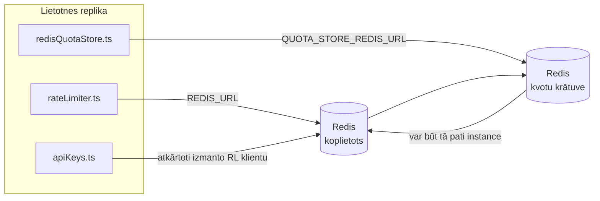

# Redis Production Configuration Guide (Latviešu)

🌐 **Languages:** 🇺🇸 [English](../../../../ops/REDIS_PRODUCTION_CONFIG.md) · 🇪🇹 [am](../../../am/docs/ops/REDIS_PRODUCTION_CONFIG.md) · 🇸🇦 [ar](../../../ar/docs/ops/REDIS_PRODUCTION_CONFIG.md) · 🇦🇿 [az](../../../az/docs/ops/REDIS_PRODUCTION_CONFIG.md) · 🇧🇬 [bg](../../../bg/docs/ops/REDIS_PRODUCTION_CONFIG.md) · 🇧🇩 [bn](../../../bn/docs/ops/REDIS_PRODUCTION_CONFIG.md) · 🇧🇦 [bs](../../../bs/docs/ops/REDIS_PRODUCTION_CONFIG.md) · 🇨🇿 [cs](../../../cs/docs/ops/REDIS_PRODUCTION_CONFIG.md) · 🇩🇰 [da](../../../da/docs/ops/REDIS_PRODUCTION_CONFIG.md) · 🇩🇪 [de](../../../de/docs/ops/REDIS_PRODUCTION_CONFIG.md) · 🇬🇷 [el](../../../el/docs/ops/REDIS_PRODUCTION_CONFIG.md) · 🇪🇸 [es](../../../es/docs/ops/REDIS_PRODUCTION_CONFIG.md) · 🇪🇪 [et](../../../et/docs/ops/REDIS_PRODUCTION_CONFIG.md) · 🇮🇷 [fa](../../../fa/docs/ops/REDIS_PRODUCTION_CONFIG.md) · 🇫🇮 [fi](../../../fi/docs/ops/REDIS_PRODUCTION_CONFIG.md) · 🇫🇷 [fr](../../../fr/docs/ops/REDIS_PRODUCTION_CONFIG.md) · 🇮🇪 [ga](../../../ga/docs/ops/REDIS_PRODUCTION_CONFIG.md) · 🇮🇳 [gu](../../../gu/docs/ops/REDIS_PRODUCTION_CONFIG.md) · 🇳🇬 [ha](../../../ha/docs/ops/REDIS_PRODUCTION_CONFIG.md) · 🇮🇱 [he](../../../he/docs/ops/REDIS_PRODUCTION_CONFIG.md) · 🇮🇳 [hi](../../../hi/docs/ops/REDIS_PRODUCTION_CONFIG.md) · 🇭🇷 [hr](../../../hr/docs/ops/REDIS_PRODUCTION_CONFIG.md) · 🇭🇺 [hu](../../../hu/docs/ops/REDIS_PRODUCTION_CONFIG.md) · 🇦🇲 [hy](../../../hy/docs/ops/REDIS_PRODUCTION_CONFIG.md) · 🇮🇩 [id](../../../id/docs/ops/REDIS_PRODUCTION_CONFIG.md) · 🇳🇬 [ig](../../../ig/docs/ops/REDIS_PRODUCTION_CONFIG.md) · 🇮🇹 [it](../../../it/docs/ops/REDIS_PRODUCTION_CONFIG.md) · 🇯🇵 [ja](../../../ja/docs/ops/REDIS_PRODUCTION_CONFIG.md) · 🇬🇪 [ka](../../../ka/docs/ops/REDIS_PRODUCTION_CONFIG.md) · 🇰🇭 [km](../../../km/docs/ops/REDIS_PRODUCTION_CONFIG.md) · 🇮🇳 [kn](../../../kn/docs/ops/REDIS_PRODUCTION_CONFIG.md) · 🇰🇷 [ko](../../../ko/docs/ops/REDIS_PRODUCTION_CONFIG.md) · 🇱🇹 [lt](../../../lt/docs/ops/REDIS_PRODUCTION_CONFIG.md) · 🇮🇳 [ml](../../../ml/docs/ops/REDIS_PRODUCTION_CONFIG.md) · 🇮🇳 [mr](../../../mr/docs/ops/REDIS_PRODUCTION_CONFIG.md) · 🇲🇾 [ms](../../../ms/docs/ops/REDIS_PRODUCTION_CONFIG.md) · 🇲🇹 [mt](../../../mt/docs/ops/REDIS_PRODUCTION_CONFIG.md) · 🇲🇲 [my](../../../my/docs/ops/REDIS_PRODUCTION_CONFIG.md) · 🇳🇵 [ne](../../../ne/docs/ops/REDIS_PRODUCTION_CONFIG.md) · 🇳🇱 [nl](../../../nl/docs/ops/REDIS_PRODUCTION_CONFIG.md) · 🇳🇴 [no](../../../no/docs/ops/REDIS_PRODUCTION_CONFIG.md) · 🇮🇳 [or](../../../or/docs/ops/REDIS_PRODUCTION_CONFIG.md) · 🇮🇳 [pa](../../../pa/docs/ops/REDIS_PRODUCTION_CONFIG.md) · 🇵🇭 [phi](../../../phi/docs/ops/REDIS_PRODUCTION_CONFIG.md) · 🇵🇱 [pl](../../../pl/docs/ops/REDIS_PRODUCTION_CONFIG.md) · 🇵🇹 [pt](../../../pt/docs/ops/REDIS_PRODUCTION_CONFIG.md) · 🇧🇷 [pt-BR](../../../pt-BR/docs/ops/REDIS_PRODUCTION_CONFIG.md) · 🇷🇴 [ro](../../../ro/docs/ops/REDIS_PRODUCTION_CONFIG.md) · 🇷🇺 [ru](../../../ru/docs/ops/REDIS_PRODUCTION_CONFIG.md) · 🇱🇰 [si](../../../si/docs/ops/REDIS_PRODUCTION_CONFIG.md) · 🇸🇰 [sk](../../../sk/docs/ops/REDIS_PRODUCTION_CONFIG.md) · 🇸🇮 [sl](../../../sl/docs/ops/REDIS_PRODUCTION_CONFIG.md) · 🇷🇸 [sr](../../../sr/docs/ops/REDIS_PRODUCTION_CONFIG.md) · 🇸🇪 [sv](../../../sv/docs/ops/REDIS_PRODUCTION_CONFIG.md) · 🇰🇪 [sw](../../../sw/docs/ops/REDIS_PRODUCTION_CONFIG.md) · 🇮🇳 [ta](../../../ta/docs/ops/REDIS_PRODUCTION_CONFIG.md) · 🇮🇳 [te](../../../te/docs/ops/REDIS_PRODUCTION_CONFIG.md) · 🇹🇭 [th](../../../th/docs/ops/REDIS_PRODUCTION_CONFIG.md) · 🇹🇷 [tr](../../../tr/docs/ops/REDIS_PRODUCTION_CONFIG.md) · 🇺🇦 [uk-UA](../../../uk-UA/docs/ops/REDIS_PRODUCTION_CONFIG.md) · 🇵🇰 [ur](../../../ur/docs/ops/REDIS_PRODUCTION_CONFIG.md) · 🇺🇿 [uz](../../../uz/docs/ops/REDIS_PRODUCTION_CONFIG.md) · 🇻🇳 [vi](../../../vi/docs/ops/REDIS_PRODUCTION_CONFIG.md) · 🇳🇬 [yo](../../../yo/docs/ops/REDIS_PRODUCTION_CONFIG.md) · 🇨🇳 [zh-CN](../../../zh-CN/docs/ops/REDIS_PRODUCTION_CONFIG.md) · 🇹🇼 [zh-TW](../../../zh-TW/docs/ops/REDIS_PRODUCTION_CONFIG.md)

---

## Pārskats

Redis ir **izvēles, mīksta atkarība** OmniRoute — lietojumprogramma graciozi degradējas (atmiņas atkāpšanās), kad Redis nav pieejams. Ražošanā Redis regulēšana samazina latentumu četrām dažādām darba slodzēm:

| Darba slodze                 | Šoferis                       | Klientu rūpnīca                                 | Taustiņu modelis                                  |
| ---------------------------- | ----------------------------- | ----------------------------------------------- | ------------------------------------------------- |
| Likmes ierobežošana          | `rateLimiter.ts`              | `getRedisClient()` — slinks `ioredis` singleton | `<prefix>rl:*` Lua atomu ātruma ierobežojuma logi |
| Auth cache                   | `apiKeys.ts`                  | Atkārtoti izmanto `rateLimiter` klientu         | `<prefix>auth:api_key:<sha256>` ar TTL            |
| Kvotu veikals                | `redisQuotaStore.ts`          | Atsevišķs `getRedisClient(url)` viengabals      | `<prefix>quota:*` konfigurējams katrā instancē    |
| Sildīšanas ķēdes pārtraucējs | `redisCircuitBreakerStore.ts` | Atsevišķs klients `circuitBreakerFactory.ts`    | `<prefix>warmup:cb:<connectionId>`                |

Visām četrām darba slodzēm ir viens nosaukumvietas prefikss, lai OmniRoute varētu pastāvēt līdzās citām lietotnēm vienā Redis instancē (piemēram, `127.0.0.1:6379`). Skatiet [Atslēgvārdu atstarpes](#key-namespacing).

---

## Pašreizējā konfigurācija (koda noklusējuma iestatījumi)

| Iestatījums                     | Vērtība                                                 | Kur                                                                                   |
| ------------------------------- | ------------------------------------------------------- | ------------------------------------------------------------------------------------- |
| `REDIS_URL` env var             | `redis://redis:6379` (sastādīt), pēc izvēles            | `rateLimiter.ts:5`, `.env.example`                                                    |
| `REDIS_KEY_PREFIX` env var      | `omniroute:` (noklusējums)                              | `rateLimiter.ts`, `redisQuotaStore.ts`, `redisCircuitBreakerStore.ts`, `.env.example` |
| `QUOTA_STORE_REDIS_URL` env var | atsevišķi, var atšķirties no `REDIS_URL`                | `quota/storeFactory.ts`                                                               |
| `QUOTA_STORE_DRIVER`            | `"sqlite"` (noklusējums), `"redis"` nav obligāta        | `quota/storeFactory.ts`                                                               |
| ioredis `maxRetriesPerRequest`  | `3`                                                     | `rateLimiter.ts` klienta izveide                                                      |
| `enableReadyCheck`              | nav iestatīts (ioredis noklusējuma: `true`)             | —                                                                                     |
| `lazyConnect`                   | nav iestatīts (ioredis noklusējuma: `false`)            | —                                                                                     |
| `retryStrategy`                 | nav iestatīts (noklusējums: 200 ms bāze, eksponenciāls) | —                                                                                     |
| TLS / parole / DB indekss       | **nav konfigurēts**                                     | —                                                                                     |
| Sentinel / klasteris            | **nav konfigurēts** Tikai — savrupajam vienam mezglam   | —                                                                                     |

---

## Atslēgu nosaukumvietas

OmniRoute koplieto Redis instanci ar visu pārējo, kas darbojas resursdatorā. Bez nosaukumvietas tādas atslēgas kā `auth:api_key:<sha256>` vai `rl:*` varētu konfliktēt ar atslēgām no citām lietojumprogrammām, kas izmanto to pašu Redis (šī instance darbojas adresē `127.0.0.1:6379` kopā ar citiem pakalpojumiem).

Iestatiet `REDIS_KEY_PREFIX` kā netukšu virkni, lai pievienotu prefiksu **katrai** OmniRoute atslēgai:

```bash
# .env — visas OmniRoute atslēgas kļūst par omniroute:rl:*, omniroute:auth:*, omniroute:quota:*, omniroute:warmup:cb:*
REDIS_KEY_PREFIX=omniroute:
```

- **Noklusējums:** `omniroute:` (tiek izmantots, ja `REDIS_KEY_PREFIX` nav iestatīts vai ir tukšs).
- **Tiek lietots:** pieprasījumu biežuma ierobežotājam un autentifikācijas kešatmiņai (koplietots `ioredis` klients, izmantojot `keyPrefix`), kvotu krātuvei (`KEY_PREFIX = "${REDIS_KEY_PREFIX}quota"`) un iesildīšanas ķēdes pārtraucējam (`KEY_PREFIX = "${REDIS_KEY_PREFIX}warmup:cb:"`).
- **Prefiksa maiņa**, ja Redis jau pastāv atslēgas, atstāj vecās atslēgas bez izmantotāja (to derīgums beidzas, izmantojot TTL / LRU). To var droši mainīt; migrācija nav nepieciešama. Vienīgais izņēmums ir iesildīšanas ķēdes pārtraucēja atslēga savienojumam, kas atzīmēts kā aizliegts: tā tiek saglabāta bez TTL, tāpēc uzskaitiet atlikušās atslēgas ar `redis-cli --scan --pattern '<old-prefix>warmup:cb:*'` un izdzēsiet tās.
- **ioredis `keyPrefix`** automātiski pievieno prefiksu rakstīšanas laikā **un** noņem to lasīšanas laikā, tāpēc lietojumprogrammas kods prefiksu nekad neredz.

---

## Ieteicamā ražošanas regulēšana

### 1. Savienojumu kopa/klienta opcijas (ioredis `Redis` konstruktors)

Pašreizējais kods izveido vienu `new Redis(url)` bez pielāgotām opcijām. Ražošanas vairāku reprodukciju izvietošanai nododiet klienta rūpnīcu kodā vai ietiniet `getRedisClient()`:

```typescript
const redis = new Redis(REDIS_URL, {
  maxRetriesPerRequest: null, // no retry limit; let retryStrategy decide
  enableReadyCheck: true, // verify server is ready before accepting calls
  lazyConnect: true, // don't connect on construction; wait for first call
  retryStrategy: (times) => {
    if (times > 10) return null; // give up after 10 retries → reconnect later
    return Math.min(times * 200, 5000); // 200ms, 400ms, …, 5s cap
  },
  enableAutoPipelining: true, // coalesce concurrent commands into one TCP write
  keepAlive: 10000, // TCP keep‑alive every 10s
});
```

**Galvenie kompromisi:**

- `maxRetriesPerRequest: null` + `retryStrategy` — ir ieteicama ražošanai, lai pārejoša Redis restartēšana nekavējoties neizdodas katram pieprasījumam. Atmiņas atkāpšanās `checkRateLimit()` absorbē atteices ceļu.
- `lazyConnect: true` — novērš startēšanas atkarību no Redis darbības sākuma, pirms serveris sāk pieņemt savienojumus.
- `enableAutoPipelining: true` — samazina lidojumus turp un atpakaļ vienlaicīgai likmes ierobežojumu pārbaudēm; izdevīga > 50 RPS vienā savienojumā.

### 2. Redis servera konfigurācija (`redis.conf`)

```
# Memory
maxmemory 80%                        # leave room for OS page cache
maxmemory-policy allkeys-lru         # evict stale auth cache entries under pressure

# Persistence (optional — OmniRoute is crash‑safe without it)
save 300 1                           # snapshot at least every 5 min if ≥1 key changed
appendonly no                        # AOF not needed; data is regeneratable
appendfsync no                       # no fsync overhead (RDB is sufficient)

# Networking
timeout 0                            # no idle disconnect
tcp-keepalive 300                    # 5 min keep‑alive
tcp-backlog 511                      # connection backlog for bursty load

# Performance
hz 10                                # default; 100 for latency‑sensitive
activedefrag yes                     # auto‑defragment when fragmentation >10%
```

**Kompromiss attiecībā uz `maxmemory-policy allkeys-lru`:** Auth kešatmiņas ieraksti var tikt izlikti ar atmiņas spiedienu. Tas ir drošs — `setCachedApiKey` vienmēr tiek atkārtoti aizpildīts, kad tiek palaists garām, un SQLite rezerves variants ir autoritatīvs. Ātruma ierobežotāja Lua skripts izveido mazus taustiņus, kas pēc konstrukcijas ir īslaicīgi.

### 3. Docker Compose Settings

Prod sastādīšana (`docker-compose.prod.yml`) izmanto `redis:8.6.2-alpine`. Pievienot:

```yaml
redis:
  image: redis:8.6.2-alpine
  command:
    [
      "redis-server",
      "--maxmemory",
      "512mb",
      "--maxmemory-policy",
      "allkeys-lru",
      "--activedefrag",
      "yes",
      "--save",
      "300 1",
    ]
  healthcheck:
    test: ["CMD", "redis-cli", "ping"]
    interval: 10s
    timeout: 3s
    retries: 3
    start_period: 5s
```

### 4. Vairāku instanču/mērogošanas apsvērumi

**Viena Redis visām replikām** — ātruma ierobežotāja Lua skripts ir atkarīgs no vienas autoritatīvās atslēgas vietas. Vairāki Redis gadījumi aiz replikām zaudētu atomitāti un dubultotu budžetu. Izmantojiet vienu Redis (vai Redis Sentinel kopu ar kļūmjpārlēci) visām lietojumprogrammu replikām.

**Savienojumu skaits:** Tiek atvērta katra lietojumprogrammas kopija **2 TCP savienojumi** uz Redis (likmju ierobežotāja klienta + kvotu veikala klients). Pie 10 → 20 savienojumu replikām, kas atbilst noklusējuma Redis instances 10 k savienojuma griestiem.

### 5. Uzraudzība

Atklāt, izmantojot veselības pārbaudes galapunktu:

```typescript
// src/app/api/monitoring/health/route.ts already calls rateLimiter functions
// Add Redis-specific checks:
//   1. PING latency via ioredis .ping()
//   2. Memory usage via INFO memory
//   3. Connection count via INFO clients
//   4. Hit rate for maxmemory-policy (evicted_keys / keyspace_hits)
```

Galvenie skatāmie rādītāji:

- **Izliktas atslēgas/sek** Ja — pastāvīgi atšķiras no nulles, palieliniet `maxmemory`
- **Bloķētie klienti** — kas nav nulle, liecina par lēniem Lua skriptiem vai augstu strīdu
- **Noraidīti savienojumi** — savienojuma ierobežojums sasniegts; reti pie 20 savienojumiem

### 6. Redis saderīgi serveri

Jebkuram šeit izmantotajam serverim ir jāpalaiž Lua skripti: ātruma ierobežotājs ir viens `EVAL`. Serverī bez Lua `checkRateLimit()` reģistrē `[RATE_LIMITER] Redis eval failed, falling back to in-memory rate limiting` un uzskaita katru procesu, tāpēc katra replika ievieš ierobežojumu atsevišķi. Izvēles koplietojamo sesiju radniecības veikals (`OMNIROUTE_SESSION_AFFINITY_STORE=redis`) arī nolasa un atjaunina tapas ar `EVAL`; bez Lua tas reģistrē `[SESSION_AFFINITY] Redis error; falling back to SQLite.`, un katrai kopijai ir savi tapas. Citās darba slodzēs tiek izmantotas vienkāršas komandas (`SET ... EX`, `GET`, `DEL`, `MGET`, `EXPIRE`, `INCRBYFLOAT`, jaucējkodi un kopas), un semantiskās kešatmiņas Redis aizmugursistēma nesūta `FT.*` komandas.

Pārbaudīts ar OmniRoute 3.8.52: KiviDB 1.2.0 ar Lua attēlu (`kividb/kividb:v1.2.0-lua`). Ātruma ierobežotājs (tostarp otrais process, kurā tiek koplietoti skaitītāji), autentifikācijas kešatmiņa, kvotu krātuve, iesildīšanas ķēdes pārtraucējs, semantiskās kešatmiņas krātuve un `/v1/chat/completions` pieprasījums, izmantojot tērzēšanas apdarinātāju, izturēja 18 no 19 pārbaudēm, kas atbilst Redis 8.10.3. Tas, kas atšķiras: `INCRBYFLOAT` uzglabā `0.1 + 0.2` kā `0.30000000000000004`, kur Redis uzglabā `0.3` ( [kividbio/kividb#387](https://github.com/kividbio/kividb/issues/387) ). Kvotu veikals parsē abus ar `parseFloat`, taču abi skaitļi atšķiras ar pēdējiem cipariem, tāpēc salīdzinājums, kas precīzi atbilst kvotas robežai, var iznākt atšķirīgi. Sesiju interešu veikals nebija daļa no šīs darbības. ( [iestatīšana](https://github.com/kividbio/kividb/blob/master/docs/integrations/omniroute.md), [rezultāti](https://github.com/kividbio/kividb/tree/master/benchmarks/omniroute-compat) )

---

## Arhitektūras diagramma



---

## Atsauces

| Fails                              | Mērķis                                                                      |
| ---------------------------------- | --------------------------------------------------------------------------- |
| `src/shared/utils/rateLimiter.ts`  | Primārais Redis klients, Lua ātruma ierobežojuma skripts, atkāpšanās atmiņā |
| `src/lib/db/apiKeys.ts`            | Auth cache — Redis→SQLite atkāpšanās                                        |
| `src/lib/quota/redisQuotaStore.ts` | Atsevišķs Redis klients izvēles kvotu veikalam                              |
| `src/lib/quota/storeFactory.ts`    | Pārslēdzas starp `sqlite` un `redis` kvotu draiveriem                       |
| `docker-compose.prod.yml`          | Prod Redis konteiners (attēls `redis:8.6.2-alpine`)                         |
| `.env.example`                     | Redis env vars dokumentācija                                                |
| `src/app/api/local/redis/`         | API maršruti izstrādātāju konteineru orķestrēšanai                          |
| `bin/cli/commands/redis.mjs`       | CLI komandas dev konteinera orķestrēšanai                                   |
