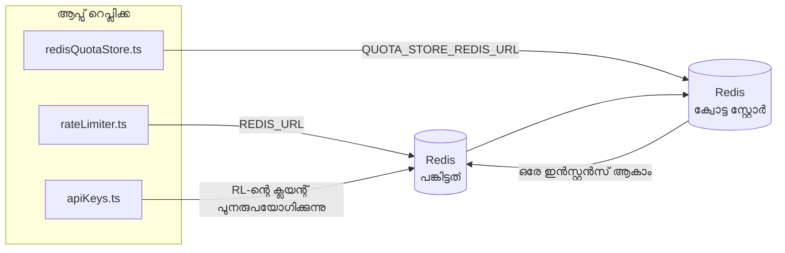

# Redis Production Configuration Guide (മലയാളം)

🌐 **Languages:** 🇺🇸 [English](../../../../ops/REDIS_PRODUCTION_CONFIG.md) · 🇪🇹 [am](../../../am/docs/ops/REDIS_PRODUCTION_CONFIG.md) · 🇸🇦 [ar](../../../ar/docs/ops/REDIS_PRODUCTION_CONFIG.md) · 🇦🇿 [az](../../../az/docs/ops/REDIS_PRODUCTION_CONFIG.md) · 🇧🇬 [bg](../../../bg/docs/ops/REDIS_PRODUCTION_CONFIG.md) · 🇧🇩 [bn](../../../bn/docs/ops/REDIS_PRODUCTION_CONFIG.md) · 🇧🇦 [bs](../../../bs/docs/ops/REDIS_PRODUCTION_CONFIG.md) · 🇨🇿 [cs](../../../cs/docs/ops/REDIS_PRODUCTION_CONFIG.md) · 🇩🇰 [da](../../../da/docs/ops/REDIS_PRODUCTION_CONFIG.md) · 🇩🇪 [de](../../../de/docs/ops/REDIS_PRODUCTION_CONFIG.md) · 🇬🇷 [el](../../../el/docs/ops/REDIS_PRODUCTION_CONFIG.md) · 🇪🇸 [es](../../../es/docs/ops/REDIS_PRODUCTION_CONFIG.md) · 🇪🇪 [et](../../../et/docs/ops/REDIS_PRODUCTION_CONFIG.md) · 🇮🇷 [fa](../../../fa/docs/ops/REDIS_PRODUCTION_CONFIG.md) · 🇫🇮 [fi](../../../fi/docs/ops/REDIS_PRODUCTION_CONFIG.md) · 🇫🇷 [fr](../../../fr/docs/ops/REDIS_PRODUCTION_CONFIG.md) · 🇮🇪 [ga](../../../ga/docs/ops/REDIS_PRODUCTION_CONFIG.md) · 🇮🇳 [gu](../../../gu/docs/ops/REDIS_PRODUCTION_CONFIG.md) · 🇳🇬 [ha](../../../ha/docs/ops/REDIS_PRODUCTION_CONFIG.md) · 🇮🇱 [he](../../../he/docs/ops/REDIS_PRODUCTION_CONFIG.md) · 🇮🇳 [hi](../../../hi/docs/ops/REDIS_PRODUCTION_CONFIG.md) · 🇭🇷 [hr](../../../hr/docs/ops/REDIS_PRODUCTION_CONFIG.md) · 🇭🇺 [hu](../../../hu/docs/ops/REDIS_PRODUCTION_CONFIG.md) · 🇦🇲 [hy](../../../hy/docs/ops/REDIS_PRODUCTION_CONFIG.md) · 🇮🇩 [id](../../../id/docs/ops/REDIS_PRODUCTION_CONFIG.md) · 🇳🇬 [ig](../../../ig/docs/ops/REDIS_PRODUCTION_CONFIG.md) · 🇮🇹 [it](../../../it/docs/ops/REDIS_PRODUCTION_CONFIG.md) · 🇯🇵 [ja](../../../ja/docs/ops/REDIS_PRODUCTION_CONFIG.md) · 🇬🇪 [ka](../../../ka/docs/ops/REDIS_PRODUCTION_CONFIG.md) · 🇰🇭 [km](../../../km/docs/ops/REDIS_PRODUCTION_CONFIG.md) · 🇮🇳 [kn](../../../kn/docs/ops/REDIS_PRODUCTION_CONFIG.md) · 🇰🇷 [ko](../../../ko/docs/ops/REDIS_PRODUCTION_CONFIG.md) · 🇱🇹 [lt](../../../lt/docs/ops/REDIS_PRODUCTION_CONFIG.md) · 🇱🇻 [lv](../../../lv/docs/ops/REDIS_PRODUCTION_CONFIG.md) · 🇮🇳 [mr](../../../mr/docs/ops/REDIS_PRODUCTION_CONFIG.md) · 🇲🇾 [ms](../../../ms/docs/ops/REDIS_PRODUCTION_CONFIG.md) · 🇲🇹 [mt](../../../mt/docs/ops/REDIS_PRODUCTION_CONFIG.md) · 🇲🇲 [my](../../../my/docs/ops/REDIS_PRODUCTION_CONFIG.md) · 🇳🇵 [ne](../../../ne/docs/ops/REDIS_PRODUCTION_CONFIG.md) · 🇳🇱 [nl](../../../nl/docs/ops/REDIS_PRODUCTION_CONFIG.md) · 🇳🇴 [no](../../../no/docs/ops/REDIS_PRODUCTION_CONFIG.md) · 🇮🇳 [or](../../../or/docs/ops/REDIS_PRODUCTION_CONFIG.md) · 🇮🇳 [pa](../../../pa/docs/ops/REDIS_PRODUCTION_CONFIG.md) · 🇵🇭 [phi](../../../phi/docs/ops/REDIS_PRODUCTION_CONFIG.md) · 🇵🇱 [pl](../../../pl/docs/ops/REDIS_PRODUCTION_CONFIG.md) · 🇵🇹 [pt](../../../pt/docs/ops/REDIS_PRODUCTION_CONFIG.md) · 🇧🇷 [pt-BR](../../../pt-BR/docs/ops/REDIS_PRODUCTION_CONFIG.md) · 🇷🇴 [ro](../../../ro/docs/ops/REDIS_PRODUCTION_CONFIG.md) · 🇷🇺 [ru](../../../ru/docs/ops/REDIS_PRODUCTION_CONFIG.md) · 🇱🇰 [si](../../../si/docs/ops/REDIS_PRODUCTION_CONFIG.md) · 🇸🇰 [sk](../../../sk/docs/ops/REDIS_PRODUCTION_CONFIG.md) · 🇸🇮 [sl](../../../sl/docs/ops/REDIS_PRODUCTION_CONFIG.md) · 🇷🇸 [sr](../../../sr/docs/ops/REDIS_PRODUCTION_CONFIG.md) · 🇸🇪 [sv](../../../sv/docs/ops/REDIS_PRODUCTION_CONFIG.md) · 🇰🇪 [sw](../../../sw/docs/ops/REDIS_PRODUCTION_CONFIG.md) · 🇮🇳 [ta](../../../ta/docs/ops/REDIS_PRODUCTION_CONFIG.md) · 🇮🇳 [te](../../../te/docs/ops/REDIS_PRODUCTION_CONFIG.md) · 🇹🇭 [th](../../../th/docs/ops/REDIS_PRODUCTION_CONFIG.md) · 🇹🇷 [tr](../../../tr/docs/ops/REDIS_PRODUCTION_CONFIG.md) · 🇺🇦 [uk-UA](../../../uk-UA/docs/ops/REDIS_PRODUCTION_CONFIG.md) · 🇵🇰 [ur](../../../ur/docs/ops/REDIS_PRODUCTION_CONFIG.md) · 🇺🇿 [uz](../../../uz/docs/ops/REDIS_PRODUCTION_CONFIG.md) · 🇻🇳 [vi](../../../vi/docs/ops/REDIS_PRODUCTION_CONFIG.md) · 🇳🇬 [yo](../../../yo/docs/ops/REDIS_PRODUCTION_CONFIG.md) · 🇨🇳 [zh-CN](../../../zh-CN/docs/ops/REDIS_PRODUCTION_CONFIG.md) · 🇹🇼 [zh-TW](../../../zh-TW/docs/ops/REDIS_PRODUCTION_CONFIG.md)

---

## അവലോകനം

OmniRoute-ൽ Redis ഒരു **ഐച്ഛികമായ, സോഫ്റ്റ് ഡിപെൻഡൻസിയാണ്** — Redis ലഭ്യമല്ലാത്തപ്പോൾ ആപ്ലിക്കേഷൻ ക്രമാനുഗതമായി പ്രവർത്തനക്ഷമത കുറയ്ക്കുന്നു (ഇൻ-മെമ്മറി
ഫാൾബാക്കുകൾ). പ്രൊഡക്ഷനിൽ, Redis ട്യൂൺ ചെയ്യുന്നത് വ്യത്യസ്തമായ നാല്
വർക്ക്ലോഡുകളുടെ ലേറ്റൻസി കുറയ്ക്കുന്നു:

| വർക്ക്ലോഡ്                   | ഡ്രൈവർ                        | ക്ലയന്റ് ഫാക്ടറി                                   | കീ പാറ്റേൺ                                              |
| ---------------------------- | ----------------------------- | -------------------------------------------------- | ------------------------------------------------------- |
| റേറ്റ് ലിമിറ്റിംഗ്           | `rateLimiter.ts`              | `getRedisClient()` — ലേസി `ioredis` സിംഗിൾടൺ       | `<prefix>rl:*` Lua‑ആറ്റോമിക് റേറ്റ് ലിമിറ്റ് വിൻഡോകൾ    |
| ഓത്ത് കാഷ്                   | `apiKeys.ts`                  | `rateLimiter`-ന്റെ ക്ലയന്റ് വീണ്ടും ഉപയോഗിക്കുന്നു | TTL സഹിതമുള്ള `<prefix>auth:api_key:<sha256>`           |
| ക്വോട്ട സ്റ്റോർ              | `redisQuotaStore.ts`          | പ്രത്യേക `getRedisClient(url)` സിംഗിൾടൺ            | ഓരോ ഇൻസ്റ്റൻസിനും കോൺഫിഗർ ചെയ്യാവുന്ന `<prefix>quota:*` |
| വാംഅപ്പ് സർക്യൂട്ട് ബ്രേക്കർ | `redisCircuitBreakerStore.ts` | `circuitBreakerFactory.ts`-ലെ പ്രത്യേക ക്ലയന്റ്    | `<prefix>warmup:cb:<connectionId>`                      |

നാല് വർക്ക്ലോഡുകളും ഒരേ നെയിംസ്പേസ് പ്രിഫിക്സ് പങ്കിടുന്നതിനാൽ, ഒരൊറ്റ Redis ഇൻസ്റ്റൻസിൽ
മറ്റ് ആപ്പുകൾക്കൊപ്പം OmniRoute-ന് പ്രവർത്തിക്കാൻ കഴിയും (ഉദാ. `127.0.0.1:6379`). [കീ നെയിംസ്പേസിംഗ്](#key-namespacing) കാണുക.

---

## നിലവിലെ കോൺഫിഗറേഷൻ (കോഡ് ഡിഫോൾട്ടുകൾ)

| ക്രമീകരണം                             | മൂല്യം                                                                  | എവിടെ                                                                                 |
| ------------------------------------- | ----------------------------------------------------------------------- | ------------------------------------------------------------------------------------- |
| `REDIS_URL` എൻവ് വേരിയബിൾ             | `redis://redis:6379` (compose), ഐച്ഛികം                                 | `rateLimiter.ts:5`, `.env.example`                                                    |
| `REDIS_KEY_PREFIX` എൻവ് വേരിയബിൾ      | `omniroute:` (ഡിഫോൾട്ട്)                                                | `rateLimiter.ts`, `redisQuotaStore.ts`, `redisCircuitBreakerStore.ts`, `.env.example` |
| `QUOTA_STORE_REDIS_URL` എൻവ് വേരിയബിൾ | പ്രത്യേകമാണ്, `REDIS_URL`-ൽ നിന്ന് വ്യത്യസ്തമാകാം                       | `quota/storeFactory.ts`                                                               |
| `QUOTA_STORE_DRIVER`                  | `"sqlite"` (ഡിഫോൾട്ട്), `"redis"` ഐച്ഛികം                               | `quota/storeFactory.ts`                                                               |
| ioredis `maxRetriesPerRequest`        | `3`                                                                     | `rateLimiter.ts` ക്ലയന്റ് സൃഷ്ടിക്കൽ                                                  |
| `enableReadyCheck`                    | സജ്ജീകരിച്ചിട്ടില്ല (ioredis ഡിഫോൾട്ട്: `true`)                         | —                                                                                     |
| `lazyConnect`                         | സജ്ജീകരിച്ചിട്ടില്ല (ioredis ഡിഫോൾട്ട്: `false`)                        | —                                                                                     |
| `retryStrategy`                       | സജ്ജീകരിച്ചിട്ടില്ല (ioredis ഡിഫോൾട്ട്: 200ms അടിസ്ഥാനം, എക്സ്പോണൻഷ്യൽ) | —                                                                                     |
| TLS / പാസ്വേഡ് / DB ഇൻഡക്സ്           | **കോൺഫിഗർ ചെയ്തിട്ടില്ല**                                               | —                                                                                     |
| Sentinel / Cluster                    | **കോൺഫിഗർ ചെയ്തിട്ടില്ല** — സ്റ്റാൻഡ്അലോൺ സിംഗിൾ-നോഡ് മാത്രം            | —                                                                                     |

---

## കീ നെയിംസ്പേസിംഗ്

ഹോസ്റ്റിൽ പ്രവർത്തിക്കുന്ന മറ്റെല്ലാ സേവനങ്ങളുമായും OmniRoute ഒരു Redis ഇൻസ്റ്റൻസ് പങ്കിടുന്നു. ഒരു നെയിംസ്പേസ് ഇല്ലെങ്കിൽ,
`auth:api_key:<sha256>` അല്ലെങ്കിൽ `rl:*` പോലുള്ള കീകൾ അതേ Redis ഉപയോഗിക്കുന്ന മറ്റ് ആപ്ലിക്കേഷനുകളുടെ
കീകളുമായി കൂട്ടിയിടിക്കാം (ഈ ഇൻസ്റ്റൻസ് മറ്റ് സേവനങ്ങൾക്കൊപ്പം `127.0.0.1:6379`-ൽ Redis പ്രവർത്തിപ്പിക്കുന്നു).

OmniRoute-ന്റെ **എല്ലാ** കീകൾക്കും പ്രിഫിക്സ് ചേർക്കാൻ `REDIS_KEY_PREFIX` ശൂന്യമല്ലാത്ത ഒരു സ്ട്രിങ്ങായി സജ്ജീകരിക്കുക:

```bash
# .env — എല്ലാ OmniRoute കീകളും omniroute:rl:*, omniroute:auth:*, omniroute:quota:*, omniroute:warmup:cb:* ആയി മാറുന്നു
REDIS_KEY_PREFIX=omniroute:
```

- **ഡിഫോൾട്ട്:** `omniroute:` (`REDIS_KEY_PREFIX` സജ്ജീകരിക്കാത്തപ്പോഴോ ശൂന്യമായിരിക്കുമ്പോഴോ പ്രയോഗിക്കുന്നു).
- **പ്രയോഗിക്കുന്നത്:** റേറ്റ് ലിമിറ്റർ + ഓത്ത് കാഷ് (`keyPrefix` വഴി പങ്കിടുന്ന `ioredis` ക്ലയന്റ്), കൂടാതെ
  ക്വോട്ട സ്റ്റോർ (`KEY_PREFIX = "${REDIS_KEY_PREFIX}quota"`), വാംഅപ്പ് സർക്യൂട്ട് ബ്രേക്കർ
  (`KEY_PREFIX = "${REDIS_KEY_PREFIX}warmup:cb:"`).
- Redis-ൽ കീകൾ ഇതിനകം നിലവിലിരിക്കുമ്പോൾ **പ്രിഫിക്സ് മാറ്റുന്നത്** പഴയ കീകളെ അനാഥമാക്കുന്നു (അവ TTL / LRU വഴി
  കാലഹരണപ്പെടും). മാറ്റുന്നത് സുരക്ഷിതമാണ്; മൈഗ്രേഷൻ ആവശ്യമില്ല. നിരോധിതമായി അടയാളപ്പെടുത്തിയ ഒരു കണക്ഷനുള്ള വാംഅപ്പ്
  സർക്യൂട്ട്-ബ്രേക്കർ കീ മാത്രമാണ് ഇതിന് അപവാദം: അത് TTL ഇല്ലാതെ നിലനിർത്തുന്നതിനാൽ,
  ശേഷിക്കുന്ന കീകൾ `redis-cli --scan --pattern '<old-prefix>warmup:cb:*'` ഉപയോഗിച്ച് ലിസ്റ്റ് ചെയ്ത് ഇല്ലാതാക്കുക.
- **ioredis `keyPrefix`** റൈറ്റുകളിൽ സ്വയമേവ പ്രിഫിക്സ് മുൻചേർക്കുകയും റീഡുകളിൽ അത് നീക്കം ചെയ്യുകയും ചെയ്യുന്നതിനാൽ,
  ആപ്ലിക്കേഷൻ കോഡിൽ പ്രിഫിക്സ് ഒരിക്കലും ദൃശ്യമാകില്ല.

---

## ശുപാർശ ചെയ്യുന്ന പ്രൊഡക്ഷൻ ട്യൂണിംഗ്

### 1. കണക്ഷൻ പൂൾ / ക്ലയൻ്റ് ഓപ്ഷനുകൾ (ioredis `Redis` കൺസ്ട്രക്റ്റർ)

നിലവിലെ കോഡ് ഇഷ്ടാനുസൃത ഓപ്ഷനുകളില്ലാതെ ഒരൊറ്റ `new Redis(url)` സൃഷ്ടിക്കുന്നു. പ്രൊഡക്ഷൻ മൾട്ടി-റെപ്ലിക്ക വിന്യാസങ്ങൾക്കായി, ഒരു ക്ലയൻ്റ് ഫാക്ടറി കോഡിൽ നൽകുക അല്ലെങ്കിൽ `getRedisClient()` പൊതിയുക:

```typescript
const redis = new Redis(REDIS_URL, {
  maxRetriesPerRequest: null, // no retry limit; let retryStrategy decide
  enableReadyCheck: true, // verify server is ready before accepting calls
  lazyConnect: true, // don't connect on construction; wait for first call
  retryStrategy: (times) => {
    if (times > 10) return null; // give up after 10 retries → reconnect later
    return Math.min(times * 200, 5000); // 200ms, 400ms, …, 5s cap
  },
  enableAutoPipelining: true, // coalesce concurrent commands into one TCP write
  keepAlive: 10000, // TCP keep‑alive every 10s
});
```

**പ്രധാന ഇടപാടുകൾ:**

- `maxRetriesPerRequest: null` + `retryStrategy` — ഉൽപ്പാദനത്തിന് മുൻഗണന നൽകുന്നതിനാൽ ക്ഷണികമായ Redis പുനരാരംഭിക്കുന്നത് എല്ലാ അഭ്യർത്ഥനകളും ഉടനടി പരാജയപ്പെടില്ല. `checkRateLimit()` ലെ ഇൻ-മെമ്മറി ഫാൾബാക്ക് പരാജയ പാതയെ ആഗിരണം ചെയ്യുന്നു.
- `lazyConnect: true` — സെർവർ കണക്ഷനുകൾ സ്വീകരിക്കാൻ തുടങ്ങുന്നതിനുമുമ്പ്, Redis യെ സ്റ്റാർട്ടപ്പ് ഡിപൻഡൻസി ഒഴിവാക്കുന്നു.
- `enableAutoPipelining: true` — കൺകറൻ്റ് റേറ്റ്-ലിമിറ്റ് ചെക്കുകൾക്കായി റൗണ്ട് ട്രിപ്പുകൾ കുറയ്ക്കുന്നു; ഒരൊറ്റ കണക്ഷനിൽ > 50 RPS ൽ പ്രയോജനകരമാണ്.

### 2. Redis സെർവർ കോൺഫിഗറേഷൻ (`redis.conf`)

```
# Memory
maxmemory 80%                        # leave room for OS page cache
maxmemory-policy allkeys-lru         # evict stale auth cache entries under pressure

# Persistence (optional — OmniRoute is crash‑safe without it)
save 300 1                           # snapshot at least every 5 min if ≥1 key changed
appendonly no                        # AOF not needed; data is regeneratable
appendfsync no                       # no fsync overhead (RDB is sufficient)

# Networking
timeout 0                            # no idle disconnect
tcp-keepalive 300                    # 5 min keep‑alive
tcp-backlog 511                      # connection backlog for bursty load

# Performance
hz 10                                # default; 100 for latency‑sensitive
activedefrag yes                     # auto‑defragment when fragmentation >10%
```

**`maxmemory-policy allkeys-lru` യുടെ വ്യാപാരം:** മെമ്മറി സമ്മർദ്ദത്തിൽ ഓത്ത് കാഷെ എൻട്രികൾ ഒഴിവാക്കിയേക്കാം. ഇത് സുരക്ഷിതമാണ് — `setCachedApiKey` എല്ലായ്പ്പോഴും നഷ്ടപ്പെടുമ്പോൾ വീണ്ടും പോപ്പുലേറ്റ് ചെയ്യുന്നു, കൂടാതെ SQLite ഫാൾബാക്ക് ആധികാരികവുമാണ്. റേറ്റ്-ലിമിറ്റർ ലുവാ സ്ക്രിപ്റ്റ് ചെറിയ കീകൾ സൃഷ്ടിക്കുന്നു, അത് ഡിസൈൻ പ്രകാരം ഹ്രസ്വകാലമാണ്.

### 3. Docker കമ്പോസ് ക്രമീകരണങ്ങൾ

പ്രോഡ് കമ്പോസ് (`docker-compose.prod.yml`) `redis:8.6.2-alpine` ഉപയോഗിക്കുന്നു. ചേർക്കുക:

```yaml
redis:
  image: redis:8.6.2-alpine
  command:
    [
      "redis-server",
      "--maxmemory",
      "512mb",
      "--maxmemory-policy",
      "allkeys-lru",
      "--activedefrag",
      "yes",
      "--save",
      "300 1",
    ]
  healthcheck:
    test: ["CMD", "redis-cli", "ping"]
    interval: 10s
    timeout: 3s
    retries: 3
    start_period: 5s
```

### 4. മൾട്ടി-ഇൻസ്റ്റൻസ് / സ്കെയിലിംഗ് പരിഗണനകൾ

**എല്ലാ പകർപ്പുകൾക്കും ഒറ്റ Redis** — റേറ്റ്-ലിമിറ്റർ Lua സ്ക്രിപ്റ്റ് ഒരൊറ്റ ആധികാരിക കീ സ്പെയ്സിനെ ആശ്രയിച്ചിരിക്കുന്നു. പകർപ്പുകൾക്ക് പിന്നിലുള്ള ഒന്നിലധികം Redis സംഭവങ്ങൾ ആറ്റോമിസിറ്റി നഷ്ടപ്പെടുകയും ബജറ്റ് ഇരട്ടിയാക്കുകയും ചെയ്യും. എല്ലാ ആപ്ലിക്കേഷൻ പകർപ്പുകൾക്കും ഒരൊറ്റ Redis (അല്ലെങ്കിൽ പരാജയമുള്ള Redis സെൻ്റിനൽ ക്ലസ്റ്റർ) ഉപയോഗിക്കുക.

**കണക്ഷൻ എണ്ണം:** ഓരോ ആപ്ലിക്കേഷൻ്റെ പകർപ്പും തുറക്കുന്നു** 2 TCP കണക്ഷനുകൾ** Redis ലേക്ക് (റേറ്റ് ലിമിറ്റർ ക്ലയൻ്റ് + ക്വാട്ട സ്റ്റോർ ക്ലയൻ്റ്). 10 replicas → 20 കണക്ഷനുകളിൽ, ഒരു ഡിഫോൾട്ട് Redis ഇൻസ്റ്റൻസിൻ്റെ 10k കണക്ഷൻ പരിധിക്കുള്ളിൽ.

### 5. നിരീക്ഷണം

ഹെൽത്ത് ചെക്ക് എൻഡ്പോയിൻ്റ് വഴി വെളിപ്പെടുത്തുക:

```typescript
// src/app/api/monitoring/health/route.ts already calls rateLimiter functions
// Add Redis-specific checks:
//   1. PING latency via ioredis .ping()
//   2. Memory usage via INFO memory
//   3. Connection count via INFO clients
//   4. Hit rate for maxmemory-policy (evicted_keys / keyspace_hits)
```

കാണേണ്ട പ്രധാന മെട്രിക്കുകൾ:

- **പുറത്താക്കിയ കീകൾ / സെക്കൻ്റ്** — സ്ഥിരമായി പൂജ്യമല്ലെങ്കിൽ, `maxmemory` വർദ്ധിപ്പിക്കുക
- **ഉപഭോക്താക്കൾ തടഞ്ഞു** — പൂജ്യമല്ലാത്തത് വേഗത കുറഞ്ഞ Lua സ്ക്രിപ്റ്റുകൾ അല്ലെങ്കിൽ ഉയർന്ന തർക്കം നിർദ്ദേശിക്കുന്നു
- **നിരസിച്ച കണക്ഷനുകൾ** — കണക്ഷൻ പരിധി ഹിറ്റ്; 20 കണക്ഷനുകളിൽ അപൂർവ്വം

### 6. റെഡിസ്-അനുയോജ്യമായ സെർവറുകൾ

ഇവിടെ ഉപയോഗിക്കുന്ന ഏതൊരു സെർവറും ലുവാ സ്ക്രിപ്റ്റുകൾ പ്രവർത്തിപ്പിക്കണം: നിരക്ക് ലിമിറ്റർ ഒരു `EVAL` ആണ്. Lua ഇല്ലാത്ത ഒരു സെർവറിൽ, `checkRateLimit()` `[RATE_LIMITER] Redis eval failed, falling back to in-memory rate limiting` ലോഗിൻ ചെയ്യുകയും ഓരോ പ്രോസസ്സിനും കണക്കാക്കുകയും ചെയ്യുന്നു, അതിനാൽ ഓരോ പകർപ്പും അതിൻ്റേതായ പരിധി നടപ്പിലാക്കുന്നു. ഓപ്റ്റ്-ഇൻ പങ്കിട്ട സെഷൻ-അഫിനിറ്റി സ്റ്റോറും (`OMNIROUTE_SESSION_AFFINITY_STORE=redis`) `EVAL` ഉപയോഗിച്ച് പിൻസ് വായിക്കുകയും അപ്ഡേറ്റ് ചെയ്യുകയും ചെയ്യുന്നു; Lua ഇല്ലാതെ അത് `[SESSION_AFFINITY] Redis error; falling back to SQLite.` ലോഗ് ചെയ്യുന്നു, ഓരോ പകർപ്പും അതിൻ്റേതായ പിന്നുകൾ സൂക്ഷിക്കുന്നു. മറ്റ് വർക്ക്ലോഡുകൾ പ്ലെയിൻ കമാൻഡുകൾ ഉപയോഗിക്കുന്നു (`SET ... EX`, `GET`, `DEL`, `MGET`, `EXPIRE`, `INCRBYFLOAT`, ഹാഷുകളും സെറ്റുകളും), കൂടാതെ സെമാൻ്റിക് കാഷെയുടെ Redis ബാക്കെൻഡ് `FT.*` കമാൻഡുകൾ അയയ്ക്കുന്നില്ല.

OmniRoute 3.8.52 ഉപയോഗിച്ച് പരീക്ഷിച്ചു: KiviDB 1.2.0 അതിൻ്റെ Lua ഇമേജിനൊപ്പം (`kividb/kividb:v1.2.0-lua`). റേറ്റ് ലിമിറ്റർ (കൗണ്ടറുകൾ പങ്കിടുന്ന രണ്ടാമത്തെ പ്രക്രിയ ഉൾപ്പെടെ), ഓത്ത് കാഷെ, ക്വാട്ട സ്റ്റോർ, വാംഅപ്പ് സർക്യൂട്ട് ബ്രേക്കർ, സെമാൻ്റിക് കാഷെ സ്റ്റോർ, ചാറ്റ് ഹാൻഡ്ലർ വഴിയുള്ള ഒരു `/v1/chat/completions` അഭ്യർത്ഥന എന്നിവ Redis 8.10.3-ൽ കടന്നുപോകുന്ന 19 ചെക്കുകളിൽ 18 എണ്ണവും കടന്നുപോയി. വ്യത്യസ്തമായ ഒന്ന്: `INCRBYFLOAT` `0.1 + 0.2` `0.30000000000000004` ആയി സംഭരിക്കുന്നു, അവിടെ Redis `0.3` ( [kividbio/kividb#387](https://github.com/kividbio/kividb/issues/387) ) സംഭരിക്കുന്നു. ക്വാട്ട സ്റ്റോർ രണ്ടും `parseFloat` ഉപയോഗിച്ച് പാഴ്സ് ചെയ്യുന്നു, എന്നാൽ രണ്ട് അക്കങ്ങളും അവസാന അക്കങ്ങളിൽ വ്യത്യാസപ്പെട്ടിരിക്കുന്നു, അതിനാൽ ഒരു ക്വാട്ട അതിർത്തിയിൽ കൃത്യമായി വരുന്ന ഒരു താരതമ്യം വ്യത്യസ്തമായി പുറത്തുവരാം. സെഷൻ-അഫിനിറ്റി സ്റ്റോർ ആ ഓട്ടത്തിൻ്റെ ഭാഗമായിരുന്നില്ല. ( [സജ്ജീകരണം](https://github.com/kividbio/kividb/blob/master/docs/integrations/omniroute.md), [ഫലങ്ങൾ](https://github.com/kividbio/kividb/tree/master/benchmarks/omniroute-compat) )

---

## ആർക്കിടെക്ചർ ഡയഗ്രം



---

## റഫറൻസുകൾ

| ഫയൽ                                | ഉദ്ദേശ്യം                                                                       |
| ---------------------------------- | ------------------------------------------------------------------------------- |
| `src/shared/utils/rateLimiter.ts`  | പ്രാഥമിക Redis ക്ലയന്റ്, Lua റേറ്റ്-ലിമിറ്റ് സ്ക്രിപ്റ്റ്, ഇൻ-മെമ്മറി ഫാൾബാക്ക് |
| `src/lib/db/apiKeys.ts`            | ഓത്ത് കാഷ് — Redis→SQLite ഫാൾബാക്ക്                                             |
| `src/lib/quota/redisQuotaStore.ts` | ഐച്ഛിക ക്വോട്ട സ്റ്റോറിനായുള്ള പ്രത്യേക Redis ക്ലയന്റ്                          |
| `src/lib/quota/storeFactory.ts`    | `sqlite`, `redis` ക്വോട്ട ഡ്രൈവറുകൾക്കിടയിൽ മാറുന്നു                            |
| `docker-compose.prod.yml`          | പ്രൊഡക്ഷൻ Redis കണ്ടെയ്നർ (`redis:8.6.2-alpine` ഇമേജ്)                          |
| `.env.example`                     | Redis എൻവയോൺമെന്റ് വേരിയബിളുകളുടെ ഡോക്യുമെന്റേഷൻ                                |
| `src/app/api/local/redis/`         | ഡെവലപ്മെന്റ് കണ്ടെയ്നർ ഓർക്കസ്ട്രേഷനുള്ള API റൂട്ടുകൾ                           |
| `bin/cli/commands/redis.mjs`       | ഡെവലപ്മെന്റ് കണ്ടെയ്നർ ഓർക്കസ്ട്രേഷനുള്ള CLI കമാൻഡുകൾ                           |
