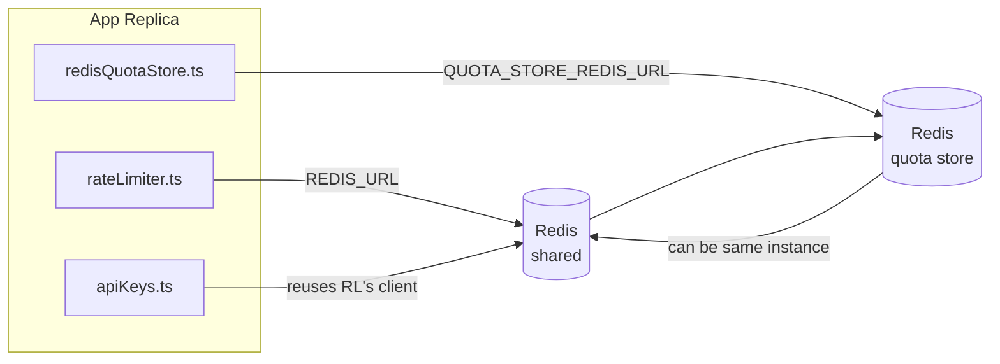

# Redis Production Configuration Guide (मराठी)

🌐 **Languages:** 🇺🇸 [English](../../../../ops/REDIS_PRODUCTION_CONFIG.md) · 🇪🇹 [am](../../../am/docs/ops/REDIS_PRODUCTION_CONFIG.md) · 🇸🇦 [ar](../../../ar/docs/ops/REDIS_PRODUCTION_CONFIG.md) · 🇦🇿 [az](../../../az/docs/ops/REDIS_PRODUCTION_CONFIG.md) · 🇧🇬 [bg](../../../bg/docs/ops/REDIS_PRODUCTION_CONFIG.md) · 🇧🇩 [bn](../../../bn/docs/ops/REDIS_PRODUCTION_CONFIG.md) · 🇧🇦 [bs](../../../bs/docs/ops/REDIS_PRODUCTION_CONFIG.md) · 🇨🇿 [cs](../../../cs/docs/ops/REDIS_PRODUCTION_CONFIG.md) · 🇩🇰 [da](../../../da/docs/ops/REDIS_PRODUCTION_CONFIG.md) · 🇩🇪 [de](../../../de/docs/ops/REDIS_PRODUCTION_CONFIG.md) · 🇬🇷 [el](../../../el/docs/ops/REDIS_PRODUCTION_CONFIG.md) · 🇪🇸 [es](../../../es/docs/ops/REDIS_PRODUCTION_CONFIG.md) · 🇪🇪 [et](../../../et/docs/ops/REDIS_PRODUCTION_CONFIG.md) · 🇮🇷 [fa](../../../fa/docs/ops/REDIS_PRODUCTION_CONFIG.md) · 🇫🇮 [fi](../../../fi/docs/ops/REDIS_PRODUCTION_CONFIG.md) · 🇫🇷 [fr](../../../fr/docs/ops/REDIS_PRODUCTION_CONFIG.md) · 🇮🇪 [ga](../../../ga/docs/ops/REDIS_PRODUCTION_CONFIG.md) · 🇮🇳 [gu](../../../gu/docs/ops/REDIS_PRODUCTION_CONFIG.md) · 🇳🇬 [ha](../../../ha/docs/ops/REDIS_PRODUCTION_CONFIG.md) · 🇮🇱 [he](../../../he/docs/ops/REDIS_PRODUCTION_CONFIG.md) · 🇮🇳 [hi](../../../hi/docs/ops/REDIS_PRODUCTION_CONFIG.md) · 🇭🇷 [hr](../../../hr/docs/ops/REDIS_PRODUCTION_CONFIG.md) · 🇭🇺 [hu](../../../hu/docs/ops/REDIS_PRODUCTION_CONFIG.md) · 🇦🇲 [hy](../../../hy/docs/ops/REDIS_PRODUCTION_CONFIG.md) · 🇮🇩 [id](../../../id/docs/ops/REDIS_PRODUCTION_CONFIG.md) · 🇳🇬 [ig](../../../ig/docs/ops/REDIS_PRODUCTION_CONFIG.md) · 🇮🇹 [it](../../../it/docs/ops/REDIS_PRODUCTION_CONFIG.md) · 🇯🇵 [ja](../../../ja/docs/ops/REDIS_PRODUCTION_CONFIG.md) · 🇬🇪 [ka](../../../ka/docs/ops/REDIS_PRODUCTION_CONFIG.md) · 🇰🇭 [km](../../../km/docs/ops/REDIS_PRODUCTION_CONFIG.md) · 🇮🇳 [kn](../../../kn/docs/ops/REDIS_PRODUCTION_CONFIG.md) · 🇰🇷 [ko](../../../ko/docs/ops/REDIS_PRODUCTION_CONFIG.md) · 🇱🇹 [lt](../../../lt/docs/ops/REDIS_PRODUCTION_CONFIG.md) · 🇱🇻 [lv](../../../lv/docs/ops/REDIS_PRODUCTION_CONFIG.md) · 🇮🇳 [ml](../../../ml/docs/ops/REDIS_PRODUCTION_CONFIG.md) · 🇲🇾 [ms](../../../ms/docs/ops/REDIS_PRODUCTION_CONFIG.md) · 🇲🇹 [mt](../../../mt/docs/ops/REDIS_PRODUCTION_CONFIG.md) · 🇲🇲 [my](../../../my/docs/ops/REDIS_PRODUCTION_CONFIG.md) · 🇳🇵 [ne](../../../ne/docs/ops/REDIS_PRODUCTION_CONFIG.md) · 🇳🇱 [nl](../../../nl/docs/ops/REDIS_PRODUCTION_CONFIG.md) · 🇳🇴 [no](../../../no/docs/ops/REDIS_PRODUCTION_CONFIG.md) · 🇮🇳 [or](../../../or/docs/ops/REDIS_PRODUCTION_CONFIG.md) · 🇮🇳 [pa](../../../pa/docs/ops/REDIS_PRODUCTION_CONFIG.md) · 🇵🇭 [phi](../../../phi/docs/ops/REDIS_PRODUCTION_CONFIG.md) · 🇵🇱 [pl](../../../pl/docs/ops/REDIS_PRODUCTION_CONFIG.md) · 🇵🇹 [pt](../../../pt/docs/ops/REDIS_PRODUCTION_CONFIG.md) · 🇧🇷 [pt-BR](../../../pt-BR/docs/ops/REDIS_PRODUCTION_CONFIG.md) · 🇷🇴 [ro](../../../ro/docs/ops/REDIS_PRODUCTION_CONFIG.md) · 🇷🇺 [ru](../../../ru/docs/ops/REDIS_PRODUCTION_CONFIG.md) · 🇱🇰 [si](../../../si/docs/ops/REDIS_PRODUCTION_CONFIG.md) · 🇸🇰 [sk](../../../sk/docs/ops/REDIS_PRODUCTION_CONFIG.md) · 🇸🇮 [sl](../../../sl/docs/ops/REDIS_PRODUCTION_CONFIG.md) · 🇷🇸 [sr](../../../sr/docs/ops/REDIS_PRODUCTION_CONFIG.md) · 🇸🇪 [sv](../../../sv/docs/ops/REDIS_PRODUCTION_CONFIG.md) · 🇰🇪 [sw](../../../sw/docs/ops/REDIS_PRODUCTION_CONFIG.md) · 🇮🇳 [ta](../../../ta/docs/ops/REDIS_PRODUCTION_CONFIG.md) · 🇮🇳 [te](../../../te/docs/ops/REDIS_PRODUCTION_CONFIG.md) · 🇹🇭 [th](../../../th/docs/ops/REDIS_PRODUCTION_CONFIG.md) · 🇹🇷 [tr](../../../tr/docs/ops/REDIS_PRODUCTION_CONFIG.md) · 🇺🇦 [uk-UA](../../../uk-UA/docs/ops/REDIS_PRODUCTION_CONFIG.md) · 🇵🇰 [ur](../../../ur/docs/ops/REDIS_PRODUCTION_CONFIG.md) · 🇺🇿 [uz](../../../uz/docs/ops/REDIS_PRODUCTION_CONFIG.md) · 🇻🇳 [vi](../../../vi/docs/ops/REDIS_PRODUCTION_CONFIG.md) · 🇳🇬 [yo](../../../yo/docs/ops/REDIS_PRODUCTION_CONFIG.md) · 🇨🇳 [zh-CN](../../../zh-CN/docs/ops/REDIS_PRODUCTION_CONFIG.md) · 🇹🇼 [zh-TW](../../../zh-TW/docs/ops/REDIS_PRODUCTION_CONFIG.md)

---

## विहंगावलोकन

Redis आहे**वैकल्पिक, मऊ अवलंबित्व** OmniRoute — मध्ये जेव्हा Redis अनुपलब्ध असते तेव्हा ऍप्लिकेशन सुंदरपणे (इन-मेमरी फॉलबॅक) खराब होते. उत्पादनामध्ये, Redis ट्यूनिंग चार वेगळ्या वर्कलोडसाठी विलंब कमी करते:

| कामाचा ताण            | चालक                          | ग्राहक कारखाना                                 | की नमुना                                              |
| --------------------- | ----------------------------- | ---------------------------------------------- | ----------------------------------------------------- |
| दर मर्यादित करणे      | `rateLimiter.ts`              | `getRedisClient()` — आळशी `ioredis` सिंगलटन    | `<prefix>rl:*` लुआ-अणु दर मर्यादा विंडो               |
| प्रमाणीकरण कॅशे       | `apiKeys.ts`                  | `rateLimiter` च्या क्लायंटचा पुन्हा वापर करते  | TTL सह `<prefix>auth:api_key:<sha256>`                |
| कोटा स्टोअर           | `redisQuotaStore.ts`          | `getRedisClient(url)` सिंगलटन वेगळे करा        | `<prefix>quota:*` कॉन्फिगर करण्यायोग्य प्रति-इंस्टन्स |
| वार्मअप सर्किट ब्रेकर | `redisCircuitBreakerStore.ts` | `circuitBreakerFactory.ts` मध्ये वेगळा क्लायंट | `<prefix>warmup:cb:<connectionId>`                    |

सर्व चार वर्कलोड्स एक नेमस्पेस उपसर्ग सामायिक करतात जेणेकरून OmniRoute एकाच Redis उदाहरणावर (उदा. `127.0.0.1:6379`) इतर ॲप्ससह सह-अस्तित्वात राहू शकेल. [की नेमस्पेसिंग](#key-namespacing) पहा.

---

## वर्तमान कॉन्फिगरेशन (कोड डीफॉल्ट)

| सेटिंग                          | मूल्य                                               | कुठे                                                                                  |
| ------------------------------- | --------------------------------------------------- | ------------------------------------------------------------------------------------- |
| `REDIS_URL` env var             | `redis://redis:6379` (रचना), पर्यायी                | `rateLimiter.ts:5`, `.env.example`                                                    |
| `REDIS_KEY_PREFIX` env var      | `omniroute:` (डीफॉल्ट)                              | `rateLimiter.ts`, `redisQuotaStore.ts`, `redisCircuitBreakerStore.ts`, `.env.example` |
| `QUOTA_STORE_REDIS_URL` env var | वेगळे, `REDIS_URL` पेक्षा वेगळे असू शकते            | `quota/storeFactory.ts`                                                               |
| `QUOTA_STORE_DRIVER`            | `"sqlite"` (डीफॉल्ट), `"redis"` पर्यायी             | `quota/storeFactory.ts`                                                               |
| ioredis `maxRetriesPerRequest`  | `3`                                                 | `rateLimiter.ts` क्लायंट निर्मिती                                                     |
| `enableReadyCheck`              | सेट नाही (ioredis डीफॉल्ट: `true`)                  | —                                                                                     |
| `lazyConnect`                   | सेट नाही (ioredis डीफॉल्ट: `false`)                 | —                                                                                     |
| `retryStrategy`                 | सेट नाही (आयोरेडिस डीफॉल्ट: 200ms बेस, घातांक)      | —                                                                                     |
| TLS / पासवर्ड / DB अनुक्रमणिका  | **कॉन्फिगर केलेले नाही**                            | —                                                                                     |
| सेंटिनेल / क्लस्टर              | **कॉन्फिगर केलेले नाही** केवळ — स्टँडअलोन सिंगल-नोड | —                                                                                     |

---

## की नेमस्पेसिंग

OmniRoute होस्टवर चालणाऱ्या इतर कोणत्याही सेवांसह Redis इन्स्टन्स सामायिक करतो. नेमस्पेसशिवाय,
`auth:api_key:<sha256>` किंवा `rl:*` सारख्या कीज त्याच Redis चा वापर करणाऱ्या इतर अनुप्रयोगांच्या
कीजशी टकराव करू शकतात (हा इन्स्टन्स इतर सेवांसोबत `127.0.0.1:6379` वर Redis चालवतो).

OmniRoute च्या **प्रत्येक** कीच्या सुरुवातीला प्रीफिक्स जोडण्यासाठी `REDIS_KEY_PREFIX` रिक्त नसलेल्या स्ट्रिंगवर सेट करा:

```bash
# .env — OmniRoute च्या सर्व कीज omniroute:rl:*, omniroute:auth:*, omniroute:quota:*, omniroute:warmup:cb:* होतात
REDIS_KEY_PREFIX=omniroute:
```

- **डीफॉल्ट:** `omniroute:` (`REDIS_KEY_PREFIX` सेट केलेले नसेल किंवा रिक्त असेल तेव्हा लागू होते).
- **यांना लागू होते:** दर मर्यादक + प्रमाणीकरण कॅशे (`keyPrefix` द्वारे सामायिक केलेला `ioredis` क्लायंट), तसेच
  कोटा स्टोअर (`KEY_PREFIX = "${REDIS_KEY_PREFIX}quota"`) आणि वॉर्मअप सर्किट ब्रेकर
  (`KEY_PREFIX = "${REDIS_KEY_PREFIX}warmup:cb:"`).
- Redis मध्ये कीज आधीपासून अस्तित्वात असताना **प्रीफिक्स बदलल्यास**, जुन्या कीज अनाथ होतात (त्या
  TTL / LRU द्वारे कालबाह्य होतात). बदलणे सुरक्षित आहे; स्थलांतराची आवश्यकता नाही. निषिद्ध म्हणून
  चिन्हांकित केलेल्या कनेक्शनसाठी असलेली वॉर्मअप सर्किट-ब्रेकर की हा एकमेव अपवाद आहे: ती TTL शिवाय कायम ठेवली जाते, म्हणून
  उर्वरित कीज `redis-cli --scan --pattern '<old-prefix>warmup:cb:*'` वापरून सूचीबद्ध करा आणि त्या हटवा.
- **ioredis `keyPrefix`** लेखनाच्या वेळी प्रीफिक्स आपोआप जोडतो **आणि** वाचनाच्या वेळी तो काढून टाकतो,
  त्यामुळे अनुप्रयोगाच्या कोडला प्रीफिक्स कधीही दिसत नाही.

---

## शिफारस केलेले उत्पादन ट्यूनिंग

### 1. कनेक्शन पूल / क्लायंट पर्याय (ioredis `Redis` कन्स्ट्रक्टर)

सध्याचा कोड सानुकूल पर्यायांशिवाय एकच `new Redis(url)` तयार करतो. प्रोडक्शन मल्टी-रिप्लिका डिप्लॉयमेंटसाठी, कोडमध्ये क्लायंट फॅक्टरी पास करा किंवा `getRedisClient()` रॅप करा:

```typescript
const redis = new Redis(REDIS_URL, {
  maxRetriesPerRequest: null, // no retry limit; let retryStrategy decide
  enableReadyCheck: true, // verify server is ready before accepting calls
  lazyConnect: true, // don't connect on construction; wait for first call
  retryStrategy: (times) => {
    if (times > 10) return null; // give up after 10 retries → reconnect later
    return Math.min(times * 200, 5000); // 200ms, 400ms, …, 5s cap
  },
  enableAutoPipelining: true, // coalesce concurrent commands into one TCP write
  keepAlive: 10000, // TCP keep‑alive every 10s
});
```

**मुख्य ट्रेड-ऑफ:**

- `maxRetriesPerRequest: null` + `retryStrategy` — उत्पादनासाठी प्राधान्य दिले जाते त्यामुळे क्षणिक Redis रीस्टार्ट प्रत्येक विनंतीला त्वरित अपयशी ठरत नाही. `checkRateLimit()` मधील इन-मेमरी फॉलबॅक अपयशाचा मार्ग शोषून घेते.
- `lazyConnect: true` — सर्व्हरने कनेक्शन स्वीकारण्यास सुरुवात करण्यापूर्वी Redis वर स्टार्टअप अवलंबित्व टाळते.
- `enableAutoPipelining: true` — समवर्ती दर-मर्यादा तपासणीसाठी राउंड-ट्रिप्स कमी करते; एकाच कनेक्शनवर > 50 RPS वर फायदेशीर.

### 2. Redis सर्व्हर कॉन्फिगरेशन (`redis.conf`)

```
# Memory
maxmemory 80%                        # leave room for OS page cache
maxmemory-policy allkeys-lru         # evict stale auth cache entries under pressure

# Persistence (optional — OmniRoute is crash‑safe without it)
save 300 1                           # snapshot at least every 5 min if ≥1 key changed
appendonly no                        # AOF not needed; data is regeneratable
appendfsync no                       # no fsync overhead (RDB is sufficient)

# Networking
timeout 0                            # no idle disconnect
tcp-keepalive 300                    # 5 min keep‑alive
tcp-backlog 511                      # connection backlog for bursty load

# Performance
hz 10                                # default; 100 for latency‑sensitive
activedefrag yes                     # auto‑defragment when fragmentation >10%
```

**`maxmemory-policy allkeys-lru` साठी व्यापार बंद:** मेमरी प्रेशर अंतर्गत ऑथ कॅशे एंट्री बाहेर काढल्या जाऊ शकतात. हे सुरक्षित आहे — `setCachedApiKey` नेहमी चुकल्यावर पुन्हा भरतो आणि SQLite फॉलबॅक अधिकृत आहे. रेट-लिमिटर लुआ स्क्रिप्ट लहान की तयार करते ज्या डिझाइननुसार अल्पायुषी असतात.

### 3. Docker रचना सेटिंग्ज

प्रोड कंपोझ (`docker-compose.prod.yml`) `redis:8.6.2-alpine` वापरते. जोडा:

```yaml
redis:
  image: redis:8.6.2-alpine
  command:
    [
      "redis-server",
      "--maxmemory",
      "512mb",
      "--maxmemory-policy",
      "allkeys-lru",
      "--activedefrag",
      "yes",
      "--save",
      "300 1",
    ]
  healthcheck:
    test: ["CMD", "redis-cli", "ping"]
    interval: 10s
    timeout: 3s
    retries: 3
    start_period: 5s
```

### 4. मल्टी-इन्स्टन्स / स्केलिंग विचार

**सर्व प्रतिकृतींसाठी सिंगल Redis** — दर-मर्यादा लुआ स्क्रिप्ट एका अधिकृत की स्पेसवर अवलंबून असते. प्रतिकृतींमागील अनेक Redis उदाहरणे अणुशक्ती गमावतील आणि बजेट दुप्पट करतील. सर्व ऍप्लिकेशन प्रतिकृतींसाठी एकच Redis (किंवा फेलओव्हरसह Redis सेंटिनेल क्लस्टर) वापरा.

**कनेक्शन संख्या:** प्रत्येक अनुप्रयोग प्रतिकृती उघडते**2 TCP कनेक्शन** Redis ला (रेट लिमिटर क्लायंट + कोटा स्टोअर क्लायंट). 10 प्रतिकृती → 20 कनेक्शनवर, डीफॉल्ट Redis उदाहरणाच्या 10k कनेक्शन कमाल मर्यादेमध्ये.

### 5. देखरेख

आरोग्य-तपासणी एंडपॉईंटद्वारे उघड करा:

```typescript
// src/app/api/monitoring/health/route.ts already calls rateLimiter functions
// Add Redis-specific checks:
//   1. PING latency via ioredis .ping()
//   2. Memory usage via INFO memory
//   3. Connection count via INFO clients
//   4. Hit rate for maxmemory-policy (evicted_keys / keyspace_hits)
```

पाहण्यासाठी प्रमुख मेट्रिक्स:

- **बाहेर काढलेल्या की / से** — सतत शून्य न राहिल्यास, `maxmemory` वाढवा
- **ब्लॉक केलेले क्लायंट** — नॉन-झिरो मंद लुआ स्क्रिप्ट किंवा उच्च विवाद सूचित करतो
- **कनेक्शन नाकारले** — कनेक्शन मर्यादा हिट; 20 कनेक्शनवर दुर्मिळ

### 6. Redis-सुसंगत सर्व्हर

येथे वापरलेल्या कोणत्याही सर्व्हरने लुआ स्क्रिप्ट चालवणे आवश्यक आहे: दर मर्यादा एक `EVAL` आहे. Lua शिवाय सर्व्हरवर, `checkRateLimit()` `[RATE_LIMITER] Redis eval failed, falling back to in-memory rate limiting` लॉग करते आणि प्रत्येक प्रक्रियेची गणना करते, त्यामुळे प्रत्येक प्रतिकृती स्वतःच मर्यादा लागू करते. ऑप्ट-इन शेअर्ड सेशन-ॲफिनिटी स्टोअर (`OMNIROUTE_SESSION_AFFINITY_STORE=redis`) देखील `EVAL` सह पिन वाचते आणि अपडेट करते; लुआशिवाय ते `[SESSION_AFFINITY] Redis error; falling back to SQLite.` लॉग करते आणि प्रत्येक प्रतिकृती स्वतःच्या पिन ठेवते. इतर वर्कलोड्स प्लेन कमांड्स वापरतात (`SET ... EX`, `GET`, `DEL`, `MGET`, `EXPIRE`, `INCRBYFLOAT`, हॅश आणि सेट), आणि सिमेंटिक कॅशेचा Redis बॅकएंड `FT.*` कमांड पाठवत नाही.

OmniRoute 3.8.52 सह चाचणी केली: KiviDB 1.2.0 त्याच्या लुआ प्रतिमेसह (`kividb/kividb:v1.2.0-lua`). रेट लिमिटर (काउंटर शेअर करण्याच्या दुसऱ्या प्रक्रियेसह), प्रमाणीकरण कॅशे, कोटा स्टोअर, वॉर्मअप सर्किट ब्रेकर, सिमेंटिक कॅशे स्टोअर आणि चॅट हँडलरद्वारे `/v1/chat/completions` विनंतीने Redis 8.10.3 रोजी पास झालेल्या 19 चेकपैकी 18 पास केले. जे वेगळे आहे: `INCRBYFLOAT` `0.1 + 0.2` `0.30000000000000004` म्हणून स्टोअर करते जेथे Redis `0.3` ( [kividbio/kividb#387](https://github.com/kividbio/kividb/issues/387) ) स्टोअर करते. कोटा स्टोअर दोन्ही `parseFloat` सह पार्स करते, परंतु शेवटच्या अंकांमध्ये दोन संख्या भिन्न असतात, त्यामुळे कोटा सीमारेषेवर नेमकी तुलना करणारी तुलना वेगळ्या प्रकारे येऊ शकते. सेशन-ॲफिनिटी स्टोअर त्या रनचा भाग नव्हता. ( [सेटअप](https://github.com/kividbio/kividb/blob/master/docs/integrations/omniroute.md), [परिणाम](https://github.com/kividbio/kividb/tree/master/benchmarks/omniroute-compat) )

---

## आर्किटेक्चर आकृती



---

## संदर्भ

| फाईल                               | उद्देश                                                            |
| ---------------------------------- | ----------------------------------------------------------------- |
| `src/shared/utils/rateLimiter.ts`  | प्राथमिक Redis क्लायंट, लुआ दर-मर्यादा स्क्रिप्ट, इन-मेमरी फॉलबॅक |
| `src/lib/db/apiKeys.ts`            | प्रमाणीकरण कॅशे — Redis→SQLite फॉलबॅक                             |
| `src/lib/quota/redisQuotaStore.ts` | पर्यायी कोटा स्टोअरसाठी स्वतंत्र Redis क्लायंट                    |
| `src/lib/quota/storeFactory.ts`    | `sqlite` आणि `redis` कोटा ड्रायव्हर्स दरम्यान स्विच करते          |
| `docker-compose.prod.yml`          | उत्पादन Redis कंटेनर (प्रतिमा `redis:8.6.2-alpine`)               |
| `.env.example`                     | Redis env vars दस्तऐवजीकरण                                        |
| `src/app/api/local/redis/`         | डेव्ह कंटेनर ऑर्केस्ट्रेशनसाठीAPI मार्ग                           |
| `bin/cli/commands/redis.mjs`       | डेव्ह कंटेनर ऑर्केस्ट्रेशनसाठीCLI आज्ञा                           |
