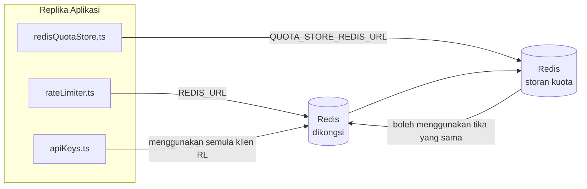

# Redis Production Configuration Guide (Bahasa Melayu)

🌐 **Languages:** 🇺🇸 [English](../../../../ops/REDIS_PRODUCTION_CONFIG.md) · 🇪🇹 [am](../../../am/docs/ops/REDIS_PRODUCTION_CONFIG.md) · 🇸🇦 [ar](../../../ar/docs/ops/REDIS_PRODUCTION_CONFIG.md) · 🇦🇿 [az](../../../az/docs/ops/REDIS_PRODUCTION_CONFIG.md) · 🇧🇬 [bg](../../../bg/docs/ops/REDIS_PRODUCTION_CONFIG.md) · 🇧🇩 [bn](../../../bn/docs/ops/REDIS_PRODUCTION_CONFIG.md) · 🇧🇦 [bs](../../../bs/docs/ops/REDIS_PRODUCTION_CONFIG.md) · 🇨🇿 [cs](../../../cs/docs/ops/REDIS_PRODUCTION_CONFIG.md) · 🇩🇰 [da](../../../da/docs/ops/REDIS_PRODUCTION_CONFIG.md) · 🇩🇪 [de](../../../de/docs/ops/REDIS_PRODUCTION_CONFIG.md) · 🇬🇷 [el](../../../el/docs/ops/REDIS_PRODUCTION_CONFIG.md) · 🇪🇸 [es](../../../es/docs/ops/REDIS_PRODUCTION_CONFIG.md) · 🇪🇪 [et](../../../et/docs/ops/REDIS_PRODUCTION_CONFIG.md) · 🇮🇷 [fa](../../../fa/docs/ops/REDIS_PRODUCTION_CONFIG.md) · 🇫🇮 [fi](../../../fi/docs/ops/REDIS_PRODUCTION_CONFIG.md) · 🇫🇷 [fr](../../../fr/docs/ops/REDIS_PRODUCTION_CONFIG.md) · 🇮🇪 [ga](../../../ga/docs/ops/REDIS_PRODUCTION_CONFIG.md) · 🇮🇳 [gu](../../../gu/docs/ops/REDIS_PRODUCTION_CONFIG.md) · 🇳🇬 [ha](../../../ha/docs/ops/REDIS_PRODUCTION_CONFIG.md) · 🇮🇱 [he](../../../he/docs/ops/REDIS_PRODUCTION_CONFIG.md) · 🇮🇳 [hi](../../../hi/docs/ops/REDIS_PRODUCTION_CONFIG.md) · 🇭🇷 [hr](../../../hr/docs/ops/REDIS_PRODUCTION_CONFIG.md) · 🇭🇺 [hu](../../../hu/docs/ops/REDIS_PRODUCTION_CONFIG.md) · 🇦🇲 [hy](../../../hy/docs/ops/REDIS_PRODUCTION_CONFIG.md) · 🇮🇩 [id](../../../id/docs/ops/REDIS_PRODUCTION_CONFIG.md) · 🇳🇬 [ig](../../../ig/docs/ops/REDIS_PRODUCTION_CONFIG.md) · 🇮🇹 [it](../../../it/docs/ops/REDIS_PRODUCTION_CONFIG.md) · 🇯🇵 [ja](../../../ja/docs/ops/REDIS_PRODUCTION_CONFIG.md) · 🇬🇪 [ka](../../../ka/docs/ops/REDIS_PRODUCTION_CONFIG.md) · 🇰🇭 [km](../../../km/docs/ops/REDIS_PRODUCTION_CONFIG.md) · 🇮🇳 [kn](../../../kn/docs/ops/REDIS_PRODUCTION_CONFIG.md) · 🇰🇷 [ko](../../../ko/docs/ops/REDIS_PRODUCTION_CONFIG.md) · 🇱🇹 [lt](../../../lt/docs/ops/REDIS_PRODUCTION_CONFIG.md) · 🇱🇻 [lv](../../../lv/docs/ops/REDIS_PRODUCTION_CONFIG.md) · 🇮🇳 [ml](../../../ml/docs/ops/REDIS_PRODUCTION_CONFIG.md) · 🇮🇳 [mr](../../../mr/docs/ops/REDIS_PRODUCTION_CONFIG.md) · 🇲🇹 [mt](../../../mt/docs/ops/REDIS_PRODUCTION_CONFIG.md) · 🇲🇲 [my](../../../my/docs/ops/REDIS_PRODUCTION_CONFIG.md) · 🇳🇵 [ne](../../../ne/docs/ops/REDIS_PRODUCTION_CONFIG.md) · 🇳🇱 [nl](../../../nl/docs/ops/REDIS_PRODUCTION_CONFIG.md) · 🇳🇴 [no](../../../no/docs/ops/REDIS_PRODUCTION_CONFIG.md) · 🇮🇳 [or](../../../or/docs/ops/REDIS_PRODUCTION_CONFIG.md) · 🇮🇳 [pa](../../../pa/docs/ops/REDIS_PRODUCTION_CONFIG.md) · 🇵🇭 [phi](../../../phi/docs/ops/REDIS_PRODUCTION_CONFIG.md) · 🇵🇱 [pl](../../../pl/docs/ops/REDIS_PRODUCTION_CONFIG.md) · 🇵🇹 [pt](../../../pt/docs/ops/REDIS_PRODUCTION_CONFIG.md) · 🇧🇷 [pt-BR](../../../pt-BR/docs/ops/REDIS_PRODUCTION_CONFIG.md) · 🇷🇴 [ro](../../../ro/docs/ops/REDIS_PRODUCTION_CONFIG.md) · 🇷🇺 [ru](../../../ru/docs/ops/REDIS_PRODUCTION_CONFIG.md) · 🇱🇰 [si](../../../si/docs/ops/REDIS_PRODUCTION_CONFIG.md) · 🇸🇰 [sk](../../../sk/docs/ops/REDIS_PRODUCTION_CONFIG.md) · 🇸🇮 [sl](../../../sl/docs/ops/REDIS_PRODUCTION_CONFIG.md) · 🇷🇸 [sr](../../../sr/docs/ops/REDIS_PRODUCTION_CONFIG.md) · 🇸🇪 [sv](../../../sv/docs/ops/REDIS_PRODUCTION_CONFIG.md) · 🇰🇪 [sw](../../../sw/docs/ops/REDIS_PRODUCTION_CONFIG.md) · 🇮🇳 [ta](../../../ta/docs/ops/REDIS_PRODUCTION_CONFIG.md) · 🇮🇳 [te](../../../te/docs/ops/REDIS_PRODUCTION_CONFIG.md) · 🇹🇭 [th](../../../th/docs/ops/REDIS_PRODUCTION_CONFIG.md) · 🇹🇷 [tr](../../../tr/docs/ops/REDIS_PRODUCTION_CONFIG.md) · 🇺🇦 [uk-UA](../../../uk-UA/docs/ops/REDIS_PRODUCTION_CONFIG.md) · 🇵🇰 [ur](../../../ur/docs/ops/REDIS_PRODUCTION_CONFIG.md) · 🇺🇿 [uz](../../../uz/docs/ops/REDIS_PRODUCTION_CONFIG.md) · 🇻🇳 [vi](../../../vi/docs/ops/REDIS_PRODUCTION_CONFIG.md) · 🇳🇬 [yo](../../../yo/docs/ops/REDIS_PRODUCTION_CONFIG.md) · 🇨🇳 [zh-CN](../../../zh-CN/docs/ops/REDIS_PRODUCTION_CONFIG.md) · 🇹🇼 [zh-TW](../../../zh-TW/docs/ops/REDIS_PRODUCTION_CONFIG.md)

---

## Gambaran keseluruhan

Redis ialah sebuah **pilihan, pergantungan lembut** dalam OmniRoute — aplikasi merosot dengan anggun (saling balik dalam memori) apabila Redis tidak tersedia. Dalam pengeluaran, penalaan Redis mengurangkan kependaman untuk empat beban kerja yang berbeza:

| Beban kerja            | Pemandu                       | Kilang Pelanggan                                 | Corak Utama                                            |
| ---------------------- | ----------------------------- | ------------------------------------------------ | ------------------------------------------------------ |
| Mengehadkan kadar      | `rateLimiter.ts`              | `getRedisClient()` — malas `ioredis` singleton   | `<prefix>rl:*` Lua‑atom tetingkap had kadar            |
| Cache pengesahan       | `apiKeys.ts`                  | Menggunakan semula pelanggan `rateLimiter`       | `<prefix>auth:api_key:<sha256>` dengan TTL             |
| Kedai kuota            | `redisQuotaStore.ts`          | Singleton `getRedisClient(url)` yang berasingan  | `<prefix>quota:*` boleh dikonfigurasikan setiap contoh |
| Panaskan pemutus litar | `redisCircuitBreakerStore.ts` | Asingkan pelanggan di `circuitBreakerFactory.ts` | `<prefix>warmup:cb:<connectionId>`                     |

Keempat-empat beban kerja berkongsi satu awalan ruang nama supaya OmniRoute boleh wujud bersama dengan apl lain pada satu tika Redis (cth `127.0.0.1:6379`). Lihat [Jarak Nama Utama](#key-namespacing).

---

## Konfigurasi Semasa (Lalai Kod)

| Tetapan                         | Nilai                                                   | di mana                                                                               |
| ------------------------------- | ------------------------------------------------------- | ------------------------------------------------------------------------------------- |
| `REDIS_URL` env var             | `redis://redis:6379` (karang), pilihan                  | `rateLimiter.ts:5`, `.env.example`                                                    |
| `REDIS_KEY_PREFIX` env var      | `omniroute:` (lalai)                                    | `rateLimiter.ts`, `redisQuotaStore.ts`, `redisCircuitBreakerStore.ts`, `.env.example` |
| `QUOTA_STORE_REDIS_URL` env var | berasingan, boleh berbeza dengan `REDIS_URL`            | `quota/storeFactory.ts`                                                               |
| `QUOTA_STORE_DRIVER`            | `"sqlite"` (lalai), `"redis"` pilihan                   | `quota/storeFactory.ts`                                                               |
| ioredis `maxRetriesPerRequest`  | `3`                                                     | Penciptaan pelanggan `rateLimiter.ts`                                                 |
| `enableReadyCheck`              | tidak ditetapkan (ioredis lalai: `true`)                | —                                                                                     |
| `lazyConnect`                   | tidak ditetapkan (ioredis lalai: `false`)               | —                                                                                     |
| `retryStrategy`                 | tidak ditetapkan (ioredis lalai: asas 200ms, eksponen)  | —                                                                                     |
| TLS / kata laluan / indeks DB   | **tidak dikonfigurasikan**                              | —                                                                                     |
| Sentinel / Kluster              | **tidak dikonfigurasikan** — nod tunggal kendiri sahaja | —                                                                                     |

---

## Penggunaan Ruang Nama Kunci

OmniRoute berkongsi satu tika Redis dengan apa-apa sahaja yang berjalan pada hos. Tanpa ruang nama, kunci seperti `auth:api_key:<sha256>` atau `rl:*` mungkin bertembung dengan kunci daripada aplikasi lain yang menggunakan Redis yang sama (tika ini menjalankan Redis pada `127.0.0.1:6379` bersama perkhidmatan lain).

Tetapkan `REDIS_KEY_PREFIX` kepada rentetan yang tidak kosong untuk mengawalkan **setiap** kunci OmniRoute:

```bash
# .env — semua kunci OmniRoute menjadi omniroute:rl:*, omniroute:auth:*, omniroute:quota:*, omniroute:warmup:cb:*
REDIS_KEY_PREFIX=omniroute:
```

- **Lalai:** `omniroute:` (digunakan apabila `REDIS_KEY_PREFIX` tidak ditetapkan atau kosong).
- **Digunakan pada:** pengehad kadar + cache pengesahan (klien `ioredis` yang dikongsi melalui `keyPrefix`) dan
  storan kuota (`KEY_PREFIX = "${REDIS_KEY_PREFIX}quota"`) serta pemutus litar pemanasan
  (`KEY_PREFIX = "${REDIS_KEY_PREFIX}warmup:cb:"`).
- **Menukar awalan** apabila kunci sudah wujud dalam Redis menyebabkan kunci lama menjadi yatim (kunci tersebut luput
  melalui TTL / LRU). Selamat untuk diubah; tiada migrasi diperlukan. Satu pengecualian ialah kunci pemutus
  litar pemanasan bagi sambungan yang ditandai sebagai dilarang: kunci tersebut disimpan tanpa TTL, jadi
  senaraikan baki kunci dengan `redis-cli --scan --pattern '<old-prefix>warmup:cb:*'` dan padamkannya.
- **`keyPrefix` ioredis** secara automatik menambahkan awalan ketika menulis **dan** membuangnya ketika membaca,
  jadi kod aplikasi tidak pernah melihat awalan tersebut.

---

## Penalaan Pengeluaran yang disyorkan

### 1. Kolam Sambungan / Pilihan Pelanggan (pembina ioredis `Redis` )

Kod semasa mencipta `new Redis(url)` tunggal tanpa pilihan tersuai. Untuk penggunaan berbilang replika pengeluaran, hantar kilang pelanggan dalam kod atau bungkus `getRedisClient()`:

```typescript
const redis = new Redis(REDIS_URL, {
  maxRetriesPerRequest: null, // no retry limit; let retryStrategy decide
  enableReadyCheck: true, // verify server is ready before accepting calls
  lazyConnect: true, // don't connect on construction; wait for first call
  retryStrategy: (times) => {
    if (times > 10) return null; // give up after 10 retries → reconnect later
    return Math.min(times * 200, 5000); // 200ms, 400ms, …, 5s cap
  },
  enableAutoPipelining: true, // coalesce concurrent commands into one TCP write
  keepAlive: 10000, // TCP keep‑alive every 10s
});
```

**Pertukaran utama:**

- `maxRetriesPerRequest: null` + `retryStrategy` — diutamakan untuk pengeluaran jadi Redis sementara dimulakan semula tidak serta-merta gagal setiap permintaan. Saling balik dalam ingatan dalam `checkRateLimit()` menyerap laluan kegagalan.
- `lazyConnect: true` — mengelakkan pergantungan permulaan pada Redis terpasang sebelum pelayan mula menerima sambungan.
- `enableAutoPipelining: true` — mengurangkan perjalanan pergi dan balik untuk semakan had kadar serentak; bermanfaat pada > 50 RPS pada satu sambungan.

### 2. Konfigurasi Pelayan Redis (`redis.conf`)

```
# Memory
maxmemory 80%                        # leave room for OS page cache
maxmemory-policy allkeys-lru         # evict stale auth cache entries under pressure

# Persistence (optional — OmniRoute is crash‑safe without it)
save 300 1                           # snapshot at least every 5 min if ≥1 key changed
appendonly no                        # AOF not needed; data is regeneratable
appendfsync no                       # no fsync overhead (RDB is sufficient)

# Networking
timeout 0                            # no idle disconnect
tcp-keepalive 300                    # 5 min keep‑alive
tcp-backlog 511                      # connection backlog for bursty load

# Performance
hz 10                                # default; 100 for latency‑sensitive
activedefrag yes                     # auto‑defragment when fragmentation >10%
```

**Tukar ganti untuk `maxmemory-policy allkeys-lru`:** Entri cache pengesahan boleh diusir di bawah tekanan memori. Ini adalah selamat — `setCachedApiKey` sentiasa mengisi semula apabila terlepas, dan sandaran SQLite adalah berwibawa. Skrip Lua pembatas kadar mencipta kunci kecil yang berumur pendek mengikut reka bentuk.

### 3. Tetapan Karang Docker

Karang prod (`docker-compose.prod.yml`) menggunakan `redis:8.6.2-alpine`. Tambah:

```yaml
redis:
  image: redis:8.6.2-alpine
  command:
    [
      "redis-server",
      "--maxmemory",
      "512mb",
      "--maxmemory-policy",
      "allkeys-lru",
      "--activedefrag",
      "yes",
      "--save",
      "300 1",
    ]
  healthcheck:
    test: ["CMD", "redis-cli", "ping"]
    interval: 10s
    timeout: 3s
    retries: 3
    start_period: 5s
```

### 4. Pertimbangan Berbilang Contoh / Penskalaan

**Redis tunggal untuk semua replika** — skrip Lua pembatas kadar bergantung pada satu ruang kunci berwibawa. Berbilang kejadian Redis di sebalik replika akan kehilangan atomicity dan menggandakan belanjawan. Gunakan satu Redis (atau gugusan Redis Sentinel dengan failover) untuk semua replika aplikasi.

**Kiraan sambungan:** Setiap replika aplikasi dibuka **2 sambungan TCP** kepada Redis (pelanggan pengehad kadar + pelanggan kedai kuota). Pada 10 replika sambungan → 20, dalam siling sambungan 10k tika Redis lalai.

### 5. Pemantauan

Dedahkan melalui titik akhir pemeriksaan kesihatan:

```typescript
// src/app/api/monitoring/health/route.ts already calls rateLimiter functions
// Add Redis-specific checks:
//   1. PING latency via ioredis .ping()
//   2. Memory usage via INFO memory
//   3. Connection count via INFO clients
//   4. Hit rate for maxmemory-policy (evicted_keys / keyspace_hits)
```

Metrik utama untuk ditonton:

- **Kunci diusir / saat** — jika berterusan bukan sifar, tingkatkan `maxmemory`
- **Pelanggan yang disekat** — bukan sifar mencadangkan skrip Lua perlahan atau perbalahan tinggi
- **Sambungan yang ditolak** Had sambungan — mencecah; jarang berlaku pada 20 sambungan

### 6. Pelayan Serasi Redis

Mana-mana pelayan yang digunakan di sini mesti menjalankan skrip Lua: pengehad kadar ialah satu `EVAL`. Pada pelayan tanpa Lua, `checkRateLimit()` mencatatkan `[RATE_LIMITER] Redis eval failed, falling back to in-memory rate limiting` dan mengira setiap proses, jadi setiap replika menguatkuasakan hadnya sendiri. Kedai perkaitan sesi kongsi ikut serta (`OMNIROUTE_SESSION_AFFINITY_STORE=redis`) juga membaca dan mengemas kini pin dengan `EVAL`; tanpa Lua ia log `[SESSION_AFFINITY] Redis error; falling back to SQLite.` dan setiap replika menyimpan pinnya sendiri. Beban kerja lain menggunakan arahan biasa (`SET ... EX`, `GET`, `DEL`, `MGET`, `EXPIRE`, `INCRBYFLOAT`, cincang dan set), dan bahagian belakang Redis cache semantik tidak menghantar arahan `FT.*`.

Diuji dengan OmniRoute 3.8.52: KiviDB 1.2.0 dengan imej Lua (`kividb/kividb:v1.2.0-lua`). Pengehad kadar (termasuk proses kedua berkongsi kaunter), cache pengesahan, stor kuota, pemutus litar pemanasan, stor cache semantik dan permintaan `/v1/chat/completions` melalui pengendali sembang melepasi 18 daripada 19 semakan yang meneruskan Redis 8.10.3. Yang berbeza: `INCRBYFLOAT` menyimpan `0.1 + 0.2` sebagai `0.30000000000000004` di mana Redis menyimpan `0.3` ( [kividbio/kividb#387](https://github.com/kividbio/kividb/issues/387) ). Kedai kuota menghuraikan kedua-duanya dengan `parseFloat`, tetapi kedua-dua nombor berbeza dalam digit terakhir, jadi perbandingan yang jatuh tepat pada sempadan kuota boleh keluar secara berbeza. Kedai perkaitan sesi bukan sebahagian daripada larian itu. ( [persediaan](https://github.com/kividbio/kividb/blob/master/docs/integrations/omniroute.md), [keputusan](https://github.com/kividbio/kividb/tree/master/benchmarks/omniroute-compat) )

---

## Rajah Seni Bina



---

## Rujukan

| Fail                               | Tujuan                                                             |
| ---------------------------------- | ------------------------------------------------------------------ |
| `src/shared/utils/rateLimiter.ts`  | Pelanggan Redis utama, skrip had kadar Lua, sandaran dalam ingatan |
| `src/lib/db/apiKeys.ts`            | Cache pengesahan — Redis→SQLite sandaran                           |
| `src/lib/quota/redisQuotaStore.ts` | Asingkan pelanggan Redis untuk kedai kuota pilihan                 |
| `src/lib/quota/storeFactory.ts`    | Beralih antara pemacu kuota `sqlite` dan `redis`                   |
| `docker-compose.prod.yml`          | Prod bekas Redis (imej `redis:8.6.2-alpine`)                       |
| `.env.example`                     | Redis env vars dokumentasi                                         |
| `src/app/api/local/redis/`         | Laluan API untuk orkestrasi kontena dev                            |
| `bin/cli/commands/redis.mjs`       | Perintah CLI untuk orkestrasi kontena dev                          |
