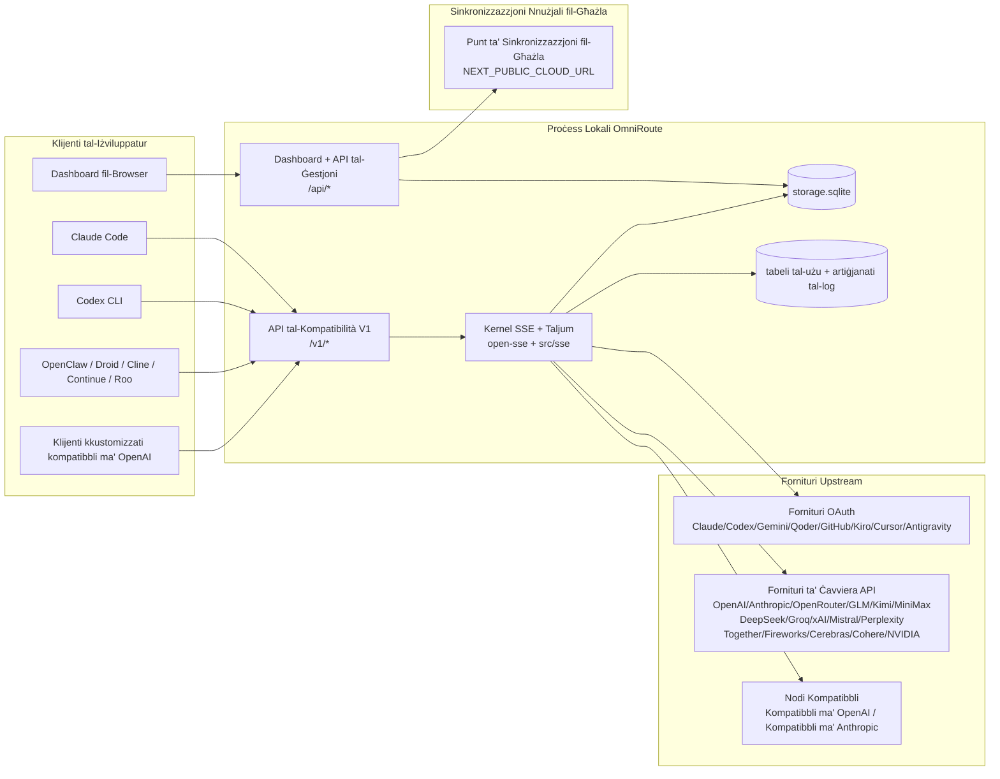
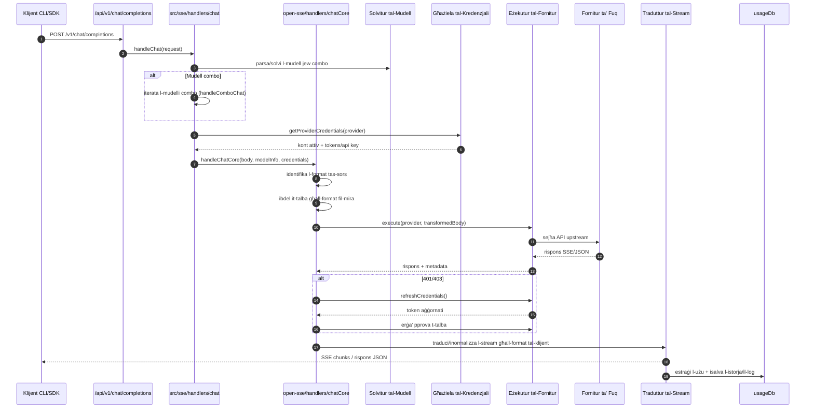
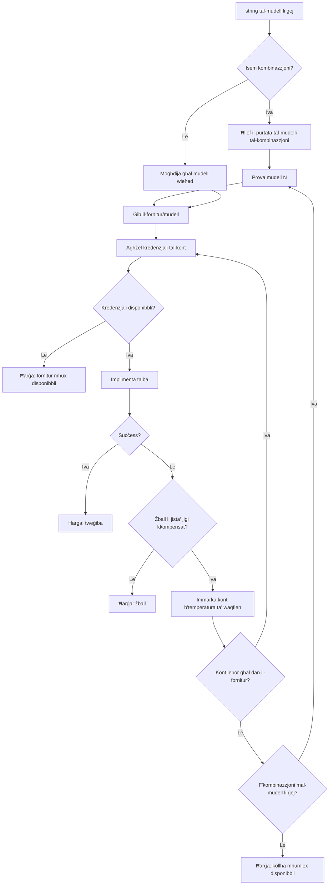
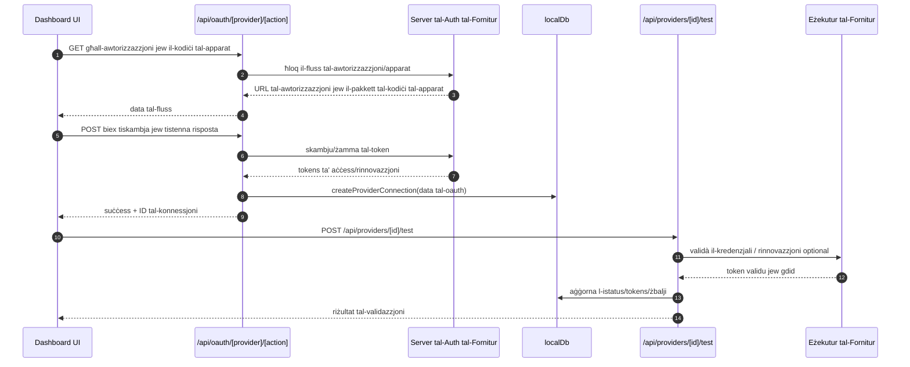
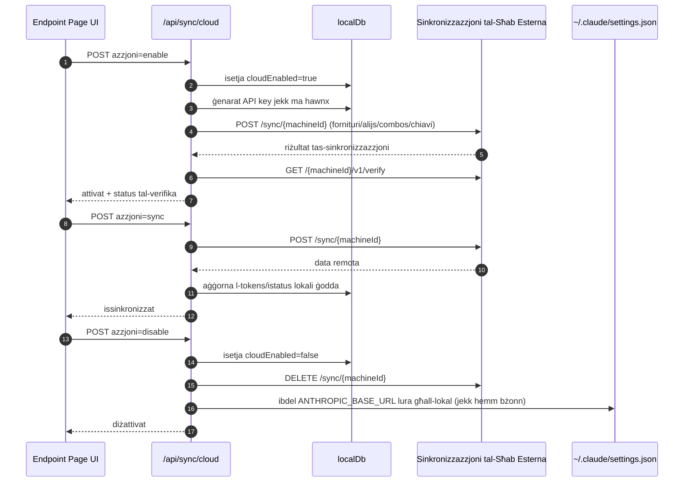
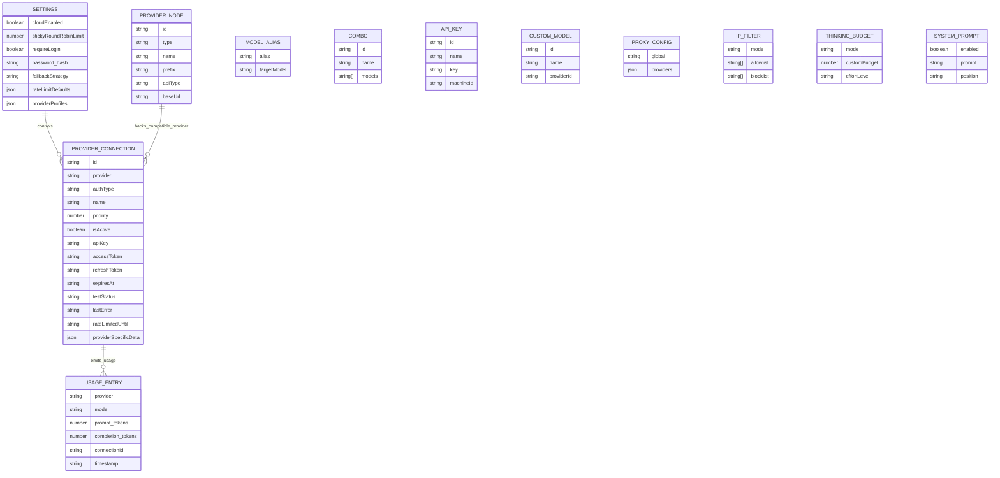
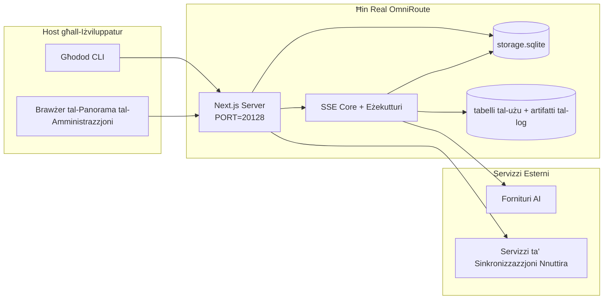

# OmniRoute Architecture (Malti)

🌐 **Languages:** 🇺🇸 [English](../../../../architecture/ARCHITECTURE.md) · 🇪🇹 [am](../../../am/docs/architecture/ARCHITECTURE.md) · 🇸🇦 [ar](../../../ar/docs/architecture/ARCHITECTURE.md) · 🇦🇿 [az](../../../az/docs/architecture/ARCHITECTURE.md) · 🇧🇬 [bg](../../../bg/docs/architecture/ARCHITECTURE.md) · 🇧🇩 [bn](../../../bn/docs/architecture/ARCHITECTURE.md) · 🇧🇦 [bs](../../../bs/docs/architecture/ARCHITECTURE.md) · 🇨🇿 [cs](../../../cs/docs/architecture/ARCHITECTURE.md) · 🇩🇰 [da](../../../da/docs/architecture/ARCHITECTURE.md) · 🇩🇪 [de](../../../de/docs/architecture/ARCHITECTURE.md) · 🇬🇷 [el](../../../el/docs/architecture/ARCHITECTURE.md) · 🇪🇸 [es](../../../es/docs/architecture/ARCHITECTURE.md) · 🇪🇪 [et](../../../et/docs/architecture/ARCHITECTURE.md) · 🇮🇷 [fa](../../../fa/docs/architecture/ARCHITECTURE.md) · 🇫🇮 [fi](../../../fi/docs/architecture/ARCHITECTURE.md) · 🇫🇷 [fr](../../../fr/docs/architecture/ARCHITECTURE.md) · 🇮🇪 [ga](../../../ga/docs/architecture/ARCHITECTURE.md) · 🇮🇳 [gu](../../../gu/docs/architecture/ARCHITECTURE.md) · 🇳🇬 [ha](../../../ha/docs/architecture/ARCHITECTURE.md) · 🇮🇱 [he](../../../he/docs/architecture/ARCHITECTURE.md) · 🇮🇳 [hi](../../../hi/docs/architecture/ARCHITECTURE.md) · 🇭🇷 [hr](../../../hr/docs/architecture/ARCHITECTURE.md) · 🇭🇺 [hu](../../../hu/docs/architecture/ARCHITECTURE.md) · 🇦🇲 [hy](../../../hy/docs/architecture/ARCHITECTURE.md) · 🇮🇩 [id](../../../id/docs/architecture/ARCHITECTURE.md) · 🇳🇬 [ig](../../../ig/docs/architecture/ARCHITECTURE.md) · 🇮🇹 [it](../../../it/docs/architecture/ARCHITECTURE.md) · 🇯🇵 [ja](../../../ja/docs/architecture/ARCHITECTURE.md) · 🇬🇪 [ka](../../../ka/docs/architecture/ARCHITECTURE.md) · 🇰🇭 [km](../../../km/docs/architecture/ARCHITECTURE.md) · 🇮🇳 [kn](../../../kn/docs/architecture/ARCHITECTURE.md) · 🇰🇷 [ko](../../../ko/docs/architecture/ARCHITECTURE.md) · 🇱🇹 [lt](../../../lt/docs/architecture/ARCHITECTURE.md) · 🇱🇻 [lv](../../../lv/docs/architecture/ARCHITECTURE.md) · 🇮🇳 [ml](../../../ml/docs/architecture/ARCHITECTURE.md) · 🇮🇳 [mr](../../../mr/docs/architecture/ARCHITECTURE.md) · 🇲🇾 [ms](../../../ms/docs/architecture/ARCHITECTURE.md) · 🇲🇲 [my](../../../my/docs/architecture/ARCHITECTURE.md) · 🇳🇵 [ne](../../../ne/docs/architecture/ARCHITECTURE.md) · 🇳🇱 [nl](../../../nl/docs/architecture/ARCHITECTURE.md) · 🇳🇴 [no](../../../no/docs/architecture/ARCHITECTURE.md) · 🇮🇳 [or](../../../or/docs/architecture/ARCHITECTURE.md) · 🇮🇳 [pa](../../../pa/docs/architecture/ARCHITECTURE.md) · 🇵🇭 [phi](../../../phi/docs/architecture/ARCHITECTURE.md) · 🇵🇱 [pl](../../../pl/docs/architecture/ARCHITECTURE.md) · 🇵🇹 [pt](../../../pt/docs/architecture/ARCHITECTURE.md) · 🇧🇷 [pt-BR](../../../pt-BR/docs/architecture/ARCHITECTURE.md) · 🇷🇴 [ro](../../../ro/docs/architecture/ARCHITECTURE.md) · 🇷🇺 [ru](../../../ru/docs/architecture/ARCHITECTURE.md) · 🇱🇰 [si](../../../si/docs/architecture/ARCHITECTURE.md) · 🇸🇰 [sk](../../../sk/docs/architecture/ARCHITECTURE.md) · 🇸🇮 [sl](../../../sl/docs/architecture/ARCHITECTURE.md) · 🇷🇸 [sr](../../../sr/docs/architecture/ARCHITECTURE.md) · 🇸🇪 [sv](../../../sv/docs/architecture/ARCHITECTURE.md) · 🇰🇪 [sw](../../../sw/docs/architecture/ARCHITECTURE.md) · 🇮🇳 [ta](../../../ta/docs/architecture/ARCHITECTURE.md) · 🇮🇳 [te](../../../te/docs/architecture/ARCHITECTURE.md) · 🇹🇭 [th](../../../th/docs/architecture/ARCHITECTURE.md) · 🇹🇷 [tr](../../../tr/docs/architecture/ARCHITECTURE.md) · 🇺🇦 [uk-UA](../../../uk-UA/docs/architecture/ARCHITECTURE.md) · 🇵🇰 [ur](../../../ur/docs/architecture/ARCHITECTURE.md) · 🇺🇿 [uz](../../../uz/docs/architecture/ARCHITECTURE.md) · 🇻🇳 [vi](../../../vi/docs/architecture/ARCHITECTURE.md) · 🇳🇬 [yo](../../../yo/docs/architecture/ARCHITECTURE.md) · 🇨🇳 [zh-CN](../../../zh-CN/docs/architecture/ARCHITECTURE.md) · 🇹🇼 [zh-TW](../../../zh-TW/docs/architecture/ARCHITECTURE.md)

---

🌐 **Languages:** 🇺🇸 [English](../../../../architecture/ARCHITECTURE.md) · 🇪🇹 [am](../../../am/docs/architecture/ARCHITECTURE.md) · 🇸🇦 [ar](../../../ar/docs/architecture/ARCHITECTURE.md) · 🇦🇿 [az](../../../az/docs/architecture/ARCHITECTURE.md) · 🇧🇬 [bg](../../../bg/docs/architecture/ARCHITECTURE.md) · 🇧🇩 [bn](../../../bn/docs/architecture/ARCHITECTURE.md) · 🇧🇦 [bs](../../../bs/docs/architecture/ARCHITECTURE.md) · 🇨🇿 [cs](../../../cs/docs/architecture/ARCHITECTURE.md) · 🇩🇰 [da](../../../da/docs/architecture/ARCHITECTURE.md) · 🇩🇪 [de](../../../de/docs/architecture/ARCHITECTURE.md) · 🇬🇷 [el](../../../el/docs/architecture/ARCHITECTURE.md) · 🇪🇸 [es](../../../es/docs/architecture/ARCHITECTURE.md) · 🇪🇪 [et](../../../et/docs/architecture/ARCHITECTURE.md) · 🇮🇷 [fa](../../../fa/docs/architecture/ARCHITECTURE.md) · 🇫🇮 [fi](../../../fi/docs/architecture/ARCHITECTURE.md) · 🇫🇷 [fr](../../../fr/docs/architecture/ARCHITECTURE.md) · 🇮🇪 [ga](../../../ga/docs/architecture/ARCHITECTURE.md) · 🇮🇳 [gu](../../../gu/docs/architecture/ARCHITECTURE.md) · 🇳🇬 [ha](../../../ha/docs/architecture/ARCHITECTURE.md) · 🇮🇱 [he](../../../he/docs/architecture/ARCHITECTURE.md) · 🇮🇳 [hi](../../../hi/docs/architecture/ARCHITECTURE.md) · 🇭🇷 [hr](../../../hr/docs/architecture/ARCHITECTURE.md) · 🇭🇺 [hu](../../../hu/docs/architecture/ARCHITECTURE.md) · 🇦🇲 [hy](../../../hy/docs/architecture/ARCHITECTURE.md) · 🇮🇩 [id](../../../id/docs/architecture/ARCHITECTURE.md) · 🇳🇬 [ig](../../../ig/docs/architecture/ARCHITECTURE.md) · 🇮🇹 [it](../../../it/docs/architecture/ARCHITECTURE.md) · 🇯🇵 [ja](../../../ja/docs/architecture/ARCHITECTURE.md) · 🇬🇪 [ka](../../../ka/docs/architecture/ARCHITECTURE.md) · 🇰🇭 [km](../../../km/docs/architecture/ARCHITECTURE.md) · 🇮🇳 [kn](../../../kn/docs/architecture/ARCHITECTURE.md) · 🇰🇷 [ko](../../../ko/docs/architecture/ARCHITECTURE.md) · 🇱🇹 [lt](../../../lt/docs/architecture/ARCHITECTURE.md) · 🇱🇻 [lv](../../../lv/docs/architecture/ARCHITECTURE.md) · 🇮🇳 [ml](../../../ml/docs/architecture/ARCHITECTURE.md) · 🇮🇳 [mr](../../../mr/docs/architecture/ARCHITECTURE.md) · 🇲🇾 [ms](../../../ms/docs/architecture/ARCHITECTURE.md) · 🇲🇲 [my](../../../my/docs/architecture/ARCHITECTURE.md) · 🇳🇵 [ne](../../../ne/docs/architecture/ARCHITECTURE.md) · 🇳🇱 [nl](../../../nl/docs/architecture/ARCHITECTURE.md) · 🇳🇴 [no](../../../no/docs/architecture/ARCHITECTURE.md) · 🇮🇳 [or](../../../or/docs/architecture/ARCHITECTURE.md) · 🇮🇳 [pa](../../../pa/docs/architecture/ARCHITECTURE.md) · 🇵🇭 [phi](../../../phi/docs/architecture/ARCHITECTURE.md) · 🇵🇱 [pl](../../../pl/docs/architecture/ARCHITECTURE.md) · 🇵🇹 [pt](../../../pt/docs/architecture/ARCHITECTURE.md) · 🇧🇷 [pt-BR](../../../pt-BR/docs/architecture/ARCHITECTURE.md) · 🇷🇴 [ro](../../../ro/docs/architecture/ARCHITECTURE.md) · 🇷🇺 [ru](../../../ru/docs/architecture/ARCHITECTURE.md) · 🇱🇰 [si](../../../si/docs/architecture/ARCHITECTURE.md) · 🇸🇰 [sk](../../../sk/docs/architecture/ARCHITECTURE.md) · 🇸🇮 [sl](../../../sl/docs/architecture/ARCHITECTURE.md) · 🇷🇸 [sr](../../../sr/docs/architecture/ARCHITECTURE.md) · 🇸🇪 [sv](../../../sv/docs/architecture/ARCHITECTURE.md) · 🇰🇪 [sw](../../../sw/docs/architecture/ARCHITECTURE.md) · 🇮🇳 [ta](../../../ta/docs/architecture/ARCHITECTURE.md) · 🇮🇳 [te](../../../te/docs/architecture/ARCHITECTURE.md) · 🇹🇭 [th](../../../th/docs/architecture/ARCHITECTURE.md) · 🇹🇷 [tr](../../../tr/docs/architecture/ARCHITECTURE.md) · 🇺🇦 [uk-UA](../../../uk-UA/docs/architecture/ARCHITECTURE.md) · 🇵🇰 [ur](../../../ur/docs/architecture/ARCHITECTURE.md) · 🇺🇿 [uz](../../../uz/docs/architecture/ARCHITECTURE.md) · 🇻🇳 [vi](../../../vi/docs/architecture/ARCHITECTURE.md) · 🇳🇬 [yo](../../../yo/docs/architecture/ARCHITECTURE.md) · 🇨🇳 [zh-CN](../../../zh-CN/docs/architecture/ARCHITECTURE.md) · 🇹🇼 [zh-TW](../../../zh-TW/docs/architecture/ARCHITECTURE.md)

_Aġġornat l-aħħar: 2026-06-28_

## Sommarju Eżekuttiv

OmniRoute huwa gateway u dashboard lokali AI routing mibnija fuq Next.js. Jipprovdi endpoint (`/v1/*`) kompatibbli mal-OpenAI wieħed u jindirizza t-traffiku f'diversi fornituri upstream bi traduzzjoni, fallback, token refresh, u traċċar tal-użu.

Kapaċitajiet ewlenin:

- Wiċċ API kompatibbli ma' OpenAI għal CLI/tools (394 fornitur, 159 modulu eżekutur)
- Request/response traduzzjoni madwar formati tal-fornitur
- Fallback combo tal-mudell (sekwenza multi-mudell)
- Passi combo strutturati (`provider + model + connection`) b'ordni ta' runtime minn `compositeTiers`
- Riżerva fil-livell tal-kont (b'ħafna kontijiet għal kull fornitur)
- Preflight tal-kwota u għażla tal-kont P2C konxju mill-kwota fil-mogħdija taċ-chat prinċipali
- OAuth + Ġestjoni tal-konnessjoni tal-fornitur taċ-ċavetta tal-API (27 modulu tal-fornitur OAuth )
- Ġenerazzjoni ta' inkorporazzjoni permezz `/v1/embeddings` (18-il fornitur)
- Ġenerazzjoni ta' immaġni permezz ta' `/v1/images/generations` (10 fornituri +, 20 mudell + )
- Traskrizzjoni awdjo permezz ta' `/v1/audio/transcriptions` (18-il fornitur)
- Test-to-speech permezz ta `/v1/audio/speech` (24 fornitur integrat)
- Ġenerazzjoni tal-vidjo permezz ta' `/v1/videos/generations` (ComfyUI + SD WebUI)
- Ġenerazzjoni tal-mużika permezz `/v1/music/generations` (ComfyUI)
- Tfittxija fuq il-web permezz ta' `/v1/search` (20 fornitur)
- Moderazzjonijiet via `/v1/moderations`
- Reranking via `/v1/rerank`
- Think tag parsing (`<think>...</think>`) għal mudelli ta' raġunament
- Rispons sanitization għal kompatibilità stretta OpenAI SDK
- Normalizzazzjoni tar-rwol (sistema → tal-iżviluppatur, utent tas-sistema →) għall-kompatibilità bejn il-fornituri
- Konverżjoni tal-output strutturat (json_schema → Gemini responseSchema)
- Persistenza lokali għall-fornituri, ċwievet, psewdonimi, combos, settings, prezzijiet (122 modulu DB )
- Usage/cost tracking u logging talba
- Sinkronizzazzjoni tas-sħab mhux obbligatorja għal multi-device/state sync
- IP allowlist/blocklist għall-kontroll tal-aċċess API
- Thinking budget management (passthrough/auto/custom/adaptive)
- Sistema globali injezzjoni fil-pront
- It-traċċar tas-sessjoni u t-teħid tal-marki tas-swaba'
- Limitazzjoni tar-rata mtejba għal kull kont bi profili speċifiċi għall-fornitur
- Mudell ta' circuit breaker għar-reżiljenza tal-fornitur
- Protezzjoni tal-merħla kontra r-ragħad bi qfil mutex
- Cache tad-deduplikazzjoni tat-talbiet ibbażati fuq il-firma
- Saff ta 'dominju: regoli tal-ispiża, politika ta' riżerva, politika ta 'lockout
- Relay tal-Kuntest: sommarji ta' handoff tas-sessjoni għall-kontinwità tar-rotazzjoni tal-kont
- Persistenza tal-istat tad-dominju (SQLite write-through cache għal fallbacks, budgets, lockouts, circuit breakers)
- Magna tal-politika għall-evalwazzjoni ċentralizzata tat-talbiet (lockout → budget → fallback)
- Itlob telemetrija b'aggregazzjoni ta' latency p50/p95/p99
- Telemetrija fil-mira kombinata u s-saħħa fil-mira combo storika permezz ta `combo_execution_key` / `combo_step_id`
- Korrelazzjoni ID (X-Request-Id) għal traċċar minn tarf sa tarf
- Logging tal-verifika tal-konformità b'opt-out għal kull ċavetta API
- Qafas ta' evalwazzjoni għall-assigurazzjoni tal-kwalità LLM
- Dashboard tas-saħħa bi status ta 'circuit breaker tal-fornitur f'ħin reali
- MCP Server (110 għodda) bi 3 trasporti (stdio/SSE/Streamable HTTP)
- A2A Server (JSON-RPC 2.0 + SSE) b'ħiliet u ċiklu tal-ħajja tal-kompiti
- Sistema tal-memorja (estrazzjoni, injezzjoni, irkupru, sommarju)
- Sistema ta' ħiliet (reġistru, eżekutur, sandbox, ħiliet integrati)
- MITM proxy b'immaniġġjar taċ-ċertifikati u DNS handling
- Middleware tal-gwardja tal-injezzjoni fil-pront
- Pipeline ta' kompressjoni fil-pront bi Caveman, RTK, pipelines f'munzelli, combos ta' kompressjoni, pakketti tal-lingwa, u analitiċi
- ACP (Agent Communication Protocol) reġistru
- Fornituri OAuth modulari (22 modulu individwali taħt `src/lib/oauth/providers/`)
- Uninstall/full-uninstall skripts
- OAuth ambjent tiswija azzjoni
- WebSocket bridge għal klijenti WS kompatibbli ma' OpenAI (`/v1/ws`)
- Ġestjoni tas-sinkronizzazzjoni tat-tokens (issue/revoke, tniżżil tal-pakkett tal-konfigurazzjoni b'verżjoni ETag)
- GLM Thinking (`glmt`) issettjat minn qabel tal-fornitur tal-ewwel klassi
- Għadd ta' tokens ibridi ( `/messages/count_tokens` min-naħa tal-fornitur b'riżerva ta' stima)
- Auto-seeding tal-alias tal-mudell (30 normalizzazzjoni tad-djalett trans-proxy + fl-istartjar)
- Ġib sikur barra bil-gwardja SSRF, imblukkar URL privat, u pprova mill-ġdid konfigurabbli
- Iċ-chat konxju mit-tkessiħ jerġa' jipprova `requestRetry` u `maxRetryIntervalSec` konfigurabbli
- Validazzjoni tal-ambjent runtime Zod fl-istartjar
- Awditjar tal-konformità v2 b'paġnar, avvenimenti CRUD tal-fornitur, u illoggjar tal-validazzjoni imblukkat mill-SSRF

Mudell ta' runtime primarju:

- Next.js app rotot taħt `src/app/api/*` jimplimentaw kemm dashboard APIs u kompatibilità APIs
- Qofol SSE/routing kondiviż `src/sse/*` + `open-sse/*` jimmaniġġja l-eżekuzzjoni, it-traduzzjoni, l-istrimjar, ir-rimi, u l-użu tal-fornitur

## Diqaġni tal-Referenza

Is-sorsi Mermaid kanoniċi, ikkontrollati bil-verżjoni, għall-pjattaforma v3.8.0 jinsabu f’
[`docs/diagrams/`](../diagrams/README.md). Wieħed minnhom jinġieb hawn taħt għal orjentazzjoni;
l-oħrajn huma marbuta mill-gwidi speċifiċi tad-doma tagħhom.


> Sors: [diagrams/request-pipeline.mmd](../diagrams/request-pipeline.mmd)


> Sors: [diagrams/resilience-3layers.mmd](../diagrams/resilience-3layers.mmd) — ukoll marbut minn
> [RESILIENCE_GUIDE.md](./RESILIENCE_GUIDE.md) u r-referenza tal-resiljenza tal-`CLAUDE.md`.

## Portata u Limiti

### Fil-Portata

- Runtime tal-gateway lokali
- APIs tal-ġestjoni tal-dashboard
- Awtentikazzjoni tal-fornitur u tigdid tat-token
- Traduzzjoni tal-ħtiġijiet u SSE streaming
- Stat lokali + reżistenza tal-użu
- Orkestrazzjoni ta' sinkronizzazzjoni tal-cloud (mhux obbligatorja)

### Barra mill-Portata

- Implementazzjoni tas-servizz tal-cloud wara `NEXT_PUBLIC_CLOUD_URL`
- SLA/kontroll tal-fornitur barra mill-proċess lokali
- Binaries tal-CLI esterni (Claude CLI, Codex CLI, eċċ.)

## Paġni tad-Dashboard (Attwali)

Il-paġni ewlenin taħt `src/app/(dashboard)/dashboard/`:

- `/dashboard` — bidu rapidu + ħarsa ġenerali lejn il-fornituri
- `/dashboard/endpoint` — proxy tal-endpoint + tabs tal-endpoints MCP + A2A + API
- `/dashboard/providers` — konnessjonijiet u kredenzjali tal-fornituri
- `/dashboard/combos` — strateġiji ta’ kombinazzjoni, mudelli, bennej ibbażat fuq passi, regoli tar-routing tal-mudelli, ordni manwali persistenti
- `/dashboard/auto-combo` — Magna tal-Kombinazzjonijiet Awtomatiċi: piżijiet tal-punteġġ, pakketti tal-modi, presets tal-fabbrika virtwali, telemetrija
- `/dashboard/costs` — aggregazzjoni tal-ispejjeż u viżibbiltà tal-ipprezzar
- `/dashboard/analytics` — analitika tal-użu, evalwazzjonijiet, stat tal-miri tal-kombinazzjonijiet
- `/dashboard/limits` — kontrolli tal-kwoti/rati
- `/dashboard/cli-tools` — introduzzjoni għas-CLI, individwazzjoni tar-runtime, ġenerazzjoni tal-konfigurazzjoni
- `/dashboard/agents` — aġenti ACP individwati + reġistrazzjoni ta’ aġenti personalizzati
- `/dashboard/cloud-agents` — kompiti ta’ aġenti ospitati fil-cloud (Codex Cloud, Devin, Jules) u ċ-ċiklu tal-ħajja tal-kompiti
- `/dashboard/skills` — reġistru tal-ħiliet A2A, eżekuzzjoni f’sandbox, katalgu ta’ ħiliet integrati
- `/dashboard/memory` — spezzjoni u rkupru tal-memorja persistenti tal-konverżazzjonijiet
- `/dashboard/webhooks` — abbonamenti għal webhooks ħerġin, rotazzjoni tas-sigrieti, statistika tat-tentattivi mill-ġdid
- `/dashboard/batch` — sottomissjoni ta’ xogħlijiet f’lottijiet u progress
- `/dashboard/cache` — statistika tal-cache read-through u tar-raġunament, kontrolli tat-tneħħija
- `/dashboard/playground` — spazju interattiv taċ-chat għal kwalunkwe kombinazzjoni/mudell ikkonfigurat
- `/dashboard/changelog` — viżwalizzatur tar-reġistru tal-bidliet fl-app (jirrendi `CHANGELOG.md`)
- `/dashboard/system` — dijanjostika tar-runtime, informazzjoni dwar il-verżjoni, interfaċċa tal-validazzjoni tal-ambjent
- `/dashboard/onboarding` — assistent tal-konfigurazzjoni għall-ewwel tħaddim għal installazzjonijiet ġodda
- `/dashboard/media` — spazju għall-esperimentazzjoni bl-immaġnijiet/vidjows/mużika
- `/dashboard/search-tools` — ittestjar tal-fornituri tat-tiftix u storja
- `/dashboard/health` — uptime, circuit breakers, limiti tar-rata, sessjonijiet immonitorjati għall-kwoti
- `/dashboard/logs` — logs tat-talbiet/proxy/verifika/console
- `/dashboard/settings` — tabs tas-settings tas-sistema (ġenerali, routing, valuri predefiniti tal-kombinazzjonijiet, eċċ.)
- `/dashboard/context/caveman` — regoli tal-kompressjoni Caveman, pakketti tal-lingwi, previżjoni, u modalità tal-output
- `/dashboard/context/rtk` — filtri tal-output tal-kmandi RTK, previżjoni, u settings tas-sikurezza tar-runtime
- `/dashboard/context/combos` — pipelines tal-kompressjoni b’isem assenjati lil kombinazzjonijiet tar-routing
- `/dashboard/translator` — spezzjoni tat-traduttur u previżjoni tal-konverżjoni tal-format tat-talbiet
- `/dashboard/audit` — browser tal-log tal-verifika tal-konformità b’paġinazzjoni u metadata strutturata
- `/dashboard/usage` — browser tal-użu għal kull talba marbut ma’ `usage_history`
- `/dashboard/compression` — analitika tal-kompressjoni, statistika, u assenjazzjoni tal-pipelines
- `/dashboard/api-manager` — ċiklu tal-ħajja taċ-ċwievet API u permessi tal-mudelli

Saff tal-UI: kull paġna tiġi rrendjata fi ħdan shell wieħed — `src/app/(dashboard)/layout.tsx` →
`src/shared/components/layouts/DashboardLayout.tsx` → `DashboardShell.tsx` (il-
`SidebarProvider`/`SidebarInset` tal-kit, u `Sidebar.tsx` u `Header.tsx` ta’ OmniRoute). Il-paġni jimportaw il-
building blocks tagħhom minn `@/shared/components` (adapters għall-Keak CI UI Kit inkluż fil-proġett fi
`packages/ui-kit`) jew minn subpaths tal-komponenti tal-kit (`@omniroute/ui-kit/table`, `…/page-header`), u
l-ikoni permezz ta’ `<Icon>` (`ICON_MAP` → Lucide). It-tema (`system` b’mod predefinit, ċara/skura) u t-tokens jiġu
mill-kit permezz tal-bridge f’`src/app/globals.css`. Dettalji: `docs/architecture/DESIGN_SYSTEM.md`.

## Kontest tal-Isistema fil-Livell Għoli



## Komponenti Prinċipali tal-Kiri

## 1) Saff tal-API u t-Trottwal (Rotot tal-App Next.js)

Direttorji ewlenin:

- `src/app/api/v1/*` u `src/app/api/v1beta/*` għal API tal-kompatibilità
- `src/app/api/*` għal API tal-ġestjoni/konfigurazzjoni
- Irtiri ġodda ta' Next.js f'`next.config.mjs` jimappjaw `/v1/*` għal `/api/v1/*`

Rotot importanti tal-kompatibilità:

- `src/app/api/v1/chat/completions/route.ts`
- `src/app/api/v1/messages/route.ts`
- `src/app/api/v1/responses/route.ts`
- `src/app/api/v1/models/route.ts` — jinkludi mudelli personalizzati b'`custom: true`
- `src/app/api/v1/embeddings/route.ts` — ġenerazzjoni tal-embeddings (6 fornituri)
- `src/app/api/v1/images/generations/route.ts` — ġenerazzjoni tal-istampi (4+ fornituri inklużi Antigravity/Nebius)
- `src/app/api/v1/messages/count_tokens/route.ts`
- `src/app/api/v1/providers/[provider]/chat/completions/route.ts` — chat dedikat għal kull fornitur
- `src/app/api/v1/providers/[provider]/embeddings/route.ts` — embeddings dedikati għal kull fornitur
- `src/app/api/v1/providers/[provider]/images/generations/route.ts` — stampi dedikati għal kull fornitur
- `src/app/api/v1beta/models/route.ts`
- `src/app/api/v1beta/models/[...path]/route.ts`

Domini tal-ġestjoni:

- Awtiċitikazzjoni/issettjar: `src/app/api/auth/*`, `src/app/api/settings/*`
- Fornituri/konnessjonijiet: `src/app/api/providers*`
- Nodi tal-fornituri: `src/app/api/provider-nodes*`
- Mudelli personalizzati: `src/app/api/provider-models` (GET/POST/DELETE)
- Katalgu tal-mudelli: `src/app/api/models/route.ts` (GET)
- Konfigurazzjoni prokji: `src/app/api/settings/proxy` (GET/PUT/DELETE) + `src/app/api/settings/proxy/test` (POST)
- OAuth: `src/app/api/oauth/*`
- Ċavvieri/aljasi/kombinazzjonijiet/irqejjiet: `src/app/api/keys*`, `src/app/api/models/alias`, `src/app/api/combos*`, `src/app/api/pricing`
- Użu: `src/app/api/usage/*`
- Sinkronizzazzjoni/sħab: `src/app/api/sync/*`, `src/app/api/cloud/*`
- Għodod CLI: `src/app/api/cli-tools/*`
- Filtru IP: `src/app/api/settings/ip-filter` (GET/PUT)
- Bġit ta' ħsieb: `src/app/api/settings/thinking-budget` (GET/PUT)
- Prompt tas-sistema: `src/app/api/settings/system-prompt` (GET/PUT)
- Kompressjoni: `src/app/api/settings/compression`, `src/app/api/compression/*`, u
  `src/app/api/context/*`
- Sessjonijiet: `src/app/api/sessions` (GET)
- Limiti tar-rata: `src/app/api/rate-limits` (GET)
- Reżiljenza: `src/app/api/resilience` (GET/PATCH) — filma tal-perizzjonijiet, kju ta' konnessjonijiet, kisser tal-fornitur, konfigurazzjoni ta' stennija-għal-ksur
- Triq tar-reżiljenza: `src/app/api/resilience/reset` (POST) — triq il-kissur tal-fornituri
- Statistika tal-cache: `src/app/api/cache/stats` (GET/DELETE)
- Telemetrija: `src/app/api/telemetry/summary` (GET)
- Bġit: `src/app/api/usage/budget` (GET/POST)
- Ħrieġ tal-ħabi: `src/app/api/fallback/chains` (GET/POST/DELETE)
- Reviżjoni tal-konformità: `src/app/api/compliance/audit-log` (GET, b'paginazzjoni + metadata strutturata)
- Evalwazzjonijiet: `src/app/api/evals` (GET/POST), `src/app/api/evals/[suiteId]` (GET)
- Politiki: `src/app/api/policies` (GET/POST)
- Tokeni ta' sinkronizzazzjoni: `src/app/api/sync/tokens` (GET/POST), `src/app/api/sync/tokens/[id]` (GET/DELETE)
- Pacett tal-konfigurazzjoni: `src/app/api/sync/bundle` (GET, stampa versjonata b'ETag tal-issettjiet/fornituri/kombinazzjonijiet/ċavvieri)
- WebSocket: `src/app/api/v1/ws/route.ts` — hander ta' tisħiħ għal klijenti WS kompatibbli ma' OpenAI

## 2) SSE + Translation Core

Moduli tal-fluss prinċipali:

- Dħul: `src/sse/handlers/chat.ts`
- Core orchestration: `open-sse/handlers/chatCore.ts`
- Adapters tal-eżekuzzjoni tal-fornitur: `open-sse/executors/*`
- Format detection/provider config: `open-sse/services/provider.ts`
- Mudell parse/resolve: `src/sse/services/model.ts`, `open-sse/services/model.ts`
- Loġika ta' riżerva tal-kont: `open-sse/services/accountFallback.ts`
- Reġistru tat-traduzzjoni: `open-sse/translator/index.ts`
- Trasformazzjonijiet tan-nixxiegħa: `open-sse/utils/stream.ts`, `open-sse/utils/streamHandler.ts`
- Usage extraction/normalization: `open-sse/utils/usageTracking.ts`
- Think tag parser: `open-sse/utils/thinkTagParser.ts`
- Embedding handler: `open-sse/handlers/embeddings.ts`
- Reġistru tal-fornitur tal-inkorporazzjoni: `open-sse/config/embeddingRegistry.ts`
- Immaniġġjar tal-ġenerazzjoni tal-immaġni: `open-sse/handlers/imageGeneration.ts`
- Reġistru tal-fornitur tal-immaġni: `open-sse/config/imageRegistry.ts`
- Rispons sanitization: `open-sse/handlers/responseSanitizer.ts`
- Normalizzazzjoni tar-rwoli: `open-sse/services/roleNormalizer.ts`

Servizzi (loġika tan-negozju):

- Kont selection/scoring: `open-sse/services/accountSelector.ts`
- Context lifecycle management: `open-sse/services/contextManager.ts`
- infurzar tal-filtru IP : `open-sse/services/ipFilter.ts`
- Session tracking: `open-sse/services/sessionManager.ts`
- Talba deduplikazzjoni: `open-sse/services/signatureCache.ts`
- Injezzjoni fil-pront tas-sistema: `open-sse/services/systemPrompt.ts`
- Thinking budget management: `open-sse/services/thinkingBudget.ts`
- Rotot tal-mudell wildcard: `open-sse/services/wildcardRouter.ts`
- Ġestjoni tal-limitu tar-rata: `open-sse/services/rateLimitManager.ts`
- Circuit breaker: `src/shared/utils/circuitBreaker.ts`
- Kuntest handoff: `open-sse/services/contextHandoff.ts` — handoff ġenerazzjoni sommarja u injezzjoni għall-istrateġija kuntest-relay
- Kompressjoni: kompressjoni proattiva `open-sse/services/compression/*` — qabel it-traduzzjoni tal-fornitur; jinkludi regoli ta' Caveman, filtri RTK, pipelines f'munzelli, combos ta' kompressjoni, stats, u validazzjoni
- Codex quota fetcher: `open-sse/services/codexQuotaFetcher.ts` — iġib Codex quota għal deċiżjonijiet ta' trasferiment tal-kuntest-relay
- Ipprova mill-ġdid konxju tat-tkessiħ: `src/sse/services/cooldownAwareRetry.ts` — jerġa' jipprova t-tkessiħ għal kull mudell `requestRetry` / `maxRetryIntervalSec` konfigurabbli
- Ħruġ tal-ħruġ sikur: `src/shared/network/safeOutboundFetch.ts` — mgħasses provider/model fetch SSRF guard, imblukkar tal-URL privat, ipprova mill-ġdid, u timeout
- Outbound URL guard: `src/shared/network/outboundUrlGuard.ts` — host checks on provider URLs; `src/shared/network/outboundUrlGuardPolicy.ts` jagħżel il-mod minn `OMNIROUTE_ALLOW_LOCAL_PROVIDER_URLS`, `OMNIROUTE_ALLOW_PRIVATE_PROVIDER_URLS`, u d-dashboard tagħhom toggles (ara `docs/reference/ENVIRONMENT.md`)
- Talba tal-fornitur defaults: `open-sse/services/providerRequestDefaults.ts` — provider-level `maxTokens`, `temperature`, `thinkingBudgetTokens` defaults
- Kostanti tal-fornitur GLM : mudelli GLM — `open-sse/config/glmProvider.ts`, kwota URLs, GLMT timeout/defaults
- Antigravity upstream: `open-sse/config/antigravityUpstream.ts` — bażi URL u kostanti tal-mogħdija ta' skoperta
- Codex client constants: `open-sse/config/codexClient.ts` — versioned user-agent u client-version values
- Mudell psewdonimu taż-żerriegħa: `src/lib/modelAliasSeed.ts` — seeds 30 + cross-proxy alias djalett fl-istartjar

Moduli tas-saff tad-dominju:

- Cost rules/budgets: `src/domain/costRules.ts`
- Politika ta' riżerva: `src/domain/fallbackPolicy.ts`
- Kuntratt riżervat ta' combo-resolution: `src/domain/comboResolver.ts`; live routing juża `open-sse/services/combo.ts`
- Politika ta' lockout: `src/domain/lockoutPolicy.ts`
- Kuntratt riservat ta' valutazzjoni tal-politika: `src/domain/policyEngine.ts`; il-mogħdija tat-talba tinforza l-politika taċ-ċavetta tal-API permezz `src/shared/utils/apiKeyPolicy.ts` u awtorizzazzjoni ta' mira solvuta permezz `src/sse/handlers/chat/resolvedModelPolicy.ts`
- Katalogu tal-kodiċijiet tal-iżball: `src/shared/constants/errorCodes.ts`
- Talba ID: `src/shared/utils/requestId.ts`
- Fetch timeout: `src/shared/utils/fetchTimeout.ts`
- Talba telemetrija: `src/shared/utils/requestTelemetry.ts`
- Compliance/audit: `src/lib/compliance/index.ts`
- Eval runner: `src/lib/evals/evalRunner.ts`
- Persistenza tal-istat tad-dominju: `src/lib/db/domainState.ts` — SQLite CRUD għal ktajjen ta' riżerva, baġits, storja tal-ispejjeż, stat ta' lockout, circuit breakers

Moduli tal-fornitur OAuth (27 fajl individwali taħt `src/lib/oauth/providers/`):

- Indiċi tar-reġistru: `src/lib/oauth/providers/index.ts`
- Fornituri individwali: `agy.ts`, `antigravity.ts`, `claude.ts`, `cline.ts`, `codebuddy-cn.ts`, `codebuddy-intl.ts`, `codex.ts`, `cursor.ts`, `devin-desktop.ts`, `ghe-copilot.ts`, `github.ts`, `gitlab-duo.ts`, `grok-cli-oauth.ts`, `grok-cli.ts` `zed.ts` `kilocode.ts`, `kimi-coding.ts` `muse-code.ts` `kiro.ts`, `openference.ts`, `qoder.ts`, `trae.ts`, `workbuddy.ts`, `xai-oauth.ts`, `zed-hosted.ts`
- Helpers kondiviżi: `codebuddyDeviceAuth.ts` (CodeBuddy CN/intl device flow), `museCodeDeviceResponse.ts`
- tgeżwir irqiq: `src/lib/oauth/providers.ts` — ri-esportazzjoni minn moduli individwali

## 5) Servizzi Embedditi (v3.8.4)

OmniRoute jista' jinstalla, jissorvelja, u jirrotta lejn proċessi ta' għodda AI li qed jigu ejkolluwati lokally, magħrufa bħala **servizzi embedditi**. Huma n슴ell u jaslu mill-fiduċja: 9Router, CLIProxyAPI, Bifrost, u Dario.

Għal ħarsa ħafif ta' l-arkitettura, ara [`docs/ARCHITECTURE.md`](../ARCHITECTURE.md).

Livelli ta' l-arkitettura:

- **UI** (`/dashboard/providers/services`) — faċċata b'żewġ tabs b'kontrolli ta' ħajja,
  streaming ta' logs ħajjin, ġestjoni ta' chiavi API, u (għal 9Router) UI indiġena embeddita permezz ta'
  reverse proxy intern.
- **API** (`/api/services/{name}/*`) — 11 endpounts għal 9Router, 10 għal CLIProxyAPI, 8 kull wieħed għal Bifrost / Dario,
  kollha ikklassifikati **LOCAL_ONLY** (regola beżiegħa #17). Endpount SSE kondiviż `GET /api/services/[name]/logs`
  jigużi iż-żewġ servizzi.
- **Supervisor** (`src/lib/services/`) — klassi ġenerika `ServiceSupervisor` li tittawwal
  `child_process.spawn`, tżomm ring buffer ta' 5 MB għal streaming ta' logs SSE, sondar
  ta' saħħa, lock ta' operazzjoni atomika, u shut down ġentili ta' SIGTERM→SIGKILL.
  `bootstrap.ts` jgħaqqad is-servizzi kollha konfigurati meta jibda l-proċess.
- **Fornitur/attwar** (`open-sse/executors/ninerouter.ts`) — 9Router jigi espost bħala
  fornitur reali. Mudelli huma pprifikati `9router/{sub}/{model}` u ssinkronizzati kull 5 min
  mill-endpount `/v1/models` ta' 9Router.

Għal tagħrif aktar fond: `docs/frameworks/EMBEDDED-SERVICES.md`

## Sottosistemi Maġġuri (v3.8.0)

### A. Magna Auto Combo

Auto Combo b'mod dinamiku punteġġi u jiġbor il-miri tar-rotot fil-ħin tat-talba, aktar milli tiddependi fuq definizzjoni combo statika. Jissaħħaħ il-familja tal-prefiss tal-mudell `auto/*`.

- Dħul tal-magna: `open-sse/services/autoCombo/` (`autoComboEngine.ts`, `scoringEngine.ts`, `virtualFactory.ts`, `modePacks.ts`)
- Dħul kombo live: `open-sse/services/combo.ts` (`handleComboChat`, `resolveComboTargets`), imsejjaħ minn `src/sse/handlers/chat.ts`
- Dashboard: `/dashboard/auto-combo`
- Telemetrija: tabella `auto_combo_decisions` SQLite

Kapaċitajiet ewlenin:

- **22 strateġiji ta' rotta** (prijorità, peżat, jimla l-ewwel, round-robin, P2C, każwali, l-inqas użat, ottimizzat għall-ispiża, konxju mill-irrisettjar, tieqa mill-ġdid, l-iskadenza l-ewwel, spazju għar-ras, peżat skont il-kwota, strettament każwali,** auto** , lkgp, context-optimized, cache-optimized, context-relay,** fużjoni** , pipeline, jev) — auto hija ż-żieda ewlenija f'v3.8.0; `fusion` (panel fan-out + judge synthesis, `open-sse/services/fusion.ts`) hija ġdida f'v3.8.36.
- **Skor ta’ 16-il fattur** : kwota, saħħa, spiża inversa, latenza inversa, kompitu tajbin u għaxar oħra. It-tabella kanonika tal-fatturi u l-piżijiet awtomatiċi tagħhom tgħix [`docs/routing/AUTO-COMBO.md`](../routing/AUTO-COMBO.md) — billi terġa' tgħidha hawn tagħtiha t-tieni post biex tmur rasa.
- **Fabbrika virtwali** jimmaterjalizza combos effimeri meta ma teżisti l-ebda kombinazzjoni msemmija tqabbil, li jakkwista kandidati minn konnessjonijiet b'saħħithom tal-fornitur attivi.
- **Prefissi awtomatiċi** : `auto/coding`, `auto/cheap`, `auto/fast`, `auto/offline`, `auto/smart`, `auto/lkgp` — kull wieħed appoġġjat minn profil ta 'piż sintonizzat.
- **6 pakketti ta 'modalità** : `ship-fast`, `cost-saver`, `quality-first`, `offline-friendly`, `reliability-first` u `chaos-mode` — konfigurazzjonijiet tal-piż issettjati minn qabel li jistgħu jissejħu mid-dashboard. (M'għandux jiġi konfuż mal-prefissi `auto/*` hawn fuq, li huma varjanti fil-ħin tat-talba.)

Għal dettall algoritmiku sħiħ (formuli tal-fatturi, irfinar tal-piż), ara [`docs/routing/AUTO-COMBO.md`](../routing/AUTO-COMBO.md).

### B. Aġenti tal-Cloud

Cloud Agents jgħaqqad pjattaformi ta' aġent ta' kodiċi ospitati minn partijiet terzi (Codex Cloud, Devin, Jules) wara ċiklu ta' ħajja ta' kompitu uniformi appoġġjat minn DB. L-endpoints kollha tal-kompitu creation/inspection jeħtieġu awtentikazzjoni tal-ġestjoni.

- Għerq tal-modulu: `src/lib/cloudAgent/` (`baseAgent.ts`, `registry.ts`, `api.ts`, `types.ts`, `db.ts`, flimkien ma' subdirettorji għal kull aġent taħt `agents/`)
- Implimentazzjonijiet għal kull aġent: `agents/codex/`, `agents/devin/`, `agents/jules/`
- Punti finali pubbliċi: `/api/v1/agents/tasks/*` (list/create/get/cancel)
- Punti finali tal-ġestjoni: `/api/cloud/*` (provvista, status, lott)
- Dashboard: `/dashboard/cloud-agents`
- Ħażna: tabella `cloud_agent_tasks`

Għal provvediment għal kull aġent u speċifikazzjonijiet OAuth, ara [`docs/frameworks/CLOUD_AGENT.md`](../frameworks/CLOUD_AGENT.md).

### C. Guardrails

Il-modulu tal-guardrails huwa saff ta 'middleware li jista' jerġa 'jiċċarġja bis-sħana li jispezzjona talbiet u tweġibiet għal PII, injezzjoni fil-pront, u kontenut ta' viżjoni mhux sigur. Vjolazzjonijiet short-circuit it-talba ma HTTP** 503** flimkien ma' kodiċi ta' żball strutturat, li jippermetti lil min iċempel downstream jerġgħu jippruvaw jew fergħa.

- Għerq tal-modulu: `src/lib/guardrails/` (`base.ts`, `registry.ts`, `piiMasker.ts`, `promptInjection.ts`, `visionBridge.ts`, `visionBridgeHelpers.ts`)
- Reload sħun: reġistru arloġġi għall-bidliet konfig u jibni mill-ġdid il-katina fil-post
- Wire-in punti: dħul ta 'chat handler, handler ta' ġenerazzjoni ta 'immaġni, sanitizer ta' rispons
- HTTP kuntratt: vjolazzjonijiet wiċċ bħala `503` ma `error.code = "GUARDRAIL_VIOLATION"`

Għal awtorjar ta' sett ta' regoli u rfinar ta' limitu, ara [`docs/security/GUARDRAILS.md`](../security/GUARDRAILS.md).

### D. Saff tad-Dominju

L-ispazju tal-isem `src/domain/` fih servizzi ta’ domain u kuntratti ta’ evalwazzjoni riżervati. Mhuwiex punt ta' dħul ta' politika mandatorju wieħed għal kull talba.

Il-passaġġ tal-live chat isejjaħ `enforceApiKeyPolicy()` minn `src/shared/utils/apiKeyPolicy.ts`; awtorizzazzjoni ta 'mudelli solvuti u membri combo hija implimentata `src/sse/handlers/chat/resolvedModelPolicy.ts`. Id-dħul self-hosted `src/app/api/v1/chat/completions/route.ts` jinforza wkoll il-politika API-key qabel id-dispaċċ. Riżoluzzjoni Combo tgħaddi minn `open-sse/services/combo.ts`.

`src/domain/policyEngine.ts`, `src/domain/comboResolver.ts` u `src/lib/container.ts` jibqgħu kuntratti ttestjati, mhux il-wiring ta 'dik it-triq tat-talba. Il-kontenitur jirreġistra l-magna tal-politika, iżda l-mogħdija tat-talba tal-produzzjoni spezzjonata ma ssolvihiex. It-tibdil ta' dawk il-kuntratti waħdu ma jbiddilx il-politika tal-live chat jew ir-routing tal-combo; il-konnessjoni jew it-tneħħija tagħhom teħtieġ deċiżjoni separata tad-disinn.

- Magna tal-politika riservata: `src/domain/policyEngine.ts` — lockout → budget → fallback evaluation
- Regoli tal-ispiża: `src/domain/costRules.ts`
- Politika ta' riżerva: `src/domain/fallbackPolicy.ts`
- Politika ta' lockout: `src/domain/lockoutPolicy.ts`
- Rotot ibbażat fuq tag: `src/domain/tagRouter.ts`
- Riżervat combo resolver: `src/domain/comboResolver.ts` — kuntratt ta' għażla standalone; live combo routing huwa implimentat `open-sse/services/combo.ts`
- Connection/model rule joiner: `src/domain/connectionModelRules.ts`
- Snapshots tad-disponibbiltà tal-mudell: `src/domain/modelAvailability.ts`
- It-traċċar tal-iskadenza tal-fornitur: `src/domain/providerExpiration.ts`
- Quota cache: `src/domain/quotaCache.ts`. Il-fornituri jżidu u jneħħu t-twieqi tal-kwota (OpenAI waqgħet it-tieqa Codex ’ 5 sigħat għal xi pjanijiet), għalhekk l-użu li qari l-adapter tal-fornitur jattesta bħala komplut (`quotasComplete`, ara `src/lib/usage/usageReading.ts`) huwa s-sett sħiħ ta’ tieqa tal-kont: tieqa magħrufa qabel iżda assenti minnha hija rtirata, fil-cache, fl- `quota_snapshots` irtirata mill-ġdid (irtirar ir-rekord) Codex stat tal-kwota u fil-bramel ta 'saturazzjoni ta' Claude. L-evidenza parzjali (headers tar-rispons, kopji skaduti) taġġorna biss it-twieqi li ġġorr.
- Stat ta' degradazzjoni: `src/domain/degradation.ts`
- Verifika tal-konfigurazzjoni: `src/domain/configAudit.ts`
- bennej tal-metadata tar-rispons OmniRoute : `src/domain/omnirouteResponseMeta.ts`
- Subsistema ta’ valutazzjoni: `src/domain/assessment/` — impjiegi ta’ evalwazzjoni perjodika

### E. Pipeline ta' Awtorizzazzjoni

Il-pipeline tal-awtorizzazzjoni jikklassifika kull talba li tidħol u japplika l-katina tal-politika xierqa qabel id-dispaċċ.

- Dħul fil-pipeline: `src/server/authz/pipeline.ts`
- Klassifikatur tat-talba: `src/server/authz/classify.ts` — jiddistingwi r-rotot ta' kompatibilità pubbliċi minn rotot ta' ġestjoni
- Inventarju tar-rotta pubblika: `src/shared/constants/publicApiRoutes.ts`
- Policies: `src/server/authz/policies/` — predikati komposti (`requireApiKey`, `requireManagement`, `requireFreshAuth`, eċċ.)
- Utilitajiet header: `src/server/authz/headers.ts`
- Assertion helper: `src/server/authz/assertAuth.ts`
- Kuntest tat-talba: `src/server/authz/context.ts`

Ir-rotot pubbliċi vs ġestjoni huma konfini iebsa: agent/cooldown APIs u mutazzjonijiet tal-fornitur jeħtieġu awtorizzazzjoni tal-ġestjoni (HTTP 401 jekk nieqes).

Għar-regoli sħaħ tal-klassifikazzjoni tar-rotta, ara [`docs/architecture/AUTHZ_GUIDE.md`](./AUTHZ_GUIDE.md).

### F. Workflow FSM u Task-Aware Router

Router immexxi minn magna fi stat finit imqiegħed fuq għażla kombinata biex jidderieġi t-traffiku bbażat fuq l-istadju tal-fluss tax-xogħol misjub (ppjanar, eżekuzzjoni, reviżjoni) u affinità tal-kompitu fl-isfond.

- Workflow FSM: `open-sse/services/workflowFSM.ts`
- Router konxju tal-kompitu: `open-sse/services/taskAwareRouter.ts`
- Sfond kompitu detector: `open-sse/services/backgroundTaskDetector.ts`
- Klassifikatur tal-intenzjoni: `open-sse/services/intentClassifier.ts`

It-tranżizzjonijiet FSM jiddaħħlu fil-punteġġ ta 'Auto Combo, biasing lejn mudelli orħos għal kompiti background/automation u lejn mudelli aktar b'saħħithom għal dawriet planning/review interattivi.

### G. Reżiljenza Speċifika għall-Fornitur

Diversi fornituri jibagħtu moduli ddedikati ta’ reżiljenza u stealth li jpoġġu lura fuq is-saffi globali tal-interruttur taċ-ċirkwit / tat-tkessiħ tal-konnessjoni / tas-saffi tal-mudell:

- Magna Antigravity 429: `open-sse/services/antigravity429Engine.ts` (iddawwar l-identità, Scrubs headers tar-rispons, isuq credits/version tracking permezz `antigravityCredits.ts`, `antigravityHeaderScrub.ts`, `antigravityHeaders.ts`, `antigravityIdentity.ts`, `antigravityVersion.ts`)
- Antigravity 429 guard: `open-sse/services/antigravity429Guard.ts` (budget għal kull talba ta' 429s upstream madwar l-hosts kollha, `ANTIGRAVITY_MAX_429_ATTEMPTS`; re-send identiku ta' korp rifjutat jitwieġeb lokalment; `src/sse/handlers/chat.ts` ma jerġax jibda tali talba permezz tar-riprova konxju ta' cooldown)
- ModelScope quota policy: `open-sse/services/modelscopePolicy.ts`
- Claude Kodiċi CCH (Compatibility Channel Handshake): `open-sse/services/claudeCodeCCH.ts`, flimkien ma `claudeCodeCompatible.ts`, `claudeCodeConstraints.ts`, `claudeCodeExtraRemap.ts`, `claudeCodeToolRemapper.ts`
- Claude Kodiċi iffurmar tal-marki tas-swaba': `open-sse/services/claudeCodeFingerprint.ts`
- Claude Obfuscation tal-kodiċi: `open-sse/services/claudeCodeObfuscation.ts`

Għall-playbook sħiħ stealth u gwida operattiva, ara `docs/security/STEALTH_GUIDE.md` (git; mhux miġbura `/docs`).

### H. Webhooks, Cache tar-Raġunament, Cache Aqra

- **Webhooks** — outbound dispatch għal avvenimenti provider/account/task.
  - Dispatcher: `src/lib/webhookDispatcher.ts`
  - Ħażna: tabella `webhooks` SQLite (permezz `src/lib/db/webhooks.ts`)
  - Dashboard: `/dashboard/webhooks` (abbonamenti, sigrieti, istorja mill-ġdid)
  - Għat-tassonomija tal-avvenimenti u s-semantika mill-ġdid, ara [`docs/frameworks/WEBHOOKS.md`](../frameworks/WEBHOOKS.md).
- **Cache tar-raġunament** — blokki ta' raġunament replayable għal fornituri li jarmu tokens tal-ħsieb (Claude, GLMT, eċċ.) sabiex dawriet konsekuttivi jkunu jistgħu jaqbżu mill-ġdid il-ħsieb.
  - DB saff: `src/lib/db/reasoningCache.ts`
  - Saff tas-servizz: `open-sse/services/reasoningCache.ts`
  - Għal semantika ta' replay, ara [`docs/routing/REASONING_REPLAY.md`](../routing/REASONING_REPLAY.md).
- **Aqra Cache** — cache ta' rispons għal żmien qasir immarkat bil-firma u użat biex jikkollassa tentattivi identiċi minn SDKs upstream miksur.
  - DB saff: `src/lib/db/readCache.ts`
  - Stats endpoint: `GET /api/cache/stats`, dashboard fi `/dashboard/cache`

## 3) Saffa tal-Persistenza

DB prinċipali tal-istat (SQLite):

- Infrastruttura ċentrali: `src/lib/db/core.ts` (better-sqlite3, migrazzjonijiet, WAL)
- Aċċess lejn id-DB: importa moduli speċifiċi ta' `src/lib/db/*` direttament (il-barrel qodim `localDb.ts` ġiet mneħħija)
- Fajl: `${DATA_DIR}/storage.sqlite` (jew `$XDG_CONFIG_HOME/omniroute/storage.sqlite` meta jkun stabbilit, inkella `~/.omniroute/storage.sqlite`)
- Entitajiet (tabelli + namespaces KV): providerConnections, providerNodes, modelAliases, combos, apiKeys, settings, pricing, **customModels**, **proxyConfig**, **ipFilter**, **thinkingBudget**, **systemPrompt**

Persistenza tal-użu:

- Faċata: `src/lib/usageDb.ts` (moduli dekomposti f'`src/lib/usage/*`)
- Tabelli SQLite f'`storage.sqlite`: `usage_history`, `call_logs`, `proxy_logs`
- Fajls residwi fakultattivi għadhom eżistenti għall-kompatibilità/debbug (`${DATA_DIR}/log.txt`, `${DATA_DIR}/call_logs/`, `<repo>/logs/...`)
- Fajls JSON legacy huma migrazzjati lejn SQLite mill-migrazzjonijiet tal-istart meta jkunu preżenti

DB tal-Stat tal-Dominju (SQLite):

- `src/lib/db/domainState.ts` — Operazzjonijiet CRUD għall-stat tal-dominju
- Tabelli (maħluqa f'`src/lib/db/core.ts`): `domain_fallback_chains`, `domain_budgets`, `domain_cost_history`, `domain_lockout_state`, `domain_circuit_breakers`
- Mudell ta' cache write-through: Maps fil-memorja huma awtorettivi waqt il-produzzjoni; il-mudifiki huma miktuba sinchronament lejn SQLite; l-stat jiġi restawrat mid-DB fuq cold start

## 4) Awtentikazzjoni + Uċuħ tas-Sigurtà

- Awtentikazzjoni permezz tal-cookie tad-dashboard: `src/proxy.ts`, `src/app/api/auth/login/route.ts`
- Ġenerazzjoni/verifika taċ-ċavetta tal-API: `src/shared/utils/apiKey.ts`
- Sigrieti tal-fornitur maħżuna fl-entrati `providerConnections`
- Appoġġ għal proxy ħiereġ permezz ta’ `open-sse/utils/proxyFetch.ts` (varjabbli tal-ambjent) u `open-sse/utils/networkProxy.ts` (konfigurabbli għal kull fornitur jew globalment)
- Protezzjoni kontra SSRF / URLs ħerġin: `src/shared/network/outboundUrlGuard.ts` — verifiki tal-host fuq sejħiet lill-fornitur u miri tal-webhook; il-modalità tiġi minn `src/shared/network/outboundUrlGuardPolicy.ts` (flags f’`docs/reference/ENVIRONMENT.md`)
- Validazzjoni tal-ambjent waqt it-tħaddim: `src/lib/env/runtimeEnv.ts` — skema Zod għall-varjabbli kollha tal-ambjent, ippreżentati bħala żbalji/twissijiet waqt l-istartjar
- Tokens tas-sinkronizzazzjoni: `src/lib/db/syncTokens.ts` — tokens b’ambitu definit għall-endpoints tat-tniżżil tal-pakkett tal-konfigurazzjoni; sostnuti mit-tabella SQLite `sync_tokens` (migrazzjoni `024_create_sync_tokens.sql`)
- Awtentikazzjoni waqt il-handshake tal-WebSocket: `src/lib/ws/handshake.ts` — tivvalida t-talbiet għall-upgrade tal-WS permezz ta’ ċavetta tal-API jew cookie tas-sessjoni
- Awtentikazzjoni tal-WebSocket tad-dashboard dirett: `src/server/ws/liveServer.ts` — is-sidecar (port `LIVE_WS_PORT`) jaċċetta cookie tas-sessjoni tad-dashboard jew ċavetta Bearer tal-API li jkollha ambitu ta’ ġestjoni (`manage`/`admin`); ċwievet għall-inferenza biss jiġu rrifjutati. L-endpoint intern tal-pubblikazzjoni `POST /__omniroute_event` jaċċetta peers tal-loopback biss meta ma jkun preżenti l-ebda header ta’ proxy-hop (`x-forwarded-*`, `x-real-ip`, `forwarded`, `via`)

## 5) Sinkronizzazzjoni tal-Cloud

- Tnedija tal-iskedulatur: `src/lib/initCloudSync.ts`, `src/shared/services/initializeCloudSync.ts`, `src/shared/services/modelSyncScheduler.ts`
- Kompitu perjodiku: `src/shared/services/cloudSyncScheduler.ts`
- Kompitu perjodiku: `src/shared/services/modelSyncScheduler.ts`
- Rotta tal-kontroll: `src/app/api/sync/cloud/route.ts`

## Ċiklu tal-Ħajja tal-Talba (`/v1/chat/completions`)



## Kombinazzjoni + Flow tal-Ħarġa tal-Kont



Id-deċiżjonijiet tal-kompensazzjoni huma mħaddma minn `open-sse/services/accountFallback.ts` juża' l-kodiċijiet tal-istatus u l-ewristiċi tal-messaġġi tal-żbalji. Ir-rotta tal-kombinazzjoni iżżid ġwienaħ ta' ħarsien: żbalji 400 skop tal-fornitur bħal blocked-content tal-kontenut u żbalji tal-validazzjoni tal-kurċif huma trattati bħala żbalji lokali tal-mudell sabiex il-miri tal-kombinazzjoni wara jkunu jistgħu għadhom joperaw.

## Onboarding OAuth u Ċiklu tal-Ġdid tal-Token



Ir-rinnovazzjoni waqt it-traffiku ħaj hija eżegwita ġewwa `open-sse/handlers/chatCore.ts` permezz ta' `refreshCredentials()` tal-eżekutur.

## Ċiklu tal-Sinkronizzazzjoni tal-Sħab (Enable / Sync / Disable)



Is-sinkronizzazzjoni pjonika hija mħabbra minn `CloudSyncScheduler` meta s-sħab huwa attivat.

## Mudell tal-Data u l-Karta tal-Ħżin



Fajls tal-ħżin fiżiku:

- il-DB ewlieni tal-ħin real: `${DATA_DIR}/storage.sqlite`
- linji tal-log tal-ħtiġijiet: `${DATA_DIR}/log.txt` (artifatt għall-kompatibbiltà/debug)
- arċivji strutturati tal-pakketti tal-sejħa: `${DATA_DIR}/call_logs/`
- sessjonijiet optional ta' debug tal-jsarrif/sejħa: `<repo>/logs/...`

## Topoloġija tal-Ħruġ fil-Ħajja



## Immappjar tal-Modulu (Deċiżjoni Kritika)

### Rotta u API Moduli

- `src/app/api/v1/*`, `src/app/api/v1beta/*`: kompatibilità APIs
- `src/app/api/v1/providers/[provider]/*`: rotot dedikati għal kull fornitur (chat, inkorporazzjonijiet, immaġini)
- `src/app/api/providers*`: fornitur CRUD, validazzjoni, ittestjar
- `src/app/api/provider-nodes*`: ġestjoni ta' nodi kompatibbli apposta
- `src/app/api/provider-models`: ġestjoni tal-mudell tad-dwana (CRUD)
- `src/app/api/models/route.ts`: katalgu tal-mudell API (aliases + custom models)
- `src/app/api/oauth/*`: OAuth/device-code flows
- `src/app/api/keys*`: ċiklu tal-ħajja taċ-ċavetta API lokali
- `src/app/api/models/alias`: alias management
- `src/app/api/combos*`: fallback combo management
- `src/app/api/pricing`: overrides tal-prezzijiet għall-kalkolu tal-ispiża
- `src/app/api/settings/proxy`: konfigurazzjoni tal-prokura (GET/PUT/DELETE)
- `src/app/api/settings/proxy/test`: test tal - konnettività tal - prokura ' l barra (POST)
- `src/app/api/usage/*`: użu u zkuk APIs
- `src/app/api/sync/*` + `src/app/api/cloud/*`: sinkronizzazzjoni tas-sħab u helpers li jiffaċċjaw is-sħab
- `src/app/api/cli-tools/*`: lokali CLI config writers/checkers
- `src/app/api/settings/ip-filter`: IP allowlist/blocklist (GET/PUT)
- `src/app/api/settings/thinking-budget`: konfigurazzjoni tal-baġit tat-token tal-ħsieb (GET/PUT)
- `src/app/api/settings/system-prompt`: sistema globali fil-pront (GET/PUT)
- `src/app/api/settings/compression`: settings globali tal-kompressjoni (GET/PUT)
- `src/app/api/compression/*`: preview tal-kompressjoni, metadata tar-regoli, u pakketti tal-lingwa
- `src/app/api/context/caveman/config`: Caveman settings alias (GET/PUT)
- `src/app/api/context/rtk/*`: konfigurazzjoni RTK, katalogu tal-filtru, punt ta' tmiem tat-test, u rkupru tal-output mhux maħdum
- `src/app/api/context/combos*`: kompressjoni ta' kompressjoni CRUD u assenjazzjonijiet ta' routing-combo
- `src/app/api/context/analytics`: compression analytics alias
- `src/app/api/sessions`: lista ta' sessjoni attiva (GET)
- `src/app/api/rate-limits`: status ta' limitu tar-rata għal kull kont (GET)
- `src/app/api/sync/tokens`: token tas-sinkronizzazzjoni CRUD (GET/POST)
- `src/app/api/sync/tokens/[id]`: token tas-sinkronizzazzjoni get/delete (GET/DELETE)
- `src/app/api/sync/bundle`: tniżżil tal-pakkett tal-konfigurazzjoni (GET, ETag versioning)
- `src/app/api/v1/ws`: WebSocket upgrade handler għal klijenti WS kompatibbli ma' OpenAI

### Rotot u Eżekuzzjoni Core

- `src/sse/handlers/chat.ts`: talba parse, immaniġġjar combo, loop tal-għażla tal-kont
- `open-sse/handlers/chatCore.ts`: traduzzjoni, eżekutur dispaċċ, retry/refresh handling, stream setup
- `open-sse/executors/*`: netwerk speċifiku għall-fornitur u mġiba tal-format

### Reġistru tat-Traduzzjoni u Konvertituri tal-Format

- `open-sse/translator/index.ts`: reġistru tat-tradutturi u orkestrazzjoni
- Itlob tradutturi: `open-sse/translator/request/*` (9 moduli — `antigravity-to-openai`, `claude-to-gemini`, `claude-to-openai`, `gemini-to-openai`, `openai-responses`, `openai-to-claude`, `openai-to-cursor`, `openai-to-gemini`, `openai-to-kiro`)
- Tradutturi tar-rispons: `open-sse/translator/response/*` (11-il modulu — `claude-to-openai`, `cursor-to-openai`, `gemini-to-claude`, `gemini-to-openai`, `kiro-to-openai`, `openai-responses`, `openai-to-antigravity`, `openai-to-claude`, `openai-to-gemini`, `openai-to-gemini-sse`, `responsesToolItem`)
- Helpers: `open-sse/translator/helpers/*` (12-il modulu — `claudeHelper`, `geminiHelper`, `geminiToolsSanitizer`, `jsonUtil`, `markdownBoundary`, `maxTokensHelper`, `openaiHelper`, `responsesApiHelper`, `schemaCoercion`, `strictSystemHoist`, `toolCallHelper`, `toolCallShim`)
- Format constants: `open-sse/translator/formats.ts`
- Bootstrap u reġistru: `open-sse/translator/bootstrap.ts`, `open-sse/translator/registry.ts`
- Helpers tal-format tal-immaġini: `open-sse/translator/image/`

### Persistenza

- `src/lib/db/*`: config/state persistenti u persistenza tad-dominju fuq SQLite
- `src/lib/db/*`: jimporta moduli speċifiċi direttament — l-ebda barmil (is-saff ta 'riesportazzjoni `localDb.ts` -antik tneħħa)
- `src/lib/usageDb.ts`: użu history/call zkuk faċċata fuq tabelli SQLite

## Kopertura tal-Eżekutur tal-Fornitur (Mudell ta' Strateġija)

Kull fornitur għandu eżekutur speċjalizzat li jestendi `BaseExecutor` ( `open-sse/executors/base.ts`), li jipprovdi bini URL, kostruzzjoni ta 'header, ipprova mill-ġdid b'backoff esponenzjali, ganċijiet ta' aġġornament tal-kredenzjali, u l-metodu ta 'orkestrazzjoni `execute()`.

| Eżekutur                  | Fornitur(i)                                                                                                                                            | Immaniġġjar Speċjali                                                                   |
| ------------------------- | ------------------------------------------------------------------------------------------------------------------------------------------------------ | -------------------------------------------------------------------------------------- |
| `DefaultExecutor`         | OpenAI, Claude, Gemini, Qwen, OpenRouter, GLM, Kimi, MiniMax, DeepSeek, Groq, xAI, Mistral, Perplexity, Together, Fireworks, Cerebras, Cohere,, NVIDIA | Dynamic URL/header config għal kull fornitur                                           |
| `AntigravityExecutor`     | Google Antigravity                                                                                                                                     | Custom project/session IDs, Retry-After parsing, 429 offuskazzjoni                     |
| `AzureOpenAIExecutor`     | Azure OpenAI                                                                                                                                           | Rotot ibbażat fuq l-iskjerament, infurzar tal-mistoqsijiet tal-verżjoni api            |
| `BlackboxWebExecutor`     | Blackbox AI (web-mode)                                                                                                                                 | Reverse tas-sessjoni tal-web b'emulazzjoni tal-marki tas-swaba ' TLS                   |
| `ClaudeIdentityExecutor`  | Claude.ai (CCH path)                                                                                                                                   | Constraint + tool-remap pipelines, iffurmar tal-marki tas-swaba                        |
| `CliProxyApiExecutor`     | Fornituri kompatibbli mal-CLIProxyAPI                                                                                                                  | Immaniġġjar ta' awtorizzazzjoni u protokoll apposta                                    |
| `CloudflareAiExecutor`    | Cloudflare Ħaddiema AI                                                                                                                                 | Kont ID injezzjoni, Traċċar tal-użu ibbażat fuq in-newroni                             |
| `CodexExecutor`           | OpenAI Codex                                                                                                                                           | Injetta struzzjonijiet tas-sistema, iġiegħel l-isforz tar-raġunament                   |
| `ChatGptWebCodexExecutor` | ChatGPT Web (Codex)                                                                                                                                    | Browser-Session Responses API bridge bi thread/turn pinning                            |
| `CommandCodeExecutor`     | Kodiċi tal-Kmand                                                                                                                                       | OAuth + rotazzjoni header għal kull sessjoni                                           |
| `CursorExecutor`          | Cursor IDE                                                                                                                                             | protokoll ConnectRPC, kodifikazzjoni Protobuf, iffirmar tat-talba permezz ta 'checksum |
| `DevinCliExecutor`        | Devin CLI                                                                                                                                              | Devin kompitu li jgħaqqad iċ-ċiklu tal-ħajja permezz tal-modulu tal-aġent tal-cloud    |
| `GithubExecutor`          | GitHub Copilot                                                                                                                                         | Copilot token refresh, headers li jimitaw il-VSCode                                    |
| `GitlabExecutor`          | GitLab Duo                                                                                                                                             | GitLab OAuth + rotot ambitu tal-proġett                                                |
| `GlmExecutor`             | Z.AI GLM (inkl. `glmt` preset)                                                                                                                         | Thinking-budget konxju, GLMT kostanti preset                                           |
| `GrokWebExecutor`         | xAI Grok web                                                                                                                                           | Reverse tas-sessjoni tal-web, għażla tal-mod (think/standard)                          |
| `KieExecutor`             | KIE                                                                                                                                                    | Ħruġ ta 'tokens personalizzati b'ankri tas-sessjoni li jduru                           |
| `KiroExecutor`            | AWS CodeWhisperer/Kiro                                                                                                                                 | AWS EventStream format binarju → SSE konverżjoni                                       |
| `MuseSparkWebExecutor`    | Muse Spark (web)                                                                                                                                       | Reverse ta' sessjoni tal-web b'pont ta' immaġni-messaġġ                                |
| `NlpCloudExecutor`        | NLP Cloud                                                                                                                                              | Forma tal-ġisem talba speċifika għall-fornitur                                         |
| `OpenCodeExecutor`        | OpenCode                                                                                                                                               | Setup tal-fornitur kompatibbli AI SDK                                                  |
| `PerplexityWebExecutor`   | Web perplessità                                                                                                                                        | Reverse tas-sessjoni tal-web għall-kontinwazzjoni taċ-chat                             |
| `PetalsExecutor`          | Petali mqassma inferenza                                                                                                                               | Rotot ta' swarm deċentralizzat                                                         |
| `PollinationsExecutor`    | Pollinazzjonijiet AI                                                                                                                                   | Ebda ċavetta API meħtieġa, talbiet b'rata limitata                                     |
| `QoderExecutor`           | Qoder AI                                                                                                                                               | appoġġ PAT u OAuth, saff b'ħafna mudell                                                |
| `VertexExecutor`          | Google Vertex AI                                                                                                                                       | Awtentikazzjoni tal-kont tas-servizz, endpoints ibbażati fuq ir-reġjun                 |
| `DevinDesktopExecutor`    | Devin Desktop                                                                                                                                          | Ċavetta API importata + Connect-protobuf chat streaming                                |

Il-fornituri l-oħra kollha (inklużi nodi kompatibbli tad-dwana) jużaw iż- `DefaultExecutor`.

### Sondi awtomatizzati u kontijiet tal-web-sessjoni

Testijiet tal-mudell, Test Kollha, testijiet kombo u valutazzjonijiet jibagħtu talbiet reali ta 'chat. Fornitur ta' sessjoni fuq il-web jaġixxi bħala l-utent li jkun iffirma, għalhekk kull waħda minn dawk it-talbiet tiġi ssejvjata bħala konverżazzjoni f'dak il-kont; sondi awtomatizzati li ħallew tali konversazzjonijiet kisbu kont sospiż (#14780). Il-pipeline taċ-chat għalhekk jirrifjuta kull mira li tilħaq sonda awtomatizzata li l-fornitur tagħha jieħu kredenzjali tas-sessjoni tal-web, ladarba l-fornitur tal-mira jiġi solvut u qabel ma tintgħażel kredenzjali (`src/lib/providers/chatProbePolicy.ts`). Ir-rifjut huwa `422` ma `error.code` `chat_probe_not_isolated`, u s-sonda runners jirrappurtawh bħala skip, mhux falliment.

Eżekutur li jmexxi kull chat fil-modalità bla storja tal-fornitur stess jiddikjaraha `ChatProbeIsolatingExecutor` (`open-sse/executors/chatProbeIsolation.ts`); sondi lil dak il-fornitur huma mbagħad permessi. ChatGPT Web jiddikjara `temporary-chat`. Pin dikjarazzjoni mal-mekkaniżmu tagħha b'test, sabiex it-talba ma tkunx tista 'tgħix aktar mill-kodiċi li jagħmilha vera.

## Kompatibilità tal-Fornitur

> **Nota:** It-tabella hawn taħtu hija kampjun rappreżentattiv tal-351 fornitur irreġistrati fi
> OmniRoute v3.8.0. Għal lista kanonika u aġġornata kontinwament, irreferi lejn
> [`docs/reference/PROVIDER_REFERENCE.md`](../reference/PROVIDER_REFERENCE.md) (ġenerat awtomatikament) jew is-sors tal-
> verità f'`src/shared/constants/providers.ts` (validat b'Zod fil-miftuħ).

| Fornitur            | Fomat            | Awtentikazzjoni           | Stream           | Non-Stream | Aġġornament tat-Token | API tal-Ħlas               |
| ------------------- | ---------------- | ------------------------- | ---------------- | ---------- | --------------------- | -------------------------- |
| Claude              | claude           | API Key / OAuth           | ✅               | ✅         | ✅                    | ⚠️ L-amministrazzjoni biss |
| Gemini              | gemini           | API Key / OAuth           | ✅               | ✅         | ✅                    | ⚠️ Konsol tal-Cloud        |
| Antigravity         | antigravity      | OAuth                     | ✅               | ✅         | ✅                    | ✅ API ta' kwota sħiħa     |
| OpenAI              | openai           | API Key                   | ✅               | ✅         | ❌                    | ❌                         |
| Codex               | openai-responses | OAuth                     | ✅ Forzat        | ❌         | ✅                    | ✅ Limiti tar-rata         |
| ChatGPT Web (Codex) | openai-responses | Session tal-Browser       | ✅ Forzat        | ❌         | ❌                    | ❌                         |
| GitHub Copilot      | openai           | OAuth + Token tal-Copilot | ✅               | ✅         | ✅                    | ✅ Snapshots tal-kwota     |
| Cursor              | cursor           | Checksum personalizzat    | ✅               | ✅         | ❌                    | ❌                         |
| Kiro                | kiro             | AWS SSO OIDC              | ✅ (EventStream) | ❌         | ✅                    | ✅ Limiti tal-ħlas         |
| Qoder               | openai           | OAuth / PAT               | ✅               | ✅         | ✅                    | ⚠️ Skont it-talba          |
| Kilo Code           | openai           | OAuth                     | ✅               | ✅         | ✅                    | ❌                         |
| Cline               | openai           | OAuth                     | ✅               | ✅         | ✅                    | ❌                         |
| Kimi Coding         | openai           | OAuth                     | ✅               | ✅         | ✅                    | ❌                         |
| OpenRouter          | openai           | API Key                   | ✅               | ✅         | ❌                    | ❌                         |
| GLM/Kimi/MiniMax    | claude           | API Key                   | ✅               | ✅         | ❌                    | ❌                         |
| DeepSeek            | openai           | API Key                   | ✅               | ✅         | ❌                    | ❌                         |
| Groq                | openai           | API Key                   | ✅               | ✅         | ❌                    | ❌                         |
| xAI (Grok)          | openai           | API Key                   | ✅               | ✅         | ❌                    | ❌                         |
| Mistral             | openai           | API Key                   | ✅               | ✅         | ❌                    | ❌                         |
| Perplexity          | openai           | API Key                   | ✅               | ✅         | ❌                    | ❌                         |
| Together AI         | openai           | API Key                   | ✅               | ✅         | ❌                    | ❌                         |
| Fireworks AI        | openai           | API Key                   | ✅               | ✅         | ❌                    | ❌                         |
| Cerebras            | openai           | API Key                   | ✅               | ✅         | ❌                    | ❌                         |
| Cohere              | openai           | API Key                   | ✅               | ✅         | ❌                    | ❌                         |
| NVIDIA NIM          | openai           | API Key                   | ✅               | ✅         | ❌                    | ❌                         |
| Cloudflare AI       | openai           | API Token + ID tal-Kont   | ✅               | ✅         | ❌                    | ❌                         |
| Pollinations        | openai           | Xejn (ebda chiave)        | ✅               | ✅         | ❌                    | ❌                         |
| Scaleway AI         | openai           | API Key                   | ✅               | ✅         | ❌                    | ❌                         |
| LongCat             | openai           | API Key                   | ✅               | ✅         | ❌                    | ❌                         |
| Ollama Cloud        | openai           | API Key (fakultattiv)     | ✅               | ✅         | ❌                    | ❌                         |
| HuggingFace         | openai           | API Key                   | ✅               | ✅         | ❌                    | ❌                         |
| Nebius              | openai           | API Key                   | ✅               | ✅         | ❌                    | ❌                         |
| SiliconFlow         | openai           | API Key                   | ✅               | ✅         | ❌                    | ❌                         |
| Hyperbolic          | openai           | API Key                   | ✅               | ✅         | ❌                    | ❌                         |
| Vertex AI           | gemini           | Servizz Account           | ✅               | ✅         | ✅                    | ⚠️ Konsol tal-Cloud        |
| Command Code        | openai           | OAuth                     | ✅               | ✅         | ✅                    | ⚠️ Skont it-talba          |
| Z.AI / GLM          | openai           | API Key / OAuth           | ✅               | ✅         | ❌                    | ❌                         |
| GLMT (preset)       | claude           | API Key                   | ✅               | ✅         | ❌                    | ⚠️ Skont it-talba          |
| Kimi Coding         | openai           | OAuth / API Key           | ✅               | ✅         | ✅                    | ❌                         |
| KIE                 | openai           | API Key                   | ✅               | ✅         | ❌                    | ❌                         |
| Devin Desktop       | openai           | API Key导入               | ✅ (Connett→SSE) | ✅         | ❌                    | ⚠️ Skont it-talba          |
| GitLab Duo          | openai           | OAuth (GitLab)            | ✅               | ✅         | ✅                    | ❌                         |
| Devin CLI           | openai           | Login lokali tal-CLI      | ✅               | ✅         | ❌                    | ✅ API tal-ħidma           |
| Codex Cloud         | openai-responses | OAuth                     | ✅               | ❌         | ✅                    | ✅ Limiti tar-rata         |
| Jules               | openai           | OAuth                     | ✅               | ✅         | ✅                    | ✅ API tal-ħidma           |
| AgentRouter         | openai           | API Key                   | ✅               | ✅         | ❌                    | ❌                         |
| Grok-Web            | openai           | Cookie tal-Session        | ✅               | ✅         | ❌                    | ❌                         |
| Perplexity-Web      | openai           | Cookie tal-Session        | ✅               | ✅         | ❌                    | ❌                         |
| BlackBox-Web        | openai           | Cookie tal-Session + TLS  | ✅               | ✅         | ❌                    | ❌                         |
| Muse-Spark-Web      | openai           | Cookie tal-Session        | ✅               | ✅         | ❌                    | ❌                         |
| ModelScope          | openai           | API Key                   | ✅               | ✅         | ❌                    | ⚠️ Politika tal-kwota      |
| BazaarLink          | openai           | API Key                   | ✅               | ✅         | ❌                    | ❌                         |
| Petals              | openai           | Xejn                      | ✅               | ✅         | ❌                    | ❌                         |
| Qoder               | openai           | OAuth / PAT               | ✅               | ✅         | ✅                    | ⚠️ Skont it-talba          |
| OpenCode (Go/Zen)   | openai           | OAuth                     | ✅               | ✅         | ✅                    | ❌                         |
| CLIProxyAPI         | openai           | Personalizzat             | ✅               | ✅         | ❌                    | ❌                         |

## Format Traduzzjoni Kopertura

Il-formati tas-sors misjuba jinkludu:

- `openai`
- `openai-responses`
- `claude`
- `gemini`

Il-formati fil-mira jinkludu:

- OpenAI chat/Responses
- Claude
- Gemini/Antigravity envelope
- Kiro
- Cursor

Traduzzjonijiet użu**OpenAI bħala l-format tal-hub** — il-konverżjonijiet kollha jgħaddu minn OpenAI bħala intermedju:

```
Source Format → OpenAI (hub) → Target Format
```

It-traduzzjonijiet jintgħażlu b'mod dinamiku abbażi tal-forma tat-tagħbija tas-sors u l-format tal-mira tal-fornitur.

Saffi tal-ipproċessar addizzjonali fil-pipeline tat-traduzzjoni:

- **Sanitizzazzjoni tar-rispons** — Istrixxi oqsma mhux standard minn tweġibiet bil-format OpenAI (kemm streaming kif ukoll mhux streaming) biex tiżgura konformità stretta SDK
- **Normalizzazzjoni tar-rwoli** — Tikkonverti `developer` → `system` għal miri mhux OpenAI; jgħaqqad `system` → `user` għal mudelli li jirrifjutaw ir-rwol tas-sistema (GLM, ERNIE)
- **Aħseb l-estrazzjoni tat-tikketta** — Teżamina l-blokki `<think>...</think>` mill-kontenut fil-qasam `reasoning_content`
- **Produzzjoni strutturata** — Jikkonverti OpenAI `response_format.json_schema` għal Gemini `responseMimeType` + `responseSchema`

## Eponti Appoġġjati

| Epontu                                             | Format                | Handler                                                                     |
| -------------------------------------------------- | --------------------- | --------------------------------------------------------------------------- |
| `POST /v1/chat/completions`                        | OpenAI Chat           | `src/sse/handlers/chat.ts`                                                  |
| `POST /v1/messages`                                | Claude Messages       | L-istess handler (skopert awtomatikament)                                   |
| `POST /v1/responses`                               | OpenAI Responses      | `open-sse/handlers/responsesHandler.ts`                                     |
| `POST /v1/embeddings`                              | OpenAI Embeddings     | `open-sse/handlers/embeddings.ts`                                           |
| `GET /v1/embeddings`                               | Listar tal-Mudelli    | Rotta API                                                                   |
| `POST /v1/images/generations`                      | OpenAI Images         | `open-sse/handlers/imageGeneration.ts`                                      |
| `GET /v1/images/generations`                       | Listar tal-Mudelli    | Rotta API                                                                   |
| `POST /v1/providers/{provider}/chat/completions`   | OpenAI Chat           | Ddedikat għal kull fornitur bi tvalidazzjoni tal-mudell                     |
| `POST /v1/providers/{provider}/embeddings`         | OpenAI Embeddings     | Ddedikat għal kull fornitur bi tvalidazzjoni tal-mudell                     |
| `POST /v1/providers/{provider}/images/generations` | OpenAI Images         | Ddedikat għal kull fornitur bi tvalidazzjoni tal-mudell                     |
| `POST /v1/messages/count_tokens`                   | Claude Token Count    | Rotta API                                                                   |
| `GET /v1/models`                                   | Lista Mudelli OpenAI  | Rotta API (chat + embedding + immaġni + mudelli custom)                     |
| `GET /api/models/catalog`                          | Katalgu               | Mudelli kollha skont il-fornitur + tip                                      |
| `POST /v1beta/models/*:streamGenerateContent`      | Nativu Gemini         | Rotta API                                                                   |
| `GET/PUT/DELETE /api/settings/proxy`               | Konfigurazzjoni Proxy | Konfigurazzjoni tan-network proxy                                           |
| `POST /api/settings/proxy/test`                    | Kurrenti Proxy        | Epontu tal-ittestjar tal-kurrenti/saħħa tal-proxy                           |
| `GET/POST/DELETE /api/provider-models`             | Mudelli Fornitur      | Metadata tal-mudelli tal-fornitur li jappoġġja mudelli custom u disponibbli |

## Ħidma tal-Ħruż

Il-ħidma tal-ħruż (`open-sse/utils/bypassHandler.ts`) tinterċetta talbiet magħrufa "tal-ħela" minn Claude CLI — pings ta' ħruġ, tneħħija tal-kunċetti u kontijiet tal-token — u tirritorna **rispons falz** mingħajr ma tikkunsmna tokens tal-fornitur tal-maġenb. Dan jitħeġġeġ biss meta l-`User-Agent` fih `claude-cli`.

## Tniġġis tal-Ħruġ u Artifatti

Il-fajl tal-qadim tal-tniġġis tal-ħruġ (`open-sse/utils/requestLogger.ts`) jinżamm biss għal kompatibilità tal-ħruż. Il-kuntratt attwali tal-ħruġ juża:

- `APP_LOG_TO_FILE=true` għal logs tal-applikazzjoni u tal-audit miktuba taħt `<repo>/logs/`
- Rekords tal-ħruġ tal-ħruġ appoġġjati minn SQLite fil-`call_logs`
- Artifatti `${DATA_DIR}/call_logs/YYYY-MM-DD/...` meta l-pajp tal-ħruġ tal-ħruġ jkun attivat

## Modi tal-Ħruż u Reżiljenza

## 1) Disponibbiltà tal-Kont/Fornitur

- ħruż imnaqqas meta jkun hemm fallimenti tal-maġenb li jistgħu jerġgħu jseħħu
- att li jibdel għal kont ieħor qabel ma jfalli talb
- att li jibdel għal mudell mixħ meta l-mudell/fornitur attwali tkun intuża kollha

## 2) Skadenza tal-Token

- tneħħija ta' tkaxkir u tħarrix bil-ħruġ għal fornituri li jistgħu jiġġeddu
- erġa' pprova wara l-ħruġ tal-401/403 fil-vettra prinċipali

## 3) Is-sigurtà tal-Mistednin

- kontrollur tal-mistednin li jħassar meta jinqata'
- misterednin tat-tħarrix bħala ħruġ tas-suffiss u ħidma tal-`[DONE]`
- estimazzjoni ta' l-użu meta jiġi ffalla meta ma jkunx hemm metadata tal-fornitur

## 4) Qawwa tat-Tħarrix tas-Sinkronizzazzjoni

- għanijiet tas-sinkronizzazzjoni jitwasslu imma l-ħruġ lokali jkompli
- l-iskedulatur għandu ħidma li tista' terġa' ssir, imma l-eżekuzzjoni periodika attwali ssejjaħ sinkronizzazzjoni b'attempt wieħed biss b'mod default

## 5) L-Integrità tad-Data

- tkaxkir ta' skema SQLite u ganci ta' titjieb awtomatiku meta jibda
- kompatibilità tat-tħarrix tal-ħruż antik JSON → SQLite

## 6) SSRF / Outbound URL Guard

- `BaseExecutor.assertOutboundUrlAllowed` (`open-sse/executors/base.ts`) japplika `src/shared/network/outboundUrlGuard.ts` għal talbiet ta' chat mibgħuta permezz `BaseExecutor.execute()`. Fil-modalità pubblika biss (`OMNIROUTE_ALLOW_LOCAL_PROVIDER_URLS=false` bil-bandiera privata mitfija) timblokka hosts privati u loopback u 169.254.0.0/16; f'kull mod ieħor jimblokka l-hosts tal-metadata tas-sħab. Jiċċekkja l-hostname jew IP letterali kif miktub, qabel kwalunkwe tfittxija DNS. Fornituri lokali integrati jaqbżuh.
- Ir-rotot ta' skoperta u validazzjoni tal-mudell tal-fornitur jużaw `src/shared/network/safeOutboundFetch.ts` li japplika l-gwardja qabel kull talba 'l barra
- Żbalji tal-gwardja jiffaċċjaw bħala `URL_GUARD_BLOCKED` HTTP 503 (`getSafeOutboundFetchErrorStatus`; ir-rotta ta' skoperta tal-mudell tirritorna 400), u blokki SSRF ġenwini waqt il-validazzjoni huma illoggjati fil-verifika tal-verifika bħala avvenimenti `provider.validation.ssrf_blocked`

## Osservabilità u Sinjali Operazzjonali

Sorsi tal-viżibilità tal-ħruġ:

- logs tal-konsol minn `src/sse/utils/logger.ts`
- aggregati tal-użu għal kull talba fil-`SQLite` (`usage_history`, `call_logs`, `proxy_logs`)
- erba' stadji ta' dettalji tal-pajp fil-`SQLite` (`request_detail_logs`) meta `settings.detailed_logs_enabled=true`
- log tal-istat tat-talba testwali fil-`log.txt` (ottjonal/kompati)
- fajls log tal-applikazzjoni ottjonal taħt `logs/` meta `APP_LOG_TO_FILE=true`
- artifatti tal-talba ottjonal taħt `${DATA_DIR}/call_logs/` meta l-pajp tal-ħruġ tal-ħruġ jkun attivat
- punti tal-użu tal-dashboard (`/api/usage/*`) għal użu tal-ħruġ

Id-dettalji tal-pajp tal-talba jaħżnu sa erba' stadji JSON tal-pajp għal kull talba rrotta:

- talba ħarxa rċevuta mill-klijent
- talba tħarrix attwalment mibgħuta lill-maġenb
- rispons tal-fornitur rikostruwit bħala JSON; risponsi mistednin jidħlu fil-kumpriża fl-aħħar ħarxa flimkien ma' metadata tal-misterednin
- rispons finali tal-klijent ritornata minn OmniRoute; risponsi mistednin jiġu maħżuna fil-forma tal-kumpriża fl-aħħar ħarxa

## Limiti Sensittivi għas-Sigurtà

- Is-sigriet tal-JWT (`JWT_SECRET`) jisigura l-verifika/firma tal-cookie tas-sessjoni tad-dashboard
- Il-password inizjali (`INITIAL_PASSWORD`) għandha tiġi kkonfigurata b'mod esplicitu għall-provvista tal-ewwel ħarba
- Is-sigriet tal-HMAC tal-API key (`API_KEY_SECRET`) jisigura l-format tal-API key lokali ġenerata
- Is-sigriet tal-fornituri (API keys/tokens) huma permanenti fil-DB lokali u għandhom jingħataw protezzjoni fil-livell tal-fajls
- L-endpoints tal-sync tal-cloud jiddependu fuq l-auth tal-API key + is-semantika tal-id tal-magna

## Ambjent u Runtime Matrix

Varjabbli ambjentali użati b'mod attiv mill-kodiċi:

- App/auth: `JWT_SECRET`, `INITIAL_PASSWORD`
- Ħażna: `DATA_DIR`
- L-override tal-bażi tal-ħażna fakultattiva (Linux/macOS meta `DATA_DIR` jitwaqqaf): `XDG_CONFIG_HOME`
- Hashing tas-sigurtà: `API_KEY_SECRET`, `MACHINE_ID_SALT`
- Logging: `APP_LOG_TO_FILE`, `APP_LOG_RETENTION_DAYS`, `CALL_LOG_RETENTION_DAYS`
- Sync/cloud URLing: `NEXT_PUBLIC_BASE_URL`, `NEXT_PUBLIC_CLOUD_URL`
- Prokura 'l barra: `HTTP_PROXY`, `HTTPS_PROXY`, `ALL_PROXY`, `NO_PROXY` u varjanti żgħar
- SOCKS5 karatteristika bnadar: `ENABLE_SOCKS5_PROXY`, `NEXT_PUBLIC_ENABLE_SOCKS5_PROXY`
- Platform/runtime helpers (mhux konfigurazzjoni speċifika għall-app): `APPDATA`, `NODE_ENV`, `PORT`, `HOSTNAME`

## Noti Arkitettoni Magħrufa

1. `usageDb` u `localDb` jistaqsu l-istess politika tad-direttorija bażi (`DATA_DIR` -> `XDG_CONFIG_HOME/omniroute` -> `~/.omniroute`) bi qiegħed ta' migrazzjoni tal-fajls qodma.
2. `/api/v1/route.ts` jiddelega lill-istess binar tal-katalgu unifikat użat minn `/api/v1/models` (`src/app/api/v1/models/catalog.ts`) biex jevita d-drixxa semantika.
3. Il-logger tal-ħtiġijiet jikteb s-samenti sħiħ/meta jkun attiv; ittratta d-direttorija tal-logs bħala sensittiva.
4. L-imġiba tal-cloud tiddependi minn `NEXT_PUBLIC_BASE_URL` korrett u mill-aċċessibbiltà tal-endpoint tal-cloud.
5. Id-direttorija `open-sse/` hija ppubblikata bħala l-pakkett tal-**workspace npm** `@omniroute/open-sse`. Il-kodice sors jimportaha permezz ta' `@omniroute/open-sse/...` (soluzzjonat minn `transpilePackages` ta' Next.js). L-isħab tal-fajls f'dan id-dokument għadhom jużaw l-isem tad-direttorija `open-sse/` għall-konsistenza.
6. Charts fid-dashboard jużaw **Recharts** (bbażat fuq SVG) għal analiżi interattivi u aċċessibbli (charts tal-użu tal-mudelli, tabelli tal-iskop tal-fornituri b'rati ta' suċċess).
7. Tests E2E jużaw **Playwright** (`tests/e2e/`), imħaddma permezz ta' `npm run test:e2e`. Tests unitarji jużaw it-**test runner ta' Node.js** (`tests/unit/`), imħaddma permezz ta' `npm run test:unit`. Is-sors taħt `src/` huwa **TypeScript** (`.ts`/`.tsx`); il-workspace `open-sse/` jibqa' JavaScript (`.js`).
8. Il-paġna tas-Settings hija organizzata f'7 tabs: Ġenerali, Dehra, AI, Sigurtà, Routing, Reżiljenza, Avvanzata. Il-paġna Reżiljenza tikkonfigura biss il-queue tal-ħtiġijiet, il-cooldown tal-konnessjoni, il-breaker tal-fornitur, u l-imġiba ta' wait-for-cooldown; l-istat live tal-breaker jitwera fil-paġna tal-Health.
9. L-istrateġija ta' **Context Relay** (`context-relay`) hi maqsusa bejn żewġ livelli: `combo.ts` jiddeċiedi jekk handoff għandux jiġiġġenerat, `chat.ts` jinjetta l-handoff wara r-riżoluzzjoni tal-kont. Id-dejta tal-handoff tinsab fil-tabla SQLite `context_handoffs`. Din is-sħiqa hija intenzjonata għax biss `chat.ts` jaf jekk il-kont attiv bidilx.
10. L-**enforcement tal-proxy** huwa kompreħensiv issa: `tokenHealthCheck.ts` jirrisolvi l-proxy għal kull konnessjoni, `/api/providers/validate` juża `runWithProxyContext`, u `proxyFetch.ts` juża `undici.fetch()` biex iżomm il-kompatibilità tal-dispatcher fuq Node 22.
11. L-**iskoperta tal-politika tal-ambjent tax-xogħol Node.js**: `/api/settings/require-login` jirritorna l-qasam `nodeVersion` u `nodeCompatible`. Il-pağna tal-login turi striscuna tal-warn meta l-ambjent tax-xogħol joħroġ minn il-linji ta' Node.js siguri u appoġġjati.

## Il-Kontroll tal-Verifika Operazzjonali

- Bni mill-kodiċi sors: `npm run build`
- Bni stampa ta' Docker: `docker build -t omniroute .`
- Bda s-servizz uivverifika:
- `GET /api/settings`
- `GET /api/v1/models`
- L-URL tal-bażi għall-mira CLI għandu jkun `http://<host>:20128/v1` meta `PORT=20128`
