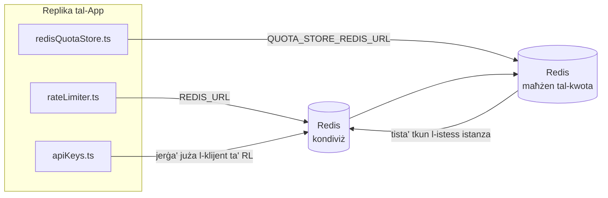

# Redis Production Configuration Guide (Malti)

🌐 **Languages:** 🇺🇸 [English](../../../../ops/REDIS_PRODUCTION_CONFIG.md) · 🇪🇹 [am](../../../am/docs/ops/REDIS_PRODUCTION_CONFIG.md) · 🇸🇦 [ar](../../../ar/docs/ops/REDIS_PRODUCTION_CONFIG.md) · 🇦🇿 [az](../../../az/docs/ops/REDIS_PRODUCTION_CONFIG.md) · 🇧🇬 [bg](../../../bg/docs/ops/REDIS_PRODUCTION_CONFIG.md) · 🇧🇩 [bn](../../../bn/docs/ops/REDIS_PRODUCTION_CONFIG.md) · 🇧🇦 [bs](../../../bs/docs/ops/REDIS_PRODUCTION_CONFIG.md) · 🇨🇿 [cs](../../../cs/docs/ops/REDIS_PRODUCTION_CONFIG.md) · 🇩🇰 [da](../../../da/docs/ops/REDIS_PRODUCTION_CONFIG.md) · 🇩🇪 [de](../../../de/docs/ops/REDIS_PRODUCTION_CONFIG.md) · 🇬🇷 [el](../../../el/docs/ops/REDIS_PRODUCTION_CONFIG.md) · 🇪🇸 [es](../../../es/docs/ops/REDIS_PRODUCTION_CONFIG.md) · 🇪🇪 [et](../../../et/docs/ops/REDIS_PRODUCTION_CONFIG.md) · 🇮🇷 [fa](../../../fa/docs/ops/REDIS_PRODUCTION_CONFIG.md) · 🇫🇮 [fi](../../../fi/docs/ops/REDIS_PRODUCTION_CONFIG.md) · 🇫🇷 [fr](../../../fr/docs/ops/REDIS_PRODUCTION_CONFIG.md) · 🇮🇪 [ga](../../../ga/docs/ops/REDIS_PRODUCTION_CONFIG.md) · 🇮🇳 [gu](../../../gu/docs/ops/REDIS_PRODUCTION_CONFIG.md) · 🇳🇬 [ha](../../../ha/docs/ops/REDIS_PRODUCTION_CONFIG.md) · 🇮🇱 [he](../../../he/docs/ops/REDIS_PRODUCTION_CONFIG.md) · 🇮🇳 [hi](../../../hi/docs/ops/REDIS_PRODUCTION_CONFIG.md) · 🇭🇷 [hr](../../../hr/docs/ops/REDIS_PRODUCTION_CONFIG.md) · 🇭🇺 [hu](../../../hu/docs/ops/REDIS_PRODUCTION_CONFIG.md) · 🇦🇲 [hy](../../../hy/docs/ops/REDIS_PRODUCTION_CONFIG.md) · 🇮🇩 [id](../../../id/docs/ops/REDIS_PRODUCTION_CONFIG.md) · 🇳🇬 [ig](../../../ig/docs/ops/REDIS_PRODUCTION_CONFIG.md) · 🇮🇹 [it](../../../it/docs/ops/REDIS_PRODUCTION_CONFIG.md) · 🇯🇵 [ja](../../../ja/docs/ops/REDIS_PRODUCTION_CONFIG.md) · 🇬🇪 [ka](../../../ka/docs/ops/REDIS_PRODUCTION_CONFIG.md) · 🇰🇭 [km](../../../km/docs/ops/REDIS_PRODUCTION_CONFIG.md) · 🇮🇳 [kn](../../../kn/docs/ops/REDIS_PRODUCTION_CONFIG.md) · 🇰🇷 [ko](../../../ko/docs/ops/REDIS_PRODUCTION_CONFIG.md) · 🇱🇹 [lt](../../../lt/docs/ops/REDIS_PRODUCTION_CONFIG.md) · 🇱🇻 [lv](../../../lv/docs/ops/REDIS_PRODUCTION_CONFIG.md) · 🇮🇳 [ml](../../../ml/docs/ops/REDIS_PRODUCTION_CONFIG.md) · 🇮🇳 [mr](../../../mr/docs/ops/REDIS_PRODUCTION_CONFIG.md) · 🇲🇾 [ms](../../../ms/docs/ops/REDIS_PRODUCTION_CONFIG.md) · 🇲🇲 [my](../../../my/docs/ops/REDIS_PRODUCTION_CONFIG.md) · 🇳🇵 [ne](../../../ne/docs/ops/REDIS_PRODUCTION_CONFIG.md) · 🇳🇱 [nl](../../../nl/docs/ops/REDIS_PRODUCTION_CONFIG.md) · 🇳🇴 [no](../../../no/docs/ops/REDIS_PRODUCTION_CONFIG.md) · 🇮🇳 [or](../../../or/docs/ops/REDIS_PRODUCTION_CONFIG.md) · 🇮🇳 [pa](../../../pa/docs/ops/REDIS_PRODUCTION_CONFIG.md) · 🇵🇭 [phi](../../../phi/docs/ops/REDIS_PRODUCTION_CONFIG.md) · 🇵🇱 [pl](../../../pl/docs/ops/REDIS_PRODUCTION_CONFIG.md) · 🇵🇹 [pt](../../../pt/docs/ops/REDIS_PRODUCTION_CONFIG.md) · 🇧🇷 [pt-BR](../../../pt-BR/docs/ops/REDIS_PRODUCTION_CONFIG.md) · 🇷🇴 [ro](../../../ro/docs/ops/REDIS_PRODUCTION_CONFIG.md) · 🇷🇺 [ru](../../../ru/docs/ops/REDIS_PRODUCTION_CONFIG.md) · 🇱🇰 [si](../../../si/docs/ops/REDIS_PRODUCTION_CONFIG.md) · 🇸🇰 [sk](../../../sk/docs/ops/REDIS_PRODUCTION_CONFIG.md) · 🇸🇮 [sl](../../../sl/docs/ops/REDIS_PRODUCTION_CONFIG.md) · 🇷🇸 [sr](../../../sr/docs/ops/REDIS_PRODUCTION_CONFIG.md) · 🇸🇪 [sv](../../../sv/docs/ops/REDIS_PRODUCTION_CONFIG.md) · 🇰🇪 [sw](../../../sw/docs/ops/REDIS_PRODUCTION_CONFIG.md) · 🇮🇳 [ta](../../../ta/docs/ops/REDIS_PRODUCTION_CONFIG.md) · 🇮🇳 [te](../../../te/docs/ops/REDIS_PRODUCTION_CONFIG.md) · 🇹🇭 [th](../../../th/docs/ops/REDIS_PRODUCTION_CONFIG.md) · 🇹🇷 [tr](../../../tr/docs/ops/REDIS_PRODUCTION_CONFIG.md) · 🇺🇦 [uk-UA](../../../uk-UA/docs/ops/REDIS_PRODUCTION_CONFIG.md) · 🇵🇰 [ur](../../../ur/docs/ops/REDIS_PRODUCTION_CONFIG.md) · 🇺🇿 [uz](../../../uz/docs/ops/REDIS_PRODUCTION_CONFIG.md) · 🇻🇳 [vi](../../../vi/docs/ops/REDIS_PRODUCTION_CONFIG.md) · 🇳🇬 [yo](../../../yo/docs/ops/REDIS_PRODUCTION_CONFIG.md) · 🇨🇳 [zh-CN](../../../zh-CN/docs/ops/REDIS_PRODUCTION_CONFIG.md) · 🇹🇼 [zh-TW](../../../zh-TW/docs/ops/REDIS_PRODUCTION_CONFIG.md)

---

## Ħarsa ġenerali

Redis huwa an **dipendenza mhux obbligatorja, artab** OmniRoute — l-applikazzjoni tiddegrada b'mod grazzjuż (fallbacks fil-memorja) meta Redis ma jkunx disponibbli. Fil-produzzjoni, l-irfinar Redis inaqqas il-latenza għal erba’ tagħbijiet ta’ xogħol distinti:

| L-ammont ta' xogħol        | Sewwieq                       | Fabbrika tal-Klijent                              | Mudell Ewlenin                                        |
| -------------------------- | ----------------------------- | ------------------------------------------------- | ----------------------------------------------------- |
| Limitazzjoni tar-rata      | `rateLimiter.ts`              | `getRedisClient()` — għażżien `ioredis` singleton | `<prefix>rl:*` Twieqi tal-limitu tar-rata atomika Lua |
| Awth cache                 | `apiKeys.ts`                  | Tuża mill-ġdid il-klijent ta' `rateLimiter`       | `<prefix>auth:api_key:<sha256>` ma TTL                |
| Maħżen tal-kwota           | `redisQuotaStore.ts`          | Singleton `getRedisClient(url)` separat           | `<prefix>quota:*` konfigurabbli għal kull istanza     |
| Circuit breaker tat-tisħin | `redisCircuitBreakerStore.ts` | Klijent separat `circuitBreakerFactory.ts`        | `<prefix>warmup:cb:<connectionId>`                    |

L-erba' xogħolijiet kollha jaqsmu prefiss tal-ispazju tal-isem wieħed sabiex OmniRoute jkun jista' jeżisti flimkien ma' apps oħra fuq istanza waħda Redis (eż. `127.0.0.1:6379`). Ara [l-Ispazjar tal-Ismijiet Ewlenin](#key-namespacing).

---

## Konfigurazzjoni kurrenti (Defaults tal-Kodiċi)

| L-issettjar                     | Valur                                                      | Fejn                                                                                  |
| ------------------------------- | ---------------------------------------------------------- | ------------------------------------------------------------------------------------- |
| `REDIS_URL` env var             | `redis://redis:6379` (jikkomponi), fakultattiv             | `rateLimiter.ts:5`, `.env.example`                                                    |
| `REDIS_KEY_PREFIX` env var      | `omniroute:` (default)                                     | `rateLimiter.ts`, `redisQuotaStore.ts`, `redisCircuitBreakerStore.ts`, `.env.example` |
| `QUOTA_STORE_REDIS_URL` env var | separati, jistgħu jvarjaw minn `REDIS_URL`                 | `quota/storeFactory.ts`                                                               |
| `QUOTA_STORE_DRIVER`            | `"sqlite"` (default), `"redis"` fakultattiv                | `quota/storeFactory.ts`                                                               |
| ioredis `maxRetriesPerRequest`  | `3`                                                        | Ħolqien tal-klijenti `rateLimiter.ts`                                                 |
| `enableReadyCheck`              | mhux issettjat (ioredis default: `true`)                   | —                                                                                     |
| `lazyConnect`                   | mhux issettjat (ioredis default: `false`)                  | —                                                                                     |
| `retryStrategy`                 | mhux issettjat (ioredis default: bażi 200ms, esponenzjali) | —                                                                                     |
| TLS / password / indiċi DB      | **mhux ikkonfigurat**                                      | —                                                                                     |
| Sentinella / Cluster            | **mhux ikkonfigurat** — standalone single-node biss        | —                                                                                     |

---

## Spazju tal-Ismijiet taċ-Ċwievet

OmniRoute jaqsam istanza ta’ Redis ma’ kwalunkwe servizz ieħor li jaħdem fuq il-host. Mingħajr spazju tal-ismijiet,
ċwievet bħal `auth:api_key:<sha256>` jew `rl:*` jistgħu jikkonfliġġu ma’ ċwievet minn applikazzjonijiet oħra
li jużaw l-istess Redis (din l-istanza tħaddem Redis fuq `127.0.0.1:6379` flimkien ma’ servizzi oħra).

Issettja `REDIS_KEY_PREFIX` għal string mhux vojt sabiex iżżid prefiss ma’ **kull** ċavetta ta’ OmniRoute:

```bash
# .env — iċ-ċwievet kollha ta’ OmniRoute jsiru omniroute:rl:*, omniroute:auth:*, omniroute:quota:*, omniroute:warmup:cb:*
REDIS_KEY_PREFIX=omniroute:
```

- **Valur predefinit:** `omniroute:` (applikat meta `REDIS_KEY_PREFIX` ma jkunx issettjat jew ikun vojt).
- **Applikat għal:** il-limitatur tar-rata + il-cache tal-awtentikazzjoni (klijent `ioredis` kondiviż permezz ta’ `keyPrefix`) u l-
  maħżen tal-kwoti (`KEY_PREFIX = "${REDIS_KEY_PREFIX}quota"`) u ċ-circuit breaker tat-tisħin
  (`KEY_PREFIX = "${REDIS_KEY_PREFIX}warmup:cb:"`).
- **Il-bdil tal-prefiss** meta ċ-ċwievet ikunu diġà jeżistu f’Redis iħalli ċ-ċwievet il-qodma orfni (dawn jiskadu
  permezz ta’ TTL / LRU). Jista’ jinbidel mingħajr periklu; ebda migrazzjoni mhi meħtieġa. L-unika eċċezzjoni hija ċavetta taċ-
  circuit breaker tat-tisħin għal konnessjoni mmarkata bħala pprojbita: din tinħażen mingħajr TTL, għalhekk
  elenka l-fdalijiet b’`redis-cli --scan --pattern '<old-prefix>warmup:cb:*'` u ħassarhom.
- **`keyPrefix` ta’ ioredis** iżid il-prefiss awtomatikament waqt il-kitba **u** jneħħih waqt il-qari,
  għalhekk il-kodiċi tal-applikazzjoni qatt ma jara l-prefiss.

---

## Irfinar tal-Produzzjoni Rakkomandat

### 1. Konnessjoni Pool / Għażliet tal-Klijent (kostruttur ioredis `Redis` )

Il-kodiċi attwali joħloq `new Redis(url)` waħda mingħajr għażliet personalizzati. Għal skjeramenti ta' multi-repliki ta' produzzjoni, għaddi fabbrika tal-klijenti fil-kodiċi jew wrap `getRedisClient()`:

```typescript
const redis = new Redis(REDIS_URL, {
  maxRetriesPerRequest: null, // no retry limit; let retryStrategy decide
  enableReadyCheck: true, // verify server is ready before accepting calls
  lazyConnect: true, // don't connect on construction; wait for first call
  retryStrategy: (times) => {
    if (times > 10) return null; // give up after 10 retries → reconnect later
    return Math.min(times * 200, 5000); // 200ms, 400ms, …, 5s cap
  },
  enableAutoPipelining: true, // coalesce concurrent commands into one TCP write
  keepAlive: 10000, // TCP keep‑alive every 10s
});
```

**Kompromessi ewlenin:**

- `maxRetriesPerRequest: null` + `retryStrategy` — preferuta għall-produzzjoni sabiex restart Redis temporanju ma jfallux immedjatament kull talba. Il-fallback fil-memorja `checkRateLimit()` jassorbi l-mogħdija tal-falliment.
- `lazyConnect: true` — jevita dipendenza tal-istartjar fuq Redis li jkun up qabel is-server jibda jaċċetta konnessjonijiet.
- `enableAutoPipelining: true` — inaqqas ir-ritorni għal kontrolli konkorrenti tal-limitu tar-rata; benefiċċju għal > 50 RPS fuq konnessjoni waħda.

### 2. Konfigurazzjoni tas-Server Redis (`redis.conf`)

```
# Memory
maxmemory 80%                        # leave room for OS page cache
maxmemory-policy allkeys-lru         # evict stale auth cache entries under pressure

# Persistence (optional — OmniRoute is crash‑safe without it)
save 300 1                           # snapshot at least every 5 min if ≥1 key changed
appendonly no                        # AOF not needed; data is regeneratable
appendfsync no                       # no fsync overhead (RDB is sufficient)

# Networking
timeout 0                            # no idle disconnect
tcp-keepalive 300                    # 5 min keep‑alive
tcp-backlog 511                      # connection backlog for bursty load

# Performance
hz 10                                # default; 100 for latency‑sensitive
activedefrag yes                     # auto‑defragment when fragmentation >10%
```

**Kompromess għal `maxmemory-policy allkeys-lru`:** L-entrati tal-cache tal-awtifikazzjoni jistgħu jiġu żgumbrati taħt pressjoni tal-memorja. Dan huwa sikur — `setCachedApiKey` dejjem jerġa 'jippopola fuq miss, u r-riżerva SQLite hija awtorevoli. L-iskript Lua li jillimita r-rata joħloq ċwievet żgħar li huma ta 'ħajja qasira mid-disinn.

### 3. Docker Ikteb Settings

Il-prod compose (`docker-compose.prod.yml`) juża `redis:8.6.2-alpine`. Żid:

```yaml
redis:
  image: redis:8.6.2-alpine
  command:
    [
      "redis-server",
      "--maxmemory",
      "512mb",
      "--maxmemory-policy",
      "allkeys-lru",
      "--activedefrag",
      "yes",
      "--save",
      "300 1",
    ]
  healthcheck:
    test: ["CMD", "redis-cli", "ping"]
    interval: 10s
    timeout: 3s
    retries: 3
    start_period: 5s
```

### 4. Konsiderazzjonijiet ta' Multi-Istanza/Skala

**Redis Uniku għar-repliki kollha** — l-iskript Lua tal-limitatur tar-rata jiddependi fuq spazju ewlieni awtorevoli wieħed. Istanza Redis multipli wara repliki jitilfu l-atomiċità u jirdoppjaw il-baġit. Uża Redis wieħed (jew cluster Sentinel Redis b'failover) għar-repliki kollha tal-applikazzjoni.

**Għadd ta' konnessjoni:** Kull replika tal-applikazzjoni tiftaħ **2 konnessjonijiet TCP** lil Redis (klijent tal-limitatur tar-rata klijent tal-maħżen tal-kwota + ). F'10 repliki → 20 konnessjonijiet, sew fil-limitu ta 'konnessjoni 10k ta' istanza Redis default.

### 5. Monitoraġġ

Esponi permezz tal-endpoint tal-kontroll tas-saħħa:

```typescript
// src/app/api/monitoring/health/route.ts already calls rateLimiter functions
// Add Redis-specific checks:
//   1. PING latency via ioredis .ping()
//   2. Memory usage via INFO memory
//   3. Connection count via INFO clients
//   4. Hit rate for maxmemory-policy (evicted_keys / keyspace_hits)
```

Metriċi ewlenin li għandek tara:

- **Ċwievet żgumbrati / sek** — jekk persistenti mhux żero, żid `maxmemory`
- **Klijenti imblukkati** — mhux żero jissuġġerixxi skripts Lua bil-mod jew kontestazzjoni għolja
- **Konnessjonijiet miċħuda** limitu ta 'konnessjoni — hit; rari f'20 konnessjoni

### 6. Servers Kompatibbli Redis

Kwalunkwe server użat hawn għandu jħaddem skripts Lua: il-limitatur tar-rata huwa `EVAL` wieħed. Fuq server mingħajr Lua, `checkRateLimit()` jirreġistra `[RATE_LIMITER] Redis eval failed, falling back to in-memory rate limiting` u jgħodd għal kull proċess, għalhekk kull replika tinforza l-limitu waħedha. L-opt-in shared session-affinity store (`OMNIROUTE_SESSION_AFFINITY_STORE=redis`) jaqra u jaġġorna wkoll il-brilli `EVAL`; minghajr Lua tisloggja `[SESSION_AFFINITY] Redis error; falling back to SQLite.` u kull replika żżomm il-labar taghha. Il-piżijiet tax-xogħol l-oħra jużaw kmandi sempliċi (`SET ... EX`, `GET`, `DEL`, `MGET`, `EXPIRE`, `INCRBYFLOAT`, hashes u settijiet), u l-backend Redis tal-cache semantiku ma jibgħat l-ebda kmandi `FT.*`.

Ittestjat OmniRoute 3.8.52: KiviDB 1.2.0 bl-immaġni Lua tiegħu (`kividb/kividb:v1.2.0-lua`). Il-limitatur tar-rata (inkluż it-tieni proċess li jaqsam il-counters), awth cache, maħżen tal-kwota, circuit breaker warmup, maħżen cache semantiku, u talba `/v1/chat/completions` permezz tal-chat handler għaddew 18 mid-19-il verifika li jgħaddu Redis 8.10.3. Dak li huwa differenti: `INCRBYFLOAT` jaħżen `0.1 + 0.2` bħala `0.30000000000000004` fejn Redis jaħżen `0.3` ( [kividbio/kividb#387](https://github.com/kividbio/kividb/issues/387) ). Il-maħżen tal-kwota janalizza t-tnejn `parseFloat`, iżda ż-żewġ numri jvarjaw fl-aħħar ċifri, għalhekk paragun li jaqa 'eżatt fuq konfini tal-kwota jista' joħroġ b'mod differenti. Il-maħżen tal-affinità tas-sessjoni ma kienx parti minn dik il-ġirja. ( [setup](https://github.com/kividbio/kividb/blob/master/docs/integrations/omniroute.md), [riżultati](https://github.com/kividbio/kividb/tree/master/benchmarks/omniroute-compat) )

---

## Dijagramma tal-Arkitettura



---

## Referenzi

| Fajl                               | Għan                                                                         |
| ---------------------------------- | ---------------------------------------------------------------------------- |
| `src/shared/utils/rateLimiter.ts`  | Klijent Redis primarju, skript tal-limitu tar-rata Lua, fallback fil-memorja |
| `src/lib/db/apiKeys.ts`            | Awth cache — Redis→SQLite fallback                                           |
| `src/lib/quota/redisQuotaStore.ts` | Klijent Redis separat għal maħżen tal-kwota fakultattiv                      |
| `src/lib/quota/storeFactory.ts`    | Qlib bejn is-sewwieqa tal-kwota `sqlite` u `redis`                           |
| `docker-compose.prod.yml`          | Prod Redis kontejner (immaġni `redis:8.6.2-alpine`)                          |
| `.env.example`                     | Redis env vars dokumentazzjoni                                               |
| `src/app/api/local/redis/`         | Rotot API għall-orkestrazzjoni tal-kontejners dev                            |
| `bin/cli/commands/redis.mjs`       | Kmandi CLI għall-orkestrazzjoni tal-kontenituri dev                          |
