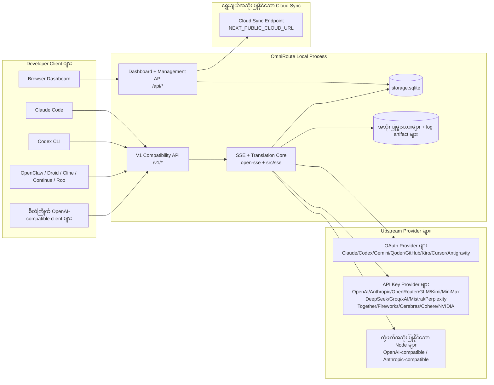
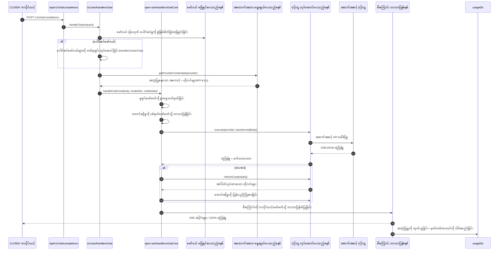
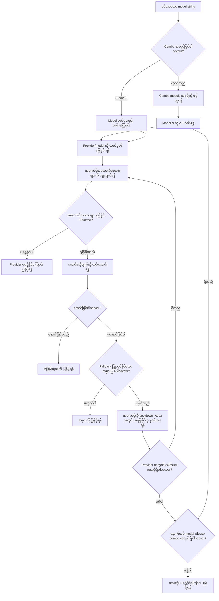
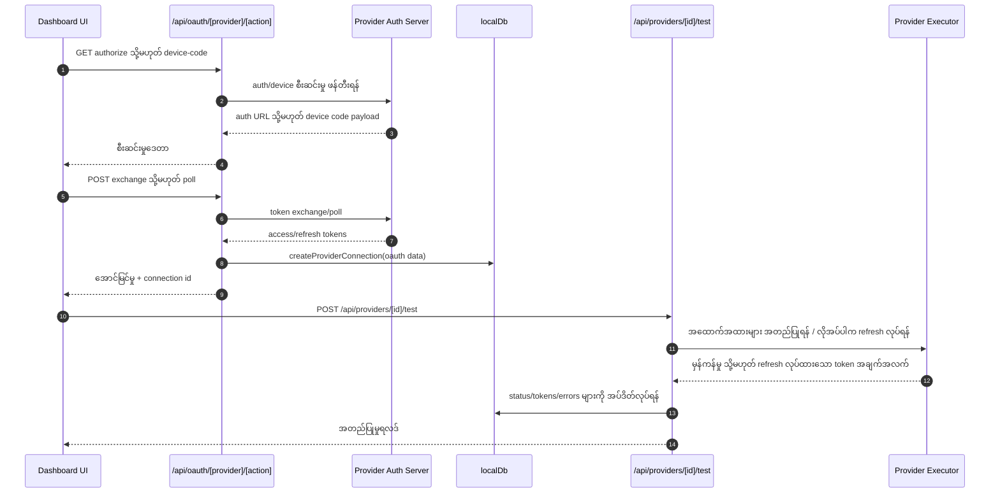
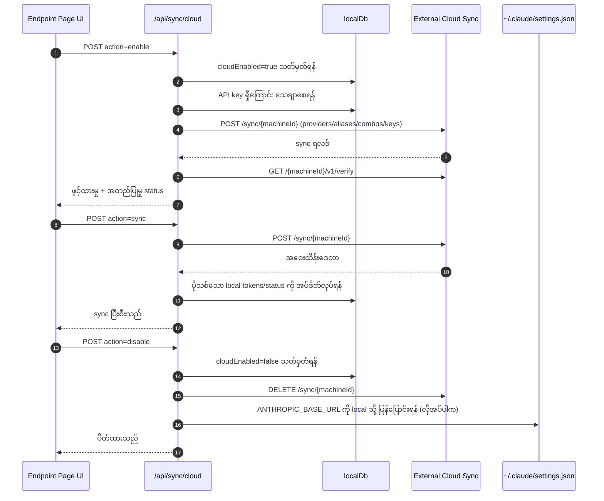
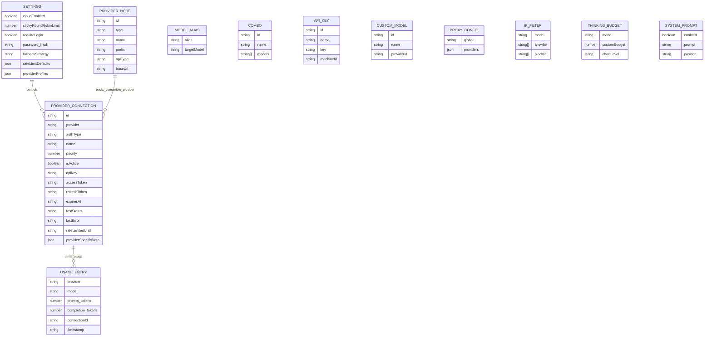
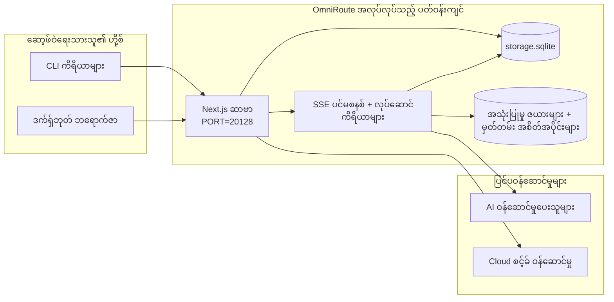

# OmniRoute Architecture (မြန်မာ)

🌐 **Languages:** 🇺🇸 [English](../../../../architecture/ARCHITECTURE.md) · 🇪🇹 [am](../../../am/docs/architecture/ARCHITECTURE.md) · 🇸🇦 [ar](../../../ar/docs/architecture/ARCHITECTURE.md) · 🇦🇿 [az](../../../az/docs/architecture/ARCHITECTURE.md) · 🇧🇬 [bg](../../../bg/docs/architecture/ARCHITECTURE.md) · 🇧🇩 [bn](../../../bn/docs/architecture/ARCHITECTURE.md) · 🇧🇦 [bs](../../../bs/docs/architecture/ARCHITECTURE.md) · 🇨🇿 [cs](../../../cs/docs/architecture/ARCHITECTURE.md) · 🇩🇰 [da](../../../da/docs/architecture/ARCHITECTURE.md) · 🇩🇪 [de](../../../de/docs/architecture/ARCHITECTURE.md) · 🇬🇷 [el](../../../el/docs/architecture/ARCHITECTURE.md) · 🇪🇸 [es](../../../es/docs/architecture/ARCHITECTURE.md) · 🇪🇪 [et](../../../et/docs/architecture/ARCHITECTURE.md) · 🇮🇷 [fa](../../../fa/docs/architecture/ARCHITECTURE.md) · 🇫🇮 [fi](../../../fi/docs/architecture/ARCHITECTURE.md) · 🇫🇷 [fr](../../../fr/docs/architecture/ARCHITECTURE.md) · 🇮🇪 [ga](../../../ga/docs/architecture/ARCHITECTURE.md) · 🇮🇳 [gu](../../../gu/docs/architecture/ARCHITECTURE.md) · 🇳🇬 [ha](../../../ha/docs/architecture/ARCHITECTURE.md) · 🇮🇱 [he](../../../he/docs/architecture/ARCHITECTURE.md) · 🇮🇳 [hi](../../../hi/docs/architecture/ARCHITECTURE.md) · 🇭🇷 [hr](../../../hr/docs/architecture/ARCHITECTURE.md) · 🇭🇺 [hu](../../../hu/docs/architecture/ARCHITECTURE.md) · 🇦🇲 [hy](../../../hy/docs/architecture/ARCHITECTURE.md) · 🇮🇩 [id](../../../id/docs/architecture/ARCHITECTURE.md) · 🇳🇬 [ig](../../../ig/docs/architecture/ARCHITECTURE.md) · 🇮🇹 [it](../../../it/docs/architecture/ARCHITECTURE.md) · 🇯🇵 [ja](../../../ja/docs/architecture/ARCHITECTURE.md) · 🇬🇪 [ka](../../../ka/docs/architecture/ARCHITECTURE.md) · 🇰🇭 [km](../../../km/docs/architecture/ARCHITECTURE.md) · 🇮🇳 [kn](../../../kn/docs/architecture/ARCHITECTURE.md) · 🇰🇷 [ko](../../../ko/docs/architecture/ARCHITECTURE.md) · 🇱🇹 [lt](../../../lt/docs/architecture/ARCHITECTURE.md) · 🇱🇻 [lv](../../../lv/docs/architecture/ARCHITECTURE.md) · 🇮🇳 [ml](../../../ml/docs/architecture/ARCHITECTURE.md) · 🇮🇳 [mr](../../../mr/docs/architecture/ARCHITECTURE.md) · 🇲🇾 [ms](../../../ms/docs/architecture/ARCHITECTURE.md) · 🇲🇹 [mt](../../../mt/docs/architecture/ARCHITECTURE.md) · 🇳🇵 [ne](../../../ne/docs/architecture/ARCHITECTURE.md) · 🇳🇱 [nl](../../../nl/docs/architecture/ARCHITECTURE.md) · 🇳🇴 [no](../../../no/docs/architecture/ARCHITECTURE.md) · 🇮🇳 [or](../../../or/docs/architecture/ARCHITECTURE.md) · 🇮🇳 [pa](../../../pa/docs/architecture/ARCHITECTURE.md) · 🇵🇭 [phi](../../../phi/docs/architecture/ARCHITECTURE.md) · 🇵🇱 [pl](../../../pl/docs/architecture/ARCHITECTURE.md) · 🇵🇹 [pt](../../../pt/docs/architecture/ARCHITECTURE.md) · 🇧🇷 [pt-BR](../../../pt-BR/docs/architecture/ARCHITECTURE.md) · 🇷🇴 [ro](../../../ro/docs/architecture/ARCHITECTURE.md) · 🇷🇺 [ru](../../../ru/docs/architecture/ARCHITECTURE.md) · 🇱🇰 [si](../../../si/docs/architecture/ARCHITECTURE.md) · 🇸🇰 [sk](../../../sk/docs/architecture/ARCHITECTURE.md) · 🇸🇮 [sl](../../../sl/docs/architecture/ARCHITECTURE.md) · 🇷🇸 [sr](../../../sr/docs/architecture/ARCHITECTURE.md) · 🇸🇪 [sv](../../../sv/docs/architecture/ARCHITECTURE.md) · 🇰🇪 [sw](../../../sw/docs/architecture/ARCHITECTURE.md) · 🇮🇳 [ta](../../../ta/docs/architecture/ARCHITECTURE.md) · 🇮🇳 [te](../../../te/docs/architecture/ARCHITECTURE.md) · 🇹🇭 [th](../../../th/docs/architecture/ARCHITECTURE.md) · 🇹🇷 [tr](../../../tr/docs/architecture/ARCHITECTURE.md) · 🇺🇦 [uk-UA](../../../uk-UA/docs/architecture/ARCHITECTURE.md) · 🇵🇰 [ur](../../../ur/docs/architecture/ARCHITECTURE.md) · 🇺🇿 [uz](../../../uz/docs/architecture/ARCHITECTURE.md) · 🇻🇳 [vi](../../../vi/docs/architecture/ARCHITECTURE.md) · 🇳🇬 [yo](../../../yo/docs/architecture/ARCHITECTURE.md) · 🇨🇳 [zh-CN](../../../zh-CN/docs/architecture/ARCHITECTURE.md) · 🇹🇼 [zh-TW](../../../zh-TW/docs/architecture/ARCHITECTURE.md)

---

🌐 **Languages:** 🇺🇸 [English](../../../../architecture/ARCHITECTURE.md) · 🇪🇹 [am](../../../am/docs/architecture/ARCHITECTURE.md) · 🇸🇦 [ar](../../../ar/docs/architecture/ARCHITECTURE.md) · 🇦🇿 [az](../../../az/docs/architecture/ARCHITECTURE.md) · 🇧🇬 [bg](../../../bg/docs/architecture/ARCHITECTURE.md) · 🇧🇩 [bn](../../../bn/docs/architecture/ARCHITECTURE.md) · 🇧🇦 [bs](../../../bs/docs/architecture/ARCHITECTURE.md) · 🇨🇿 [cs](../../../cs/docs/architecture/ARCHITECTURE.md) · 🇩🇰 [da](../../../da/docs/architecture/ARCHITECTURE.md) · 🇩🇪 [de](../../../de/docs/architecture/ARCHITECTURE.md) · 🇬🇷 [el](../../../el/docs/architecture/ARCHITECTURE.md) · 🇪🇸 [es](../../../es/docs/architecture/ARCHITECTURE.md) · 🇪🇪 [et](../../../et/docs/architecture/ARCHITECTURE.md) · 🇮🇷 [fa](../../../fa/docs/architecture/ARCHITECTURE.md) · 🇫🇮 [fi](../../../fi/docs/architecture/ARCHITECTURE.md) · 🇫🇷 [fr](../../../fr/docs/architecture/ARCHITECTURE.md) · 🇮🇪 [ga](../../../ga/docs/architecture/ARCHITECTURE.md) · 🇮🇳 [gu](../../../gu/docs/architecture/ARCHITECTURE.md) · 🇳🇬 [ha](../../../ha/docs/architecture/ARCHITECTURE.md) · 🇮🇱 [he](../../../he/docs/architecture/ARCHITECTURE.md) · 🇮🇳 [hi](../../../hi/docs/architecture/ARCHITECTURE.md) · 🇭🇷 [hr](../../../hr/docs/architecture/ARCHITECTURE.md) · 🇭🇺 [hu](../../../hu/docs/architecture/ARCHITECTURE.md) · 🇦🇲 [hy](../../../hy/docs/architecture/ARCHITECTURE.md) · 🇮🇩 [id](../../../id/docs/architecture/ARCHITECTURE.md) · 🇳🇬 [ig](../../../ig/docs/architecture/ARCHITECTURE.md) · 🇮🇹 [it](../../../it/docs/architecture/ARCHITECTURE.md) · 🇯🇵 [ja](../../../ja/docs/architecture/ARCHITECTURE.md) · 🇬🇪 [ka](../../../ka/docs/architecture/ARCHITECTURE.md) · 🇰🇭 [km](../../../km/docs/architecture/ARCHITECTURE.md) · 🇮🇳 [kn](../../../kn/docs/architecture/ARCHITECTURE.md) · 🇰🇷 [ko](../../../ko/docs/architecture/ARCHITECTURE.md) · 🇱🇹 [lt](../../../lt/docs/architecture/ARCHITECTURE.md) · 🇱🇻 [lv](../../../lv/docs/architecture/ARCHITECTURE.md) · 🇮🇳 [ml](../../../ml/docs/architecture/ARCHITECTURE.md) · 🇮🇳 [mr](../../../mr/docs/architecture/ARCHITECTURE.md) · 🇲🇾 [ms](../../../ms/docs/architecture/ARCHITECTURE.md) · 🇲🇹 [mt](../../../mt/docs/architecture/ARCHITECTURE.md) · 🇳🇵 [ne](../../../ne/docs/architecture/ARCHITECTURE.md) · 🇳🇱 [nl](../../../nl/docs/architecture/ARCHITECTURE.md) · 🇳🇴 [no](../../../no/docs/architecture/ARCHITECTURE.md) · 🇮🇳 [or](../../../or/docs/architecture/ARCHITECTURE.md) · 🇮🇳 [pa](../../../pa/docs/architecture/ARCHITECTURE.md) · 🇵🇭 [phi](../../../phi/docs/architecture/ARCHITECTURE.md) · 🇵🇱 [pl](../../../pl/docs/architecture/ARCHITECTURE.md) · 🇵🇹 [pt](../../../pt/docs/architecture/ARCHITECTURE.md) · 🇧🇷 [pt-BR](../../../pt-BR/docs/architecture/ARCHITECTURE.md) · 🇷🇴 [ro](../../../ro/docs/architecture/ARCHITECTURE.md) · 🇷🇺 [ru](../../../ru/docs/architecture/ARCHITECTURE.md) · 🇱🇰 [si](../../../si/docs/architecture/ARCHITECTURE.md) · 🇸🇰 [sk](../../../sk/docs/architecture/ARCHITECTURE.md) · 🇸🇮 [sl](../../../sl/docs/architecture/ARCHITECTURE.md) · 🇷🇸 [sr](../../../sr/docs/architecture/ARCHITECTURE.md) · 🇸🇪 [sv](../../../sv/docs/architecture/ARCHITECTURE.md) · 🇰🇪 [sw](../../../sw/docs/architecture/ARCHITECTURE.md) · 🇮🇳 [ta](../../../ta/docs/architecture/ARCHITECTURE.md) · 🇮🇳 [te](../../../te/docs/architecture/ARCHITECTURE.md) · 🇹🇭 [th](../../../th/docs/architecture/ARCHITECTURE.md) · 🇹🇷 [tr](../../../tr/docs/architecture/ARCHITECTURE.md) · 🇺🇦 [uk-UA](../../../uk-UA/docs/architecture/ARCHITECTURE.md) · 🇵🇰 [ur](../../../ur/docs/architecture/ARCHITECTURE.md) · 🇺🇿 [uz](../../../uz/docs/architecture/ARCHITECTURE.md) · 🇻🇳 [vi](../../../vi/docs/architecture/ARCHITECTURE.md) · 🇳🇬 [yo](../../../yo/docs/architecture/ARCHITECTURE.md) · 🇨🇳 [zh-CN](../../../zh-CN/docs/architecture/ARCHITECTURE.md) · 🇹🇼 [zh-TW](../../../zh-TW/docs/architecture/ARCHITECTURE.md)

_နောက်ဆုံးအပ်ဒိတ်လုပ်ထားသည့်ရက်: 2026-06-28_

## စီမံကိန်း၏အဓိကအချက်အလက်များ

OmniRoute သည် Next.js ပေါ်တွင် တည်ဆောက်ထားသော ဒေသဆိုင်ရာ AI လမ်းကြောင်းနှင့် ဒက်ရှ်ဘုတ်တစ်ခုဖြစ်သည်။ ၎င်းသည် OpenAI-သဟဇာတရှိသော အဆုံးမှတ် (`/v1/*`) တစ်ခုတည်းကို ပံ့ပိုးပေးပြီး ဘာသာပြန်ခြင်း၊ တုံ့ပြန်ခြင်း၊ တိုကင်ပြန်လည်ဆန်းသစ်ခြင်းနှင့် အသုံးပြုမှုခြေရာခံခြင်းတို့ဖြင့် ရေစီးကြောင်းပံ့ပိုးပေးသူအများအပြားကို လမ်းကြောင်းပေးသည်။

ပင်မစွမ်းရည်များ-

- CLI/tools အတွက် OpenAI-သဟဇာတဖြစ်သော API မျက်နှာပြင် (394 ဝန်ဆောင်မှုပေးသူ၊ 159 executor modules)
- ပံ့ပိုးသူဖော်မတ်များမှတဆင့်Request/response ဘာသာပြန်ဆိုချက်
- မော်ဒယ်ပေါင်းစည်းမှု နောက်ပြန်ဆုတ်ခြင်း (မော်ဒယ်လ်အစုံ)
- `compositeTiers` ဖြင့် runtime အစီအစဉ်ဖြင့် ဖွဲ့စည်းထားသော ပေါင်းစပ်အဆင့်များ (`provider + model + connection`)
- အကောင့်အဆင့် လှည့်ပြန်ခြင်း (ပံ့ပိုးသူ တစ်ဦးလျှင် အကောင့်များစွာ)
- ပင်မချတ်လမ်းကြောင်းရှိ Quota preflight နှင့် quota-aware P2C အကောင့်ရွေးချယ်ခြင်း။
- OAuth + API-သော့ပံ့ပိုးပေးသူချိတ်ဆက်မှုစီမံခန့်ခွဲမှု (27 OAuth ပံ့ပိုးပေးသူ modules)
- `/v1/embeddings` (ဝန်ဆောင်မှုပေးသူ 18 ခု) မှတစ်ဆင့် မျိုးဆက်ကို မြှုပ်နှံထားသည်
- `/v1/images/generations` မှတစ်ဆင့် ပုံထုတ်လုပ်ခြင်း (10 + ပံ့ပိုးပေးသူများ၊ 20 + မော်ဒယ်များ)
- `/v1/audio/transcriptions` (ဝန်ဆောင်မှုပေးသူ 18 ဦး) မှတစ်ဆင့် အသံမှတ်တမ်းယူခြင်း
- `/v1/audio/speech` (24 built-in ပံ့ပိုးပေးသူများ) မှတဆင့် စာသားမှစကားပြောခြင်း
- `/v1/videos/generations` မှတဆင့်ဗီဒီယိုမျိုးဆက် (ComfyUI + SD WebUI)
- `/v1/music/generations` (ComfyUI) မှတဆင့်ဂီတမျိုးဆက်
- `/v1/search` (ပံ့ပိုးပေးသူ 20) မှတစ်ဆင့် ဝဘ်ရှာဖွေမှု
- `/v1/moderations` မှတစ်ဆင့် ထိန်းညှိမှုများ
- `/v1/rerank` မှတစ်ဆင့် အဆင့်သတ်မှတ်ခြင်း
- ကျိုးကြောင်းဆင်ခြင်ခြင်းပုံစံများအတွက် tag parsing (`<think>...</think>`) ကိုစဉ်းစားပါ။
- တင်းကျပ်သော OpenAI SDK လိုက်ဖက်ညီမှုအတွက် တုံ့ပြန်မှုသန့်ရှင်းရေး
- ဝန်ဆောင်မှုပေးသူအချင်းချင်း လိုက်ဖက်ညီမှုအတွက် အခန်းကဏ္ဍပုံမှန်ဖြစ်စေခြင်း (ဆော့ဖ်ဝဲအင်ဂျင်နီယာ→ စနစ်၊ စနစ်→ အသုံးပြုသူ)
- ဖွဲ့စည်းတည်ဆောက်ထားသော အထွက်နှုန်းပြောင်းလဲခြင်း (json_schema → Gemini responseSchema)
- ဝန်ဆောင်မှုပေးသူများ၊ သော့များ၊ နာမည်တူများ၊ ပေါင်းစပ်မှုများ၊ ဆက်တင်များ၊ ဈေးနှုန်းများ (122 DB modules)
- Usage/cost ခြေရာခံခြင်းနှင့် သစ်ခုတ်ခြင်းတောင်းဆိုခြင်း။
- multi-device/state ထပ်တူပြုခြင်းအတွက် ရွေးချယ်နိုင်သော cloud ထပ်တူပြုခြင်း။
- API ဝင်ရောက်ထိန်းချုပ်မှုအတွက်IP allowlist/blocklist
- တွေးခေါ်ဘတ်ဂျက်စီမံခန့်ခွဲမှု (passthrough/auto/custom/adaptive)
- ကမ္ဘာလုံးဆိုင်ရာစနစ်မျာ ထိုးဆေး
- ဆက်ရှင်ခြေရာခံခြင်းနှင့် လက်ဗွေနှိပ်ခြင်း။
- ဝန်ဆောင်မှုပေးသူ သီးသန့်ပရိုဖိုင်များဖြင့် အကောင့်တစ်ခုချင်းတိုးနှုန်း ကန့်သတ်ချက်
- ပံ့ပိုးပေးသူ ခံနိုင်ရည်ရှိမှုအတွက် circuit breaker ပုံစံ
- mutex လော့ခ်ချခြင်းဖြင့် မိုးခြိမ်းသံဆန့်ကျင်သော နွားများကို အကာအကွယ်ပေးသည်။
- လက်မှတ်အခြေခံ တောင်းဆိုချက် ထုတ်ယူမှု ကက်ရှ်
- ဒိုမိန်းအလွှာ- ကုန်ကျစရိတ်စည်းမျဉ်းများ၊ နောက်ပြန်ဆွဲမူဝါဒ၊ လော့ခ်ချမှုမူဝါဒ
- Context Relay- အကောင့်လည်ပတ်မှုအဆက်မပြတ်အတွက် ဆက်ရှင်လက်လွှဲမှု အနှစ်ချုပ်
- Domain state မြဲမြံမှု (နောက်ပြန်ဆုတ်မှုများအတွက်SQLite ကက်ရှ်မှတဆင့် စာရေးခြင်း၊ ဘတ်ဂျက်များ၊ လော့ခ်ချမှုများ၊ circuit breakers)
- ဗဟိုမှတောင်းဆိုမှုအကဲဖြတ်ခြင်းအတွက် မူဝါဒအင်ဂျင် ( → ဘတ်ဂျက် → ဆုတ်ယုတ်မှု)
- p50/p95/p99 latency စုစည်းမှုဖြင့် telemetry ကို တောင်းဆိုပါ။
- ပေါင်းစပ်ပစ်မှတ် telemetry နှင့် `combo_execution_key` / `combo_step_id` မှတဆင့် သမိုင်းဝင် ပေါင်းစပ်ပစ်မှတ် ကျန်းမာရေး
- အဆုံးမှအဆုံး ခြေရာခံခြင်းအတွက် ဆက်စပ် ID (X-Request-Id)
- API သော့တစ်ခုလျှင် ဖယ်ထုတ်ခြင်းဖြင့် လိုက်နာမှု စာရင်းစစ်မှတ်တမ်း
- LLM အရည်အသွေးအာမခံမှုအတွက် Eval မူဘောင်
- အချိန်နှင့်တစ်ပြေးညီ ပံ့ပိုးပေးသူ circuit breaker အနေအထားပါရှိသော ကျန်းမာရေး ဒက်ရှ်ဘုတ်
- ပို့ဆောင်မှု 3 ခု (stdio/SSE/Streamable HTTP) ပါသောMCP ဆာဗာ (ကိရိယာ 110)
- ကျွမ်းကျင်မှုနှင့် အလုပ်သက်တမ်းစက်ဝန်းပါရှိသောA2A ဆာဗာ (JSON-RPC 2.0 + SSE)
- မှတ်ဉာဏ်စနစ် (ထုတ်ယူခြင်း၊ ဆေးထိုးခြင်း၊ ပြန်လည်ထုတ်ယူခြင်း၊ အကျဉ်းချုပ်)
- ကျွမ်းကျင်မှုစနစ် (registry၊ executor၊ sandbox၊ built-in ကျွမ်းကျင်မှုများ)
- လက်မှတ်စီမံခန့်ခွဲမှုနှင့် DNS ကိုင်တွယ်မှုနှင့်အတူMITM proxy
- Injection guard Middleware ကို အချက်ပြပါ။
- Caveman၊ RTK၊ စုထားသောပိုက်လိုင်းများ၊ compression combos၊ language packs နှင့် ခွဲခြမ်းစိတ်ဖြာချက်များဖြင့် အချက်ပြခြင်း
- ACP (Agent Communication Protocol) မှတ်ပုံတင်ခြင်း
- Modular OAuth ပံ့ပိုးပေးသူများ ( `src/lib/oauth/providers/` အောက်တွင် တစ်ဦးချင်းစီ module 22 ခု)
- Uninstall/full-uninstall ဇာတ်ညွှန်းများ
- OAuth ပတ်ဝန်းကျင် ပြုပြင်ခြင်း လုပ်ဆောင်ချက်
- OpenAI-သဟဇာတ WS clients (`/v1/ws`) အတွက်WebSocket တံတား
- စင့်ခ်လုပ်ရန် တိုကင်စီမံခန့်ခွဲမှု (issue/revoke၊ ETag-ဗားရှင်းဖြင့် ပြုပြင်ထားသော အစုအဝေးကို ဒေါင်းလုဒ်လုပ်ခြင်း)
- GLM Thinking (`glmt`) ပထမတန်းစားပံ့ပိုးပေးသူ ကြိုတင်သတ်မှတ်မှု
- စပ်ဟပ်တိုကင်ရေတွက်ခြင်း (ခန့်မှန်းခြေပြန်ပြောင်းနှင့်အတူ ပံ့ပိုးသူဘက်မှ `/messages/count_tokens` )
- မော်ဒယ်အမည်များ အလိုအလျောက်မျိုးစေ့ချခြင်း (စတင်ချိန်တွင် 30 + အပြန်အလှန် ပရောက်စီ ဒေသိယစကား ပုံမှန်ပြုလုပ်ခြင်း)
- SSRF အစောင့်၊ သီးသန့် URL ပိတ်ဆို့ခြင်း၊ နှင့် ပြင်ဆင်သတ်မှတ်နိုင်သော ထပ်စမ်းခြင်းတို့ဖြင့် ဘေးကင်းသော အပြင်သို့ ထုတ်ယူပါ။
- Cooldown-aware chat သည် configureable `requestRetry` နှင့် `maxRetryIntervalSec` ဖြင့် ပြန်ကြိုးစားသည်။
- စတင်ချိန်တွင် Zod ဖြင့် runtime ပတ်ဝန်းကျင် validation
- pagination၊ ပံ့ပိုးပေးသူ CRUD ဖြစ်ရပ်များနှင့် SSRF-ပိတ်ဆို့ထားသော တရားဝင်အထောက်အထားမှတ်တမ်းနှင့်အတူ လိုက်နာမှုစာရင်းစစ် v2

အဓိက runtime မော်ဒယ်-

- `src/app/api/*` အောက်တွင်Next.js အက်ပ်လမ်းကြောင်းများကို ဒက်ရှ်ဘုတ် APIs နှင့် လိုက်ဖက်ညီသော APIs နှစ်ခုလုံးကို အကောင်အထည်ဖော်ပါ။
- `src/sse/*` + `open-sse/*` ရှိ မျှဝေထားသော SSE/routing core သည် ဝန်ဆောင်မှုပေးသူကို စီမံဆောင်ရွက်ခြင်း၊ ဘာသာပြန်ဆိုခြင်း၊ တိုက်ရိုက်လွှင့်ခြင်း၊ နောက်ပြန်ဆုတ်ခြင်းနှင့် အသုံးပြုခြင်းကို ဆောင်ရွက်ပေးသည်

## ကိုးကားပုံကြမ်းများ

v3.8.0 ပလက်ဖောင်းအတွက် စံသတ်မှတ်ထားပြီး ဗားရှင်းထိန်းချုပ်ထားသော Mermaid ရင်းမြစ်များကို
[`docs/diagrams/`](../diagrams/README.md) တွင် ထားရှိပါသည်။ အကြမ်းဖျင်းသိရှိနိုင်ရန် ပုံကြမ်းနှစ်ခုကို အောက်တွင် ပြန်လည်ဖော်ပြထားပြီး၊
ကျန်ပုံကြမ်းများကို ၎င်းတို့နှင့် သက်ဆိုင်ရာ နယ်ပယ်အလိုက် လမ်းညွှန်များမှ လင့်ခ်ချိတ်ထားပါသည်။


> ရင်းမြစ်: [diagrams/request-pipeline.mmd](../diagrams/request-pipeline.mmd)


> ရင်းမြစ်: [diagrams/resilience-3layers.mmd](../diagrams/resilience-3layers.mmd) — ထို့အပြင်
> [RESILIENCE_GUIDE.md](./RESILIENCE_GUIDE.md) နှင့် `CLAUDE.md` ရှိ ခံနိုင်ရည်ဆိုင်ရာ ကိုးကားချက်မှလည်း လင့်ခ်ချိတ်ထားပါသည်။

## အကျုံးဝင်မှုနှင့် နယ်နိမိတ်များ

### အကျုံးဝင်သည့်အရာများ

- စက်တွင်း gateway runtime
- Dashboard စီမံခန့်ခွဲမှု API များ
- Provider စစ်မှန်ကြောင်းအတည်ပြုခြင်းနှင့် token ပြန်လည်သက်တမ်းတိုးခြင်း
- တောင်းဆိုမှု ဘာသာပြန်ပြောင်းလဲခြင်းနှင့် SSE streaming
- စက်တွင်း state + အသုံးပြုမှု အမြဲတမ်းသိမ်းဆည်းခြင်း
- ရွေးချယ်အသုံးပြုနိုင်သော cloud sync စီမံပေါင်းစပ်မှု

### အကျုံးမဝင်သည့်အရာများ

- `NEXT_PUBLIC_CLOUD_URL` နောက်ကွယ်ရှိ cloud ဝန်ဆောင်မှု အကောင်အထည်ဖော်မှု
- စက်တွင်း process ပြင်ပရှိ Provider SLA/control plane
- ပြင်ပ CLI binary များကိုယ်တိုင် (Claude CLI၊ Codex CLI စသည်)

## Dashboard မျက်နှာပြင် (လက်ရှိ)

`src/app/(dashboard)/dashboard/` အောက်ရှိ အဓိကစာမျက်နှာများ-

- `/dashboard` — အမြန်စတင်မှု + provider ခြုံငုံသုံးသပ်ချက်
- `/dashboard/endpoint` — endpoint proxy + MCP + A2A + API endpoint တက်ဘ်များ
- `/dashboard/providers` — provider ချိတ်ဆက်မှုများနှင့် အထောက်အထားများ
- `/dashboard/combos` — combo မဟာဗျူဟာများ၊ template များ၊ အဆင့်လိုက် builder၊ model routing စည်းမျဉ်းများနှင့် ကိုယ်တိုင်သတ်မှတ်ကာ အမြဲသိမ်းထားသော အစီအစဉ်
- `/dashboard/auto-combo` — Auto Combo Engine- အမှတ်ပေးခြင်းဆိုင်ရာ အလေးပေးတန်ဖိုးများ၊ mode pack များ၊ virtual factory preset များနှင့် telemetry
- `/dashboard/costs` — ကုန်ကျစရိတ် စုစည်းမှုနှင့် ဈေးနှုန်းမြင်နိုင်မှု
- `/dashboard/analytics` — အသုံးပြုမှုဆိုင်ရာ ခွဲခြမ်းစိတ်ဖြာချက်များ၊ အကဲဖြတ်မှုများနှင့် combo ပစ်မှတ်အခြေအနေ
- `/dashboard/limits` — quota/rate ထိန်းချုပ်မှုများ
- `/dashboard/cli-tools` — CLI စတင်အသုံးပြုမှု၊ runtime ရှာဖွေသတ်မှတ်မှုနှင့် config ဖန်တီးမှု
- `/dashboard/agents` — ရှာဖွေတွေ့ရှိထားသော ACP agent များ + စိတ်ကြိုက် agent မှတ်ပုံတင်ခြင်း
- `/dashboard/cloud-agents` — cloud တွင် host လုပ်ထားသော agent လုပ်ငန်းများ (Codex Cloud, Devin, Jules) နှင့် လုပ်ငန်း lifecycle
- `/dashboard/skills` — A2A skill registry၊ sandbox လုပ်ဆောင်မှုနှင့် အသင့်ပါရှိသော skill catalog
- `/dashboard/memory` — အမြဲသိမ်းထားသော စကားဝိုင်း memory ကို စစ်ဆေးခြင်းနှင့် ပြန်လည်ရယူခြင်း
- `/dashboard/webhooks` — အပြင်သို့ပို့သော webhook စာရင်းသွင်းမှုများ၊ secret လှည့်လည်ပြောင်းလဲခြင်းနှင့် retry စာရင်းအင်းများ
- `/dashboard/batch` — batch job တင်သွင်းခြင်းနှင့် တိုးတက်မှု
- `/dashboard/cache` — read-through နှင့် reasoning cache စာရင်းအင်းများ၊ ဖယ်ရှားရှင်းလင်းမှု ထိန်းချုပ်ချက်များ
- `/dashboard/playground` — configure လုပ်ထားသော မည်သည့် combo/model နှင့်မဆို အပြန်အလှန်အသုံးပြုနိုင်သည့် chat playground
- `/dashboard/changelog` — app အတွင်းရှိ changelog ကြည့်ရှုကိရိယာ (`CHANGELOG.md` ကို render လုပ်သည်)
- `/dashboard/system` — runtime စစ်ဆေးရှာဖွေမှုများ၊ version အချက်အလက်နှင့် environment အတည်ပြုရေး မျက်နှာပြင်
- `/dashboard/onboarding` — အသစ်ထည့်သွင်းမှုများအတွက် ပထမဆုံးအသုံးပြုချိန် စနစ်တပ်ဆင်ရေး wizard
- `/dashboard/media` — ရုပ်ပုံ/ဗီဒီယို/တေးဂီတ playground
- `/dashboard/search-tools` — search provider စမ်းသပ်ခြင်းနှင့် မှတ်တမ်း
- `/dashboard/health` — uptime၊ circuit breaker များ၊ rate limit များနှင့် quota စောင့်ကြည့်ထားသော session များ
- `/dashboard/logs` — request/proxy/audit/console မှတ်တမ်းများ
- `/dashboard/settings` — စနစ်ဆက်တင် တက်ဘ်များ (အထွေထွေ၊ routing၊ combo မူလတန်ဖိုးများ စသည်)
- `/dashboard/context/caveman` — Caveman compression စည်းမျဉ်းများ၊ language pack များ၊ အစမ်းကြည့်ရှုမှုနှင့် output mode
- `/dashboard/context/rtk` — RTK command-output filter များ၊ အစမ်းကြည့်ရှုမှုနှင့် runtime လုံခြုံရေးဆက်တင်များ
- `/dashboard/context/combos` — routing combo များသို့ သတ်မှတ်ထားသော အမည်ပေးထားသည့် compression pipeline များ
- `/dashboard/translator` — ဘာသာပြန်စနစ်ကို စစ်ဆေးခြင်းနှင့် request format ပြောင်းလဲမှု အစမ်းကြည့်ရှုခြင်း
- `/dashboard/audit` — pagination နှင့် ဖွဲ့စည်းတည်ဆောက်ထားသော metadata ပါဝင်သည့် စည်းမျဉ်းလိုက်နာမှုဆိုင်ရာ audit log browser
- `/dashboard/usage` — `usage_history` နှင့် ချိတ်ဆက်ထားသော request တစ်ခုချင်းစီအလိုက် အသုံးပြုမှု browser
- `/dashboard/compression` — compression ခွဲခြမ်းစိတ်ဖြာချက်များ၊ စာရင်းအင်းများနှင့် pipeline သတ်မှတ်မှု
- `/dashboard/api-manager` — API key lifecycle နှင့် model ခွင့်ပြုချက်များ

UI အလွှာ- စာမျက်နှာတိုင်းကို shell တစ်ခုတည်းအတွင်း render လုပ်သည် — `src/app/(dashboard)/layout.tsx` →
`src/shared/components/layouts/DashboardLayout.tsx` → `DashboardShell.tsx` (kit ၏
`SidebarProvider`/`SidebarInset`၊ OmniRoute ၏ `Sidebar.tsx` နှင့် `Header.tsx`)။ စာမျက်နှာများသည် ၎င်းတို့၏
တည်ဆောက်ရေးအစိတ်အပိုင်းများကို `@/shared/components` (`packages/ui-kit` ရှိ vendored Keak CI UI Kit ကို
ကြားခံချိတ်ဆက်ပေးသည့် adapter များ) သို့မဟုတ် kit component လမ်းကြောင်းခွဲများ (`@omniroute/ui-kit/table`, `…/page-header`) မှ import လုပ်ပြီး၊
icon များကို `<Icon>` (`ICON_MAP` → Lucide) မှတစ်ဆင့် အသုံးပြုသည်။ Theme (မူလအားဖြင့် `system`၊ light/dark) နှင့် token များကို
`src/app/globals.css` ရှိ bridge မှတစ်ဆင့် kit ထံမှ ရယူသည်။ အသေးစိတ်- `docs/architecture/DESIGN_SYSTEM.md`။

## အဆင့်မြင့် စနစ်ဆိုင်ရာ အကြောင်းအရာ



## အဓိက Runtime Component များ

## 1) API နှင့် Routing Layer (Next.js App Route များ)

အဓိက directory များ:

- Compatibility API များအတွက် `src/app/api/v1/*` နှင့် `src/app/api/v1beta/*`
- စီမံခန့်ခွဲမှု/ပြင်ဆင်သတ်မှတ်မှု API များအတွက် `src/app/api/*`
- `next.config.mjs` ရှိ Next rewrite များသည် `/v1/*` ကို `/api/v1/*` သို့ map လုပ်ပေးသည်

အရေးကြီးသော compatibility route များ:

- `src/app/api/v1/chat/completions/route.ts`
- `src/app/api/v1/messages/route.ts`
- `src/app/api/v1/responses/route.ts`
- `src/app/api/v1/models/route.ts` — `custom: true` ပါဝင်သော စိတ်ကြိုက် model များပါဝင်သည်
- `src/app/api/v1/embeddings/route.ts` — embedding ထုတ်လုပ်ခြင်း (provider 6 ခု)
- `src/app/api/v1/images/generations/route.ts` — ပုံထုတ်လုပ်ခြင်း (Antigravity/Nebius အပါအဝင် provider 4 ခုနှင့်အထက်)
- `src/app/api/v1/messages/count_tokens/route.ts`
- `src/app/api/v1/providers/[provider]/chat/completions/route.ts` — provider တစ်ခုချင်းစီအတွက် သီးခြား chat
- `src/app/api/v1/providers/[provider]/embeddings/route.ts` — provider တစ်ခုချင်းစီအတွက် သီးခြား embedding များ
- `src/app/api/v1/providers/[provider]/images/generations/route.ts` — provider တစ်ခုချင်းစီအတွက် သီးခြားပုံများ
- `src/app/api/v1beta/models/route.ts`
- `src/app/api/v1beta/models/[...path]/route.ts`

စီမံခန့်ခွဲမှု domain များ:

- အထောက်အထားစစ်ဆေးခြင်း/ဆက်တင်များ: `src/app/api/auth/*`, `src/app/api/settings/*`
- Provider များ/ချိတ်ဆက်မှုများ: `src/app/api/providers*`
- Provider node များ: `src/app/api/provider-nodes*`
- စိတ်ကြိုက် model များ: `src/app/api/provider-models` (GET/POST/DELETE)
- Model catalog: `src/app/api/models/route.ts` (GET)
- Proxy ပြင်ဆင်သတ်မှတ်မှု: `src/app/api/settings/proxy` (GET/PUT/DELETE) + `src/app/api/settings/proxy/test` (POST)
- OAuth: `src/app/api/oauth/*`
- Key များ/alias များ/combo များ/ဈေးနှုန်းသတ်မှတ်ခြင်း: `src/app/api/keys*`, `src/app/api/models/alias`, `src/app/api/combos*`, `src/app/api/pricing`
- အသုံးပြုမှု: `src/app/api/usage/*`
- Sync/cloud: `src/app/api/sync/*`, `src/app/api/cloud/*`
- CLI ကိရိယာဆိုင်ရာ အကူအညီပေးစနစ်များ: `src/app/api/cli-tools/*`
- IP filter: `src/app/api/settings/ip-filter` (GET/PUT)
- Thinking budget: `src/app/api/settings/thinking-budget` (GET/PUT)
- System prompt: `src/app/api/settings/system-prompt` (GET/PUT)
- Compression: `src/app/api/settings/compression`, `src/app/api/compression/*` နှင့်
  `src/app/api/context/*`
- Session များ: `src/app/api/sessions` (GET)
- Rate limit များ: `src/app/api/rate-limits` (GET)
- ခံနိုင်ရည်ရှိမှု: `src/app/api/resilience` (GET/PATCH) — request queue၊ connection cooldown၊ provider breaker နှင့် wait-for-cooldown ပြင်ဆင်သတ်မှတ်မှု
- ခံနိုင်ရည်ရှိမှု ပြန်လည်သတ်မှတ်ခြင်း: `src/app/api/resilience/reset` (POST) — provider breaker များကို ပြန်လည်သတ်မှတ်ရန်
- Cache စာရင်းအင်းများ: `src/app/api/cache/stats` (GET/DELETE)
- Telemetry: `src/app/api/telemetry/summary` (GET)
- ဘတ်ဂျက်: `src/app/api/usage/budget` (GET/POST)
- Fallback chain များ: `src/app/api/fallback/chains` (GET/POST/DELETE)
- စည်းမျဉ်းလိုက်နာမှု စစ်ဆေးမှတ်တမ်း: `src/app/api/compliance/audit-log` (GET၊ pagination + ဖွဲ့စည်းပုံသတ်မှတ်ထားသော metadata ပါဝင်သည်)
- အကဲဖြတ်မှုများ: `src/app/api/evals` (GET/POST), `src/app/api/evals/[suiteId]` (GET)
- မူဝါဒများ: `src/app/api/policies` (GET/POST)
- Sync token များ: `src/app/api/sync/tokens` (GET/POST), `src/app/api/sync/tokens/[id]` (GET/DELETE)
- Config bundle: `src/app/api/sync/bundle` (GET၊ ဆက်တင်များ/provider များ/combo များ/key များ၏ ETag-versioned snapshot)
- WebSocket: `src/app/api/v1/ws/route.ts` — OpenAI-compatible WS client များအတွက် Upgrade handler

## 2) SSE + Translation Core

ပင်မစီးဆင်းမှု မော်ဂျူးများ-

- ဝင်ရောက်မှု- `src/sse/handlers/chat.ts`
- အဓိက တီးမှုတ်ခြင်း- `open-sse/handlers/chatCore.ts`
- ပံ့ပိုးပေးသူ၏ လုပ်ဆောင်မှု အဒက်တာများ- `open-sse/executors/*`
- detection/provider config ဖော်မတ်- `open-sse/services/provider.ts`
- မော်ဒယ် parse/resolve: `src/sse/services/model.ts`, `open-sse/services/model.ts`
- အကောင့် မှားယွင်းသော ယုတ္တိဗေဒ- `open-sse/services/accountFallback.ts`
- ဘာသာပြန်ချက်စာရင်း- `open-sse/translator/index.ts`
- တိုက်ရိုက်ထုတ်လွှင့်မှုများ- `open-sse/utils/stream.ts`၊ `open-sse/utils/streamHandler.ts`
- extraction/normalization: `open-sse/utils/usageTracking.ts` အသုံးပြုမှု
- tag parser: `open-sse/utils/thinkTagParser.ts` ကိုစဉ်းစားပါ။
- ကိုင်တွယ်ကိရိယာ ထည့်သွင်းခြင်း- `open-sse/handlers/embeddings.ts`
- ဝန်ဆောင်မှုပေးသူ မှတ်ပုံတင်ခြင်းကို ထည့်သွင်းခြင်း- `open-sse/config/embeddingRegistry.ts`
- ပုံမျိုးဆက် ကိုင်တွယ်သူ- `open-sse/handlers/imageGeneration.ts`
- ပုံပံ့ပိုးပေးသူ မှတ်ပုံတင်ခြင်း- `open-sse/config/imageRegistry.ts`
- တုံ့ပြန်မှု သန့်စင်ရေး- `open-sse/handlers/responseSanitizer.ts`
- အခန်းကဏ္ဍ ပုံမှန်ဖြစ်စေရန်- `open-sse/services/roleNormalizer.ts`

ဝန်ဆောင်မှုများ (လုပ်ငန်းဆိုင်ရာ ယုတ္တိဗေဒ):

- အကောင့် selection/scoring: `open-sse/services/accountSelector.ts`
- ဆက်စပ်ဘဝသံသရာစီမံခန့်ခွဲမှု- `open-sse/services/contextManager.ts`
- IP စစ်ထုတ်ခြင်း- `open-sse/services/ipFilter.ts`
- ဆက်ရှင်ခြေရာခံခြင်း- `open-sse/services/sessionManager.ts`
- ထပ်ထုတ်ရန် တောင်းဆိုခြင်း- `open-sse/services/signatureCache.ts`
- စနစ်အမှာစာထိုးခြင်း- `open-sse/services/systemPrompt.ts`
- ဘတ်ဂျက်စီမံခန့်ခွဲမှု- တွေးခေါ် `open-sse/services/thinkingBudget.ts`
- Wildcard မော်ဒယ်လမ်းကြောင်းသတ်မှတ်ခြင်း- `open-sse/services/wildcardRouter.ts`
- အဆင့်သတ်မှတ်ကန့်သတ်မှု စီမံခန့်ခွဲမှု- `open-sse/services/rateLimitManager.ts`
- Circuit breaker : `src/shared/utils/circuitBreaker.ts`
- ဆက်စပ်အကြောင်းအရာ လက်လွှဲမှု- `open-sse/services/contextHandoff.ts` — လက်လွှဲအကျဉ်းချုပ် မျိုးဆက်နှင့် ဆက်စပ်ဆက်စပ်- ထပ်ဆင့်လွှင့်နည်းဗျူဟာအတွက် ထိုးဆေး
- နှိမ့်ချမှု- ပံ့ပိုးသူဘာသာပြန်ခြင်းမပြုမီ `open-sse/services/compression/*` — နှိမ့်ချမှု။ Caveman စည်းမျဉ်းများ၊ RTK စစ်ထုတ်မှုများ၊ တန်းစီထားသော ပိုက်လိုင်းများ၊ ချုံ့ထားသော ပေါင်းစပ်မှုများ၊ ကိန်းဂဏာန်းများနှင့် အတည်ပြုချက်တို့ ပါဝင်သည်
- Codex quota fetcher- `open-sse/services/codexQuotaFetcher.ts` — context-relay handoff ဆုံးဖြတ်ချက်များအတွက် Codex ခွဲတမ်းကို ရယူသည်
- Cooldown-aware ထပ်စမ်းခြင်း- `src/sse/services/cooldownAwareRetry.ts` — per-model cooldown ကို ပြုပြင်နိုင်သော `requestRetry` / `maxRetryIntervalSec` ဖြင့် ထပ်စမ်းခြင်း
- ဘေးကင်းသော အပြင်သို့ ထုတ်ယူခြင်း- `src/shared/network/safeOutboundFetch.ts` — သည် SSRF guard ဖြင့် provider/model ထုတ်ယူမှု၊ သီးသန့် URL ပိတ်ဆို့ခြင်း၊ ထပ်စမ်းခြင်းနှင့် အချိန်ကုန်ခြင်း
- အပြင်ဘက် URL အစောင့်- `src/shared/network/outboundUrlGuard.ts` — ဝန်ဆောင်မှုပေးသူ URLs တွင် လက်ခံစစ်ဆေးမှုများ `src/shared/network/outboundUrlGuardPolicy.ts` `OMNIROUTE_ALLOW_LOCAL_PROVIDER_URLS`၊ `OMNIROUTE_ALLOW_PRIVATE_PROVIDER_URLS` နှင့် ၎င်းတို့၏ ဒက်ရှ်ဘုတ်ခလုတ်များမှ မုဒ်ကို ရွေးသည် ( `docs/reference/ENVIRONMENT.md` ကြည့်ပါ)
- ဝန်ဆောင်မှုပေးသူ တောင်းဆိုမှု ပုံသေများ- `open-sse/services/providerRequestDefaults.ts` — ဝန်ဆောင်မှုပေးသူ အဆင့် `maxTokens`၊ `temperature`၊ `thinkingBudgetTokens` ပုံသေများ
- GLM ပံ့ပိုးပေးသူ ကိန်းသေများ- `open-sse/config/glmProvider.ts` — မျှဝေထားသော GLM မော်ဒယ်များ၊ ခွဲတမ်း URLs၊ GLMT timeout/defaults
- Antigravity အထက်ပိုင်း- `open-sse/config/antigravityUpstream.ts` — အခြေခံ URL နှင့် ရှာဖွေမှုလမ်းကြောင်း ကိန်းသေများ
- Codex client ကိန်းသေများ- `open-sse/config/codexClient.ts` — ဗားရှင်းဖြင့် အသုံးပြုသူ-အေးဂျင့်နှင့် ကလိုင်းယင့်ဗားရှင်းတန်ဖိုးများ
- မော်ဒယ်အမည်များ အမျိုးအနွယ်- `src/lib/modelAliasSeed.ts` — မျိုးစေ့ 30 + ဖြတ်ကျော် ပရောက်စီ ဒေသိယစကား နာမည်တူများ

ဒိုမိန်း အလွှာ မော်ဂျူးများ

- rules/budgets: `src/domain/costRules.ts` ကုန်ကျစရိတ်
- နောက်ပြန်ဆုတ်ရေးမူဝါဒ- `src/domain/fallbackPolicy.ts`
- ပေါင်းစပ်-ဖြေရှင်းချက် စာချုပ်- `src/domain/comboResolver.ts`; တိုက်ရိုက်လမ်းကြောင်းသည် `open-sse/services/combo.ts` အသုံးပြုသည်။
- လော့ခ်ချခြင်းမူဝါဒ- `src/domain/lockoutPolicy.ts`
- မူဝါဒ-အကဲဖြတ်ခြင်း စာချုပ်- `src/domain/policyEngine.ts`; တောင်းဆိုမှုလမ်းကြောင်းသည် `src/shared/utils/apiKeyPolicy.ts` မှတဆင့် API-သော့မူဝါဒကို တွန်းအားပေးပြီး `src/sse/handlers/chat/resolvedModelPolicy.ts` မှတဆင့် ဖြေရှင်းပြီးပစ်မှတ်ခွင့်ပြုချက်ပေးသည်။
- အမှားကုဒ်များ ကတ်တလောက်- `src/shared/constants/errorCodes.ts`
- ID: `src/shared/utils/requestId.ts` တောင်းဆိုပါ။
- အချိန်ကုန်သွားသည်- `src/shared/utils/fetchTimeout.ts`
- တယ်လီမီတာ တောင်းခံခြင်း- `src/shared/utils/requestTelemetry.ts`
- Compliance/audit: `src/lib/compliance/index.ts`
- Eval အပြေးသမား- `src/lib/evals/evalRunner.ts`
- Domain အခြေအနေ တည်မြဲမှု- နောက်ပြန်ဆွဲကြိုးများအတွက် `src/lib/db/domainState.ts` — SQLite CRUD ၊ ဘတ်ဂျက်များ၊ ကုန်ကျစရိတ်မှတ်တမ်း၊ လော့ခ်ချမှုအခြေအနေ၊ ဆားကစ်ဖြတ်ပိုင်းများ

OAuth ပံ့ပိုးပေးသူ မော်ဂျူးများ ( `src/lib/oauth/providers/` အောက်တွင် တစ်ဦးချင်းစီ ဖိုင် 27 ဖိုင်):

- မှတ်ပုံတင်ခြင်း အညွှန်း- `src/lib/oauth/providers/index.ts`
- တစ်ဦးချင်း `ghe-copilot.ts` ပေးသူများ `workbuddy.ts` `agy.ts`, `antigravity.ts`, `claude.ts`, `cline.ts`, `codebuddy-cn.ts`, `codebuddy-intl.ts`, `codex.ts`, `cursor.ts`, `devin-desktop.ts`, `github.ts`, `gitlab-duo.ts`, `grok-cli-oauth.ts`, `grok-cli.ts`, `kilocode.ts`, `kimi-coding.ts`, `kiro.ts`, `muse-code.ts`, `openference.ts`, `qoder.ts`, `trae.ts`, , `xai-oauth.ts` `zed-hosted.ts` `zed.ts`
- မျှဝေထားသော အကူအညီများ- `codebuddyDeviceAuth.ts` (CodeBuddy CN/intl device flow), `museCodeDeviceResponse.ts`
- ပါးလွှာသော ထုပ်ပိုးမှု- `src/lib/oauth/providers.ts` — တစ်ဦးချင်းစီ မော်ဂျူးများမှ ပြန်လည် တင်ပို့သည်။

## 5) ထည့်သွင်းထားသော ဝန်ဆောင်မှုများ (v3.8.4)

OmniRoute သည် စက်တွင်း၌ လည်ပတ်နေသော AI ကိရိယာ process များကို ထည့်သွင်းခြင်း၊ ကြီးကြပ်ခြင်းနှင့် လမ်းကြောင်းပို့ခြင်းတို့ ပြုလုပ်နိုင်ပြီး ၎င်းတို့ကို **ထည့်သွင်းထားသော ဝန်ဆောင်မှုများ** ဟု ခေါ်သည်။ 9Router၊ CLIProxyAPI၊ Bifrost၊ Mux နှင့် Dario စုစုပေါင်း ငါးခုကို တစ်ပါတည်း ထည့်သွင်းပေးထားသည်။

ဗိသုကာအလွှာများ-

- **UI** (`/dashboard/providers/services`) — lifecycle ထိန်းချုပ်မှုများ၊ တိုက်ရိုက် log streaming၊ API key စီမံခန့်ခွဲမှုနှင့် (9Router အတွက်) အတွင်းပိုင်း reverse proxy မှတစ်ဆင့် ထည့်သွင်းထားသော မူရင်း UI တို့ပါဝင်သည့် tab နှစ်ခုပါ စာမျက်နှာ။
- **API** (`/api/services/{name}/*`) — 9Router အတွက် endpoint 11 ခု၊ CLIProxyAPI အတွက် 10 ခု၊ Bifrost / Mux / Dario တစ်ခုစီအတွက် 8 ခုရှိပြီး အားလုံးကို **LOCAL_ONLY** (မဖြစ်မနေလိုက်နာရသော စည်းမျဉ်း #17) အဖြစ် အမျိုးအစားခွဲထားသည်။ မျှဝေသုံးစွဲသည့် `GET /api/services/[name]/logs` SSE endpoint သည် ဝန်ဆောင်မှုနှစ်ခုလုံးကို ပံ့ပိုးပေးသည်။
- **ကြီးကြပ်ကိရိယာ** (`src/lib/services/`) — ယေဘုယျ `ServiceSupervisor` class သည် `child_process.spawn` ကို wrapper လုပ်ထားပြီး SSE log streaming အတွက် 5 MB ring buffer၊ health probe loop၊ atomic operation lock နှင့် SIGTERM→SIGKILL ဖြင့် အဆင့်ဆင့်ပိတ်သိမ်းမှုတို့ ပါဝင်သည်။ `bootstrap.ts` သည် process စတင်ချိန်တွင် ပြင်ဆင်သတ်မှတ်ထားသော ဝန်ဆောင်မှုအားလုံးကို ချိတ်ဆက်ပေးသည်။
- **Provider/executor** (`open-sse/executors/ninerouter.ts`) — 9Router ကို တကယ့် provider တစ်ခုအဖြစ် ဖော်ထုတ်ပေးထားသည်။ Model များတွင် `9router/{sub}/{model}` prefix တပ်ထားပြီး 9Router ၏ `/v1/models` endpoint မှ 5 မိနစ်တိုင်း ချိန်ကိုက်သည်။

အသေးစိတ်လေ့လာရန်- `docs/frameworks/EMBEDDED-SERVICES.md`

## အဓိကစနစ်ခွဲများ (v3.8.0)

### A. Auto Combo Engine

Auto Combo သည် static combo အဓိပ္ပါယ်ဖွင့်ဆိုချက်အပေါ် အားကိုးမည့်အစား တောင်းဆိုသည့်အချိန်၌ လမ်းကြောင်းပစ်မှတ်များကို ဒိုင်းနမစ်အမှတ်ပေးပြီး ရွေးသည်။ ၎င်းသည် `auto/*` မော်ဒယ်ရှေ့ဆက်မိသားစုကို စွမ်းအားပေးသည်။

- အင်ဂျင်ဝင်ရောက်မှု- `open-sse/services/autoCombo/` (`autoComboEngine.ts`၊ `scoringEngine.ts`၊ `virtualFactory.ts`၊ `modePacks.ts`)
- တိုက်ရိုက်ပေါင်းစပ်ထည့်သွင်းမှု- `open-sse/services/combo.ts` (`handleComboChat`, `resolveComboTargets`), `src/sse/handlers/chat.ts` မှ ခေါ်သည်။
- ဒက်ရှ်ဘုတ်- `/dashboard/auto-combo`
- Telemetry: `auto_combo_decisions` SQLite ဇယား

အဓိက စွမ်းဆောင်ရည်များ-

- **လမ်းကြောင်းဗျူဟာ 22 ခု** (ဦးစားပေး၊ အလေးချိန်၊ ပထမ၊ အဝိုင်း-ရော်ဘင်၊ P2C၊ ကျပန်း၊ အသုံးအနည်းဆုံး၊ ကုန်ကျစရိတ်-အကောင်းဆုံးဖြစ်အောင်၊ ပြန်လည်သတ်မှတ်-သတိပြုမိ၊ ပြန်လည်သတ်မှတ်-ဝင်းဒိုး၊ သက်တမ်းကုန်-ပထမ၊ ခေါင်းခန်း၊ ခွဲတမ်းအလေးချိန်၊ တင်းကျပ်သောကျပန်း၊** အော်တို** , lkgp, context-optimized, cache-optimized, context-relay၊** ပေါင်းစပ်မှု** , pipeline, jev) — auto သည် v3.8.0 တွင် ခေါင်းစီးအပြင်၊ `fusion` (panel fan-out + စီရင်ချက်ပေါင်းစပ်မှု၊ `open-sse/services/fusion.ts`) သည် v3.8.36 တွင် အသစ်ဖြစ်သည်။
- **16-အချက် အမှတ်ပေး** : ခွဲတမ်း၊ ကျန်းမာရေး၊ ပြောင်းပြန် ကုန်ကျစရိတ်၊ ပြောင်းပြန်နေချိန်၊ အလုပ်နှင့် အံကိုက် နှင့် နောက်ထပ် ဆယ်ခု။ ကိန်းဂဏန်းဇယားများနှင့် ၎င်းတို့၏မူလအလေးများသည် [`docs/routing/AUTO-COMBO.md`](../routing/AUTO-COMBO.md) — တွင်တည်ရှိပြီး ၎င်းအား ဤနေရာတွင် ပြန်လည်ဖော်ပြခြင်းက ၎င်းအား ပျက်သွားစေရန် ဒုတိယနေရာပေးမည်ဖြစ်သည်။
- **စက်ရုံအတု** အမည်ပေးထားသည့် တွဲဆိုင်းများ မရှိသောအခါတွင် ပေါ်ပင်ပေါင်းစပ်မှုများ ပေါ်ပေါက်လာပြီး ကျန်းမာတက်ကြွသော ဝန်ဆောင်မှုပေးသူ ချိတ်ဆက်မှုများမှ ကိုယ်စားလှယ်လောင်းများကို ရင်းမြစ်ပေးသည်။
- **အလိုအလျောက် ရှေ့ထွက်များ** : `auto/coding`, `auto/cheap`, `auto/fast`, `auto/offline`, `auto/smart`, `auto/lkgp` — တစ်ခုစီကို ချိန်ညှိထားသော အလေးချိန်ပရိုဖိုင်ဖြင့် ပံ့ပိုးထားသည်။
- **6 မုဒ်အစုံ** : `ship-fast`, `cost-saver`, `quality-first`, `offline-friendly`, `reliability-first` နှင့် `chaos-mode` — ဒိုင်ခွက်မှ ခေါ်ဆိုနိုင်သော ကြိုတင်သတ်မှတ်ထားသော အလေးချိန် ဖွဲ့စည်းမှုပုံစံများ။ (တောင်းဆိုမှု-အချိန်မျိုးကွဲများဖြစ်သည့် အထက်ဖော်ပြပါ `auto/*` ရှေ့ဆက်များနှင့် မရောထွေးရပါ။)

အယ်လဂိုရီသမ်အသေးစိတ် (အချက်ဖော်မြူလာများ၊ အလေးချိန်ချိန်ညှိခြင်း) အပြည့်အစုံအတွက် [`docs/routing/AUTO-COMBO.md`](../routing/AUTO-COMBO.md) ကြည့်ပါ။

### B. Cloud အေးဂျင့်များ

Cloud Agents သည် ယူနီဖောင်း DB-ကျောထောက်နောက်ခံပြုထားသော လုပ်ငန်းဆောင်တာဘဝစက်ဝန်းနောက်ကွယ်တွင် ပြင်ပအဖွဲ့အစည်းမှ လက်ခံထားသော ကုဒ်အေးဂျင့်ပလပ်ဖောင်းများ (Codex Cloud၊ Devin၊ Jules) ကို ခြုံငုံထားသည်။ အလုပ် creation/inspection အဆုံးမှတ်များအားလုံးသည် စီမံခန့်ခွဲမှု စစ်မှန်ကြောင်းအထောက်အထား လိုအပ်သည်။

- မော်ဂျူး အမြစ်- `src/lib/cloudAgent/` (`baseAgent.ts`၊ `registry.ts`၊ `api.ts`၊ `types.ts`၊ `db.ts`၊ အပေါင်း `agents/` အောက်တွင် တစ်ခုစီ ကိုယ်စားလှယ် လမ်းကြောင်းခွဲများ )
- ကိုယ်စားလှယ်တစ်ဦးစီ အကောင်အထည်ဖော်မှုများ- `agents/codex/`၊ `agents/devin/`၊ `agents/jules/`
- အများသူငှာ အဆုံးမှတ်များ- `/api/v1/agents/tasks/*` (list/create/get/cancel)
- စီမံခန့်ခွဲမှုအဆုံးမှတ်များ- `/api/cloud/*` (စီမံဆောင်ရွက်ပေးခြင်း၊ အခြေအနေ၊ အစုလိုက်)
- ဒက်ရှ်ဘုတ်- `/dashboard/cloud-agents`
- သိုလှောင်မှု- `cloud_agent_tasks` ဇယား

ကိုယ်စားလှယ်တစ်ဦးစီ စီမံဆောင်ရွက်ပေးခြင်းနှင့် OAuth အတိအကျအတွက် [`docs/frameworks/CLOUD_AGENT.md`](../frameworks/CLOUD_AGENT.md) ကြည့်ပါ။

### C. Guardrails

guardrails module သည် PII၊ ချက်ခြင်းထိုးသွင်းခြင်းနှင့် မလုံခြုံသောအမြင်အာရုံအကြောင်းအရာအတွက် တောင်းဆိုမှုများနှင့် တုံ့ပြန်မှုများကို စစ်ဆေးသည့် hot-reloadable middleware အလွှာတစ်ခုဖြစ်သည်။ ချိုးဖောက်မှုများသည် HTTP ဖြင့် တောင်းဆိုမှုကို တိုတိုတုတ်တုတ်ဖြစ်စေသည်။** ၅၀၃** ထို့အပြင် အောက်ပိုင်းခေါ်ဆိုသူများကို ထပ်စမ်းကြည့်ရန် သို့မဟုတ် ဘဏ်ခွဲလုပ်ခွင့်ပေးသည့် ဖွဲ့စည်းပုံအမှားကုဒ်။

- မော်ဂျူးအမြစ်- `src/lib/guardrails/` (`base.ts`၊ `registry.ts`၊ `piiMasker.ts`၊ `promptInjection.ts`၊ `visionBridge.ts`၊ `visionBridgeHelpers.ts`)
- ပြန်လည်စတင်ခြင်း- config အပြောင်းအလဲများအတွက် registry နာရီများသည် ကွင်းဆက်ကို နေရာ၌ ပြန်လည်တည်ဆောက်သည်။
- Wire-in အမှတ်များ- ချက်တင်ကိုင်တွယ်သူ ဝင်ရောက်မှု၊ ရုပ်ပုံထုတ်လုပ်သည့် ကိုင်တွယ်ကိရိယာ၊ တုံ့ပြန်မှု သန့်စင်ဆေး
- HTTP စာချုပ်- `503` နှင့် `error.code = "GUARDRAIL_VIOLATION"` အဖြစ် မျက်နှာပြင်ကို ချိုးဖောက်သည်။

စည်းမျဉ်းသတ်မှတ်ရေးသားခြင်းနှင့် အဆင့်သတ်မှတ်ခြင်းအတွက် [`docs/security/GUARDRAILS.md`](../security/GUARDRAILS.md) ကြည့်ပါ။

### D. Domain Layer

`src/domain/` namespace တွင် ဒိုမိန်းဝန်ဆောင်မှုများနှင့် သီးသန့်အကဲဖြတ်ခြင်းစာချုပ်များ ပါရှိသည်။ ၎င်းသည် တောင်းဆိုမှုတိုင်းအတွက် မဖြစ်မနေ ပေါ်လစီ ဝင်ခွင့်အမှတ်တစ်ခုမဟုတ်ပါ။

တိုက်ရိုက်ချက်တင်လမ်းကြောင်းသည် `src/shared/utils/apiKeyPolicy.ts` မှ `enforceApiKeyPolicy()` ခေါ်ဆိုသည်။ ဖြေရှင်းထားသော မော်ဒယ်များနှင့် ပေါင်းစပ်အဖွဲ့ဝင်များ၏ ခွင့်ပြုချက်ကို `src/sse/handlers/chat/resolvedModelPolicy.ts` တွင် အကောင်အထည်ဖော်သည်။ `src/app/api/v1/chat/completions/route.ts` တွင် ကိုယ်တိုင် host လုပ်ထားသော entry သည် dispatch မပြုမီ API-key မူဝါဒကိုလည်း ကျင့်သုံးသည်။ Combo Resolution သည် `open-sse/services/combo.ts` မှတဆင့် လုပ်ဆောင်သည်။

`src/domain/policyEngine.ts`၊ `src/domain/comboResolver.ts` နှင့် `src/lib/container.ts` ထိုတောင်းဆိုမှုလမ်းကြောင်း၏ ကြိုးမဲ့မဟုတ်သော စမ်းသပ်ထားသော စာချုပ်များ ကျန်ရှိနေသေးသည်။ ကွန်တိန်နာသည် မူဝါဒအင်ဂျင်ကို မှတ်ပုံတင်ထားသော်လည်း စစ်ဆေးထားသော ထုတ်လုပ်မှုတောင်းဆိုမှုလမ်းကြောင်းသည် ၎င်းကို ဖြေရှင်းမပေးပေ။ အဆိုပါ စာချုပ်များကို ပြောင်းလဲခြင်းတစ်ခုတည်းက တိုက်ရိုက်ချတ်မူဝါဒ သို့မဟုတ် ပေါင်းစပ်လမ်းကြောင်းကို ပြောင်းလဲခြင်းမဟုတ်ပါ။ ၎င်းတို့ကိုချိတ်ဆက်ခြင်း သို့မဟုတ် ဖယ်ရှားခြင်းအတွက် သီးခြားဒီဇိုင်းဆုံးဖြတ်ချက်တစ်ခု လိုအပ်သည်။

- သီးသန့်မူဝါဒအင်ဂျင်- `src/domain/policyEngine.ts` — လော့ခ်ချခြင်း → ဘတ်ဂျက် → ဆုတ်ယုတ်မှု အကဲဖြတ်ခြင်း။
- ကုန်ကျစရိတ်စည်းမျဉ်းများ- `src/domain/costRules.ts`
- နောက်ပြန်ဆုတ်ရေးမူဝါဒ- `src/domain/fallbackPolicy.ts`
- လော့ခ်ချခြင်းမူဝါဒ- `src/domain/lockoutPolicy.ts`
- တဂ်အခြေခံလမ်းကြောင်း- `src/domain/tagRouter.ts`
- သီးသန့်ပေါင်းစပ်ဖြေရှင်းသူ- `src/domain/comboResolver.ts` — သီးသန့်ရွေးချယ်မှုစာချုပ်။ တိုက်ရိုက်ပေါင်းစပ်လမ်းကြောင်းကို `open-sse/services/combo.ts` တွင်အကောင်အထည်ဖော်သည်။
- Connection/model စည်းမျဉ်း joiner: `src/domain/connectionModelRules.ts`
- မော်ဒယ်ရရှိနိုင်မှု လျှပ်တစ်ပြက်ပုံများ- `src/domain/modelAvailability.ts`
- ဝန်ဆောင်မှုပေးသူ သက်တမ်းကုန်ဆုံးမှုကို ခြေရာခံခြင်း- `src/domain/providerExpiration.ts`
- Quota cache: `src/domain/quotaCache.ts`. Providers add and remove quota windows (OpenAI dropped the 5-hour Codex window for some plans), so a usage reading the provider's adapter attests as complete (`quotasComplete`, see `src/lib/usage/usageReading.ts`) is the account's full window set: a window known earlier but absent from it is retired, in the cache, in the `quota_snapshots` a restart rehydrates (an appended retirement record), in the persisted Codex quota state and in Claude's saturation buckets. Partial evidence (response headers, stale copies) only updates the windows it carries.
- ပျက်စီးခြင်းအခြေအနေ- `src/domain/degradation.ts`
- ဖွဲ့စည်းမှုစာရင်းစစ်- `src/domain/configAudit.ts`
- OmniRoute တုံ့ပြန်မှု မက်တာဒေတာ တည်ဆောက်သူ- `src/domain/omnirouteResponseMeta.ts`
- အကဲဖြတ်စနစ်ခွဲ- `src/domain/assessment/` — အပိုင်းအလိုက် အကဲဖြတ်ခြင်းအလုပ်များ

### E. ခွင့်ပြုချက် ပိုက်လိုင်း

ခွင့်ပြုချက်ပိုက်လိုင်းသည် ဝင်လာသော တောင်းဆိုချက်တိုင်းကို အမျိုးအစားခွဲကာ ဖြန့်ဝေခြင်းမပြုမီ သင့်လျော်သောမူဝါဒကွင်းဆက်ကို ကျင့်သုံးသည်။

- ပိုက်လိုင်းဝင်ရောက်မှု- `src/server/authz/pipeline.ts`
- အမျိုးအစားခွဲရန် တောင်းဆိုခြင်း- `src/server/authz/classify.ts` — အများသူငှာ လိုက်ဖက်ညီသော လမ်းကြောင်းများကို စီမံခန့်ခွဲမှုလမ်းကြောင်းများနှင့် ခွဲခြားသည်။
- အများသူငှာ လမ်းကြောင်းစာရင်း- `src/shared/constants/publicApiRoutes.ts`
- မူဝါဒများ- `src/server/authz/policies/` — composable predicates (`requireApiKey`, `requireManagement`, `requireFreshAuth`, etc.)
- ခေါင်းစီးအသုံးအဆောင်များ- `src/server/authz/headers.ts`
- အခိုင်အမာကူညီသူ- `src/server/authz/assertAuth.ts`
- အကြောင်းအရာ တောင်းဆိုချက်- `src/server/authz/context.ts`

အများသူငှာ နှင့် စီမံခန့်ခွဲမှုလမ်းကြောင်းများသည် ခက်ခဲသောနယ်နိမိတ်ဖြစ်သည်- agent/cooldown APIs နှင့် ဝန်ဆောင်မှုပေးသူ ဗီဇပြောင်းလဲမှုများသည် စီမံခန့်ခွဲမှုဆိုင်ရာ အထောက်အထား (HTTP 401) ပျောက်ဆုံးနေပါက လိုအပ်ပါသည်။

လမ်းကြောင်း အမျိုးအစားခွဲခြင်း စည်းမျဉ်းအပြည့်အစုံအတွက် [`docs/architecture/AUTHZ_GUIDE.md`](./AUTHZ_GUIDE.md) ကြည့်ပါ။

### F. Workflow FSM နှင့် Task-Aware Router

ရှာဖွေတွေ့ရှိထားသော အလုပ်အသွားအလာအဆင့် (စီစဉ်ခြင်း၊ လုပ်ဆောင်ခြင်း၊ ပြန်လည်သုံးသပ်ခြင်း) နှင့် နောက်ခံ-လုပ်ငန်းစဥ်ဆက်စပ်မှုအပေါ် အခြေခံ၍ အသွားအလာကို တိုက်ရိုက်လုပ်ဆောင်ရန် ပေါင်းစပ်ရွေးချယ်မှုအပေါ်တွင် အလွှာလိုက် ကန့်သတ်-ပြည်နယ်-စက်မောင်းနှင်သည့်ရောက်တာတစ်ခု။

- အလုပ်အသွားအလာ FSM: `open-sse/services/workflowFSM.ts`
- Task-aware router- `open-sse/services/taskAwareRouter.ts`
- နောက်ခံလုပ်ဆောင်စရာ ရှာဖွေရေးကိရိယာ- `open-sse/services/backgroundTaskDetector.ts`
- ရည်ရွယ်ချက် အမျိုးအစားခွဲခြင်း- `open-sse/services/intentClassifier.ts`

FSM အကူးအပြောင်းများသည် Auto Combo ၏ အမှတ်ပေးချက်များသို့ ဖြည့်သွင်းပြီး background/automation လုပ်ဆောင်စရာများအတွက် စျေးသက်သာသော မော်ဒယ်များဆီသို့ ဦးတည်ကာ အပြန်အလှန်အကျိုးသက်ရောက်သော planning/review အလှည့်များအတွက် ပိုမိုအားကောင်းသော မော်ဒယ်များဆီသို့ ဦးတည်ပေးပါသည်။

### G. ပံ့ပိုးပေးသူ-သတ်သတ်မှတ်မှတ် ခံနိုင်ရည်ရှိမှု

ဝန်ဆောင်မှုပေးသူအများအပြားသည် ကမ္ဘာလုံးဆိုင်ရာ circuit breaker / connection cooldown / model lockout layers တွင် ကျောထောက်နောက်ခံပြုထားသော ခံနိုင်ရည်ရှိမှုနှင့် ကိုယ်ပျောက် module များကို ပေးပို့သည်-

- Antigravity 429 အင်ဂျင်- `open-sse/services/antigravity429Engine.ts` (အထောက်အထားကို လှည့်ပတ်သည်၊ တုံ့ပြန်မှု ခေါင်းစီးများကို ပွတ်တိုက်သည်၊ `antigravityCredits.ts`၊ `antigravityHeaderScrub.ts`၊ `antigravityHeaders.ts`၊ `antigravityIdentity.ts`၊ `antigravityVersion.ts` မှတဆင့် credits/version ခြေရာခံခြင်းကို မောင်းနှင်သည်)
- Antigravity 429 guard- `open-sse/services/antigravity429Guard.ts` (အိမ်ရှင်အားလုံးတွင်၊ `ANTIGRAVITY_MAX_429_ATTEMPTS`၏ အထက်ရေစီးကြောင်း 429s ၏ တောင်းဆိုချက်တစ်ခုအတွက် ဘတ်ဂျက်၊ ငြင်းဆိုထားသည့် ကိုယ်ထည်၏ ထပ်တူထပ်မျှ ပြန်လည်ပေးပို့မှုကို စက်တွင်းတွင် အဖြေပေးသည်၊ `src/sse/handlers/chat.ts` cooldown-aware ထပ်စမ်းကြည့်ခြင်းဖြင့် ထိုတောင်းဆိုမှုကို ပြန်လည်စတင်မည်မဟုတ်ပါ)
- ModelScope ခွဲတမ်းမူဝါဒ- `open-sse/services/modelscopePolicy.ts`
- Claude ကုဒ် CCH (လိုက်ဖက်ညီသော ချန်နယ် လက်ဆွဲနှုတ်ဆက်ခြင်း): `open-sse/services/claudeCodeCCH.ts`, အပေါင်း `claudeCodeCompatible.ts`, `claudeCodeConstraints.ts`, `claudeCodeExtraRemap.ts`, `claudeCodeToolRemapper.ts`
- Claude ကုဒ် လက်ဗွေပုံဖော်ခြင်း- `open-sse/services/claudeCodeFingerprint.ts`
- Claude Code obfuscation- `open-sse/services/claudeCodeObfuscation.ts`

ကိုယ်ပျောက်ကစားနည်းစာအုပ်နှင့် လုပ်ငန်းလည်ပတ်မှုလမ်းညွှန်ချက်အပြည့်အစုံအတွက် `docs/security/STEALTH_GUIDE.md` (git; `/docs` တွင်စုစည်းထားခြင်းမဟုတ်) ကိုကြည့်ပါ။

### H. Webhooks၊ Reasoning Cache၊ Read Cache

- **Webhooks** provider/account/task ဖြစ်ရပ်များအတွက် — အပြင်သို့ ပို့ဆောင်ခြင်း။
  - Dispatcher: `src/lib/webhookDispatcher.ts`
  - သိုလှောင်မှု- `webhooks` SQLite ဇယား ( `src/lib/db/webhooks.ts` မှတဆင့်)
  - ဒက်ရှ်ဘုတ်- `/dashboard/webhooks` (စာရင်းသွင်းမှုများ၊ လျှို့ဝှက်ချက်များ၊ ပြန်လည်ကြိုးစားမှုမှတ်တမ်း)
  - ဖြစ်ရပ်အစီအစဥ်ခွဲခြားခြင်းနှင့် အဓိပ္ပါယ်ပြန်စမ်းခြင်းအတွက် [`docs/frameworks/WEBHOOKS.md`](../frameworks/WEBHOOKS.md) ကြည့်ပါ။
- **Reasoning Cache** — replayable reasoning blocks for providers that emit thinking tokens (Claude, GLMT, etc.) so consecutive turns can skip re-thinking.
  - DB အလွှာ: `src/lib/db/reasoningCache.ts`
  - ဝန်ဆောင်မှုအလွှာ- `open-sse/services/reasoningCache.ts`
  - အဓိပ္ပါယ်ပြန်ဖွင့်ရန်အတွက် [`docs/routing/REASONING_REPLAY.md`](../routing/REASONING_REPLAY.md) ကြည့်ပါ။
- **Cache ကိုဖတ်ပါ။** — ခဏတာ တုံ့ပြန်မှု ကက်ရှ်ကို လက်မှတ်ဖြင့် သော့ခတ်ထားပြီး ကျိုးပဲ့နေသော SDKs မှ ထပ်တူထပ်မျှ ထပ်တူညီမှုများကို ဖျက်ရန် အသုံးပြုသည်။
  - DB အလွှာ: `src/lib/db/readCache.ts`
  - စာရင်းအင်းအဆုံးမှတ်- `GET /api/cache/stats`၊ `/dashboard/cache` ရှိ ဒက်ရှ်ဘုတ်

## 3) တည်မြဲသိုလှောင်မှု အလွှာ

အဓိက အခြေအနေ DB (SQLite):

- အခြေခံ အင်ဖရာ: `src/lib/db/core.ts` (better-sqlite3၊ migrations၊ WAL)
- DB အသုံးပြုခွင့်: သီးခြား `src/lib/db/*` module များကို တိုက်ရိုက် import လုပ်ပါ (`localDb.ts` barrel အဟောင်းကို ဖယ်ရှားပြီးဖြစ်သည်)
- ဖိုင်: `${DATA_DIR}/storage.sqlite` (`$XDG_CONFIG_HOME/omniroute/storage.sqlite` ကို သတ်မှတ်ထားလျှင် ၎င်းကို အသုံးပြုမည်၊ မသတ်မှတ်ထားလျှင် `~/.omniroute/storage.sqlite`)
- entity များ (table များ + KV namespace များ): providerConnections, providerNodes, modelAliases, combos, apiKeys, settings, pricing, **customModels**, **proxyConfig**, **ipFilter**, **thinkingBudget**, **systemPrompt**

အသုံးပြုမှုဒေတာ တည်မြဲသိုလှောင်ခြင်း:

- facade: `src/lib/usageDb.ts` (`src/lib/usage/*` ထဲတွင် ခွဲထားသော module များ)
- `storage.sqlite` ရှိ SQLite table များ: `usage_history`, `call_logs`, `proxy_logs`
- လိုက်ဖက်ညီမှု/အမှားရှာဖွေမှုအတွက် ရွေးချယ်အသုံးပြုနိုင်သော ဖိုင် artifact များကို ဆက်လက်ထိန်းသိမ်းထားသည် (`${DATA_DIR}/log.txt`, `${DATA_DIR}/call_logs/`, `<repo>/logs/...`)
- ယခင် JSON ဖိုင်များ ရှိနေပါက စတင်ချိန် migration များက SQLite သို့ ရွှေ့ပြောင်းပေးသည်

Domain အခြေအနေ DB (SQLite):

- `src/lib/db/domainState.ts` — domain အခြေအနေအတွက် CRUD လုပ်ဆောင်ချက်များ
- Table များ (`src/lib/db/core.ts` တွင် ဖန်တီးသည်): `domain_fallback_chains`, `domain_budgets`, `domain_cost_history`, `domain_lockout_state`, `domain_circuit_breakers`
- Write-through cache ပုံစံ: runtime တွင် in-memory Map များကို အဓိကအမှန်အဖြစ် သတ်မှတ်ထားသည်၊ ပြောင်းလဲမှုများကို SQLite သို့ synchronous နည်းဖြင့် ရေးသားသည်၊ cold start အချိန်တွင် အခြေအနေကို DB မှ ပြန်လည်ရယူသည်

## 4) Auth + လုံခြုံရေးဆိုင်ရာ မျက်နှာပြင်များ

- Dashboard cookie auth: `src/proxy.ts`, `src/app/api/auth/login/route.ts`
- API key ထုတ်လုပ်ခြင်း/အတည်ပြုခြင်း: `src/shared/utils/apiKey.ts`
- Provider လျှို့ဝှက်ချက်များကို `providerConnections` entries များတွင် အမြဲတမ်းသိမ်းဆည်းထားသည်
- `open-sse/utils/proxyFetch.ts` (env vars) နှင့် `open-sse/utils/networkProxy.ts` (provider တစ်ခုချင်းအလိုက် သို့မဟုတ် global အဖြစ် ပြင်ဆင်သတ်မှတ်နိုင်သည်) တို့မှတစ်ဆင့် outbound proxy ကို ပံ့ပိုးသည်
- SSRF / outbound URL ကာကွယ်မှု: `src/shared/network/outboundUrlGuard.ts` — provider ခေါ်ဆိုမှုများနှင့် webhook ပစ်မှတ်များအတွက် host စစ်ဆေးမှုများ ပြုလုပ်သည်၊ mode ကို `src/shared/network/outboundUrlGuardPolicy.ts` မှ ရယူသည် (`docs/reference/ENVIRONMENT.md` ရှိ flags များ)
- Runtime env အတည်ပြုစစ်ဆေးမှု: `src/lib/env/runtimeEnv.ts` — environment variables အားလုံးအတွက် Zod schema ဖြစ်ပြီး startup errors/warnings များအဖြစ် ဖော်ပြသည်
- Sync tokens: `src/lib/db/syncTokens.ts` — config bundle download endpoints များအတွက် scope သတ်မှတ်ထားသော tokens များဖြစ်ပြီး `sync_tokens` SQLite table (migration `024_create_sync_tokens.sql`) ဖြင့် သိမ်းဆည်းပံ့ပိုးထားသည်
- WebSocket handshake auth: `src/lib/ws/handshake.ts` — API key သို့မဟုတ် session cookie မှတစ်ဆင့် WS upgrade requests များကို အတည်ပြုစစ်ဆေးသည်
- Live dashboard WebSocket auth: `src/server/ws/liveServer.ts` — sidecar (port `LIVE_WS_PORT`) သည် dashboard session cookie သို့မဟုတ် management scope (`manage`/`admin`) ပါရှိသော Bearer API key ကို လက်ခံသည်။ inference-only keys များကို ငြင်းပယ်သည်။ ၎င်း၏ အတွင်းပိုင်း `POST /__omniroute_event` publisher endpoint သည် proxy-hop header (`x-forwarded-*`, `x-real-ip`, `forwarded`, `via`) မရှိသည့်အခါတွင်သာ loopback peers များကို လက်ခံသည်

## 5) Cloud Sync

- Scheduler စတင်ပြင်ဆင်ခြင်း: `src/lib/initCloudSync.ts`, `src/shared/services/initializeCloudSync.ts`, `src/shared/services/modelSyncScheduler.ts`
- အချိန်မှန် လုပ်ဆောင်သည့် task: `src/shared/services/cloudSyncScheduler.ts`
- အချိန်မှန် လုပ်ဆောင်သည့် task: `src/shared/services/modelSyncScheduler.ts`
- ထိန်းချုပ်ရေး route: `src/app/api/sync/cloud/route.ts`

## တောင်းဆိုမှု အသက်တာစက်ဝန်း (`/v1/chat/completions`)



## Combo + အကောင့် Fallback စီးဆင်းမှု



Fallback ဆုံးဖြတ်ချက်များကို status codes နှင့် error-message heuristics များအသုံးပြုသည့် `open-sse/services/accountFallback.ts` က ထိန်းချုပ်သည်။ Combo routing တွင် နောက်ထပ် အကာအကွယ်တစ်ခု ထည့်သွင်းထားသည်- upstream content-block နှင့် role-validation မအောင်မြင်မှုများကဲ့သို့ provider တစ်ခုနှင့်သာ သက်ဆိုင်သော 400s များကို model တစ်ခုနှင့်သာ သက်ဆိုင်သည့် မအောင်မြင်မှုများအဖြစ် သတ်မှတ်သဖြင့် နောက်ပိုင်း combo targets များကို ဆက်လက်လုပ်ဆောင်နိုင်သည်။

## OAuth စတင်ချိတ်ဆက်ခြင်းနှင့် Token Refresh သက်တမ်းစက်ဝန်း



တိုက်ရိုက် traffic အတွင်း refresh လုပ်ဆောင်မှုကို executor `refreshCredentials()` မှတစ်ဆင့် `open-sse/handlers/chatCore.ts` အတွင်း လုပ်ဆောင်သည်။

## Cloud Sync သက်တမ်းစက်ဝန်း (ဖွင့်ရန် / Sync လုပ်ရန် / ပိတ်ရန်)



Cloud ကို ဖွင့်ထားသည့်အခါ အချိန်ကာလအလိုက် sync လုပ်ဆောင်မှုကို `CloudSyncScheduler` က စတင်ပေးသည်။

## ဒေတာမော်ဒယ်နှင့် သိုလှောင်မှုမြေပုံ



ရုပ်ပိုင်းဆိုင်ရာ သိုလှောင်မှုဖိုင်များ-

- ပင်မ runtime DB: `${DATA_DIR}/storage.sqlite`
- တောင်းဆိုမှုမှတ်တမ်းစာကြောင်းများ- `${DATA_DIR}/log.txt` (လိုက်ဖက်ညီမှု/အမှားရှာဖွေရေးအတွက် ဖန်တီးထားသည့်ဖိုင်)
- စနစ်တကျဖွဲ့စည်းထားသော ခေါ်ဆိုမှု payload မော်ကွန်းများ- `${DATA_DIR}/call_logs/`
- ရွေးချယ်အသုံးပြုနိုင်သော ဘာသာပြန်ကိရိယာ/တောင်းဆိုမှု အမှားရှာဖွေရေး session များ- `<repo>/logs/...`

## ဖြန့်ကျက်အသုံးပြုမှု ဖွဲ့စည်းပုံ



## မော်ဂျူးမြေပုံ (ဆုံးဖြတ်ချက်အတွက် အရေးကြီးသည်)

### Route နှင့် API မော်ဂျူးများ

- `src/app/api/v1/*`, `src/app/api/v1beta/*`: လိုက်ဖက်ညီမှု API များ
- `src/app/api/v1/providers/[provider]/*`: provider တစ်ခုချင်းစီအတွက် သီးသန့် route များ (ချတ်၊ embedding များ၊ ပုံများ)
- `src/app/api/providers*`: provider CRUD၊ အတည်ပြုစစ်ဆေးခြင်းနှင့် စမ်းသပ်ခြင်း
- `src/app/api/provider-nodes*`: စိတ်ကြိုက် လိုက်ဖက်ညီသော node စီမံခန့်ခွဲမှု
- `src/app/api/provider-models`: စိတ်ကြိုက်မော်ဒယ် စီမံခန့်ခွဲမှု (CRUD)
- `src/app/api/models/route.ts`: မော်ဒယ်ကတ်တလောက် API (alias များ + စိတ်ကြိုက်မော်ဒယ်များ)
- `src/app/api/oauth/*`: OAuth/device-code လုပ်ငန်းစဉ်များ
- `src/app/api/keys*`: စက်တွင်း API key သက်တမ်းစက်ဝန်း
- `src/app/api/models/alias`: alias စီမံခန့်ခွဲမှု
- `src/app/api/combos*`: fallback combo စီမံခန့်ခွဲမှု
- `src/app/api/pricing`: ကုန်ကျစရိတ်တွက်ချက်မှုအတွက် စျေးနှုန်း override များ
- `src/app/api/settings/proxy`: proxy ဖွဲ့စည်းသတ်မှတ်မှု (GET/PUT/DELETE)
- `src/app/api/settings/proxy/test`: အပြင်ဘက်သို့ထွက်သော proxy ချိတ်ဆက်နိုင်မှု စမ်းသပ်ချက် (POST)
- `src/app/api/usage/*`: အသုံးပြုမှုနှင့် မှတ်တမ်း API များ
- `src/app/api/sync/*` + `src/app/api/cloud/*`: cloud sync နှင့် cloud ဆိုင်ရာ အထောက်အကူပြုကိရိယာများ
- `src/app/api/cli-tools/*`: စက်တွင်း CLI ဖွဲ့စည်းသတ်မှတ်ချက် ရေးသားခြင်း/စစ်ဆေးခြင်း ကိရိယာများ
- `src/app/api/settings/ip-filter`: IP ခွင့်ပြုစာရင်း/ပိတ်ဆို့စာရင်း (GET/PUT)
- `src/app/api/settings/thinking-budget`: စဉ်းစားမှု token ဘတ်ဂျက် ဖွဲ့စည်းသတ်မှတ်ချက် (GET/PUT)
- `src/app/api/settings/system-prompt`: စနစ်တစ်ခုလုံးဆိုင်ရာ system prompt (GET/PUT)
- `src/app/api/settings/compression`: စနစ်တစ်ခုလုံးဆိုင်ရာ compression ဆက်တင်များ (GET/PUT)
- `src/app/api/compression/*`: compression အစမ်းကြည့်ရှုမှု၊ စည်းမျဉ်း metadata နှင့် ဘာသာစကား pack များ
- `src/app/api/context/caveman/config`: Caveman ဆက်တင် alias (GET/PUT)
- `src/app/api/context/rtk/*`: RTK ဖွဲ့စည်းသတ်မှတ်ချက်၊ filter ကတ်တလောက်၊ စမ်းသပ် endpoint နှင့် raw-output ပြန်လည်ရယူမှု
- `src/app/api/context/combos*`: compression combo CRUD နှင့် routing-combo သတ်မှတ်ချိတ်ဆက်မှုများ
- `src/app/api/context/analytics`: compression analytics alias
- `src/app/api/sessions`: လက်ရှိအသုံးပြုနေသော session စာရင်း (GET)
- `src/app/api/rate-limits`: အကောင့်တစ်ခုချင်းအလိုက် rate limit အခြေအနေ (GET)
- `src/app/api/sync/tokens`: sync token CRUD (GET/POST)
- `src/app/api/sync/tokens/[id]`: sync token ရယူခြင်း/ဖျက်ခြင်း (GET/DELETE)
- `src/app/api/sync/bundle`: config bundle ဒေါင်းလုဒ်လုပ်ခြင်း (GET၊ ETag ဗားရှင်းသတ်မှတ်ခြင်း)
- `src/app/api/v1/ws`: OpenAI-compatible WS client များအတွက် WebSocket upgrade handler

### Routing နှင့် လုပ်ဆောင်မှု Core

- `src/sse/handlers/chat.ts`: တောင်းဆိုမှုကို parse လုပ်ခြင်း၊ combo ကို ကိုင်တွယ်ခြင်းနှင့် အကောင့်ရွေးချယ်မှု loop
- `open-sse/handlers/chatCore.ts`: ဘာသာပြန်ခြင်း၊ executor dispatch၊ ထပ်မံကြိုးစားခြင်း/ပြန်လည်ဆန်းသစ်ခြင်းကို ကိုင်တွယ်ခြင်းနှင့် stream ပြင်ဆင်ခြင်း
- `open-sse/executors/*`: provider တစ်ခုချင်းစီအလိုက် ကွန်ရက်နှင့် ဖော်မတ်ဆိုင်ရာ အပြုအမူ

### ဘာသာပြန် Registry နှင့် ဖော်မတ်ပြောင်းလဲပေးသည့် ကိရိယာများ

- `open-sse/translator/index.ts`: ဘာသာပြန်စနစ် registry နှင့် orchestration
- Request ဘာသာပြန်စနစ်များ: `open-sse/translator/request/*` (module 9 ခု — `antigravity-to-openai`, `claude-to-gemini`, `claude-to-openai`, `gemini-to-openai`, `openai-responses`, `openai-to-claude`, `openai-to-cursor`, `openai-to-gemini`, `openai-to-kiro`)
- Response ဘာသာပြန်စနစ်များ: `open-sse/translator/response/*` (module 11 ခု — `claude-to-openai`, `cursor-to-openai`, `gemini-to-claude`, `gemini-to-openai`, `kiro-to-openai`, `openai-responses`, `openai-to-antigravity`, `openai-to-claude`, `openai-to-gemini`, `openai-to-gemini-sse`, `responsesToolItem`)
- အထောက်အကူပြုများ: `open-sse/translator/helpers/*` (module 12 ခု — `claudeHelper`, `geminiHelper`, `geminiToolsSanitizer`, `jsonUtil`, `markdownBoundary`, `maxTokensHelper`, `openaiHelper`, `responsesApiHelper`, `schemaCoercion`, `strictSystemHoist`, `toolCallHelper`, `toolCallShim`)
- Format ကိန်းသေများ: `open-sse/translator/formats.ts`
- Bootstrap နှင့် registry: `open-sse/translator/bootstrap.ts`, `open-sse/translator/registry.ts`
- ပုံ format အထောက်အကူပြုများ: `open-sse/translator/image/`

### အမြဲတမ်းသိမ်းဆည်းမှု

- `src/lib/db/*`: SQLite ပေါ်ရှိ အမြဲတမ်းသိမ်းဆည်းထားသော config/state နှင့် domain ဆိုင်ရာ အချက်အလက်သိမ်းဆည်းမှု
- `src/lib/db/*`: သီးခြား module များကို တိုက်ရိုက် import လုပ်ပါ — barrel မရှိပါ (`localDb.ts` re-export layer အဟောင်းကို ဖယ်ရှားပြီးဖြစ်သည်)
- `src/lib/usageDb.ts`: SQLite table များအပေါ်တွင် တည်ဆောက်ထားသော အသုံးပြုမှုမှတ်တမ်း/call log များအတွက် facade

## ပံ့ပိုးပေးသူ စီမံအုပ်ချုပ်သူ လွှမ်းခြုံမှု (ဗျူဟာပုံစံ)

ဝန်ဆောင်မှုပေးသူတိုင်းတွင် URL အဆောက်အဦ၊ ခေါင်းစီးတည်ဆောက်မှု၊ ကိန်းဂဏန်းနောက်ပြန်ဆွဲမှု၊ အထောက်အထားပြန်လည်ဆန်းသစ်မှုချိတ်များနှင့် `execute()` စုစည်းမှုနည်းလမ်းတို့ကို ပံ့ပိုးပေးသည့် `BaseExecutor` ( `open-sse/executors/base.ts`) တွင် တိုးချဲ့ထားသော အထူးစီမံအုပ်ချုပ်သူတစ်ခုရှိသည်။

| အုပ်ချုပ်သူ               | ပံ့ပိုးသူ(များ)                                                                                                                                              | အထူးကိုင်တွယ်                                                                              |
| ------------------------- | ------------------------------------------------------------------------------------------------------------------------------------------------------------ | ------------------------------------------------------------------------------------------ |
| `DefaultExecutor`         | OpenAI, Claude, Gemini, Qwen, OpenRouter, GLM, Kimi, MiniMax, DeepSeek, Groq, xAI, Mistral, Perplexity , Together, Fireworks, Cerebras, Cohere, NVIDIA, etc. | ဝန်ဆောင်မှုပေးသူ တစ်ဦးစီ၏ ဒိုင်းနမစ် URL/header config                                     |
| `AntigravityExecutor`     | Google Antigravity                                                                                                                                           | စိတ်ကြိုက် project/session IDs၊ ပြန်စမ်းကြည့်ပါ-ခွဲခြမ်းစိတ်ဖြာပြီးနောက်၊ 429 ရှုပ်ထွေးမှု |
| `AzureOpenAIExecutor`     | Azure OpenAI                                                                                                                                                 | ဖြန့်ကျက်မှုအခြေခံ လမ်းကြောင်းတင်ခြင်း၊ api-ဗားရှင်းမေးမြန်းမှု ပြဋ္ဌာန်းခြင်း။            |
| `BlackboxWebExecutor`     | Blackbox AI (ဝဘ်မုဒ်)                                                                                                                                        | TLS လက်ဗွေအတုယူခြင်းဖြင့် ဝဘ်စက်ရှင်သည် ပြောင်းပြန်                                        |
| `ClaudeIdentityExecutor`  | Claude.ai (CCH လမ်းကြောင်း)                                                                                                                                  | + tool-remap ပိုက်လိုင်းများ၊ လက်ဗွေပုံဖော်ခြင်းကို ကန့်သတ်ထားသည်။                         |
| `CliProxyApiExecutor`     | CLIProxyAPI-သဟဇာတ ပံ့ပိုးပေးသူများ                                                                                                                           | စိတ်ကြိုက် အထောက်အထားနှင့် ပရိုတိုကော ကိုင်တွယ်ခြင်း။                                      |
| `CloudflareAiExecutor`    | Cloudflare အလုပ်သမားများ AI                                                                                                                                  | အကောင့် ID ထိုးခြင်း၊ နျူရွန်အခြေခံအသုံးပြုမှု ခြေရာခံခြင်း။                               |
| `CodexExecutor`           | OpenAI Codex                                                                                                                                                 | စနစ်ညွှန်ကြားချက်များကို ထိုးသွင်းကာ ကျိုးကြောင်းဆင်ခြင်အားထုတ်မှုကို တွန်းအားပေးသည်။      |
| `ChatGptWebCodexExecutor` | ChatGPT ဝဘ် (Codex)                                                                                                                                          | ဘရောက်ဆာ-ဆက်ရှင်သည် thread/turn ပင်ထိုးခြင်းဖြင့် API တံတားကို တုံ့ပြန်သည်။                |
| `CommandCodeExecutor`     | Command Code                                                                                                                                                 | OAuth + per-session header လှည့်ခြင်း။                                                     |
| `CursorExecutor`          | Cursor IDE                                                                                                                                                   | ConnectRPC ပရိုတိုကော၊ Protobuf ကုဒ်နံပါတ်၊ checksum မှတစ်ဆင့် လက်မှတ်ထိုးတောင်းဆိုပါ။     |
| `DevinCliExecutor`        | Devin CLI                                                                                                                                                    | Devin သည် cloud အေးဂျင့် module မှတဆင့် ပေါင်းကူးပေးခြင်း                                  |
| `GithubExecutor`          | GitHub Copilot                                                                                                                                               | Copilot တိုကင် ပြန်လည်ဆန်းသစ်မှု၊ VSCode-အတုခိုးသည့် ခေါင်းစီးများ                         |
| `GitlabExecutor`          | GitLab Duo                                                                                                                                                   | GitLab OAuth + project-scoped routing                                                      |
| `GlmExecutor`             | Z.AI GLM ( `glmt` ကြိုတင်သတ်မှတ်မှု အပါအဝင်)                                                                                                                 | တွေးခေါ်မှု-ဘတ်ဂျက် သတိပြုပါ၊ GLMT ကြိုတင်သတ်မှတ်ထားသောကိန်းသေများ                         |
| `GrokWebExecutor`         | xAI Grok ဝဘ်                                                                                                                                                 | ဝဘ်ဆက်ရှင် ပြောင်းပြန်၊ မုဒ်ရွေးချယ်မှု (think/standard)                                   |
| `KieExecutor`             | KIE                                                                                                                                                          | လည်ပတ်နေသော စက်ရှင်ကျောက်ဆူးများဖြင့် စိတ်ကြိုက်တိုကင်ထုတ်ပေးခြင်း။                        |
| `KiroExecutor`            | AWS CodeWhisperer/Kiro                                                                                                                                       | AWS EventStream ဒွိဖော်မတ် → SSE ပြောင်းလဲခြင်း။                                           |
| `MuseSparkWebExecutor`    | မူဆယ်မီးပွား (ဝက်ဘ်ဆိုဒ်)၊                                                                                                                                   | ပုံ-မက်ဆေ့ခ်ျကို ပေါင်းကူးခြင်းဖြင့် ဝဘ်-ဆက်ရှင် ပြောင်းပြန်                               |
| `NlpCloudExecutor`        | NLP တိမ်တိုက်                                                                                                                                                | ဝန်ဆောင်မှုပေးသူ-သီးသန့် တောင်းဆိုမှု ကိုယ်ထည်ပုံစံ                                        |
| `OpenCodeExecutor`        | OpenCode                                                                                                                                                     | AI SDK သဟဇာတ ပံ့ပိုးပေးသူ စနစ်ထည့်သွင်းမှု                                                 |
| `PerplexityWebExecutor`   | စိတ်ရှုပ်စရာ web                                                                                                                                             | ချတ်ဆက်ခြင်းအတွက် ဝဘ်ဆက်ရှင် ပြောင်းပြန်                                                   |
| `PetalsExecutor`          | ပန်းဖူးများ စုံစုံဝေဆာသည်။                                                                                                                                   | ကျတ်ဝိုင်းအုံ လမ်းကြောင်းပေး                                                               |
| `PollinationsExecutor`    | ဝတ်မှုန်ကူးခြင်း AI                                                                                                                                          | API သော့မလိုအပ်ပါ၊ နှုန်းကန့်သတ်ထားသောတောင်းဆိုမှုများ                                     |
| `QoderExecutor`           | Qoder AI                                                                                                                                                     | PAT နှင့် OAuth ပံ့ပိုးမှု၊ မော်ဒယ်အခမဲ့အဆင့်                                              |
| `VertexExecutor`          | Google Vertex AI                                                                                                                                             | ဝန်ဆောင်မှုအကောင့် စစ်မှန်ကြောင်း၊ ဒေသအခြေပြု အဆုံးမှတ်များ                                |
| `DevinDesktopExecutor`    | Devin Desktop                                                                                                                                                | API key + Connect-protobuf chat streaming ကို တင်သွင်းထားသည်။                              |

အခြားပံ့ပိုးပေးသူအားလုံး (စိတ်ကြိုက်လိုက်ဖက်ညီသော nodes များအပါအဝင်) `DefaultExecutor` ကို အသုံးပြုသည်။

### အလိုအလျောက် စုံစမ်းစစ်ဆေးမှုများနှင့် ဝဘ်-ဆက်ရှင်အကောင့်များ

မော်ဒယ်စမ်းသပ်မှုများ၊ စမ်းသပ်မှုအားလုံး၊ ပေါင်းစပ်စမ်းသပ်မှုများနှင့် အကဲဖြတ်မှုများသည် စစ်မှန်သော ချတ်တောင်းဆိုမှုများကို ပေးပို့သည်။ ဝဘ်-ဆက်ရှင်ဝန်ဆောင်မှုပေးသူတစ်ဦးသည် အကောင့်ဝင်ထားသည့်အသုံးပြုသူအဖြစ် လုပ်ဆောင်သည်၊ ထို့ကြောင့် အဆိုပါတောင်းဆိုမှုများအားလုံးကို ထိုအကောင့်တွင် စကားဝိုင်းတစ်ခုအဖြစ် သိမ်းဆည်းထားမည်ဖြစ်သည်။ ထိုသို့သော စကားဝိုင်းများမှ ထွက်ခွာသွားသော အလိုအလျောက် စုံစမ်းစစ်ဆေးမှုများသည် အကောင့်တစ်ခု ဆိုင်းငံ့ထားသည် (#14780)။ ထို့ကြောင့် ချတ်ပိုက်လိုင်းသည် ပစ်မှတ်၏ဝန်ဆောင်မှုပေးသူကိုဖြေရှင်းပြီး အထောက်အထားမရွေးချယ်မီ (`src/lib/providers/chatProbePolicy.ts`) ဝန်ဆောင်မှုပေးသူမှ ဝဘ်-ဆက်ရှင်ဆိုင်ရာ အထောက်အထားကို ရယူသည့် အလိုအလျောက်စုံစမ်းစစ်ဆေးသည့် ပစ်မှတ်တိုင်းကို ငြင်းပယ်ပါသည်။ ငြင်းဆိုချက်သည် `422` နှင့် `error.code` `chat_probe_not_isolated` ဖြစ်သည်၊ နှင့် အပြေးသမားများက ၎င်းအား skip အဖြစ် အစီရင်ခံသည်၊ မအောင်မြင်ပါ။

ဝန်ဆောင်မှုပေးသူ၏ကိုယ်ပိုင်မဟုတ်သောသမိုင်းမုဒ်တွင် ချတ်တိုင်းကိုလုပ်ဆောင်သော executor သည် ၎င်းအား `ChatProbeIsolatingExecutor` (`open-sse/executors/chatProbeIsolation.ts`) ဖြင့်ကြေငြာသည်။ ထို့နောက် အဆိုပါဝန်ဆောင်မှုပေးသူအား စုံစမ်းစစ်ဆေးမှုများကို ခွင့်ပြုသည်။ ChatGPT Web သည် `temporary-chat` ကြေငြာသည်။ စမ်းသပ်မှုတစ်ခုဖြင့် ၎င်း၏ယန္တရားတွင် ကြေငြာချက်တစ်ခုကို ချိတ်ထားပါ၊ ထို့ကြောင့် တောင်းဆိုချက်သည် အမှန်ဖြစ်စေသောကုဒ်ကို အသက်မကျော်နိုင်ပါ။

## Provider လိုက်ဖက်ညီမှု မက်ထရစ်

> **မှတ်ချက်:** အောက်ပါမက်ထရစ်သည် OmniRoute v3.8.0 တွင် မှတ်ပုံတင်ထားသော provider 351 ခုအနက် ကိုယ်စားပြုနမူနာတစ်ခု ဖြစ်သည်။
> စံအဖြစ်သတ်မှတ်ထားပြီး စဉ်ဆက်မပြတ် အပ်ဒိတ်လုပ်ထားသော စာရင်းအတွက်
> [`docs/reference/PROVIDER_REFERENCE.md`](../reference/PROVIDER_REFERENCE.md) (အလိုအလျောက် ဖန်တီးထားသည်) သို့မဟုတ်
> `src/shared/constants/providers.ts` ရှိ အရင်းအမြစ်အမှန်ကို ကိုးကားပါ (ဖွင့်တင်စဉ် Zod ဖြင့် အတည်ပြုထားသည်)။

| ပံ့ပိုးသူ                 | ဖော်မတ်          | စစ်မှန်ကြောင်းအတည်ပြုမှု | တိုက်ရိုက်ထုတ်လွှင့်မှု | တိုက်ရိုက်မဟုတ်မှု | Token ပြန်လည်ရယူခြင်း | အသုံးပြုမှု API               |
| ------------------------- | ---------------- | ------------------------ | ----------------------- | ------------------ | --------------------- | ----------------------------- |
| Claude                    | claude           | API Key / OAuth          | ✅                      | ✅                 | ✅                    | ⚠️ Admin အတွက်သာ              |
| Gemini                    | gemini           | API Key / OAuth          | ✅                      | ✅                 | ✅                    | ⚠️ Cloud Console              |
| Antigravity               | antigravity      | OAuth                    | ✅                      | ✅                 | ✅                    | ✅ Quota API အပြည့်အစုံ       |
| OpenAI                    | openai           | API Key                  | ✅                      | ✅                 | ❌                    | ❌                            |
| Codex                     | openai-responses | OAuth                    | ✅ မဖြစ်မနေ             | ❌                 | ✅                    | ✅ နှုန်းကန့်သတ်ချက်များ      |
| ChatGPT Web (Codex)       | openai-responses | Browser session          | ✅ မဖြစ်မနေ             | ❌                 | ❌                    | ❌                            |
| GitHub Copilot            | openai           | OAuth + Copilot Token    | ✅                      | ✅                 | ✅                    | ✅ Quota လက်ငင်းမှတ်တမ်းများ  |
| Cursor                    | cursor           | စိတ်ကြိုက် checksum      | ✅                      | ✅                 | ❌                    | ❌                            |
| Kiro                      | kiro             | AWS SSO OIDC             | ✅ (EventStream)        | ❌                 | ✅                    | ✅ အသုံးပြုမှုကန့်သတ်ချက်များ |
| Qoder                     | openai           | OAuth / PAT              | ✅                      | ✅                 | ✅                    | ⚠️ Request တစ်ခုချင်းစီအလိုက် |
| Kilo Code                 | openai           | OAuth                    | ✅                      | ✅                 | ✅                    | ❌                            |
| Cline                     | openai           | OAuth                    | ✅                      | ✅                 | ✅                    | ❌                            |
| Kimi Coding               | openai           | OAuth                    | ✅                      | ✅                 | ✅                    | ❌                            |
| OpenRouter                | openai           | API Key                  | ✅                      | ✅                 | ❌                    | ❌                            |
| GLM/Kimi/MiniMax          | claude           | API Key                  | ✅                      | ✅                 | ❌                    | ❌                            |
| DeepSeek                  | openai           | API Key                  | ✅                      | ✅                 | ❌                    | ❌                            |
| Groq                      | openai           | API Key                  | ✅                      | ✅                 | ❌                    | ❌                            |
| xAI (Grok)                | openai           | API Key                  | ✅                      | ✅                 | ❌                    | ❌                            |
| Mistral                   | openai           | API Key                  | ✅                      | ✅                 | ❌                    | ❌                            |
| Perplexity                | openai           | API Key                  | ✅                      | ✅                 | ❌                    | ❌                            |
| Together AI               | openai           | API Key                  | ✅                      | ✅                 | ❌                    | ❌                            |
| Fireworks AI              | openai           | API Key                  | ✅                      | ✅                 | ❌                    | ❌                            |
| Cerebras                  | openai           | API Key                  | ✅                      | ✅                 | ❌                    | ❌                            |
| Cohere                    | openai           | API Key                  | ✅                      | ✅                 | ❌                    | ❌                            |
| NVIDIA NIM                | openai           | API Key                  | ✅                      | ✅                 | ❌                    | ❌                            |
| Cloudflare AI             | openai           | API Token + Acct ID      | ✅                      | ✅                 | ❌                    | ❌                            |
| Pollinations              | openai           | မရှိ (key မလို)          | ✅                      | ✅                 | ❌                    | ❌                            |
| Scaleway AI               | openai           | API Key                  | ✅                      | ✅                 | ❌                    | ❌                            |
| LongCat                   | openai           | API Key                  | ✅                      | ✅                 | ❌                    | ❌                            |
| Ollama Cloud              | openai           | API Key (ရွေးချယ်နိုင်)  | ✅                      | ✅                 | ❌                    | ❌                            |
| HuggingFace               | openai           | API Key                  | ✅                      | ✅                 | ❌                    | ❌                            |
| Nebius                    | openai           | API Key                  | ✅                      | ✅                 | ❌                    | ❌                            |
| SiliconFlow               | openai           | API Key                  | ✅                      | ✅                 | ❌                    | ❌                            |
| Hyperbolic                | openai           | API Key                  | ✅                      | ✅                 | ❌                    | ❌                            |
| Vertex AI                 | gemini           | Service Account          | ✅                      | ✅                 | ✅                    | ⚠️ Cloud Console              |
| Command Code              | openai           | OAuth                    | ✅                      | ✅                 | ✅                    | ⚠️ Request တစ်ခုချင်းစီအလိုက် |
| Z.AI / GLM                | openai           | API Key / OAuth          | ✅                      | ✅                 | ❌                    | ❌                            |
| GLMT (ကြိုတင်သတ်မှတ်ချက်) | claude           | API Key                  | ✅                      | ✅                 | ❌                    | ⚠️ Request တစ်ခုချင်းစီအလိုက် |
| Kimi Coding               | openai           | OAuth / API Key          | ✅                      | ✅                 | ✅                    | ❌                            |
| KIE                       | openai           | API Key                  | ✅                      | ✅                 | ❌                    | ❌                            |
| Devin Desktop             | openai           | ထည့်သွင်းထားသော API key  | ✅ (Connect→SSE)        | ✅                 | ❌                    | ⚠️ Request တစ်ခုချင်းစီအလိုက် |
| GitLab Duo                | openai           | OAuth (GitLab)           | ✅                      | ✅                 | ✅                    | ❌                            |
| Devin CLI                 | openai           | Local CLI login          | ✅                      | ✅                 | ❌                    | ✅ Task API                   |
| Codex Cloud               | openai-responses | OAuth                    | ✅                      | ❌                 | ✅                    | ✅ နှုန်းကန့်သတ်ချက်များ      |
| Jules                     | openai           | OAuth                    | ✅                      | ✅                 | ✅                    | ✅ Task API                   |
| AgentRouter               | openai           | API Key                  | ✅                      | ✅                 | ❌                    | ❌                            |
| Grok-Web                  | openai           | Session cookie           | ✅                      | ✅                 | ❌                    | ❌                            |
| Perplexity-Web            | openai           | Session cookie           | ✅                      | ✅                 | ❌                    | ❌                            |
| BlackBox-Web              | openai           | Session cookie + TLS     | ✅                      | ✅                 | ❌                    | ❌                            |
| Muse-Spark-Web            | openai           | Session cookie           | ✅                      | ✅                 | ❌                    | ❌                            |
| ModelScope                | openai           | API Key                  | ✅                      | ✅                 | ❌                    | ⚠️ Quota မူဝါဒ                |
| BazaarLink                | openai           | API Key                  | ✅                      | ✅                 | ❌                    | ❌                            |
| Petals                    | openai           | မရှိ                     | ✅                      | ✅                 | ❌                    | ❌                            |
| Qoder                     | openai           | OAuth / PAT              | ✅                      | ✅                 | ✅                    | ⚠️ Request တစ်ခုချင်းစီအလိုက် |
| OpenCode (Go/Zen)         | openai           | OAuth                    | ✅                      | ✅                 | ✅                    | ❌                            |
| CLIProxyAPI               | openai           | စိတ်ကြိုက်               | ✅                      | ✅                 | ❌                    | ❌                            |

## ဖော်မတ် ဘာသာပြန်ဆိုမှု လွှမ်းခြုံမှု

ရှာဖွေတွေ့ရှိနိုင်သည့် မူရင်းဖော်မတ်များတွင် အောက်ပါတို့ ပါဝင်သည်-

- `openai`
- `openai-responses`
- `claude`
- `gemini`

ပစ်မှတ်ဖော်မတ်များတွင် အောက်ပါတို့ ပါဝင်သည်-

- OpenAI chat/Responses
- Claude
- Gemini/Antigravity envelope
- Kiro
- Cursor

ဘာသာပြန်ဆိုမှုများသည် **OpenAI ကို ဗဟိုဖော်မတ်အဖြစ်** အသုံးပြုသည် — ပြောင်းလဲမှုအားလုံးသည် OpenAI ကို ကြားခံအဖြစ် ဖြတ်သန်းသည်-

```
မူရင်းဖော်မတ် → OpenAI (ဗဟို) → ပစ်မှတ်ဖော်မတ်
```

မူရင်း payload ပုံသဏ္ဌာန်နှင့် provider ပစ်မှတ်ဖော်မတ်တို့ကို အခြေခံ၍ ဘာသာပြန်ဆိုမှုများကို အလိုအလျောက် ရွေးချယ်သည်။

ဘာသာပြန်ဆိုမှု pipeline အတွင်းရှိ ထပ်ဆောင်းလုပ်ဆောင်မှု အလွှာများ-

- **တုံ့ပြန်ချက် သန့်စင်ခြင်း** — SDK စံနှုန်းများကို တိကျစွာ လိုက်နာနိုင်စေရန် OpenAI ဖော်မတ် တုံ့ပြန်ချက်များမှ စံမမီသည့် field များကို ဖယ်ရှားသည် (streaming နှင့် non-streaming နှစ်မျိုးစလုံး)
- **Role စံသတ်မှတ်ခြင်း** — OpenAI မဟုတ်သော ပစ်မှတ်များအတွက် `developer` → `system` သို့ ပြောင်းလဲသည်၊ system role ကို လက်မခံသော model များ (GLM၊ ERNIE) အတွက် `system` → `user` သို့ ပေါင်းစည်းသည်
- **Think tag ထုတ်ယူခြင်း** — Content ထဲရှိ `<think>...</think>` block များကို ခွဲခြမ်းစိတ်ဖြာ၍ `reasoning_content` field အဖြစ် ထုတ်ယူသည်
- **ဖွဲ့စည်းပုံကျ output** — OpenAI `response_format.json_schema` ကို Gemini ၏ `responseMimeType` + `responseSchema` သို့ ပြောင်းလဲသည်

## ပံ့ပိုးထားသော API Endpoint များ

| Endpoint                                           | ဖော်မတ်                | Handler                                                                                               |
| -------------------------------------------------- | ---------------------- | ----------------------------------------------------------------------------------------------------- |
| `POST /v1/chat/completions`                        | OpenAI Chat            | `src/sse/handlers/chat.ts`                                                                            |
| `POST /v1/messages`                                | Claude Messages        | တူညီသော handler (အလိုအလျောက် ရှာဖွေသတ်မှတ်သည်)                                                        |
| `POST /v1/responses`                               | OpenAI Responses       | `open-sse/handlers/responsesHandler.ts`                                                               |
| `POST /v1/embeddings`                              | OpenAI Embeddings      | `open-sse/handlers/embeddings.ts`                                                                     |
| `GET /v1/embeddings`                               | Model စာရင်း           | API route                                                                                             |
| `POST /v1/images/generations`                      | OpenAI Images          | `open-sse/handlers/imageGeneration.ts`                                                                |
| `GET /v1/images/generations`                       | Model စာရင်း           | API route                                                                                             |
| `POST /v1/providers/{provider}/chat/completions`   | OpenAI Chat            | Model စစ်ဆေးအတည်ပြုမှုပါဝင်သော provider တစ်ခုချင်းစီအတွက် သီးသန့် endpoint                            |
| `POST /v1/providers/{provider}/embeddings`         | OpenAI Embeddings      | Model စစ်ဆေးအတည်ပြုမှုပါဝင်သော provider တစ်ခုချင်းစီအတွက် သီးသန့် endpoint                            |
| `POST /v1/providers/{provider}/images/generations` | OpenAI Images          | Model စစ်ဆေးအတည်ပြုမှုပါဝင်သော provider တစ်ခုချင်းစီအတွက် သီးသန့် endpoint                            |
| `POST /v1/messages/count_tokens`                   | Claude Token Count     | API route                                                                                             |
| `GET /v1/models`                                   | OpenAI Models စာရင်း   | API route (chat + embedding + image + custom model များ)                                              |
| `GET /api/models/catalog`                          | Catalog                | Provider + အမျိုးအစားအလိုက် အုပ်စုဖွဲ့ထားသော model အားလုံး                                            |
| `POST /v1beta/models/*:streamGenerateContent`      | Gemini native          | API route                                                                                             |
| `GET/PUT/DELETE /api/settings/proxy`               | Proxy Config           | Network proxy ဖွဲ့စည်းသတ်မှတ်မှု                                                                      |
| `POST /api/settings/proxy/test`                    | Proxy ချိတ်ဆက်နိုင်မှု | Proxy အခြေအနေ/ချိတ်ဆက်နိုင်မှု စမ်းသပ်သည့် endpoint                                                   |
| `GET/POST/DELETE /api/provider-models`             | Provider Models        | Custom နှင့် စီမံခန့်ခွဲထားသော အသုံးပြုနိုင်သည့် model များကို ပံ့ပိုးပေးသည့် provider model metadata |

## Bypass Handler

Bypass handler (`open-sse/utils/bypassHandler.ts`) သည် Claude CLI မှလာသော သိရှိပြီးသား "စွန့်ပစ်နိုင်သည့်" request များဖြစ်သည့် warmup ping များ၊ title ထုတ်ယူမှုများနှင့် token ရေတွက်မှုများကို ကြားဖြတ်ဖမ်းယူပြီး upstream provider token များကို သုံးစွဲခြင်းမရှိဘဲ **တုံ့ပြန်မှုအတု** တစ်ခုကို ပြန်ပေးသည်။ `User-Agent` တွင် `claude-cli` ပါဝင်သည့်အခါမှသာ ၎င်းကို အစပျိုးသည်။

## Request မှတ်တမ်းတင်ခြင်းနှင့် Artifact များ

ယခင် file အခြေပြု request logger (`open-sse/utils/requestLogger.ts`) ကို
စနစ်ဟောင်းနှင့် ကိုက်ညီမှုရှိစေရန်သာ ဆက်လက်ထားရှိထားသည်။ လက်ရှိ runtime contract တွင် အောက်ပါတို့ကို အသုံးပြုသည်-

- `<repo>/logs/` အောက်တွင် ရေးသားသည့် application နှင့် audit log များအတွက် `APP_LOG_TO_FILE=true`
- `call_logs` ရှိ SQLite အခြေပြု call log record များ
- call log pipeline ကို ဖွင့်ထားသည့်အခါ `${DATA_DIR}/call_logs/YYYY-MM-DD/...` artifact များ

## ပျက်ကွက်မှုပုံစံများနှင့် ခံနိုင်ရည်ရှိမှု

## 1) Account/Provider ရရှိနိုင်မှု

- ပြန်လည်ကြိုးစားနိုင်သော upstream ပျက်ကွက်မှုများအတွက် connection cooldown
- request ကို ပျက်ကွက်သည်ဟု သတ်မှတ်မီ account fallback ပြုလုပ်ခြင်း
- လက်ရှိ model/provider လမ်းကြောင်းကို ဆက်လက်အသုံးမပြုနိုင်တော့သည့်အခါ combo model fallback ပြုလုပ်ခြင်း

## 2) Token သက်တမ်းကုန်ဆုံးမှု

- refresh ပြုလုပ်နိုင်သော provider များအတွက် ကြိုတင်စစ်ဆေးပြီး retry ဖြင့် refresh ပြုလုပ်ခြင်း
- core လမ်းကြောင်းတွင် refresh လုပ်ရန် ကြိုးပမ်းပြီးနောက် 401/403 အတွက် ပြန်လည်ကြိုးစားခြင်း

## 3) Stream ဘေးကင်းမှု

- ချိတ်ဆက်မှုပြတ်တောက်မှုကို သိရှိတုံ့ပြန်နိုင်သော stream controller
- end-of-stream flush နှင့် `[DONE]` ကိုင်တွယ်မှုပါဝင်သော translation stream
- provider usage metadata မရှိသည့်အခါ usage ခန့်မှန်းတွက်ချက်သည့် fallback

## 4) Cloud Sync အရည်အသွေးကျဆင်းမှု

- sync error များကို ဖော်ပြပေးသော်လည်း local runtime သည် ဆက်လက်လည်ပတ်သည်
- scheduler တွင် retry ပြုလုပ်နိုင်သော logic ပါဝင်သော်လည်း လက်ရှိတွင် အချိန်မှန်လုပ်ဆောင်မှုသည် ပုံသေအားဖြင့် တစ်ကြိမ်သာ ကြိုးစားသည့် sync ကို ခေါ်ယူသည်

## 5) Data ခိုင်မာမှန်ကန်မှု

- startup တွင် SQLite schema migration များနှင့် အလိုအလျောက် upgrade hook များ
- legacy JSON → SQLite migration နှင့် ကိုက်ညီမှုရှိသော လမ်းကြောင်း

## 6) SSRF / Outbound URL Guard

- `BaseExecutor.assertOutboundUrlAllowed` (`open-sse/executors/base.ts`) သည် `src/shared/network/outboundUrlGuard.ts` `BaseExecutor.execute()` မှတဆင့် ပေးပို့ထားသော ချတ်တောင်းဆိုမှုများကို အသုံးချပါသည်။ အများသူငှာသီးသန့်မုဒ်တွင် (ပုဂ္ဂလိကအလံကိုပိတ်ခြင်းဖြင့်`OMNIROUTE_ALLOW_LOCAL_PROVIDER_URLS=false` ) ၎င်းသည် သီးသန့်နှင့် loopback host များနှင့် 169.254.0.0/16 ပိတ်ဆို့သည်။ အခြားမုဒ်တိုင်းတွင် ၎င်းသည် cloud-metadata host များကိုပိတ်ဆို့သည်။ ၎င်းသည် DNS ရှာဖွေမှုမပြုလုပ်မီတွင် ရေးထားသည့်အတိုင်း hostname သို့မဟုတ် IP ပကတိအတိုင်း စစ်ဆေးသည်။ Built-in ပြည်တွင်းဝန်ဆောင်မှုပေးသူများသည် ၎င်းကို ကျော်သွားကြသည်။
- ဝန်ဆောင်မှုပေးသူ၏ မော်ဒယ်ရှာဖွေတွေ့ရှိမှုနှင့် တရားဝင်လမ်းကြောင်းများသည် အပြင်ထွက်တောင်းဆိုမှုတိုင်းအတွက် အစောင့်အကြပ်ကို အသုံးပြုသည့် `src/shared/network/safeOutboundFetch.ts` အသုံးပြုသည်။
- HTTP 503 (`getSafeOutboundFetchErrorStatus`; မော်ဒယ်-ရှာဖွေတွေ့ရှိမှုလမ်းကြောင်း 400) ဖြင့် `URL_GUARD_BLOCKED` ကဲ့သို့ အမှားအယွင်းများ ပေါ်လွင်နေပြီး တရားဝင်စစ်ဆေးနေစဉ်အတွင်း စစ်မှန်သော SSRF ပိတ်ဆို့မှုများကို `provider.validation.ssrf_blocked` ဖြစ်ရပ်များအဖြစ် စာရင်းစစ်လမ်းကြောင်းသို့ မှတ်တမ်းတင်ထားသည်။

## စောင့်ကြည့်နိုင်မှုနှင့် လုပ်ငန်းလည်ပတ်ရေး Signal များ

Runtime အခြေအနေကို မြင်နိုင်သည့် အရင်းအမြစ်များ-

- `src/sse/utils/logger.ts` မှ console log များ
- SQLite ရှိ request တစ်ခုချင်းစီအလိုက် usage စုစုပေါင်းများ (`usage_history`, `call_logs`, `proxy_logs`)
- `settings.detailed_logs_enabled=true` ဖြစ်သည့်အခါ SQLite (`request_detail_logs`) ရှိ အဆင့်လေးဆင့်ပါသော အသေးစိတ် payload ဖမ်းယူမှုများ
- `log.txt` ရှိ စာသားအခြေပြု request အခြေအနေ log (ချန်လှပ်နိုင်/ကိုက်ညီမှုအတွက်)
- `APP_LOG_TO_FILE=true` ဖြစ်သည့်အခါ `logs/` အောက်ရှိ ချန်လှပ်အသုံးပြုနိုင်သော application log file များ
- call log pipeline ကို ဖွင့်ထားသည့်အခါ `${DATA_DIR}/call_logs/` အောက်ရှိ ချန်လှပ်အသုံးပြုနိုင်သော request artifact များ
- UI အသုံးပြုမှုအတွက် dashboard usage endpoint များ (`/api/usage/*`)

အသေးစိတ် request payload ဖမ်းယူမှုသည် လမ်းကြောင်းပို့ထားသော call တစ်ခုစီအတွက် JSON payload အဆင့် လေးဆင့်အထိ သိမ်းဆည်းသည်-

- client ထံမှ လက်ခံရရှိသည့် မူရင်း request
- upstream သို့ အမှန်တကယ် ပေးပို့ခဲ့သည့် ဘာသာပြန်ထားသော request
- JSON အဖြစ် ပြန်လည်တည်ဆောက်ထားသည့် provider response; streamed response များကို stream metadata နှင့် နောက်ဆုံး summary အဖြစ် အကျဉ်းချုံ့ထားသည်
- OmniRoute က ပြန်ပေးသည့် နောက်ဆုံး client response; streamed response များကိုလည်း တူညီသော အကျဉ်းချုပ်ပုံစံဖြင့် သိမ်းဆည်းထားသည်

## လုံခြုံရေးအရ အရေးကြီးသော နယ်နိမိတ်များ

- JWT လျှို့ဝှက်တန်ဖိုး (`JWT_SECRET`) သည် dashboard session cookie အတည်ပြုခြင်း/လက်မှတ်ရေးထိုးခြင်းကို လုံခြုံစေသည်
- ကနဦးစကားဝှက် bootstrap (`INITIAL_PASSWORD`) ကို ပထမဆုံးအကြိမ် စတင်အသုံးပြုရန် စီစဉ်ပေးခြင်းအတွက် အတိအလင်း သတ်မှတ်ထားသင့်သည်
- API key HMAC လျှို့ဝှက်တန်ဖိုး (`API_KEY_SECRET`) သည် ထုတ်ပေးထားသော local API key ပုံစံကို လုံခြုံစေသည်
- Provider လျှို့ဝှက်တန်ဖိုးများ (API key/token များ) ကို local DB ထဲတွင် သိမ်းဆည်းထားသောကြောင့် filesystem အဆင့်၌ ကာကွယ်ထားသင့်သည်
- Cloud sync endpoint များသည် API key auth + machine id semantics များအပေါ် မှီခိုသည်

## Environment နှင့် Runtime Matrix

ကုဒ်က လက်ရှိအသုံးပြုနေသော environment variable များ-

- App/auth: `JWT_SECRET`, `INITIAL_PASSWORD`
- Storage: `DATA_DIR`
- ရွေးချယ်နိုင်သော storage base override (`DATA_DIR` မသတ်မှတ်ထားသည့် Linux/macOS တွင်): `XDG_CONFIG_HOME`
- လုံခြုံရေး hashing: `API_KEY_SECRET`, `MACHINE_ID_SALT`
- Logging: `APP_LOG_TO_FILE`, `APP_LOG_RETENTION_DAYS`, `CALL_LOG_RETENTION_DAYS`
- Sync/cloud URL သတ်မှတ်ခြင်း: `NEXT_PUBLIC_BASE_URL`, `NEXT_PUBLIC_CLOUD_URL`
- Outbound proxy: `HTTP_PROXY`, `HTTPS_PROXY`, `ALL_PROXY`, `NO_PROXY` နှင့် စာလုံးအသေး variant များ
- SOCKS5 feature flag များ: `ENABLE_SOCKS5_PROXY`, `NEXT_PUBLIC_ENABLE_SOCKS5_PROXY`
- Platform/runtime အထောက်အကူများ (app အတွက် သီးသန့် config မဟုတ်ပါ): `APPDATA`, `NODE_ENV`, `PORT`, `HOSTNAME`

## သိထားသင့်သော Architecture မှတ်ချက်များ

1. `usageDb` နှင့် `localDb` သည် legacy file migration နှင့်အတူ တူညီသော base directory မူဝါဒ (`DATA_DIR` -> `XDG_CONFIG_HOME/omniroute` -> `~/.omniroute`) ကို မျှဝေအသုံးပြုသည်။
2. `/api/v1/route.ts` သည် semantic ကွဲလွဲမှုကို ရှောင်ရှားရန် `/api/v1/models` က အသုံးပြုသော တစ်စုတစ်စည်းတည်း catalog builder (`src/app/api/v1/models/catalog.ts`) ကိုပင် တာဝန်လွှဲပေးသည်။
3. ဖွင့်ထားသည့်အခါ request logger သည် header/body အပြည့်အစုံကို ရေးသားသည်၊ ထို့ကြောင့် log directory ကို အရေးကြီးသောဒေတာအဖြစ် သတ်မှတ်ကိုင်တွယ်ပါ။
4. Cloud လုပ်ဆောင်ပုံသည် မှန်ကန်သော `NEXT_PUBLIC_BASE_URL` နှင့် cloud endpoint သို့ ရောက်ရှိနိုင်မှုအပေါ် မူတည်သည်။
5. `open-sse/` directory ကို `@omniroute/open-sse` **npm workspace package** အဖြစ် ဖြန့်ချိထားသည်။ Source code သည် ၎င်းကို `@omniroute/open-sse/...` မှတစ်ဆင့် import လုပ်သည် (Next.js `transpilePackages` က resolve လုပ်ပေးသည်)။ ဤစာတမ်းရှိ file path များတွင် တစ်သမတ်တည်းဖြစ်စေရန် directory အမည် `open-sse/` ကို ဆက်လက်အသုံးပြုထားသည်။
6. Dashboard ရှိ chart များသည် အသုံးပြုရလွယ်ကူပြီး အပြန်အလှန်တုံ့ပြန်နိုင်သော analytics visualization များ (model အသုံးပြုမှု bar chart များ၊ အောင်မြင်မှုနှုန်းများပါဝင်သော provider ခွဲခြမ်းဇယားများ) အတွက် **Recharts** (SVG အခြေပြု) ကို အသုံးပြုသည်။
7. E2E test များသည် **Playwright** (`tests/e2e/`) ကို အသုံးပြုပြီး `npm run test:e2e` မှတစ်ဆင့် run သည်။ Unit test များသည် **Node.js test runner** (`tests/unit/`) ကို အသုံးပြုပြီး `npm run test:unit` မှတစ်ဆင့် run သည်။ `src/` အောက်ရှိ source code သည် **TypeScript** (`.ts`/`.tsx`) ဖြစ်ပြီး `open-sse/` workspace သည် JavaScript (`.js`) အဖြစ် ဆက်လက်တည်ရှိသည်။
8. Settings page ကို tab 7 ခုအဖြစ် စီစဉ်ထားသည်- General, Appearance, AI, Security, Routing, Resilience, Advanced။ Resilience page သည် request queue၊ connection cooldown၊ provider breaker နှင့် wait-for-cooldown အပြုအမူတို့ကိုသာ configure လုပ်သည်။ လက်ရှိ breaker runtime state ကို Health page တွင် ပြသသည်။
9. **Context Relay** မဟာဗျူဟာ (`context-relay`) ကို layer နှစ်ခုအဖြစ် ခွဲထားသည်- `combo.ts` က handoff တစ်ခု ထုတ်ပေးသင့်၊ မသင့် ဆုံးဖြတ်ပြီး `chat.ts` က account resolution ပြီးနောက် handoff ကို ထည့်သွင်းသည်။ Handoff data သည် `context_handoffs` SQLite table ထဲတွင် ရှိသည်။ အမှန်တကယ် account ပြောင်းသွားခြင်း ရှိ၊ မရှိကို `chat.ts` သာ သိရှိသောကြောင့် ဤသို့ခွဲထားခြင်းသည် ရည်ရွယ်ချက်ရှိရှိ ပြုလုပ်ထားခြင်းဖြစ်သည်။
10. **Proxy enforcement** သည် ယခုအခါ အပြည့်အဝ အကျုံးဝင်သည်- `tokenHealthCheck.ts` က connection တစ်ခုချင်းစီအတွက် proxy ကို resolve လုပ်သည်၊ `/api/providers/validate` က `runWithProxyContext` ကို အသုံးပြုပြီး `proxyFetch.ts` က Node 22 တွင် dispatcher compatibility ကို ထိန်းသိမ်းရန် `undici.fetch()` ကို အသုံးပြုသည်။
11. **Node.js runtime မူဝါဒ ရှာဖွေသတ်မှတ်ခြင်း**- `/api/settings/require-login` သည် `nodeVersion` နှင့် `nodeCompatible` field များကို ပြန်ပေးသည်။ Runtime သည် ပံ့ပိုးထားသော လုံခြုံသည့် Node.js line များ၏ အပြင်ဘက်သို့ ရောက်နေပါက login page က သတိပေး banner တစ်ခုကို ပြသသည်။

## လုပ်ငန်းလည်ပတ်မှု စစ်ဆေးအတည်ပြုချက် စာရင်း

- အရင်းအမြစ်ကုဒ်မှ build ပြုလုပ်ရန်: `npm run build`
- Docker image တည်ဆောက်ရန်: `docker build -t omniroute .`
- ဝန်ဆောင်မှုကို စတင်ပြီး အတည်ပြုရန်:
- `GET /api/settings`
- `GET /api/v1/models`
- `PORT=20128` ဖြစ်သည့်အခါ CLI ပစ်မှတ်အခြေခံ URL သည် `http://<host>:20128/v1` ဖြစ်သင့်သည်
