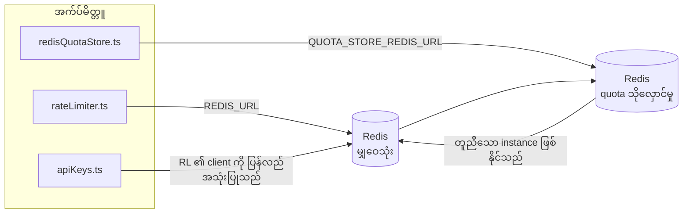

# Redis Production Configuration Guide (မြန်မာ)

🌐 **Languages:** 🇺🇸 [English](../../../../ops/REDIS_PRODUCTION_CONFIG.md) · 🇪🇹 [am](../../../am/docs/ops/REDIS_PRODUCTION_CONFIG.md) · 🇸🇦 [ar](../../../ar/docs/ops/REDIS_PRODUCTION_CONFIG.md) · 🇦🇿 [az](../../../az/docs/ops/REDIS_PRODUCTION_CONFIG.md) · 🇧🇬 [bg](../../../bg/docs/ops/REDIS_PRODUCTION_CONFIG.md) · 🇧🇩 [bn](../../../bn/docs/ops/REDIS_PRODUCTION_CONFIG.md) · 🇧🇦 [bs](../../../bs/docs/ops/REDIS_PRODUCTION_CONFIG.md) · 🇨🇿 [cs](../../../cs/docs/ops/REDIS_PRODUCTION_CONFIG.md) · 🇩🇰 [da](../../../da/docs/ops/REDIS_PRODUCTION_CONFIG.md) · 🇩🇪 [de](../../../de/docs/ops/REDIS_PRODUCTION_CONFIG.md) · 🇬🇷 [el](../../../el/docs/ops/REDIS_PRODUCTION_CONFIG.md) · 🇪🇸 [es](../../../es/docs/ops/REDIS_PRODUCTION_CONFIG.md) · 🇪🇪 [et](../../../et/docs/ops/REDIS_PRODUCTION_CONFIG.md) · 🇮🇷 [fa](../../../fa/docs/ops/REDIS_PRODUCTION_CONFIG.md) · 🇫🇮 [fi](../../../fi/docs/ops/REDIS_PRODUCTION_CONFIG.md) · 🇫🇷 [fr](../../../fr/docs/ops/REDIS_PRODUCTION_CONFIG.md) · 🇮🇪 [ga](../../../ga/docs/ops/REDIS_PRODUCTION_CONFIG.md) · 🇮🇳 [gu](../../../gu/docs/ops/REDIS_PRODUCTION_CONFIG.md) · 🇳🇬 [ha](../../../ha/docs/ops/REDIS_PRODUCTION_CONFIG.md) · 🇮🇱 [he](../../../he/docs/ops/REDIS_PRODUCTION_CONFIG.md) · 🇮🇳 [hi](../../../hi/docs/ops/REDIS_PRODUCTION_CONFIG.md) · 🇭🇷 [hr](../../../hr/docs/ops/REDIS_PRODUCTION_CONFIG.md) · 🇭🇺 [hu](../../../hu/docs/ops/REDIS_PRODUCTION_CONFIG.md) · 🇦🇲 [hy](../../../hy/docs/ops/REDIS_PRODUCTION_CONFIG.md) · 🇮🇩 [id](../../../id/docs/ops/REDIS_PRODUCTION_CONFIG.md) · 🇳🇬 [ig](../../../ig/docs/ops/REDIS_PRODUCTION_CONFIG.md) · 🇮🇹 [it](../../../it/docs/ops/REDIS_PRODUCTION_CONFIG.md) · 🇯🇵 [ja](../../../ja/docs/ops/REDIS_PRODUCTION_CONFIG.md) · 🇬🇪 [ka](../../../ka/docs/ops/REDIS_PRODUCTION_CONFIG.md) · 🇰🇭 [km](../../../km/docs/ops/REDIS_PRODUCTION_CONFIG.md) · 🇮🇳 [kn](../../../kn/docs/ops/REDIS_PRODUCTION_CONFIG.md) · 🇰🇷 [ko](../../../ko/docs/ops/REDIS_PRODUCTION_CONFIG.md) · 🇱🇹 [lt](../../../lt/docs/ops/REDIS_PRODUCTION_CONFIG.md) · 🇱🇻 [lv](../../../lv/docs/ops/REDIS_PRODUCTION_CONFIG.md) · 🇮🇳 [ml](../../../ml/docs/ops/REDIS_PRODUCTION_CONFIG.md) · 🇮🇳 [mr](../../../mr/docs/ops/REDIS_PRODUCTION_CONFIG.md) · 🇲🇾 [ms](../../../ms/docs/ops/REDIS_PRODUCTION_CONFIG.md) · 🇲🇹 [mt](../../../mt/docs/ops/REDIS_PRODUCTION_CONFIG.md) · 🇳🇵 [ne](../../../ne/docs/ops/REDIS_PRODUCTION_CONFIG.md) · 🇳🇱 [nl](../../../nl/docs/ops/REDIS_PRODUCTION_CONFIG.md) · 🇳🇴 [no](../../../no/docs/ops/REDIS_PRODUCTION_CONFIG.md) · 🇮🇳 [or](../../../or/docs/ops/REDIS_PRODUCTION_CONFIG.md) · 🇮🇳 [pa](../../../pa/docs/ops/REDIS_PRODUCTION_CONFIG.md) · 🇵🇭 [phi](../../../phi/docs/ops/REDIS_PRODUCTION_CONFIG.md) · 🇵🇱 [pl](../../../pl/docs/ops/REDIS_PRODUCTION_CONFIG.md) · 🇵🇹 [pt](../../../pt/docs/ops/REDIS_PRODUCTION_CONFIG.md) · 🇧🇷 [pt-BR](../../../pt-BR/docs/ops/REDIS_PRODUCTION_CONFIG.md) · 🇷🇴 [ro](../../../ro/docs/ops/REDIS_PRODUCTION_CONFIG.md) · 🇷🇺 [ru](../../../ru/docs/ops/REDIS_PRODUCTION_CONFIG.md) · 🇱🇰 [si](../../../si/docs/ops/REDIS_PRODUCTION_CONFIG.md) · 🇸🇰 [sk](../../../sk/docs/ops/REDIS_PRODUCTION_CONFIG.md) · 🇸🇮 [sl](../../../sl/docs/ops/REDIS_PRODUCTION_CONFIG.md) · 🇷🇸 [sr](../../../sr/docs/ops/REDIS_PRODUCTION_CONFIG.md) · 🇸🇪 [sv](../../../sv/docs/ops/REDIS_PRODUCTION_CONFIG.md) · 🇰🇪 [sw](../../../sw/docs/ops/REDIS_PRODUCTION_CONFIG.md) · 🇮🇳 [ta](../../../ta/docs/ops/REDIS_PRODUCTION_CONFIG.md) · 🇮🇳 [te](../../../te/docs/ops/REDIS_PRODUCTION_CONFIG.md) · 🇹🇭 [th](../../../th/docs/ops/REDIS_PRODUCTION_CONFIG.md) · 🇹🇷 [tr](../../../tr/docs/ops/REDIS_PRODUCTION_CONFIG.md) · 🇺🇦 [uk-UA](../../../uk-UA/docs/ops/REDIS_PRODUCTION_CONFIG.md) · 🇵🇰 [ur](../../../ur/docs/ops/REDIS_PRODUCTION_CONFIG.md) · 🇺🇿 [uz](../../../uz/docs/ops/REDIS_PRODUCTION_CONFIG.md) · 🇻🇳 [vi](../../../vi/docs/ops/REDIS_PRODUCTION_CONFIG.md) · 🇳🇬 [yo](../../../yo/docs/ops/REDIS_PRODUCTION_CONFIG.md) · 🇨🇳 [zh-CN](../../../zh-CN/docs/ops/REDIS_PRODUCTION_CONFIG.md) · 🇹🇼 [zh-TW](../../../zh-TW/docs/ops/REDIS_PRODUCTION_CONFIG.md)

---

## အနှစ်ချုပ်

Redis သည် OmniRoute တွင် **ရွေးချယ်အသုံးပြုနိုင်သော၊ မဖြစ်မနေမဟုတ်သည့် dependency** တစ်ခုဖြစ်သည် — Redis ကို အသုံးမပြုနိုင်သည့်အခါ application သည် (in-memory
fallback များဖြင့်) လုပ်ဆောင်နိုင်စွမ်းကို အဆင့်ဆင့်ညင်သာစွာ လျှော့ချသည်။ Production တွင် Redis ကို ချိန်ညှိခြင်းက သီးခြား
workload လေးမျိုးအတွက် latency ကို လျှော့ချပေးသည်-

| Workload               | Driver                        | Client Factory                                | Key Pattern                                                           |
| ---------------------- | ----------------------------- | --------------------------------------------- | --------------------------------------------------------------------- |
| Rate limiting          | `rateLimiter.ts`              | `getRedisClient()` — lazy `ioredis` singleton | `<prefix>rl:*` Lua‑atomic rate limit window များ                      |
| Auth cache             | `apiKeys.ts`                  | `rateLimiter` ၏ client ကို ပြန်လည်အသုံးပြုသည် | TTL ပါရှိသည့် `<prefix>auth:api_key:<sha256>`                         |
| Quota store            | `redisQuotaStore.ts`          | သီးခြား `getRedisClient(url)` singleton       | instance တစ်ခုချင်းစီအလိုက် ပြင်ဆင်သတ်မှတ်နိုင်သည့် `<prefix>quota:*` |
| Warmup circuit breaker | `redisCircuitBreakerStore.ts` | `circuitBreakerFactory.ts` ရှိ သီးခြား client | `<prefix>warmup:cb:<connectionId>`                                    |

Workload လေးမျိုးလုံးသည် namespace prefix တစ်ခုတည်းကို မျှဝေသုံးစွဲသောကြောင့် OmniRoute သည်
Redis instance တစ်ခုတည်း (ဥပမာ `127.0.0.1:6379`) ပေါ်ရှိ အခြား app များနှင့် အတူတကွ တည်ရှိနိုင်သည်။ [Key Namespacing](#key-namespacing) ကို ကြည့်ပါ။

---

## လက်ရှိ Configuration (Code Default များ)

| Setting                         | Value                                                        | Where                                                                                 |
| ------------------------------- | ------------------------------------------------------------ | ------------------------------------------------------------------------------------- |
| `REDIS_URL` env var             | `redis://redis:6379` (compose)၊ ရွေးချယ်အသုံးပြုနိုင်သည်     | `rateLimiter.ts:5`, `.env.example`                                                    |
| `REDIS_KEY_PREFIX` env var      | `omniroute:` (default)                                       | `rateLimiter.ts`, `redisQuotaStore.ts`, `redisCircuitBreakerStore.ts`, `.env.example` |
| `QUOTA_STORE_REDIS_URL` env var | သီးခြားဖြစ်ပြီး `REDIS_URL` နှင့် ကွဲပြားနိုင်သည်            | `quota/storeFactory.ts`                                                               |
| `QUOTA_STORE_DRIVER`            | `"sqlite"` (default)၊ `"redis"` ကို ရွေးချယ်အသုံးပြုနိုင်သည် | `quota/storeFactory.ts`                                                               |
| ioredis `maxRetriesPerRequest`  | `3`                                                          | `rateLimiter.ts` client ဖန်တီးမှု                                                     |
| `enableReadyCheck`              | မသတ်မှတ်ထားပါ (ioredis default: `true`)                      | —                                                                                     |
| `lazyConnect`                   | မသတ်မှတ်ထားပါ (ioredis default: `false`)                     | —                                                                                     |
| `retryStrategy`                 | မသတ်မှတ်ထားပါ (ioredis default: 200ms base၊ exponential)     | —                                                                                     |
| TLS / password / DB index       | **မပြင်ဆင်ထားပါ**                                            | —                                                                                     |
| Sentinel / Cluster              | **မပြင်ဆင်ထားပါ** — standalone single-node သာ                | —                                                                                     |

---

## Key Namespacing

OmniRoute သည် host ပေါ်တွင် လည်ပတ်နေသည့် အခြားအရာများနှင့် Redis instance တစ်ခုကို မျှဝေသုံးစွဲသည်။ Namespace မရှိပါက
`auth:api_key:<sha256>` သို့မဟုတ် `rl:*` ကဲ့သို့သော key များသည် Redis တစ်ခုတည်းကို
အသုံးပြုနေသည့် အခြား application များ၏ key များနှင့် ထပ်တူကျနိုင်သည် (ဤ instance သည် အခြား service များနှင့်အတူ `127.0.0.1:6379` ပေါ်တွင် Redis ကို လည်ပတ်စေသည်)။

OmniRoute key **တိုင်း**၏ ရှေ့တွင် prefix ထည့်ရန် `REDIS_KEY_PREFIX` ကို အလွတ်မဟုတ်သော string တစ်ခုအဖြစ် သတ်မှတ်ပါ-

```bash
# .env — OmniRoute key အားလုံးသည် omniroute:rl:*, omniroute:auth:*, omniroute:quota:*, omniroute:warmup:cb:* ဖြစ်လာမည်
REDIS_KEY_PREFIX=omniroute:
```

- **Default:** `omniroute:` (`REDIS_KEY_PREFIX` ကို မသတ်မှတ်ထားသည့်အခါ သို့မဟုတ် အလွတ်ဖြစ်သည့်အခါ အသုံးပြုသည်)။
- **အသုံးချသည့်နေရာများ:** rate limiter + auth cache (`keyPrefix` မှတစ်ဆင့် မျှဝေထားသော `ioredis` client)၊
  quota store (`KEY_PREFIX = "${REDIS_KEY_PREFIX}quota"`) နှင့် warmup circuit breaker
  (`KEY_PREFIX = "${REDIS_KEY_PREFIX}warmup:cb:"`)။
- Redis တွင် key များ ရှိပြီးသားဖြစ်နေချိန်၌ **prefix ကို ပြောင်းလဲခြင်း**သည် key အဟောင်းများကို အသုံးမပြုတော့သည့်အခြေအနေ ဖြစ်စေသည် (၎င်းတို့သည်
  TTL / LRU မှတစ်ဆင့် သက်တမ်းကုန်ဆုံးသည်)။ ပြောင်းလဲရန် ဘေးကင်းပြီး migration မလိုအပ်ပါ။ တစ်ခုတည်းသော ခြွင်းချက်မှာ forbidden အဖြစ် မှတ်သားထားသည့် connection တစ်ခုအတွက် warmup
  circuit-breaker key ဖြစ်သည်။ ၎င်းကို TTL မပါဘဲ အမြဲတမ်းသိမ်းဆည်းထားသောကြောင့်
  `redis-cli --scan --pattern '<old-prefix>warmup:cb:*'` ဖြင့် ကျန်ရှိနေသည့် key များကို စာရင်းပြုစုပြီး ဖျက်ပါ။
- **ioredis `keyPrefix`** သည် write လုပ်သည့်အခါ prefix ကို အလိုအလျောက် ရှေ့တွင် ထည့်ပေးပြီး read လုပ်သည့်အခါတွင်လည်း ၎င်းကို ဖယ်ရှားပေးသည်။
  ထို့ကြောင့် application code သည် prefix ကို မည်သည့်အခါမျှ မမြင်ရပါ။

---

## ထုတ်လုပ်မှု ချိန်ညှိခြင်းကို အကြံပြုထားသည်။

### 1. Connection Pool/Client Options (ioredis `Redis` constructor)

လက်ရှိကုဒ်သည် စိတ်ကြိုက်ရွေးချယ်စရာများမရှိဘဲ `new Redis(url)` တစ်ခုတည်းကို ဖန်တီးသည်။ ထုတ်လုပ်မှု ဘက်စုံပုံစံတူ အသုံးချမှုများအတွက်၊ ကုဒ်ဖြင့် ဖောက်သည် စက်ရုံကို ဖြတ်သန်းပါ သို့မဟုတ် `getRedisClient()` ထုပ်ပိုးပါ-

```typescript
const redis = new Redis(REDIS_URL, {
  maxRetriesPerRequest: null, // no retry limit; let retryStrategy decide
  enableReadyCheck: true, // verify server is ready before accepting calls
  lazyConnect: true, // don't connect on construction; wait for first call
  retryStrategy: (times) => {
    if (times > 10) return null; // give up after 10 retries → reconnect later
    return Math.min(times * 200, 5000); // 200ms, 400ms, …, 5s cap
  },
  enableAutoPipelining: true, // coalesce concurrent commands into one TCP write
  keepAlive: 10000, // TCP keep‑alive every 10s
});
```

**အဓိက အပေးအယူများ-**

- `maxRetriesPerRequest: null` + `retryStrategy` — ထုတ်လုပ်မှုအတွက် ပိုနှစ်သက်သည်၊ ထို့ကြောင့် ယာယီ Redis ပြန်လည်စတင်ခြင်းသည် တောင်းဆိုမှုတိုင်းကို ချက်ချင်းမအောင်မြင်စေပါ။ `checkRateLimit()` ရှိ မမ်မိုရီအတွင်းမှ ဆုတ်ယုတ်မှုသည် ကျရှုံးမှုလမ်းကြောင်းကို စုပ်ယူသည်။
- `lazyConnect: true` — ဆာဗာချိတ်ဆက်မှုများကို လက်ခံခြင်းမစမီ Redis တွင် စတင်ခြင်းအပေါ် မှီခိုမှုကို ရှောင်ကြဉ်သည်။
- `enableAutoPipelining: true` — တစ်ပြိုင်တည်း နှုန်းကန့်သတ်ချက်စစ်ဆေးမှုများအတွက် အသွားအပြန်ခရီးများကို လျှော့ချပေးသည်။ ချိတ်ဆက်မှုတစ်ခုတည်းတွင် > 50 RPS တွင် အကျိုးရှိသည်။

### 2. Redis ဆာဗာပြင်ဆင်ခြင်း (`redis.conf`)

```
# Memory
maxmemory 80%                        # leave room for OS page cache
maxmemory-policy allkeys-lru         # evict stale auth cache entries under pressure

# Persistence (optional — OmniRoute is crash‑safe without it)
save 300 1                           # snapshot at least every 5 min if ≥1 key changed
appendonly no                        # AOF not needed; data is regeneratable
appendfsync no                       # no fsync overhead (RDB is sufficient)

# Networking
timeout 0                            # no idle disconnect
tcp-keepalive 300                    # 5 min keep‑alive
tcp-backlog 511                      # connection backlog for bursty load

# Performance
hz 10                                # default; 100 for latency‑sensitive
activedefrag yes                     # auto‑defragment when fragmentation >10%
```

**`maxmemory-policy allkeys-lru` အတွက် အပေးအယူ-** မှတ်ဉာဏ်ဖိအားအောက်တွင် Auth cache ထည့်သွင်းမှုများကို ဖယ်ရှားနိုင်သည်။ ၎င်းသည် အန္တရာယ်ကင်းသော — `setCachedApiKey` miss တွင် အမြဲတမ်းပြန်လည်ပြည့်နေမည်ဖြစ်ပြီး SQLite သည် လုံခြုံစိတ်ချရသောအချက်ဖြစ်သည်။ Rate-limiter Lua script သည် ဒီဇိုင်းအားဖြင့် တိုတောင်းသော သော့ငယ်များကို ဖန်တီးပေးသည်။

### 3. Docker ဆက်တင်များကို ရေးပါ။

prod compose (`docker-compose.prod.yml`) သည် `redis:8.6.2-alpine` အသုံးပြုသည်။ ထည့်ရန်-

```yaml
redis:
  image: redis:8.6.2-alpine
  command:
    [
      "redis-server",
      "--maxmemory",
      "512mb",
      "--maxmemory-policy",
      "allkeys-lru",
      "--activedefrag",
      "yes",
      "--save",
      "300 1",
    ]
  healthcheck:
    test: ["CMD", "redis-cli", "ping"]
    interval: 10s
    timeout: 3s
    retries: 3
    start_period: 5s
```

### 4. Multi-Instance/Scaling ထည့်သွင်းစဉ်းစားမှုများ

**ပုံတူအားလုံးအတွက် Redis တစ်ခုတည်း** — နှုန်းကန့်သတ်ချက် Lua ဇာတ်ညွှန်းသည် တရားဝင်သော့နေရာတစ်ခုပေါ်တွင် မူတည်သည်။ ပုံတူများနောက်ကွယ်ရှိ Redis ဖြစ်ရပ်များစွာသည် အနုမြူစွမ်းအားကို ဆုံးရှုံးစေပြီး ဘတ်ဂျက်နှစ်ဆဖြစ်သည်။ အပလီကေးရှင်းပုံတူများ အားလုံးအတွက် Redis (သို့မဟုတ် Redis Sentinel အစုအဝေးတစ်ခု) ကို အသုံးပြုပါ။

**ချိတ်ဆက်မှုအရေအတွက်-** အပလီကေးရှင်းပုံတူတစ်ခုစီကို ဖွင့်သည်။** 2 TCP ဆက်သွယ်မှု** Redis (ကန့်သတ်ဖောက်သည် + ခွဲတမ်းစတိုးဆိုင်ကလိုင်းယင့်) ကို သတ်မှတ်သည်။ ပုံတူ → 20 ချိတ်ဆက်မှု 10 ခုတွင်၊ မူရင်း Redis instance ၏ 10k ချိတ်ဆက်မှုမျက်နှာကျက်တွင် ကောင်းမွန်စွာ။

### 5. စောင့်ကြည့်လေ့လာခြင်း။

ကျန်းမာရေးစစ်ဆေးမှု အဆုံးမှတ်မှတစ်ဆင့် ဖော်ထုတ်ပါ-

```typescript
// src/app/api/monitoring/health/route.ts already calls rateLimiter functions
// Add Redis-specific checks:
//   1. PING latency via ioredis .ping()
//   2. Memory usage via INFO memory
//   3. Connection count via INFO clients
//   4. Hit rate for maxmemory-policy (evicted_keys / keyspace_hits)
```

ကြည့်ရှုရန် အဓိက မက်ထရစ်များ

- **နှင်ထုတ်ခံရသောသော့များ / စက္ကန့်** — သုညမဟုတ်ပါက၊ `maxmemory` တိုးပါ။
- **ပိတ်ထားသော ဖောက်သည်များ** — နှေးကွေးသော Lua scripts သို့မဟုတ် မြင့်မားသော အငြင်းပွားမှုကို အကြံပြုသည်။
- **ချိတ်ဆက်မှုများကို ငြင်းပယ်ခဲ့သည်။** — ဆက်သွယ်မှုကန့်သတ်ချက်ထိမှန်; ချိတ်ဆက်မှု 20 တွင်ရှားပါးသည်။

### 6. Redis-လိုက်ဖက်သောဆာဗာများ

ဤနေရာတွင် အသုံးပြုသည့် မည်သည့်ဆာဗာမဆို Lua scripts များကို လုပ်ဆောင်ရပါမည်- နှုန်းကန့်သတ်ချက်မှာ `EVAL` တစ်ခုဖြစ်သည်။ Lua မရှိသောဆာဗာတွင် `checkRateLimit()` `[RATE_LIMITER] Redis eval failed, falling back to in-memory rate limiting` မှတ်တမ်းပြုပြီး လုပ်ငန်းစဉ်တစ်ခုစီတွင် အရေအတွက်များကို မှတ်သားထားသောကြောင့် ပုံတူတစ်ခုစီသည် ကန့်သတ်ချက်ကို သူ့ဘာသာသူ တွန်းအားပေးသည်။ မျှဝေထားသော session-affinity စတိုး (`OMNIROUTE_SESSION_AFFINITY_STORE=redis`) သည် ပင်နံပါတ်များကို `EVAL` ဖြင့် ဖတ်ပြီး အပ်ဒိတ်လုပ်သည် . Lua မပါဘဲ၎င်းသည် `[SESSION_AFFINITY] Redis error; falling back to SQLite.` မှတ်တမ်းတင်ပြီးပုံတူတစ်ခုစီသည်၎င်း၏ကိုယ်ပိုင် pin များကိုသိမ်းဆည်းထားသည်။ အခြားအလုပ်ဝန်များသည် ရိုးရှင်းသောအမိန့်များ (`SET ... EX`၊ `GET`၊ `DEL`၊ `MGET`၊ `EXPIRE`၊ `INCRBYFLOAT`၊ hashes နှင့် sets ) ကိုအသုံးပြုပြီး semantic cache ၏ Redis နောက်ကွယ်မှသည် `FT.*` အမိန့်များကို ပေးပို့မည်မဟုတ်ပါ။

Tested with OmniRoute 3.8.52: KiviDB 1.2.0 with its Lua image (`kividb/kividb:v1.2.0-lua`). The rate limiter (including a second process sharing the counters), auth cache, quota store, warmup circuit breaker, semantic cache store, and a `/v1/chat/completions` request through the chat handler passed 18 of the 19 checks that pass on Redis 8.10.3. The one that differs: `INCRBYFLOAT` stores `0.1 + 0.2` as `0.30000000000000004` where Redis stores `0.3` ([kividbio/kividb#387](https://github.com/kividbio/kividb/issues/387)). The quota store parses both with `parseFloat`, but the two numbers differ in the last digits, so a comparison that falls exactly on a quota boundary can come out differently. The session-affinity store was not part of that run. ([setup](https://github.com/kividbio/kividb/blob/master/docs/integrations/omniroute.md), [results](https://github.com/kividbio/kividb/tree/master/benchmarks/omniroute-compat))

---

## ဗိသုကာပုံကြမ်း



---

## ကိုးကားချက်များ

| ဖိုင်                              | ရည်ရွယ်ချက်                                                        |
| ---------------------------------- | ------------------------------------------------------------------ |
| `src/shared/utils/rateLimiter.ts`  | ပင်မ Redis client၊ Lua rate-limit script နှင့် in-memory fallback  |
| `src/lib/db/apiKeys.ts`            | Auth cache — Redis→SQLite fallback                                 |
| `src/lib/quota/redisQuotaStore.ts` | ရွေးချယ်အသုံးပြုနိုင်သော quota store အတွက် သီးခြား Redis client    |
| `src/lib/quota/storeFactory.ts`    | `sqlite` နှင့် `redis` quota driver များအကြား ပြောင်းလဲအသုံးပြုသည် |
| `docker-compose.prod.yml`          | Production Redis container (`redis:8.6.2-alpine` image)            |
| `.env.example`                     | Redis env var များအတွက် စာရွက်စာတမ်း                               |
| `src/app/api/local/redis/`         | Development container စီမံခန့်ခွဲမှုအတွက် API route များ           |
| `bin/cli/commands/redis.mjs`       | Development container စီမံခန့်ခွဲမှုအတွက် CLI command များ         |
