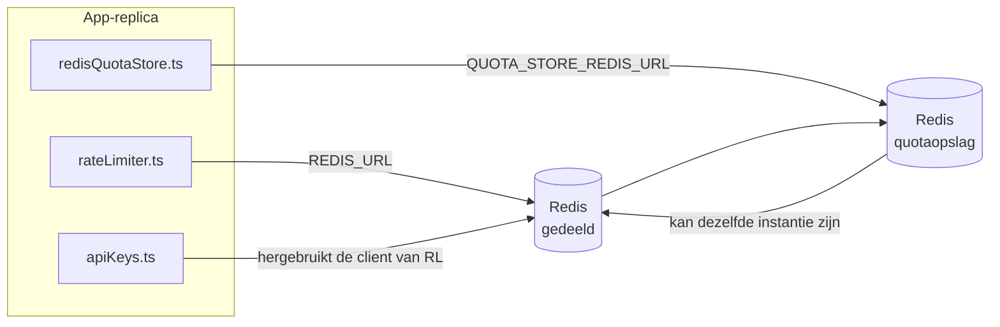

# Redis Production Configuration Guide (Nederlands)

🌐 **Languages:** 🇺🇸 [English](../../../../ops/REDIS_PRODUCTION_CONFIG.md) · 🇪🇹 [am](../../../am/docs/ops/REDIS_PRODUCTION_CONFIG.md) · 🇸🇦 [ar](../../../ar/docs/ops/REDIS_PRODUCTION_CONFIG.md) · 🇦🇿 [az](../../../az/docs/ops/REDIS_PRODUCTION_CONFIG.md) · 🇧🇬 [bg](../../../bg/docs/ops/REDIS_PRODUCTION_CONFIG.md) · 🇧🇩 [bn](../../../bn/docs/ops/REDIS_PRODUCTION_CONFIG.md) · 🇧🇦 [bs](../../../bs/docs/ops/REDIS_PRODUCTION_CONFIG.md) · 🇨🇿 [cs](../../../cs/docs/ops/REDIS_PRODUCTION_CONFIG.md) · 🇩🇰 [da](../../../da/docs/ops/REDIS_PRODUCTION_CONFIG.md) · 🇩🇪 [de](../../../de/docs/ops/REDIS_PRODUCTION_CONFIG.md) · 🇬🇷 [el](../../../el/docs/ops/REDIS_PRODUCTION_CONFIG.md) · 🇪🇸 [es](../../../es/docs/ops/REDIS_PRODUCTION_CONFIG.md) · 🇪🇪 [et](../../../et/docs/ops/REDIS_PRODUCTION_CONFIG.md) · 🇮🇷 [fa](../../../fa/docs/ops/REDIS_PRODUCTION_CONFIG.md) · 🇫🇮 [fi](../../../fi/docs/ops/REDIS_PRODUCTION_CONFIG.md) · 🇫🇷 [fr](../../../fr/docs/ops/REDIS_PRODUCTION_CONFIG.md) · 🇮🇪 [ga](../../../ga/docs/ops/REDIS_PRODUCTION_CONFIG.md) · 🇮🇳 [gu](../../../gu/docs/ops/REDIS_PRODUCTION_CONFIG.md) · 🇳🇬 [ha](../../../ha/docs/ops/REDIS_PRODUCTION_CONFIG.md) · 🇮🇱 [he](../../../he/docs/ops/REDIS_PRODUCTION_CONFIG.md) · 🇮🇳 [hi](../../../hi/docs/ops/REDIS_PRODUCTION_CONFIG.md) · 🇭🇷 [hr](../../../hr/docs/ops/REDIS_PRODUCTION_CONFIG.md) · 🇭🇺 [hu](../../../hu/docs/ops/REDIS_PRODUCTION_CONFIG.md) · 🇦🇲 [hy](../../../hy/docs/ops/REDIS_PRODUCTION_CONFIG.md) · 🇮🇩 [id](../../../id/docs/ops/REDIS_PRODUCTION_CONFIG.md) · 🇳🇬 [ig](../../../ig/docs/ops/REDIS_PRODUCTION_CONFIG.md) · 🇮🇹 [it](../../../it/docs/ops/REDIS_PRODUCTION_CONFIG.md) · 🇯🇵 [ja](../../../ja/docs/ops/REDIS_PRODUCTION_CONFIG.md) · 🇬🇪 [ka](../../../ka/docs/ops/REDIS_PRODUCTION_CONFIG.md) · 🇰🇭 [km](../../../km/docs/ops/REDIS_PRODUCTION_CONFIG.md) · 🇮🇳 [kn](../../../kn/docs/ops/REDIS_PRODUCTION_CONFIG.md) · 🇰🇷 [ko](../../../ko/docs/ops/REDIS_PRODUCTION_CONFIG.md) · 🇱🇹 [lt](../../../lt/docs/ops/REDIS_PRODUCTION_CONFIG.md) · 🇱🇻 [lv](../../../lv/docs/ops/REDIS_PRODUCTION_CONFIG.md) · 🇮🇳 [ml](../../../ml/docs/ops/REDIS_PRODUCTION_CONFIG.md) · 🇮🇳 [mr](../../../mr/docs/ops/REDIS_PRODUCTION_CONFIG.md) · 🇲🇾 [ms](../../../ms/docs/ops/REDIS_PRODUCTION_CONFIG.md) · 🇲🇹 [mt](../../../mt/docs/ops/REDIS_PRODUCTION_CONFIG.md) · 🇲🇲 [my](../../../my/docs/ops/REDIS_PRODUCTION_CONFIG.md) · 🇳🇵 [ne](../../../ne/docs/ops/REDIS_PRODUCTION_CONFIG.md) · 🇳🇴 [no](../../../no/docs/ops/REDIS_PRODUCTION_CONFIG.md) · 🇮🇳 [or](../../../or/docs/ops/REDIS_PRODUCTION_CONFIG.md) · 🇮🇳 [pa](../../../pa/docs/ops/REDIS_PRODUCTION_CONFIG.md) · 🇵🇭 [phi](../../../phi/docs/ops/REDIS_PRODUCTION_CONFIG.md) · 🇵🇱 [pl](../../../pl/docs/ops/REDIS_PRODUCTION_CONFIG.md) · 🇵🇹 [pt](../../../pt/docs/ops/REDIS_PRODUCTION_CONFIG.md) · 🇧🇷 [pt-BR](../../../pt-BR/docs/ops/REDIS_PRODUCTION_CONFIG.md) · 🇷🇴 [ro](../../../ro/docs/ops/REDIS_PRODUCTION_CONFIG.md) · 🇷🇺 [ru](../../../ru/docs/ops/REDIS_PRODUCTION_CONFIG.md) · 🇱🇰 [si](../../../si/docs/ops/REDIS_PRODUCTION_CONFIG.md) · 🇸🇰 [sk](../../../sk/docs/ops/REDIS_PRODUCTION_CONFIG.md) · 🇸🇮 [sl](../../../sl/docs/ops/REDIS_PRODUCTION_CONFIG.md) · 🇷🇸 [sr](../../../sr/docs/ops/REDIS_PRODUCTION_CONFIG.md) · 🇸🇪 [sv](../../../sv/docs/ops/REDIS_PRODUCTION_CONFIG.md) · 🇰🇪 [sw](../../../sw/docs/ops/REDIS_PRODUCTION_CONFIG.md) · 🇮🇳 [ta](../../../ta/docs/ops/REDIS_PRODUCTION_CONFIG.md) · 🇮🇳 [te](../../../te/docs/ops/REDIS_PRODUCTION_CONFIG.md) · 🇹🇭 [th](../../../th/docs/ops/REDIS_PRODUCTION_CONFIG.md) · 🇹🇷 [tr](../../../tr/docs/ops/REDIS_PRODUCTION_CONFIG.md) · 🇺🇦 [uk-UA](../../../uk-UA/docs/ops/REDIS_PRODUCTION_CONFIG.md) · 🇵🇰 [ur](../../../ur/docs/ops/REDIS_PRODUCTION_CONFIG.md) · 🇺🇿 [uz](../../../uz/docs/ops/REDIS_PRODUCTION_CONFIG.md) · 🇻🇳 [vi](../../../vi/docs/ops/REDIS_PRODUCTION_CONFIG.md) · 🇳🇬 [yo](../../../yo/docs/ops/REDIS_PRODUCTION_CONFIG.md) · 🇨🇳 [zh-CN](../../../zh-CN/docs/ops/REDIS_PRODUCTION_CONFIG.md) · 🇹🇼 [zh-TW](../../../zh-TW/docs/ops/REDIS_PRODUCTION_CONFIG.md)

---

## Overzicht

Redis is een **optionele, zachte afhankelijkheid** in OmniRoute — verslechtert de applicatie netjes (fallbacks in het geheugen) wanneer Redis niet beschikbaar is. In productie vermindert het afstemmen Redis de latentie voor vier verschillende werklasten:

| Werklast                | Bestuurder                    | Klant Fabriek                                 | Sleutelpatroon                                      |
| ----------------------- | ----------------------------- | --------------------------------------------- | --------------------------------------------------- |
| Tariefbeperking         | `rateLimiter.ts`              | `getRedisClient()` — luie `ioredis` singleton | `<prefix>rl:*` Lua-atomaire snelheidslimietvensters |
| Authenticatiecache      | `apiKeys.ts`                  | Hergebruikt de klant van `rateLimiter`        | `<prefix>auth:api_key:<sha256>` met TTL             |
| Quotum winkel           | `redisQuotaStore.ts`          | Aparte `getRedisClient(url)` singleton        | `<prefix>quota:*` configureerbaar per exemplaar     |
| Opwarmstroomonderbreker | `redisCircuitBreakerStore.ts` | Aparte client in `circuitBreakerFactory.ts`   | `<prefix>warmup:cb:<connectionId>`                  |

Alle vier de werkbelastingen delen één naamruimtevoorvoegsel, zodat OmniRoute naast andere apps kan bestaan op één Redis instantie (bijvoorbeeld `127.0.0.1:6379`). Zie [Sleutelnaamafstand](#key-namespacing).

---

## Huidige configuratie (standaardcodes)

| Instelling                           | Waarde                                                         | Waar                                                                                  |
| ------------------------------------ | -------------------------------------------------------------- | ------------------------------------------------------------------------------------- |
| `REDIS_URL` omgevingsvar             | `redis://redis:6379` (componeren), optioneel                   | `rateLimiter.ts:5`, `.env.example`                                                    |
| `REDIS_KEY_PREFIX` omgevingsvar      | `omniroute:` (standaard)                                       | `rateLimiter.ts`, `redisQuotaStore.ts`, `redisCircuitBreakerStore.ts`, `.env.example` |
| `QUOTA_STORE_REDIS_URL` omgevingsvar | afzonderlijk, kan afwijken van `REDIS_URL`                     | `quota/storeFactory.ts`                                                               |
| `QUOTA_STORE_DRIVER`                 | `"sqlite"` (standaard), `"redis"` optioneel                    | `quota/storeFactory.ts`                                                               |
| ioredis `maxRetriesPerRequest`       | `3`                                                            | `rateLimiter.ts` clientcreatie                                                        |
| `enableReadyCheck`                   | niet ingesteld (ioredis standaard: `true`)                     | —                                                                                     |
| `lazyConnect`                        | niet ingesteld (ioredis standaard: `false`)                    | —                                                                                     |
| `retryStrategy`                      | niet ingesteld (ioredis standaard: 200 ms basis, exponentieel) | —                                                                                     |
| TLS / wachtwoord / DB index          | **niet geconfigureerd**                                        | —                                                                                     |
| Sentinel / Cluster                   | **niet geconfigureerd** Alleen — standalone single-node        | —                                                                                     |

---

## Sleutelnamespacing

OmniRoute deelt een Redis-instantie met alle andere toepassingen die op de host worden uitgevoerd. Zonder een namespace kunnen sleutels zoals `auth:api_key:<sha256>` of `rl:*` conflicteren met sleutels van andere applicaties die dezelfde Redis gebruiken (op deze instantie draait Redis op `127.0.0.1:6379` naast andere services).

Stel `REDIS_KEY_PREFIX` in op een niet-lege tekenreeks om **elke** OmniRoute-sleutel van een voorvoegsel te voorzien:

```bash
# .env — alle OmniRoute-sleutels worden omniroute:rl:*, omniroute:auth:*, omniroute:quota:*, omniroute:warmup:cb:*
REDIS_KEY_PREFIX=omniroute:
```

- **Standaard:** `omniroute:` (toegepast wanneer `REDIS_KEY_PREFIX` niet is ingesteld of leeg is).
- **Toegepast op:** snelheidsbeperking + authenticatiecache (gedeelde `ioredis`-client via `keyPrefix`), de quotaopslag (`KEY_PREFIX = "${REDIS_KEY_PREFIX}quota"`) en de circuitbreaker voor opwarming (`KEY_PREFIX = "${REDIS_KEY_PREFIX}warmup:cb:"`).
- **Het voorvoegsel wijzigen** wanneer er al sleutels in Redis bestaan, maakt de oude sleutels verweesd (ze verlopen via TTL / LRU). Dit kan veilig worden gewijzigd; er is geen migratie nodig. De enige uitzondering is een circuitbreakersleutel voor opwarming van een verbinding die als verboden is gemarkeerd: deze wordt zonder TTL opgeslagen. Toon daarom achtergebleven sleutels met `redis-cli --scan --pattern '<old-prefix>warmup:cb:*'` en verwijder ze.
- **ioredis `keyPrefix`** voegt het voorvoegsel automatisch toe bij schrijfbewerkingen **en** verwijdert het bij leesbewerkingen, zodat de applicatiecode het voorvoegsel nooit ziet.

---

## Aanbevolen productieafstemming

### 1. Verbindingspool/clientopties (ioredis `Redis` constructor)

De huidige code creëert één `new Redis(url)` zonder aangepaste opties. Voor productie-implementaties met meerdere replica's geeft u een clientfabriek door in de code of verpakt u `getRedisClient()`:

```typescript
const redis = new Redis(REDIS_URL, {
  maxRetriesPerRequest: null, // no retry limit; let retryStrategy decide
  enableReadyCheck: true, // verify server is ready before accepting calls
  lazyConnect: true, // don't connect on construction; wait for first call
  retryStrategy: (times) => {
    if (times > 10) return null; // give up after 10 retries → reconnect later
    return Math.min(times * 200, 5000); // 200ms, 400ms, …, 5s cap
  },
  enableAutoPipelining: true, // coalesce concurrent commands into one TCP write
  keepAlive: 10000, // TCP keep‑alive every 10s
});
```

**Belangrijkste afwegingen:**

- `maxRetriesPerRequest: null` + `retryStrategy` — heeft de voorkeur voor productie, zodat tijdelijke Redis herstarts niet onmiddellijk bij elk verzoek mislukken. De terugval in het geheugen in `checkRateLimit()` absorbeert het faalpad.
- `lazyConnect: true` — vermijdt een opstartafhankelijkheid van het feit dat Redis actief is voordat de server verbindingen begint te accepteren.
- `enableAutoPipelining: true` — vermindert het aantal retourvluchten voor gelijktijdige tarieflimietcontroles; voordelig bij > 50 RPS op een enkele aansluiting.

### 2. Redis -serverconfiguratie (`redis.conf`)

```
# Memory
maxmemory 80%                        # leave room for OS page cache
maxmemory-policy allkeys-lru         # evict stale auth cache entries under pressure

# Persistence (optional — OmniRoute is crash‑safe without it)
save 300 1                           # snapshot at least every 5 min if ≥1 key changed
appendonly no                        # AOF not needed; data is regeneratable
appendfsync no                       # no fsync overhead (RDB is sufficient)

# Networking
timeout 0                            # no idle disconnect
tcp-keepalive 300                    # 5 min keep‑alive
tcp-backlog 511                      # connection backlog for bursty load

# Performance
hz 10                                # default; 100 for latency‑sensitive
activedefrag yes                     # auto‑defragment when fragmentation >10%
```

**Afweging voor `maxmemory-policy allkeys-lru`:** Auth-cachegegevens kunnen onder geheugendruk worden verwijderd. Dit is veilig. — `setCachedApiKey` vult zich altijd opnieuw in bij een fout, en de terugval SQLite is gezaghebbend. Het Lua-script met snelheidsbegrenzer maakt kleine toetsen die door hun ontwerp een korte levensduur hebben.

### 3. Docker Compose-instellingen

De prod compose (`docker-compose.prod.yml`) maakt gebruik van `redis:8.6.2-alpine`. Toevoegen:

```yaml
redis:
  image: redis:8.6.2-alpine
  command:
    [
      "redis-server",
      "--maxmemory",
      "512mb",
      "--maxmemory-policy",
      "allkeys-lru",
      "--activedefrag",
      "yes",
      "--save",
      "300 1",
    ]
  healthcheck:
    test: ["CMD", "redis-cli", "ping"]
    interval: 10s
    timeout: 3s
    retries: 3
    start_period: 5s
```

### 4. Overwegingen bij meerdere exemplaren/schalen

**Enkele Redis voor alle replica's** — het Lua-script met snelheidsbegrenzer, is afhankelijk van een enkele gezaghebbende sleutelruimte. Meerdere Redis instanties achter replica's zouden de atomiciteit verliezen en het budget verdubbelen. Gebruik één Redis (of Redis Sentinel-cluster met failover) voor alle applicatiereplica's.

**Aantal verbindingen:** Elke toepassingsreplica wordt geopend **2 TCP -aansluitingen** naar Redis (rate limiter-client + quota-opslagclient). Bij 10 replica's → 20-verbindingen, ruim binnen het 10k-verbindingsplafond van een standaard Redis instantie.

### 5. Toezicht

Blootstellen via eindpunt voor statuscontrole:

```typescript
// src/app/api/monitoring/health/route.ts already calls rateLimiter functions
// Add Redis-specific checks:
//   1. PING latency via ioredis .ping()
//   2. Memory usage via INFO memory
//   3. Connection count via INFO clients
//   4. Hit rate for maxmemory-policy (evicted_keys / keyspace_hits)
```

Belangrijke statistieken om in de gaten te houden:

- **Uitgezet sleutels / sec** Als — aanhoudend niet nul is, verhoog dan `maxmemory`
- **Geblokkeerde klanten** — niet-nul duidt op trage Lua-scripts of hoge conflicten
- **Geweigerde verbindingen** — -verbindingslimiet bereikt; zeldzaam bij 20 aansluitingen

### 6. Redis-compatibele servers

Elke server die hier wordt gebruikt, moet Lua-scripts uitvoeren: de snelheidsbegrenzer is één `EVAL`. Op een server zonder Lua logt `checkRateLimit()` `[RATE_LIMITER] Redis eval failed, falling back to in-memory rate limiting` en telt per proces, zodat elke replica de limiet op zichzelf afdwingt. De opt-in gedeelde sessie-affiniteitswinkel (`OMNIROUTE_SESSION_AFFINITY_STORE=redis`) leest en werkt ook pinnen bij met `EVAL`; zonder Lua logt het `[SESSION_AFFINITY] Redis error; falling back to SQLite.` en behoudt elke replica zijn eigen pinnen. De andere werkbelastingen gebruiken gewone opdrachten (`SET ... EX`, `GET`, `DEL`, `MGET`, `EXPIRE`, `INCRBYFLOAT`, hashes en sets), en de Redis backend van de semantische cache verzendt geen `FT.*` -opdrachten.

Getest met OmniRoute 3.8.52: KiviDB 1.2.0 met zijn Lua-image (`kividb/kividb:v1.2.0-lua`). De snelheidsbegrenzer (inclusief een tweede proces dat de tellers deelt), auth-cache, quota-opslag, opwarmstroomonderbreker, semantische cache-opslag en een `/v1/chat/completions` verzoek via de chat-handler heeft 18 van de 19 controles doorstaan die worden doorgegeven in Redis 8.10.3. Degene die verschilt: `INCRBYFLOAT` slaat `0.1 + 0.2` op als `0.30000000000000004`, terwijl Redis `0.3` opslaat ( [kividbio/kividb#387](https://github.com/kividbio/kividb/issues/387) ). Het quotaarchief parseert beide met `parseFloat`, maar de twee getallen verschillen in de laatste cijfers, dus een vergelijking die precies op een quotumgrens valt, kan er anders uit komen. De sessie-affiniteitswinkel maakte geen deel uit van die run. ( [opstelling](https://github.com/kividbio/kividb/blob/master/docs/integrations/omniroute.md), [resultaten](https://github.com/kividbio/kividb/tree/master/benchmarks/omniroute-compat) )

---

## Architectuurdiagram



---

## Referenties

| Bestand                            | Doel                                                                       |
| ---------------------------------- | -------------------------------------------------------------------------- |
| `src/shared/utils/rateLimiter.ts`  | Primaire Redis client, Lua-snelheidslimietscript, terugval in het geheugen |
| `src/lib/db/apiKeys.ts`            | Verificatiecache — Redis→SQLite terugval                                   |
| `src/lib/quota/redisQuotaStore.ts` | Aparte Redis client voor optioneel quota-archief                           |
| `src/lib/quota/storeFactory.ts`    | Schakelt tussen `sqlite` en `redis` -quotastuurprogramma's                 |
| `docker-compose.prod.yml`          | Prod Redis container (afbeelding `redis:8.6.2-alpine`)                     |
| `.env.example`                     | Redis env vars-documentatie                                                |
| `src/app/api/local/redis/`         | API routes voor dev-containerorkestratie                                   |
| `bin/cli/commands/redis.mjs`       | CLI -opdrachten voor dev-containerorkestratie                              |
