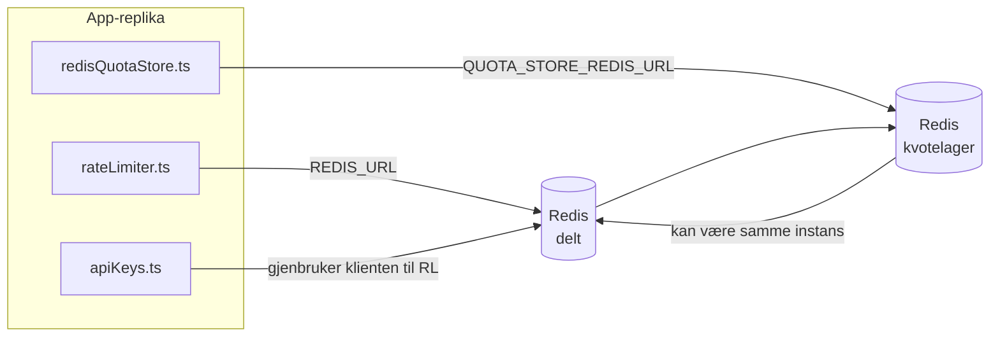

# Redis Production Configuration Guide (Norsk)

🌐 **Languages:** 🇺🇸 [English](../../../../ops/REDIS_PRODUCTION_CONFIG.md) · 🇪🇹 [am](../../../am/docs/ops/REDIS_PRODUCTION_CONFIG.md) · 🇸🇦 [ar](../../../ar/docs/ops/REDIS_PRODUCTION_CONFIG.md) · 🇦🇿 [az](../../../az/docs/ops/REDIS_PRODUCTION_CONFIG.md) · 🇧🇬 [bg](../../../bg/docs/ops/REDIS_PRODUCTION_CONFIG.md) · 🇧🇩 [bn](../../../bn/docs/ops/REDIS_PRODUCTION_CONFIG.md) · 🇧🇦 [bs](../../../bs/docs/ops/REDIS_PRODUCTION_CONFIG.md) · 🇨🇿 [cs](../../../cs/docs/ops/REDIS_PRODUCTION_CONFIG.md) · 🇩🇰 [da](../../../da/docs/ops/REDIS_PRODUCTION_CONFIG.md) · 🇩🇪 [de](../../../de/docs/ops/REDIS_PRODUCTION_CONFIG.md) · 🇬🇷 [el](../../../el/docs/ops/REDIS_PRODUCTION_CONFIG.md) · 🇪🇸 [es](../../../es/docs/ops/REDIS_PRODUCTION_CONFIG.md) · 🇪🇪 [et](../../../et/docs/ops/REDIS_PRODUCTION_CONFIG.md) · 🇮🇷 [fa](../../../fa/docs/ops/REDIS_PRODUCTION_CONFIG.md) · 🇫🇮 [fi](../../../fi/docs/ops/REDIS_PRODUCTION_CONFIG.md) · 🇫🇷 [fr](../../../fr/docs/ops/REDIS_PRODUCTION_CONFIG.md) · 🇮🇪 [ga](../../../ga/docs/ops/REDIS_PRODUCTION_CONFIG.md) · 🇮🇳 [gu](../../../gu/docs/ops/REDIS_PRODUCTION_CONFIG.md) · 🇳🇬 [ha](../../../ha/docs/ops/REDIS_PRODUCTION_CONFIG.md) · 🇮🇱 [he](../../../he/docs/ops/REDIS_PRODUCTION_CONFIG.md) · 🇮🇳 [hi](../../../hi/docs/ops/REDIS_PRODUCTION_CONFIG.md) · 🇭🇷 [hr](../../../hr/docs/ops/REDIS_PRODUCTION_CONFIG.md) · 🇭🇺 [hu](../../../hu/docs/ops/REDIS_PRODUCTION_CONFIG.md) · 🇦🇲 [hy](../../../hy/docs/ops/REDIS_PRODUCTION_CONFIG.md) · 🇮🇩 [id](../../../id/docs/ops/REDIS_PRODUCTION_CONFIG.md) · 🇳🇬 [ig](../../../ig/docs/ops/REDIS_PRODUCTION_CONFIG.md) · 🇮🇹 [it](../../../it/docs/ops/REDIS_PRODUCTION_CONFIG.md) · 🇯🇵 [ja](../../../ja/docs/ops/REDIS_PRODUCTION_CONFIG.md) · 🇬🇪 [ka](../../../ka/docs/ops/REDIS_PRODUCTION_CONFIG.md) · 🇰🇭 [km](../../../km/docs/ops/REDIS_PRODUCTION_CONFIG.md) · 🇮🇳 [kn](../../../kn/docs/ops/REDIS_PRODUCTION_CONFIG.md) · 🇰🇷 [ko](../../../ko/docs/ops/REDIS_PRODUCTION_CONFIG.md) · 🇱🇹 [lt](../../../lt/docs/ops/REDIS_PRODUCTION_CONFIG.md) · 🇱🇻 [lv](../../../lv/docs/ops/REDIS_PRODUCTION_CONFIG.md) · 🇮🇳 [ml](../../../ml/docs/ops/REDIS_PRODUCTION_CONFIG.md) · 🇮🇳 [mr](../../../mr/docs/ops/REDIS_PRODUCTION_CONFIG.md) · 🇲🇾 [ms](../../../ms/docs/ops/REDIS_PRODUCTION_CONFIG.md) · 🇲🇹 [mt](../../../mt/docs/ops/REDIS_PRODUCTION_CONFIG.md) · 🇲🇲 [my](../../../my/docs/ops/REDIS_PRODUCTION_CONFIG.md) · 🇳🇵 [ne](../../../ne/docs/ops/REDIS_PRODUCTION_CONFIG.md) · 🇳🇱 [nl](../../../nl/docs/ops/REDIS_PRODUCTION_CONFIG.md) · 🇮🇳 [or](../../../or/docs/ops/REDIS_PRODUCTION_CONFIG.md) · 🇮🇳 [pa](../../../pa/docs/ops/REDIS_PRODUCTION_CONFIG.md) · 🇵🇭 [phi](../../../phi/docs/ops/REDIS_PRODUCTION_CONFIG.md) · 🇵🇱 [pl](../../../pl/docs/ops/REDIS_PRODUCTION_CONFIG.md) · 🇵🇹 [pt](../../../pt/docs/ops/REDIS_PRODUCTION_CONFIG.md) · 🇧🇷 [pt-BR](../../../pt-BR/docs/ops/REDIS_PRODUCTION_CONFIG.md) · 🇷🇴 [ro](../../../ro/docs/ops/REDIS_PRODUCTION_CONFIG.md) · 🇷🇺 [ru](../../../ru/docs/ops/REDIS_PRODUCTION_CONFIG.md) · 🇱🇰 [si](../../../si/docs/ops/REDIS_PRODUCTION_CONFIG.md) · 🇸🇰 [sk](../../../sk/docs/ops/REDIS_PRODUCTION_CONFIG.md) · 🇸🇮 [sl](../../../sl/docs/ops/REDIS_PRODUCTION_CONFIG.md) · 🇷🇸 [sr](../../../sr/docs/ops/REDIS_PRODUCTION_CONFIG.md) · 🇸🇪 [sv](../../../sv/docs/ops/REDIS_PRODUCTION_CONFIG.md) · 🇰🇪 [sw](../../../sw/docs/ops/REDIS_PRODUCTION_CONFIG.md) · 🇮🇳 [ta](../../../ta/docs/ops/REDIS_PRODUCTION_CONFIG.md) · 🇮🇳 [te](../../../te/docs/ops/REDIS_PRODUCTION_CONFIG.md) · 🇹🇭 [th](../../../th/docs/ops/REDIS_PRODUCTION_CONFIG.md) · 🇹🇷 [tr](../../../tr/docs/ops/REDIS_PRODUCTION_CONFIG.md) · 🇺🇦 [uk-UA](../../../uk-UA/docs/ops/REDIS_PRODUCTION_CONFIG.md) · 🇵🇰 [ur](../../../ur/docs/ops/REDIS_PRODUCTION_CONFIG.md) · 🇺🇿 [uz](../../../uz/docs/ops/REDIS_PRODUCTION_CONFIG.md) · 🇻🇳 [vi](../../../vi/docs/ops/REDIS_PRODUCTION_CONFIG.md) · 🇳🇬 [yo](../../../yo/docs/ops/REDIS_PRODUCTION_CONFIG.md) · 🇨🇳 [zh-CN](../../../zh-CN/docs/ops/REDIS_PRODUCTION_CONFIG.md) · 🇹🇼 [zh-TW](../../../zh-TW/docs/ops/REDIS_PRODUCTION_CONFIG.md)

---

## Oversikt

Redis er en **valgfri, myk avhengighet** i OmniRoute — degraderes applikasjonen elegant (tilbakeslag i minnet) når Redis er utilgjengelig. I produksjon reduserer tuning Redis ventetiden for fire distinkte arbeidsbelastninger:

| Arbeidsmengde     | Sjåfør                        | Klientfabrikk                                | Nøkkelmønster                                |
| ----------------- | ----------------------------- | -------------------------------------------- | -------------------------------------------- |
| Satsbegrensende   | `rateLimiter.ts`              | `getRedisClient()` — lat `ioredis` singleton | `<prefix>rl:*` Lua-atomic rate limit-vinduer |
| Auth cache        | `apiKeys.ts`                  | Gjenbruker `rateLimiter` sin klient          | `<prefix>auth:api_key:<sha256>` med TTL      |
| Kvotebutikk       | `redisQuotaStore.ts`          | Separat `getRedisClient(url)` singleton      | `<prefix>quota:*` konfigurerbar per instans  |
| Oppvarmingsbryter | `redisCircuitBreakerStore.ts` | Separat klient i `circuitBreakerFactory.ts`  | `<prefix>warmup:cb:<connectionId>`           |

Alle de fire arbeidsbelastningene deler ett navneområdeprefiks slik at OmniRoute kan eksistere sammen med andre apper på en enkelt Redis forekomst (f.eks. `127.0.0.1:6379`). Se [Nøkkelnavneavstand](#key-namespacing).

---

## Gjeldende konfigurasjon (kodestandarder)

| Innstilling                     | Verdi                                                     | Hvor                                                                                  |
| ------------------------------- | --------------------------------------------------------- | ------------------------------------------------------------------------------------- |
| `REDIS_URL` env var             | `redis://redis:6379` (komponer), valgfritt                | `rateLimiter.ts:5`, `.env.example`                                                    |
| `REDIS_KEY_PREFIX` env var      | `omniroute:` (standard)                                   | `rateLimiter.ts`, `redisQuotaStore.ts`, `redisCircuitBreakerStore.ts`, `.env.example` |
| `QUOTA_STORE_REDIS_URL` env var | separat, kan avvike fra `REDIS_URL`                       | `quota/storeFactory.ts`                                                               |
| `QUOTA_STORE_DRIVER`            | `"sqlite"` (standard), `"redis"` valgfritt                | `quota/storeFactory.ts`                                                               |
| ioredis `maxRetriesPerRequest`  | `3`                                                       | Opprettelse av `rateLimiter.ts` kunder                                                |
| `enableReadyCheck`              | ikke angitt (ioredis standard: `true`)                    | —                                                                                     |
| `lazyConnect`                   | ikke angitt (ioredis standard: `false`)                   | —                                                                                     |
| `retryStrategy`                 | ikke angitt (ioredis standard: 200ms base, eksponentiell) | —                                                                                     |
| TLS / passord / DB indeks       | **ikke konfigurert**                                      | —                                                                                     |
| Sentinel / Cluster              | **ikke konfigurert** Kun — frittstående enkeltnode        | —                                                                                     |

---

## Navnerom for nøkler

OmniRoute deler en Redis-instans med alt annet som kjører på verten. Uten et navnerom
kan nøkler som `auth:api_key:<sha256>` eller `rl:*` kollidere med nøkler fra andre applikasjoner
som bruker samme Redis (denne instansen kjører Redis på `127.0.0.1:6379` sammen med andre tjenester).

Sett `REDIS_KEY_PREFIX` til en ikke-tom streng for å gi **alle** OmniRoute-nøkler et prefiks:

```bash
# .env — alle OmniRoute-nøkler blir omniroute:rl:*, omniroute:auth:*, omniroute:quota:*, omniroute:warmup:cb:*
REDIS_KEY_PREFIX=omniroute:
```

- **Standard:** `omniroute:` (brukes når `REDIS_KEY_PREFIX` ikke er angitt eller er tom).
- **Brukes på:** hastighetsbegrenseren + autentiseringsbufferen (delt `ioredis`-klient via `keyPrefix`) og
  kvotelageret (`KEY_PREFIX = "${REDIS_KEY_PREFIX}quota"`) samt kretsbryteren for oppvarming
  (`KEY_PREFIX = "${REDIS_KEY_PREFIX}warmup:cb:"`).
- **Endring av prefikset** når nøkler allerede finnes i Redis, etterlater de gamle nøklene uten tilknytning (de utløper
  via TTL / LRU). Det er trygt å endre prefikset; ingen migrering er nødvendig. Det eneste unntaket er en nøkkel for
  kretsbryteren for oppvarming til en tilkobling som er merket som forbudt: Den lagres uten TTL, så
  vis gjenværende nøkler med `redis-cli --scan --pattern '<old-prefix>warmup:cb:*'` og slett dem.
- **ioredis `keyPrefix`** legger automatisk til prefikset ved skriving **og** fjerner det ved lesing,
  slik at applikasjonskoden aldri ser prefikset.

---

## Anbefalt produksjonsjustering

### 1. Tilkoblingspool / klientalternativer (ioredis `Redis` konstruktør)

Den nåværende koden lager en enkelt `new Redis(url)` uten egendefinerte alternativer. For produksjon av multi-replika-distribusjoner, send en klientfabrikk i koden eller pakk inn `getRedisClient()`:

```typescript
const redis = new Redis(REDIS_URL, {
  maxRetriesPerRequest: null, // no retry limit; let retryStrategy decide
  enableReadyCheck: true, // verify server is ready before accepting calls
  lazyConnect: true, // don't connect on construction; wait for first call
  retryStrategy: (times) => {
    if (times > 10) return null; // give up after 10 retries → reconnect later
    return Math.min(times * 200, 5000); // 200ms, 400ms, …, 5s cap
  },
  enableAutoPipelining: true, // coalesce concurrent commands into one TCP write
  keepAlive: 10000, // TCP keep‑alive every 10s
});
```

**Viktige avveininger:**

- `maxRetriesPerRequest: null` + `retryStrategy` — foretrukket for produksjon, slik at forbigående Redis omstarter ikke umiddelbart mislykkes hver forespørsel. Tilbakeslaget i minnet i `checkRateLimit()` absorberer feilbanen.
- `lazyConnect: true` — unngår en oppstartsavhengighet av at Redis er oppe før serveren begynner å akseptere tilkoblinger.
- `enableAutoPipelining: true` — reduserer rundturer for samtidige rategrensekontroller; fordelaktig ved > 50 RPS på en enkelt tilkobling.

### 2. Redis -serverkonfigurasjon (`redis.conf`)

```
# Memory
maxmemory 80%                        # leave room for OS page cache
maxmemory-policy allkeys-lru         # evict stale auth cache entries under pressure

# Persistence (optional — OmniRoute is crash‑safe without it)
save 300 1                           # snapshot at least every 5 min if ≥1 key changed
appendonly no                        # AOF not needed; data is regeneratable
appendfsync no                       # no fsync overhead (RDB is sufficient)

# Networking
timeout 0                            # no idle disconnect
tcp-keepalive 300                    # 5 min keep‑alive
tcp-backlog 511                      # connection backlog for bursty load

# Performance
hz 10                                # default; 100 for latency‑sensitive
activedefrag yes                     # auto‑defragment when fragmentation >10%
```

**Avveining for `maxmemory-policy allkeys-lru`:** Auth cache-oppføringer kan bli kastet ut under minnepress. Dette er trygt — `setCachedApiKey` fylles alltid på nytt ved miss, og SQLite reserven er autoritativ. Hastighetsbegrenseren Lua-skriptet lager små nøkler som har kort levetid.

### 3. Docker Compose-innstillinger

Prod compose (`docker-compose.prod.yml`) bruker `redis:8.6.2-alpine`. Legge til:

```yaml
redis:
  image: redis:8.6.2-alpine
  command:
    [
      "redis-server",
      "--maxmemory",
      "512mb",
      "--maxmemory-policy",
      "allkeys-lru",
      "--activedefrag",
      "yes",
      "--save",
      "300 1",
    ]
  healthcheck:
    test: ["CMD", "redis-cli", "ping"]
    interval: 10s
    timeout: 3s
    retries: 3
    start_period: 5s
```

### 4. Flerinstans-/skaleringshensyn

**Enkel Redis for alle kopier** — rate-limiter Lua-skriptet avhenger av et enkelt autoritativt nøkkelrom. Flere Redis forekomster bak replikaer ville miste atomitet og doble budsjettet. Bruk en enkelt Redis (eller Redis Sentinel-klynge med failover) for alle applikasjonsreplikaer.

**Antall tilkoblinger:** Hver applikasjonsreplika åpnes **2 TCP -tilkoblinger** til Redis (rate limiter client + quota store client). Ved 10 kopier av → 20-tilkoblinger, godt innenfor en standard Redis forekomsts 10k tilkoblingstak.

### 5. Overvåking

Eksponer via helsesjekkende endepunkt:

```typescript
// src/app/api/monitoring/health/route.ts already calls rateLimiter functions
// Add Redis-specific checks:
//   1. PING latency via ioredis .ping()
//   2. Memory usage via INFO memory
//   3. Connection count via INFO clients
//   4. Hit rate for maxmemory-policy (evicted_keys / keyspace_hits)
```

Viktige beregninger å se på:

- **Utkastede nøkler / sek** — hvis den vedvarende ikke er null, øk `maxmemory`
- **Blokkerte klienter** — ikke-null antyder trege Lua-skript eller høy strid
- **Avviste forbindelser** — -tilkoblingsgrense treffer; sjelden ved 20 tilkoblinger

### 6. Redis-kompatible servere

Enhver server som brukes her må kjøre Lua-skript: hastighetsbegrenseren er en `EVAL`. På en server uten Lua, logger `checkRateLimit()` `[RATE_LIMITER] Redis eval failed, falling back to in-memory rate limiting` og teller per prosess, så hver replika håndhever grensen på egen hånd. Den opt-in shared session-affinity store (`OMNIROUTE_SESSION_AFFINITY_STORE=redis`) leser og oppdaterer også pins med `EVAL`; uten Lua logger den `[SESSION_AFFINITY] Redis error; falling back to SQLite.` og hver replika beholder sine egne pinner. De andre arbeidsbelastningene bruker vanlige kommandoer (`SET ... EX`, `GET`, `DEL`, `MGET`, `EXPIRE`, `INCRBYFLOAT`, hashes og sett), og den semantiske cachens Redis backend sender ingen `FT.*` -kommandoer.

Testet med OmniRoute 3.8.52: KiviDB 1.2.0 med sitt Lua-bilde (`kividb/kividb:v1.2.0-lua`). Hastighetsbegrenseren (inkludert en andre prosess som deler tellerne), godkjenningsbuffer, kvotelager, oppvarmingskretsbryter, semantisk hurtigbufferlager og en `/v1/chat/completions` forespørsel gjennom chatbehandleren bestod 18 av de 19 sjekkene som videresendes Redis 8.10.3. Den som er forskjellig: `INCRBYFLOAT` lagrer `0.1 + 0.2` som `0.30000000000000004` der Redis lagrer `0.3` ( [kividbio/kividb#387](https://github.com/kividbio/kividb/issues/387) ). Kvotelageret parser begge med `parseFloat`, men de to tallene er forskjellige i de siste sifrene, så en sammenligning som faller nøyaktig på en kvotegrense kan komme annerledes ut. Session-affinity-butikken var ikke en del av den kjøringen. ( [oppsett](https://github.com/kividbio/kividb/blob/master/docs/integrations/omniroute.md), [resultater](https://github.com/kividbio/kividb/tree/master/benchmarks/omniroute-compat) )

---

## Arkitekturdiagram



---

## Referanser

| Fil                                | Hensikt                                                      |
| ---------------------------------- | ------------------------------------------------------------ |
| `src/shared/utils/rateLimiter.ts`  | Primær Redis klient, Lua rate-limit-skript, reserve i minnet |
| `src/lib/db/apiKeys.ts`            | Auth cache — Redis→SQLite reserve                            |
| `src/lib/quota/redisQuotaStore.ts` | Separat Redis klient for valgfri kvotebutikk                 |
| `src/lib/quota/storeFactory.ts`    | Bytter mellom `sqlite` og `redis` -kvotedrivere              |
| `docker-compose.prod.yml`          | Prod Redis beholder (bilde `redis:8.6.2-alpine`)             |
| `.env.example`                     | Redis env vars dokumentasjon                                 |
| `src/app/api/local/redis/`         | API ruter for orkestrering av utviklere containere           |
| `bin/cli/commands/redis.mjs`       | CLI kommandoer for orkestrering av utviklerbeholdere         |
