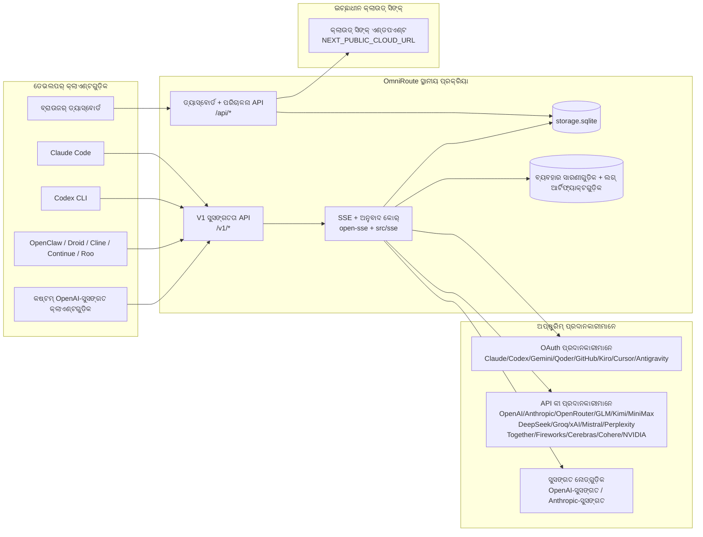
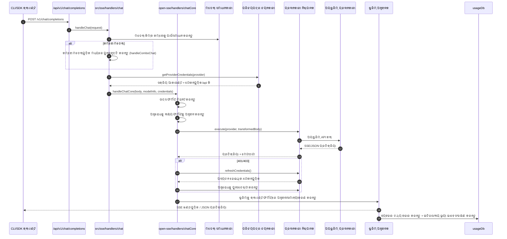
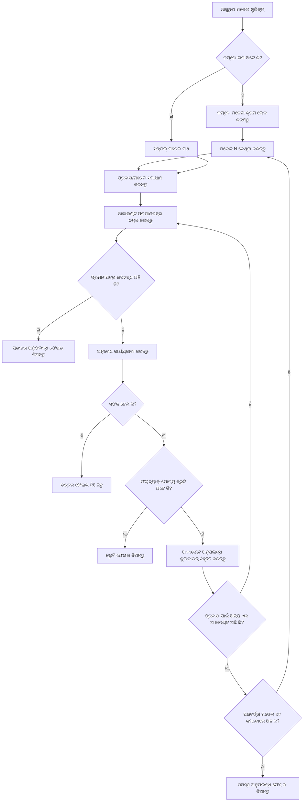
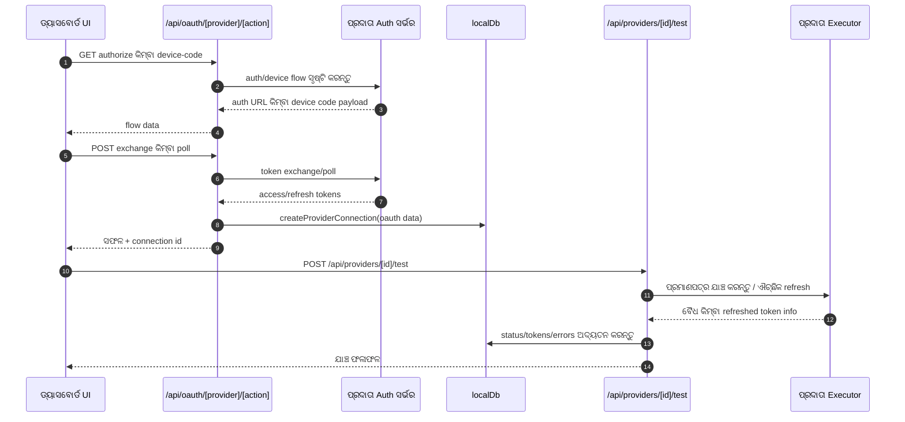
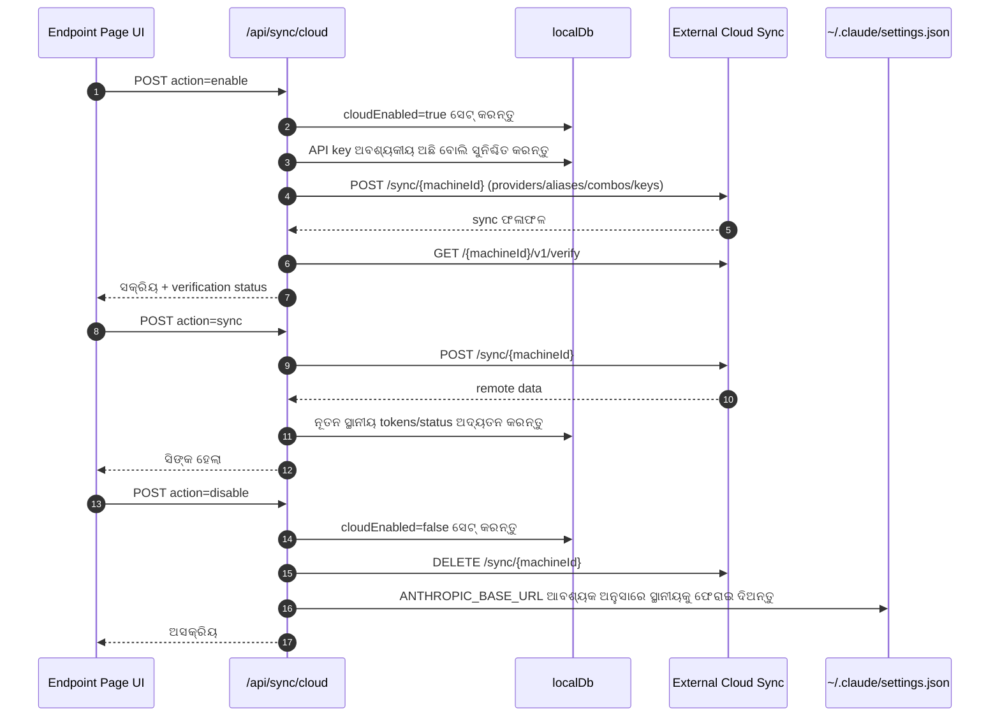
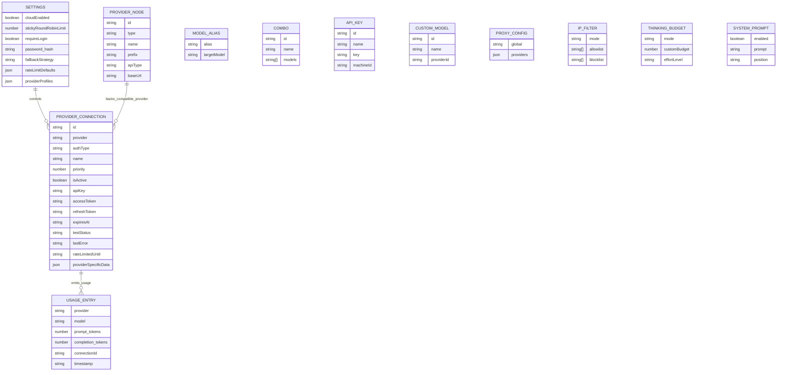
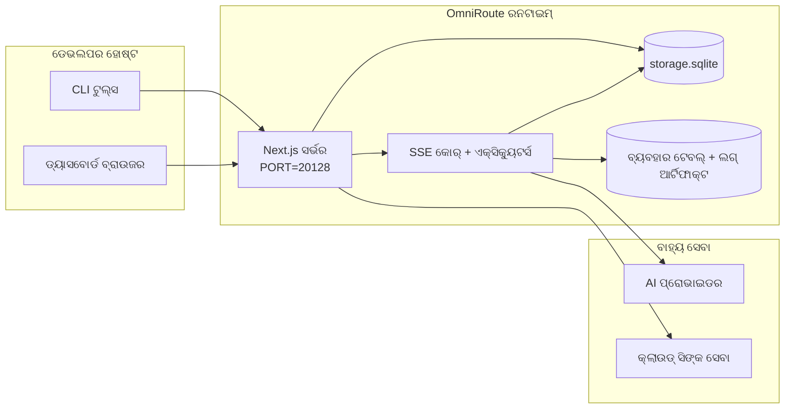

# OmniRoute Architecture (ଓଡ଼ିଆ)

🌐 **Languages:** 🇺🇸 [English](../../../../architecture/ARCHITECTURE.md) · 🇪🇹 [am](../../../am/docs/architecture/ARCHITECTURE.md) · 🇸🇦 [ar](../../../ar/docs/architecture/ARCHITECTURE.md) · 🇦🇿 [az](../../../az/docs/architecture/ARCHITECTURE.md) · 🇧🇬 [bg](../../../bg/docs/architecture/ARCHITECTURE.md) · 🇧🇩 [bn](../../../bn/docs/architecture/ARCHITECTURE.md) · 🇧🇦 [bs](../../../bs/docs/architecture/ARCHITECTURE.md) · 🇨🇿 [cs](../../../cs/docs/architecture/ARCHITECTURE.md) · 🇩🇰 [da](../../../da/docs/architecture/ARCHITECTURE.md) · 🇩🇪 [de](../../../de/docs/architecture/ARCHITECTURE.md) · 🇬🇷 [el](../../../el/docs/architecture/ARCHITECTURE.md) · 🇪🇸 [es](../../../es/docs/architecture/ARCHITECTURE.md) · 🇪🇪 [et](../../../et/docs/architecture/ARCHITECTURE.md) · 🇮🇷 [fa](../../../fa/docs/architecture/ARCHITECTURE.md) · 🇫🇮 [fi](../../../fi/docs/architecture/ARCHITECTURE.md) · 🇫🇷 [fr](../../../fr/docs/architecture/ARCHITECTURE.md) · 🇮🇪 [ga](../../../ga/docs/architecture/ARCHITECTURE.md) · 🇮🇳 [gu](../../../gu/docs/architecture/ARCHITECTURE.md) · 🇳🇬 [ha](../../../ha/docs/architecture/ARCHITECTURE.md) · 🇮🇱 [he](../../../he/docs/architecture/ARCHITECTURE.md) · 🇮🇳 [hi](../../../hi/docs/architecture/ARCHITECTURE.md) · 🇭🇷 [hr](../../../hr/docs/architecture/ARCHITECTURE.md) · 🇭🇺 [hu](../../../hu/docs/architecture/ARCHITECTURE.md) · 🇦🇲 [hy](../../../hy/docs/architecture/ARCHITECTURE.md) · 🇮🇩 [id](../../../id/docs/architecture/ARCHITECTURE.md) · 🇳🇬 [ig](../../../ig/docs/architecture/ARCHITECTURE.md) · 🇮🇹 [it](../../../it/docs/architecture/ARCHITECTURE.md) · 🇯🇵 [ja](../../../ja/docs/architecture/ARCHITECTURE.md) · 🇬🇪 [ka](../../../ka/docs/architecture/ARCHITECTURE.md) · 🇰🇭 [km](../../../km/docs/architecture/ARCHITECTURE.md) · 🇮🇳 [kn](../../../kn/docs/architecture/ARCHITECTURE.md) · 🇰🇷 [ko](../../../ko/docs/architecture/ARCHITECTURE.md) · 🇱🇹 [lt](../../../lt/docs/architecture/ARCHITECTURE.md) · 🇱🇻 [lv](../../../lv/docs/architecture/ARCHITECTURE.md) · 🇮🇳 [ml](../../../ml/docs/architecture/ARCHITECTURE.md) · 🇮🇳 [mr](../../../mr/docs/architecture/ARCHITECTURE.md) · 🇲🇾 [ms](../../../ms/docs/architecture/ARCHITECTURE.md) · 🇲🇹 [mt](../../../mt/docs/architecture/ARCHITECTURE.md) · 🇲🇲 [my](../../../my/docs/architecture/ARCHITECTURE.md) · 🇳🇵 [ne](../../../ne/docs/architecture/ARCHITECTURE.md) · 🇳🇱 [nl](../../../nl/docs/architecture/ARCHITECTURE.md) · 🇳🇴 [no](../../../no/docs/architecture/ARCHITECTURE.md) · 🇮🇳 [pa](../../../pa/docs/architecture/ARCHITECTURE.md) · 🇵🇭 [phi](../../../phi/docs/architecture/ARCHITECTURE.md) · 🇵🇱 [pl](../../../pl/docs/architecture/ARCHITECTURE.md) · 🇵🇹 [pt](../../../pt/docs/architecture/ARCHITECTURE.md) · 🇧🇷 [pt-BR](../../../pt-BR/docs/architecture/ARCHITECTURE.md) · 🇷🇴 [ro](../../../ro/docs/architecture/ARCHITECTURE.md) · 🇷🇺 [ru](../../../ru/docs/architecture/ARCHITECTURE.md) · 🇱🇰 [si](../../../si/docs/architecture/ARCHITECTURE.md) · 🇸🇰 [sk](../../../sk/docs/architecture/ARCHITECTURE.md) · 🇸🇮 [sl](../../../sl/docs/architecture/ARCHITECTURE.md) · 🇷🇸 [sr](../../../sr/docs/architecture/ARCHITECTURE.md) · 🇸🇪 [sv](../../../sv/docs/architecture/ARCHITECTURE.md) · 🇰🇪 [sw](../../../sw/docs/architecture/ARCHITECTURE.md) · 🇮🇳 [ta](../../../ta/docs/architecture/ARCHITECTURE.md) · 🇮🇳 [te](../../../te/docs/architecture/ARCHITECTURE.md) · 🇹🇭 [th](../../../th/docs/architecture/ARCHITECTURE.md) · 🇹🇷 [tr](../../../tr/docs/architecture/ARCHITECTURE.md) · 🇺🇦 [uk-UA](../../../uk-UA/docs/architecture/ARCHITECTURE.md) · 🇵🇰 [ur](../../../ur/docs/architecture/ARCHITECTURE.md) · 🇺🇿 [uz](../../../uz/docs/architecture/ARCHITECTURE.md) · 🇻🇳 [vi](../../../vi/docs/architecture/ARCHITECTURE.md) · 🇳🇬 [yo](../../../yo/docs/architecture/ARCHITECTURE.md) · 🇨🇳 [zh-CN](../../../zh-CN/docs/architecture/ARCHITECTURE.md) · 🇹🇼 [zh-TW](../../../zh-TW/docs/architecture/ARCHITECTURE.md)

---

🌐 **Languages:** 🇺🇸 [English](../../../../architecture/ARCHITECTURE.md) · 🇪🇹 [am](../../../am/docs/architecture/ARCHITECTURE.md) · 🇸🇦 [ar](../../../ar/docs/architecture/ARCHITECTURE.md) · 🇦🇿 [az](../../../az/docs/architecture/ARCHITECTURE.md) · 🇧🇬 [bg](../../../bg/docs/architecture/ARCHITECTURE.md) · 🇧🇩 [bn](../../../bn/docs/architecture/ARCHITECTURE.md) · 🇧🇦 [bs](../../../bs/docs/architecture/ARCHITECTURE.md) · 🇨🇿 [cs](../../../cs/docs/architecture/ARCHITECTURE.md) · 🇩🇰 [da](../../../da/docs/architecture/ARCHITECTURE.md) · 🇩🇪 [de](../../../de/docs/architecture/ARCHITECTURE.md) · 🇬🇷 [el](../../../el/docs/architecture/ARCHITECTURE.md) · 🇪🇸 [es](../../../es/docs/architecture/ARCHITECTURE.md) · 🇪🇪 [et](../../../et/docs/architecture/ARCHITECTURE.md) · 🇮🇷 [fa](../../../fa/docs/architecture/ARCHITECTURE.md) · 🇫🇮 [fi](../../../fi/docs/architecture/ARCHITECTURE.md) · 🇫🇷 [fr](../../../fr/docs/architecture/ARCHITECTURE.md) · 🇮🇪 [ga](../../../ga/docs/architecture/ARCHITECTURE.md) · 🇮🇳 [gu](../../../gu/docs/architecture/ARCHITECTURE.md) · 🇳🇬 [ha](../../../ha/docs/architecture/ARCHITECTURE.md) · 🇮🇱 [he](../../../he/docs/architecture/ARCHITECTURE.md) · 🇮🇳 [hi](../../../hi/docs/architecture/ARCHITECTURE.md) · 🇭🇷 [hr](../../../hr/docs/architecture/ARCHITECTURE.md) · 🇭🇺 [hu](../../../hu/docs/architecture/ARCHITECTURE.md) · 🇦🇲 [hy](../../../hy/docs/architecture/ARCHITECTURE.md) · 🇮🇩 [id](../../../id/docs/architecture/ARCHITECTURE.md) · 🇳🇬 [ig](../../../ig/docs/architecture/ARCHITECTURE.md) · 🇮🇹 [it](../../../it/docs/architecture/ARCHITECTURE.md) · 🇯🇵 [ja](../../../ja/docs/architecture/ARCHITECTURE.md) · 🇬🇪 [ka](../../../ka/docs/architecture/ARCHITECTURE.md) · 🇰🇭 [km](../../../km/docs/architecture/ARCHITECTURE.md) · 🇮🇳 [kn](../../../kn/docs/architecture/ARCHITECTURE.md) · 🇰🇷 [ko](../../../ko/docs/architecture/ARCHITECTURE.md) · 🇱🇹 [lt](../../../lt/docs/architecture/ARCHITECTURE.md) · 🇱🇻 [lv](../../../lv/docs/architecture/ARCHITECTURE.md) · 🇮🇳 [ml](../../../ml/docs/architecture/ARCHITECTURE.md) · 🇮🇳 [mr](../../../mr/docs/architecture/ARCHITECTURE.md) · 🇲🇾 [ms](../../../ms/docs/architecture/ARCHITECTURE.md) · 🇲🇹 [mt](../../../mt/docs/architecture/ARCHITECTURE.md) · 🇲🇲 [my](../../../my/docs/architecture/ARCHITECTURE.md) · 🇳🇵 [ne](../../../ne/docs/architecture/ARCHITECTURE.md) · 🇳🇱 [nl](../../../nl/docs/architecture/ARCHITECTURE.md) · 🇳🇴 [no](../../../no/docs/architecture/ARCHITECTURE.md) · 🇮🇳 [pa](../../../pa/docs/architecture/ARCHITECTURE.md) · 🇵🇭 [phi](../../../phi/docs/architecture/ARCHITECTURE.md) · 🇵🇱 [pl](../../../pl/docs/architecture/ARCHITECTURE.md) · 🇵🇹 [pt](../../../pt/docs/architecture/ARCHITECTURE.md) · 🇧🇷 [pt-BR](../../../pt-BR/docs/architecture/ARCHITECTURE.md) · 🇷🇴 [ro](../../../ro/docs/architecture/ARCHITECTURE.md) · 🇷🇺 [ru](../../../ru/docs/architecture/ARCHITECTURE.md) · 🇱🇰 [si](../../../si/docs/architecture/ARCHITECTURE.md) · 🇸🇰 [sk](../../../sk/docs/architecture/ARCHITECTURE.md) · 🇸🇮 [sl](../../../sl/docs/architecture/ARCHITECTURE.md) · 🇷🇸 [sr](../../../sr/docs/architecture/ARCHITECTURE.md) · 🇸🇪 [sv](../../../sv/docs/architecture/ARCHITECTURE.md) · 🇰🇪 [sw](../../../sw/docs/architecture/ARCHITECTURE.md) · 🇮🇳 [ta](../../../ta/docs/architecture/ARCHITECTURE.md) · 🇮🇳 [te](../../../te/docs/architecture/ARCHITECTURE.md) · 🇹🇭 [th](../../../th/docs/architecture/ARCHITECTURE.md) · 🇹🇷 [tr](../../../tr/docs/architecture/ARCHITECTURE.md) · 🇺🇦 [uk-UA](../../../uk-UA/docs/architecture/ARCHITECTURE.md) · 🇵🇰 [ur](../../../ur/docs/architecture/ARCHITECTURE.md) · 🇺🇿 [uz](../../../uz/docs/architecture/ARCHITECTURE.md) · 🇻🇳 [vi](../../../vi/docs/architecture/ARCHITECTURE.md) · 🇳🇬 [yo](../../../yo/docs/architecture/ARCHITECTURE.md) · 🇨🇳 [zh-CN](../../../zh-CN/docs/architecture/ARCHITECTURE.md) · 🇹🇼 [zh-TW](../../../zh-TW/docs/architecture/ARCHITECTURE.md)

_ଶେଷ ଅଦ୍ୟତନ: 2026-06-28_

## କାର୍ଯ୍ୟନିର୍ବାହୀ ସାରାଂଶ

OmniRoute ହେଉଛି ଏକ ସ୍ଥାନୀୟ AI ରାଉଟିଙ୍ଗ୍ ଗେଟୱେ ଏବଂ Next.js ଉପରେ ନିର୍ମିତ ଡ୍ୟାସବୋର୍ଡ। ଏହା ଏକକ OpenAI- ସୁସଙ୍ଗତ ଏଣ୍ଡପଏଣ୍ଟ (`/v1/*`) ପ୍ରଦାନ କରିଥାଏ ଏବଂ ଅନୁବାଦ, ଫଲବ୍ୟାକ୍, ଟୋକେନ୍ ସତେଜ ଏବଂ ବ୍ୟବହାର ଟ୍ରାକିଂ ସହିତ ଏକାଧିକ ଅପଷ୍ଟ୍ରିମ୍ ପ୍ରଦାନକାରୀଙ୍କ ମଧ୍ୟରେ ଟ୍ରାଫିକ୍ ମାର୍ଗ କରିଥାଏ।

ମୂଳ କ୍ଷମତା:

- CLI/tools ପାଇଁ OpenAI- ସୁସଙ୍ଗତ API ପୃଷ୍ଠ (394 ପ୍ରଦାନକାରୀ, 159 ନିର୍ବାହୀ ମଡ୍ୟୁଲ୍)
- ପ୍ରଦାନକାରୀ ଫର୍ମାଟଗୁଡ଼ିକରେRequest/response ଅନୁବାଦ।
- ମଡେଲ୍ କମ୍ବୋ ଫଲବ୍ୟାକ୍ (ମଲ୍ଟି-ମଡେଲ୍ କ୍ରମ)
- `compositeTiers` ଦ୍ୱାରା ଚାଲିବା ସମୟ ଅର୍ଡର ସହିତ ସଂରଚନା କମ୍ବୋ ଷ୍ଟେପଗୁଡିକ (`provider + model + connection`)।
- ଆକାଉଣ୍ଟ୍ ସ୍ତରୀୟ ଫଲବ୍ୟାକ୍ (ପ୍ରଦାନକାରୀ ପ୍ରତି ମଲ୍ଟି ଆକାଉଣ୍ଟ୍)
- ମୁଖ୍ୟ ଚାଟ୍ ପଥରେ କୋଟା ପ୍ରିଫ୍ଲାଇଟ୍ ଏବଂ କୋଟା-ସଚେତନ P2C ଖାତା ଚୟନ।
- OAuth + API- କି ପ୍ରଦାନକାରୀ ସଂଯୋଗ ପରିଚାଳନା (27 OAuth ପ୍ରଦାନକାରୀ ମଡ୍ୟୁଲ୍)
- `/v1/embeddings` (18 ପ୍ରଦାନକାରୀ) ମାଧ୍ୟମରେ ପି generation ଼ି ଏମ୍ବେଡିଂ।
- `/v1/images/generations` ମାଧ୍ୟମରେ ପ୍ରତିଛବି ଉତ୍ପାଦନ (10 + ପ୍ରଦାନକାରୀ, 20 + ମଡେଲ)
- `/v1/audio/transcriptions` (18 ପ୍ରଦାନକାରୀ) ମାଧ୍ୟମରେ ଅଡିଓ ଟ୍ରାନ୍ସକ୍ରିପସନ୍।
- `/v1/audio/speech` ମାଧ୍ୟମରେ ପାଠ୍ୟ-ଟୁ-ସ୍ପିଚ୍ (24 ବିଲ୍ଟ-ଇନ୍ ପ୍ରଦାନକାରୀ)।
- `/v1/videos/generations` ମାଧ୍ୟମରେ ଭିଡିଓ ଉତ୍ପାଦନ (ComfyUI + SD WebUI)
- `/v1/music/generations` (ComfyUI) ମାଧ୍ୟମରେ ସଂଗୀତ ଉତ୍ପାଦନ।
- `/v1/search` ମାଧ୍ୟମରେ ୱେବ୍ ସନ୍ଧାନ (20 ପ୍ରଦାନକାରୀ)
- `/v1/moderations` ମାଧ୍ୟମରେ ପରିବର୍ତ୍ତନ
- `/v1/rerank` ମାଧ୍ୟମରେ ରେରାନ୍କିଂ।
- ଯୁକ୍ତିଯୁକ୍ତ ମଡେଲଗୁଡିକ ପାଇଁ ଟ୍ୟାଗ୍ ପାର୍ସିଂ (`<think>...</think>`) ଚିନ୍ତା କରନ୍ତୁ।
- କଠୋର OpenAI SDK ସୁସଙ୍ଗତତା ପାଇଁ ପ୍ରତିକ୍ରିୟା ସାନିଟାଇଜେସନ୍।
- କ୍ରସ୍-ପ୍ରଦାନକାରୀ ସୁସଙ୍ଗତତା ପାଇଁ ଭୂମିକା ସ୍ ization ାଭାବିକତା (ବିକାଶକାରୀ→ ସିଷ୍ଟମ୍, ସିଷ୍ଟମ୍→ ବ୍ୟବହାରକାରୀ)।
- ସଂରଚନା ଆଉଟପୁଟ୍ ରୂପାନ୍ତର (json_schema → Gemini responseSchema)
- ପ୍ରଦାନକାରୀ, ଚାବି, ଛଦ୍ମନାମ, କମ୍ବୋ, ସେଟିଙ୍ଗ୍, ମୂଲ୍ୟ ନିର୍ଧାରଣ (122 DB ମଡ୍ୟୁଲ୍) ପାଇଁ ସ୍ଥାନୀୟ ସ୍ଥିରତା।
- Usage/cost ଟ୍ରାକିଂ ଏବଂ ଲଗିଂ ପାଇଁ ଅନୁରୋଧ।
- multi-device/state ସିଙ୍କ ପାଇଁ ଇଚ୍ଛାଧୀନ କ୍ଲାଉଡ୍ ସିଙ୍କ।
- API ପ୍ରବେଶ ନିୟନ୍ତ୍ରଣ ପାଇଁIP allowlist/blocklist
- ଚିନ୍ତା ବଜେଟ୍ ପରିଚାଳନା (passthrough/auto/custom/adaptive)
- ଗ୍ଲୋବାଲ୍ ସିଷ୍ଟମ୍ ପ୍ରମ୍ପ୍ଟ ଇଞ୍ଜେକ୍ସନ୍।
- ଅଧିବେଶନ ଟ୍ରାକିଂ ଏବଂ ଫିଙ୍ଗର ପ୍ରିଣ୍ଟିଂ।
- ପ୍ରଦାନକାରୀ-ନିର୍ଦ୍ଦିଷ୍ଟ ପ୍ରୋଫାଇଲ୍ ସହିତ ପ୍ରତି-ଆକାଉଣ୍ଟ୍ ବର୍ଦ୍ଧିତ ହାର ସୀମିତ।
- ପ୍ରଦାନକାରୀ ସ୍ଥିରତା ପାଇଁ ସର୍କିଟ ବ୍ରେକର୍ ପ୍ୟାଟର୍।
- ମ୍ୟୁଟେକ୍ସ ଲକିଂ ସହିତ ଆଣ୍ଟି-ଥଣ୍ଡରିଂ ଗୋରୁ ସୁରକ୍ଷା।
- ଦସ୍ତଖତ-ଆଧାରିତ ଅନୁରୋଧ deduplication କ୍ୟାଚ୍।
- ଡୋମେନ୍ ସ୍ତର: ମୂଲ୍ୟ ନିୟମ, ଫଲବ୍ୟାକ୍ ପଲିସି, ଲକଆଉଟ୍ ପଲିସି।
- ପ୍ରସଙ୍ଗ ରିଲେ: ଆକାଉଣ୍ଟ୍ ଘୂର୍ଣ୍ଣନ ନିରନ୍ତରତା ପାଇଁ ଅଧିବେଶନ ହ୍ୟାଣ୍ଡଫ୍ ସାରାଂଶ।
- ଡୋମେନ୍ ଷ୍ଟେଟ୍ ସ୍ଥିରତା (ଫଲବ୍ୟାକ୍, ବଜେଟ୍, ଲକଆଉଟ୍, ସର୍କିଟ ବ୍ରେକର୍ ପାଇଁSQLite ଲିଖନ ମାଧ୍ୟମରେ କ୍ୟାଚ୍)
- କେନ୍ଦ୍ରୀୟ ଅନୁରୋଧ ମୂଲ୍ୟାଙ୍କନ ପାଇଁ ପଲିସି ଇଞ୍ଜିନ୍ (ଲକଆଉଟ୍ → ବଜେଟ୍ → ଫଲବ୍ୟାକ୍)
- p50/p95/p99 ବିଳମ୍ବତା ଏକୀକରଣ ସହିତ ଟେଲିମେଟ୍ରି ଅନୁରୋଧ।
- `combo_execution_key` / `combo_step_id` ମାଧ୍ୟମରେ କମ୍ବୋ ଟାର୍ଗେଟ୍ ଟେଲିମେଟ୍ରି ଏବଂ historical ତିହାସିକ କମ୍ବୋ ଟାର୍ଗେଟ୍ ସ୍ୱାସ୍ଥ୍ୟ।
- ଏଣ୍ଡ-ଟୁ-ଏଣ୍ଡ ଅନୁସନ୍ଧାନ ପାଇଁ ସମ୍ପର୍କ ID (X-Request-Id)।
- API କି ପ୍ରତି ଅପ୍ଟ-ଆଉଟ୍ ସହିତ ଅନୁପାଳନ ଅଡିଟ୍ ଲଗିଂ।
- LLM ଗୁଣବତ୍ତା ନିଶ୍ଚିତତା ପାଇଁ ମୂଲ୍ୟାଙ୍କନ framework ାଞ୍ଚା।
- ରିଅଲ୍-ଟାଇମ୍ ପ୍ରଦାନକାରୀ ସର୍କିଟ ବ୍ରେକର ସ୍ଥିତି ସହିତ ସ୍ୱାସ୍ଥ୍ୟ ଡ୍ୟାସବୋର୍ଡ।
- 3 ପରିବହନ (stdio/SSE/Streamable HTTP) ସହିତ MCP ସର୍ଭର (110 ଉପକରଣ)।
- କ skills ଶଳ ଏବଂ କାର୍ଯ୍ୟ ଜୀବନଚକ୍ର ସହିତ A2A ସର୍ଭର (JSON-RPC 2.0 + SSE)।
- ମେମୋରୀ ସିଷ୍ଟମ୍ (ନିଷ୍କାସନ, ଇଞ୍ଜେକ୍ସନ୍, ପୁନରୁଦ୍ଧାର, ସାରାଂଶ)
- ଦକ୍ଷତା ପ୍ରଣାଳୀ (ରେଜିଷ୍ଟ୍ରି, ଏକଜେକ୍ୟୁଟର, ସ୍ୟାଣ୍ଡବକ୍ସ, ବିଲ୍ଟ-ଇନ୍ କ skills ଶଳ)
- ସାର୍ଟିଫିକେଟ୍ ପରିଚାଳନା ଏବଂ DNS ନିୟନ୍ତ୍ରଣ ସହିତ MITM ପ୍ରକ୍ସି।
- ପ୍ରମ୍ପ୍ଟ ଇଞ୍ଜେକ୍ସନ୍ ଗାର୍ଡ ମିଡିଲୱେର୍।
- କେଭମ୍ୟାନ୍, RTK, ଷ୍ଟାକ୍ଡ୍ ପାଇପଲାଇନ, ସଙ୍କୋଚନ କମ୍ବୋ, ଭାଷା ପ୍ୟାକ୍, ଏବଂ ଆନାଲିଟିକ୍ସ ସହିତ ତୁରନ୍ତ ସଙ୍କୋଚନ ପାଇପଲାଇନ।
- ACP (ଏଜେଣ୍ଟ ଯୋଗାଯୋଗ ପ୍ରୋଟୋକଲ୍) ରେଜିଷ୍ଟ୍ରି।
- ମଡ୍ୟୁଲାର୍ OAuth ପ୍ରଦାନକାରୀ ( `src/lib/oauth/providers/` ଅଧୀନରେ 22 ଟି ବ୍ୟକ୍ତିଗତ ମଡ୍ୟୁଲ୍)
- Uninstall/full-uninstall ସ୍କ୍ରିପ୍ଟଗୁଡ଼ିକ।
- OAuth ପରିବେଶ ମରାମତି କାର୍ଯ୍ୟ।
- OpenAI- ସୁସଙ୍ଗତ WS କ୍ଲାଏଣ୍ଟ (`/v1/ws`) ପାଇଁWebSocket ବ୍ରିଜ୍।
- ସିଙ୍କ୍ ଟୋକନ୍ ପରିଚାଳନା (issue/revoke, ETag- ସଂସ୍କରଣ ବିନ୍ୟାସ ବଣ୍ଡଲ୍ ଡାଉନଲୋଡ୍)
- GLM ଚିନ୍ତା (`glmt`) ପ୍ରଥମ ଶ୍ରେଣୀ ପ୍ରଦାନକାରୀ ପ୍ରିସେଟ୍।
- ହାଇବ୍ରିଡ୍ ଟୋକେନ୍ ଗଣନା (ଆକଳନ ଫଲବ୍ୟାକ୍ ସହିତ ପ୍ରଦାନକାରୀ-ପାର୍ଶ୍ୱ `/messages/count_tokens` )
- ମଡେଲ୍ ଛଦ୍ମନାମ ଅଟୋ-ବିହନ (ଷ୍ଟାର୍ଟଅପ୍ ସମୟରେ 30 + କ୍ରସ୍-ପ୍ରକ୍ସି ଉପଭାଷା ସ୍ normal ାଭାବିକତା)
- SSRF ଗାର୍ଡ, ବ୍ୟକ୍ତିଗତ URL ଅବରୋଧ, ଏବଂ ବିନ୍ୟାସଯୋଗ୍ୟ ପୁନ ry ଚେଷ୍ଟା ସହିତ ସୁରକ୍ଷିତ ଆଉଟବାଉଣ୍ଡ ଫେଚ୍।
- କୁଲଡାଉନ୍-ସଚେତନ ଚାଟ୍ ବିନ୍ୟାସଯୋଗ୍ୟ `requestRetry` ଏବଂ `maxRetryIntervalSec` ସହିତ ପୁନ ries ଚେଷ୍ଟା କରେ।
- ପ୍ରାରମ୍ଭ ସମୟରେ Zod ସହିତ ଚାଲିବା ସମୟ ପରିବେଶ ବ valid ଧତା।
- ପୃଷ୍ଠା, ପ୍ରଦାନକାରୀ CRUD ଇଭେଣ୍ଟ, ଏବଂ SSRF- ଅବରୋଧିତ ବ valid ଧତା ଲଗିଂ ସହିତ ଅନୁକରଣ ଅଡିଟ୍ v2।

ପ୍ରାଥମିକ ଚାଲିବା ସମୟ ମଡେଲ୍:

- `src/app/api/*` ଅନ୍ତର୍ଗତ Next.js ଆପ୍ ମାର୍ଗଗୁଡ଼ିକ ଉଭୟ ଡ୍ୟାସବୋର୍ଡ APIs ଏବଂ ସୁସଙ୍ଗତତା APIs କାର୍ଯ୍ୟକାରୀ କରିଥାଏ।
- `src/sse/*` + `open-sse/*` ରେ ଏକ ଅଂଶୀଦାର SSE/routing କୋର ପ୍ରଦାନକାରୀ ନିଷ୍ପାଦନ, ଅନୁବାଦ, ଷ୍ଟ୍ରିମିଂ, ଫଲବ୍ୟାକ୍ ଏବଂ ବ୍ୟବହାରକୁ ନିୟନ୍ତ୍ରଣ କରିଥାଏ।

## ସନ୍ଦର୍ଭ ଚିତ୍ରଗୁଡ଼ିକ

v3.8.0 ପ୍ଲାଟଫର୍ମ ପାଇଁ ପ୍ରାମାଣିକ, ସଂସ୍କରଣ-ନିୟନ୍ତ୍ରିତ Mermaid ଉତ୍ସଗୁଡ଼ିକ
[`docs/diagrams/`](../diagrams/README.md)ରେ ରହିଛି। ଦିଗ୍ଦର୍ଶନ ପାଇଁ ତଳେ ଦୁଇଟି ପୁନଃପ୍ରଦର୍ଶିତ ହୋଇଛି;
ଅନ୍ୟଗୁଡ଼ିକୁ ସେମାନଙ୍କ ଡୋମେନ୍-ନିର୍ଦ୍ଦିଷ୍ଟ ମାର୍ଗଦର୍ଶିକାରୁ ଲିଙ୍କ୍ କରାଯାଇଛି।


> ଉତ୍ସ: [diagrams/request-pipeline.mmd](../diagrams/request-pipeline.mmd)


> ଉତ୍ସ: [diagrams/resilience-3layers.mmd](../diagrams/resilience-3layers.mmd) — ଏହାକୁ
> [RESILIENCE_GUIDE.md](./RESILIENCE_GUIDE.md) ଏବଂ `CLAUDE.md` ସ୍ଥିତିସ୍ଥାପକତା ସନ୍ଦର୍ଭରୁ ମଧ୍ୟ ଲିଙ୍କ୍ କରାଯାଇଛି।

## ପରିସର ଏବଂ ସୀମା

### ପରିସର ଅନ୍ତର୍ଭୁକ୍ତ

- ସ୍ଥାନୀୟ ଗେଟୱେ ରନ୍ଟାଇମ୍
- ଡ୍ୟାସ୍ବୋର୍ଡ ପରିଚାଳନା APIଗୁଡ଼ିକ
- ପ୍ରଦାତା ପ୍ରମାଣୀକରଣ ଏବଂ ଟୋକନ୍ ସତେଜୀକରଣ
- ଅନୁରୋଧ ରୂପାନ୍ତରଣ ଏବଂ SSE ଷ୍ଟ୍ରିମିଂ
- ସ୍ଥାନୀୟ ଅବସ୍ଥା + ବ୍ୟବହାର ସ୍ଥାୟୀ ସଂରକ୍ଷଣ
- ଇଚ୍ଛାଧୀନ କ୍ଲାଉଡ୍ ସିଙ୍କ୍ ସମନ୍ୱୟ

### ପରିସର ବହିର୍ଭୁକ୍ତ

- `NEXT_PUBLIC_CLOUD_URL` ପଛରେ ଥିବା କ୍ଲାଉଡ୍ ସେବାର କାର୍ଯ୍ୟାନ୍ୱୟନ
- ସ୍ଥାନୀୟ ପ୍ରକ୍ରିୟା ବାହାରେ ଥିବା ପ୍ରଦାତା SLA/ନିୟନ୍ତ୍ରଣ ପ୍ଲେନ୍
- ବାହ୍ୟ CLI ବାଇନାରିଗୁଡ଼ିକ ସ୍ୱୟଂ (Claude CLI, Codex CLI, ଇତ୍ୟାଦି)

## ଡ୍ୟାସ୍ବୋର୍ଡ ପୃଷ୍ଠ (ବର୍ତ୍ତମାନ)

`src/app/(dashboard)/dashboard/` ଅଧୀନରେ ଥିବା ମୁଖ୍ୟ ପୃଷ୍ଠାଗୁଡ଼ିକ:

- `/dashboard` — ଦ୍ରୁତ ଆରମ୍ଭ + ପ୍ରଦାନକାରୀ ସାରାଂଶ
- `/dashboard/endpoint` — ଏଣ୍ଡପଏଣ୍ଟ ପ୍ରକ୍ସି + MCP + A2A + API ଏଣ୍ଡପଏଣ୍ଟ ଟ୍ୟାବ୍ଗୁଡ଼ିକ
- `/dashboard/providers` — ପ୍ରଦାନକାରୀ ସଂଯୋଗ ଏବଂ ପ୍ରମାଣପତ୍ର
- `/dashboard/combos` — କମ୍ବୋ କୌଶଳ, ଟେମ୍ପଲେଟ୍, ପଦକ୍ଷେପ-ଆଧାରିତ ବିଲ୍ଡର୍, ମଡେଲ୍ ରାଉଟିଂ ନିୟମ, ହସ୍ତଚାଳିତ ସ୍ଥାୟୀ କ୍ରମ
- `/dashboard/auto-combo` — Auto Combo Engine: ସ୍କୋରିଂ ଓଜନ, ମୋଡ୍ ପ୍ୟାକ୍, ଭର୍ଚୁଆଲ୍ ଫ୍ୟାକ୍ଟରୀ ପ୍ରିସେଟ୍, ଟେଲିମେଟ୍ରି
- `/dashboard/costs` — ଖର୍ଚ୍ଚ ସମାହାର ଏବଂ ମୂଲ୍ୟ ଦୃଶ୍ୟମାନତା
- `/dashboard/analytics` — ବ୍ୟବହାର ବିଶ୍ଳେଷଣ, ମୂଲ୍ୟାୟନ, କମ୍ବୋ ଲକ୍ଷ୍ୟର ସ୍ୱାସ୍ଥ୍ୟ
- `/dashboard/limits` — କୋଟା/ହାର ନିୟନ୍ତ୍ରଣ
- `/dashboard/cli-tools` — CLI ପ୍ରାରମ୍ଭିକ ସେଟ୍ଅପ୍, ରନ୍ଟାଇମ୍ ଚିହ୍ନଟ, ବିନ୍ୟାସ ସୃଷ୍ଟି
- `/dashboard/agents` — ଚିହ୍ନଟ ହୋଇଥିବା ACP ଏଜେଣ୍ଟ + କଷ୍ଟମ୍ ଏଜେଣ୍ଟ ପଞ୍ଜୀକରଣ
- `/dashboard/cloud-agents` — କ୍ଲାଉଡ୍ରେ ହୋଷ୍ଟ ହୋଇଥିବା ଏଜେଣ୍ଟ କାର୍ଯ୍ୟଗୁଡ଼ିକ (Codex Cloud, Devin, Jules) ଏବଂ କାର୍ଯ୍ୟ ଜୀବନଚକ୍ର
- `/dashboard/skills` — A2A କୌଶଳ ରେଜିଷ୍ଟ୍ରି, ସ୍ୟାଣ୍ଡବକ୍ସ ନିଷ୍ପାଦନ, ଅନ୍ତର୍ନିର୍ମିତ କୌଶଳ କ୍ୟାଟାଲଗ୍
- `/dashboard/memory` — ସ୍ଥାୟୀ କଥୋପକଥନ ସ୍ମୃତିର ନିରୀକ୍ଷଣ ଏବଂ ପୁନରୁଦ୍ଧାର
- `/dashboard/webhooks` — ଆଉଟ୍ବାଉଣ୍ଡ ୱେବ୍ହୁକ୍ ସଦସ୍ୟତା, ଗୁପ୍ତ କୀ ରୋଟେସନ୍, ପୁନଃପ୍ରୟାସ ପରିସଂଖ୍ୟାନ
- `/dashboard/batch` — ବ୍ୟାଚ୍ କାର୍ଯ୍ୟ ଦାଖଲ ଏବଂ ପ୍ରଗତି
- `/dashboard/cache` — ରିଡ୍-ଥ୍ରୁ ଏବଂ ରିଜନିଂ କ୍ୟାଶ୍ ପରିସଂଖ୍ୟାନ, ଇଭିକ୍ସନ୍ ନିୟନ୍ତ୍ରଣ
- `/dashboard/playground` — ବିନ୍ୟାସିତ ଯେକୌଣସି କମ୍ବୋ/ମଡେଲ୍ ସହିତ ଇଣ୍ଟର୍ଆକ୍ଟିଭ୍ ଚାଟ୍ ପ୍ଲେଗ୍ରାଉଣ୍ଡ
- `/dashboard/changelog` — ଆପ୍-ମଧ୍ୟସ୍ଥ ଚେଞ୍ଜଲଗ୍ ଦର୍ଶକ (`CHANGELOG.md` ରେଣ୍ଡର୍ କରେ)
- `/dashboard/system` — ରନ୍ଟାଇମ୍ ନିଦାନ, ସଂସ୍କରଣ ସୂଚନା, ପରିବେଶ ବୈଧତା ଯାଞ୍ଚ ପୃଷ୍ଠ
- `/dashboard/onboarding` — ନୂତନ ଇନ୍ଷ୍ଟଲେସନ୍ ପାଇଁ ପ୍ରଥମ-ଚାଳନ ସେଟ୍ଅପ୍ ୱିଜାର୍ଡ
- `/dashboard/media` — ଛବି/ଭିଡିଓ/ସଙ୍ଗୀତ ପ୍ଲେଗ୍ରାଉଣ୍ଡ
- `/dashboard/search-tools` — ସନ୍ଧାନ ପ୍ରଦାନକାରୀ ପରୀକ୍ଷଣ ଏବଂ ଇତିହାସ
- `/dashboard/health` — ଅପ୍ଟାଇମ୍, ସର୍କିଟ୍ ବ୍ରେକର୍, ହାର ସୀମା, କୋଟା-ନିରୀକ୍ଷିତ ସେସନ୍
- `/dashboard/logs` — ଅନୁରୋଧ/ପ୍ରକ୍ସି/ଅଡିଟ୍/କନ୍ସୋଲ୍ ଲଗ୍
- `/dashboard/settings` — ସିଷ୍ଟମ୍ ସେଟିଂସ୍ ଟ୍ୟାବ୍ଗୁଡ଼ିକ (ସାଧାରଣ, ରାଉଟିଂ, କମ୍ବୋ ଡିଫଲ୍ଟ ଇତ୍ୟାଦି)
- `/dashboard/context/caveman` — Caveman ସଙ୍କୋଚନ ନିୟମ, ଭାଷା ପ୍ୟାକ୍, ପୂର୍ବାବଲୋକନ ଏବଂ ଆଉଟ୍ପୁଟ୍ ମୋଡ୍
- `/dashboard/context/rtk` — RTK କମାଣ୍ଡ-ଆଉଟ୍ପୁଟ୍ ଫିଲ୍ଟର୍, ପୂର୍ବାବଲୋକନ ଏବଂ ରନ୍ଟାଇମ୍ ସୁରକ୍ଷା ସେଟିଂସ୍
- `/dashboard/context/combos` — ରାଉଟିଂ କମ୍ବୋଗୁଡ଼ିକୁ ନ୍ୟସ୍ତ ହୋଇଥିବା ନାମିତ ସଙ୍କୋଚନ ପାଇପ୍ଲାଇନ୍
- `/dashboard/translator` — ଅନୁବାଦକ ନିରୀକ୍ଷଣ ଏବଂ ଅନୁରୋଧ ଫର୍ମାଟ୍ ରୂପାନ୍ତରଣ ପୂର୍ବାବଲୋକନ
- `/dashboard/audit` — ପୃଷ୍ଠାଙ୍କନ ଏବଂ ସଂରଚିତ ମେଟାଡାଟା ସହିତ ଅନୁପାଳନ ଅଡିଟ୍ ଲଗ୍ ବ୍ରାଉଜର୍
- `/dashboard/usage` — `usage_history` ସହିତ ସଂଯୁକ୍ତ ପ୍ରତି-ଅନୁରୋଧ ବ୍ୟବହାର ବ୍ରାଉଜର୍
- `/dashboard/compression` — ସଙ୍କୋଚନ ବିଶ୍ଳେଷଣ, ପରିସଂଖ୍ୟାନ ଏବଂ ପାଇପ୍ଲାଇନ୍ ନ୍ୟସ୍ତକରଣ
- `/dashboard/api-manager` — API କୀ ଜୀବନଚକ୍ର ଏବଂ ମଡେଲ୍ ଅନୁମତିଗୁଡ଼ିକ

UI ସ୍ତର: ପ୍ରତ୍ୟେକ ପୃଷ୍ଠା ଗୋଟିଏ ସେଲ୍ ଭିତରେ ରେଣ୍ଡର୍ ହୁଏ — `src/app/(dashboard)/layout.tsx` →
`src/shared/components/layouts/DashboardLayout.tsx` → `DashboardShell.tsx` (କିଟ୍ର
`SidebarProvider`/`SidebarInset`, OmniRouteର `Sidebar.tsx` ଏବଂ `Header.tsx`)। ପୃଷ୍ଠାଗୁଡ଼ିକ ସେମାନଙ୍କର
ନିର୍ମାଣ ଉପାଦାନଗୁଡ଼ିକୁ `@/shared/components` (`packages/ui-kit`ରେ ଥିବା ଭେଣ୍ଡର୍ କରାଯାଇଥିବା Keak CI UI Kit ଉପରେ ଆଡାପ୍ଟର୍)
କିମ୍ବା କିଟ୍ କମ୍ପୋନେଣ୍ଟ ସବ୍ପାଥ୍ଗୁଡ଼ିକ (`@omniroute/ui-kit/table`, `…/page-header`)ରୁ ଇମ୍ପୋର୍ଟ କରେ, ଏବଂ
ଆଇକନ୍ଗୁଡ଼ିକୁ `<Icon>` (`ICON_MAP` → Lucide) ମାଧ୍ୟମରେ ଇମ୍ପୋର୍ଟ କରେ। ଥିମ୍ (ଡିଫଲ୍ଟ ଭାବେ `system`, ହାଲୁକା/ଗାଢ଼) ଏବଂ ଟୋକେନ୍ଗୁଡ଼ିକ
`src/app/globals.css`ରେ ଥିବା ବ୍ରିଜ୍ ମାଧ୍ୟମରେ କିଟ୍ରୁ ଆସେ। ବିବରଣୀ: `docs/architecture/DESIGN_SYSTEM.md`।

## ଉଚ୍ଚ-ସ୍ତରୀୟ ସିଷ୍ଟମ୍ ପରିପ୍ରେକ୍ଷ୍ୟ



## ମୂଳ ରନ୍ଟାଇମ୍ ଉପାଦାନଗୁଡ଼ିକ

## 1) API ଏବଂ ରାଉଟିଂ ସ୍ତର (Next.js ଆପ୍ ରୁଟ୍ଗୁଡ଼ିକ)

ମୁଖ୍ୟ ଡିରେକ୍ଟୋରୀଗୁଡ଼ିକ:

- ସୁସଙ୍ଗତତା API ପାଇଁ `src/app/api/v1/*` ଏବଂ `src/app/api/v1beta/*`
- ପରିଚାଳନା/ବିନ୍ୟାସ API ପାଇଁ `src/app/api/*`
- `next.config.mjs` ରେ ଥିବା Next ପୁନର୍ଲିଖନଗୁଡ଼ିକ `/v1/*`କୁ `/api/v1/*` ସହିତ ମ୍ୟାପ୍ କରେ

ଗୁରୁତ୍ୱପୂର୍ଣ୍ଣ ସୁସଙ୍ଗତତା ରୁଟ୍ଗୁଡ଼ିକ:

- `src/app/api/v1/chat/completions/route.ts`
- `src/app/api/v1/messages/route.ts`
- `src/app/api/v1/responses/route.ts`
- `src/app/api/v1/models/route.ts` — `custom: true` ସହିତ କଷ୍ଟମ୍ ମଡେଲ୍ଗୁଡ଼ିକୁ ସାମିଲ କରେ
- `src/app/api/v1/embeddings/route.ts` — ଏମ୍ବେଡିଂ ସୃଷ୍ଟି (6ଟି ପ୍ରଦାନକାରୀ)
- `src/app/api/v1/images/generations/route.ts` — ପ୍ରତିଛବି ସୃଷ୍ଟି (Antigravity/Nebius ସମେତ 4+ ପ୍ରଦାନକାରୀ)
- `src/app/api/v1/messages/count_tokens/route.ts`
- `src/app/api/v1/providers/[provider]/chat/completions/route.ts` — ପ୍ରତ୍ୟେକ ପ୍ରଦାନକାରୀ ପାଇଁ ସ୍ୱତନ୍ତ୍ର ଚାଟ୍
- `src/app/api/v1/providers/[provider]/embeddings/route.ts` — ପ୍ରତ୍ୟେକ ପ୍ରଦାନକାରୀ ପାଇଁ ସ୍ୱତନ୍ତ୍ର ଏମ୍ବେଡିଂ
- `src/app/api/v1/providers/[provider]/images/generations/route.ts` — ପ୍ରତ୍ୟେକ ପ୍ରଦାନକାରୀ ପାଇଁ ସ୍ୱତନ୍ତ୍ର ପ୍ରତିଛବି
- `src/app/api/v1beta/models/route.ts`
- `src/app/api/v1beta/models/[...path]/route.ts`

ପରିଚାଳନା ଡୋମେନ୍ଗୁଡ଼ିକ:

- ପ୍ରମାଣୀକରଣ/ସେଟିଂସ୍: `src/app/api/auth/*`, `src/app/api/settings/*`
- ପ୍ରଦାନକାରୀ/ସଂଯୋଗଗୁଡ଼ିକ: `src/app/api/providers*`
- ପ୍ରଦାନକାରୀ ନୋଡ୍ଗୁଡ଼ିକ: `src/app/api/provider-nodes*`
- କଷ୍ଟମ୍ ମଡେଲ୍ଗୁଡ଼ିକ: `src/app/api/provider-models` (GET/POST/DELETE)
- ମଡେଲ୍ କ୍ୟାଟାଲଗ୍: `src/app/api/models/route.ts` (GET)
- ପ୍ରକ୍ସି ବିନ୍ୟାସ: `src/app/api/settings/proxy` (GET/PUT/DELETE) + `src/app/api/settings/proxy/test` (POST)
- OAuth: `src/app/api/oauth/*`
- କୀ/ଉପନାମ/ସଂଯୋଜନ/ମୂଲ୍ୟ ନିର୍ଦ୍ଧାରଣ: `src/app/api/keys*`, `src/app/api/models/alias`, `src/app/api/combos*`, `src/app/api/pricing`
- ବ୍ୟବହାର: `src/app/api/usage/*`
- ସିଙ୍କ୍/କ୍ଲାଉଡ୍: `src/app/api/sync/*`, `src/app/api/cloud/*`
- CLI ଟୁଲିଂ ସହାୟକଗୁଡ଼ିକ: `src/app/api/cli-tools/*`
- IP ଫିଲ୍ଟର୍: `src/app/api/settings/ip-filter` (GET/PUT)
- ଚିନ୍ତନ ବଜେଟ୍: `src/app/api/settings/thinking-budget` (GET/PUT)
- ସିଷ୍ଟମ୍ ପ୍ରମ୍ପ୍ଟ: `src/app/api/settings/system-prompt` (GET/PUT)
- ସଙ୍କୋଚନ: `src/app/api/settings/compression`, `src/app/api/compression/*`, ଏବଂ
  `src/app/api/context/*`
- ସେସନ୍ଗୁଡ଼ିକ: `src/app/api/sessions` (GET)
- ହାର ସୀମାଗୁଡ଼ିକ: `src/app/api/rate-limits` (GET)
- ସ୍ଥିତିସ୍ଥାପକତା: `src/app/api/resilience` (GET/PATCH) — ଅନୁରୋଧ କ୍ୟୁ, ସଂଯୋଗ କୁଲ୍ଡାଉନ୍, ପ୍ରଦାନକାରୀ ବ୍ରେକର୍ ଏବଂ କୁଲ୍ଡାଉନ୍ ପାଇଁ ଅପେକ୍ଷା ବିନ୍ୟାସ
- ସ୍ଥିତିସ୍ଥାପକତା ରିସେଟ୍: `src/app/api/resilience/reset` (POST) — ପ୍ରଦାନକାରୀ ବ୍ରେକର୍ଗୁଡ଼ିକୁ ରିସେଟ୍ କରେ
- କ୍ୟାଶ୍ ପରିସଂଖ୍ୟାନ: `src/app/api/cache/stats` (GET/DELETE)
- ଟେଲିମେଟ୍ରି: `src/app/api/telemetry/summary` (GET)
- ବଜେଟ୍: `src/app/api/usage/budget` (GET/POST)
- ଫଲ୍ବ୍ୟାକ୍ ଶୃଙ୍ଖଳଗୁଡ଼ିକ: `src/app/api/fallback/chains` (GET/POST/DELETE)
- ଅନୁପାଳନ ଅଡିଟ୍: `src/app/api/compliance/audit-log` (GET, ପୃଷ୍ଠାଙ୍କନ + ସଂରଚିତ ମେଟାଡାଟା ସହିତ)
- ମୂଲ୍ୟାୟନଗୁଡ଼ିକ: `src/app/api/evals` (GET/POST), `src/app/api/evals/[suiteId]` (GET)
- ନୀତିଗୁଡ଼ିକ: `src/app/api/policies` (GET/POST)
- ସିଙ୍କ୍ ଟୋକନ୍ଗୁଡ଼ିକ: `src/app/api/sync/tokens` (GET/POST), `src/app/api/sync/tokens/[id]` (GET/DELETE)
- ବିନ୍ୟାସ ବଣ୍ଡଲ୍: `src/app/api/sync/bundle` (GET, ସେଟିଂସ୍/ପ୍ରଦାନକାରୀ/ସଂଯୋଜନ/କୀଗୁଡ଼ିକର ETag-ସଂସ୍କରଣଯୁକ୍ତ ସ୍ନାପ୍ଶଟ୍)
- WebSocket: `src/app/api/v1/ws/route.ts` — OpenAI-ସୁସଙ୍ଗତ WS କ୍ଲାଏଣ୍ଟଗୁଡ଼ିକ ପାଇଁ Upgrade ହ୍ୟାଣ୍ଡଲର୍

## 2) SSE + ଅନୁବାଦ କୋର।

ମୁଖ୍ୟ ପ୍ରବାହ ମଡ୍ୟୁଲ୍:

- ପ୍ରବେଶ: `src/sse/handlers/chat.ts`
- ମୂଳ ସଂଗୀତ: `open-sse/handlers/chatCore.ts`
- ପ୍ରଦାନକାରୀ ନିଷ୍ପାଦନ ଆଡାପ୍ଟର: `open-sse/executors/*`
- detection/provider ବିନ୍ୟାସ: `open-sse/services/provider.ts` ଫର୍ମାଟ୍ କରନ୍ତୁ।
- ମଡେଲ୍ parse/resolve: `src/sse/services/model.ts`, `open-sse/services/model.ts`
- ଆକାଉଣ୍ଟ୍ ଫଲବ୍ୟାକ୍ ଲଜିକ୍: `open-sse/services/accountFallback.ts`
- ଅନୁବାଦ ରେଜିଷ୍ଟ୍ରି: `open-sse/translator/index.ts`
- ଷ୍ଟ୍ରିମ୍ ପରିବର୍ତ୍ତନ: `open-sse/utils/stream.ts`, `open-sse/utils/streamHandler.ts`
- extraction/normalization ବ୍ୟବହାର: `open-sse/utils/usageTracking.ts`
- ଟ୍ୟାଗ୍ ପାର୍ସର୍ ଭାବନ୍ତୁ: `open-sse/utils/thinkTagParser.ts`
- ଏମ୍ବେଡିଂ ହ୍ୟାଣ୍ଡେଲର୍: `open-sse/handlers/embeddings.ts`
- ଏମ୍ବେଡିଂ ପ୍ରଦାନକାରୀ ରେଜିଷ୍ଟ୍ରି: `open-sse/config/embeddingRegistry.ts`
- ପ୍ରତିଛବି ଉତ୍ପାଦନ ନିୟନ୍ତ୍ରକ: `open-sse/handlers/imageGeneration.ts`
- ପ୍ରତିଛବି ପ୍ରଦାନକାରୀ ରେଜିଷ୍ଟ୍ରି: `open-sse/config/imageRegistry.ts`
- ପ୍ରତିକ୍ରିୟା ପରିମଳ: `open-sse/handlers/responseSanitizer.ts`
- ଭୂମିକା ସାଧାରଣକରଣ: `open-sse/services/roleNormalizer.ts`

ସେବାଗୁଡିକ (ବ୍ୟବସାୟ ତର୍କ):

- ଖାତା selection/scoring: `open-sse/services/accountSelector.ts`
- ପ୍ରସଙ୍ଗ ଜୀବନଚକ୍ର ପରିଚାଳନା: `open-sse/services/contextManager.ts`
- IP ଫିଲ୍ଟର ପ୍ରୟୋଗ: `open-sse/services/ipFilter.ts`
- ଅଧିବେଶନ ଟ୍ରାକିଂ: `open-sse/services/sessionManager.ts`
- ନକଲ ପାଇଁ ଅନୁରୋଧ: `open-sse/services/signatureCache.ts`
- ସିଷ୍ଟମ୍ ପ୍ରମ୍ପ୍ଟ ଇଞ୍ଜେକ୍ସନ୍: `open-sse/services/systemPrompt.ts`
- ବଜେଟ୍ ପରିଚାଳନା ଚିନ୍ତା: `open-sse/services/thinkingBudget.ts`
- ୱାଇଲ୍ଡକାର୍ଡ ମଡେଲ ରାଉଟିଙ୍ଗ: `open-sse/services/wildcardRouter.ts`
- ହାର ସୀମା ପରିଚାଳନା: `open-sse/services/rateLimitManager.ts`
- ସର୍କିଟ ବ୍ରେକର୍: `src/shared/utils/circuitBreaker.ts`
- ପ୍ରସଙ୍ଗ ହ୍ୟାଣ୍ଡଫ୍: `open-sse/services/contextHandoff.ts` — ହ୍ୟାଣ୍ଡଫ୍ ସାରାଂଶ ଉତ୍ପାଦନ ଏବଂ ପ୍ରସଙ୍ଗ-ରିଲେ ରଣନୀତି ପାଇଁ ଇଞ୍ଜେକ୍ସନ୍।
- ସଙ୍କୋଚନ: ପ୍ରଦାନକାରୀ ଅନୁବାଦ ପୂର୍ବରୁ `open-sse/services/compression/*` — ସକ୍ରିୟ ସଙ୍କୋଚନ; କେଭମ୍ୟାନ୍ ନିୟମ, RTK ଫିଲ୍ଟର୍, ଷ୍ଟାକ୍ଡ୍ ପାଇପଲାଇନ, ସଙ୍କୋଚନ କମ୍ବୋ, ପରିସଂଖ୍ୟାନ ଏବଂ ବ valid ଧତା ଅନ୍ତର୍ଭୁକ୍ତ କରେ।
- Codex କୋଟା ଫେଚର୍: `open-sse/services/codexQuotaFetcher.ts` — ପ୍ରସଙ୍ଗ-ରିଲେ ହ୍ୟାଣ୍ଡଅଫ୍ ନିଷ୍ପତ୍ତି ପାଇଁ Codex କୋଟା ଆଣେ।
- କୁଲଡାଉନ୍-ସଚେତନ ପୁନ ry ଚେଷ୍ଟା: `src/sse/services/cooldownAwareRetry.ts` — ପ୍ରତି ମଡେଲ୍ କୁଲଡାଉନ୍ ବିନ୍ୟାସଯୋଗ୍ୟ `requestRetry` / `maxRetryIntervalSec` ସହିତ ପୁନ ries ଚେଷ୍ଟା କରେ।
- ନିରାପଦ ଆଉଟବାଉଣ୍ଡ ଫେଚ୍: SSRF ରାକ୍ଷୀ ସହିତ `src/shared/network/safeOutboundFetch.ts` — ରାକ୍ଷୀ provider/model ଫେଚ୍, ବ୍ୟକ୍ତିଗତ- URL ଅବରୋଧ, ପୁନ ry ଚେଷ୍ଟା, ଏବଂ ସମୟ ସମାପ୍ତ।
- ଆଉଟବାଉଣ୍ଡ URL ଗାର୍ଡ: URLs ପ୍ରଦାନକାରୀ ଉପରେ `src/shared/network/outboundUrlGuard.ts` — ହୋଷ୍ଟ ଯାଞ୍ଚ; `src/shared/network/outboundUrlGuardPolicy.ts` `OMNIROUTE_ALLOW_LOCAL_PROVIDER_URLS`, `OMNIROUTE_ALLOW_PRIVATE_PROVIDER_URLS`, ଏବଂ ସେମାନଙ୍କର ଡ୍ୟାସବୋର୍ଡ ଟୋଗଲ୍ଗୁଡ଼ିକରୁ ମୋଡ୍ ବାଛିଥାଏ ( `docs/reference/ENVIRONMENT.md` ଦେଖନ୍ତୁ)
- ପ୍ରଦାନକାରୀ ଅନୁରୋଧ ଡିଫଲ୍ଟ: `open-sse/services/providerRequestDefaults.ts` — ପ୍ରଦାନକାରୀ ସ୍ତରୀୟ `maxTokens`, `temperature`, `thinkingBudgetTokens` ଡିଫଲ୍ଟ।
- GLM ପ୍ରଦାନକାରୀ ସ୍ଥିର: `open-sse/config/glmProvider.ts` — ଅଂଶୀଦାର GLM ମଡେଲ, କୋଟା URLs, GLMT timeout/defaults
- Antigravity ଅପଷ୍ଟ୍ରିମ୍: `open-sse/config/antigravityUpstream.ts` — ଆଧାର URL ଏବଂ ଆବିଷ୍କାର ପଥ ସ୍ଥିର।
- Codex କ୍ଲାଏଣ୍ଟ ସ୍ଥିର: `open-sse/config/codexClient.ts` — ସଂସ୍କରଣ ବ୍ୟବହାରକାରୀ-ଏଜେଣ୍ଟ ଏବଂ କ୍ଲାଏଣ୍ଟ-ସଂସ୍କରଣ ମୂଲ୍ୟଗୁଡ଼ିକ।
- ମଡେଲ୍ ଛଦ୍ମନାମ ମଞ୍ଜି: `src/lib/modelAliasSeed.ts` — ମଞ୍ଜି 30 + କ୍ରସ୍-ପ୍ରକ୍ସି ଉପଭାଷା ଛଦ୍ମନାମ ଆରମ୍ଭ ସମୟରେ।

ଡୋମେନ୍ ସ୍ତର ମଡ୍ୟୁଲ୍:

- rules/budgets ମୂଲ୍ୟ: `src/domain/costRules.ts`
- ଫଲବ୍ୟାକ୍ ନୀତି: `src/domain/fallbackPolicy.ts`
- ସଂରକ୍ଷିତ କମ୍ବୋ-ରିଜୋଲ୍ୟୁସନ୍ ଚୁକ୍ତି: `src/domain/comboResolver.ts`; ଲାଇଭ୍ ରାଉଟିଙ୍ଗ୍ `open-sse/services/combo.ts` ବ୍ୟବହାର କରେ।
- ଲକଆଉଟ୍ ନୀତି: `src/domain/lockoutPolicy.ts`
- ସଂରକ୍ଷିତ ନୀତି-ମୂଲ୍ୟାଙ୍କନ ଚୁକ୍ତି: `src/domain/policyEngine.ts`; ଅନୁରୋଧ ପଥ `src/shared/utils/apiKeyPolicy.ts` ମାଧ୍ୟମରେ API- କି ନୀତି ଏବଂ `src/sse/handlers/chat/resolvedModelPolicy.ts` ମାଧ୍ୟମରେ ସମାଧାନ-ଲକ୍ଷ୍ୟ ପ୍ରାଧିକରଣକୁ କାର୍ଯ୍ୟକାରୀ କରିଥାଏ।
- ତ୍ରୁଟି ସଂକେତ ତାଲିକା: `src/shared/constants/errorCodes.ts`
- ID ଅନୁରୋଧ: `src/shared/utils/requestId.ts`
- ସମୟ ସମାପ୍ତ କରନ୍ତୁ: `src/shared/utils/fetchTimeout.ts`
- ଟେଲିମେଟ୍ରି ଅନୁରୋଧ: `src/shared/utils/requestTelemetry.ts`
- Compliance/audit: `src/lib/compliance/index.ts`
- ମୂଲ୍ୟାଙ୍କନ ରନର୍: `src/lib/evals/evalRunner.ts`
- ଡୋମେନ୍ ରାଜ୍ୟ ସ୍ଥିରତା: ଫଲବ୍ୟାକ୍ ଚେନ୍, ବଜେଟ୍, ମୂଲ୍ୟ ଇତିହାସ, ଲକଆଉଟ୍ ସ୍ଥିତି, ସର୍କିଟ ବ୍ରେକର୍ ପାଇଁ `src/lib/db/domainState.ts` — SQLite CRUD

OAuth ପ୍ରଦାନକାରୀ ଏକକାଂଶ ( `src/lib/oauth/providers/` ଅଧୀନରେ 27 ଟି ବ୍ୟକ୍ତିଗତ ଫାଇଲ):

- ରେଜିଷ୍ଟ୍ରି ଇଣ୍ଡେକ୍ସ: `src/lib/oauth/providers/index.ts`
- `ghe-copilot.ts` ପ୍ରଦାନକାରୀ `kiro.ts` `agy.ts`, `antigravity.ts`, `claude.ts`, `cline.ts`, `codebuddy-cn.ts`, `codebuddy-intl.ts` `zed-hosted.ts` `codex.ts` `workbuddy.ts` `cursor.ts`, `devin-desktop.ts`, `github.ts`, `gitlab-duo.ts`, `grok-cli-oauth.ts`, `grok-cli.ts`, `kilocode.ts`, `kimi-coding.ts`, `muse-code.ts`, `openference.ts`, `qoder.ts`, `trae.ts` `zed.ts` `xai-oauth.ts`
- ଅଂଶୀଦାର ସହାୟକକାରୀ: `codebuddyDeviceAuth.ts` (CodeBuddy CN/intl ଉପକରଣ ପ୍ରବାହ), `museCodeDeviceResponse.ts`
- ପତଳା ରାପର୍: `src/lib/oauth/providers.ts` — ବ୍ୟକ୍ତିଗତ ମଡ୍ୟୁଲରୁ ପୁନ - ରପ୍ତାନି।

## �) ଏମ୍ବେଡେଡ୍ ସର୍ଭିସ୍ଗୁଡ଼ିକ (v3.8.4)

OmniRoute କାର୍ଯ୍ୟ କରୁଥିବା ସ୍ଥାନୀୟ AI ଟୁଲ୍ ପ୍ରକ୍ରିୟାଗୁଡ଼ିକୁ **ଏମ୍ବେଡେଡ୍ ସର୍ଭିସ୍** କୁହାଯାଏ, ସେଗୁଡ଼ିକୁ ସ୍ଥାପନ, ତଦାରିବା ଏବଂ ରୁଟିଂ କରିପାରେ। ପାଞ୍ଚଟି ପଠାଯାଇଛି: 9Router, CLIProxyAPI, Bifrost, Mux ଏବଂ Dario।

ଆର୍କିଟେକ୍ଚର ସ୍ତର:

- **UI** (`/dashboard/providers/services`) — ଦୁଇଟି ଟ୍ୟାବ୍ ଥିବା ପୃଷ୍ଠା, ଯାହାରେ ଲାଇଫସାଇକଲ୍ କଣ୍ଟ୍ରୋଲ୍, ଲାଇଭ୍ ଲଗ୍ ଷ୍ଟ୍ରିମିଂ, API କି ପରିଚାଳନା ଏବଂ (9Router ପାଇଁ) ଏକ ଆନ୍ତଃଗତ ରିଭର୍ସ ପ୍ରକ୍ସି ମାଧ୍ୟମରେ ଏମ୍ବେଡେଡ୍ ନେଟିଭ୍ UI ଅଛି।
- **API** (`/api/services/{name}/*`) — 9Router ପାଇଁ 11ଟି ଏଣ୍ଡପଏଣ୍ଟ, CLIProxyAPI ପାଇଁ 10ଟି, Bifrost / Mux / Dario ପ୍ରତ୍ୟେକ ପାଇଁ 8ଟି, ସମସ୍ତେ **LOCAL_ONLY** (ନିୟମ #17) ଭାବରେ ବର୍ଗୀକୃତ। ଏକ ସାଝା `GET /api/services/[name]/logs` SSE ଏଣ୍ଡପଏଣ୍ଟ ଦୁଇଟି ସର୍ଭିସ୍କୁ ସେବା ଯୋଗାଏ।
- **ପର୍ଯ୍ୟବେକ୍ଷକ** (`src/lib/services/`) — ସାଧାରଣ `ServiceSupervisor` ଶ୍ରେଣୀ `child_process.spawn` କୁ ଓ୍ଵାପ୍ କରେ, SSE ଲଗ୍ ଷ୍ଟ୍ରିମିଂ ପାଇଁ 5 MB ରିଙ୍ଗ୍ ବଫର୍, ଏକ ସ୍ୱାସ୍ଥ୍ୟ ସନ୍ଧାନ ଲୁପ୍, ଏକ ପରମାଣୁ ଅପରେଶନ୍ ଲକ୍ ଏବଂ SIGTERM→SIGKILL ସୁସ୍ଥ ଶଟଡାଉନ୍ ଧାରଣ କରେ। `bootstrap.ts` ପ୍ରକ୍ରିୟା ଆରମ୍ଭ ସମୟରେ ସମସ୍ତ କନଫିଗର୍ କରାଯାଇଥିବା ସର୍ଭିସ୍ଗୁଡ଼ିକୁ ୱାୟାର୍ କରେ।
- **ପ୍ରଦାନକର୍ତ୍ତା/ଏକ୍ଜିକ୍ୟୁଟର** (`open-sse/executors/ninerouter.ts`) — 9Router କୁ ଏକ ପ୍ରକୃତ ପ୍ରଦାନକର୍ତ୍ତା ଭାବରେ ଉପସ୍ଥାପନ କରାଯାଇଛି। ମଡେଲ୍ଗୁଡ଼ିକ `9router/{sub}/{model}` ପ୍ରିଫିକ୍ସ୍ ସହିତ ଥାଏ ଏବଂ 9Router ର `/v1/models` ଏଣ୍ଡପଏଣ୍ଟରୁ ପ୍ରତି 5 ମିନିଟ୍ ସିଙ୍କ ହୁଏ।

ବିସ୍ତୃତ ଅଧ୍ୟୟନ: `docs/frameworks/EMBEDDED-SERVICES.md`

## ପ୍ରମୁଖ ଉପତନ୍ତ୍ର (v3.8.0)

### ଉ: ଅଟୋ କମ୍ବୋ ଇଞ୍ଜିନ।

ଏକ ଷ୍ଟାଟିକ୍ କମ୍ବୋ ସଂଜ୍ଞା ଉପରେ ନିର୍ଭର କରିବା ପରିବର୍ତ୍ତେ ଅଟୋ କମ୍ବୋ ଗତିଶୀଳ ଭାବରେ ସ୍କୋର କରିଥାଏ ଏବଂ ଅନୁରୋଧ ସମୟରେ ରାଉଟିଙ୍ଗ୍ ଟାର୍ଗେଟ୍ ବାଛିଥାଏ। ଏହା `auto/*` ମଡେଲ୍ ଉପସର୍ଗ ପରିବାରକୁ ଶକ୍ତି ପ୍ରଦାନ କରେ।

- ଇଞ୍ଜିନ୍ ପ୍ରବେଶ: `open-sse/services/autoCombo/` (`autoComboEngine.ts`, `scoringEngine.ts`, `virtualFactory.ts`, `modePacks.ts`)
- ଲାଇଭ କମ୍ବୋ ଏଣ୍ଟ୍ରି: `open-sse/services/combo.ts` (`handleComboChat`, `resolveComboTargets`), ଯାହାକୁ `src/sse/handlers/chat.ts` ଦ୍ୱାରା କୁହାଯାଏ।
- ଡ୍ୟାସବୋର୍ଡ: `/dashboard/auto-combo`
- ଟେଲିମେଟ୍ରି: `auto_combo_decisions` SQLite ଟେବୁଲ୍।

ମୁଖ୍ୟ ସାମର୍ଥ୍ୟ:

- **22 ରାଉଟିଙ୍ଗ୍ ରଣନୀତି।** P2C** ଅଟୋ** , lkgp, ପ୍ରସଙ୍ଗ-ଅପ୍ଟିମାଇଜ୍, କ୍ୟାଚ୍-ଅପ୍ଟିମାଇଜ୍, ପ୍ରସଙ୍ଗ-ରିଲେ,** ଫ୍ୟୁଜନ୍** , ପାଇପଲାଇନ, ଜିଭ) — ଅଟୋ ହେଉଛି v3.8.0 ରେ ହେଡଲାଇନ୍ ଯୋଗ; `fusion` (ପ୍ୟାନେଲ୍ ଫ୍ୟାନ୍-ଆଉଟ୍ + ଜଜ୍ ସିନ୍ଥେସିସ୍, `open-sse/services/fusion.ts`) v3.8.36 ରେ ନୂତନ ଅଟେ।
- **16-ଫ୍ୟାକ୍ଟର୍ ସ୍କୋରିଂ।** : କୋଟା, ସ୍ୱାସ୍ଥ୍ୟ, ଓଲଟା ମୂଲ୍ୟ, ଓଲଟା ବିଳମ୍ବ, ଟାସ୍କ ଫିଟ୍ ଏବଂ ଆହୁରି ଦଶ। କାରକଗୁଡିକର କାନୋନିକାଲ୍ ଟେବୁଲ୍ ଏବଂ ସେମାନଙ୍କର ଡିଫଲ୍ଟ ଓଜନ [`docs/routing/AUTO-COMBO.md`](../routing/AUTO-COMBO.md) — ରେ ବାସ କରେ ଏହାକୁ ଏହାକୁ ପୁନ ating ସ୍ଥିର କରିବା ଦ୍ a ାରା ଏହା ଦ୍ୱିତୀୟ ସ୍ଥାନ ଦେବ।
- **ଭର୍ଚୁଆଲ୍ କାରଖାନା।** ସୁସ୍ଥ ସକ୍ରିୟ ପ୍ରଦାନକାରୀ ସଂଯୋଗରୁ ପ୍ରାର୍ଥୀଙ୍କୁ ସୋର୍ସିଂ କରୁଥିବାବେଳେ କମ୍ବୋ ନାମକ କ ing ଣସି ମେଳକ ବିଦ୍ୟମାନ ନଥିବାବେଳେ ଏଫେମେରାଲ୍ କମ୍ବୋକୁ ପଦାର୍ଥ କରିଥାଏ।
- **ଅଟୋ ଉପସର୍ଗ।** : `auto/coding`, `auto/cheap`, `auto/fast`, `auto/offline`, `auto/smart`, `auto/lkgp` — ପ୍ରତ୍ୟେକଟି ଏକ ସନ୍ତୁଳିତ ଓଜନ ପ୍ରୋଫାଇଲ୍ ଦ୍ୱାରା ସମର୍ଥିତ।
- **6 ମୋଡ୍ ପ୍ୟାକ୍।** : `ship-fast`, `cost-saver`, `quality-first`, `offline-friendly`, `reliability-first` ଏବଂ `chaos-mode` — ପୂର୍ବ ନିର୍ଦ୍ଧାରିତ ଓଜନ ସଂରଚନାଗୁଡ଼ିକ ଡ୍ୟାସବୋର୍ଡରୁ କଲ୍ ଯୋଗ୍ୟ। (ଉପରୋକ୍ତ `auto/*` ଉପସର୍ଗ ସହିତ ଦ୍ୱନ୍ଦ୍ୱରେ ନହେବା, ଯାହା ଅନୁରୋଧ-ସମୟ ପ୍ରକାର ଅଟେ।)

ପୂର୍ଣ୍ଣ ଆଲଗୋରିଦମିକ୍ ବିବରଣୀ ପାଇଁ (ଫ୍ୟାକ୍ଟର୍ ଫର୍ମୁଲା, ଓଜନ ଟ୍ୟୁନିଂ), [`docs/routing/AUTO-COMBO.md`](../routing/AUTO-COMBO.md) ଦେଖନ୍ତୁ।

### B. କ୍ଲାଉଡ୍ ଏଜେଣ୍ଟସ୍

କ୍ଲାଉଡ୍ ଏଜେଣ୍ଟମାନେ ଏକ ସମାନ DB- ସମର୍ଥିତ ଟାସ୍କ ଲାଇଫ୍ ସାଇକେଲ ପଛରେ ତୃତୀୟ-ପକ୍ଷ ହୋଷ୍ଟ କୋଡ୍-ଏଜେଣ୍ଟ ପ୍ଲାଟଫର୍ମ (Codex Cloud, Devin, Jules) ଗୁଡ଼ାଏ। ସମସ୍ତ କାର୍ଯ୍ୟ creation/inspection ଶେଷ ପଏଣ୍ଟଗୁଡିକ ପରିଚାଳନା ପ୍ରାମାଣିକିକରଣ ଆବଶ୍ୟକ କରେ।

- ମଡ୍ୟୁଲ୍ ମୂଳ: `src/lib/cloudAgent/` (`baseAgent.ts`, `registry.ts`, `api.ts`, `types.ts`, `db.ts`, ଏବଂ `agents/` ଅଧୀନରେ ପ୍ରତି ଏଜେଣ୍ଟ ସବ୍ ଡିରେକ୍ଟୋରୀ)
- ପ୍ରତି-ଏଜେଣ୍ଟ କାର୍ଯ୍ୟକାରିତା: `agents/codex/`, `agents/devin/`, `agents/jules/`
- ସର୍ବସାଧାରଣ ଶେଷ ବିନ୍ଦୁ: `/api/v1/agents/tasks/*` (list/create/get/cancel)
- ପରିଚାଳନା ଶେଷ ପଏଣ୍ଟଗୁଡିକ: `/api/cloud/*` (ଯୋଗାଣ, ସ୍ଥିତି, ବ୍ୟାଚ୍)
- ଡ୍ୟାସବୋର୍ଡ: `/dashboard/cloud-agents`
- ସଂରକ୍ଷଣ: `cloud_agent_tasks` ଟେବୁଲ୍।

ପ୍ରତି-ଏଜେଣ୍ଟ ପ୍ରୋଭିଜନିଂ ଏବଂ OAuth ନିର୍ଦ୍ଦିଷ୍ଟତା ପାଇଁ, [`docs/frameworks/CLOUD_AGENT.md`](../frameworks/CLOUD_AGENT.md) ଦେଖନ୍ତୁ।

### C. ରାକ୍ଷୀ

ରାକ୍ଷୀ ମଡ୍ୟୁଲ୍ ହେଉଛି ଏକ ହଟ-ପୁନ o ଲୋଡ୍ ମିଡିଲୱେର୍ ସ୍ତର ଯାହା PII, ପ୍ରମ୍ପ୍ଟ ଇଞ୍ଜେକ୍ସନ୍ ଏବଂ ଅସୁରକ୍ଷିତ ଦୃଷ୍ଟି ବିଷୟବସ୍ତୁ ପାଇଁ ଅନୁରୋଧ ଏବଂ ପ୍ରତିକ୍ରିୟାଗୁଡ଼ିକୁ ଯାଞ୍ଚ କରିଥାଏ। ଉଲ୍ଲଂଘନ HTTP ସହିତ ଅନୁରୋଧ ସର୍ଟ ସର୍କିଟ।** 503** ଡାଉନ୍ଷ୍ଟ୍ରିମ୍ କଲର୍ମାନଙ୍କୁ ପୁନ ry ଚେଷ୍ଟା କିମ୍ବା ଶାଖା କରିବାକୁ ଅନୁମତି ଦେଇ ଏକ ସଂରଚନା ତ୍ରୁଟି ସଂକେତ।

- ମଡ୍ୟୁଲ୍ ମୂଳ: `src/lib/guardrails/` (`base.ts`, `registry.ts`, `piiMasker.ts`, `promptInjection.ts`, `visionBridge.ts`, `visionBridgeHelpers.ts`)
- ହଟ୍ ପୁନ o ଲୋଡ୍: ବିନ୍ୟାସ ପରିବର୍ତ୍ତନ ପାଇଁ ରେଜିଷ୍ଟ୍ରି ଦେଖେ ଏବଂ ସ୍ଥାନରେ ଶୃଙ୍ଖଳାକୁ ପୁନ build ନିର୍ମାଣ କରେ।
- ତାର-ଇନ୍ ପଏଣ୍ଟଗୁଡିକ: ଚାଟ୍ ହ୍ୟାଣ୍ଡେଲର୍ ଏଣ୍ଟ୍ରି, ଇମେଜ୍ ଜେନେରେସନ୍ ହ୍ୟାଣ୍ଡେଲର୍, ପ୍ରତିକ୍ରିୟା ସାନିଟାଇଜର।
- HTTP ଚୁକ୍ତି: `error.code = "GUARDRAIL_VIOLATION"` ସହିତ `503` ପରି ଉଲ୍ଲଂଘନ।

ନିୟମ ପ୍ରାମାଣିକରଣ ଏବଂ ଥ୍ରେସହୋଲ୍ଡ ଟ୍ୟୁନିଂ ପାଇଁ, [`docs/security/GUARDRAILS.md`](../security/GUARDRAILS.md) ଦେଖନ୍ତୁ।

### D. ଡୋମେନ୍ ସ୍ତର

`src/domain/` ନାମସ୍ଥାନ ଡୋମେନ୍ ସେବା ଏବଂ ସଂରକ୍ଷିତ ମୂଲ୍ୟାଙ୍କନ ଚୁକ୍ତିନାମା ଧାରଣ କରେ। ପ୍ରତ୍ୟେକ ଅନୁରୋଧ ପାଇଁ ଏହା ଗୋଟିଏ ବାଧ୍ୟତାମୂଳକ ନୀତି ପ୍ରବେଶ ପଏଣ୍ଟ ନୁହେଁ।

ଲାଇଭ୍ ଚାଟ୍ ପଥ `src/shared/utils/apiKeyPolicy.ts` ରୁ `enforceApiKeyPolicy()` କଲ୍ କରେ; ସମାଧାନ ହୋଇଥିବା ମଡେଲ ଏବଂ କମ୍ବୋ ସଦସ୍ୟମାନଙ୍କର ପ୍ରାଧିକରଣ `src/sse/handlers/chat/resolvedModelPolicy.ts` ରେ କାର୍ଯ୍ୟକାରୀ ହୋଇଛି। `src/app/api/v1/chat/completions/route.ts` ରେ ସ୍ୱ-ହୋଷ୍ଟ ହୋଇଥିବା ଏଣ୍ଟ୍ରି ପଠାଇବା ପୂର୍ବରୁ API- କି ନୀତିକୁ ମଧ୍ୟ କାର୍ଯ୍ୟକାରୀ କରିଥାଏ। କମ୍ବୋ ରେଜୋଲୁସନ `open-sse/services/combo.ts` ମାଧ୍ୟମରେ ଚାଲିଥାଏ।

`src/domain/policyEngine.ts`, `src/domain/comboResolver.ts` ଏବଂ `src/lib/container.ts` ପରୀକ୍ଷିତ ଚୁକ୍ତିନାମା ହୋଇ ରହିଥାଏ, ସେହି ଅନୁରୋଧ ପଥର ତାର ନୁହେଁ। ପାତ୍ରଟି ପଲିସି ଇଞ୍ଜିନ୍ ପଞ୍ଜିକରଣ କରେ, କିନ୍ତୁ ଯାଞ୍ଚ ହୋଇଥିବା ଉତ୍ପାଦନ ଅନୁରୋଧ ପଥ ଏହାର ସମାଧାନ କରେ ନାହିଁ। କେବଳ ସେହି ଚୁକ୍ତିଗୁଡ଼ିକୁ ପରିବର୍ତ୍ତନ କରିବା ଲାଇଭ୍ ଚାଟ୍ ପଲିସି କିମ୍ବା କମ୍ବୋ ରାଉଟିଙ୍ଗ୍ ପରିବର୍ତ୍ତନ କରେ ନାହିଁ। ସେମାନଙ୍କୁ ସଂଯୋଗ କିମ୍ବା ଅପସାରଣ କରିବା ଏକ ପୃଥକ ଡିଜାଇନ୍ ନିଷ୍ପତ୍ତି ଆବଶ୍ୟକ କରେ।

- ସଂରକ୍ଷିତ ପଲିସି ଇଞ୍ଜିନ୍: `src/domain/policyEngine.ts` — ଲକଆଉଟ୍ → ବଜେଟ୍ → ଫଲବ୍ୟାକ୍ ମୂଲ୍ୟାଙ୍କନ।
- ମୂଲ୍ୟ ନିୟମ: `src/domain/costRules.ts`
- ଫଲବ୍ୟାକ୍ ନୀତି: `src/domain/fallbackPolicy.ts`
- ଲକଆଉଟ୍ ନୀତି: `src/domain/lockoutPolicy.ts`
- ଟ୍ୟାଗ୍ ଆଧାରିତ ମାର୍ଗଦର୍ଶନ: `src/domain/tagRouter.ts`
- ସଂରକ୍ଷିତ କମ୍ବୋ ରିଜୋଲଭର: `src/domain/comboResolver.ts` — ଷ୍ଟାଣ୍ଡାଲୋନ ଚୟନ ଚୁକ୍ତି; ଲାଇଭ୍ କମ୍ବୋ ରାଉଟିଙ୍ଗ୍ `open-sse/services/combo.ts` ରେ କାର୍ଯ୍ୟକାରୀ ହୋଇଛି।
- Connection/model ନିୟମ ଯୋଗଦାନକାରୀ: `src/domain/connectionModelRules.ts`
- ମଡେଲ୍ ଉପଲବ୍ଧତା ସ୍ନାପସଟ୍: `src/domain/modelAvailability.ts`
- ପ୍ରଦାନକାରୀ ସମାପ୍ତି ଟ୍ରାକିଂ: `src/domain/providerExpiration.ts`
- କୋଟା କ୍ୟାଚ୍: `src/domain/quotaCache.ts` ପ୍ରଦାନକାରୀମାନେ କୋଟା ୱିଣ୍ଡୋ ଯୋଡନ୍ତି ଏବଂ ଅପସାରଣ କରନ୍ତି (OpenAI କିଛି ଯୋଜନା ପାଇଁ 5 ଘଣ୍ଟିଆ Codex ୱିଣ୍ଡୋ ଡ୍ରପ୍ କରିଦେଲା), ତେଣୁ ପ୍ରଦାନକାରୀଙ୍କ ଆଡାପ୍ଟର ପ reading ଼ିବା ଏକ ବ୍ୟବହାର (`quotasComplete`, `src/lib/usage/usageReading.ts` ଦେଖନ୍ତୁ) ହେଉଛି ଖାତାର ସମ୍ପୂର୍ଣ୍ଣ Codex ସେଟ୍: ଏହା ପୂର୍ବରୁ ଜଣାଶୁଣା କିନ୍ତୁ ଏହା ଅନୁପସ୍ଥିତ, କ୍ୟାଶେରେ, `quota_snapshots` ରେ ପୁନ rest ଆରମ୍ଭ Claude(ଏକ ଯୋଡା ଯାଇଥିବା ଅବସର ରେକର୍ଡ)। ଆଂଶିକ ପ୍ରମାଣ (ପ୍ରତିକ୍ରିୟା ହେଡର୍, ଷ୍ଟଲ୍ କପି) କେବଳ ଏହା ବହନ କରୁଥିବା ୱିଣ୍ଡୋଗୁଡ଼ିକୁ ଅପଡେଟ୍ କରେ।
- ଅବନତି ସ୍ଥିତି: `src/domain/degradation.ts`
- ବିନ୍ୟାସ ଅଡିଟ୍: `src/domain/configAudit.ts`
- OmniRoute ପ୍ରତିକ୍ରିୟା ମେଟାଡାଟା ବିଲଡର୍: `src/domain/omnirouteResponseMeta.ts`
- ମୂଲ୍ୟାଙ୍କନ ଉପତନ୍ତ୍ର: `src/domain/assessment/` — ପର୍ଯ୍ୟାୟ ମୂଲ୍ୟାଙ୍କନ କାର୍ଯ୍ୟ।

### E. ପ୍ରାଧିକରଣ ପାଇପଲାଇନ।

ପ୍ରାଧିକରଣ ପାଇପଲାଇନ ପ୍ରତ୍ୟେକ ଆସୁଥିବା ଅନୁରୋଧକୁ ଶ୍ରେଣୀଭୁକ୍ତ କରେ ଏବଂ ପଠାଇବା ପୂର୍ବରୁ ଉପଯୁକ୍ତ ନୀତି ଶୃଙ୍ଖଳା ପ୍ରୟୋଗ କରେ।

- ପାଇପଲାଇନ ପ୍ରବେଶ: `src/server/authz/pipeline.ts`
- କ୍ଲାସିଫାୟର୍ ଅନୁରୋଧ: `src/server/authz/classify.ts` — ସର୍ବସାଧାରଣ ସୁସଙ୍ଗତତା ମାର୍ଗଗୁଡ଼ିକୁ ପରିଚାଳନା ମାର୍ଗରୁ ପୃଥକ କରେ।
- ସର୍ବସାଧାରଣ ମାର୍ଗ ତାଲିକା: `src/shared/constants/publicApiRoutes.ts`
- ନୀତି: `src/server/authz/policies/` — କମ୍ପୋଜେବଲ୍ ପୂର୍ବାନୁମାନ (`requireApiKey`, `requireManagement`, `requireFreshAuth`, ଇତ୍ୟାଦି)।
- ହେଡର୍ ଉପଯୋଗିତା: `src/server/authz/headers.ts`
- ଧାରଣା ସହାୟକ: `src/server/authz/assertAuth.ts`
- ଅନୁରୋଧ ପ୍ରସଙ୍ଗ: `src/server/authz/context.ts`

ସାର୍ବଜନୀନ ବନାମ ପରିଚାଳନା ମାର୍ଗଗୁଡ଼ିକ ଏକ କଠିନ ସୀମା: agent/cooldown APIs ଏବଂ ପ୍ରଦାନକାରୀ ପରିବର୍ତ୍ତନଗୁଡିକ ପରିଚାଳନା auth ଆବଶ୍ୟକ କରେ (ଯଦି ହଜିଯାଏ HTTP 401)।

ସମ୍ପୂର୍ଣ୍ଣ ମାର୍ଗ ବର୍ଗୀକରଣ ନିୟମ ପାଇଁ, [`docs/architecture/AUTHZ_GUIDE.md`](./AUTHZ_GUIDE.md) ଦେଖନ୍ତୁ।

### F. ୱାର୍କଫ୍ଲୋ FSM ଏବଂ ଟାସ୍କ-ସଚେତନ ରାଉଟର।

ଚିହ୍ନଟ ହୋଇଥିବା ୱାର୍କଫ୍ଲୋ ପର୍ଯ୍ୟାୟ (ଯୋଜନା, କାର୍ଯ୍ୟକାରିତା, ସମୀକ୍ଷା) ଏବଂ ପୃଷ୍ଠଭୂମି-ଟାସ୍କ ଆଫିନିଟି ଉପରେ ଆଧାର କରି ଟ୍ରାଫିକକୁ ନିର୍ଦ୍ଦେଶ ଦେବା ପାଇଁ କମ୍ବୋ ଚୟନ ଉପରେ ଏକ ସୀମିତ-ଷ୍ଟେଟ-ମେସିନ୍ ଚାଳିତ ରାଉଟର।

- କାର୍ଯ୍ୟ ପ୍ରବାହ FSM: `open-sse/services/workflowFSM.ts`
- କାର୍ଯ୍ୟ-ସଚେତନ ରାଉଟର: `open-sse/services/taskAwareRouter.ts`
- ପୃଷ୍ଠଭୂମି ଟାସ୍କ ଡିଟେକ୍ଟର: `open-sse/services/backgroundTaskDetector.ts`
- ଉଦ୍ଦେଶ୍ୟ ବର୍ଗୀକରଣକାରୀ: `open-sse/services/intentClassifier.ts`

FSM ଟ୍ରାନ୍ସମିସନ୍ ଅଟୋ କମ୍ବୋ ସ୍କୋରିଂରେ ଫିଡ୍ କରେ, background/automation କାର୍ଯ୍ୟ ପାଇଁ ଶସ୍ତା ମଡେଲ ଏବଂ ଇଣ୍ଟରାକ୍ଟିଭ୍ planning/review ଟର୍ନ ପାଇଁ ଶକ୍ତିଶାଳୀ ମଡେଲ ଆଡକୁ।

### G. ପ୍ରଦାନକାରୀ-ନିର୍ଦ୍ଦିଷ୍ଟ ସ୍ଥିରତା।

ଅନେକ ପ୍ରଦାନକାରୀ ଉତ୍ସର୍ଗୀକୃତ ସ୍ଥିରତା ଏବଂ ଚୋରି ମଡ୍ୟୁଲ୍ ପଠାନ୍ତି ଯାହା ଗ୍ଲୋବାଲ୍ ସର୍କିଟ ବ୍ରେକର୍ / କନେକ୍ସନ୍ କୁଲଡାଉନ୍ / ମଡେଲ୍ ଲକଆଉଟ୍ ସ୍ତରରେ ଘୁଷୁରୀ-ବ୍ୟାକ୍:

- Antigravity 429 ଇଞ୍ଜିନ୍: `open-sse/services/antigravity429Engine.ts` (ପରିଚୟ ଘୂର୍ଣ୍ଣନ କରେ, ସ୍କ୍ରବ୍ ପ୍ରତିକ୍ରିୟା ହେଡର୍, `antigravityCredits.ts`, `antigravityHeaderScrub.ts`, `antigravityHeaders.ts`, `antigravityIdentity.ts`, `antigravityVersion.ts` ମାଧ୍ୟମରେ credits/version ଟ୍ରାକିଂ ଡ୍ରାଇଭ୍ କରେ)
- Antigravity `open-sse/services/antigravity429Guard.ts` `ANTIGRAVITY_MAX_429_ATTEMPTS` `src/sse/handlers/chat.ts`
- ModelScope କୋଟା ନୀତି: `open-sse/services/modelscopePolicy.ts`
- Claude କୋଡ୍ CCH (ସୁସଙ୍ଗତତା ଚ୍ୟାନେଲ ହ୍ୟାଣ୍ଡସେକ୍): `open-sse/services/claudeCodeCCH.ts`, ପ୍ଲସ୍ `claudeCodeCompatible.ts`, `claudeCodeConstraints.ts`, `claudeCodeExtraRemap.ts`, `claudeCodeToolRemapper.ts`
- Claude କୋଡ୍ ଫିଙ୍ଗର ପ୍ରିଣ୍ଟ ଆକୃତି: `open-sse/services/claudeCodeFingerprint.ts`
- Claude କୋଡ୍ ଅବଫ୍ୟୁକେସନ୍: `open-sse/services/claudeCodeObfuscation.ts`

ପୂର୍ଣ୍ଣ ଚୋରି ପ୍ଲେବୁକ୍ ଏବଂ କାର୍ଯ୍ୟକ୍ଷମ ମାର୍ଗଦର୍ଶନ ପାଇଁ, `docs/security/STEALTH_GUIDE.md` ଦେଖନ୍ତୁ (git; `/docs` ରେ ସଂକଳିତ ନୁହେଁ)।

### H. Webhooks, Reacheing Cache, କ୍ୟାଚ୍ ପ Read ନ୍ତୁ।

- **ୱେବହକ୍ସ।** provider/account/task ଇଭେଣ୍ଟ ପାଇଁ — ଆଉଟବାଉଣ୍ଡ ପଠାଇବା।
  - ପ୍ରେରକ: `src/lib/webhookDispatcher.ts`
  - ସଂରକ୍ଷଣ: `webhooks` SQLite ସାରଣୀ ( `src/lib/db/webhooks.ts` ମାଧ୍ୟମରେ)
  - ଡ୍ୟାସବୋର୍ଡ: `/dashboard/webhooks` (ସଦସ୍ୟତା, ରହସ୍ୟ, ପୁନ ry ଚେଷ୍ଟା ଇତିହାସ)
  - ଇଭେଣ୍ଟ ଟ୍ୟାକ୍ସୋନୋମି ଏବଂ ପୁନ ant ଚେଷ୍ଟା ପାଇଁ, [`docs/frameworks/WEBHOOKS.md`](../frameworks/WEBHOOKS.md) ଦେଖନ୍ତୁ।
- **କ୍ୟାଚ୍ ଯୁକ୍ତି କରିବା।** ପ୍ରଦାନକାରୀଙ୍କ ପାଇଁ — ପୁନ play ଚିତ୍ରଣକାରୀ ଯୁକ୍ତିଯୁକ୍ତ ବ୍ଲକଗୁଡିକ ଯାହା ଚିନ୍ତାଧାରା ଟୋକେନ୍ ନିର୍ଗତ କରେ (Claude, GLMT, ଇତ୍ୟାଦି) ତେଣୁ କ୍ରମାଗତ ମୋଡ଼ ପୁନ thinking ଚିନ୍ତାଧାରାକୁ ଏଡ଼ାଇ ଦେଇପାରେ।
  - DB ସ୍ତର: `src/lib/db/reasoningCache.ts`
  - ସେବା ସ୍ତର: `open-sse/services/reasoningCache.ts`
  - ରିପ୍ଲେ ସେମାଣ୍ଟିକ୍ସ ପାଇଁ, [`docs/routing/REASONING_REPLAY.md`](../routing/REASONING_REPLAY.md) ଦେଖନ୍ତୁ।
- **କ୍ୟାଚ୍ ପ Read ନ୍ତୁ।** — short ଳ୍ପ ସମୟର ପ୍ରତିକ୍ରିୟା କ୍ୟାଶେ ଦସ୍ତଖତ ଦ୍ୱାରା ଚାବି ଏବଂ ଭଙ୍ଗା ଅପଷ୍ଟ୍ରିମ୍ SDKs ରୁ ସମାନ ପୁନ ries ଚେଷ୍ଟାକୁ ଭାଙ୍ଗିବା ପାଇଁ ବ୍ୟବହୃତ।
  - DB ସ୍ତର: `src/lib/db/readCache.ts`
  - ପରିସଂଖ୍ୟାନ ଶେଷ ପଏଣ୍ଟ: `GET /api/cache/stats`, `/dashboard/cache` ରେ ଡ୍ୟାସବୋର୍ଡ।

## ୩) ଡାଟା ସଂରକ୍ଷଣ ସ୍ତର

ପ୍ରାଥମିକ ଅବସ୍ଥା DB (SQLite):

- ମୂଳ ଅବକାଠାମୋ: `src/lib/db/core.ts` (better-sqlite3, ସ୍ଥାନାନ୍ତରଣ, WAL)
- DB ପ୍ରବେଶ: ସିଧାସଳଖ ନିର୍ଦ୍ଦିଷ୍ଟ `src/lib/db/*` ମୋଡ୍ୟୁଲ ଆମଦାନୀ କରନ୍ତୁ (ପୁରୁଣା `localDb.ts` ବ୍ୟାରେଲ ହଟାଯାଇଛି)
- ଫାଇଲ: `${DATA_DIR}/storage.sqlite` (କିମ୍ବା ସେଟ୍ ଥିବା ସମୟରେ `$XDG_CONFIG_HOME/omniroute/storage.sqlite`, ନଚେତ୍ `~/.omniroute/storage.sqlite`)
- ସଂସ୍ଥା (ଟେବୁଲ୍ + KV ନାମକରଣ): providerConnections, providerNodes, modelAliases, combos, apiKeys, settings, pricing, **customModels**, **proxyConfig**, **ipFilter**, **thinkingBudget**, **systemPrompt**

ବ୍ୟବହାର ସଂରକ୍ଷଣ:

- ମୁଖୌଟା: `src/lib/usageDb.ts` (`src/lib/usage/*` ରେ ବିଭାଜିତ ମୋଡ୍ୟୁଲ)
- `storage.sqlite` ରେ SQLite ଟେବୁଲ୍: `usage_history`, `call_logs`, `proxy_logs`
- ସୁସଙ୍ଗତତା/ଡିବଗ୍ ପାଇଁ ବିକଳ୍ପ ଫାଇଲ ଶିଳ୍ପକଳା ରହିଥାଏ (`${DATA_DIR}/log.txt`, `${DATA_DIR}/call_logs/`, `<repo>/logs/...`)
- ପ୍ରାଚୀନ JSON ଫାଇଲ୍ ଉପସ୍ଥିତ ଥିଲେ ଆରମ୍ଭିକ ସ୍ଥାନାନ୍ତରଣ ଦ୍ୱାରା SQLite କୁ ସ୍ଥାନାନ୍ତରିତ ହୁଏ

କ୍ଷେତ୍ର ଅବସ୍ଥା DB (SQLite):

- `src/lib/db/domainState.ts` — କ୍ଷେତ୍ର ଅବସ୍ଥା ପାଇଁ CRUD କାର୍ଯ୍ୟ
- ଟେବୁଲ୍ (`src/lib/db/core.ts` ରେ ସୃଷ୍ଟି): `domain_fallback_chains`, `domain_budgets`, `domain_cost_history`, `domain_lockout_state`, `domain_circuit_breakers`
- ଲେଖନ-ଥ୍ରୁ କ୍ୟାଶେ ପ୍ରକାର: ରନଟାଇମ୍ ରେ ଇନ୍-ମେମୋରୀ Maps ଅଧିକାରୀ; ପରିବର୍ତ୍ତନଗୁଡିକ SQLite କୁ ସମକାଳୀନ ଭାବରେ ଲେଖାଯାଏ; କୋଲ୍ଡ ଷ୍ଟାର୍ଟ୍ ସମୟରେ DB ରୁ ଅବସ୍ଥା ପୁନରୁଦ୍ଧାର କରାଯାଏ

## 4) ପ୍ରମାଣୀକରଣ + ସୁରକ୍ଷା ପୃଷ୍ଠଭାଗ

- ଡ୍ୟାସବୋର୍ଡ କୁକି ପ୍ରମାଣୀକରଣ: `src/proxy.ts`, `src/app/api/auth/login/route.ts`
- API କି ଉତ୍ପାଦନ/ଯାଞ୍ଚ: `src/shared/utils/apiKey.ts`
- ପ୍ରଦାନକାରୀଙ୍କ ଗୁପ୍ତ ତଥ୍ୟ `providerConnections` ଏଣ୍ଟ୍ରିଗୁଡ଼ିକରେ ସ୍ଥାୟୀ ଭାବେ ସଂରକ୍ଷିତ ହୁଏ
- `open-sse/utils/proxyFetch.ts` (ପରିବେଶ ଭେରିଏବଲ୍ଗୁଡ଼ିକ) ଏବଂ `open-sse/utils/networkProxy.ts` (ପ୍ରତ୍ୟେକ ପ୍ରଦାନକାରୀ ପାଇଁ କିମ୍ବା ବିଶ୍ୱସ୍ତରରେ ବିନ୍ୟାସଯୋଗ୍ୟ) ମାଧ୍ୟମରେ ଆଉଟବାଉଣ୍ଡ ପ୍ରକ୍ସି ସମର୍ଥନ
- SSRF / ଆଉଟବାଉଣ୍ଡ URL ସୁରକ୍ଷା: `src/shared/network/outboundUrlGuard.ts` — ପ୍ରଦାନକାରୀ କଲ୍ ଏବଂ ୱେବହୁକ୍ ଲକ୍ଷ୍ୟଗୁଡ଼ିକ ପାଇଁ ହୋଷ୍ଟ ଯାଞ୍ଚ; ମୋଡ୍ଟି `src/shared/network/outboundUrlGuardPolicy.ts` ରୁ ଆସେ (`docs/reference/ENVIRONMENT.md`ରେ ଫ୍ଲାଗ୍ଗୁଡ଼ିକ)
- ରନ୍ଟାଇମ୍ ପରିବେଶ ଯାଞ୍ଚ: `src/lib/env/runtimeEnv.ts` — ସମସ୍ତ ପରିବେଶ ଭେରିଏବଲ୍ ପାଇଁ Zod ସ୍କିମା, ଯାହା ଷ୍ଟାର୍ଟଅପ୍ ତ୍ରୁଟି/ଚେତାବନୀ ଭାବେ ପ୍ରଦର୍ଶିତ ହୁଏ
- ସିଙ୍କ୍ ଟୋକନ୍ଗୁଡ଼ିକ: `src/lib/db/syncTokens.ts` — ବିନ୍ୟାସ ବଣ୍ଡଲ୍ ଡାଉନଲୋଡ୍ ଏଣ୍ଡପଏଣ୍ଟଗୁଡ଼ିକ ପାଇଁ ସୀମିତ-ପରିସର ଟୋକନ୍; `sync_tokens` SQLite ଟେବୁଲ୍ ଦ୍ୱାରା ସମର୍ଥିତ (ମାଇଗ୍ରେସନ୍ `024_create_sync_tokens.sql`)
- WebSocket ହ୍ୟାଣ୍ଡଶେକ୍ ପ୍ରମାଣୀକରଣ: `src/lib/ws/handshake.ts` — API କି କିମ୍ବା ସେସନ୍ କୁକି ମାଧ୍ୟମରେ WS ଅପ୍ଗ୍ରେଡ୍ ଅନୁରୋଧଗୁଡ଼ିକୁ ଯାଞ୍ଚ କରେ
- ଲାଇଭ୍ ଡ୍ୟାସବୋର୍ଡ WebSocket ପ୍ରମାଣୀକରଣ: `src/server/ws/liveServer.ts` — ସାଇଡ୍କାର୍ (ପୋର୍ଟ `LIVE_WS_PORT`) ଏକ ଡ୍ୟାସବୋର୍ଡ ସେସନ୍ କୁକି କିମ୍ବା ପରିଚାଳନା ପରିସର (`manage`/`admin`) ଥିବା ଏକ Bearer API କି ଗ୍ରହଣ କରେ; କେବଳ ଇନ୍ଫରେନ୍ସ ପାଇଁ ଉଦ୍ଦିଷ୍ଟ କିଗୁଡ଼ିକୁ ପ୍ରତ୍ୟାଖ୍ୟାନ କରାଯାଏ। କୌଣସି ପ୍ରକ୍ସି-ହପ୍ ହେଡର୍ (`x-forwarded-*`, `x-real-ip`, `forwarded`, `via`) ଉପସ୍ଥିତ ନଥିଲେ ମାତ୍ର ଏହାର ଆଭ୍ୟନ୍ତରୀଣ `POST /__omniroute_event` ପ୍ରକାଶକ ଏଣ୍ଡପଏଣ୍ଟ ଲୁପ୍ବ୍ୟାକ୍ ପିଅର୍ଗୁଡ଼ିକୁ ଗ୍ରହଣ କରେ

## ୫) କ୍ଲାଉଡ୍ ସିଙ୍କ୍

- ସମୟ-ସୂଚକ ଆରମ୍ଭ: `src/lib/initCloudSync.ts`, `src/shared/services/initializeCloudSync.ts`, `src/shared/services/modelSyncScheduler.ts`
- ପର୍ଯ୍ୟାୟିକ କାର୍ଯ୍ୟ: `src/shared/services/cloudSyncScheduler.ts`
- ପର୍ଯ୍ୟାୟିକ କାର୍ଯ୍ୟ: `src/shared/services/modelSyncScheduler.ts`
- ନିୟନ୍ତ୍ରଣ ରୁଟ: `src/app/api/sync/cloud/route.ts`

## ଅନୁରୋଧ ଜୀବନଚକ୍ର (`/v1/chat/completions`)



## କମ୍ବୋ + ଆକାଉଣ୍ଟ ଫଲ୍ବ୍ୟାକ୍ ଫ୍ଲୋ



ଫଲ୍ବ୍ୟାକ୍ ନିଷ୍ପତ୍ତିଗୁଡ଼ିକ `open-sse/services/accountFallback.ts` ଦ୍ୱାରା ସ୍ଥିତି ସଂକେତ ଏବଂ ତ୍ରୁଟି-ବାର୍ତ୍ତା ହ୍ୟୁରିଷ୍ଟିକ୍ସ ବ୍ୟବହାର କରି ଚାଳିତ ହୁଏ। କମ୍ବୋ ରୁଟିଂ ଏକ ଅତିରିକ୍ତ ଗାର୍ଡ ଯୋଗ କରେ: ଅପ୍ଷ୍ଟ୍ରିମ୍ ସାମଗ୍ରୀ-ବ୍ଲକ୍ ଏବଂ ଭୂମିକା-ଯାଞ୍ଚ ବିଫଳତା ପରି ପ୍ରଦାତା-ପରିସୀମିତ 400 ତ୍ରୁଟିଗୁଡ଼ିକୁ ମଡେଲ-ସ୍ଥାନୀୟ ବିଫଳତା ଭାବରେ ବିବେଚନା କରାଯାଏ, ଯାହା ଦ୍ୱାରା ପରବର୍ତ୍ତୀ କମ୍ବୋ ଲକ୍ଷ୍ୟଗୁଡ଼ିକ ଏପର୍ଯ୍ୟନ୍ତ ଚଳାଇ ହେବ।

## OAuth ଅନବୋର୍ଡିଂ ଏବଂ ଟୋକେନ୍ ରିଫ୍ରେସ୍ ଜୀବନଚକ୍ର



ଲାଇଭ୍ ଟ୍ରାଫିକ୍ ସମୟରେ ରିଫ୍ରେସ୍ executor `refreshCredentials()` ମାଧ୍ୟମରେ `open-sse/handlers/chatCore.ts` ଭିତରେ କାର୍ଯ୍ୟକାରୀ ହୁଏ।

## କ୍ଲାଉଡ୍ ସିଙ୍କ ଜୀବନଚକ୍ର (ସକ୍ରିୟ / ସିଙ୍କ / ଅସକ୍ରିୟ)



ପର୍ଯ୍ୟାୟିକ ସିଙ୍କ cloud ସକ୍ରିୟ ଥିବା ସମୟରେ `CloudSyncScheduler` ଦ୍ୱାରା ଟ୍ରିଗର ହୁଏ।

## ଡାଟା ମଡେଲ ଏବଂ ଷ୍ଟୋରେଜ୍ ମ୍ୟାପ୍



ଭୌତିକ ଷ୍ଟୋରେଜ୍ ଫାଇଲ୍ଗୁଡ଼ିକ:

- ମୁଖ୍ୟ ରନଟାଇମ୍ ଡିବି: `${DATA_DIR}/storage.sqlite`
- ଅନୁରୋଧ ଲଗ୍ ଲାଇନ୍: `${DATA_DIR}/log.txt` (କମ୍ପାଟିବିଲିଟି/ଡିବଗ୍ ଆର୍ଟିଫାକ୍ଟ)
- ଷ୍ଟ୍ରକ୍ଚର୍ଡ କଲ୍ ପେଲୋଡ୍ ଆର୍କାଇଭ୍: `${DATA_DIR}/call_logs/`
- ବିକଳ୍ପ ଅନୁବାଦକ/ଅନୁରୋଧ ଡିବଗ୍ ସେସନ୍: `<repo>/logs/...`

## ଡିପ୍ଲଏମେଣ୍ଟ ଟୋପୋଲୋଜି



## ମଡ୍ୟୁଲ୍ ମ୍ୟାପିଙ୍ଗ୍ (ନିର୍ଣ୍ଣୟ-ଗୁରୁତ୍ୱପୂର୍ଣ୍ଣ)

### ରୁଟ୍ ଏବଂ API ମଡ୍ୟୁଲ୍

- `src/app/api/v1/*`, `src/app/api/v1beta/*`: କମ୍ପାଟିବିଲିଟି APIs
- `src/app/api/v1/providers/[provider]/*`: ସମର୍ପିତ ପ୍ରତ୍ୟେକ ପ୍ରୋଭାଇଡର ରୁଟ୍ (ଚ୍ୟାଟ, ଏମ୍ବେଡିଙ୍ଗସ୍, ଇମେଜ୍)
- `src/app/api/providers*`: ପ୍ରୋଭାଇଡର CRUD, ଯାଚାଇବା, ପରୀକ୍ଷା କରିବା
- `src/app/api/provider-nodes*`: କଷ୍ଟମ୍ କମ୍ପାଟିବଲ୍ ନୋଡ୍ ପ୍ରବନ୍ଧନ
- `src/app/api/provider-models`: କଷ୍ଟମ୍ ମଡେଲ୍ ପ୍ରବନ୍ଧନ (CRUD)
- `src/app/api/models/route.ts`: ମଡେଲ୍ କ୍ୟାଟାଲଗ୍ API (ଉପନାମ + କଷ୍ଟମ୍ ମଡେଲ୍)
- `src/app/api/oauth/*`: OAuth/ଡିଭାଇସ୍-କୋଡ୍ ଫ୍ଲୋ
- `src/app/api/keys*`: ସ୍ଥାନୀୟ API କୀ ଲାଇଫସାଇକଲ୍
- `src/app/api/models/alias`: ଉପନାମ ପ୍ରବନ୍ଧନ
- `src/app/api/combos*`: ଫଲବ୍ୟାକ୍ କମ୍ବୋ ପ୍ରବନ୍ଧନ
- `src/app/api/pricing`: ଖର୍ଚ୍ଚ ଗଣନା ପାଇଁ ମୂଲ୍ୟ ଅଭାବ
- `src/app/api/settings/proxy`: ପ୍ରକ୍ସି କନଫିଗରେସନ୍ (GET/PUT/DELETE)
- `src/app/api/settings/proxy/test`: ଆଉଟବାଉଣ୍ଡ ପ୍ରକ୍ସି ସଂଯୋଗଯୋଗ୍ୟତା ପରୀକ୍ଷା (POST)
- `src/app/api/usage/*`: ବ୍ୟବହାର ଏବଂ ଲଗ୍ APIs
- `src/app/api/sync/*` + `src/app/api/cloud/*`: କ୍ଲାଉଡ୍ ସିଙ୍କ୍ ଏବଂ କ୍ଲାଉଡ୍-ମୁଖ୍ୟ ସାହାଯ୍ୟକାରୀ
- `src/app/api/cli-tools/*`: ସ୍ଥାନୀୟ CLI କନଫିଗ୍ ଲେଖକ/ପରୀକ୍ଷକ
- `src/app/api/settings/ip-filter`: IP ଅନୁମୋଦନ/ଅବରୋଧ ତାଲିକା (GET/PUT)
- `src/app/api/settings/thinking-budget`: ଚିନ୍ତନ ଟୋକେନ୍ ବଜେଟ୍ କନଫିଗରେସନ୍ (GET/PUT)
- `src/app/api/settings/system-prompt`: ଗ୍ଲୋବାଲ୍ ସିଷ୍ଟମ୍ ପ୍ରମ୍ପ୍ଟ (GET/PUT)
- `src/app/api/settings/compression`: ଗ୍ଲୋବାଲ୍ କମ୍ପ୍ରେସନ୍ ସେଟିଙ୍ଗ୍ସ (GET/PUT)
- `src/app/api/compression/*`: କମ୍ପ୍ରେସନ୍ ପ୍ରିଭିଉ, ନିୟମ ମେଟାଡାଟା, ଏବଂ ଭାଷା ପ୍ୟାକ୍
- `src/app/api/context/caveman/config`: କେଭମ୍ୟାନ୍ ସେଟିଙ୍ଗ୍ସ ଉପନାମ (GET/PUT)
- `src/app/api/context/rtk/*`: RTK କନଫିଗ୍, ଫିଲଟର୍ କ୍ୟାଟାଲଗ୍, ପରୀକ୍ଷା ସମାପ୍ତି, ଏବଂ କଞ୍ଚା-ଆଉଟପୁଟ୍ ରିକଭରି
- `src/app/api/context/combos*`: କମ୍ପ୍ରେସନ୍ କମ୍ବୋ CRUD ଏବଂ ରୁଟିଙ୍ଗ୍-କମ୍ବୋ ନିୟୁକ୍ତି
- `src/app/api/context/analytics`: କମ୍ପ୍ରେସନ୍ ଆନାଲିଟିକ୍ସ ଉପନାମ
- `src/app/api/sessions`: ସକ୍ରିୟ ସେସନ୍ ତାଲିକା (GET)
- `src/app/api/rate-limits`: ପ୍ରତ୍ୟେକ ଆକାଉଣ୍ଟ୍ ରେଟ୍ ଲିମିଟ୍ ସ୍ଥିତି (GET)
- `src/app/api/sync/tokens`: ସିଙ୍କ୍ ଟୋକେନ୍ CRUD (GET/POST)
- `src/app/api/sync/tokens/[id]`: ସିଙ୍କ୍ ଟୋକେନ୍ ପାଇବା/ବିଲୋପ କରିବା (GET/DELETE)
- `src/app/api/sync/bundle`: କନଫିଗ୍ ବଣ୍ଡଲ୍ ଡାଉନଲୋଡ୍ (GET, ETag ସଂସ୍କରଣ)
- `src/app/api/v1/ws`: OpenAI କମ୍ପାଟିବଲ୍ WS କ୍ଲାଏଣ୍ଟ୍ ପାଇଁ WebSocket ଅପଗ୍ରେଡ୍ ହ୍ୟାଣ୍ଡଲର

### ରୁଟିଙ୍ଗ୍ ଏବଂ ନିଷ୍ପାଦନ କୋର୍

- `src/sse/handlers/chat.ts`: ଅନୁରୋଧ ବିଶ୍ଳେଷଣ, କମ୍ବୋ ପ୍ରକ୍ରିୟାକରଣ, ଆକାଉଣ୍ଟ୍ ଚୟନ ଲୁପ୍
- `open-sse/handlers/chatCore.ts`: ଅନୁବାଦ, ଏକ୍ସିକ୍ୟୁଟର୍ ପ୍ରେରଣ, ରିଟ୍ରାଇ/ରିଫ୍ରେସ୍ ପ୍ରକ୍ରିୟାକରଣ, ଷ୍ଟ୍ରିମ୍ ସେଟଅପ୍
- `open-sse/executors/*`: ପ୍ରୋଭାଇଡର-ନିର୍ଦ୍ଦିଷ୍ଟ ନେଟୱର୍କ ଏବଂ ଫର୍ମାଟ୍ ବ୍ୟବହାର

### ଅନୁବାଦକ ରଜିଷ୍ଟ୍ରି ଏବଂ ଫର୍ମାଟ୍ ରୂପାନ୍ତରକାରୀ

- `open-sse/translator/index.ts`: ଅନୁବାଦକ ରଜିଷ୍ଟ୍ରି ଏବଂ ସମନ୍ୱୟ
- ଅନୁରୋଧ ଅନୁବାଦକ: `open-sse/translator/request/*` (9 ମଡ୍ୟୁଲ୍ — `antigravity-to-openai`, `claude-to-gemini`, `claude-to-openai`, `gemini-to-openai`, `openai-responses`, `openai-to-claude`, `openai-to-cursor`, `openai-to-gemini`, `openai-to-kiro`)
- ଉତ୍ତର ଅନୁବାଦକ: `open-sse/translator/response/*` (11 ମଡ୍ୟୁଲ୍ — `claude-to-openai`, `cursor-to-openai`, `gemini-to-claude`, `gemini-to-openai`, `kiro-to-openai`, `openai-responses`, `openai-to-antigravity`, `openai-to-claude`, `openai-to-gemini`, `openai-to-gemini-sse`, `responsesToolItem`)
- ସାହାଯ୍ୟକାରୀ: `open-sse/translator/helpers/*` (12 ମଡ୍ୟୁଲ୍ — `claudeHelper`, `geminiHelper`, `geminiToolsSanitizer`, `jsonUtil`, `markdownBoundary`, `maxTokensHelper`, `openaiHelper`, `responsesApiHelper`, `schemaCoercion`, `strictSystemHoist`, `toolCallHelper`, `toolCallShim`)
- ଫର୍ମାଟ୍ ଧ୍ରୁବକ: `open-sse/translator/formats.ts`
- ବୁଟ୍ଷ୍ଟ୍ରାପ୍ ଏବଂ ରଜିଷ୍ଟ୍ରି: `open-sse/translator/bootstrap.ts`, `open-sse/translator/registry.ts`
- ଇମେଜ୍-ଫର୍ମାଟ୍ ସାହାଯ୍ୟକାରୀ: `open-sse/translator/image/`

### ପର୍ସିଷ୍ଟେନ୍ସ

- `src/lib/db/*`: SQLite ଉପରେ ନିରନ୍ତର କନଫିଗ୍/ଅବସ୍ଥା ଏବଂ ଡୋମେନ୍ ପର୍ସିଷ୍ଟେନ୍ସ
- `src/lib/db/*`: ନିର୍ଦ୍ଦିଷ୍ଟ ମଡ୍ୟୁଲ୍ ସିଧାସଳଖ ଆମଦାନି କରନ୍ତୁ — ବ୍ୟାରେଲ୍ ନାହିଁ (ପୁରାତନ `localDb.ts` ରି-ଏକ୍ସପୋର୍ଟ୍ ସ୍ତର ଅପସାରଣ ହୋଇଛି)
- `src/lib/usageDb.ts`: SQLite ଟେବଲ୍ ଉପରେ ବ୍ୟବହାର ଇତିହାସ/କଲ୍ ଲଗ୍ ଫେସାଡ୍

## ପ୍ରଦାନକାରୀ ନିର୍ବାହୀ କଭରେଜ୍ (ରଣନୀତି ପାଟର୍ନ)

ପ୍ରତ୍ୟେକ ପ୍ରଦାନକାରୀଙ୍କର `BaseExecutor` ( `open-sse/executors/base.ts` ରେ) ବିସ୍ତାର କରୁଥିବା ଏକ ବିଶେଷ ନିର୍ବାହକ ଅଛି, ଯାହାକି URL ବିଲଡିଂ, ହେଡର୍ ନିର୍ମାଣ, ଏକ୍ସପୋନ୍ସନାଲ ବ୍ୟାକଅଫ୍, ପୁନ cred ଚେଷ୍ଟା, ପରିଚୟ ସତେଜ ହୁକ୍ ଏବଂ `execute()` ଅର୍କେଷ୍ଟ୍ରେସନ୍ ପଦ୍ଧତି ପ୍ରଦାନ କରିଥାଏ।

| କାର୍ଯ୍ୟନିର୍ବାହୀ           | ପ୍ରଦାନକାରୀ (ଗୁଡିକ)                                                                                                                                          | ସ୍ୱତନ୍ତ୍ର ନିୟନ୍ତ୍ରଣ।                                                             |
| ------------------------- | ----------------------------------------------------------------------------------------------------------------------------------------------------------- | -------------------------------------------------------------------------------- |
| `DefaultExecutor`         | OpenAI, Claude, Gemini, Qwen, OpenRouter, GLM, Kimi, MiniMax, DeepSeek, Groq, xAI, Mistral, ଜଟିଳତା, Together, Fireworks, Cerebras, Cohere, NVIDIA, ଇତ୍ୟାଦି। | ପ୍ରତି ପ୍ରଦାନକାରୀ ପାଇଁ ଡାଇନାମିକ୍ URL/header ବିନ୍ୟାସ।                              |
| `AntigravityExecutor`     | Google Antigravity                                                                                                                                          | କଷ୍ଟମ୍ project/session IDs, ପୁନ ry- ପାର୍ସ କରିବା ପରେ, 429 ଅବଫୁସ୍କେସନ୍।            |
| `AzureOpenAIExecutor`     | Azure OpenAI                                                                                                                                                | ନିୟୋଜନ-ଆଧାରିତ ରାଉଟିଙ୍ଗ୍, ଆପି-ସଂସ୍କରଣ ଜିଜ୍ଞାସା କାର୍ଯ୍ୟକାରିତା।                     |
| `BlackboxWebExecutor`     | ବ୍ଲାକ୍ ବକ୍ସ AI (ୱେବ୍ ମୋଡ୍)                                                                                                                                  | TLS ଫିଙ୍ଗର ପ୍ରିଣ୍ଟ ଏମୁଲେସନ ସହିତ ୱେବ୍ ଅଧିବେଶନ ଓଲଟା।                               |
| `ClaudeIdentityExecutor`  | Claude.ai (CCH ପଥ)                                                                                                                                          | + ଟୁଲ୍-ରିମାପ୍ ପାଇପଲାଇନ, ଫିଙ୍ଗର ପ୍ରିଣ୍ଟ ଆକୃତିର ପ୍ରତିବନ୍ଧକ।                        |
| `CliProxyApiExecutor`     | CLIProxyAPI- ସୁସଙ୍ଗତ ପ୍ରଦାନକାରୀ।                                                                                                                            | କଷ୍ଟମ୍ auth ଏବଂ ପ୍ରୋଟୋକଲ୍ ନିୟନ୍ତ୍ରଣ।                                             |
| `CloudflareAiExecutor`    | Cloudflare ଶ୍ରମିକ AI                                                                                                                                        | ଆକାଉଣ୍ଟ୍ ID ଇଞ୍ଜେକ୍ସନ୍, ନ୍ୟୁରନ୍-ଆଧାରିତ ବ୍ୟବହାର ଟ୍ରାକିଂ।                          |
| `CodexExecutor`           | OpenAI Codex                                                                                                                                                | ସିଷ୍ଟମ୍ ନିର୍ଦ୍ଦେଶନାମା ଇଞ୍ଜେକ୍ଟ କରେ, ଯୁକ୍ତିଯୁକ୍ତ ପ୍ରୟାସକୁ ବାଧ୍ୟ କରେ।              |
| `ChatGptWebCodexExecutor` | ChatGPT ୱେବ୍ (Codex)                                                                                                                                        | ବ୍ରାଉଜର୍-ଅଧିବେଶନ thread/turn ପିନିଙ୍ଗ୍ ସହିତ API ବ୍ରିଜ୍ ପ୍ରତିକ୍ରିୟା କରେ।           |
| `CommandCodeExecutor`     | ନିର୍ଦ୍ଦେଶ କୋଡ୍                                                                                                                                              | OAuth + ପ୍ରତି ଅଧିବେଶନ ହେଡର୍ ଘୂର୍ଣ୍ଣନ।                                            |
| `CursorExecutor`          | Cursor IDE                                                                                                                                                  | ConnectRPC ପ୍ରୋଟୋକଲ୍, ପ୍ରୋଟୋବୁଫ୍ ଏନକୋଡିଂ, ଚେକ୍ସମ୍ ମାଧ୍ୟମରେ ସାଇନ୍ କରିବାକୁ ଅନୁରୋଧ। |
| `DevinCliExecutor`        | Devin CLI                                                                                                                                                   | କ୍ଲାଉଡ୍ ଏଜେଣ୍ଟ ମଡ୍ୟୁଲ୍ ମାଧ୍ୟମରେDevin ଟାସ୍କ ଲାଇଫ୍ ସାଇକେଲ ବ୍ରିଜ୍।                  |
| `GithubExecutor`          | GitHub Copilot                                                                                                                                              | Copilot ଟୋକେନ୍ ସତେଜ, VSCode- ଅନୁକରଣକାରୀ ହେଡର୍।                                   |
| `GitlabExecutor`          | GitLab Duo                                                                                                                                                  | GitLab OAuth + ପ୍ରୋଜେକ୍ଟ-ସ୍କୋପିଡ୍ ରାଉଟିଙ୍ଗ୍।                                     |
| `GlmExecutor`             | Z.AI GLM (ଅନ୍ତର୍ଭୂକ୍ତ। `glmt` ପ୍ରିସେଟ୍)                                                                                                                     | ଚିନ୍ତା-ବଜେଟ୍ ସଚେତନ, GLMT ପ୍ରିସେଟ୍ ସ୍ଥିର।                                         |
| `GrokWebExecutor`         | xAI Grok ୱେବ୍।                                                                                                                                              | ୱେବ୍ ଅଧିବେଶନ ଓଲଟା, ମୋଡ୍ ଚୟନ (think/standard)                                     |
| `KieExecutor`             | KIE                                                                                                                                                         | ଘୂର୍ଣ୍ଣନ ଅଧିବେଶନ ଆଙ୍କର୍ ସହିତ କଷ୍ଟମ୍ ଟୋକନ୍ ପ୍ରଦାନ।                                |
| `KiroExecutor`            | AWS CodeWhisperer/Kiro                                                                                                                                      | AWS EventStream ବାଇନାରୀ ଫର୍ମାଟ୍ → SSE ରୂପାନ୍ତର।                                  |
| `MuseSparkWebExecutor`    | ମ୍ୟୁଜ୍ ସ୍ପାର୍କ (ୱେବ୍)                                                                                                                                       | ଇମେଜ୍-ମେସେଜ୍ ବ୍ରିଜ୍ ସହିତ ୱେବ୍ ଅଧିବେଶନ ଓଲଟା।                                      |
| `NlpCloudExecutor`        | NLP କ୍ଲାଉଡ୍।                                                                                                                                                | ପ୍ରଦାନକାରୀ-ନିର୍ଦ୍ଦିଷ୍ଟ ଅନୁରୋଧ ଶରୀର ଆକୃତି।                                        |
| `OpenCodeExecutor`        | OpenCode                                                                                                                                                    | AI SDK ସୁସଙ୍ଗତ ପ୍ରଦାନକାରୀ ସେଟଅପ୍।                                                |
| `PerplexityWebExecutor`   | ଜଟିଳତା ୱେବ୍।                                                                                                                                                | ଚାଟ୍ ଜାରି ପାଇଁ ୱେବ୍ ଅଧିବେଶନ ଓଲଟା।                                                |
| `PetalsExecutor`          | ପେଟପତ୍ରଗୁଡିକ ବଣ୍ଟନ ବଣ୍ଟନ।                                                                                                                                   | ବିକେନ୍ଦ୍ରୀକରଣ ସ୍ arm ାର୍ମ ରାଉଟିଙ୍ଗ୍।                                             |
| `PollinationsExecutor`    | ପ୍ରଦୂଷଣ AI                                                                                                                                                  | API କି ଆବଶ୍ୟକ ନାହିଁ, ହାର-ସୀମିତ ଅନୁରୋଧ।                                           |
| `QoderExecutor`           | Qoder AI                                                                                                                                                    | PAT ଏବଂ OAuth ସମର୍ଥନ, ମଲ୍ଟି-ମଡେଲ୍ ମାଗଣା ସ୍ତର।                                    |
| `VertexExecutor`          | Google Vertex AI                                                                                                                                            | ସେବା ଆକାଉଣ୍ଟ୍ auth, ଅଞ୍ଚଳ-ଆଧାରିତ ଶେଷ ପଏଣ୍ଟ।                                      |
| `DevinDesktopExecutor`    | Devin ଡେସ୍କଟପ୍।                                                                                                                                             | ଆମଦାନୀ ହୋଇଥିବା API କି + କନେକ୍ଟ-ପ୍ରୋଟୋବଫ ଚାଟ୍ ଷ୍ଟ୍ରିମିଂ।                          |

ଅନ୍ୟ ସମସ୍ତ ପ୍ରଦାନକାରୀ (କଷ୍ଟମ୍ ସୁସଙ୍ଗତ ନୋଡ୍ ଅନ୍ତର୍ଭୂକ୍ତ କରି) `DefaultExecutor` ବ୍ୟବହାର କରନ୍ତି।

### ସ୍ୱୟଂଚାଳିତ ଅନୁସନ୍ଧାନ ଏବଂ ୱେବ୍ ଅଧିବେଶନ ଖାତା।

ମଡେଲ୍ ପରୀକ୍ଷା, ସମସ୍ତ ପରୀକ୍ଷା, କମ୍ବୋ ପରୀକ୍ଷା ଏବଂ ମୂଲ୍ୟାଙ୍କନ ପ୍ରକୃତ ଚାଟ୍ ଅନୁରୋଧ ପଠାଏ। ଏକ ୱେବ୍ ଅଧିବେଶନ ପ୍ରଦାନକାରୀ ସାଇନ୍-ଇନ୍ ଉପଭୋକ୍ତା ଭାବରେ କାର୍ଯ୍ୟ କରନ୍ତି, ତେଣୁ ସେହି ଅନୁରୋଧଗୁଡ଼ିକର ପ୍ରତ୍ୟେକଟି ସେହି ଆକାଉଣ୍ଟରେ ବାର୍ତ୍ତାଳାପ ଭାବରେ ସଞ୍ଚୟ ହେବ। ସ୍ୱୟଂଚାଳିତ ଅନୁସନ୍ଧାନ ଯାହାକି ଏହିପରି ବାର୍ତ୍ତାଳାପ ଛାଡିଥାଏ ଏକ ଖାତା ସ୍ଥଗିତ ରହିଲା (#14780)। ଚାଟ୍ ପାଇପଲାଇନ ପ୍ରତ୍ୟେକ ଲକ୍ଷ୍ୟକୁ ଏକ ସ୍ୱୟଂଚାଳିତ ଅନୁସନ୍ଧାନରେ ପହଞ୍ଚେ ଯାହାର ପ୍ରଦାନକାରୀ ଏକ ୱେବ୍ ଅଧିବେଶନ ପ୍ରମାଣପତ୍ର ନେଇଥାଏ, ଥରେ ଟାର୍ଗେଟର ପ୍ରଦାନକାରୀ ସମାଧାନ ହେବା ପରେ ଏବଂ ଏକ ପ୍ରମାଣପତ୍ର ବାଛିବା ପୂର୍ବରୁ (`src/lib/providers/chatProbePolicy.ts`)। ପ୍ରତ୍ୟାଖ୍ୟାନ ହେଉଛି `422` ସହିତ `error.code` `chat_probe_not_isolated`, ଏବଂ ଅନୁସନ୍ଧାନକାରୀମାନେ ଏହାକୁ ଏକ ସ୍କିପ୍ ଭାବରେ ରିପୋର୍ଟ କରନ୍ତି, ଏକ ବିଫଳତା ନୁହେଁ।

ଏକ ନିର୍ବାହୀ ଯାହାକି ପ୍ରଦାନକାରୀଙ୍କର ନିଜସ୍ୱ ଇତିହାସ ମୋଡରେ ପ୍ରତ୍ୟେକ ଚାଟ୍ ଚଲାଇଥାଏ ଏହାକୁ `ChatProbeIsolatingExecutor` (`open-sse/executors/chatProbeIsolation.ts`) ସହିତ ଘୋଷଣା କରେ। ସେହି ପ୍ରଦାନକାରୀଙ୍କୁ ଅନୁସନ୍ଧାନ ପରେ ଅନୁମତି ଦିଆଯାଏ। ChatGPT ୱେବ୍ `temporary-chat` ଘୋଷଣା କରେ। ଏକ ପରୀକ୍ଷଣ ସହିତ ଏହାର ଯାନ୍ତ୍ରିକତାକୁ ଏକ ଘୋଷଣାନାମା ପିନ୍ କରନ୍ତୁ, ତେଣୁ ଦାବି ସଂକେତକୁ ବଞ୍ଚାଇ ପାରିବ ନାହିଁ ଯାହା ଏହାକୁ ସତ୍ୟ କରିଥାଏ।

## ପ୍ରଦାତା ସୁସଙ୍ଗତତା ମ୍ୟାଟ୍ରିକ୍ସ

> **ଟିପ୍ପଣୀ:** ନିମ୍ନଲିଖିତ ମ୍ୟାଟ୍ରିକ୍ସ ହେଉଛି OmniRoute v3.8.0 ର 351 ଟି ପଞ୍ଜୀକୃତ ପ୍ରଦାତାମାନଙ୍କ ମଧ୍ୟରୁ ଏକ ନିରୂପକ ନମୁନା। କ୍ୟାନୋନିକାଲ ଏବଂ ଧାରାବାହିକ ଭାବରେ ଅଦ୍ୟତିତ ତାଲିକା ପାଇଁ,
> [`docs/reference/PROVIDER_REFERENCE.md`](../reference/PROVIDER_REFERENCE.md) (ସ୍ୱୟଂଚାଳିତ) ବା ମୂଳ ସ୍ରୋତ
> `src/shared/constants/providers.ts` (ଲୋଡ ସମୟରେ Zod-ଦ୍ୱାରା ଯାଞ୍ଚିତ) କୁ ଦେଖନ୍ତୁ।

| ପ୍ରଦାତା             | ଫର୍ମାଟ୍          | ପ୍ରମାଣୀକରଣ                | ଷ୍ଟ୍ରିମ୍         | ନନ୍-ଷ୍ଟ୍ରିମ୍ | ଟୋକେନ ରିଫ୍ରେସ୍ | ବ୍ୟବହାର API            |
| ------------------- | ---------------- | ------------------------- | ---------------- | ------------ | -------------- | ---------------------- |
| Claude              | claude           | API Key / OAuth           | ✅               | ✅           | ✅             | ⚠️ କେବଳ ପ୍ରଶାସକ        |
| Gemini              | gemini           | API Key / OAuth           | ✅               | ✅           | ✅             | ⚠️ କ୍ଲାଉଡ୍ କନସୋଲ୍      |
| Antigravity         | antigravity      | OAuth                     | ✅               | ✅           | ✅             | ✅ ସମ୍ପୂର୍ଣ୍ଣ କୋଟା API |
| OpenAI              | openai           | API Key                   | ✅               | ✅           | ❌             | ❌                     |
| Codex               | openai-responses | OAuth                     | ✅ ବାଧ୍ୟତାମୂଳକ   | ❌           | ✅             | ✅ ହାର ସୀମା            |
| ChatGPT Web (Codex) | openai-responses | ବ୍ରାଉଜର ସେସନ              | ✅ ବାଧ୍ୟତାମୂଳକ   | ❌           | ❌             | ❌                     |
| GitHub Copilot      | openai           | OAuth + Copilot Token     | ✅               | ✅           | ✅             | ✅ କୋଟା ସ୍ନାପଶଟ୍       |
| Cursor              | cursor           | କ୍ରମନିର୍ଦ୍ଧାରିତ ଚେକସମ୍    | ✅               | ✅           | ❌             | ❌                     |
| Kiro                | kiro             | AWS SSO OIDC              | ✅ (EventStream) | ❌           | ✅             | ✅ ବ୍ୟବହାର ସୀମା        |
| Qoder               | openai           | OAuth / PAT               | ✅               | ✅           | ✅             | ⚠️ ପ୍ରତି ଅନୁରୋଧ        |
| Kilo Code           | openai           | OAuth                     | ✅               | ✅           | ✅             | ❌                     |
| Cline               | openai           | OAuth                     | ✅               | ✅           | ✅             | ❌                     |
| Kimi Coding         | openai           | OAuth                     | ✅               | ✅           | ✅             | ❌                     |
| OpenRouter          | openai           | API Key                   | ✅               | ✅           | ❌             | ❌                     |
| GLM/Kimi/MiniMax    | claude           | API Key                   | ✅               | ✅           | ❌             | ❌                     |
| DeepSeek            | openai           | API Key                   | ✅               | ✅           | ❌             | ❌                     |
| Groq                | openai           | API Key                   | ✅               | ✅           | ❌             | ❌                     |
| xAI (Grok)          | openai           | API Key                   | ✅               | ✅           | ❌             | ❌                     |
| Mistral             | openai           | API Key                   | ✅               | ✅           | ❌             | ❌                     |
| Perplexity          | openai           | API Key                   | ✅               | ✅           | ❌             | ❌                     |
| Together AI         | openai           | API Key                   | ✅               | ✅           | ❌             | ❌                     |
| Fireworks AI        | openai           | API Key                   | ✅               | ✅           | ❌             | ❌                     |
| Cerebras            | openai           | API Key                   | ✅               | ✅           | ❌             | ❌                     |
| Cohere              | openai           | API Key                   | ✅               | ✅           | ❌             | ❌                     |
| NVIDIA NIM          | openai           | API Key                   | ✅               | ✅           | ❌             | ❌                     |
| Cloudflare AI       | openai           | API Token + Acct ID       | ✅               | ✅           | ❌             | ❌                     |
| Pollinations        | openai           | ନାହିଁ (କୌଣସି key ନାହିଁ)   | ✅               | ✅           | ❌             | ❌                     |
| Scaleway AI         | openai           | API Key                   | ✅               | ✅           | ❌             | ❌                     |
| LongCat             | openai           | API Key                   | ✅               | ✅           | ❌             | ❌                     |
| Ollama Cloud        | openai           | API Key (ବିକଳ୍ପ)          | ✅               | ✅           | ❌             | ❌                     |
| HuggingFace         | openai           | API Key                   | ✅               | ✅           | ❌             | ❌                     |
| Nebius              | openai           | API Key                   | ✅               | ✅           | ❌             | ❌                     |
| SiliconFlow         | openai           | API Key                   | ✅               | ✅           | ❌             | ❌                     |
| Hyperbolic          | openai           | API Key                   | ✅               | ✅           | ❌             | ❌                     |
| Vertex AI           | gemini           | ସେବା ଖାତା                 | ✅               | ✅           | ✅             | ⚠️ କ୍ଲାଉଡ୍ କନସୋଲ୍      |
| Command Code        | openai           | OAuth                     | ✅               | ✅           | ✅             | ⚠️ ପ୍ରତି ଅନୁରୋଧ        |
| Z.AI / GLM          | openai           | API Key / OAuth           | ✅               | ✅           | ❌             | ❌                     |
| GLMT (preset)       | claude           | API Key                   | ✅               | ✅           | ❌             | ⚠️ ପ୍ରତି ଅନୁରୋଧ        |
| Kimi Coding         | openai           | OAuth / API Key           | ✅               | ✅           | ✅             | ❌                     |
| KIE                 | openai           | API Key                   | ✅               | ✅           | ❌             | ❌                     |
| Devin Desktop       | openai           | ଆମଦାନୀ କରାଯାଇଥିବା API key | ✅ (Connect→SSE) | ✅           | ❌             | ⚠️ ପ୍ରତି ଅନୁରୋଧ        |
| GitLab Duo          | openai           | OAuth (GitLab)            | ✅               | ✅           | ✅             | ❌                     |
| Devin CLI           | openai           | ସ୍ଥାନୀୟ CLI login         | ✅               | ✅           | ❌             | ✅ କାର୍ଯ୍ୟ API         |
| Codex Cloud         | openai-responses | OAuth                     | ✅               | ❌           | ✅             | ✅ ହାର ସୀମା            |
| Jules               | openai           | OAuth                     | ✅               | ✅           | ✅             | ✅ କାର୍ଯ୍ୟ API         |
| AgentRouter         | openai           | API Key                   | ✅               | ✅           | ❌             | ❌                     |
| Grok-Web            | openai           | ସେସନ୍ କୁକି                | ✅               | ✅           | ❌             | ❌                     |
| Perplexity-Web      | openai           | ସେସନ୍ କୁକି                | ✅               | ✅           | ❌             | ❌                     |
| BlackBox-Web        | openai           | ସେସନ୍ କୁକି + TLS          | ✅               | ✅           | ❌             | ❌                     |
| Muse-Spark-Web      | openai           | ସେସନ୍ କୁକି                | ✅               | ✅           | ❌             | ❌                     |
| ModelScope          | openai           | API Key                   | ✅               | ✅           | ❌             | ⚠️ କୋଟା ନୀତି           |
| BazaarLink          | openai           | API Key                   | ✅               | ✅           | ❌             | ❌                     |
| Petals              | openai           | ନାହିଁ                     | ✅               | ✅           | ❌             | ❌                     |
| Qoder               | openai           | OAuth / PAT               | ✅               | ✅           | ✅             | ⚠️ ପ୍ରତି ଅନୁରୋଧ        |
| OpenCode (Go/Zen)   | openai           | OAuth                     | ✅               | ✅           | ✅             | ❌                     |
| CLIProxyAPI         | openai           | କ୍ରମନିର୍ଦ୍ଧାରିତ           | ✅               | ✅           | ❌             | ❌                     |

## ଅନୁବାଦ କଭରେଜ୍ ଫର୍ମାଟ୍ କରନ୍ତୁ।

ଚିହ୍ନଟ ଉତ୍ସ ଫର୍ମାଟଗୁଡିକ ଅନ୍ତର୍ଭୁକ୍ତ:

- `openai`
- `openai-responses`
- `claude`
- `gemini`

ଲକ୍ଷ୍ୟ ଫର୍ମାଟଗୁଡିକ ଅନ୍ତର୍ଭୁକ୍ତ:

- OpenAI chat/Responses
- Claude
- Gemini/Antigravity ଏନଭଲପ୍।
- Kiro
- Cursor

ଅନୁବାଦ ବ୍ୟବହାର।**OpenAI ହବ୍ ଫର୍ମାଟ୍ ଭାବରେ।** — ସମସ୍ତ ରୂପାନ୍ତର ମଧ୍ୟବର୍ତ୍ତୀ ଭାବରେ OpenAI ଦେଇ ଯାଏ:

```
Source Format → OpenAI (hub) → Target Format
```

ଉତ୍ସ ପେଲୋଡ୍ ଆକୃତି ଏବଂ ପ୍ରଦାନକାରୀ ଲକ୍ଷ୍ୟ ଫର୍ମାଟ୍ ଉପରେ ଆଧାର କରି ଅନୁବାଦଗୁଡିକ ଗତିଶୀଳ ଭାବରେ ଚୟନ କରାଯାଇଛି।

ଅନୁବାଦ ପାଇପଲାଇନରେ ଅତିରିକ୍ତ ପ୍ରକ୍ରିୟାକରଣ ସ୍ତର:

- **ପ୍ରତିକ୍ରିୟା ପରିମଳ** — କଠୋର SDK ଅନୁପାଳନ ନିଶ୍ଚିତ କରିବାକୁ OpenAI- ଫର୍ମାଟ୍ ପ୍ରତିକ୍ରିୟାଗୁଡ଼ିକ (ଉଭୟ ଷ୍ଟ୍ରିମିଂ ଏବଂ ଅଣ-ଷ୍ଟ୍ରିମିଂ) ରୁ ଅଣ-ମାନକ କ୍ଷେତ୍ରଗୁଡ଼ିକୁ ଷ୍ଟ୍ରିପ୍ କରେ।
- **ଭୂମିକା ସ୍ ization ାଭାବିକତା।** — ଅଣ- OpenAI ଲକ୍ଷ୍ୟ ପାଇଁ `developer` → `system` କୁ ରୂପାନ୍ତର କରେ; ମଡେଲଗୁଡିକ ପାଇଁ `system` → `user` ମିଶ୍ରଣ କରିଥାଏ ଯାହାକି ସିଷ୍ଟମ ଭୂମିକାକୁ ପ୍ରତ୍ୟାଖ୍ୟାନ କରିଥାଏ (GLM, ERNIE)
- **ଟ୍ୟାଗ୍ ନିଷ୍କାସନ ବିଷୟରେ ଚିନ୍ତା କର।** — ବିଷୟବସ୍ତୁରୁ `reasoning_content` କ୍ଷେତ୍ରକୁ `<think>...</think>` ବ୍ଲକଗୁଡିକ ପାର୍ସ କରେ।
- **ସଂରଚନା ଆଉଟପୁଟ୍** — OpenAI `response_format.json_schema` Gemini `responseMimeType` + ରେ ରୂପାନ୍ତର କରେ `responseSchema`

## ସମର୍ଥିତ API ଏଣ୍ଡପଏଣ୍ଟ

| ଏଣ୍ଡପଏଣ୍ଟ                                          | ଫର୍ମାଟ୍              | ହ୍ୟାଣ୍ଡଲର                                                     |
| -------------------------------------------------- | -------------------- | ------------------------------------------------------------- |
| `POST /v1/chat/completions`                        | OpenAI ଚାଟ୍          | `src/sse/handlers/chat.ts`                                    |
| `POST /v1/messages`                                | Claude ମେସେଜ୍        | ସମାନ ହ୍ୟାଣ୍ଡଲର (ସ୍ୱୟଂଚାଳିତ ଚିହ୍ନଟ)                            |
| `POST /v1/responses`                               | OpenAI ରସ୍ପନ୍ସେସ୍    | `open-sse/handlers/responsesHandler.ts`                       |
| `POST /v1/embeddings`                              | OpenAI ଏମ୍ବେଡିଂସ୍    | `open-sse/handlers/embeddings.ts`                             |
| `GET /v1/embeddings`                               | ମଡେଲ୍ ତାଲିକା         | API ରୁଟ୍                                                      |
| `POST /v1/images/generations`                      | OpenAI ଚିତ୍ର         | `open-sse/handlers/imageGeneration.ts`                        |
| `GET /v1/images/generations`                       | ମଡେଲ୍ ତାଲିକା         | API ରୁଟ୍                                                      |
| `POST /v1/providers/{provider}/chat/completions`   | OpenAI ଚାଟ୍          | ମଡେଲ୍ ଯାଚାଇବା ସହ ସମର୍ପିତ ପ୍ରତି-ପ୍ରଦାତା                        |
| `POST /v1/providers/{provider}/embeddings`         | OpenAI ଏମ୍ବେଡିଂସ୍    | ମଡେଲ୍ ଯାଚାଇବା ସହ ସମର୍ପିତ ପ୍ରତି-ପ୍ରଦାତା                        |
| `POST /v1/providers/{provider}/images/generations` | OpenAI ଚିତ୍ର         | ମଡେଲ୍ ଯାଚାଇବା ସହ ସମର୍ପିତ ପ୍ରତି-ପ୍ରଦାତା                        |
| `POST /v1/messages/count_tokens`                   | Claude ଟୋକେନ୍ ଗଣନା   | API ରୁଟ୍                                                      |
| `GET /v1/models`                                   | OpenAI ମଡେଲ୍ ତାଲିକା  | API ରୁଟ୍ (ଚାଟ୍ + ଏମ୍ବେଡିଂ + ଚିତ୍ର + କଷ୍ଟମ୍ ମଡେଲ୍)             |
| `GET /api/models/catalog`                          | କ୍ୟାଟାଲଗ୍            | ସମସ୍ତ ମଡେଲ୍ ପ୍ରଦାତା + ପ୍ରକାର ଅନୁଯାୟୀ ଗୋଷ୍ଠୀଭୁକ୍ତ              |
| `POST /v1beta/models/*:streamGenerateContent`      | Gemini ସ୍ଵଦେଶୀ       | API ରୁଟ୍                                                      |
| `GET/PUT/DELETE /api/settings/proxy`               | ପ୍ରକ୍ସି କନ୍ଫିଗ୍      | ନେଟୱର୍କ ପ୍ରକ୍ସି କନ୍ଫିଗରେସନ୍                                   |
| `POST /api/settings/proxy/test`                    | ପ୍ରକ୍ସି ସଂଯୋଗାତ୍ମକତା | ପ୍ରକ୍ସି ସ୍ୱାସ୍ଥ୍ୟ/ସଂଯୋଗାତ୍ମକତା ପରୀକ୍ଷା ଏଣ୍ଡପଏଣ୍ଟ              |
| `GET/POST/DELETE /api/provider-models`             | ପ୍ରଦାତା ମଡେଲ୍        | ପ୍ରଦାତା ମଡେଲ୍ ମେଟାଡାଟା କଷ୍ଟମ୍ ଏବଂ ପରିଚାଳିତ ଉପଲବ୍ଧ ମଡେଲ୍ ପଛପଟେ |

## ବାଇପାସ୍ ହ୍ୟାଣ୍ଡଲର

ବାଇପାସ୍ ହ୍ୟାଣ୍ଡଲର (`open-sse/utils/bypassHandler.ts`) କ୍ଲାଉଡ଼ ସିଏଲଆଇ ଦ୍ୱାରା ଜଣାଶୁଣା "ଫେଙ୍କୋ" ଅନୁରୋଧଗୁଡ଼ିକୁ ଅନ୍ତର୍ହିତ କରେ - ୱାର୍ମଅପ୍ ପିଙ୍ଗ୍, ଶୀର୍ଷକ ନିଷ୍କାସନ, ଏବଂ ଟୋକନ ଗଣନା - ଏବଂ ଉପରମୁଖୀ ପ୍ରଦାତା ଟୋକନ ଖର୍ଚ୍ଚ ନ କରି ଏକ **ନକଲି ପ୍ରତିକ୍ରିୟା** ଫେରାଇଥାଏ। ଏହା କେବଳ ସେତେବେଳେ ଟ୍ରିଗର ହୁଏ ଯେତେବେଳେ `User-Agent` ରେ `claude-cli` ଥାଏ।

## ଅନୁରୋଧ ଲଗିଂ ଏବଂ ଆର୍ଟିଫାକ୍ଟ

ପୁରୁଣା ଫାଇଲ୍-ଆଧାରିତ ଅନୁରୋଧ ଲଗର (`open-sse/utils/requestLogger.ts`) କେବଳ ପୁରାତନ ସୁସଙ୍ଗତତା ପାଇଁ ରଖାଯାଇଛି। ବର୍ତ୍ତମାନର ରନଟାଇମ୍ ଚୁକ୍ତି ବ୍ୟବହାର କରେ:

- `<repo>/logs/` ଅଧୀନରେ ଲେଖାଯାଇଥିବା ଆପ୍ଲିକେସନ୍ ଏବଂ ଅଡିଟ୍ ଲଗ୍ ପାଇଁ `APP_LOG_TO_FILE=true`
- `call_logs` ରେ SQLite-ଆଧାରିତ କଲ୍ ଲଗ୍ ରେକର୍ଡ
- କଲ୍ ଲଗ୍ ପାଇପ୍ଲାଇନ୍ ସକ୍ରିୟ ଥିବା ସମୟରେ `${DATA_DIR}/call_logs/YYYY-MM-DD/...` ଆର୍ଟିଫାକ୍ଟ

## ବିଫଳତା ମୋଡ୍ ଏବଂ ସ୍ଥିତିଶୀଳତା

## 1) ଆକାଉଣ୍ଟ୍/ପ୍ରଦାତା ଉପଲବ୍ଧତା

- ରିଟ୍ରାଏବୁଲ୍ ଉପରମୁଖୀ ବିଫଳତା ଉପରେ ସଂଯୋଜନ କୁଳିଂ
- ଅନୁରୋଧ ବିଫଳ ହେବା ପୂର୍ବରୁ ଆକାଉଣ୍ଟ୍ ଫଲବ୍ୟାକ
- ବର୍ତ୍ତମାନର ମୋଡେଲ୍/ପ୍ରଦାତା ପାଥ ସମାପ୍ତ ହୋଇଗଲେ କମ୍ବୋ ମୋଡେଲ୍ ଫଲବ୍ୟାକ

## 2) ଟୋକନ୍ ସମୟ ସୀମା

- ରିଫ୍ରେସ୍ ଯୋଗ୍ୟ ପ୍ରଦାତା ପାଇଁ ପ୍ରି-ଚେକ୍ ଏବଂ ପୁନର୍ବାର ପ୍ରୟାସ ସହ ରିଫ୍ରେସ୍
- ମୂଳ ପାଥରେ ରିଫ୍ରେସ୍ ପ୍ରୟାସ ପରେ 401/403 ପୁନର୍ବାର ପ୍ରୟାସ

## 3) ଷ୍ଟ୍ରିମ୍ ସୁରକ୍ଷା

- ବିଚ୍ଛିନ୍ନ-ସଚେତନ ଷ୍ଟ୍ରିମ୍ ନିୟନ୍ତ୍ରକ
- ଷ୍ଟ୍ରିମ୍ ଶେଷରେ ଫ୍ଲାଶ୍ ଏବଂ `[DONE]` ହ୍ୟାଣ୍ଡଲିଂ ସହ ଅନୁବାଦ ଷ୍ଟ୍ରିମ୍
- ପ୍ରଦାତା ବ୍ୟବହାର ମେଟାଡାଟା ଅନୁପସ୍ଥିତ ଥିବା ସମୟରେ ବ୍ୟବହାର ଅନୁମାନ ଫଲବ୍ୟାକ

## 4) କ୍ଲାଉଡ୍ ସିଙ୍କ କ୍ଷୀଣତା

- ସିଙ୍କ୍ ତ୍ରୁଟି ଦୃଶ୍ୟମାନ ହୁଏ କିନ୍ତୁ ସ୍ଥାନୀୟ ରନଟାଇମ୍ ଚାଲୁ ରହେ
- ସ୍କେଡ୍ୟୁଲରରେ ପୁନର୍ବାର ପ୍ରୟାସ ଯୋଗ୍ୟ ଯୁକ୍ତି ଅଛି, କିନ୍ତୁ ପର୍ଯ୍ୟାୟିକ ନିଷ୍ପାଦନ ବର୍ତ୍ତମାନ ଡିଫଲ୍ଟ ଭାବରେ ଏକ-ପ୍ରୟାସ ସିଙ୍କ କଲ କରେ

## 5) ତଥ୍ୟ ସତାର୍ଥତା

- SQLite ସ୍କିମା ମାଇଗ୍ରେସନ୍ ଏବଂ ଆରମ୍ଭରେ ସ୍ୱୟଂ-ଅପଗ୍ରେଡ୍ ହୁକ୍
- ପୁରାତନ JSON → SQLite ମାଇଗ୍ରେସନ୍ ସୁସଙ୍ଗତ ପାଥ

## 6) SSRF / ଆଉଟବାଉଣ୍ଡ URL ଗାର୍ଡ।

- `BaseExecutor.assertOutboundUrlAllowed` (`open-sse/executors/base.ts`) `BaseExecutor.execute()` ମାଧ୍ୟମରେ ପଠାଯାଇଥିବା ଚାଟ୍ ଅନୁରୋଧ ପାଇଁ `src/shared/network/outboundUrlGuard.ts` ପ୍ରୟୋଗ କରେ। ସର୍ବସାଧାରଣ-କେବଳ ମୋଡ୍ ରେ (ବ୍ୟକ୍ତିଗତ ପତାକା ସହିତ `OMNIROUTE_ALLOW_LOCAL_PROVIDER_URLS=false` ) ଏହା ବ୍ୟକ୍ତିଗତ ଏବଂ ଲୁପ୍ ବ୍ୟାକ୍ ହୋଷ୍ଟ ଏବଂ 169.254.0.0/16 ଅବରୋଧ କରେ। ଅନ୍ୟ ସମସ୍ତ ମୋଡ୍ ରେ ଏହା କ୍ଲାଉଡ୍-ମେଟାଡାଟା ହୋଷ୍ଟଗୁଡ଼ିକୁ ଅବରୋଧ କରେ। ଯେକ any ଣସି DNS ସନ୍ଧାନ ପୂର୍ବରୁ ଏହା ହୋଷ୍ଟନାମ କିମ୍ବା IP ଆକ୍ଷରିକ ଲିଖିତ ଭାବରେ ଯାଞ୍ଚ କରେ। ବିଲ୍ଟ-ଇନ୍ ସ୍ଥାନୀୟ ପ୍ରଦାନକାରୀମାନେ ଏହାକୁ ଏଡ଼ାଇ ଦିଅନ୍ତି।
- ପ୍ରଦାନକାରୀ ମଡେଲ ଆବିଷ୍କାର ଏବଂ ବ valid ଧତା ମାର୍ଗ `src/shared/network/safeOutboundFetch.ts` ବ୍ୟବହାର କରେ ଯାହା ପ୍ରତ୍ୟେକ ବାହ୍ୟ ଅନୁରୋଧ ପୂର୍ବରୁ ରାକ୍ଷୀ ପ୍ରୟୋଗ କରେ।
- HTTP 503 (`getSafeOutboundFetchErrorStatus`; ମଡେଲ୍-ଆବିଷ୍କାର ମାର୍ଗ 400 ରିଟର୍ନ) ସହିତ `URL_GUARD_BLOCKED` ପରି ରାକ୍ଷୀ ତ୍ରୁଟି ପୃଷ୍ଠ, ଏବଂ ବ valid ଧତା ସମୟରେ ପ୍ରକୃତ SSRF ବ୍ଲକଗୁଡିକ `provider.validation.ssrf_blocked` ଇଭେଣ୍ଟ ଭାବରେ ଅଡିଟ୍ ଟ୍ରେଲରେ ଲଗ୍ ହୋଇଛି।

## ପର୍ଯ୍ୟବେକ୍ଷଣଯୋଗ୍ୟତା ଏବଂ ଅପରେସନାଲ୍ ସଙ୍କେତ

ରନଟାଇମ୍ ଦୃଶ୍ୟମାନତା ଉତ୍ସ:

- `src/sse/utils/logger.ts` ରୁ କନ୍ସୋଲ୍ ଲଗ୍
- SQLite ରେ ପ୍ରତି-ଅନୁରୋଧ ବ୍ୟବହାର ଆଗ୍ରିଗେସନ୍ (`usage_history`, `call_logs`, `proxy_logs`)
- `settings.detailed_logs_enabled=true` ସମୟରେ SQLite ରେ ଚାରି-ଷ୍ଟେଜ୍ ବିସ୍ତୃତ ପେଲୋଡ୍ କ୍ୟାପ୍ଚର (`request_detail_logs`)
- `log.txt` ରେ ପାଠ୍ୟ ଅନୁରୋଧ ସ୍ଥିତି ଲଗ୍ (ବୈକଳ୍ପିକ/ସୁସଙ୍ଗତ)
- `APP_LOG_TO_FILE=true` ସମୟରେ `logs/` ଅଧୀନରେ ବୈକଳ୍ପିକ ଆପ୍ଲିକେସନ୍ ଲଗ୍ ଫାଇଲ୍
- କଲ୍ ଲଗ୍ ପାଇପ୍ଲାଇନ୍ ସକ୍ରିୟ ଥିବା ସମୟରେ `${DATA_DIR}/call_logs/` ଅଧୀନରେ ବୈକଳ୍ପିକ ଅନୁରୋଧ ଆର୍ଟିଫାକ୍ଟ
- UI ବ୍ୟବହାର ପାଇଁ ଡ୍ୟାସବୋର୍ଡ୍ ବ୍ୟବହାର ଏଣ୍ଡପଏଣ୍ଟ୍ (`/api/usage/*`)

ବିସ୍ତୃତ ଅନୁରୋଧ ପେଲୋଡ୍ କ୍ୟାପ୍ଚର ପ୍ରତ୍ୟେକ ରୁଟ୍ କଲ୍ ପ୍ରତି ଚାରିଟି JSON ପେଲୋଡ୍ ସ୍ତର ସଂରକ୍ଷଣ କରେ:

- କ୍ଲାଏଣ୍ଟଙ୍କଠାରୁ ପ୍ରାପ୍ତ ଅଶୋଧିତ ଅନୁରୋଧ
- ଉପରମୁଖୀ ପ୍ରେରିତ ପ୍ରକୃତ ଅନୁବାଦ ଅନୁରୋଧ
- JSON ଭାବରେ ପୁନର୍ଗଠିତ ପ୍ରଦାତା ପ୍ରତିକ୍ରିୟା; ଷ୍ଟ୍ରିମ୍ ପ୍ରତିକ୍ରିୟା ଚୂଡ଼ାନ୍ତ ସାରାଂଶ ସହ ଷ୍ଟ୍ରିମ୍ ମେଟାଡାଟା ସୁସଙ୍ଗତ କରାଯାଏ
- OmniRoute ଦ୍ୱାରା ଫେରାଯାଇଥିବା ଚୂଡ଼ାନ୍ତ କ୍ଲାଏଣ୍ଟ ପ୍ରତିକ୍ରିୟା; ଷ୍ଟ୍ରିମ୍ ପ୍ରତିକ୍ରିୟା ସମାନ ସୁସଙ୍ଗତ ସାରାଂଶ ରୂପରେ ସଂରକ୍ଷିତ ହୁଏ

## ସୁରକ୍ଷା-ସମ୍ବେଦନଶୀଳ ସୀମାନ୍ତ

- JWT ସିକ୍ରେଟ (`JWT_SECRET`) ଡ୍ୟାସବୋର୍ଡ ସେସନ କୁକି ଯାଞ୍ଚ/ସ୍ୱାକ୍ଷରକରଣକୁ ସୁରକ୍ଷିତ କରେ
- ପ୍ରାରମ୍ଭିକ ପାସୱାର୍ଡ ବୁଟସ୍ଟ୍ରାପ (`INITIAL_PASSWORD`) ପ୍ରଥମ-ରନ୍ଧ୍ର ପ୍ରାବିଜନ ପାଇଁ ସ୍ପଷ୍ଟ ଭାବରେ କନ୍ଫିଗର କରାଯିବା ଉଚିତ
- API କି HMAC ସିକ୍ରେଟ (`API_KEY_SECRET`) ସୃଷ୍ଟି ହୋଇଥିବା ସ୍ଥାନୀୟ API କି ଫର୍ମାଟକୁ ସୁରକ୍ଷିତ କରେ
- ପ୍ରଦାତା ସିକ୍ରେଟ୍ସ (API କି/ଟୋକେନ୍ସ) ସ୍ଥାନୀୟ DB ରେ ସଂରକ୍ଷିତ ହୋଇଥାଏ ଏବଂ ଫାଇଲସିଷ୍ଟମ ସ୍ତରରେ ସୁରକ୍ଷିତ ରଖାଯିବା ଉଚିତ
- କ୍ଲାଉଡ ସିଙ୍କ ଏଣ୍ଡପଏଣ୍ଟ API କି ପ୍ରମାଣୀକରଣ + ମେସିନ୍ ଆଇଡି ସେମାଣ୍ଟିକ୍ସ ଉପରେ ନିର୍ଭର କରେ

## ପରିବେଶ ଏବଂ ରନ୍ଟାଇମ୍ ମ୍ୟାଟ୍ରିକ୍ସ।

କୋଡ୍ ଦ୍ୱାରା ସକ୍ରିୟ ଭାବରେ ବ୍ୟବହୃତ ପରିବେଶ ଭେରିଏବଲ୍:

- App/auth: `JWT_SECRET`, `INITIAL_PASSWORD`
- ସଂରକ୍ଷଣ: `DATA_DIR`
- ବ storage କଳ୍ପିକ ଷ୍ଟୋରେଜ୍ ବେସ୍ ଓଭରବାଇଡ୍ (Linux/macOS ଯେତେବେଳେ `DATA_DIR` ଅନ୍ସେଟ): `XDG_CONFIG_HOME`
- ସୁରକ୍ଷା ହ୍ୟାସିଂ: `API_KEY_SECRET`, `MACHINE_ID_SALT`
- ଲଗିଂ: `APP_LOG_TO_FILE`, `APP_LOG_RETENTION_DAYS`, `CALL_LOG_RETENTION_DAYS`
- Sync/cloud URLing: `NEXT_PUBLIC_BASE_URL`, `NEXT_PUBLIC_CLOUD_URL`
- ଆଉଟବାଉଣ୍ଡ ପ୍ରକ୍ସି: `HTTP_PROXY`, `HTTPS_PROXY`, `ALL_PROXY`, `NO_PROXY` ଏବଂ ଲୋୟର କେସ୍ ପ୍ରକାର।
- SOCKS5 feature ଶିଷ୍ଟ୍ୟ ପତାକା: `ENABLE_SOCKS5_PROXY`, `NEXT_PUBLIC_ENABLE_SOCKS5_PROXY`
- Platform/runtime ସହାୟକକାରୀ (ଆପ୍ ନିର୍ଦ୍ଦିଷ୍ଟ ବିନ୍ୟାସ ନୁହେଁ): `APPDATA`, `NODE_ENV`, `PORT`, `HOSTNAME`

## ଜଣାଶୁଣା ସ୍ଥାପତ୍ୟ ଟିପ୍ପଣୀ।

1. `usageDb` ଏବଂ `localDb` ସମାନ ଆଧାର ଡିରେକ୍ଟୋରୀ ନୀତି (`DATA_DIR` -> `XDG_CONFIG_HOME/omniroute` -> `~/.omniroute`) ପୁରୁଣା ଫାଇଲ୍ ସ୍ଥାନାନ୍ତରଣ ସହିତ ଅଂଶୀଦାର କରନ୍ତି।
2. `/api/v1/route.ts` ପ୍ରତିନିଧୀମାନେ ସମାନ ୟୁନିଫାଏଡ୍ କାଟାଲଗ୍ ବିଲଡର୍ କୁ `/api/v1/models` (`src/app/api/v1/models/catalog.ts`) ଦ୍ୱାରା ବ୍ୟବହୃତ ଅର୍ଥଗତ ଡ୍ରଫ୍ଟକୁ ଏଡାଇବା ପାଇଁ ବ୍ୟବହାର କରନ୍ତି।
3. ସକ୍ଷମ ହେଲେ ଲଗର୍ ଅନୁରୋଧ ସମ୍ପୂର୍ଣ୍ଣ headers/body ଲେଖେ; ଲଗ୍ ଡିରେକ୍ଟୋରୀକୁ ସମ୍ବେଦନଶୀଳ ଭାବରେ ବ୍ୟବହାର କର।
4. କ୍ଲାଉଡ୍ ଆଚରଣ ସଠିକ୍ `NEXT_PUBLIC_BASE_URL` ଏବଂ କ୍ଲାଉଡ୍ ଏଣ୍ଡପଏଣ୍ଟ ପହଞ୍ଚିବା ଉପରେ ନିର୍ଭର କରେ।
5. `open-sse/` ଡିରେକ୍ଟୋରୀ `@omniroute/open-sse` ଭାବରେ ପ୍ରକାଶିତ।** npm କାର୍ଯ୍ୟକ୍ଷେତ୍ର ପ୍ୟାକେଜ୍।** । ଉତ୍ସ କୋଡ୍ ଏହାକୁ `@omniroute/open-sse/...` ମାଧ୍ୟମରେ ଆମଦାନି କରେ ( Next.js `transpilePackages` ଦ୍ୱାରା ସମାଧାନ)। ଏହି ଡକ୍ୟୁମେଣ୍ଟରେ ଫାଇଲ୍ ପଥଗୁଡ଼ିକ ସ୍ଥିରତା ପାଇଁ `open-sse/` ଡିରେକ୍ଟୋରୀ ନାମ ବ୍ୟବହାର କରେ।
6. ଡ୍ୟାସବୋର୍ଡ ବ୍ୟବହାରରେ ଚାର୍ଟ।** ରିଚାର୍ଜ** ଉପଲବ୍ଧ, ଇଣ୍ଟରାକ୍ଟିଭ୍ ଆନାଲିଟିକ୍ସ ଭିଜୁଆଲାଇଜେସନ୍ (ମଡେଲ୍ ବ୍ୟବହାର ବାର୍ ଚାର୍ଟ, ସଫଳତା ହାର ସହିତ ପ୍ରଦାନକାରୀ ବ୍ରେକଡାଉନ୍ ଟେବୁଲ୍) ପାଇଁ (SVG- ଆଧାରିତ)।
7. E2E ପରୀକ୍ଷା ବ୍ୟବହାର**Playwright** (`tests/e2e/`), `npm run test:e2e` ମାଧ୍ୟମରେ ଚଲାନ୍ତୁ। ୟୁନିଟ୍ ପରୀକ୍ଷା ବ୍ୟବହାର।**Node.js ପରୀକ୍ଷା ରନର୍।** (`tests/unit/`), `npm run test:unit` ମାଧ୍ୟମରେ ଚଲାନ୍ତୁ। `src/` ଅନ୍ତର୍ଗତ ଉତ୍ସ କୋଡ୍ ହେଉଛି।**TypeScript** (`.ts`/`.tsx`); `open-sse/` କାର୍ଯ୍ୟକ୍ଷେତ୍ର JavaScript (`.js`) ରହିଥାଏ।
8. ସେଟିଂସମୂହ ପୃଷ୍ଠା 7 ଟ୍ୟାବରେ ସଂଗଠିତ ହୋଇଛି: ସାଧାରଣ, ଦୃଶ୍ୟ, AI, ସୁରକ୍ଷା, ମାର୍ଗ, ସ୍ଥିରତା, ଉନ୍ନତ। ସ୍ଥିରତା ପୃଷ୍ଠା କେବଳ ଅନୁରୋଧ କ୍ରମ, ସଂଯୋଗ କୁଲଡାଉନ୍, ପ୍ରଦାନକାରୀ ବ୍ରେକର୍, ଏବଂ ଅପେକ୍ଷା-କୁଲଡାଉନ୍ ଆଚରଣକୁ ବିନ୍ୟାସ କରେ। ଲାଇଭ୍ ବ୍ରେକର୍ ରାଇଟ୍ ସମୟ ଅବସ୍ଥା ସ୍ୱାସ୍ଥ୍ୟ ପୃଷ୍ଠାରେ ପ୍ରଦର୍ଶିତ ହୋଇଛି।
9. **ପ୍ରସଙ୍ଗ ରିଲେ** ରଣନୀତି (`context-relay`) ଦୁଇଟି ସ୍ତରରେ ବିଭକ୍ତ: `combo.ts` ସ୍ଥିର କରେ ଯେ ଏକ ହ୍ୟାଣ୍ଡଅଫ୍ ସୃଷ୍ଟି ହେବା ଉଚିତ, `chat.ts` ଖାତା ରିଜୋଲ୍ୟୁସନ୍ ପରେ ହ୍ୟାଣ୍ଡଅଫକୁ ଇଞ୍ଜେକ୍ଟ କରେ। ହ୍ୟାଣ୍ଡଫ୍ ଡାଟା `context_handoffs` SQLite ଟେବୁଲରେ ରୁହେ। ଏହି ବିଭାଜନ ଉଦ୍ଦେଶ୍ୟମୂଳକ କାରଣ ପ୍ରକୃତ ଖାତା ବଦଳିଛି କି ନାହିଁ କେବଳ `chat.ts` ଜାଣେ।
10. **ପ୍ରକ୍ସି କାର୍ଯ୍ୟକାରିତା।** ବର୍ତ୍ତମାନ ବିସ୍ତୃତ: `tokenHealthCheck.ts` ସଂଯୋଗ ପ୍ରତି ପ୍ରକ୍ସି ସମାଧାନ କରେ, `/api/providers/validate` `runWithProxyContext` ବ୍ୟବହାର କରେ, ଏବଂ ନୋଡ 22 ରେ ପଠାଯାଉଥିବା ସୁସଙ୍ଗତତା ବଜାୟ ରଖିବା ପାଇଁ `proxyFetch.ts` `undici.fetch()` ବ୍ୟବହାର କରେ।
11. **Node.js ଚାଲିବା ସମୟ ନୀତି ଚିହ୍ନଟ।** : `/api/settings/require-login` `nodeVersion` ଏବଂ `nodeCompatible` ଫିଲ୍ଡଗୁଡ଼ିକୁ ରିଟର୍ନ କରେ। ଲଗ୍ଇନ୍ ପୃଷ୍ଠା ଏକ ଚେତାବନୀ ବ୍ୟାନର ପ୍ରଦାନ କରେ ଯେତେବେଳେ ଚାଲିବା ସମୟ ସମର୍ଥିତ ସୁରକ୍ଷିତ Node.js ରେଖା ବାହାରେ ପଡ଼େ।

## ପରିଚାଳନା ଯାଞ୍ଚ ତାଲିକା

- ସୋର୍ସରୁ ନିର୍ମାଣ କରନ୍ତୁ: `npm run build`
- Docker ଇମେଜ ନିର୍ମାଣ କରନ୍ତୁ: `docker build -t omniroute .`
- ସେବା ଆରମ୍ଭ କରନ୍ତୁ ଏବଂ ଯାଞ୍ଚ କରନ୍ତୁ:
- `GET /api/settings`
- `GET /api/v1/models`
- CLI ଟାର୍ଗେଟ୍ ବେସ୍ URL `http://<host>:20128/v1` ହେବା ଉଚିତ୍ ଯେତେବେଳେ `PORT=20128` ଅଛି
